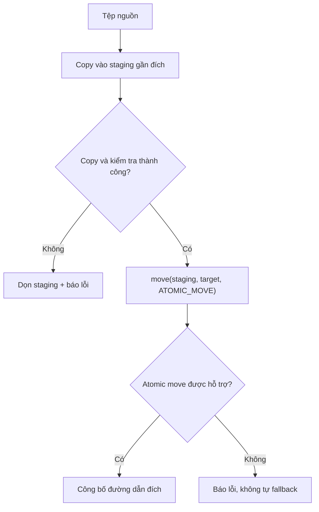

# Sao chép, di chuyển nguyên tử và thuộc tính tệp

Trong Java 27, việc sao chép hoặc đổi tên một tệp không chỉ là thao tác với nội dung. Ứng dụng còn phải quyết định **có được ghi đè đích không**, **có cần giữ thời gian sửa đổi/quyền truy cập không**, **có theo symbolic link không**, và **người đọc có thể nhìn thấy một tệp đang ghi dở hay không**. Các API `Path`, `Files` và `java.nio.file.attribute` của Java NIO.2 cung cấp những công cụ hiện hành để diễn đạt các lựa chọn này.

Ba thao tác cần phân biệt:

- **Sao chép (`Files.copy`):** tạo tệp đích từ nguồn; nguồn vẫn còn. Sao chép tệp **không được bảo đảm nguyên tử**.
- **Di chuyển (`Files.move`):** đổi tên/vị trí một tệp hoặc thư mục; thành công thì đường dẫn nguồn không còn trỏ tới mục vừa được di chuyển. Có thể thực hiện bình thường hoặc yêu cầu `ATOMIC_MOVE`.
- **Đọc/ghi thuộc tính:** lấy kích thước, loại tệp, dấu thời gian và, nếu hệ thống hỗ trợ, quyền POSIX/DOS, chủ sở hữu cùng những metadata khác.

Bài học thuộc chương **Tệp và nhập xuất** của module Java 27. Các ví dụ tập trung vào API chuẩn đang được hỗ trợ, tránh cách xử lý chỉ dựa trên `java.io.File` khi NIO.2 có hợp đồng rõ ràng hơn.

## 1. Làm việc với `Path` và `Files`

`Path` biểu diễn một đường dẫn trong một file system; `Files` chứa các phương thức tĩnh để thao tác với tệp, thư mục và metadata.

```java
import java.nio.file.Files;
import java.nio.file.Path;

Path source = Path.of("data", "input.csv");
Path target = Path.of("backup", "input.csv");

Files.createDirectories(target.getParent());
Files.copy(source, target);
```

Ví dụ minh họa giả định `data/input.csv` có sẵn và chương trình có quyền đọc/ghi. `createDirectories` tạo các thư mục cha còn thiếu; nó **không** có nghĩa thao tác sao chép sẽ được thực hiện nguyên tử.

Các khái niệm quan trọng:

| Khái niệm | Ý nghĩa |
|---|---|
| `source` | Đường dẫn nguồn được đọc hoặc chuyển đi |
| `target` | Đường dẫn đích được tạo/thay thế |
| `Path.resolve(...)` | Ghép một đường dẫn với đường dẫn con |
| `Path.resolveSibling(...)` | Tạo đường dẫn cùng thư mục cha, thường dùng để đổi tên |
| `Files.copy(...)` | Sao chép tệp hoặc mục thư mục; không tự duyệt đệ quy |
| `Files.move(...)` | Di chuyển/đổi tên; có thể yêu cầu nguyên tử |
| `BasicFileAttributes` | Nhóm thuộc tính cơ bản phổ biến trên các file system |

Đường dẫn tương đối được diễn giải theo thư mục làm việc của tiến trình hoặc ngữ cảnh file system. Khi tạo đường dẫn từ dữ liệu người dùng, cần kiểm soát thư mục gốc, chuẩn hóa và kiểm tra chính sách truy cập; **chỉ gọi `normalize()` không đủ để phòng chống mọi tấn công path traversal hoặc symbolic link**.

## 2. `Files.copy`: sao chép một tệp và kiểm soát ghi đè

Phương thức thông dụng:

```java
Files.copy(Path source, Path target, CopyOption... options);
```

Mặc định, nếu đích đã tồn tại, việc sao chép thất bại (thường là `FileAlreadyExistsException`). Để chủ động cho phép thay thế tệp đích, dùng `StandardCopyOption.REPLACE_EXISTING`.

Ví dụ hoàn chỉnh, đặt trong file `FileCopyDemo.java`:

```java
import java.io.IOException;
import java.nio.charset.StandardCharsets;
import java.nio.file.Files;
import java.nio.file.Path;

import static java.nio.file.StandardCopyOption.COPY_ATTRIBUTES;
import static java.nio.file.StandardCopyOption.REPLACE_EXISTING;

public class FileCopyDemo {
    public static void main(String[] args) throws IOException {
        Path workspace = Files.createTempDirectory("java27-copy-");
        Path source = workspace.resolve("source.txt");
        Path target = workspace.resolve("copy.txt");

        Files.writeString(source, "Nội dung mẫu Java 27\n",
                StandardCharsets.UTF_8);

        // Tạo tệp đích, cố gắng sao chép metadata.
        Files.copy(source, target, COPY_ATTRIBUTES);

        System.out.println(Files.readString(target, StandardCharsets.UTF_8));
        System.out.println(Files.mismatch(source, target)); // -1: không lệch byte

        // Lần copy thứ hai: phải nói rõ nếu muốn ghi đè đích đã có.
        Files.writeString(source, "Phiên bản mới\n",
                StandardCharsets.UTF_8);
        Files.copy(source, target, REPLACE_EXISTING, COPY_ATTRIBUTES);

        System.out.println(Files.readString(target, StandardCharsets.UTF_8));
        System.out.println("Thư mục minh họa: " + workspace);
    }
}
```

Biên dịch và chạy:

```bash
javac --release 27 FileCopyDemo.java
java FileCopyDemo
```

Kết quả nội dung lần lượt là “Nội dung mẫu Java 27” và “Phiên bản mới”; `Files.mismatch(source, target)` trả `-1L` khi hai tệp không có byte khác nhau. Đường dẫn thư mục tạm là giá trị do hệ thống tạo ra, không cố định. Ví dụ tạo file trong thư mục tạm riêng và không tự xóa để bạn có thể kiểm tra kết quả; ứng dụng thực tế cần chính sách dọn dẹp hợp lý.

### Các tùy chọn sao chép chuẩn

| Tùy chọn | Ý nghĩa | Lưu ý |
|---|---|---|
| Không truyền tùy chọn | Sao chép, mặc định không thay thế đích đã tồn tại | Đích đã tồn tại có thể gây `FileAlreadyExistsException` |
| `REPLACE_EXISTING` | Thay thế đích nếu có thể | Không thay thế được một thư mục đích không rỗng |
| `COPY_ATTRIBUTES` | Cố gắng sao chép thuộc tính sang đích | Bộ thuộc tính cụ thể phụ thuộc hệ điều hành/file system |
| `LinkOption.NOFOLLOW_LINKS` | Không đi theo symbolic link nguồn | Sao chép chính liên kết nếu được hỗ trợ, không sao chép nội dung nơi nó trỏ đến |

Với `COPY_ATTRIBUTES`, Java cam kết cố gắng sao chép các thuộc tính; tối thiểu `last-modified-time` được sao chép nếu cả hai file store đều hỗ trợ. **Không có bảo đảm mọi thuộc tính POSIX, ACL, owner hay thời gian tạo đều giữ nguyên trên mọi hệ thống**. Dấu thời gian có thể bị giảm độ chính xác khi đi qua file system khác.

Một trường hợp đặc biệt: nếu nguồn là **thư mục**, `Files.copy(sourceDir, targetDir)` chỉ tạo **thư mục đích rỗng**; nó không sao chép các mục con. Muốn sao chép cả cây thư mục cần thuật toán riêng, thường dùng `Files.walkFileTree`.

### Sao chép không nguyên tử

Theo hợp đồng `Files.copy`, quá trình sao chép **không nguyên tử**: chương trình khác có thể nhìn thấy tệp đích trước khi việc sao chép hoàn tất. Nếu một `IOException` xảy ra, tệp đích có thể tồn tại nhưng **thiếu nội dung hoặc thiếu một số thuộc tính**.

Vì vậy, **không dùng `Files.copy` trực tiếp vào đường dẫn công khai** nếu yêu cầu người đọc chỉ được thấy bản hoàn chỉnh. Phần dưới trình bày mẫu “sao chép vào tệp tạm → di chuyển nguyên tử để công bố”.

## 3. `Files.move`: đổi tên, di chuyển và ghi đè

Cú pháp:

```java
Files.move(Path source, Path target, CopyOption... options);
```

Ví dụ đổi tên trong cùng thư mục:

```java
Path oldPath = Path.of("reports", "draft.txt");
Path newPath = oldPath.resolveSibling("final.txt");

Files.move(oldPath, newPath);
```

Sau khi thao tác thành công, mục tệp ở đường dẫn `oldPath` đã được di chuyển tới `newPath`. Mặc định, nếu đích đã tồn tại, thao tác thường thất bại trừ khi nguồn và đích là cùng một tệp.

Nếu chủ đích cho phép thay thế một tệp đích hiện có trong di chuyển **không yêu cầu nguyên tử**:

```java
Files.move(source, target, REPLACE_EXISTING);
```

`REPLACE_EXISTING` cũng không cho phép thay thế tùy ý một thư mục không rỗng. Nếu nguồn là symbolic link, `Files.move` di chuyển **bản thân liên kết**, không phải tệp mà liên kết trỏ tới.

### Move không phải lúc nào cũng là một lệnh đổi tên rẻ tiền

Trên cùng file store, một thao tác đổi tên thường có thể thực hiện bằng cách cập nhật mục thư mục của file system, nhưng **điều đó không phải bảo đảm của mọi `Files.move` thông thường**.

Khi đi qua các file store hoặc provider khác nhau, việc di chuyển có thể cần sao chép rồi xóa hoặc thất bại vì các giới hạn nền tảng. Với thư mục không rỗng, nếu buộc phải di chuyển toàn bộ các mục con, implementation **không bắt buộc** thực hiện và có thể ném `IOException`.

Đặc biệt, nếu một **move không nguyên tử** thất bại giữa chừng, trạng thái nguồn/đích có thể không được xác định: cả hai có thể còn tồn tại hoặc đích chưa đầy đủ. Đừng mặc định “ném exception thì dữ liệu vẫn y nguyên”. Cần quy trình kiểm tra và khôi phục phù hợp.

## 4. `ATOMIC_MOVE`: “nguyên tử” nghĩa là gì?

Khi gọi:

```java
Files.move(source, target, StandardCopyOption.ATOMIC_MOVE);
```

ta yêu cầu file system thực hiện thao tác di chuyển/đổi tên như **một thao tác nguyên tử**. Nếu được hỗ trợ, các quan sát về tên tệp không nhìn thấy một trạng thái trung gian “đích đang được tạo bằng cách sao chép dở” của chính thao tác di chuyển.

Đây là cơ sở quan trọng để công bố một tệp đã chuẩn bị hoàn chỉnh.

**Ba giới hạn bắt buộc ghi nhớ:**

1. `ATOMIC_MOVE` **không được hỗ trợ ở mọi tình huống**. Di chuyển qua file store/provider khác nhau thường không thể thực hiện như một thao tác nguyên tử; Java ném `AtomicMoveNotSupportedException`.
2. Khi có `ATOMIC_MOVE`, **các tùy chọn di chuyển khác bị bỏ qua**. Đặc biệt, không nên giả định ghép `ATOMIC_MOVE` với `REPLACE_EXISTING` sẽ bảo đảm ghi đè theo cùng hợp đồng của `REPLACE_EXISTING`.
3. **Nếu đích đã tồn tại, hành vi phụ thuộc implementation:** có file system thay thế đích, có trường hợp di chuyển thất bại bằng `IOException`. Không được dựa vào một quy tắc thống nhất trên mọi môi trường.

Bảng so sánh:

| Thao tác | Bảo đảm chính | Khi không thực hiện được |
|---|---|---|
| `Files.copy(src, dst)` | Sao chép nội dung, không xóa nguồn | Có thể còn tệp đích chưa hoàn chỉnh |
| `Files.move(src, dst)` | Cố di chuyển/đổi tên, không yêu cầu nguyên tử | Kết quả phụ thuộc thao tác/file system; khi thất bại không nguyên tử có thể khó khôi phục |
| `Files.move(src, dst, ATOMIC_MOVE)` | Yêu cầu di chuyển như thao tác nguyên tử | Ném `AtomicMoveNotSupportedException` nếu không thể bảo đảm |

### Nguyên tử khác với bền vững sau mất điện

**Atomicity** ở đây là tính nguyên tử của thao tác đổi tên/di chuyển trong file system, không đồng nghĩa **durability**: dữ liệu và mục thư mục đã chắc chắn được ghi xuống thiết bị lưu trữ không mất sau sự cố nguồn điện.

Nếu một hệ thống cần bảo đảm khôi phục sau crash hoặc mất điện, phải xem thêm khả năng ghi đồng bộ dữ liệu (ví dụ `FileChannel.force(...)`), metadata thư mục và các bảo đảm riêng của file system. `ATOMIC_MOVE` **không tự biến một quy trình nhiều bước thành giao dịch ACID** và không bảo vệ mọi tình huống phần cứng/hệ điều hành.


## 5. Công bố bản sao hoàn chỉnh bằng tệp tạm và atomic move

Một nhu cầu phổ biến là sinh báo cáo, sao lưu cấu hình hoặc tạo artifact mà **chương trình đọc không được nhìn thấy nội dung ghi dở**. Có thể kết hợp `Files.copy` với `Files.move(..., ATOMIC_MOVE)` theo quy trình:

1. Tạo một **tệp tạm** ngay trong thư mục đích bằng `Files.createTempFile(parent, ...)`.
2. Sao chép hoặc ghi hoàn chỉnh nội dung vào tệp tạm.
3. Thực hiện kiểm tra nội dung và metadata nếu hợp đồng nghiệp vụ yêu cầu.
4. Gọi `Files.move(staging, destination, ATOMIC_MOVE)` để công bố tên đích, **nếu file system hỗ trợ**.
5. Dọn tệp tạm nếu có lỗi trước khi công bố.



Ví dụ tự chứa, lưu thành `AtomicPublishDemo.java`:

```java
import java.io.IOException;
import java.nio.charset.StandardCharsets;
import java.nio.file.AtomicMoveNotSupportedException;
import java.nio.file.Files;
import java.nio.file.Path;

import static java.nio.file.StandardCopyOption.ATOMIC_MOVE;
import static java.nio.file.StandardCopyOption.COPY_ATTRIBUTES;
import static java.nio.file.StandardCopyOption.REPLACE_EXISTING;

public class AtomicPublishDemo {
    public static void main(String[] args) throws IOException {
        Path workspace = Files.createTempDirectory("java27-publish-");
        Path source = workspace.resolve("prepared.txt");
        Path target = workspace.resolve("published.txt");

        Files.writeString(source, "Dữ liệu đã hoàn chỉnh\n",
                StandardCharsets.UTF_8);

        publishNewFile(source, target);
        System.out.println(Files.readString(target, StandardCharsets.UTF_8));
        System.out.println("Thư mục minh họa: " + workspace);
    }

    // Ví dụ công bố một đường dẫn đích chưa tồn tại.
    static void publishNewFile(Path source, Path target) throws IOException {
        Path absoluteTarget = target.toAbsolutePath();
        Path parent = absoluteTarget.getParent();
        if (parent == null) {
            throw new IllegalArgumentException("Đích phải có thư mục cha");
        }

        Files.createDirectories(parent);

        // Tệp tạm nằm ngay trong thư mục của đường dẫn đích.
        Path staging = Files.createTempFile(parent, ".publishing-", ".tmp");

        try {
            // Staging đã tồn tại, nên copy phải cho phép thay thế.
            Files.copy(source, staging, REPLACE_EXISTING, COPY_ATTRIBUTES);

            // Không chuyển sang move bình thường nếu atomicity bắt buộc.
            Files.move(staging, absoluteTarget, ATOMIC_MOVE);
        } catch (AtomicMoveNotSupportedException unsupported) {
            throw new IOException(
                    "File system không hỗ trợ atomic move tại đích",
                    unsupported);
        } finally {
            Files.deleteIfExists(staging);
        }
    }
}
```

Chạy với JDK 27:

```bash
javac --release 27 AtomicPublishDemo.java
java AtomicPublishDemo
```

Mã minh họa tạo một đường dẫn đích ban đầu chưa tồn tại trong thư mục tạm. Nếu `ATOMIC_MOVE` không khả dụng, chương trình báo lỗi; tệp nguồn vẫn còn và tệp staging được cố gắng xóa. `finally` vẫn có thể phát sinh lỗi dọn dẹp, nên code production cần bảo toàn lỗi gốc và ghi nhận lỗi cleanup thích hợp.

### Giới hạn của mẫu công bố

- Staging nằm **cùng thư mục với đích**, thường giúp hai đường dẫn cùng file store, nhưng **không tự bảo đảm** atomic move luôn được hỗ trợ.
- Chỉ việc công bố **tên đích** là nguyên tử khi move thành công; quá trình copy trước đó vẫn không nguyên tử. Điều này chấp nhận được khi staging chưa phải đường dẫn được người đọc sử dụng.
- Với **đích đã tồn tại**, hành vi của `ATOMIC_MOVE` là **phụ thuộc implementation**: có thể thay thế hoặc từ chối. Mẫu này không phải cơ chế *compare-and-swap* hay *create-if-absent* di động giữa mọi hệ thống.
- Nếu nguồn bị writer khác sửa trong lúc copy, bản sao không nhất thiết là snapshot nhất quán. Cần cơ chế phối hợp, snapshot hoặc kiểm tra riêng.
- Mẫu trên không bảo đảm dữ liệu đã bền vững sau mất điện. Tính nguyên tử của thao tác file system không thay cho bảo đảm ghi xuống bộ nhớ lâu dài.
- Nếu nhiều tiến trình cùng công bố một tên, dùng thêm chính sách phối hợp và xử lý xung đột. `if (!Files.exists(target))` trước `move` không loại bỏ race condition.

**Không âm thầm fallback** sang `Files.move` không nguyên tử nếu hợp đồng yêu cầu atomicity. Nếu nghiệp vụ cho phép fallback, hãy ghi nhận điều kiện này, thông báo hoặc log rõ ràng và thiết kế xử lý trạng thái tệp có thể chưa hoàn chỉnh.

## 6. Đọc thuộc tính cơ bản bằng `BasicFileAttributes`

`Files.readAttributes(path, BasicFileAttributes.class)` đọc một nhóm thuộc tính cơ bản của tệp hoặc thư mục trong một lời gọi. Nếu đường dẫn là symbolic link, mặc định thao tác đi theo link; thêm `NOFOLLOW_LINKS` để đọc metadata của **chính link**.

Ví dụ tự chứa, lưu thành `BasicAttributesDemo.java`:

```java
import java.io.IOException;
import java.nio.charset.StandardCharsets;
import java.nio.file.Files;
import java.nio.file.Path;
import java.nio.file.attribute.BasicFileAttributes;

import static java.nio.file.LinkOption.NOFOLLOW_LINKS;

public class BasicAttributesDemo {
    public static void main(String[] args) throws IOException {
        Path file = Files.createTempFile("java27-attrs-", ".txt");
        Files.writeString(file, "Xin chào tệp\n", StandardCharsets.UTF_8);

        BasicFileAttributes attrs = Files.readAttributes(
                file, BasicFileAttributes.class, NOFOLLOW_LINKS);

        System.out.println("Regular: " + attrs.isRegularFile());
        System.out.println("Directory: " + attrs.isDirectory());
        System.out.println("Symlink: " + attrs.isSymbolicLink());
        System.out.println("Bytes: " + attrs.size());
        System.out.println("Modified: " + attrs.lastModifiedTime());
        System.out.println("Accessed: " + attrs.lastAccessTime());
        System.out.println("Created: " + attrs.creationTime());
        System.out.println("Key: " + attrs.fileKey());
        System.out.println("File: " + file);
    }
}
```

Các phương thức của `BasicFileAttributes`:

| Thuộc tính | Kiểu trả về | Diễn giải |
|---|---|---|
| `isRegularFile()` | `boolean` | Có phải regular file hay không |
| `isDirectory()` | `boolean` | Có phải thư mục hay không |
| `isSymbolicLink()` | `boolean` | Có phải symbolic link hay không |
| `isOther()` | `boolean` | Thuộc loại khác các nhóm trên |
| `size()` | `long` | Kích thước theo byte; với mục không phải regular file, cách tính có thể khác tùy hệ thống |
| `lastModifiedTime()` | `FileTime` | Dấu thời gian sửa cuối |
| `lastAccessTime()` | `FileTime` | Dấu thời gian truy cập gần nhất |
| `creationTime()` | `FileTime` | Dấu thời gian tạo (nếu hệ thống cung cấp) |
| `fileKey()` | `Object` hoặc `null` | Khóa nhận diện do provider cung cấp, không phải ID ổn định xuyên hệ thống |

Không nên mặc định mọi file system có dấu thời gian tạo hoặc truy cập đáng tin cậy. Khi không hỗ trợ, một số trường có thể mang giá trị mặc định. `fileKey()` cũng có thể là `null`.

### API nhanh cho một số thuộc tính

```java
long bytes = Files.size(file);
var modified = Files.getLastModifiedTime(file);
boolean regular = Files.isRegularFile(file);
```

Các hàm tiện ích hữu ích khi chỉ cần một vài thông tin. Dù gọi `readAttributes` trong một lần, Java **không bảo đảm** mọi trường đều được đọc nguyên tử đối với hoạt động sửa đổi tệp từ tiến trình khác. Khi gọi nhiều phương thức riêng lẻ, nguy cơ quan sát các thời điểm khác nhau càng rõ.

## 7. Đọc và thay đổi dấu thời gian của tệp

`Files.setLastModifiedTime` cho phép cập nhật metadata `last-modified-time` khi quyền và file system cho phép:

```java
import java.nio.file.Files;
import java.nio.file.Path;
import java.nio.file.attribute.FileTime;
import java.time.Duration;
import java.time.Instant;

Path file = Path.of("data", "report.csv");

// Giả định file có sẵn và được phép chỉnh metadata.
FileTime desired = FileTime.from(
        Instant.now().minus(Duration.ofDays(1)));
Files.setLastModifiedTime(file, desired);

FileTime actual = Files.getLastModifiedTime(file);
System.out.println(actual);
```

Độ chính xác thời gian phụ thuộc file system; không bắt buộc giá trị đọc lại chính xác đến nano-giây. Khi kiểm thử, hãy tính tới độ phân giải hoặc cách làm tròn được nền tảng hỗ trợ.

Ngoài API có kiểu `BasicFileAttributes.class`, Java cho phép lấy nhóm thuộc tính bằng chuỗi:

```java
var attrs = Files.readAttributes(
        file, "basic:size,lastModifiedTime,isRegularFile");

System.out.println(attrs.get("size"));
System.out.println(attrs.get("lastModifiedTime"));
```

Cú pháp `basic:...` phù hợp khi chọn động các trường. Nếu biết trước cấu trúc dữ liệu, `BasicFileAttributes` thường dễ đọc và an toàn kiểu hơn. Việc thay đổi thời gian sửa file không nhất thiết giữ các metadata khác y nguyên.


## 8. Thuộc tính mở rộng: quyền POSIX, DOS và owner

Ngoài `BasicFileAttributes`, Java cung cấp **attribute views** để thao tác với những nhóm metadata được file system hỗ trợ.

| Attribute view | Cung cấp | Mức độ portable |
|---|---|---|
| `BasicFileAttributeView` | Kích thước, loại tệp, dấu thời gian | Hỗ trợ rộng rãi |
| `PosixFileAttributeView` | Owner, group, quyền đọc/ghi/thực thi POSIX | Khi file system hỗ trợ POSIX |
| `DosFileAttributeView` | Các cờ read-only, hidden, system, archive | Tùy nền tảng/provider |
| `FileOwnerAttributeView` | Chủ sở hữu tệp | Tùy file system |
| `AclFileAttributeView` | Danh sách kiểm soát truy cập ACL | Không khả dụng trên mọi hệ thống |

Không nên suy từ tên hệ điều hành rằng chắc chắn một attribute view tồn tại. Kiểm tra trực tiếp tại runtime:

```java
import java.io.IOException;
import java.nio.file.Files;
import java.nio.file.Path;
import java.nio.file.attribute.DosFileAttributeView;
import java.nio.file.attribute.PosixFileAttributeView;
import java.nio.file.attribute.PosixFilePermissions;

public class AttributeViewsDemo {
    public static void main(String[] args) throws IOException {
        Path file = Files.createTempFile("java27-views-", ".txt");

        PosixFileAttributeView posix = Files.getFileAttributeView(
                file, PosixFileAttributeView.class);
        if (posix != null) {
            var attrs = posix.readAttributes();
            System.out.println("Owner: " + attrs.owner().getName());
            System.out.println("Permissions: "
                    + PosixFilePermissions.toString(attrs.permissions()));
        } else {
            System.out.println("Không hỗ trợ POSIX view");
        }

        DosFileAttributeView dos = Files.getFileAttributeView(
                file, DosFileAttributeView.class);
        if (dos != null) {
            var attrs = dos.readAttributes();
            System.out.println("Hidden: " + attrs.isHidden());
            System.out.println("Read-only: " + attrs.isReadOnly());
        } else {
            System.out.println("Không hỗ trợ DOS view");
        }
    }
}
```

`Files.getFileAttributeView(...)` có thể trả `null` khi view không được hỗ trợ; ngay cả khi có view, thao tác I/O vẫn có thể thất bại do quyền hoặc hạn chế từ provider. Với đường dẫn là symbolic link, các API này có các lựa chọn theo link hoặc không theo link tùy overload.

### Thay đổi quyền POSIX

```java
var view = Files.getFileAttributeView(
        file, PosixFileAttributeView.class);

if (view != null) {
    // rw------- : owner đọc/ghi, các nhóm khác không được cấp quyền.
    view.setPermissions(PosixFilePermissions.fromString("rw-------"));
}
```

Ví dụ chỉ nên chạy với **tệp thử nghiệm có quyền sửa metadata**. Quyền POSIX không tương đương toàn bộ ACL trên mọi file system; thay đổi quyền có thể ảnh hưởng đến cách ứng dụng truy cập tệp. `COPY_ATTRIBUTES` không bảo đảm giữ nguyên toàn bộ permissions, owner và ACL.

## 9. Symbolic links: theo link hay thao tác trên chính link?

**Symbolic link** là một mục hệ thống tệp tham chiếu tới một đường dẫn khác. Việc đi theo link có thể thay đổi cả đối tượng được đọc lẫn metadata quan sát được.

Giả sử `alias.txt` là link trỏ tới `real.txt`:

| Thao tác | Hành vi điển hình |
|---|---|
| `Files.copy(alias, dst)` | Mặc định theo link, sao chép nội dung của đối tượng cuối |
| `Files.copy(alias, dst, NOFOLLOW_LINKS)` | Sao chép **chính link** nếu hỗ trợ |
| `Files.move(alias, dst)` | Di chuyển/đổi tên link, không di chuyển đối tượng được tham chiếu |
| `Files.readAttributes(alias, BasicFileAttributes.class)` | Đọc thuộc tính đối tượng cuối |
| `Files.readAttributes(alias, BasicFileAttributes.class, NOFOLLOW_LINKS)` | Đọc thuộc tính của link |

Ví dụ kiểm tra một đường dẫn liên kết có sẵn:

```java
import java.nio.file.Files;
import java.nio.file.Path;
import java.nio.file.attribute.BasicFileAttributes;

import static java.nio.file.LinkOption.NOFOLLOW_LINKS;

Path link = Path.of("demo", "alias.txt");

BasicFileAttributes attrs = Files.readAttributes(
        link, BasicFileAttributes.class, NOFOLLOW_LINKS);

if (attrs.isSymbolicLink()) {
    System.out.println("Đây là một symbolic link");
    System.out.println("Trỏ đến: " + Files.readSymbolicLink(link));
}
```

Việc tạo symbolic link không phải lúc nào cũng được hệ thống cho phép. Nếu sao chép nguyên một **relative symlink** sang thư mục khác, đường dẫn đích mà nó tham chiếu có thể đổi ý nghĩa do vị trí mới khác trước. Đối với backup, cần lựa chọn có chủ đích giữa giữ link và theo link.

Khi xử lý đường dẫn do người dùng cung cấp, hãy lưu ý nguy cơ truy cập ra ngoài thư mục dự kiến qua symbolic link. `NOFOLLOW_LINKS` giảm một loại rủi ro ở mục cuối của đường dẫn, nhưng không tự giải quyết mọi race hoặc việc đi qua link ở các thành phần đường dẫn trung gian.

## 10. Sao chép cả cây thư mục bằng `Files.walkFileTree`

`Files.copy(directory, target)` chỉ tạo một thư mục đích rỗng; **không copy đệ quy các mục con**. Để sao chép cả cây, dùng `Files.walkFileTree` và một `SimpleFileVisitor`.

Ví dụ sau tạo cây mẫu trong thư mục tạm, duyệt **không theo symbolic links** và sao chép từng mục:

```java
import java.io.IOException;
import java.nio.file.FileAlreadyExistsException;
import java.nio.file.FileVisitResult;
import java.nio.file.Files;
import java.nio.file.Path;
import java.nio.file.SimpleFileVisitor;
import java.nio.file.attribute.BasicFileAttributes;

import static java.nio.file.LinkOption.NOFOLLOW_LINKS;
import static java.nio.file.StandardCopyOption.COPY_ATTRIBUTES;

public class CopyTreeDemo {
    public static void main(String[] args) throws IOException {
        Path work = Files.createTempDirectory("java27-tree-");
        Path source = Files.createDirectory(work.resolve("source"));
        Files.writeString(source.resolve("note.txt"), "Ví dụ cây thư mục");
        Path target = work.resolve("backup");

        copyTree(source, target);
        System.out.println(Files.readString(target.resolve("note.txt")));
    }

    static void copyTree(Path sourceRoot, Path targetRoot)
            throws IOException {
        if (!Files.isDirectory(sourceRoot, NOFOLLOW_LINKS)) {
            throw new IllegalArgumentException("Nguồn phải là thư mục");
        }
        if (Files.exists(targetRoot, NOFOLLOW_LINKS)) {
            throw new FileAlreadyExistsException(targetRoot.toString());
        }

        Files.walkFileTree(sourceRoot, new SimpleFileVisitor<Path>() {
            @Override
            public FileVisitResult preVisitDirectory(
                    Path dir, BasicFileAttributes attrs) throws IOException {
                Path relative = sourceRoot.relativize(dir);
                Files.createDirectories(targetRoot.resolve(relative));
                return FileVisitResult.CONTINUE;
            }

            @Override
            public FileVisitResult visitFile(
                    Path file, BasicFileAttributes attrs) throws IOException {
                Path relative = sourceRoot.relativize(file);
                Files.copy(file, targetRoot.resolve(relative),
                        NOFOLLOW_LINKS, COPY_ATTRIBUTES);
                return FileVisitResult.CONTINUE;
            }
        });
    }
}
```

Những giới hạn của ví dụ:

- Đường dẫn **đích phải nằm ngoài cây nguồn** để tránh sao chép chồng lên chính mình; ứng dụng thực tế cần xác minh vị trí và chính sách đường dẫn.
- Kiểm tra `Files.exists` giúp báo lỗi sớm nhưng **không loại bỏ race**. Đích có thể xuất hiện ngay sau đó do một tiến trình khác.
- Khi copy link với `NOFOLLOW_LINKS`, việc tạo lại link hoặc sao chép metadata của link có thể không được provider hỗ trợ.
- Ví dụ sao chép thuộc tính **tệp** bằng `COPY_ATTRIBUTES`. Nếu cần giữ cả thời gian sửa đổi của **thư mục**, có thể cần cập nhật trong `postVisitDirectory` sau khi tạo các mục con.
- Quá trình duyệt/copy toàn bộ cây **không nguyên tử**. Nếu lỗi giữa chừng, có thể còn một phần cây đích; hệ thống backup cần kế hoạch xác minh, phục hồi và dọn dẹp.

## 11. Bắt lỗi theo ngữ nghĩa, không dựa vào trạng thái giả định

Các exception cần biết:

| Exception | Tình huống thường gặp |
|---|---|
| `NoSuchFileException` | Nguồn hoặc đường dẫn cần thiết không còn tồn tại |
| `FileAlreadyExistsException` | Đích đã có và không được phép thay thế |
| `DirectoryNotEmptyException` | Cố thay/xóa một thư mục không rỗng |
| `AccessDeniedException` | Không được phép thực hiện thao tác |
| `AtomicMoveNotSupportedException` | Không thể bảo đảm di chuyển nguyên tử |
| `IOException` | Các lỗi I/O hoặc file system khác |
| `UnsupportedOperationException` | Tùy chọn hoặc attribute view không được hỗ trợ |

Những exception chuyên biệt được liệt kê chủ yếu là subtype của `IOException`, ngoại trừ `UnsupportedOperationException`. Nhà cung cấp file system có thể chọn cách báo lỗi cụ thể khác nhau; không phải mọi lỗi sẽ luôn có cùng subclass.

Ví dụ xử lý xung đột:

```java
try {
    Files.copy(source, target);
} catch (java.nio.file.FileAlreadyExistsException conflict) {
    System.err.println("Đường dẫn đích đã tồn tại: "
            + conflict.getFile());
}
```

Đừng viết `if (!Files.exists(target)) Files.copy(source, target)` rồi tin rằng không còn xung đột. Kiểm tra và tạo tệp là hai thao tác khác nhau; giữa chúng có thể có tiến trình khác tạo đích.

Với lỗi **copy** hoặc **non-atomic move**, cần kiểm tra lại nguồn/đích, do chúng có thể không ở trạng thái bạn dự đoán. Trong ứng dụng quan trọng, đừng xóa bản gốc chỉ vì một thao tác copy đã bắt đầu; hãy chỉ công nhận bản sao sau khi kiểm tra thành công theo hợp đồng.


## 12. Những ranh giới tính đúng đắn cần hiểu trước khi triển khai

### Atomic move không giải quyết việc đọc nguồn đang thay đổi

Giả sử `source.csv` đang được một tiến trình khác nối thêm dữ liệu. Một tiến trình backup dùng `Files.copy(source, staging)`, rồi công bố staging qua `ATOMIC_MOVE`. Mặc dù **tên tệp đích** được công bố nguyên tử, **nội dung staging** vẫn có thể phản ánh những thay đổi xen kẽ trong thời gian copy.

Nếu yêu cầu bản sao nhất quán, có thể cần nguồn được đóng băng trong lúc sao chép, snapshot do file system cung cấp, phiên bản immutable hoặc giao thức writer/reader riêng. `ATOMIC_MOVE` không thay thế các cơ chế này.

### Atomic move không phải phép ghi đè có điều kiện

Với `ATOMIC_MOVE`, Java **bỏ qua mọi option khác**, và trạng thái đích đã tồn tại là phụ thuộc implementation. Do đó không được hiểu:

```java
Files.move(temp, target, ATOMIC_MOVE, REPLACE_EXISTING);
```

là “luôn thay thế đích một cách nguyên tử trên mọi hệ điều hành”. Nếu cần tính di động và kiểm soát chính xác việc thay thế khi có nhiều writer, phải định nghĩa chiến lược xung đột và phối hợp phù hợp, kiểm thử trên provider đích và không dựa vào hành vi không được đặc tả bảo đảm.

### Copy và metadata không tạo snapshot giao dịch

`COPY_ATTRIBUTES` cố gắng bảo tồn metadata, nhưng không bảo đảm mọi trường. Việc đọc `BasicFileAttributes` không tự khóa tệp, và `Files.exists` có thể trả `false` vì không xác định được trạng thái chứ không đơn giản là “chắc chắn tệp không tồn tại”. Ngay cả khi một phép kiểm tra thành công, trạng thái file system có thể thay đổi trước thao tác kế tiếp.

Một ví dụ nguy hiểm khác là copy tệp bằng tên từ thư mục không tin cậy; tệp có thể bị đổi thành symbolic link giữa các bước kiểm tra và mở. Đối với mã cần mức bảo mật cao, nên cân nhắc cơ chế truy cập gắn với directory handle, chẳng hạn `SecureDirectoryStream` **nếu provider hỗ trợ**, hoặc thiết kế cách ly file system và quyền truy cập ở cấp hệ điều hành. Chỉ chuẩn hóa chuỗi đường dẫn không giải quyết hết các race này.

## 13. Chọn chiến lược theo yêu cầu nghiệp vụ

| Yêu cầu | Chiến lược thường phù hợp | Giới hạn cần kiểm tra |
|---|---|---|
| Tạo bản sao mới, không muốn ghi đè | `Files.copy(source, target)` không có `REPLACE_EXISTING` | Copy không nguyên tử; có thể cần dọn bản sao chưa hoàn chỉnh nếu lỗi |
| Ghi đè một bản sao đã có | `Files.copy(..., REPLACE_EXISTING)` | Reader có thể nhìn thấy đích đang bị thay thế/ghi dở |
| Giữ metadata tương thích | `Files.copy(..., COPY_ATTRIBUTES)` | Thuộc tính được sao chép phụ thuộc file system |
| Đổi tên một tệp | `Files.move(source, target)` | Không mặc định nguyên tử; đích tồn tại có thể khiến lỗi |
| Công bố file đã tạo hoàn chỉnh | Copy/ghi vào staging, rồi `Files.move(staging, target, ATOMIC_MOVE)` | Cần hỗ trợ atomic move, có chính sách khi đích tồn tại |
| Sao chép cả thư mục | `Files.walkFileTree` + xử lý từng mục | Không phải một giao dịch nguyên tử, cần kiểm soát symlink và lỗi |
| Đọc loại/kích thước/dấu thời gian | `Files.readAttributes(..., BasicFileAttributes.class)` | Một số trường phụ thuộc nền tảng; không bảo đảm snapshot |
| Lấy quyền truy cập | Attribute views POSIX/DOS/ACL | Kiểm tra hỗ trợ, tránh giả định cơ chế quyền đồng nhất |

Một quy trình sao lưu/triển khai thực tế có thể kết hợp **cơ chế backup của file system**, snapshot nguồn, staging, checksum, retry và chính sách retention. Không nên dùng riêng một cờ `ATOMIC_MOVE` để mô tả toàn bộ hệ thống là “backup an toàn tuyệt đối”.

## 14. Kiểm thử với thư mục tạm, không làm hỏng dữ liệu thật

Thư mục tạm giúp giảm rủi ro khi kiểm tra copy/move:

```java
Path workspace = Files.createTempDirectory("nio-test-");
Path source = workspace.resolve("source.txt");
Path target = workspace.resolve("target.txt");

Files.writeString(source, "A");
Files.copy(source, target);

if (Files.mismatch(source, target) != -1L) {
    throw new AssertionError("Bản sao khác nguồn");
}
```

Đoạn trên kiểm tra các byte ở một thời điểm, **không** là một chứng minh mật mã hoặc snapshot nếu file còn bị sửa đồng thời. Có thể bổ sung hash theo yêu cầu integrity. Việc không xóa `workspace` trong ví dụ là để dễ xem kết quả; hệ thống kiểm thử tự động nên dọn thư mục tạm sau khi kết thúc và xử lý lỗi cleanup phù hợp.

### Ma trận kiểm thử khuyến nghị

| Tình huống | Kết quả/quan sát cần kiểm tra |
|---|---|
| Copy tệp nhỏ vào tên mới | Tệp nguồn còn, nội dung đích đúng |
| Copy vào tên đã tồn tại, không `REPLACE_EXISTING` | Thao tác thất bại theo hợp đồng |
| Copy với `REPLACE_EXISTING` | Đích phản ánh nội dung mới nếu thao tác thành công |
| Copy với `COPY_ATTRIBUTES` | Kiểm tra những thuộc tính thực sự được file system hỗ trợ; không đòi mọi trường trùng tuyệt đối |
| Copy một thư mục bằng một lệnh `Files.copy` | Đích chỉ là thư mục rỗng, không có file con |
| Move cùng thư mục đến tên mới | Nếu thành công, mục nguồn chuyển sang đích |
| Atomic move trong cùng thư mục | Thành công khi file system hỗ trợ; nếu không, báo `AtomicMoveNotSupportedException` |
| Atomic move qua file store khác | Không giả định hỗ trợ; kiểm tra nhánh lỗi |
| Đọc link có/không `NOFOLLOW_LINKS` | Phân biệt thuộc tính link với thuộc tính đối tượng đích, khi môi trường hỗ trợ link |
| Đọc POSIX/DOS view | Có nhánh xử lý khi view không được hỗ trợ |
| Lỗi I/O giữa quá trình copy | Kiểm tra/dọn đích có thể chưa hoàn chỉnh, không tự xóa nguồn |

Đừng viết test giả định **mọi** hệ thống đều hỗ trợ symlink, permission POSIX hoặc atomic rename. Có thể chia test thành phần portable bắt buộc và phần tích hợp phụ thuộc nền tảng, với điều kiện bỏ qua rõ ràng.

## 15. Bài tập thực hành

1. **Sao chép có kiểm soát:** Viết hàm nhận `source`, `target` và tham số `overwrite`; gọi `Files.copy` với hoặc không có `REPLACE_EXISTING`. Thử cả đích chưa tồn tại và đã có.
2. **So sánh metadata:** Copy một tệp với `COPY_ATTRIBUTES`, đọc `BasicFileAttributes` của nguồn/đích và nêu thuộc tính nào có thể không trùng. Giải thích vì sao timestamp không nên so sánh chính xác tới nano-giây.
3. **Công bố bản sao:** Áp dụng `createTempFile` → `Files.copy` → `ATOMIC_MOVE` cho một tệp báo cáo. Không fallback khi không hỗ trợ; dọn staging khi lỗi. Thử với tên đích mới.
4. **Symbolic links:** Trong môi trường hỗ trợ link, tạo một link tương đối, thử copy mặc định và `NOFOLLOW_LINKS`, rồi so sánh `isSymbolicLink` của các bản sao.
5. **Quyền POSIX:** Nếu provider có `PosixFileAttributeView`, đọc owner/group/permissions; thử cập nhật quyền trên **tệp tạm** và đọc lại. Nếu không hỗ trợ, hiển thị thông báo thay vì làm hỏng ứng dụng.
6. **Copy cây thư mục:** Mở rộng `CopyTreeDemo` để xử lý `postVisitDirectory` và ghi nhận lỗi từng mục. Đặt target ngoài cây source. Giải thích vì sao kết quả không phải bản sao nguyên tử toàn cây.
7. **Phân tích tính đúng đắn:** Giả sử hai tiến trình cùng xuất `report.csv`; giải thích vì sao `Files.exists` trước `Files.move` không đủ và thiết kế chính sách xử lý xung đột.
8. **Độ bền sau crash:** Phân biệt phát hành nguyên tử theo đường dẫn với bảo đảm dữ liệu đã thực sự được đồng bộ xuống thiết bị lưu trữ. Nêu trách nhiệm còn lại ngoài `ATOMIC_MOVE`.

## 16. Checklist khi review mã File I/O

- [ ] Nguồn/đích có được giới hạn trong vị trí được phép không?
- [ ] Có chính sách **không ghi đè / cho phép ghi đè** tường minh không?
- [ ] Đã phân biệt copy không nguyên tử và move có tùy chọn nguyên tử chưa?
- [ ] Nếu cần atomicity, có xử lý `AtomicMoveNotSupportedException` và **không tự fallback** không?
- [ ] Đích đã tồn tại có được xử lý theo hợp đồng, không dựa vào hành vi provider chưa được bảo đảm không?
- [ ] Staging nằm gần đích và được dọn khi lỗi không?
- [ ] Đã xác định copy dữ liệu có cần snapshot nhất quán của nguồn không?
- [ ] Metadata nào thật sự cần giữ, và có kiểm tra attribute view được hỗ trợ không?
- [ ] Có xử lý symbolic link đúng ý định bằng `NOFOLLOW_LINKS` khi cần không?
- [ ] Có phân biệt sao chép tệp với copy đệ quy thư mục không?
- [ ] Có dọn bản sao chưa hoàn chỉnh và ghi nhận lỗi I/O chính xác không?
- [ ] Đã kiểm thử trên file store/provider và quyền truy cập gần môi trường chạy thực chưa?

## 17. Tài liệu tham khảo chính thức

- [Java SE 27 — `java.nio.file.Files`](https://docs.oracle.com/en/java/javase/27/docs/api/java.base/java/nio/file/Files.html): `copy`, `move`, `walkFileTree`, đọc/ghi metadata và giới hạn nguyên tử.
- [Java SE 27 — `StandardCopyOption`](https://docs.oracle.com/en/java/javase/27/docs/api/java.base/java/nio/file/StandardCopyOption.html): `REPLACE_EXISTING`, `COPY_ATTRIBUTES`, `ATOMIC_MOVE`.
- [Java SE 27 — `LinkOption`](https://docs.oracle.com/en/java/javase/27/docs/api/java.base/java/nio/file/LinkOption.html): `NOFOLLOW_LINKS`.
- [Java SE 27 — `BasicFileAttributes`](https://docs.oracle.com/en/java/javase/27/docs/api/java.base/java/nio/file/attribute/BasicFileAttributes.html): size, loại tệp, dấu thời gian, file key.
- [Java SE 27 — `PosixFileAttributeView`](https://docs.oracle.com/en/java/javase/27/docs/api/java.base/java/nio/file/attribute/PosixFileAttributeView.html): owner, group và permissions khi provider hỗ trợ POSIX.
- [Java SE 27 — `DosFileAttributeView`](https://docs.oracle.com/en/java/javase/27/docs/api/java.base/java/nio/file/attribute/DosFileAttributeView.html): các cờ thuộc tính DOS khi có.
- [Java SE 27 — `SecureDirectoryStream`](https://docs.oracle.com/en/java/javase/27/docs/api/java.base/java/nio/file/SecureDirectoryStream.html): thao tác an toàn hơn khi phải xử lý đường dẫn có nguy cơ bị thay đổi qua symbolic link, nếu provider hỗ trợ.

**Kết luận:** Với Java 27, `Files.copy` là công cụ sao chép tệp, nhưng **không nguyên tử**; `Files.move(..., ATOMIC_MOVE)` có thể công bố một bản đã hoàn chỉnh một cách nguyên tử khi file system hỗ trợ, nhưng **không tự bảo đảm ghi đè đồng nhất, snapshot nguồn hay độ bền khi mất điện**. Đọc metadata qua `BasicFileAttributes` và các attribute views phù hợp giúp xử lý kích thước, thời gian, permission và symbolic links có chủ đích. Thiết kế tốt là xác định rõ yêu cầu nguyên tử, chính sách lỗi và những bảo đảm thực sự mà file system cung cấp.
