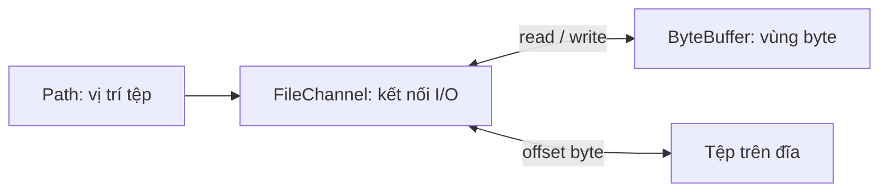

# Channel, ByteBuffer và truy cập tệp theo vị trí

Khi làm việc với tệp trong Java 27, không phải lúc nào ứng dụng cũng chỉ đọc toàn bộ tệp rồi ghi lại từ đầu. Các hệ thống lưu bản ghi nhị phân, bộ chỉ mục, dữ liệu dung lượng lớn hoặc cấu trúc có *header* thường cần đọc và sửa **một vùng byte tại offset cụ thể**. Java NIO cung cấp `FileChannel` và `ByteBuffer` cho nhu cầu này.

Bài học thuộc chương **Tệp và nhập xuất** của module **JAVA_VERSION_JAVA27 — Java 27 và các kiến thức liên quan**. Nội dung tập trung vào API chính thức và còn được hỗ trợ trong Java SE 27, tránh các kỹ thuật I/O đã lỗi thời. Bạn sẽ học cách quản lý trạng thái buffer, phân biệt truy cập tuần tự và truy cập theo vị trí (*positional I/O*), đọc/ghi đủ byte, và xử lý tài nguyên, độ bền dữ liệu một cách có chủ đích.

## 1. Từ `Path` đến `FileChannel` và `ByteBuffer`

Ba thành phần giữ ba trách nhiệm khác nhau:

- **`Path`** thuộc `java.nio.file`, mô tả vị trí tệp trong hệ thống tệp.
- **`FileChannel`** thuộc `java.nio.channels`, kết nối với tệp để đọc, ghi, thay đổi vị trí, kiểm tra kích thước, khóa vùng, ánh xạ hoặc chuyển dữ liệu.
- **`ByteBuffer`** thuộc `java.nio`, giữ các byte dùng làm nguồn của thao tác ghi hoặc đích của thao tác đọc. Buffer có các chỉ số `position` và `limit` của **chính buffer**.



Luồng thường gặp khi đọc: `FileChannel.read(buffer)` chuyển dữ liệu **từ tệp vào buffer**, rồi chương trình lấy byte từ buffer bằng `get()`. Khi ghi: chương trình đưa byte vào buffer bằng `put()`, chuyển buffer sang chế độ đọc bằng `flip()`, rồi gọi `FileChannel.write(buffer)`.

Nếu chỉ cần xử lý tệp văn bản nhỏ, `Files.readString(path)` và `Files.writeString(path, text)` thường đơn giản, dễ bảo trì hơn. Chọn `FileChannel` khi có yêu cầu thực sự về **offset, bản ghi nhị phân, chuyển dữ liệu, dung lượng hoặc kiểm soát I/O**.

## 2. Mở và đóng `FileChannel` đúng cách

Tạo channel qua `FileChannel.open(Path, OpenOption...)`, chỉ rõ quyền đọc/ghi và chính sách tạo hoặc cắt ngắn tệp:

```java
import java.nio.channels.FileChannel;
import java.nio.file.Path;
import java.nio.file.StandardOpenOption;

Path path = Path.of("data.bin");

try (FileChannel channel = FileChannel.open(
        path,
        StandardOpenOption.READ,
        StandardOpenOption.WRITE,
        StandardOpenOption.CREATE)) {

    System.out.println("Kích thước: " + channel.size());
    System.out.println("Vị trí: " + channel.position());
}
```

`try-with-resources` tự đóng channel dù thân khối kết thúc bình thường hoặc ném ngoại lệ. Các thao tác I/O có thể ném `IOException`; phương thức chứa ví dụ cần khai báo `throws IOException` hoặc xử lý ngoại lệ đúng ngữ cảnh.

| Tùy chọn | Ý nghĩa | Điểm cần lưu ý |
|---|---|---|
| `READ` | Mở để đọc | Không cho phép ghi nếu không có quyền tương ứng |
| `WRITE` | Mở để ghi | Không mặc nhiên cho phép đọc |
| `CREATE` | Tạo tệp nếu chưa tồn tại | Không xóa dữ liệu của tệp đã tồn tại |
| `CREATE_NEW` | Chỉ tạo nếu chưa có tệp | Báo lỗi khi tệp đã tồn tại; thích hợp để tránh ghi đè vô ý |
| `TRUNCATE_EXISTING` | Cắt tệp đã tồn tại về 0 byte khi mở để ghi | **Mất nội dung cũ**; không dùng khi muốn sửa một vùng |
| `APPEND` | Ghi thêm ở cuối tệp | Không phù hợp cho cập nhật offset tùy ý |
| `SYNC` / `DSYNC` | Yêu cầu đồng bộ nội dung và/hoặc metadata theo hợp đồng API | Có thể tăng chi phí I/O |

Khi không truyền tùy chọn cho `FileChannel.open(path)`, hành vi mặc định là mở tệp hiện có để đọc. Trong mã dễ bảo trì, chỉ rõ `READ` hoặc `WRITE` theo mục đích.

**Chú ý:** hiệu ứng của `write(buffer, position)` trong chế độ `APPEND` là *unspecified* theo đặc tả `FileChannel`. Không kết hợp lối ghi append với một thuật toán sửa bản ghi theo vị trí.

## 3. ByteBuffer có `capacity`, `position` và `limit`

Một `ByteBuffer` không chỉ là `byte[]`. Buffer có ba chỉ số cơ bản:

| Thuộc tính | Ý nghĩa |
|---|---|
| `capacity` | Sức chứa cố định, tính bằng byte |
| `position` | Vị trí byte kế tiếp sẽ được đọc/ghi bằng thao tác *relative* |
| `limit` | Biên trên, không được đọc/ghi bằng thao tác relative tại hoặc vượt quá giá trị này |
| `remaining()` | `limit - position`: số byte còn lại trong vùng đang hoạt động |
| `hasRemaining()` | Có byte chưa xử lý giữa position và limit hay không |
| `mark` | Vị trí tùy chọn để có thể `reset()`; không phải dữ liệu của tệp |

Điều kiện luôn được duy trì: `0 <= position <= limit <= capacity`.

```java
import java.nio.ByteBuffer;

ByteBuffer buffer = ByteBuffer.allocate(8);

System.out.println(buffer.capacity());  // 8
System.out.println(buffer.position());  // 0
System.out.println(buffer.limit());     // 8

buffer.put((byte) 10);
buffer.put((byte) 20);

System.out.println(buffer.position());  // 2
System.out.println(buffer.remaining()); // 6
```

Sau hai lần `put`, vùng đã có dữ liệu nằm ở các chỉ số 0 và 1, nhưng `position` hiện là 2. Nếu gọi `get()` ngay, thao tác sẽ đọc byte ở vị trí 2, **không tự quay về byte đầu**.

### 3.1. `flip()`, `clear()` và `rewind()`

```java
ByteBuffer data = ByteBuffer.allocate(8);
data.put((byte) 10);
data.put((byte) 20);

data.flip(); // position = 0, limit = 2.

System.out.println(data.get()); // 10
System.out.println(data.get()); // 20

data.rewind(); // position = 0, giữ nguyên limit = 2.
System.out.println(data.get()); // 10

data.clear();  // position = 0, limit = capacity = 8.
```

**Ý nghĩa các thao tác:**

- `flip()`: chuyển sau bước **đổ dữ liệu vào** buffer sang bước **đọc dữ liệu hiện có**. Nó đặt `limit = position` cũ, rồi `position = 0`.
- `clear()`: chuẩn bị buffer để **nhận dữ liệu mới**, đặt `position = 0` và `limit = capacity`.
- `rewind()`: đặt `position = 0` nhưng giữ `limit`, phù hợp khi cần đọc lại cùng nội dung.
- Cả ba không tự đọc/ghi tệp; chỉ thay đổi **trạng thái chỉ số** của buffer.
- `clear()` **không xóa dữ liệu vật lý** đang nằm trong vùng nhớ. Không dùng nó như một thao tác bảo mật để xóa byte nhạy cảm.

### 3.2. `compact()` giữ phần chưa tiêu thụ

`compact()` đặc biệt hữu ích khi một lần xử lý hoặc ghi chưa dùng hết dữ liệu trong buffer. Nó đưa các byte từ `position` hiện tại đến `limit` về đầu buffer, đặt `position` bằng số byte được giữ, rồi `limit = capacity`.

```java
ByteBuffer buffer = ByteBuffer.allocate(6);
buffer.put(new byte[] {1, 2, 3, 4});
buffer.flip();                  // position=0, limit=4.

buffer.get();                   // Đã đọc 1.
buffer.get();                   // Đã đọc 2; position=2.
buffer.compact();               // Giữ [3, 4] ở đầu, position=2, limit=6.

buffer.put((byte) 5);
buffer.flip();                  // Chuẩn bị đọc [3, 4, 5].

while (buffer.hasRemaining()) {
    System.out.println(buffer.get());
}
// In lần lượt 3, 4, 5.
```

Không dùng `clear()` nếu vẫn cần các byte chưa tiêu thụ; thao tác đó chỉ đặt lại các con trỏ và sẽ cho phép ghi đè vùng còn dữ liệu chưa xử lý.

### 3.3. Relative và absolute `get`/`put`

`get()`/`put(value)` **thay đổi buffer position**. Ngược lại, `get(index)`/`put(index, value)` truy cập theo chỉ số tuyệt đối trong **buffer**, không làm thay đổi position.

```java
ByteBuffer flags = ByteBuffer.allocate(4);
flags.put(0, (byte) 7);       // Absolute put; position vẫn bằng 0.

System.out.println(flags.get(0));  // 7; position vẫn bằng 0.
System.out.println(flags.position()); // 0
```

**Phân biệt:** `buffer.get(index)` dùng **offset trong buffer**; `channel.read(buffer, filePosition)` dùng **offset trong tệp**. Hai hệ tọa độ hoàn toàn độc lập.

## 4. Đọc và ghi tuần tự theo vị trí hiện hành

`FileChannel` giữ một **current file position**. Các thao tác không truyền offset như `read(dst)` và `write(src)` bắt đầu tại vị trí đó, rồi cập nhật nó theo **số byte thực tế** đã đọc hoặc ghi.

```java
import java.nio.ByteBuffer;
import java.nio.channels.FileChannel;
import java.nio.file.Path;
import static java.nio.file.StandardOpenOption.READ;

try (FileChannel input = FileChannel.open(Path.of("data.bin"), READ)) {
    ByteBuffer chunk = ByteBuffer.allocate(4096);
    int count;

    while ((count = input.read(chunk)) != -1) {
        if (count == 0) {
            continue; // Không giả định mỗi lần đọc đều có tiến triển.
        }

        chunk.flip();
        while (chunk.hasRemaining()) {
            byte value = chunk.get();
            // Xử lý byte value theo định dạng nhị phân đã xác định.
        }
        chunk.clear();
    }
}
```

Luồng trạng thái là **read → flip → consume → clear → read tiếp**. Với tệp lớn, cách đọc theo từng đoạn này không buộc phải tải toàn bộ nội dung lên heap.

### 4.1. Đọc/ghi một lần không bảo đảm xử lý hết buffer

`read(ByteBuffer)` trả về số byte thực sự đọc, có thể nhỏ hơn `remaining()` ban đầu, hoặc `-1` tại EOF. `write(ByteBuffer)` cũng có thể ghi ít hơn số byte đang còn; không được giả định một lần gọi là đủ.

Một vòng ghi tương đối an toàn:

```java
static void writeAll(FileChannel channel, ByteBuffer src)
        throws java.io.IOException {
    while (src.hasRemaining()) {
        int n = channel.write(src);
        if (n == 0) {
            throw new java.io.IOException("Ghi tệp không có tiến triển");
        }
    }
}
```

Đây là ví dụ cho **blocking file channel** thông thường; báo lỗi khi không có tiến triển thay vì mắc kẹt trong vòng lặp bận. Với loại channel khác hoặc mô hình non-blocking, chính sách retry cần thiết kế riêng.

Khi ghi dữ liệu, sau khi đã `put` vào buffer, cần gọi `flip()` để `write` thấy chính vùng byte đã chuẩn bị; nếu quên, channel có thể ghi các byte rác/chưa chủ đích hoặc không ghi đúng vùng dữ liệu.

## 5. Truy cập tệp theo vị trí: hai họ API

Để đọc/ghi ở vị trí cụ thể, `FileChannel` có hai cách tiếp cận. Cả hai dùng **byte offset từ đầu tệp**, bắt đầu tại 0.

| Cách gọi | Vị trí bắt đầu | Có đổi `channel.position()`? | Có đổi `buffer.position()`? |
|---|---|---|---|
| `channel.read(dst)` | Current file position | **Có**, theo byte đã đọc | **Có**, theo byte đã đọc |
| `channel.write(src)` | Current file position | **Có**, theo byte đã ghi | **Có**, theo byte đã ghi |
| `channel.position(offset); channel.read(dst)` | Offset vừa đặt | **Có** | **Có** |
| `channel.position(offset); channel.write(src)` | Offset vừa đặt | **Có** | **Có** |
| `channel.read(dst, offset)` | Offset truyền vào | **Không** | **Có** |
| `channel.write(src, offset)` | Offset truyền vào | **Không** | **Có** |

**Cách 1 — di chuyển vị trí của channel**:

```java
channel.position(128);
int read = channel.read(buffer);
// channel.position() tăng theo số byte thực sự đọc.
```

**Cách 2 — positional I/O tường minh**:

```java
int read = channel.read(buffer, 128);
// channel.position() không đổi, nhưng buffer.position() tăng.
```

Positional I/O giúp thuật toán truy cập bản ghi tại địa chỉ rõ ràng mà không cần tạm đặt lại vị trí toàn cục của channel. Nó còn giúp giảm nguy cơ các thao tác cùng chia sẻ channel vô tình làm thay đổi current file position của nhau. Tuy nhiên, **không** có nghĩa mỗi thao tác là một giao dịch nguyên tử hay mọi hệ điều hành đều cho chạy các yêu cầu song song thực sự.

### 5.1. Vị trí tệp và kích thước tệp

```java
long currentOffset = channel.position();
long bytesInFile = channel.size();

channel.position(1_000_000L);
// Nếu tệp nhỏ hơn 1.000.000 byte, việc đặt position chưa làm tệp dài ra.
```

Các điểm quan trọng:

- File position là kiểu `long` và phải **không âm**.
- `position(long)` vượt EOF **không tự mở rộng tệp**. Đọc tiếp sẽ cho dấu hiệu EOF.
- Ghi vượt kích thước hiện tại có thể làm tệp dài ra; các byte trong khoảng trống giữa EOF cũ và vùng vừa ghi có giá trị **không được đặc tả** theo hợp đồng `FileChannel`. Không dựa vào giả định rằng chúng luôn bằng 0.
- `truncate(newSize)` cắt ngắn tệp nếu `newSize < size()`; không mở rộng tệp khi `newSize` lớn hơn kích thước hiện tại.
- Sau khi cắt ngắn tệp, nếu current position vượt kích thước mới, position được điều chỉnh theo quy tắc API.

## 6. Đọc và ghi đủ byte ở một offset xác định

Khi ứng dụng yêu cầu một bản ghi **đủ N byte**, một lời gọi `read(dst, offset)` không đáp ứng trọn vẹn hợp đồng nghiệp vụ. Cần lặp lại và tăng offset theo **số byte thực sự xử lý**. Sau đây là hai helper cho FileChannel đã mở đúng quyền:

```java
import java.io.EOFException;
import java.io.IOException;
import java.nio.ByteBuffer;
import java.nio.channels.FileChannel;

static void readFullyAt(FileChannel channel, ByteBuffer dst, long offset)
        throws IOException {
    if (offset < 0) {
        throw new IllegalArgumentException("Offset không được âm");
    }
    while (dst.hasRemaining()) {
        int n = channel.read(dst, offset);
        if (n < 0) {
            throw new EOFException("Tệp kết thúc trước khi đủ bản ghi");
        }
        if (n == 0) {
            throw new IOException("Đọc không có tiến triển");
        }
        offset = Math.addExact(offset, n);
    }
}

static void writeFullyAt(FileChannel channel, ByteBuffer src, long offset)
        throws IOException {
    if (offset < 0) {
        throw new IllegalArgumentException("Offset không được âm");
    }
    while (src.hasRemaining()) {
        int n = channel.write(src, offset);
        if (n == 0) {
            throw new IOException("Ghi không có tiến triển");
        }
        offset = Math.addExact(offset, n);
    }
}
```

Sau mỗi lần gọi thành công:

1. Channel chuyển dữ liệu giữa tệp và buffer.
2. `buffer.position()` tiến lên theo số byte `n`.
3. Offset **cục bộ của helper** tiến lên theo `n`, để phần còn lại bắt đầu ngay sau đoạn đã xử lý.
4. `channel.position()` giữ nguyên vì dùng overload có offset.

Nếu gặp EOF trước khi đủ N byte, helper đọc ném `EOFException` thay vì trả về một bản ghi thiếu dữ liệu. Tùy nghiệp vụ, bạn có thể chọn trả về số byte đã nhận cho một thao tác đọc tự do, thay vì dùng helper “phải đủ byte”. Hai hợp đồng đó không nên bị lẫn.

## 7. Ví dụ hoàn chỉnh: ghi rồi sửa một vùng byte

Ví dụ sau tạo một tệp tạm, ghi chuỗi ASCII gồm 10 byte, đọc 4 byte từ offset 2, thay 2 byte tại offset 4, rồi đọc toàn bộ để kiểm tra. Nó dùng positional I/O để chứng minh **current file position không đổi**.

Lưu là `PositionalFileDemo.java` và chạy với JDK 27:

```java
import java.io.EOFException;
import java.io.IOException;
import java.nio.ByteBuffer;
import java.nio.channels.FileChannel;
import java.nio.charset.StandardCharsets;
import java.nio.file.Files;
import java.nio.file.Path;
import static java.nio.file.StandardOpenOption.READ;
import static java.nio.file.StandardOpenOption.WRITE;
import static java.nio.file.StandardOpenOption.TRUNCATE_EXISTING;

public class PositionalFileDemo {
    static void readFullyAt(FileChannel ch, ByteBuffer dst, long offset)
            throws IOException {
        while (dst.hasRemaining()) {
            int n = ch.read(dst, offset);
            if (n < 0) {
                throw new EOFException("Không đủ byte");
            }
            if (n == 0) {
                throw new IOException("Đọc không có tiến triển");
            }
            offset = Math.addExact(offset, n);
        }
    }

    static void writeFullyAt(FileChannel ch, ByteBuffer src, long offset)
            throws IOException {
        while (src.hasRemaining()) {
            int n = ch.write(src, offset);
            if (n == 0) {
                throw new IOException("Ghi không có tiến triển");
            }
            offset = Math.addExact(offset, n);
        }
    }

    public static void main(String[] args) throws IOException {
        Path file = Files.createTempFile("positional-", ".bin");
        try {
            try (FileChannel ch = FileChannel.open(
                    file, READ, WRITE, TRUNCATE_EXISTING)) {

                ByteBuffer initial = ByteBuffer.wrap(
                        "0123456789".getBytes(StandardCharsets.US_ASCII));
                while (initial.hasRemaining()) {
                    int n = ch.write(initial);
                    if (n == 0) {
                        throw new IOException("Ghi không có tiến triển");
                    }
                }

                System.out.println("Position đầu: " + ch.position());

                ByteBuffer segment = ByteBuffer.allocate(4);
                readFullyAt(ch, segment, 2);
                segment.flip();
                System.out.println("Đọc @2: "
                        + StandardCharsets.US_ASCII.decode(segment));

                ByteBuffer replacement = ByteBuffer.wrap(
                        "XY".getBytes(StandardCharsets.US_ASCII));
                writeFullyAt(ch, replacement, 4);

                System.out.println("Position sau: " + ch.position());

                ByteBuffer whole = ByteBuffer.allocate(10);
                readFullyAt(ch, whole, 0);
                whole.flip();
                System.out.println("Nội dung: "
                        + StandardCharsets.US_ASCII.decode(whole));
            }
        } finally {
            Files.deleteIfExists(file);
        }
    }
}
```

Chạy:

```bash
java PositionalFileDemo.java
```

Kết quả:

```text
Position đầu: 10
Đọc @2: 2345
Position sau: 10
Nội dung: 0123XY6789
```

Điều đáng chú ý: lần ghi đầu dùng `write(buffer)` nên current file position tăng từ 0 lên 10. Các lần `read(buffer, offset)` và `write(buffer, offset)` sau đó không đổi current file position; chỉ có buffer position và biến offset cục bộ thay đổi. `Files.deleteIfExists` chạy sau khi channel đã được đóng. Ví dụ **có tạo rồi xóa tệp tạm khi bạn tự chạy**, vì vậy chỉ chạy ở môi trường cho phép ghi tệp tạm.

## 8. Mô hình bản ghi nhị phân kích thước cố định

Positional I/O đặc biệt hữu ích khi mỗi bản ghi có kích thước cố định. Giả sử mỗi bản ghi có:

| Trường | Kiểu nhị phân | Số byte |
|---|---|---:|
| Mã đơn | `int` | 4 |
| Số tiền đơn vị nhỏ nhất | `long` | 8 |
| Số lượng | `int` | 4 |
| **Tổng** | | **16** |

Offset của bản ghi thứ `index` (đếm từ 0) là `index * 16`. Khi tính offset với chỉ số lớn, hãy dùng `long` và `Math.multiplyExact` để phát hiện overflow thay vì âm thầm truy cập sai vùng.

```java
import java.io.IOException;
import java.nio.ByteBuffer;
import java.nio.ByteOrder;
import java.nio.channels.FileChannel;

record OrderRecord(int id, long amountCents, int quantity) {}

static final int RECORD_BYTES = Integer.BYTES + Long.BYTES + Integer.BYTES;

static long recordOffset(long index) {
    if (index < 0) {
        throw new IllegalArgumentException("Index không được âm");
    }
    return Math.multiplyExact(index, (long) RECORD_BYTES);
}

static ByteBuffer encode(OrderRecord record) {
    ByteBuffer buffer = ByteBuffer.allocate(RECORD_BYTES)
            .order(ByteOrder.BIG_ENDIAN);
    buffer.putInt(record.id());
    buffer.putLong(record.amountCents());
    buffer.putInt(record.quantity());
    buffer.flip();
    return buffer;
}

static OrderRecord decode(ByteBuffer buffer) {
    buffer.order(ByteOrder.BIG_ENDIAN);
    return new OrderRecord(
            buffer.getInt(),
            buffer.getLong(),
            buffer.getInt()
    );
}
```

Sau khi tạo buffer bằng `encode(record)`, gọi `writeFullyAt(ch, buffer, recordOffset(index))`. Để đọc, tạo buffer có capacity 16, dùng `readFullyAt` tại offset rồi `flip()` trước khi `decode`.

```java
// Trong phương thức đã có FileChannel ch mở READ + WRITE:
OrderRecord input = new OrderRecord(101, 250_000L, 3);
writeFullyAt(ch, encode(input), recordOffset(2));

ByteBuffer bytes = ByteBuffer.allocate(RECORD_BYTES);
readFullyAt(ch, bytes, recordOffset(2));
bytes.flip();
OrderRecord restored = decode(bytes);
System.out.println(restored);
```

Ví dụ này ghi bản ghi tại vị trí thứ 3 trong tệp. Nếu tệp chưa có các bản ghi trước, nó sẽ tạo khoảng trống; **đừng giả định các byte trong vùng trống mang giá trị hợp lệ**. Với định dạng lưu trữ thực tế, nên ghi header (version, kích thước bản ghi, số bản ghi), quản lý việc cấp phát và kiểm tra offset dựa trên `channel.size()` trước khi đọc.

**Byte order (endianness):** `ByteBuffer` mặc định dùng `BIG_ENDIAN`. Nếu định dạng yêu cầu `LITTLE_ENDIAN`, cần đặt thống nhất ở cả bước ghi lẫn bước đọc. Đổi byte order giữa hai bước sẽ diễn giải sai `int` và `long` dù số byte vẫn đúng.

## 9. ByteBuffer heap, direct và mapped

Ba kiểu sử dụng thường gặp:

| Kiểu buffer | Cách tạo | Đặc điểm và khi dùng |
|---|---|---|
| Heap buffer | `ByteBuffer.allocate(size)` hoặc `ByteBuffer.wrap(byte[])` | Dễ tạo, phù hợp cho các đoạn I/O nhỏ/vừa và tương tác với mảng byte |
| Direct buffer | `ByteBuffer.allocateDirect(size)` | JVM cố gắng thực hiện native I/O trực tiếp, tránh một số bước sao chép trung gian |
| Mapped buffer | `FileChannel.map(mode, offset, length)` | Ánh xạ một vùng tệp vào bộ nhớ để truy cập kiểu buffer |

`allocateDirect` không đồng nghĩa **luôn nhanh hơn**. Việc cấp phát và giải phóng direct buffer thường tốn kém hơn heap buffer; memory footprint có thể khó nhìn thấy nếu chỉ theo dõi heap. Nó phù hợp khi có buffer lớn, dùng lâu hoặc tái sử dụng nhiều lần cho I/O, **sau khi benchmark** chứng minh lợi ích.

### 9.1. MappedByteBuffer

```java
import java.nio.MappedByteBuffer;
import java.nio.channels.FileChannel;
import java.nio.file.Path;
import static java.nio.channels.FileChannel.MapMode.READ_ONLY;
import static java.nio.file.StandardOpenOption.READ;

try (FileChannel channel = FileChannel.open(Path.of("data.bin"), READ)) {
    long length = Math.min(channel.size(), 1024L);
    MappedByteBuffer mapped = channel.map(READ_ONLY, 0, length);
    if (mapped.hasRemaining()) {
        byte firstByte = mapped.get();
        System.out.println(firstByte);
    }
}
```

Ánh xạ tệp thích hợp khi truy cập ngẫu nhiên hoặc lặp lại nhiều lần vào một vùng dữ liệu lớn. Tuy nhiên, mapped memory có vòng đời khác với một `ByteBuffer.allocate` thường: việc đóng channel **không đồng nghĩa** lập tức giải phóng vùng ánh xạ. Không giả định có thể đổi/truncate/xóa file tùy ý khi vẫn còn buffer đã map, đặc biệt trên các hệ điều hành khác nhau.

Khi sử dụng chế độ `MapMode.READ_WRITE` và thay đổi dữ liệu qua `MappedByteBuffer`, có thể dùng `mapped.force()` để yêu cầu đẩy thay đổi của mapped buffer xuống storage. `FileChannel.force(...)` **không phải bảo đảm tổng quát** rằng mọi cập nhật qua mapped buffer đã được ghi bền vững; tài liệu yêu cầu xem xét cơ chế `MappedByteBuffer.force()` cho trường hợp đó.

## 10. Sao chép tệp với `transferTo` và `transferFrom`

`FileChannel.transferTo(position, count, target)` và `transferFrom(source, position, count)` truyền byte giữa channel và có thể được hệ điều hành tối ưu, giảm sao chép qua vùng heap của ứng dụng.

Nhưng một lần gọi **có thể truyền ít hơn `count`**. Ví dụ minh họa sao chép toàn bộ một tệp vào tệp mới:

```java
import java.io.IOException;
import java.nio.channels.FileChannel;
import java.nio.file.Path;
import static java.nio.file.StandardOpenOption.READ;
import static java.nio.file.StandardOpenOption.WRITE;
import static java.nio.file.StandardOpenOption.CREATE_NEW;

static void copyFile(Path source, Path target) throws IOException {
    try (FileChannel from = FileChannel.open(source, READ);
         FileChannel to = FileChannel.open(target, WRITE, CREATE_NEW)) {

        long offset = 0;
        long size = from.size();
        while (offset < size) {
            long n = from.transferTo(offset, size - offset, to);
            if (n == 0) {
                throw new IOException("Sao chép không có tiến triển");
            }
            offset = Math.addExact(offset, n);
        }
    }
}
```

`transferTo` không làm thay đổi current position của **source channel**; target có thể tiến vị trí của nó. Với tệp có thể thay đổi đồng thời trong lúc sao chép, việc lấy `size` một lần không tạo snapshot nguyên tử: cần cơ chế kiểm soát cập nhật nếu yêu cầu tính nhất quán.

Trong trường hợp thông thường không cần can thiệp bằng channel, `Files.copy(source, target)` cũng là một lựa chọn API mức cao phù hợp và dễ đọc hơn.

## 11. Ghi bền vững: `force()`, `SYNC`, `DSYNC`

Một lệnh `write(...)` kết thúc không đồng nghĩa hệ thống đã ghi mọi byte xuống thiết bị lưu trữ vật lý. Tùy hệ điều hành và cơ chế cache, dữ liệu có thể còn trong bộ đệm.

`FileChannel.force(boolean metaData)` yêu cầu đồng bộ các thay đổi của tệp xuống thiết bị lưu trữ theo hợp đồng Java:

```java
try (FileChannel channel = FileChannel.open(
        path, java.nio.file.StandardOpenOption.WRITE)) {
    ByteBuffer data = ByteBuffer.wrap(new byte[] {1, 2, 3});
    while (data.hasRemaining()) {
        int n = channel.write(data);
        if (n == 0) throw new java.io.IOException("Ghi không tiến triển");
    }
    channel.force(true);
}
```

- `force(false)` yêu cầu đồng bộ nội dung tệp; metadata có thể không được đồng bộ đầy đủ.
- `force(true)` yêu cầu đồng bộ cả nội dung và metadata theo khả năng/hợp đồng của nền tảng.
- `SYNC`/`DSYNC` là các tùy chọn yêu cầu ghi đồng bộ ở mỗi thao tác cập nhật, phù hợp khi cần tính bền vững cao và chấp nhận chi phí I/O lớn hơn.
- Tính bảo đảm có thể phụ thuộc việc tệp nằm trên **thiết bị lưu trữ cục bộ** hay loại filesystem khác; không suy ra bảo đảm tuyệt đối cho mọi network filesystem và thiết bị.

Lời gọi `force` cũng không làm một loạt thao tác ghi trở thành **transaction**. Để cập nhật dữ liệu quan trọng chịu lỗi tốt, thiết kế còn cần chiến lược ghi tệp tạm, thay thế nguyên tử khi filesystem hỗ trợ, journal hoặc cơ chế phục hồi thích hợp.

## 12. Khóa tệp và truy cập đồng thời

`FileChannel.lock(position, size, shared)` hoặc `tryLock(...)` cho phép yêu cầu khóa một vùng tệp:

```java
import java.nio.channels.FileLock;

try (FileLock lock = channel.lock(0, 16, false)) {
    // Thao tác trên vùng 16 byte được bảo vệ theo cơ chế khóa của nền tảng.
}
```

- Khóa có thể là **exclusive** hoặc **shared** khi hệ thống hỗ trợ. Việc hệ điều hành thực thi mandatory hay advisory locks, cũng như một số chi tiết tính tương thích, có tính phụ thuộc nền tảng.
- `tryLock` thử lấy khóa ngay; có thể trả `null` nếu một chương trình khác giữ khóa không tương thích. Các khóa chồng lấn trong cùng JVM có thể làm ném `OverlappingFileLockException`.
- `FileLock` là tài nguyên `AutoCloseable` nên nên được đóng bằng `try-with-resources`.
- Channel cho phép nhiều thread sử dụng theo hợp đồng API, nhưng **không** bảo đảm mọi thao tác theo vị trí chạy song song hay các chuỗi read-modify-write là nguyên tử. Những thao tác liên quan current position hoặc đổi kích thước tệp có giới hạn đồng thời riêng.

Một positional read hoặc write giúp tránh sửa current position, **không thay thế** chiến lược phối hợp khi nhiều thread/process cùng ghi vào những vùng byte chồng lấn. Với dữ liệu yêu cầu nhất quán, cần thiết kế vùng khóa, phân chia offset, thứ tự ghi và phương án phục hồi lỗi rõ ràng.

## 13. Tệp là byte, không phải chỉ số ký tự

Một lỗi rất dễ gặp: nhầm `file position` với vị trí ký tự trong chuỗi. Với UTF-8, một ký tự có thể chiếm nhiều byte:

```java
import java.nio.charset.StandardCharsets;

byte[] bytes = "Tiếng Việt".getBytes(StandardCharsets.UTF_8);
System.out.println(bytes.length);
```

`offset=5` trong `channel.read(buffer, 5)` nghĩa là **byte thứ 6**, không phải ký tự thứ 6. Nếu đọc từng chunk và giải mã bằng `new String(chunk, UTF_8)`, ranh giới chunk có thể cắt đôi một chuỗi byte mã hóa Unicode, gây lỗi thay thế ký tự hoặc giải mã sai.

Với văn bản theo dòng, ưu tiên `Files.newBufferedReader(path, StandardCharsets.UTF_8)` hoặc `Files.lines(path, UTF_8)` khi thích hợp. Nếu cần streaming text qua `FileChannel`, dùng `CharsetDecoder` và giữ các byte chưa hoàn thành một ký tự qua các lần đọc, chẳng hạn dùng quy trình `compact()` có kiểm soát.

Với định dạng nhị phân, cần quy định rõ **byte order, độ dài trường, phiên bản định dạng, checksum và ý nghĩa của offset**. Đừng dùng một chuỗi ký tự như thể nó có số byte cố định mà không chỉ định charset.

## 14. Hiệu năng và lựa chọn công cụ

| Nhu cầu | API thường phù hợp | Lý do |
|---|---|---|
| Đọc/ghi cả tệp văn bản nhỏ | `Files.readString` / `Files.writeString` | Ít mã, có charset rõ ràng |
| Đọc tệp lớn tuần tự theo chunk | `FileChannel` + `ByteBuffer` hoặc buffered stream | Tránh tải toàn bộ tệp |
| Cập nhật bản ghi nhị phân theo offset | `FileChannel.read/write(buffer, position)` | Không cần thay đổi current file position |
| Di chuyển qua lại trong tệp | `FileChannel.position(...)` | Dễ biểu đạt truy cập tuần tự có seek |
| Sao chép tệp thông thường | `Files.copy` | API mức cao đơn giản |
| Truyền dữ liệu giữa các channel | `transferTo` / `transferFrom` | Có cơ hội tối ưu I/O ở tầng OS |
| Truy cập nhiều lần một vùng tệp lớn | `FileChannel.map` | Memory-mapped I/O khi phù hợp |
| Thao tác native I/O lặp lại với buffer lớn | `allocateDirect` (khi đo có lợi) | Có thể giảm sao chép trung gian |

**Đừng tối ưu theo cảm giác.** Heap buffer có thể tốt hơn direct buffer ở các tác vụ ngắn. Memory mapping có chi phí quản lý riêng và rủi ro khi file bị thay đổi/truncate. So sánh trên workload thật bằng kích thước tệp, loại filesystem, độ trễ, throughput và mức cấp phát bộ nhớ.

Ngoài ra, giảm số lần system call bằng kích thước buffer phù hợp có thể quan trọng hơn việc chọn một kỹ thuật I/O “thấp tầng” phức tạp. Kiểm thử nên có cả tệp nhỏ, lớn, đầy đủ và lỗi.

## 15. Những lỗi thường gặp

| Sai lầm | Hậu quả | Cách phòng tránh |
|---|---|---|
| `put(...)` xong gọi `channel.write(buffer)` mà quên `flip()` | Ghi sai vùng, có thể ghi byte không mong muốn | `flip()` trước khi tiêu thụ buffer |
| Dùng `clear()` để giữ byte chưa xử lý | Phần còn lại bị ghi đè trong lần đọc tiếp | Dùng `compact()` khi cần giữ phần chưa tiêu thụ |
| Cho rằng `clear()` xóa dữ liệu trong bộ nhớ | Dữ liệu cũ vẫn còn trong vùng nhớ | Không dùng `clear()` như thao tác xóa bảo mật |
| Chỉ gọi `write` hoặc `read` một lần cho bản ghi cố định | Có thể ghi/đọc thiếu byte | Lặp tới khi `!hasRemaining()`; xử lý EOF/0 byte |
| Nhầm `buffer.position()` với `channel.position()` | Tính offset sai hoặc ghi đè dữ liệu | Theo dõi hai hệ vị trí độc lập |
| Dùng `channel.position(offset)` trong code chia sẻ channel không đồng bộ | Thread khác có thể tác động luồng tuần tự | Cân nhắc positional I/O và đồng bộ phù hợp |
| Ghi theo offset khi mở `APPEND` | Hiệu ứng không được đặc tả | Không dùng APPEND cho cập nhật ngẫu nhiên |
| Ghi vượt EOF rồi trông đợi khoảng trống toàn byte 0 | Không được bảo đảm | Khởi tạo/kiểm soát vùng trống theo định dạng |
| Thấy `write` thành công và coi như đã có durability tuyệt đối | Cache và filesystem có thể chưa bền vững | Xem xét `force`, cơ chế transaction/recovery |
| Dùng `allocateDirect` cho mọi buffer | Có thể tăng chi phí bộ nhớ và cấp phát | Benchmark, tái sử dụng khi phù hợp |
| Giải mã từng chunk UTF-8 độc lập | Có thể cắt đôi chuỗi byte của một ký tự | Dùng text API hoặc `CharsetDecoder` theo trạng thái |
| Nhiều thread sửa cùng một vùng byte không phối hợp | Mất dữ liệu, trạng thái không nhất quán | Khóa hoặc phân chia vùng ghi và kiểm soát truy cập |
| Không đóng channel/lock | Rò tài nguyên, giữ tệp hoặc khóa quá lâu | `try-with-resources` |

## 16. Kiểm thử truy cập theo vị trí và giá trị biên

Khi viết ứng dụng file record, tối thiểu nên kiểm tra:

| Trường hợp | Kỳ vọng |
|---|---|
| Đọc đủ N byte tại offset hợp lệ | Nhận đúng N byte và buffer position tiến N |
| Positional read và write | `channel.position()` không đổi |
| Đọc bắt đầu đúng EOF | Trả về `-1` nếu buffer còn chỗ và đã ở cuối tệp |
| Đọc bản ghi chỉ còn một phần trước EOF | Helper `readFullyAt` báo `EOFException` |
| Offset âm | Bị từ chối |
| Offset vượt kích thước tệp | Đọc EOF; ghi có thể mở rộng tệp |
| Ghi với buffer có `remaining()` nhỏ hơn capacity | Chỉ ghi phần dữ liệu trong khoảng position đến limit |
| Byte order không trùng | Phát hiện diễn giải sai dữ liệu nhị phân |
| Truncate tệp | Nội dung và kích thước mới đúng, không giả định truncate mở rộng tệp |
| Tệp đã bị chương trình khác khóa hoặc thay đổi | Xử lý lỗi và tính nhất quán theo hợp đồng |
| Chuyển dữ liệu lớn bằng `transferTo` | Vòng lặp xử lý short transfer, không bỏ sót byte |

**Bài tự luyện 1:** Sửa `PositionalFileDemo` để ghi hai ký tự ASCII `"AB"` ở offset 0 và chứng minh lần đọc positional không đổi current position. Hãy kiểm tra chuỗi cuối cùng và kích thước tệp.

**Bài tự luyện 2:** Viết bộ đọc bản ghi gồm `int id`, `long amount` và `int quantity`. Tính offset bằng `Math.multiplyExact(index, 16L)`, từ chối index âm, đọc đủ 16 byte và giải mã cùng byte order đã dùng khi ghi.

**Bài tự luyện 3:** Một protocol text UTF-8 gửi dữ liệu thành nhiều chunk. Hãy giải thích vì sao `new String(chunk)` ở mỗi chunk có thể lỗi, và thiết kế cách dùng `CharsetDecoder` giữ byte chưa hoàn chỉnh qua ranh giới chunk.

## 17. Checklist khi dùng FileChannel trong Java 27

1. Tệp có thực sự cần truy cập ngẫu nhiên theo byte offset, hay `Files` mức cao là đủ?
2. Các `OpenOption` đã phản ánh đúng **READ/WRITE/CREATE/TRUNCATE**? Có nguy cơ xóa tệp cũ không?
3. Mọi channel và lock có được đóng bằng `try-with-resources`?
4. Đã phân biệt **buffer position** và **channel/file position**?
5. Sau khi ghi vào buffer, có gọi `flip()` trước khi đọc/ghi ra channel?
6. Khi dữ liệu chưa được tiêu thụ hết, có dùng `compact()` thay vì `clear()`?
7. Khi cần chính xác N byte, vòng lặp có xử lý **partial I/O, 0 byte, EOF và offset tăng dần**?
8. Với positional I/O, có biết `channel.position()` không đổi nhưng `buffer.position()` vẫn đổi?
9. Offset có không âm, không tràn `long` và đúng **đơn vị byte**?
10. Có xác định rõ byte order, charset và kích thước bản ghi?
11. Nếu có cập nhật đồng thời, có cơ chế khóa/đồng bộ và phục hồi thích hợp, thay vì dựa vào positional I/O như transaction?
12. Độ bền dữ liệu có yêu cầu `force`/`SYNC`/`DSYNC` hoặc giao thức commit rõ ràng?

**Kết luận:** `FileChannel` quản lý thao tác trên tệp và có current file position, còn `ByteBuffer` quản lý một vùng byte với position/limit riêng. `read(buffer, offset)` và `write(buffer, offset)` là công cụ chính để truy cập ngẫu nhiên mà không làm đổi vị trí hiện hành của channel. Để mã an toàn trong Java 27, cần phối hợp đúng **vòng đời buffer, vòng đọc/ghi đủ byte, offset, tài nguyên và yêu cầu về tính nhất quán**.

## 18. Tài liệu tham khảo chính thức

- [Java SE 27 — FileChannel API](https://docs.oracle.com/en/java/javase/27/docs/api/java.base/java/nio/channels/FileChannel.html): current file position, positional read/write, `force`, `transferTo`, `map` và khóa vùng.
- [Java SE 27 — ByteBuffer API](https://docs.oracle.com/en/java/javase/27/docs/api/java.base/java/nio/ByteBuffer.html): `allocate`, `allocateDirect`, `wrap`, `flip`, `clear`, `compact`, `get`, `put` và `order`.
- [Java SE 27 — Buffer API](https://docs.oracle.com/en/java/javase/27/docs/api/java.base/java/nio/Buffer.html): vị trí, giới hạn, dung lượng và các thao tác thay đổi trạng thái.
- [Java SE 27 — StandardOpenOption API](https://docs.oracle.com/en/java/javase/27/docs/api/java.base/java/nio/file/StandardOpenOption.html): các lựa chọn mở tệp và tính bền vững.
- [Java SE 27 — Files API](https://docs.oracle.com/en/java/javase/27/docs/api/java.base/java/nio/file/Files.html): API đọc/ghi tệp mức cao, tệp tạm, buffered reader và thao tác hệ thống tệp.
- [Java SE 27 — MappedByteBuffer API](https://docs.oracle.com/en/java/javase/27/docs/api/java.base/java/nio/MappedByteBuffer.html): quản lý vùng ánh xạ và yêu cầu ghi bền dữ liệu qua `force()`.
- [Java SE 27 — CharsetDecoder API](https://docs.oracle.com/en/java/javase/27/docs/api/java.base/java/nio/charset/CharsetDecoder.html): giải mã theo trạng thái qua nhiều chunk byte.
