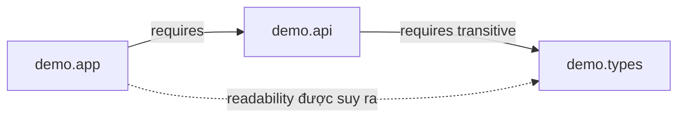
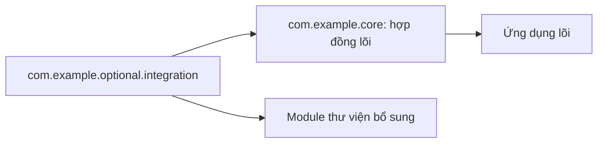
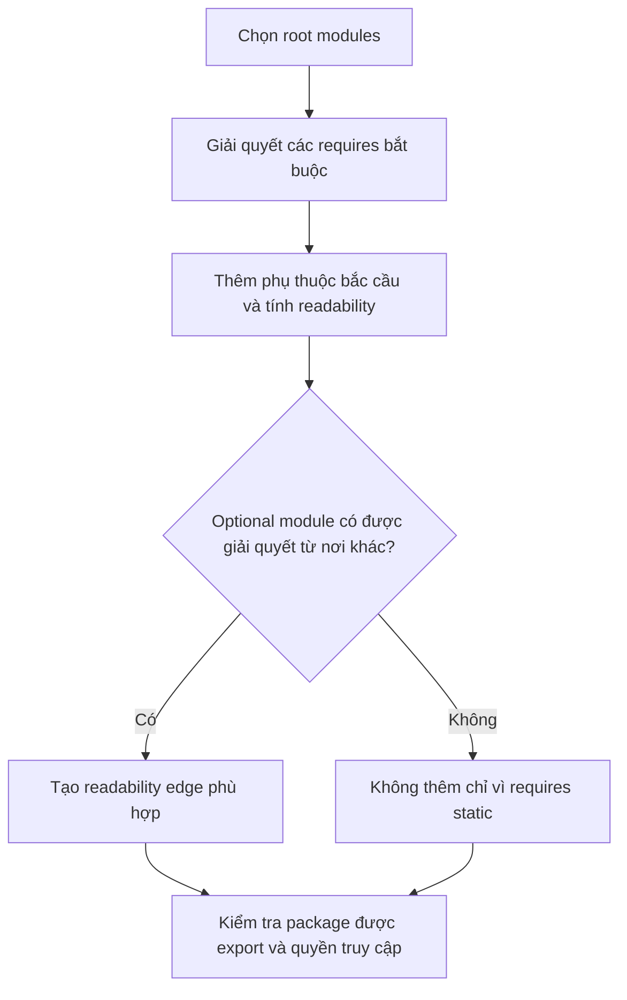

# `requires transitive`, `requires static` và ranh giới API

Trong Java 27, **Java Platform Module System (JPMS)** cho phép thư viện công khai những package được phép sử dụng và khai báo chính xác module nào cần thiết. Hai modifier đặc biệt của `requires` là **`transitive`** và **`static`** ảnh hưởng trực tiếp đến **đồ thị phụ thuộc**, khả năng **biên dịch mã của khách hàng** và việc **giải quyết module khi chạy**.

Hiểu sai `requires transitive` dễ khiến một API công khai trả về kiểu mà module tiêu thụ không truy cập được. Hiểu sai `requires static` dễ khiến ứng dụng chỉ khởi động được trong môi trường phát triển nhưng thất bại khi truy cập loại dữ liệu không có ở runtime.

Bài học thuộc chương **Module và đóng gói thư viện** của module **JAVA_VERSION_JAVA27 — Java 27 và các kiến thức liên quan**. Nội dung dựa trên các quy tắc JPMS và công cụ JDK còn áp dụng trong Java SE 27; không sử dụng những cơ chế đóng gói đã lỗi thời làm hướng thiết kế mới.

Sau bài này, bạn có thể:

- Phân biệt `requires`, `requires transitive`, `requires static` và cách kết hợp hai modifier.
- Đọc đúng đồ thị **readability** và hiểu vì sao tính công khai của `public` chưa đủ để truy cập kiểu từ module khác.
- Chọn `requires transitive` khi kiểu của dependency là một phần **API công khai** của thư viện.
- Sử dụng `requires static` cho dependency thực sự có thể thiếu khi chạy, không mặc định coi module đặt trên module path là đã được giải quyết.
- Phân biệt `requires` với `exports`, `opens` và các ranh giới đóng gói.
- Biên dịch, chạy và kiểm tra một ứng dụng gồm nhiều named modules với JDK 27.

## 1. JPMS bổ sung ranh giới gì so với package?

Một **named module** có tên và khai báo `module-info.java`, ví dụ:

```java
module com.example.billing {
    requires java.logging;
    exports com.example.billing.api;
}
```

Khai báo này có hai nhóm ý nghĩa:

1. `requires java.logging;` tạo phụ thuộc module, để `com.example.billing` có thể **đọc** module `java.logging`.
2. `exports com.example.billing.api;` công khai các kiểu có mức truy cập thích hợp trong package đó tới những module đọc được `com.example.billing`.

Để một lớp trong module `A` dùng một kiểu `public X` thuộc module `B`, thông thường **hai điều kiện** phải cùng đúng:

- **Readability:** `A` đọc được `B` qua `requires` hoặc một quan hệ đọc phù hợp khác.
- **Accessibility:** package chứa `X` được `B` **export** cho `A`, và chính kiểu/thành viên đáp ứng điều kiện truy cập của Java.

`public` **không tự vượt qua** một package chưa được export. Ngược lại, chỉ có `requires B` cũng không cấp quyền truy cập package nội bộ của `B`.

Một module khác `java.base` luôn có phụ thuộc ngầm định vào `java.base`; không cần viết `requires java.base;`. Không dùng `requires static java.base;`, vì modifier `static` đối với `java.base` bị ngôn ngữ từ chối.

## 2. Bốn cách khai báo phụ thuộc

Giả sử `api.module` sử dụng `dependency.module`:

| Khai báo bên trong `api.module` | Lúc biên dịch `api.module` | Lúc chạy, dependency có bắt buộc được giải quyết? | Module khách hàng đọc được dependency qua `api.module`? |
|---|---|---|---|
| `requires dependency.module;` | Cần module được cung cấp | **Có**, theo phụ thuộc thông thường | **Không** chỉ nhờ dòng này |
| `requires transitive dependency.module;` | Cần module được cung cấp | **Có** | **Có**, theo tính bắc cầu |
| `requires static dependency.module;` | Cần module được cung cấp | **Không**; tùy chọn khi chạy | **Không** chỉ nhờ dòng này |
| `requires static transitive dependency.module;` | Cần module được cung cấp | **Không**; tùy chọn khi chạy | **Có** ở compile time; ở runtime chỉ khi module đó được giải quyết |

Các modifier `static` và `transitive` có thể cùng xuất hiện; cú pháp `requires transitive static dependency.module;` cũng hợp lệ. Tính chất **optional khi chạy** và **lan truyền readability** là hai chiều độc lập của một khai báo.

**Chú ý:** bảng trên mô tả phụ thuộc và readability, **không** có nghĩa package của dependency tự được export. Module dependency vẫn phải `exports` package thích hợp nếu muốn module khách hàng truy cập kiểu bên trong.

## 3. `requires transitive`: đưa dependency vào hợp đồng API

Xét ba module `demo.app`, `demo.api` và `demo.types`:



Các module descriptor:

```java
// Trong module demo.types:
module demo.types {
    exports demo.types;
}
```

```java
// Trong module demo.api:
module demo.api {
    requires transitive demo.types;
    exports demo.api;
}
```

```java
// Trong module demo.app:
module demo.app {
    requires demo.api;
}
```

Tại đây:

- `demo.api` đọc được `demo.types`.
- `demo.app` đọc được `demo.api` **và** được suy ra quyền đọc `demo.types`, dù descriptor của `demo.app` không có `requires demo.types;`.
- Khả năng đọc `demo.types` có thể tiếp tục lan truyền nếu `demo.types` cũng khai báo các phụ thuộc `requires transitive` khác.
- `demo.app` chỉ sử dụng được những package thích hợp mà `demo.types` export; các package nội bộ không trở nên công khai.

Đây là cơ chế **readability bắc cầu**, chứ không phải “chuyển mã nguồn hoặc class của module C sang module B”.

### 3.1. Vì sao API công khai thường cần `requires transitive`?

Giả sử module `demo.types` cung cấp:

```java
package demo.types;

public record Money(long cents) {}
```

Và module `demo.api` xuất bản:

```java
package demo.api;

import demo.types.Money;

public interface InvoiceCalculator {
    Money calculate(int quantity);
}
```

Khách hàng của `demo.api` cần biết kiểu `Money` khi gọi `calculate(...)`, khai báo biến hoặc tương tác với chữ ký trả về:

```java
import demo.api.InvoiceCalculator;
import demo.types.Money;

Money result = calculator.calculate(3);
```

Nếu `demo.api` chỉ có `requires demo.types;`, thì **module khách hàng không được suy ra quyền đọc** `demo.types`. Khi chỉ `requires demo.api;`, việc import `demo.types.Money` trong module khách hàng sẽ bị trình biên dịch từ chối. `requires transitive demo.types;` thể hiện rằng dependency đóng góp vào **hợp đồng công khai** của thư viện, nên khách hàng cần được đọc module đó.

Ngược lại, nếu `demo.api` dùng thư viện xử lý dữ liệu **chỉ bên trong phần triển khai**, không đưa kiểu của nó vào API, `requires dependency.module;` thường là đủ và giúp tránh lan truyền phụ thuộc không cần thiết.

### 3.2. Những dạng chữ ký dễ vô tình lộ dependency

Hãy rà soát các thành phần trong exported API như:

- Kiểu trả về và kiểu tham số của phương thức `public`/`protected`.
- Trường `public`/`protected`, constructor, superclass và interface được implement/extend.
- Generic type arguments, wildcard bounds và type parameter bounds.
- Ngoại lệ checked trong khai báo `throws`.
- Các kiểu annotation và metadata công khai mà người dùng API cần xử lý.

Ví dụ `List<Money> calculate(...)` **vẫn lộ kiểu `Money`**, dù lớp chứa trực tiếp trong chữ ký là `java.util.List`. Đặt một kiểu của module khác bên trong generic parameter **không** làm mất phụ thuộc kiểu.

## 4. `requires static`: bắt buộc khi biên dịch, tùy chọn khi chạy

Định nghĩa theo JLS §7.7.1: modifier `static` làm cho dependency **bắt buộc ở compile time** nhưng **tùy chọn ở runtime**.

```java
module demo.api {
    requires static demo.annotations;
    exports demo.api;
}
```

Điều này có nghĩa:

1. Khi biên dịch `demo.api`, compiler cần thấy định nghĩa module `demo.annotations` và các kiểu được mã nguồn tham chiếu đến.
2. Khi chạy ứng dụng sử dụng `demo.api`, module resolver **không tự tìm và đưa** `demo.annotations` vào đồ thị module chỉ vì dòng `requires static`.
3. Nếu `demo.annotations` đã được đưa vào đồ thị bởi một phụ thuộc thông thường khác hoặc `--add-modules`, `demo.api` sẽ có quan hệ readability tới nó theo quy tắc giải quyết module.
4. Nếu mã thực thi hoặc reflection thực sự cần một kiểu không có mặt khi chạy, chương trình **có thể thất bại** khi tải hoặc liên kết kiểu, hoặc khi gọi vào nhánh cần kiểu đó. `requires static` không tự tạo fallback và cũng không biến phụ thuộc thành một thư viện “tự có nếu cần”.

Ví dụ sử dụng phù hợp: một thư viện dùng annotation có `RetentionPolicy.SOURCE` để hỗ trợ kiểm tra ở thời điểm biên dịch, nhưng **không** tham chiếu đến annotation khi chạy.

### 4.1. “Có trên module path” chưa có nghĩa “được giải quyết”

Phải phân biệt:

| Khái niệm | Ý nghĩa |
|---|---|
| **Observable module** | Module có thể được tìm thấy trong nguồn/module path/hệ thống ở giai đoạn tương ứng |
| **Resolved module** | Module thực sự nằm trong đồ thị được xây dựng từ các root modules |
| **Readable module** | Module mà module hiện tại có quyền đọc trong đồ thị |
| **Exported package** | Package được module sở hữu mở quyền truy cập kiểu ở mức ngôn ngữ cho module đọc thích hợp |

Một module có thể **observable** nhưng không được giải quyết ở runtime. Chỉ đặt `demo.annotations` trên `--module-path` không bắt buộc runtime resolver thêm nó vào đồ thị chỉ vì `requires static demo.annotations;`.

Nếu thật sự muốn thêm một optional module có sẵn vào root set khi khởi động:

```bash
java --module-path mods --add-modules demo.annotations --module demo.app/demo.app.Main
```

Lệnh minh họa này **không tự sửa mã nguồn**. Tùy trường hợp, dependency thông thường của module khác cũng có thể đưa `demo.annotations` vào đồ thị. Nếu một module khác bắt buộc cần `demo.annotations` nhưng tệp module không tồn tại, việc khởi chạy có thể thất bại ngay trong giai đoạn giải quyết.

### 4.2. Không coi mọi thư viện “thỉnh thoảng dùng” là `requires static`

Nếu đường đi khởi động **luôn** khởi tạo một lớp hoặc thực thi thao tác cần dependency đó, khai báo `requires static` không làm nó tự trở nên tùy chọn. Một ứng dụng thực sự có tùy chọn bật/tắt tính năng còn cần:

- Phân tách các loại dữ liệu và đường đi thực thi phụ thuộc vào thư viện tùy chọn.
- Kiểm tra tính hiện diện/phù hợp theo cơ chế được thiết kế và xử lý trường hợp vắng mặt.
- Có phương án chạy, kiểm thử và đóng gói **có** lẫn **không có** dependency đó.

Không nên dùng `requires static` để che giấu một dependency thực chất bắt buộc.

## 5. Khi kết hợp `static` với `transitive`

Khai báo:

```java
module demo.api {
    requires static transitive demo.optionaltypes;
    exports demo.api;
}
```

Kết hợp hai chính sách:

- **Compile time:** `demo.api` cần `demo.optionaltypes`; các module khách hàng đọc `demo.api` có thể được suy ra quyền đọc `demo.optionaltypes` theo tính bắc cầu.
- **Runtime:** `demo.optionaltypes` **không** được bắt buộc giải quyết chỉ vì dòng này. Nếu nó thực sự được giải quyết từ một root/phụ thuộc khác, quan hệ readability bắc cầu tương ứng mới áp dụng trên đồ thị runtime.

Cách kết hợp này có thể cần thiết khi hợp đồng API tham chiếu một kiểu từ module tùy chọn **mà một số cách dùng API có thể hoàn toàn không cần tải kiểu đó lúc chạy**. Tuy nhiên, đây là thiết kế cần xem xét rất kỹ: một khách hàng gọi phương thức có chữ ký liên quan đến kiểu tùy chọn có thể gặp lỗi runtime nếu module đó vắng mặt.

**Khuyến nghị:** nếu một kiểu là phần cốt lõi bắt buộc trong API, thường dùng `requires transitive` thay vì `requires static transitive`. Nếu chỉ một tính năng nâng cao cần dependency, cân nhắc tách phần tích hợp thành module riêng, có API hoặc service provider thích hợp. Không mặc định “static + transitive” luôn là cách làm cho dependency vừa công khai vừa an toàn khi thiếu.

## 6. `requires` không thay cho `exports` hoặc `opens`

JPMS phân biệt **quyền đọc module** và **quyền truy cập package**:

| Directive | Tác động chính | Điều không tự làm |
|---|---|---|
| `requires M;` | Module hiện tại đọc `M` | Không công khai package của mình hoặc của `M` |
| `requires transitive M;` | Khách hàng được lan truyền readability tới `M` | Không tự export package chưa công khai của `M` |
| `exports p;` | Các module đọc module hiện tại có thể truy cập kiểu công khai trong `p` | Không tự thêm `requires` cho khách hàng |
| `exports p to M;` | Chỉ export package `p` tới module `M` | Không cho module khác quyền truy cập tương tự |
| `opens p;` / `opens p to M;` | Cho phép deep reflection vào package `p` theo phạm vi đã chỉ định | Không thay `exports` cho truy cập mã nguồn thông thường |

Ví dụ mô tả module thư viện với một package public và một package nội bộ:

```java
module com.example.storage {
    requires java.logging;
    exports com.example.storage.api;
}
```

Nếu `com.example.storage.internal` không được export thì lớp `public` trong package đó **không tự trở thành API bên ngoài module**. `requires transitive com.example.storage` ở một module khác cũng không thay đổi quy tắc đóng gói này.

Khi framework cần reflection vào một package cụ thể, dùng `opens package.name to framework.module;` nếu có lý do rõ ràng. Không mở toàn bộ module chỉ để chữa một lỗi truy cập đơn lẻ.

**Lưu ý:** các directive `exports p to M` hoặc `opens p to M` phải được khai báo trong module sở hữu **package p**; module khách hàng không thể tự yêu cầu export package của module khác bằng `requires`.

## 7. Ví dụ hoàn chỉnh với bốn named modules

Ví dụ sau chứng minh đồng thời:

1. `demo.app` chỉ `requires demo.api` nhưng vẫn truy cập `demo.types.Money` nhờ `demo.api requires transitive demo.types`.
2. `demo.api` dùng annotation của `demo.annotations` khi biên dịch thông qua `requires static`.
3. Chương trình vẫn chạy khi **không có** module `demo.annotations` ở runtime, vì annotation có retention `SOURCE` và chương trình không cần kiểu đó lúc chạy.

### 7.1. Cấu trúc thư mục

```text
src/
  demo.annotations/
    module-info.java
    demo/annotations/BuildChecked.java
  demo.types/
    module-info.java
    demo/types/Money.java
  demo.api/
    module-info.java
    demo/api/InvoiceService.java
  demo.app/
    module-info.java
    demo/app/Main.java
```

Thư mục ngay dưới `src` trùng với **tên module**. Bên trong mỗi module là `module-info.java` và package path của mã nguồn.

### 7.2. Module khai báo kiểu dữ liệu: `demo.types`

Tệp `src/demo.types/module-info.java`:

```java
module demo.types {
    exports demo.types;
}
```

Tệp `src/demo.types/demo/types/Money.java`:

```java
package demo.types;

public record Money(long cents) {
    public Money {
        if (cents < 0) {
            throw new IllegalArgumentException("Số tiền không được âm");
        }
    }
}
```

`Money` là một record công khai, nhưng module tiêu thụ chỉ truy cập được nó nếu **đọc được** `demo.types` và `demo.types` export package chứa record.

### 7.3. Module annotation dùng khi biên dịch: `demo.annotations`

Tệp `src/demo.annotations/module-info.java`:

```java
module demo.annotations {
    exports demo.annotations;
}
```

Tệp `src/demo.annotations/demo/annotations/BuildChecked.java`:

```java
package demo.annotations;

import java.lang.annotation.ElementType;
import java.lang.annotation.Retention;
import java.lang.annotation.RetentionPolicy;
import java.lang.annotation.Target;

@Retention(RetentionPolicy.SOURCE)
@Target(ElementType.TYPE)
public @interface BuildChecked {}
```

`BuildChecked` ở ví dụ chỉ là một **annotation đánh dấu**, tự nó không chạy validator hay annotation processor nào. `SOURCE` nghĩa là annotation không được giữ trong class file sau biên dịch, rất thích hợp để minh họa một phụ thuộc chỉ cần lúc compile.

### 7.4. Module thư viện công khai: `demo.api`

Tệp `src/demo.api/module-info.java`:

```java
module demo.api {
    requires transitive demo.types;
    requires static demo.annotations;

    exports demo.api;
}
```

Tệp `src/demo.api/demo/api/InvoiceService.java`:

```java
package demo.api;

import demo.annotations.BuildChecked;
import demo.types.Money;

@BuildChecked
public final class InvoiceService {
    public Money total(int quantity) {
        if (quantity < 0) {
            throw new IllegalArgumentException("Số lượng không được âm");
        }
        return new Money(100L * quantity);
    }
}
```

Phương thức `total(...)` trả về `Money`, nên `demo.types` là một phần API được lộ cho khách hàng. `BuildChecked` chỉ xuất hiện trong mã nguồn và không tham gia logic runtime của `InvoiceService`.

### 7.5. Module ứng dụng: `demo.app`

Tệp `src/demo.app/module-info.java`:

```java
module demo.app {
    requires demo.api;
}
```

Tệp `src/demo.app/demo/app/Main.java`:

```java
package demo.app;

import demo.api.InvoiceService;
import demo.types.Money;

public final class Main {
    public static void main(String[] args) {
        Money result = new InvoiceService().total(3);
        System.out.println("Total: " + result.cents());
    }
}
```

`demo.app` **không khai báo** `requires demo.types;`, nhưng vẫn dùng `Money` nhờ tính bắc cầu của `demo.api`. Không có tham chiếu nào tới `demo.annotations` trong mã ứng dụng.

## 8. Biên dịch và chạy ví dụ với JDK 27

Các lệnh bên dưới chạy từ thư mục chứa `src/`. Sau khi tự tạo các tệp theo đúng cấu trúc mục 7:

```bash
javac --module-source-path src -d mods --module demo.annotations,demo.types,demo.api,demo.app
java --module-path mods --module demo.app/demo.app.Main
```

Kết quả:

```text
Total: 300
```

`javac --module-source-path src` nhận các source module theo thư mục; `-d mods` tạo output theo module. `java --module-path mods --module demo.app/demo.app.Main` chạy lớp `demo.app.Main` trong module `demo.app`. Không cần bật preview.

### 8.1. Chạy mà không đưa `demo.annotations` vào runtime

Để kiểm chứng phụ thuộc `requires static`, chỉ đưa ba module thực sự cần chạy vào thư mục `runmods`. Ví dụ **PowerShell** (chạy tại thư mục bài thực hành, không phải thư mục mã nguồn module Java 27 trong dự án học tập):

```powershell
New-Item -ItemType Directory -Force -Path runmods | Out-Null
Copy-Item -Recurse -Path mods/demo.types -Destination runmods/demo.types
Copy-Item -Recurse -Path mods/demo.api -Destination runmods/demo.api
Copy-Item -Recurse -Path mods/demo.app -Destination runmods/demo.app

java --module-path runmods --module demo.app/demo.app.Main
```

Kết quả vẫn là `Total: 300`. `runmods` **không chứa** `demo.annotations`, nhưng ứng dụng không tải annotation chỉ dùng trong mã nguồn. Điều này chứng minh *optional ở runtime* đối với ví dụ cụ thể, **không** chứng minh rằng mọi module `requires static` đều có thể thiếu mà không gây lỗi.

Nếu dùng Linux hoặc macOS, thay bước copy bằng thao tác sao chép ba thư mục module tương ứng trong shell. Điểm quyết định là **module path khi chạy chỉ chứa `demo.types`, `demo.api` và `demo.app`**.

### 8.2. Điều gì xảy ra nếu đổi `requires transitive` thành `requires`?

Hãy thử sửa **trong bài thực hành riêng**:

```java
// Thay cho "requires transitive demo.types;" trong demo.api:
requires demo.types;
```

Sau khi biên dịch lại cả các module, `demo.app` không còn được suy ra quyền đọc `demo.types`, nên dòng `import demo.types.Money;` trong `Main.java` sẽ không biên dịch. Có hai giải pháp mang ý nghĩa thiết kế khác nhau:

1. **Khôi phục `requires transitive demo.types;` ở `demo.api`** nếu `Money` là thành phần được khách hàng sử dụng qua API mà thư viện muốn công khai.
2. **Thêm `requires demo.types;` vào `demo.app`** nếu ứng dụng cố tình sở hữu dependency trực tiếp đó và không dựa vào API lan truyền. Khi đó module app gắn chặt hơn với chi tiết cấu trúc thư viện.

Không dùng `--add-reads` hoặc các flag phá encapsulation làm giải pháp mặc định thay cho một module descriptor đúng. Chúng có trường hợp sử dụng đặc biệt (chẩn đoán/kiểm thử/tích hợp), không phải phương án thiết kế API bền vững.

## 9. Ranh giới API: chỉ export những gì có chủ đích

Hãy xét một thư viện có cấu trúc logic:

```text
com.example.payment/
  module-info.java
  com/example/payment/api/PaymentService.java
  com/example/payment/internal/DatabaseAdapter.java
```

Descriptor:

```java
module com.example.payment {
    requires java.sql;
    exports com.example.payment.api;
}
```

Package `com.example.payment.internal` không được export. Dù `DatabaseAdapter` được khai báo `public` trong package đó, module khách hàng vẫn không được truy cập kiểu đó bằng đường biên dịch thông thường. Đây là **strong encapsulation ở mức module**.

Khi thiết kế library module:

- Export package chứa **contract** mà khách hàng được phép dùng.
- Giữ implementation classes, adapters, serializers, storage details ở package không export khi chúng không phải phần API.
- Tránh đưa kiểu nội bộ vào chữ ký `public`/`protected` trong package đã export; chỉ có `public` không biến kiểu thuộc package nội bộ thành kiểu khách hàng sử dụng được.
- Nếu framework cần deep reflection, mở **package tối thiểu** bằng `opens ... to ...` thay vì tự động export mọi thứ.
- Khi tham chiếu kiểu của module thứ ba trong API, xem xét `requires transitive` tương ứng và tác động tới phiên bản/khả năng tương thích của thư viện.

## 10. Phụ thuộc triển khai không nên bị lan truyền vô cớ

Không phải dependency nào nằm trong thư viện cũng phải `requires transitive`. Ví dụ:

```java
module com.example.reports {
    requires java.logging;
    requires transitive com.example.reportmodel;
    exports com.example.reports.api;
}
```

Giả sử:

- `com.example.reports.api.ReportService` nhận hoặc trả về `com.example.reportmodel.Report`.
- `java.logging.Logger` chỉ được dùng trong code triển khai của thư viện.

Khi đó:

- `requires transitive com.example.reportmodel;` hợp lý vì `Report` là kiểu thuộc API khách hàng.
- `requires java.logging;` đủ vì khách hàng không cần sử dụng Logger chỉ để gọi API báo cáo.

Tư duy này giúp tránh để người tiêu thụ một thư viện vô tình phụ thuộc vào hàng loạt module chỉ phục vụ chi tiết thực thi. Tuy nhiên, đừng đổi một dependency thành `static` chỉ vì không muốn nó bị lan truyền; `static` nói về **tính tùy chọn khi chạy**, không phải việc giữ dependency private. Để giữ dependency không lan truyền, dùng `requires` thông thường.

## 11. Rủi ro khi API công khai phụ thuộc kiểu optional

Một thiết kế đáng cân nhắc:

```java
module com.example.clientapi {
    requires static transitive com.example.optionalmodel;
    exports com.example.clientapi;
}
```

Nếu chữ ký công khai trong `com.example.clientapi` chứa kiểu từ `com.example.optionalmodel`:

- Khách hàng có thể biên dịch khi dependency optional đó **có mặt**.
- Khi chạy mà module optional **không được giải quyết**, các thao tác phải tải, dùng hoặc liên kết kiểu optional có thể thất bại.
- Những đường đi không đụng đến kiểu optional **có thể** tiếp tục hoạt động, nhưng khả năng này phụ thuộc mã, sự liên kết và các thư viện liên quan; không được hứa rằng toàn bộ API đều an toàn khi thiếu dependency.

Nếu nhiều người dùng chỉ cần lõi ứng dụng, giải pháp dễ kiểm soát thường là **tách module tích hợp**:



Ứng dụng chỉ phụ thuộc lõi không phải đưa các kiểu của thư viện bổ sung vào compile/runtime path. Module tích hợp có thể được cài đặt hoặc đưa vào đồ thị khi người dùng thực sự chọn tính năng. Khi dùng ServiceLoader, cần khai báo và kiểm thử `uses`/`provides` đúng hợp đồng; `requires static` một mình không tự cấu hình cơ chế plugin.

## 12. Đọc đồ thị module thay vì đoán theo JAR

Một JAR trên module path có thể **observable** nhưng không nằm trong đồ thị runtime. Quy trình tư duy:



Đây là sơ đồ khái quát chứ không mô phỏng đầy đủ tất cả chi tiết thuật toán resolution. Đặc tả `java.lang.module` nêu rõ hai bước **enumeration** và **readability graph**, cùng tính tùy chọn của `requires static`.

Đừng đồng nhất các tầng sau:

1. **Module path:** nơi JVM có thể tìm thấy định nghĩa module.
2. **Module resolution:** quá trình chọn module nào tham gia đồ thị.
3. **Readability:** cạnh phụ thuộc trong đồ thị.
4. **Exports/opens:** quyền truy cập package và deep reflection.
5. **Java accessibility:** `public`, `protected` và các quy tắc truy cập kiểu/thành viên.

Việc một JAR chứa class nào đó không làm mã trong named module tự động truy cập được class đó.

## 13. Kiểm tra dependency và module descriptor bằng công cụ JDK

### 13.1. Xem descriptor và đồ thị khi chạy

Sau khi biên dịch ví dụ mục 7:

```bash
java --module-path mods --describe-module demo.api
java --show-module-resolution --module-path mods --module demo.app/demo.app.Main
```

Lệnh đầu hiển thị descriptor của `demo.api`, gồm các phụ thuộc và package export. Lệnh thứ hai in thông tin module resolution ở đầu quá trình chạy; có thể quan sát việc `demo.app` yêu cầu `demo.api`, và `demo.api` kéo theo `demo.types`.

Đừng diễn giải việc `demo.annotations` xuất hiện **trên module path** là bằng chứng nó đã được đưa vào runtime graph. Với ứng dụng có các root hoặc tùy chọn khác, tập resolved modules có thể thay đổi.

### 13.2. Dùng `jdeps` để kiểm tra dependency của API

`jdeps` là công cụ phân tích dependency trên class/JAR/module đã biên dịch:

```bash
jdeps --module-path mods --api-only --module demo.api
```

`--api-only` tập trung vào những phụ thuộc có thể xuất hiện trong chữ ký của thành phần `public`/`protected`, như tham số, kiểu trả về hoặc `throws`. Đây là cách hỗ trợ phát hiện việc vô tình lộ kiểu từ dependency qua API. Nó **không** thay thế review thiết kế hoặc kiểm thử module khách hàng bằng cách biên dịch thật.

### 13.3. Cảnh báo khi compile

Có thể bật các nhóm cảnh báo liên quan:

```bash
javac -Xlint:exports -Xlint:module --module-source-path src -d mods --module demo.annotations,demo.types,demo.api,demo.app
```

`-Xlint:exports` hỗ trợ phát hiện vấn đề liên quan tới module exports; `-Xlint:module` hỗ trợ cảnh báo về hệ thống module. Khi phụ thuộc vào **automatic module**, cân nhắc thêm `-Xlint:requires-transitive-automatic` để phát hiện trường hợp `requires transitive` trỏ tới automatic module chưa có hợp đồng module descriptor ổn định.

Không nên tự sửa bằng cách export toàn bộ package chỉ để loại bỏ cảnh báo. Hãy xác định API nào thực sự được phép công khai.

## 14. Đóng gói thư viện: module path và class path

Với thư viện **modular JAR**, tệp `module-info.class` nằm ở gốc JAR và định nghĩa module. Ví dụ sau giả định các lớp đã được biên dịch vào `mods/demo.api`:

```bash
jar --create --file demo.api.jar -C mods/demo.api .
```

Nếu biên dịch được cả bốn module ở bài thực hành, có thể đóng gói tương tự từng thư mục module ra JAR riêng. Khi chạy trên **module path**, JVM đọc descriptor và áp dụng quy tắc JPMS.

Nếu đưa một JAR lên **class path** thay vì module path, mã thường thuộc **unnamed module** và không tham gia cấu hình named module theo cách giống hệt. Vì vậy, không giả định kiểm thử trên class path đã kiểm chứng `requires transitive`/`requires static`. Với library hướng JPMS, tối thiểu cần kiểm thử một **named-module consumer** chạy trên module path.

**Automatic modules** có ích trong quá trình chuyển một thư viện chưa có `module-info.class` vào module path, nhưng tên và package export của chúng không nhất thiết ổn định khi thư viện được modularize chính thức. Với thiết kế thư viện mới, ưu tiên descriptor và tên module được quản lý có chủ đích, thay vì phụ thuộc lâu dài vào tên suy luận từ JAR.

## 15. Lỗi thường gặp

| Tình huống | Nguyên nhân | Cách xử lý |
|---|---|---|
| App import kiểu trong API nhưng javac báo package không visible | App đọc `demo.api` nhưng không đọc module chứa kiểu trả về | Chọn `requires transitive` khi đây là API được công khai; hoặc app khai báo phụ thuộc trực tiếp |
| Có `requires transitive` nhưng vẫn không truy cập được class | Module chứa class **không export** package, hoặc class không có quyền truy cập phù hợp | Kiểm tra `exports` và modifier của kiểu |
| Đánh dấu mọi dependency là `transitive` | Lan truyền phụ thuộc triển khai không cần thiết | Chỉ dùng `transitive` khi chính sách API yêu cầu |
| Dùng `requires static` cho một thư viện luôn được gọi khi chạy | Dependency không được tự giải quyết; có thể gặp lỗi tải/liên kết kiểu | Dùng `requires` thông thường nếu dependency bắt buộc |
| Thấy module optional trên module path rồi tưởng tự có trong runtime graph | Nhầm observable với resolved | Kiểm tra roots, `--add-modules` và `--show-module-resolution` |
| Dùng `requires static transitive` để “bảo đảm API optional luôn chạy” | Readability và sự tồn tại của mã tại runtime là hai việc khác nhau | Kiểm thử vắng mặt; cân nhắc tách module tích hợp |
| `public` class trong package nội bộ vẫn bị từ chối | Package chưa export | Export package chỉ khi đó thực sự là public API |
| Dùng `opens` để thay `exports` cho mã nguồn Java thông thường | `opens` dành cho reflection, không phải truy cập compile-time như `exports` | Dùng đúng directive theo loại truy cập |
| Dùng `--add-exports` để sửa lỗi đóng gói trong production | Che giấu API boundary sai và tạo coupling | Sửa descriptor/chữ ký API hoặc thiết kế lại package |
| Chạy được trên class path nhưng lỗi trên module path | Hai chế độ có mô hình module khác nhau | Biên dịch và kiểm thử trên module path |
| Public method trả về kiểu thuộc module chỉ dùng bên trong | Lộ implementation detail và tạo dependency cho khách hàng | Dùng DTO/contract do API sở hữu hoặc khai báo transitive có chủ đích |

## 16. Checklist review API trước khi phát hành

1. **Ranh giới package:** Các package được `exports` có thực sự chứa API công khai không? Package nội bộ có bị export nhầm không?
2. **Readability:** Module khách hàng chỉ `requires` thư viện có thể biên dịch khi dùng tất cả kiểu trong chữ ký public API không?
3. **Transitive:** Mỗi `requires transitive` đã có lý do cụ thể từ chữ ký API hoặc hợp đồng sử dụng chưa?
4. **Static:** Phụ thuộc `requires static` có thật sự được phép vắng mặt lúc chạy? Đã kiểm thử môi trường vắng mặt chưa?
5. **Kết hợp:** Nếu dùng `requires static transitive`, những đường đi API nào còn dùng được khi dependency không resolved?
6. **Exports:** Các package của dependency được cần đến có thực sự export cho khách hàng không?
7. **Reflection:** Có thể dùng `opens package to framework.module` theo phạm vi tối thiểu thay vì mở toàn bộ module không?
8. **Build và kiểm thử:** Đã kiểm tra cả compile-time module path, runtime module graph và trường hợp thiếu optional module chưa?
9. **Tính tương thích:** Thay đổi tên module, chuyển package giữa module hoặc loại bỏ một `requires transitive` có làm mã khách hàng bị lỗi không?
10. **Công cụ:** Đã xem `javac -Xlint:exports`, `jdeps --api-only` và `java --show-module-resolution` khi thích hợp chưa?

**Quy tắc ghi nhớ:** `requires` trả lời “module này cần đọc module nào”; `transitive` trả lời “module khách hàng có được suy ra quan hệ đọc này không”; `static` trả lời “dependency có thể vắng mặt khi chạy không”; còn `exports`/`opens` quyết định **đường biên truy cập vào package**. Không nên dùng một directive để thay thế trách nhiệm của directive khác.

## 17. Tài liệu tham khảo chính thức

- [Java SE 27 — JLS §7.7: Module Declarations](https://docs.oracle.com/en/java/javase/27/docs/specs/jls/jls-7.html#jls-7.7): cú pháp `module-info.java`, các directive và module declaration.
- [Java SE 27 — JLS §7.7.1: Dependences](https://docs.oracle.com/en/java/javase/27/docs/specs/jls/jls-7.html#jls-7.7.1): `requires`, `transitive`, `static` và các lỗi khai báo phụ thuộc.
- [Java SE 27 — JLS §7.7.2: Exported and Opened Packages](https://docs.oracle.com/en/java/javase/27/docs/specs/jls/jls-7.html#jls-7.7.2): ranh giới `exports` và `opens`.
- [Java SE 27 — java.lang.module: Module Resolution](https://docs.oracle.com/en/java/javase/27/docs/api/java.base/java/lang/module/package-summary.html): resolver, readability graph và phụ thuộc optional tại runtime.
- [Java SE 27 — ModuleDescriptor.Requires.Modifier](https://docs.oracle.com/en/java/javase/27/docs/api/java.base/java/lang/module/ModuleDescriptor.Requires.Modifier.html): các modifier `TRANSITIVE` và `STATIC` ở runtime descriptor.
- [Java SE 27 — javac Command](https://docs.oracle.com/en/java/javase/27/docs/specs/man/javac.html): `--module-source-path`, `--module` và `-Xlint`.
- [Java SE 27 — java Command](https://docs.oracle.com/en/java/javase/27/docs/specs/man/java.html): `--module-path`, `--module`, `--add-modules` và `--show-module-resolution`.
- [Java SE 27 — jdeps Command](https://docs.oracle.com/en/java/javase/27/docs/specs/man/jdeps.html): phân tích module dependency và `--api-only`.
