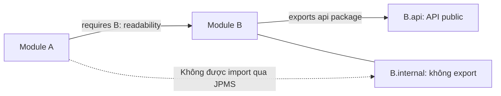
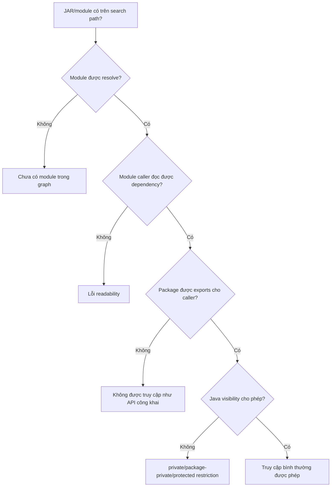
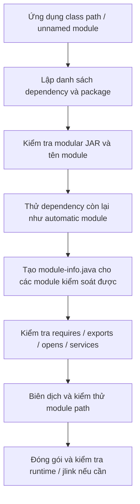

# Named module, unnamed module và automatic module trong Java 27

Java Platform Module System (**JPMS**) cho phép tổ chức mã và thư viện thành những module có tên, khai báo quan hệ phụ thuộc và quyết định package nào là API công khai. Một chương trình Java hiện đại không bắt buộc phải được modular hóa hoàn toàn: code trên **class path** vẫn được hỗ trợ, còn JAR không có descriptor có thể được dùng làm **automatic module** trên **module path**. Vì thế, hiểu ba dạng module là điều cần thiết khi phát triển thư viện, tích hợp dependency hoặc chuyển đổi một ứng dụng sang cấu trúc module.

Bài thuộc chương **Module và đóng gói thư viện** của module học **Java 27 và các kiến thức liên quan**. Nội dung chỉ tập trung vào các cơ chế JPMS đã được chuẩn hóa và vẫn đang áp dụng; không dùng API nội bộ hoặc tính năng preview. Những khái niệm có nguồn gốc từ Java 9 vẫn là thành phần hiện hành của nền tảng và được trình bày để giải thích khả năng tương tác, **không phải lời khuyên tiếp tục tạo dependency thiếu hợp đồng module khi có lựa chọn tốt hơn**.

## 1. Mục tiêu học tập

Sau bài này, bạn có thể:

- Phân biệt **explicit named module**, **automatic module** và **unnamed module**.
- Hiểu khác biệt giữa `--module-path` và `--class-path` khi biên dịch và chạy.
- Viết `module-info.java` với `requires`, `exports`, `opens` và các directive cơ bản.
- Giải thích vì sao module **đọc được** dependency chưa chắc đã truy cập được tất cả package của dependency.
- Biên dịch, đóng gói và chạy hai module có tên bằng `javac`, `jar` và `java`.
- Sử dụng module có tên từ một chương trình nằm trên class path và đưa JAR chưa modular hóa lên module path khi cần chuyển tiếp.
- Nhận diện giới hạn của automatic module, các lỗi về tên module, package trùng nhau, reflection và `jlink`.
- Lập lộ trình chuyển từ cấu hình class path sang explicit module mà không phá hợp đồng thư viện.

## 2. Module, package và JAR khác nhau thế nào?

Ba khái niệm thường xuất hiện cùng nhau nhưng giải quyết những vấn đề khác nhau:

| Khái niệm | Vai trò | Ví dụ |
|---|---|---|
| **Package** | Nhóm class/interface và quản lý tên | `com.example.greetings` |
| **JAR** | Định dạng tệp lưu class, resource và metadata | `greetings.jar` |
| **Module** | Đơn vị cấu hình dependency và đóng gói API | `com.example.greetings` |

Một module thường bao gồm nhiều package, trong đó chỉ một số package được `exports`. JAR là **vật chứa**: nó có thể là modular JAR với `module-info.class`, là JAR thường được đặt trên class path, hoặc được coi là automatic module khi đặt trên module path.

**JAR không đồng nghĩa với module.** Một JAR có thể được phân loại khác nhau tùy nội dung và cách đặt vào môi trường chạy.

Ví dụ một thư viện có cấu trúc ý tưởng:

```text
com.example.greetings (module)
├── com.example.greetings
│   └── Greeter.java                 // API dành cho client
└── com.example.greetings.internal
    └── MessageFormatter.java       // Implementation nội bộ
```

Nếu descriptor chỉ `exports com.example.greetings`, module khác có thể sử dụng những public type phù hợp trong package API nhưng không mặc nhiên import được class ở package `.internal`.

## 3. Tại sao JPMS cần đến ba dạng module?

JPMS phải đáp ứng hai mục tiêu đồng thời:

1. **Thiết kế module rõ ràng cho mã hiện đại:** thư viện có tên ổn định và khai báo rõ dependency, API, điểm mở cho reflection.
2. **Cho phép mã chưa modular hóa tiếp tục hoạt động và được chuyển đổi từng phần:** nhiều ứng dụng và thư viện vẫn sử dụng class path hoặc JAR không có descriptor.

Ba dạng module hỗ trợ các trường hợp đó:

| Dạng | Nguồn gốc | Có tên? | Có `module-info.class`? | Vị trí thông dụng |
|---|---|---|---|---|
| **Explicit named module** | Module khai báo bằng `module-info.java` | Có | Có | Module path hoặc runtime image |
| **Automatic module** | JAR chưa có descriptor được đặt trên module path | Có | Không | Module path |
| **Unnamed module** | Các class/JAR trên class path, do class loader gắn vào unnamed module | Không | Không | Class path |

Điểm dễ nhầm: **automatic module vẫn là một named module**. Tên `named module` trong tài liệu đôi khi được dùng rộng để bao gồm cả explicit và automatic module; khi cần phân biệt, hãy nói rõ **explicit named** hay **automatic named**.

## 4. Explicit named module: module được khai báo tường minh

Một explicit named module định nghĩa module descriptor bằng tệp `module-info.java`. Khi biên dịch, nó trở thành `module-info.class`.

Ví dụ:

```java
module com.example.greetings {
    exports com.example.greetings;
}
```

Tên module là `com.example.greetings`. `exports` cho phép code trong các module khác truy cập những type và member được Java cho phép truy cập từ package `com.example.greetings`, nếu module bên sử dụng cũng đọc được module này.

Một module ứng dụng phụ thuộc vào nó:

```java
module com.example.app {
    requires com.example.greetings;
}
```

Ở đây:

- `requires` diễn đạt dependency theo tên module.
- `exports` diễn đạt API package nào sẵn cho client.
- Hai chỉ thị có vai trò **khác nhau** và thường cần phối hợp.

### 4.1. Descriptor không chứa method hoặc class

`module-info.java` có cú pháp khai báo module, không phải một class Java thông thường. Bạn không định nghĩa constructor hay method trong tệp này. Các API và implementation vẫn nằm trong các package Java.

### 4.2. Không cần viết requires java.base

Module `java.base` là nền tảng của các module Java và được đọc ngầm theo quy tắc ngôn ngữ. Thông thường không cần ghi:

```java
// Không cần thêm thủ công trong mỗi module:
// requires java.base;
```

Nhưng nếu dùng một module khác, ví dụ `java.sql`, hãy khai báo dependency phù hợp trong descriptor:

```java
module com.example.database.client {
    requires java.sql;
}
```

Việc sử dụng `java.sql` ở đây chỉ là ví dụ cho một module chuẩn hiện hành, không liên quan đến một thư viện driver cụ thể.

## 5. Readability và accessibility: hai lớp kiểm tra khác nhau

Trong JPMS, việc code module A muốn sử dụng một public class của module B thường cần thỏa các điều kiện chính:

1. Module A **đọc được** module B (*readability*).
2. Package chứa class đó được B **export** cho A.
3. Class/member có mức truy cập Java phù hợp (ví dụ public class và public method).
4. Class có mặt trong cấu hình module đang được biên dịch/chạy.

Sơ đồ:



Ví dụ descriptor:

```java
module com.example.library {
    exports com.example.library.api;
}
```

Một class `public` trong `com.example.library.internal` vẫn **không tự nhiên trở thành API của module** chỉ vì có từ khóa `public`.

**Cần phân biệt:** `requires` tạo quan hệ đọc module; `exports` kiểm soát tính truy cập thông thường của các public/protected type và member giữa module. `opens` liên quan nhiều hơn đến reflection, không thay thế `exports` cho những câu lệnh `import` lúc biên dịch.

## 6. Các directive quan trọng trong module-info.java

| Directive | Ý nghĩa | Trường hợp dùng |
|---|---|---|
| `requires other.module;` | Đọc một module khác | Dependency trực tiếp |
| `requires transitive other.module;` | Truyền readability của dependency cho module đọc module hiện tại | Thư viện công bố type của dependency trong API |
| `requires static other.module;` | Dependency được yêu cầu ở lúc biên dịch nhưng không bắt buộc được phân giải lúc chạy | Một dependency thực sự tùy chọn ở runtime, có thiết kế phù hợp |
| `exports p;` | Export package `p` cho các module khác | API thông thường |
| `exports p to m;` | Export package `p` chỉ cho module `m` | API có đối tượng tiêu thụ giới hạn |
| `opens p;` | Cho phép deep reflection vào package `p` lúc chạy | Framework có nhu cầu hợp lệ |
| `opens p to m;` | Chỉ mở package `p` cho module `m` | Reflection có phạm vi |
| `uses ServiceType;` | Khai báo module dùng service | ServiceLoader |
| `provides ServiceType with Impl;` | Khai báo một hoặc nhiều provider cho service | Plugin/service implementation |

Ví dụ hợp nhất một số directive:

```java
module com.example.store {
    requires java.logging;

    exports com.example.store.api;
    opens com.example.store.model to com.example.serializer;
}
```

Ví dụ này mô tả ý tưởng. Để biên dịch descriptor chứa `opens ... to com.example.serializer`, bạn phải có package/module phù hợp với tình huống và xử lý các thông báo compiler tương ứng. **Không nên sao chép ví dụ mô phỏng rồi kỳ vọng mọi module giả định đều sẵn có.**

### 6.1. requires transitive không có nghĩa tự export mọi package

Giả sử `com.example.facade` yêu cầu:

```java
module com.example.facade {
    requires transitive com.example.greetings;
    exports com.example.facade;
}
```

Một module khác `requires com.example.facade` có thể được cấp readability tới `com.example.greetings`. Tuy nhiên, nó vẫn chỉ truy cập các package mà `com.example.greetings` thực sự export cho nó. `requires transitive` **không biến các package nội bộ của dependency thành public API**.

### 6.2. requires static không phải cách sửa thiếu module tùy ý

Với `requires static`, dependency thường được yêu cầu ở compile time nhưng không bắt buộc được phân giải khi chạy. Nếu code thực sự gọi đến class từ dependency trong lúc chạy mà dependency không hiện diện, ứng dụng vẫn có thể thất bại. Dùng directive này chỉ khi luồng thực thi đã thiết kế để xử lý dependency tùy chọn.

### 6.3. opens khác exports

Một framework reflection có thể cần truy cập field hoặc constructor không public. `opens` cho phép deep reflection theo quy tắc của JPMS; `exports` chỉ phục vụ truy cập thông thường và reflective access tới những public member phù hợp.

```java
module com.example.model {
    exports com.example.model.api;
    opens com.example.model.internal to com.example.serializer;
}
```

`com.example.model.internal` không vì thế trở thành package có thể import từ code bình thường của `com.example.serializer`.

## 7. Module path và class path khác nhau ra sao?

### 7.1. Class path

`--class-path` (hay `-cp`) chỉ nơi chứa các class/JAR theo mô hình tải class truyền thống. Code được tải từ class path thông thường thuộc **unnamed module** của class loader tương ứng.

```bash
java --class-path classes Main
```

Khi dùng class path, một JAR có metadata tên automatic module vẫn không tự trở thành automatic module chỉ vì có tên manifest. **Vị trí đặt JAR quyết định vai trò.**

### 7.2. Module path

`--module-path` (hay `-p`) cung cấp địa điểm để tìm các module có tên: modular JAR, exploded module hoặc JAR được xem như automatic module.

```bash
java --module-path modules --module com.example.app/com.example.app.Main
```

`--module` (viết gọn `-m`) xác định module và, nếu cần, class có phương thức `main`.

### 7.3. Module path không phải "class path đổi tên"

Bỏ JAR vào module path có thể thay đổi:

- Tên module được JVM dùng để phân giải.
- Quan hệ readability và quyền export/open.
- Cách phát hiện xung đột giữa các package.
- Điều kiện để reflection truy cập thành phần không public.
- Khả năng xây dựng runtime image bằng công cụ như `jlink`.

Vì vậy, đổi toàn bộ `-cp` thành `-p` mà không kiểm tra dependency và package có thể khiến chương trình không chạy.

## 8. Ví dụ hoàn chỉnh: hai explicit named module

Tạo hai module:

- `com.example.greetings`: thư viện xuất API chào hỏi.
- `com.example.app`: ứng dụng gọi thư viện.

### 8.1. Cấu trúc thư mục

```text
project/
├── src/
│   ├── com.example.greetings/
│   │   ├── module-info.java
│   │   └── com/example/greetings/Greeter.java
│   └── com.example.app/
│       ├── module-info.java
│       └── com/example/app/Main.java
├── build/
│   ├── com.example.greetings/
│   └── com.example.app/
└── dist/
```

`build` và `dist` là thư mục đầu ra do người học tạo; chúng không phải dữ liệu nguồn của bài trong kho nội dung học.

### 8.2. Module thư viện: module-info.java

Tệp `src/com.example.greetings/module-info.java`:

```java
module com.example.greetings {
    exports com.example.greetings;
}
```

Tệp `src/com.example.greetings/com/example/greetings/Greeter.java`:

```java
package com.example.greetings;

import java.util.Objects;

public final class Greeter {
    private Greeter() {
    }

    public static String greet(String name) {
        Objects.requireNonNull(name, "name");
        return "Xin chào, " + name + "!";
    }
}
```

### 8.3. Module ứng dụng: module-info.java

Tệp `src/com.example.app/module-info.java`:

```java
module com.example.app {
    requires com.example.greetings;
}
```

Tệp `src/com.example.app/com/example/app/Main.java`:

```java
package com.example.app;

import com.example.greetings.Greeter;

public final class Main {
    public static void main(String[] args) {
        System.out.println(Greeter.greet("Java 27"));
    }
}
```

### 8.4. Biên dịch với javac

Từ thư mục `project`, tạo trước các thư mục đầu ra. Ví dụ trên PowerShell:

```powershell
New-Item -ItemType Directory -Force build/com.example.greetings, build/com.example.app, dist | Out-Null
```

Với shell POSIX như Bash, có thể dùng:

```bash
mkdir -p build/com.example.greetings build/com.example.app dist
```

Biên dịch thư viện:

```bash
javac -d build/com.example.greetings src/com.example.greetings/module-info.java src/com.example.greetings/com/example/greetings/Greeter.java
```

Biên dịch ứng dụng, chỉ rõ module path chứa module đã biên dịch:

```bash
javac --module-path build -d build/com.example.app src/com.example.app/module-info.java src/com.example.app/com/example/app/Main.java
```

Chạy:

```bash
java --module-path build --module com.example.app/com.example.app.Main
```

Kết quả:

```text
Xin chào, Java 27!
```

**Giải thích:** `build` chứa các thư mục con, mỗi thư mục là một exploded module có `module-info.class` tại gốc. Khi biên dịch ứng dụng, compiler nhìn thấy `com.example.greetings` thông qua module path. Khi chạy, JVM phân giải module ứng dụng cùng dependency đã khai báo.

### 8.5. Đóng gói thành modular JAR

Tạo JAR của thư viện và ứng dụng:

```bash
jar --create --file dist/com.example.greetings.jar -C build/com.example.greetings .
jar --create --file dist/com.example.app.jar -C build/com.example.app .
```

Xem descriptor trong JAR:

```bash
jar --describe-module --file dist/com.example.greetings.jar
jar --describe-module --file dist/com.example.app.jar
```

Chạy với thư mục JAR trên module path:

```bash
java --module-path dist --module com.example.app/com.example.app.Main
```

Kết quả vẫn là:

```text
Xin chào, Java 27!
```

JAR thư viện có `module-info.class` nên đây là **explicit named module**. Nó không phụ thuộc vào việc tên tệp JAR có trùng chính xác tên module hay không; tên chính thức lấy từ descriptor.

## 9. Unnamed module: code trên class path

**Unnamed module** là cơ chế của JPMS dành cho code không nằm trong một named module. Những class và JAR đặt trên class path thông thường được gắn với unnamed module do class loader quản lý.

Các đặc điểm chính:

- Không có tên module để ghi sau `requires`.
- Không có `module-info.java` riêng.
- Mỗi unnamed module **đọc mọi module observable** theo quy tắc nền tảng; tuy nhiên, khả năng đọc không tự bảo đảm mọi named module trên module path đã được **resolved**.
- Unnamed module **export** và **open** các package của nó.
- Class trong unnamed module có thể dùng API export từ những named module phù hợp đã được phân giải.
- Named module **không thể viết một directive `requires` trỏ tới unnamed module**.

### 9.1. Ví dụ kiểm tra module của class

Tệp `LegacyMain.java`:

```java
public class LegacyMain {
    public static void main(String[] args) {
        Module current = LegacyMain.class.getModule();

        System.out.println("Named: " + current.isNamed());
        System.out.println("Name: " + current.getName());
    }
}
```

Biên dịch và chạy trên class path:

```bash
javac LegacyMain.java
java --class-path . LegacyMain
```

Kết quả:

```text
Named: false
Name: null
```

`getName()` trả `null` cho unnamed module. Đây là một cách nhận biết tại runtime; khi ứng dụng có custom class loader, không nên giả định chỉ tồn tại một unnamed module trong toàn bộ JVM.

### 9.2. Không đánh đồng unnamed module với unnamed package

Một class `LegacyMain` không có khai báo `package` thuộc **unnamed package**. Nhưng một class có `package com.example.legacy;` vẫn có thể thuộc **unnamed module** nếu được tải từ class path.

Hai từ "unnamed" ở đây chỉ những cấp độ khác nhau:

- **Unnamed package:** class không có tên package.
- **Unnamed module:** class không thuộc named module.

Một ứng dụng class path vẫn có thể tổ chức package đầy đủ theo thông lệ Java.

### 9.3. Vì sao class path vẫn cần được hiểu?

Nhiều thư viện được phân phối dưới dạng JAR chưa có descriptor; công cụ build và môi trường triển khai cũng có thể dùng class path. Hiểu unnamed module giúp bạn **tích hợp, chẩn đoán và chuyển đổi** các thành phần đó, không có nghĩa nên tự ý bỏ ranh giới module khi đang thiết kế một thư viện cần strong encapsulation.

## 10. Unnamed client sử dụng explicit named module

Một client trên class path muốn dùng `com.example.greetings` cần bảo đảm module thư viện được phân giải và package API được export.

Tiếp tục dùng JAR `dist/com.example.greetings.jar` từ mục 8.

Tạo `legacy-src/LegacyClient.java`:

```java
import com.example.greetings.Greeter;

public class LegacyClient {
    public static void main(String[] args) {
        System.out.println(Greeter.greet("Client class path"));
    }
}
```

Tạo trước thư mục `build/legacy-client`, ví dụ PowerShell:

```powershell
New-Item -ItemType Directory -Force build/legacy-client | Out-Null
```

Biên dịch:

```bash
javac --module-path dist --add-modules com.example.greetings -d build/legacy-client legacy-src/LegacyClient.java
```

Chạy:

```bash
java --module-path dist --add-modules com.example.greetings --class-path build/legacy-client LegacyClient
```

Kết quả:

```text
Xin chào, Client class path!
```

### 10.1. Vì sao cần --add-modules?

`--module-path dist` chỉ nơi **có thể tìm** module. Nó không có nghĩa JVM mặc nhiên phân giải **mọi** module trong thư mục đó vào graph.

`--add-modules com.example.greetings` chọn module này làm một root bổ sung, giúp nó được phân giải và sẵn để client ở unnamed module sử dụng. Khi thư viện được phân giải, package `com.example.greetings` đã được `exports` nên code class path truy cập được public API của nó.

Đừng nhầm:

- `--module-path`: nơi tìm module.
- `--add-modules`: thêm module vào tập root để phân giải.
- `requires` trong descriptor: khai báo dependency của một named module.

## 11. Giới hạn theo chiều ngược: named module dùng class path

Một explicit named module **không thể** ghi:

```java
// Không hợp lệ: không có tên module tương ứng với "classpath".
// module com.example.app {
//     requires ALL-UNNAMED;
// }
```

`ALL-UNNAMED` là một token đặc biệt được một số tùy chọn launcher chấp nhận, **không phải tên module hợp lệ để đặt trong directive `requires`**.

Nếu ứng dụng explicit module cần sử dụng code chỉ có trên class path, cách thiết kế bền vững thường là:

1. Tìm phiên bản thư viện có explicit module descriptor.
2. Nếu chưa có, xem thư viện có thể chạy an toàn dưới dạng **automatic module** trên module path hay không.
3. Chuyển/đóng gói một dependency bằng module descriptor có kiểm chứng khi bạn kiểm soát mã hoặc có cách build hợp lệ.

Có một số tùy chọn tương thích tạm thời, chẳng hạn `--add-reads com.example.app=ALL-UNNAMED` ở ngữ cảnh phù hợp, nhưng chúng là cách **điều chỉnh module graph lúc biên dịch/chạy**, không thay thế thiết kế dependency tường minh. Chúng cũng không tạo một tên module để bạn có thể đặt vào `requires`.

## 12. Automatic module: JAR không có descriptor trên module path

**Automatic module** là cơ chế chuyển tiếp cho JAR chưa có `module-info.class` khi nó được đặt trên module path. JPMS tự xây dựng descriptor logic và gán một tên cho JAR.

Những tính chất quan trọng của automatic module:

1. Đây là một **named module** mặc dù JAR không có descriptor tường minh.
2. Tên lấy từ thuộc tính manifest `Automatic-Module-Name` nếu có; nếu không có, tên được suy ra từ tên tệp JAR.
3. Module được xem là đọc mọi module trong configuration; khi đưa vào JVM, nó cũng đọc các unnamed module.
4. Khi được đưa vào JVM, mọi package của automatic module được coi là **exported** và **open**.
5. Nó không có đường ranh giới API chặt chẽ như explicit module cố ý khai báo từng `exports`/`opens`.
6. Việc dùng automatic module là bước **tích hợp/chuyển đổi**, không thay cho module descriptor lâu dài khi cần kiểm soát encapsulation.

### 12.1. Lưu ý về ModuleDescriptor API

Một chi tiết kỹ thuật dễ gây nhầm: `ModuleDescriptor.exports()` và `opens()` của automatic module có thể trả tập rỗng dù tại runtime package của nó được coi là exported và open theo quy tắc đặc biệt của automatic module. Vì vậy, **không suy rằng "exports() rỗng" đồng nghĩa package bị đóng** nếu descriptor có `isAutomatic() == true`.

Có thể xem:

```java
Module module = SomeLibraryClass.class.getModule();

System.out.println(module.getName());
System.out.println(module.isNamed());

var descriptor = module.getDescriptor();
System.out.println(descriptor != null && descriptor.isAutomatic());
```

Trong đoạn minh họa, `SomeLibraryClass` đại diện cho một class thuộc thư viện cụ thể và cần thay bằng tên class có thật khi sử dụng.

## 13. Automatic-Module-Name và suy tên từ JAR

### 13.1. Ưu tiên tên được khai báo trong manifest

Một JAR không có `module-info.class` có thể khai báo:

```text
Manifest-Version: 1.0
Automatic-Module-Name: com.example.legacy
```

Khi đặt JAR lên module path, tên module được dùng là `com.example.legacy`. Đây là **manifest attribute**, không phải nội dung `module-info.java`.

Lợi ích:

- Tên module không phụ thuộc vào cách đặt tên tệp JAR khi đổi phiên bản.
- Một ứng dụng explicit module có thể khai báo `requires com.example.legacy;`.
- Dễ lập kế hoạch chuyển đổi thư viện sang explicit module mà giữ nguyên tên.

Nhưng **Automatic-Module-Name không tự tạo strong encapsulation**. Thư viện vẫn là automatic module cho đến khi có descriptor explicit phù hợp.

### 13.2. Nếu không có Automatic-Module-Name

Nếu JAR không có descriptor và không khai báo thuộc tính đó, tên module được suy ra từ tên tệp.

Ví dụ ý tưởng:

| Tên JAR | Tên module suy ra |
|---|---|
| `simple-tool.jar` | `simple.tool` |
| `text-utils-1.2.jar` | `text.utils` |
| `customer_api.jar` | `customer.api` |

Quy tắc gồm bỏ phần mở rộng `.jar`, xử lý hậu tố phiên bản nếu nhận diện được, chuyển những ký tự không phải chữ/số thành dấu chấm và chuẩn hóa dấu chấm liên tiếp. Tên không phù hợp hoặc xung đột có thể gây lỗi.

**Không nên đoán tên** cho một JAR bất kỳ. Hãy dùng công cụ:

```bash
jar --describe-module --file path/to/library.jar
```

Kết quả cho biết JAR có descriptor hay được nhìn nhận là automatic module và tên module liên quan.

### 13.3. Cùng một JAR, hai cách đặt

| Nơi đặt JAR thiếu descriptor | Cách JPMS xem |
|---|---|
| `--class-path library.jar` | Các class thuộc unnamed module của class loader |
| `--module-path library.jar` | JAR có thể trở thành automatic module với tên |
| JAR có `module-info.class` trên module path | Explicit named module |

Tình huống còn phụ thuộc cấu trúc JAR: ví dụ một JAR chứa class trong unnamed package có thể không hợp lệ để đưa lên module path dưới dạng automatic module. Đưa JAR lên module path không phải một thao tác luôn thành công.

## 14. Ví dụ: xây automatic module có tên ổn định

Phần này là **ví dụ độc lập** với tên module `com.example.legacy` và ứng dụng `com.example.autocli`.

### 14.1. Tạo thư viện chưa có module-info.java

Cấu trúc nguồn:

```text
legacy-src/
└── com/example/legacy/Formatter.java

legacy-manifest.mf

src/
└── com.example.autocli/
    ├── module-info.java
    └── com/example/autocli/Main.java
```

Tệp `legacy-src/com/example/legacy/Formatter.java`:

```java
package com.example.legacy;

public final class Formatter {
    private Formatter() {
    }

    public static String label(int number) {
        return "Mã #" + number;
    }
}
```

Thư viện này **không có** `module-info.java`.

Tệp `legacy-manifest.mf` (lưu văn bản thông thường, để lại dòng trống sau dòng thuộc tính cuối):

```text
Manifest-Version: 1.0
Automatic-Module-Name: com.example.legacy

```

### 14.2. Biên dịch và đóng JAR

Tạo trước thư mục `legacy-classes` và `auto-modules`. Với PowerShell:

```powershell
New-Item -ItemType Directory -Force legacy-classes, auto-modules | Out-Null
```

Với Bash:

```bash
mkdir -p legacy-classes auto-modules
```

Biên dịch class thư viện:

```bash
javac -d legacy-classes legacy-src/com/example/legacy/Formatter.java
```

Đóng JAR với manifest:

```bash
jar --create --file auto-modules/legacy-formatter.jar --manifest legacy-manifest.mf -C legacy-classes .
```

Kiểm tra:

```bash
jar --describe-module --file auto-modules/legacy-formatter.jar
```

Vì JAR chưa có `module-info.class` nhưng manifest đặt `Automatic-Module-Name`, JPMS có thể nhận nó là automatic module tên `com.example.legacy` khi đặt trên module path.

### 14.3. Tạo ứng dụng explicit module phụ thuộc automatic module

Tệp `src/com.example.autocli/module-info.java`:

```java
module com.example.autocli {
    requires com.example.legacy;
}
```

Tệp `src/com.example.autocli/com/example/autocli/Main.java`:

```java
package com.example.autocli;

import com.example.legacy.Formatter;

public final class Main {
    public static void main(String[] args) {
        System.out.println(Formatter.label(27));
    }
}
```

Tạo thư mục biên dịch ứng dụng **bên ngoài** `auto-modules` (PowerShell):

```powershell
New-Item -ItemType Directory -Force build/com.example.autocli | Out-Null
```

Hoặc Bash:

```bash
mkdir -p build/com.example.autocli
```

Biên dịch ứng dụng:

```bash
javac --module-path auto-modules -d build/com.example.autocli src/com.example.autocli/module-info.java src/com.example.autocli/com/example/autocli/Main.java
```

Đóng gói ứng dụng thành modular JAR và đặt cùng thư mục module với automatic JAR:

```bash
jar --create --file auto-modules/com.example.autocli.jar -C build/com.example.autocli .
```

Chạy với một module path chỉ chứa các module đã đóng gói:

```bash
java --module-path auto-modules --module com.example.autocli/com.example.autocli.Main
```

Kết quả:

```text
Mã #27
```

**Giải thích:** app là explicit named module; JAR dependency là automatic named module. `requires com.example.legacy` hợp lệ vì JAR trên module path đã có một tên module, dù không chứa descriptor explicit.

### 14.4. Giới hạn của ví dụ

`Formatter` có thể được dùng qua automatic module vì mọi package của automatic module được xem là exported. Nếu thư viện có nhiều package nội bộ, chúng cũng có thể được export/open, khác với mục tiêu đóng gói chặt. Khi chuyển thư viện thành explicit module, tác giả nên chỉ `exports` package API có chủ đích và xác định những phần cần `opens` cho framework.

## 15. So sánh trực tiếp ba dạng module

| Tiêu chí | Explicit named | Automatic named | Unnamed |
|---|---|---|---|
| Tên module | Khai báo trong descriptor | Manifest hoặc suy tên JAR | Không có |
| `module-info.class` | Có | Không | Không |
| Vị trí điển hình | Module path / runtime image | Module path | Class path |
| Dependency | Khai báo qua `requires` và module graph | Được JVM phân giải với quy tắc đọc rộng | Không khai báo `requires` |
| Đọc module khác | Theo graph, `requires` và readability được cấp | Đọc các module trong configuration, và unnamed khi chạy | Đọc các module observable theo quy tắc unnamed |
| Export package | Chỉ package export theo descriptor | Mọi package được coi là exported | Mọi package được export |
| Open package | Theo `opens` / `open module` | Mọi package được coi là open | Mọi package được open |
| Có thể là đích của `requires` | Có | Có | Không |
| Thích hợp cho API module ổn định | Có | Chỉ là bước chuyển tiếp | Không cung cấp descriptor module |
| Được liên kết trực tiếp vào runtime image bằng `jlink` | Có thể, nếu graph linkable | Không | Không như một module |

Bảng mô tả hành vi thông dụng của JPMS ở compile/runtime. Các công cụ có thể cung cấp tùy chọn bổ sung để điều chỉnh graph, nhưng điều đó không biến unnamed module thành explicit module hay thêm descriptor vào automatic JAR.

## 16. Readability, resolution và access không phải một

Một lỗi tư duy phổ biến là: "Nếu JVM nhìn thấy JAR thì mọi class trong JAR phải dùng được." Thực tế có nhiều bước:



### 16.1. Resolution

Module có trên `--module-path` không nhất thiết được đưa vào module graph. `requires` từ root module hoặc `--add-modules` có thể làm module trở thành một phần của cấu hình được phân giải.

### 16.2. Readability

Một named module có thể phải khai báo `requires`, được hưởng `requires transitive` từ graph, hoặc được cấp readability bằng cơ chế phù hợp.

### 16.3. Accessibility

Ngay cả khi đọc được module, chỉ những package được export phù hợp mới có thể truy cập thông thường từ module khác. Các modifier Java như `public` và `private` vẫn áp dụng.

### 16.4. Reflection

Deep reflection có quy tắc riêng liên quan đến `opens`, `open module`, automatic/unnamed module và các tùy chọn điều chỉnh runtime. Không suy rằng `exports` cho phép mọi kiểu reflective access.

## 17. Encapsulation và reflection khi chuyển đổi thư viện

Một số framework cần truy cập field, constructor hoặc method không public qua reflection. Với explicit module, cần quyết định package nào được mở:

```java
module com.example.inventory {
    exports com.example.inventory.api;
    opens com.example.inventory.model to com.example.serializer;
}
```

Trong ví dụ:

- Client sử dụng API trong `com.example.inventory.api`.
- Serializer được phép reflection sâu vào `com.example.inventory.model` theo quy tắc module.
- Những module không được chỉ định không mặc nhiên có cùng quyền mở sâu.

### 17.1. open module

Có thể khai báo:

```java
open module com.example.openmodel {
    exports com.example.openmodel.api;
}
```

`open module` khiến mọi package được mở cho deep reflection ở runtime, nhưng **không tự export mọi package để code khác import bình thường**. Đây là một quyết định rộng; nếu chỉ một package cần reflection, `opens package to specific.module` có thể hạn chế hơn.

### 17.2. Automatic/unnamed có ranh giới yếu hơn

Vì automatic và unnamed module mở các package theo quy tắc riêng, một ứng dụng có thể chạy khi dependency là automatic JAR nhưng lỗi reflection khi chuyển dependency ấy thành explicit module mà chưa khai báo `opens` thích hợp.

Cách xử lý đúng là xác định framework nào cần truy cập và cập nhật descriptor/architecture. Đừng mặc định dùng các tùy chọn mở mọi package hoặc mã truy cập API nội bộ như giải pháp dài hạn.

## 18. ServiceLoader trong một modularized library

JPMS hỗ trợ mô hình dịch vụ có provider thông qua `uses` và `provides`. Đây là một ví dụ nhỏ để thấy module descriptor có thể mô tả cấu trúc nhiều hơn dependency thông thường.

Module API:

```java
module com.example.service.api {
    exports com.example.service.api;
}
```

Giả sử package `com.example.service.api` có interface `FormatterService`:

```java
package com.example.service.api;

public interface FormatterService {
    String format(String input);
}
```

Module provider:

```java
module com.example.service.provider {
    requires com.example.service.api;

    provides com.example.service.api.FormatterService
        with com.example.service.provider.DefaultFormatter;
}
```

Module consumer:

```java
module com.example.service.consumer {
    requires com.example.service.api;
    uses com.example.service.api.FormatterService;
}
```

ServiceLoader có thể tìm provider theo cấu hình module và cơ chế service binding phù hợp. **Không nhất thiết export package chứa implementation của provider**, vì provider được khai báo bằng `provides` theo quy tắc dịch vụ. Một hệ thống plugin hoàn chỉnh cần xử lý cả việc module provider có được đưa vào configuration hay không, module layer và các tình huống không tìm thấy provider.

Ví dụ này chỉ minh họa descriptor, không phải một chương trình ServiceLoader đầy đủ. Trọng tâm bài vẫn là ba dạng module và ranh giới của chúng.

## 19. Nhận diện module tại runtime

Java cung cấp API hiện hành trong `java.lang.Module` và `java.lang.module.ModuleDescriptor` để kiểm tra module của một class.

Ví dụ method độc lập:

```java
static void inspect(Class<?> type) {
    Module module = type.getModule();

    System.out.println("Class: " + type.getName());
    System.out.println("Named: " + module.isNamed());
    System.out.println("Module name: " + module.getName());

    var descriptor = module.getDescriptor();

    if (descriptor != null) {
        System.out.println("Automatic: " + descriptor.isAutomatic());
        System.out.println("Open: " + descriptor.isOpen());
    } else {
        System.out.println("Unnamed module (no descriptor)");
    }
}
```

Sử dụng cho một class của ứng dụng, một class từ dependency và `String.class` để so sánh. `String.class` thuộc `java.base`, là named module của nền tảng.

Các lưu ý:

- `Class.getModule()` trả đối tượng `Module` của class đó.
- `Module.isNamed()` nhận diện tên module.
- `Module.getName()` trả `null` cho unnamed module.
- `Module.getDescriptor()` có thể trả `null` với unnamed module.
- `ModuleDescriptor.isAutomatic()` phân biệt automatic với explicit named module.

Việc kiểm tra module hữu ích cho chẩn đoán, nhưng không nên để business logic bình thường tự phân nhánh theo "automatic hay explicit" chỉ để bù cho thiết kế dependency thiếu rõ ràng.

## 20. Công cụ chẩn đoán và kiểm tra module

### 20.1. jar --describe-module

```bash
jar --describe-module --file dist/com.example.greetings.jar
```

Dùng để biết JAR có descriptor và xem những thông tin module được công bố.

### 20.2. java --list-modules

```bash
java --list-modules
```

Lệnh này liệt kê các module được tìm thấy trong runtime image đang sử dụng. Nó không có nghĩa tự động liệt kê mọi JAR bạn tải về hoặc mọi JAR trong một thư mục bất kỳ.

### 20.3. java --show-module-resolution

```bash
java --show-module-resolution --module-path dist --module com.example.app/com.example.app.Main
```

Tùy chọn hiển thị thông tin quá trình phân giải module, hữu ích khi truy nguyên dependency và các module được chọn làm root.

### 20.4. jdeps

`jdeps` giúp phân tích quan hệ phụ thuộc của class/JAR, hỗ trợ đánh giá khi modular hóa:

```bash
jdeps --module-path dist --module com.example.app
```

Kết quả cần được đọc cùng descriptor thực tế; công cụ phân tích tĩnh không chứng minh mọi đường reflection hoặc dynamic loading đã được mô tả đầy đủ.

### 20.5. java --validate-modules

```bash
java --module-path dist --validate-modules
```

Có thể giúp phát hiện một số vấn đề về module trên module path. Vẫn cần biên dịch, chạy và kiểm thử ứng dụng; không có lệnh duy nhất chứng minh toàn bộ graph đúng trong mọi môi trường.

## 21. Những lỗi thường gặp và cách xử lý

| Triệu chứng | Nguyên nhân có thể | Hướng kiểm tra |
|---|---|---|
| `module not found` | Module không có trên module path, sai tên hoặc chưa phân giải | Kiểm tra `--module-path`, descriptor, tên automatic, `jar --describe-module` |
| `package ... is not visible` | Caller chưa đọc dependency hoặc package chưa export | Kiểm tra `requires`, `exports`, qualified export |
| `does not read` trong thông báo compiler/runtime | Thiếu readability | Bổ sung dependency đúng hợp đồng |
| `ClassNotFoundException` / `NoClassDefFoundError` | Class không ở môi trường thích hợp hoặc dependency thiếu | Kiểm tra class/module path và runtime graph |
| `InaccessibleObjectException` | Reflection sâu không được module mở package | Kiểm tra `opens`/framework cần quyền |
| JAR chạy trên class path nhưng lỗi khi chuyển sang module path | Package trùng, tên module sai, descriptor/reflective access khác | Kiểm tra JAR bằng `jar`, phân tích graph |
| Hai thư viện có cùng module name | Tên automatic JAR/manifest hoặc descriptor xung đột | Đổi phiên bản, chọn thư viện có tên ổn định |
| Split package giữa named modules | Cùng package xuất hiện tại nhiều module liên quan, gây xung đột resolution/compile | Phân tách, đổi package hoặc thay dependency |
| `jlink` từ chối automatic module | Automatic module không thể được liên kết trực tiếp | Dùng explicit modular dependency hoặc chiến lược runtime khác |
| Code ở explicit module cần class trên class path | Named module không có `requires` tới unnamed module | Cân nhắc automatic/explicit module hoặc giải pháp chuyển tiếp có kiểm soát |

### 21.1. Split package

**Split package** xảy ra khi một package có class trải trên nhiều module/JAR. Với JPMS, split package giữa các named module có thể gây xung đột khi module graph được phân giải hoặc compiler tìm type. Không nên thiết kế thư viện với nhiều named module cùng sở hữu một package chỉ vì trước đây class path cho phép phân chia như vậy.

### 21.2. Trùng module name

Hai JAR có tên tệp khác nhau vẫn có thể cho ra cùng automatic module name. Ví dụ `data-utils-1.0.jar` và `data-utils-2.0.jar` có thể cùng cho ra tên `data.utils`. Đặt cả hai vào cùng một module path có thể gây lỗi hoặc một phiên bản che khuất phiên bản kia tùy cơ chế tìm module và ngữ cảnh. Phải giải quyết dependency graph theo **một phiên bản được lựa chọn rõ ràng**.

### 21.3. Không lạm dụng --add-exports và --add-opens

Hai tùy chọn này có thể giúp tương thích hoặc chẩn đoán:

- `--add-exports` điều chỉnh quyền truy cập compile/runtime theo phạm vi phù hợp.
- `--add-opens` điều chỉnh quyền deep reflection khi chạy.

Nhưng việc dựa vào mở rộng quyền truy cập không cần thiết làm yếu ranh giới module. Nếu đang xây thư viện, ưu tiên tạo descriptor đúng thay vì đưa các cờ mở package nội bộ vào mọi lệnh triển khai.

## 22. Automatic module và jlink

`jlink` tạo custom runtime image từ module graph. Nó là công cụ hữu ích khi ứng dụng có dependency modularized phù hợp.

Tuy nhiên, **automatic module không được liên kết trực tiếp vào runtime image bằng `jlink`** như một explicit module. Một ứng dụng có thể biên dịch và chạy với automatic JAR trên module path mà vẫn bị công cụ link từ chối.

Nếu gặp lỗi kiểu:

```text
Error: automatic module cannot be used with jlink: some.module
```

Hướng xử lý thực tế:

1. Tìm bản thư viện có explicit module descriptor.
2. Nếu kiểm soát nguồn thư viện, xây dựng và kiểm tra module descriptor phù hợp.
3. Nếu chưa thể modular hóa dependency, dùng chiến lược đóng gói/phân phối khác với runtime phù hợp; không giả vờ automatic module là explicit module.
4. Kiểm tra lại dịch vụ, reflection, resource và các package sau khi chuyển đổi.

Đừng "sửa" bằng cách chỉ thêm tên automatic module vào `--add-modules`: điều đó không tạo ra descriptor explicit mà `jlink` cần.

## 23. Lộ trình chuyển đổi thư viện và ứng dụng

Có thể chuyển đổi dần mà không bắt buộc làm mọi dependency trong một lần:



### Bước 1. Kiểm kê dependency

Xác định những JAR đang sử dụng, phiên bản, tên package và cơ chế reflection/service loading. Kiểm tra xem thư viện đã có explicit modular JAR hay chưa.

### Bước 2. Ổn định tên module

Với thư viện chưa explicit nhưng cần được gọi từ ứng dụng module hóa, `Automatic-Module-Name` là cách chuyển tiếp để ổn định tên. Nếu tự sửa thư viện, bảo đảm tên module tương thích với tên dự kiến của bản explicit sau này.

### Bước 3. Modular hóa từng thành phần kiểm soát được

Thêm `module-info.java` vào ứng dụng hoặc thư viện của mình, chỉ export package API, khai báo `requires` rõ và dùng `opens` khi có nhu cầu thực sự.

### Bước 4. Kiểm tra ở compile time và runtime

Các lỗi đáng tìm:

- Dependency module bị thiếu hoặc sai tên.
- Package không export.
- Reflection đến package không open.
- Service provider không được phát hiện.
- Package trùng giữa dependency.
- Runtime image không link được automatic module.

### Bước 5. Giữ khả năng nâng cấp

Khi thay automatic module bằng explicit module, cố gắng giữ tên module ổn định; nếu bỏ export một package trước đây được dùng ngoài ý muốn, đánh giá tác động tới client và có kế hoạch versioning/migration.

**Không phải ứng dụng nào cũng bắt buộc chuyển sang JPMS.** Khi đóng gói thư viện cung cấp cho bên thứ ba, điều quan trọng là xác định mục tiêu tương thích và khả năng quản lý dependency. Tránh modular hóa một cách cơ học chỉ để có `module-info.java`.

## 24. Những hiểu lầm phổ biến

| Hiểu lầm | Điều đúng |
|---|---|
| "Named module" luôn có `module-info.class` | Automatic module có tên nhưng không có descriptor explicit |
| JAR trên class path tự trở thành automatic nếu manifest đặt tên | Automatic module hình thành khi JAR thiếu descriptor ở module path |
| Mọi JAR trên module path đều là explicit module | JAR thiếu descriptor thường là automatic module |
| `requires` đồng nghĩa truy cập mọi package | Còn phụ thuộc `exports` và Java visibility |
| `opens` đồng nghĩa client có thể `import` package | `opens` phục vụ reflective access, không tự export compile-time |
| `public class` nghĩa là API công khai giữa module | Package chứa class phải được export phù hợp |
| Class path không còn hoạt động trong Java 27 | Class path và unnamed module vẫn được hỗ trợ |
| Unnamed module chỉ chứa class ở unnamed package | Class trong package có tên vẫn có thể thuộc unnamed module |
| Unnamed module có thể viết `requires` trong module-info | Unnamed module không có descriptor tường minh |
| Automatic module có encapsulation giống explicit module | Automatic module coi mọi package được export và open |
| `Automatic-Module-Name` tạo một modular JAR explicit | Nó chỉ ổn định tên automatic module |
| `--module-path` luôn phân giải tất cả JAR tìm thấy | Resolution dựa trên root và dependency graph |
| JVM không bao giờ cần `--add-modules` | Code class path có thể cần thêm root module |
| `jlink` dùng được mọi automatic module | Automatic modules không link trực tiếp |
| `ModuleDescriptor.exports()` rỗng nghĩa automatic module không export gì | Automatic module có xử lý đặc biệt tại runtime |
| Tên module luôn giống tên JAR | Explicit dùng tên descriptor, automatic có thể dùng manifest/suy tên |
| Module hóa loại bỏ nhu cầu test | Vẫn phải test reflection, resource, service và tương thích |

## 25. Bài tập thực hành

### Bài 1. Nhận diện dạng module

Phân loại các trường hợp:

1. `com.example.shop.jar` có `module-info.class`, được đặt trên module path.
2. `legacy-utils.jar` không có descriptor, được đặt trên class path.
3. `legacy-utils.jar` không có descriptor, được đặt trên module path.
4. Một class tải từ `--class-path classes`.
5. Một JAR không có descriptor nhưng manifest chứa `Automatic-Module-Name`, được đặt trên class path.

Giải thích vai trò của tên module và cách đặt tệp.

### Bài 2. Viết hai module explicit

Tạo module `com.example.mathlib` export package `com.example.mathlib` với class `Calculator` có method `sum(int, int)`. Tạo module `com.example.app` sử dụng nó bằng `requires`. Biên dịch và chạy trên module path.

### Bài 3. Kiểm thử exports

Trong thư viện bài 2, tạo package `com.example.mathlib.internal` với public class `HiddenMath` nhưng không export package. Thử import class từ module ứng dụng, giải thích lỗi. Sau đó cân nhắc vì sao không nên chỉ export package nội bộ để "cho hết lỗi".

### Bài 4. Client trên class path

Biên dịch một `LegacyClient` trên class path nhưng gọi API từ module `com.example.mathlib`. Dùng `--module-path` và `--add-modules` phù hợp. Giải thích vì sao chỉ thêm thư mục module vào đường dẫn chưa đủ trong mọi trường hợp.

### Bài 5. JAR automatic

Đóng một JAR không có `module-info.class` nhưng có manifest `Automatic-Module-Name: com.example.legacy`. Dùng `jar --describe-module`, sau đó tạo ứng dụng explicit module với `requires com.example.legacy;`. So sánh hành vi khi đưa JAR lên class path.

### Bài 6. Automatic module name và version

Tạo JAR tên `reports-utils-1.0.jar`, kiểm tra tên module suy ra. Đổi thành `reports-utils-2.0.jar` và so sánh. Sau đó thêm `Automatic-Module-Name` với tên khác để thấy manifest ưu tiên hơn tên suy từ tệp.

### Bài 7. Readability và exports

Giả sử module A `requires B`; B có package `b.api` đã export và `b.internal` không export. Module A có được import `public class` trong từng package không? Nếu dùng reflection sâu vào `b.internal`, cần xem thêm directive nào?

### Bài 8. Chẩn đoán xung đột package

Hai thư viện JAR cùng chứa package `com.example.common`. Khi đưa cả hai lên module path, khả năng gặp lỗi gì? Hãy đề xuất cách xử lý mà không phụ thuộc vào thứ tự JAR được tìm thấy.

### Bài 9. Kiểm tra module tại runtime

Viết method in `type.getModule().getName()`, `isNamed()` và `getDescriptor().isAutomatic()` khi descriptor khác null. Thử một class trên class path, một class trong explicit module và một class từ automatic JAR.

### Bài 10. Kế hoạch migration

Bạn phụ trách một ứng dụng lớn có 20 dependency, một số dùng reflection và service loading. Hãy mô tả cách:

- Phân loại các JAR đã explicit và chưa explicit.
- Xác định tên module ổn định.
- Modular hóa code tự quản lý.
- Kiểm thử package visibility và reflection.
- Xử lý lỗi automatic module với `jlink` nếu cần runtime image.
- Giữ tương thích cho client đã dùng public API cũ.

## 26. Tóm tắt

**Explicit named module** khai báo tên, dependency và bề mặt API thông qua `module-info.java`. Đây là cơ chế phù hợp khi cần modular hóa thư viện với ranh giới `requires`, `exports`, `opens` rõ ràng.

**Unnamed module** là mô hình tương thích cho code trên **class path**. Nó không có tên để một explicit module viết `requires`, đồng thời cho phép ứng dụng class path tiếp tục sử dụng các package phù hợp từ module đã được phân giải.

**Automatic module** là một **named module chuyển tiếp** được hình thành khi JAR chưa có descriptor được đặt trên **module path**. Nó có tên từ `Automatic-Module-Name` hoặc tên JAR suy ra, nhưng tự động đọc rất rộng và xem mọi package là exported/open. Vì vậy, automatic module giúp tích hợp dependency từng bước nhưng không mang lại strong encapsulation như một descriptor được thiết kế cẩn thận.

Ba yếu tố cần phân biệt mỗi khi chẩn đoán JPMS là **nơi tìm module**, **module nào được phân giải/đọc**, và **package nào được truy cập**. Khi đóng gói thư viện Java 27, hãy chủ động thiết kế module name, API exports, reflection opens, dependency graph và chiến lược chuyển đổi để thư viện dễ bảo trì và triển khai.

## Tài liệu tham khảo

- [Java Language Specification, Java SE 27 — Section 7: Packages and Modules](https://docs.oracle.com/en/java/javase/27/docs/specs/jls/jls-7.html)
- [Java SE 27 API — java.lang.module.ModuleDescriptor](https://docs.oracle.com/en/java/javase/27/docs/api/java.base/java/lang/module/ModuleDescriptor.html)
- [Java SE 27 API — java.lang.module.ModuleFinder](https://docs.oracle.com/en/java/javase/27/docs/api/java.base/java/lang/module/ModuleFinder.html)
- [Java SE 27 API — java.lang.Module](https://docs.oracle.com/en/java/javase/27/docs/api/java.base/java/lang/Module.html)
- [Java SE 27 Tool — java launcher](https://docs.oracle.com/en/java/javase/27/docs/specs/man/java.html)
- [Java SE 27 Tool — javac](https://docs.oracle.com/en/java/javase/27/docs/specs/man/javac.html)
- [Java SE 27 Tool — jar](https://docs.oracle.com/en/java/javase/27/docs/specs/man/jar.html)
- [Java SE 27 Tool — jdeps](https://docs.oracle.com/en/java/javase/27/docs/specs/man/jdeps.html)
- [Java SE 27 Tool — jlink](https://docs.oracle.com/en/java/javase/27/docs/specs/man/jlink.html)
