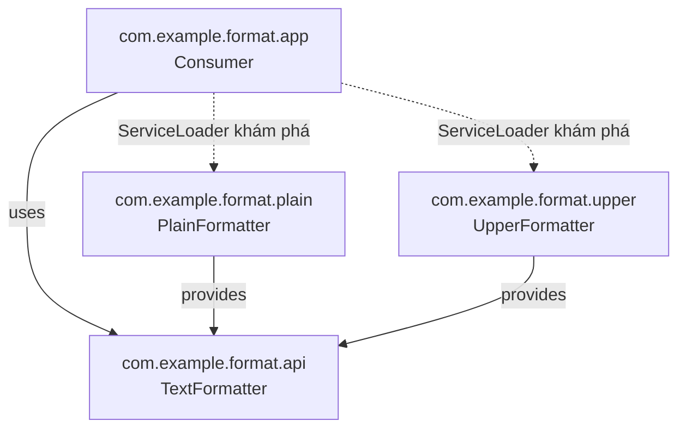

# ServiceLoader, uses và provides cho kiến trúc mở rộng

Trong Java 27, nhiều ứng dụng cần **cho phép bổ sung cách thực hiện một khả năng mà không sửa mã lõi**. Ví dụ, công cụ xuất báo cáo có thể hỗ trợ nhiều bộ định dạng; công cụ xử lý dữ liệu có thể bổ sung bộ giải mã; hoặc ứng dụng server có thể chọn một chiến lược lưu trữ khác theo môi trường triển khai.

Java Platform Module System (**JPMS**) cung cấp cơ chế **service binding** kết hợp với API `java.util.ServiceLoader`. Một module khai báo **nhu cầu sử dụng** một service bằng `uses`, module khác khai báo **khả năng cung cấp** service bằng `provides ... with ...`, còn mã ứng dụng dùng `ServiceLoader` để khám phá provider tại runtime.

Ba vai trò cần phân biệt:

- **Service / SPI (Service Provider Interface)**: giao diện hoặc lớp trừu tượng mô tả **hợp đồng** mà nhiều implementation có thể đáp ứng.
- **Provider**: một implementation cụ thể, hoặc một provider factory tạo ra đối tượng triển khai service.
- **Consumer**: mã muốn tìm và sử dụng provider thông qua hợp đồng chung mà không cần tham chiếu trực tiếp tên lớp implementation.

Bài này thuộc chương **Module và đóng gói thư viện** của Java 27. Mọi ví dụ ưu tiên cơ chế service loading đã ổn định từ Java 9, không dùng cơ chế extension directory/endorsed standards cũ và không cần bật tính năng preview.

## 1. Vì sao ứng dụng cần service provider?

Giả sử một ứng dụng xuất văn bản có hai lựa chọn:

- **Plain formatter**: giữ nguyên văn bản.
- **Uppercase formatter**: chuyển văn bản thành chữ hoa.

Một cách thiết kế phụ thuộc chặt vào implementation là:

```java
if (mode.equals("plain")) {
    return new PlainFormatter().format(text);
}
return new UpperFormatter().format(text);
```

Mỗi khi thêm implementation mới, mã lõi cần biết tên lớp cụ thể và sửa nhánh điều kiện. Nếu thư viện lõi được phân phối riêng, điều này gây phụ thuộc ngược từ core sang plugin.

Với kiến trúc SPI, ứng dụng chỉ cần biết `TextFormatter`, còn provider được đăng ký ở module riêng. Khi một provider mới được đưa vào **tập module được resolve lúc chạy**, `ServiceLoader` có thể tìm thấy provider mà mã consumer không phải `new` lớp đó trực tiếp.



**ServiceLoader là cơ chế khám phá và khởi tạo service**, không phải container dependency injection đầy đủ: nó không tự quản lý mọi dependency, vòng đời nghiệp vụ hoặc cơ chế cách ly plugin không tin cậy.

## 2. `requires`, `exports`, `uses` và `provides` làm những việc khác nhau

Các chỉ thị được đặt trong `module-info.java`, nhưng không có ý nghĩa thay thế nhau.

| Chỉ thị | Mục đích | Ví dụ |
|---|---|---|
| `requires` | Khai báo module phụ thuộc để đọc các package/type mà module khác công bố | `requires com.example.format.api;` |
| `exports` | Công bố package để module khác có thể truy cập các type `public` của package đó | `exports com.example.format.spi;` |
| `uses` | Khai báo module này **tiêu thụ** một service và có quyền khám phá provider | `uses com.example.format.spi.TextFormatter;` |
| `provides ... with ...` | Khai báo module này **cung cấp** service qua một hoặc nhiều provider | `provides ...TextFormatter with ...PlainFormatter;` |
| `opens` | Cho phép reflective access theo luật JPMS | Không cần chỉ để ServiceLoader gọi provider đã đăng ký hợp lệ |

Một điểm dễ nhầm là cho rằng consumer phải viết `requires com.example.format.plain;` thì mới sử dụng được provider. **Không cần**: consumer chỉ phụ thuộc vào module chứa kiểu `TextFormatter`; việc tìm provider là công việc của `ServiceLoader` và cơ chế module resolution.

Ngược lại, provider thường viết `requires com.example.format.api;` để hiện thực và tham chiếu service type. Một module có `provides` phải chứa provider được khai báo trong **chính module đó**, không thể trỏ tới một implementation thuộc module khác.

### Phân biệt ba mức phụ thuộc

1. **Compile-time dependency**: module app và plugin đều cần hợp đồng `TextFormatter`.
2. **Service-use dependency**: module app tuyên bố `uses TextFormatter`; đây không phải một lệnh `requires` trực tiếp đến plugin.
3. **Runtime configuration**: provider phải thực sự có mặt và được **resolve** trong module layer (hoặc có cấu hình class path thích hợp); chỉ đặt một JAR bất kỳ lên ổ đĩa không bảo đảm provider khả dụng.

## 3. Cấu trúc ví dụ: 4 named modules

Ta sẽ xây dựng một ứng dụng tối giản có bốn module:

| Module | Trách nhiệm |
|---|---|
| `com.example.format.api` | Công bố SPI `TextFormatter` |
| `com.example.format.plain` | Provider giữ nguyên nội dung |
| `com.example.format.upper` | Provider chuyển nội dung thành chữ hoa |
| `com.example.format.app` | Consumer tìm và chạy các formatter |

Cấu trúc thư mục nguồn (mỗi module có `module-info.java` riêng):

```text
src/
├── com.example.format.api/
│   ├── module-info.java
│   └── com/example/format/spi/TextFormatter.java
├── com.example.format.plain/
│   ├── module-info.java
│   └── com/example/format/plain/PlainFormatter.java
├── com.example.format.upper/
│   ├── module-info.java
│   └── com/example/format/upper/UpperFormatter.java
└── com.example.format.app/
    ├── module-info.java
    └── com/example/format/app/Main.java
```

Tên module và tên package trong bài chỉ là ví dụ. Hãy giữ chúng **nhất quán ở khai báo module, `package` trong source và các câu lệnh `javac`/`java`**.

### 3.1. Module API công bố service contract

File `src/com.example.format.api/module-info.java`:

```java
module com.example.format.api {
    exports com.example.format.spi;
}
```

File `src/com.example.format.api/com/example/format/spi/TextFormatter.java`:

```java
package com.example.format.spi;

public interface TextFormatter {
    String id();
    String format(String input);
}
```

`exports com.example.format.spi` giúp provider và app tham chiếu trực tiếp tới type `TextFormatter`. API chỉ mô tả hành vi; nó không có constructor của một formatter cụ thể và không chứa logic đăng ký các implementation.

Phương thức `id()` cung cấp định danh nghiệp vụ để consumer lựa chọn provider theo cấu hình. Không dùng thứ tự provider tìm được làm tên định danh.

### 3.2. Module provider thứ nhất: PlainFormatter

File `src/com.example.format.plain/module-info.java`:

```java
module com.example.format.plain {
    requires com.example.format.api;

    provides com.example.format.spi.TextFormatter
        with com.example.format.plain.PlainFormatter;
}
```

File `src/com.example.format.plain/com/example/format/plain/PlainFormatter.java`:

```java
package com.example.format.plain;

import com.example.format.spi.TextFormatter;
import java.util.Objects;

public final class PlainFormatter implements TextFormatter {
    public PlainFormatter() {
    }

    @Override
    public String id() {
        return "plain";
    }

    @Override
    public String format(String input) {
        return Objects.requireNonNull(input, "input");
    }
}
```

`provides TextFormatter with PlainFormatter` đăng ký provider với JPMS. Ở đây `PlainFormatter` là một lớp `public`, **implements** interface service và có **public constructor không tham số**. Đây là kiểu provider dựa trên constructor (*provider constructor*).

Lưu ý `module-info.java` **không `exports com.example.format.plain;`**. Mục đích của SPI là cho consumer gọi qua `TextFormatter`; không cần công khai package implementation. ServiceLoader vẫn có thể tạo provider đã khai báo hợp lệ, không cần thêm `opens` chỉ để nó hoạt động.

### 3.3. Module provider thứ hai: UpperFormatter

File `src/com.example.format.upper/module-info.java`:

```java
module com.example.format.upper {
    requires com.example.format.api;

    provides com.example.format.spi.TextFormatter
        with com.example.format.upper.UpperFormatter;
}
```

File `src/com.example.format.upper/com/example/format/upper/UpperFormatter.java`:

```java
package com.example.format.upper;

import com.example.format.spi.TextFormatter;
import java.util.Locale;
import java.util.Objects;

public final class UpperFormatter implements TextFormatter {
    public UpperFormatter() {
    }

    @Override
    public String id() {
        return "upper";
    }

    @Override
    public String format(String input) {
        return Objects.requireNonNull(input, "input")
                .toUpperCase(Locale.ROOT);
    }
}
```

`Locale.ROOT` giúp quy tắc chuyển chữ hoa độc lập với locale mặc định của máy. Với nội dung cần quy tắc ngôn ngữ cụ thể, phải dùng locale tương ứng của ứng dụng; ở đây chỉ minh họa provider khác nhau.

### 3.4. Module ứng dụng: `uses` và `ServiceLoader`

File `src/com.example.format.app/module-info.java`:

```java
module com.example.format.app {
    requires com.example.format.api;

    uses com.example.format.spi.TextFormatter;
}
```

File `src/com.example.format.app/com/example/format/app/Main.java`:

```java
package com.example.format.app;

import com.example.format.spi.TextFormatter;
import java.util.Comparator;
import java.util.List;
import java.util.ServiceLoader;

public final class Main {
    public static void main(String[] args) {
        List<TextFormatter> formatters = ServiceLoader
                .load(TextFormatter.class)
                .stream()
                .map(ServiceLoader.Provider::get)
                .sorted(Comparator.comparing(TextFormatter::id))
                .toList();

        if (formatters.isEmpty()) {
            throw new IllegalStateException(
                    "Không tìm thấy provider TextFormatter");
        }

        for (TextFormatter formatter : formatters) {
            System.out.println(formatter.id() + " -> "
                    + formatter.format("Java 27"));
        }
    }
}
```

App không import `PlainFormatter` hoặc `UpperFormatter`. Nó chỉ biết `TextFormatter` và dùng `ServiceLoader` để khám phá provider. Sắp xếp theo `id()` nhằm tạo đầu ra minh họa **ổn định**; thứ tự khám phá provider của service loader không phải cơ chế ưu tiên đáng tin cậy.

### Lưu ý về tính nguyên vẹn của ví dụ

Bốn module trên là **bốn đơn vị biên dịch riêng**, không phải bốn lớp đặt lẫn vào cùng một file `.java`. Từng ví dụ code cần được lưu đúng `package` và vị trí tương ứng như cây thư mục. Với nguồn được chia module, câu lệnh chạy phải có `--module-path` và chọn main module đúng tên.

## 4. Biên dịch và chạy ví dụ nhiều module với JDK 27

Các câu lệnh dưới đây giả định bạn đã tạo toàn bộ cấu trúc `src/` ở phần 3, đang đứng tại thư mục gốc ví dụ và có JDK 27 trong `PATH`. Cú pháp sử dụng các lệnh `javac` và `java` chuẩn; không phụ thuộc Gradle hoặc Maven.

### Biên dịch bằng module source path

Tạo thư mục đầu ra một lần:

```text
mkdir out
```

Sau đó biên dịch bốn module cùng lúc:

```bash
javac --module-source-path src -d out -m com.example.format.api,com.example.format.plain,com.example.format.upper,com.example.format.app
```

`--module-source-path src` cho compiler biết mỗi thư mục con trực tiếp của `src` tương ứng một named module. `-m` chọn các module cần biên dịch; `-d out` tạo cấu trúc đầu ra theo tên module.

Sau biên dịch, cấu trúc sẽ gồm các thư mục module chứa `module-info.class`:

```text
out/
├── com.example.format.api/
├── com.example.format.plain/
├── com.example.format.upper/
└── com.example.format.app/
```

**Nếu dùng Windows PowerShell**, `mkdir out` và câu lệnh `javac` vẫn có thể dùng như trên. Không cần cú pháp glob `*.java` hoặc lệnh tìm file đặc thù hệ điều hành.

### Chạy consumer và đưa provider vào tập module đã resolve

```bash
java --module-path out --add-modules com.example.format.plain,com.example.format.upper --module com.example.format.app/com.example.format.app.Main
```

Trong câu lệnh:

- `--module-path out` chỉ định nơi tìm các named modules đã biên dịch.
- `--module com.example.format.app/com.example.format.app.Main` xác định module và main class.
- `--add-modules com.example.format.plain,com.example.format.upper` đưa hai plugin vào tập module được resolve **một cách tường minh** cho ví dụ, không phụ thuộc suy đoán rằng mọi JAR trên module path đều được nạp.

Kết quả dự kiến:

```text
plain -> Java 27
upper -> JAVA 27
```

Việc app không khai báo `requires` tới hai provider là **cố ý**. Khi chạy bình thường, Java module resolver còn có thể đưa provider vào cấu hình thông qua *service binding*, nhưng việc liệt kê tường minh provider trong bài thực hành giúp kiểm soát đúng những module đang hiện diện. Trong ứng dụng thực tế, bạn cần quyết định rõ chiến lược chọn module provider ở giai đoạn launch/build.

### Kiểm tra module resolution

Có thể thêm `--show-module-resolution` để xem những module được resolve và các liên kết dependency/service tại thời điểm chạy:

```bash
java --show-module-resolution --module-path out --add-modules com.example.format.plain,com.example.format.upper --module com.example.format.app/com.example.format.app.Main
```

Các dòng thông báo phụ thuộc nội dung module graph và phiên bản JDK. Công cụ này hữu ích khi `ServiceLoader` không thấy provider dù bạn đã đặt code hoặc JAR trên module path.

## 5. Vai trò của `uses` và `provides` trong cơ chế khám phá

Cùng một service type xuất hiện ở **ba module descriptor khác nhau**, nhưng vai trò mỗi nơi là riêng biệt:

**Module chứa API:**

```java
module com.example.format.api {
    exports com.example.format.spi;
}
```

**Module tiêu thụ:**

```java
module com.example.format.app {
    requires com.example.format.api;
    uses com.example.format.spi.TextFormatter;
}
```

**Module cung cấp:**

```java
module com.example.format.plain {
    requires com.example.format.api;
    provides com.example.format.spi.TextFormatter
        with com.example.format.plain.PlainFormatter;
}
```

Điều này tạo một kiến trúc trong đó **consumer biết service interface nhưng không phải biết implementation**. Provider biết hợp đồng mà nó cung cấp, nhưng không cần import app.

### Các ràng buộc của `provides`

Theo Java Language Specification, một provider hợp lệ trong named module cần tuân thủ những quy tắc chính:

1. Type trong `provides ... with ProviderType` phải là **`public`** và là kiểu top-level hoặc nested `static` hợp lệ.
2. Provider được khai báo trong **chính module** có chỉ thị `provides`.
3. Nếu dùng **provider constructor**, lớp provider phải là subtype của service và có `public` constructor không tham số.
4. Nếu dùng **provider method**, provider type có một `public static` method tên `provider`, không tham số, trả về một subtype hợp lệ của service. Provider type tự nó không nhất thiết phải implements interface.
5. Không được chỉ định hai `provides` cho cùng một service trong một module, hoặc liệt kê trùng provider trong một `with`.
6. Service type phải hợp lệ và truy cập được từ module khai báo; không khai báo một enum làm service.

**Quan trọng:** Provider class **không cần package được `exports` hoặc `opens` cho consumer**, miễn là provider đã được đăng ký đúng và thỏa các điều kiện ServiceLoader. Việc mở package implementation cho mọi module thường làm mất lợi ích đóng gói mà JPMS mang lại.

### Nếu thiếu `uses` thì sao?

Khi mã trong **một explicit named module** gọi `ServiceLoader.load(TextFormatter.class)` nhưng module đó không khai báo `uses TextFormatter`, `ServiceLoader` có thể ném `ServiceConfigurationError` về việc module không khai báo sử dụng service.

Đây là khác biệt quan trọng giữa việc chỉ import interface ở compile time và việc tuyên bố sử dụng service ở module descriptor. Thêm `requires api` **không thay cho** `uses SPI`.

## 6. Provider constructor so với provider factory method

Một named module có hai cách hiện hành để khởi tạo service provider.

### Cách A: Provider constructor

Ví dụ `PlainFormatter` ở phần trước triển khai trực tiếp service:

```java
public final class PlainFormatter implements TextFormatter {
    public PlainFormatter() { }

    @Override
    public String id() { return "plain"; }

    @Override
    public String format(String text) { return text; }
}
```

Khi cần tạo provider, `ServiceLoader` có thể gọi **public constructor không tham số**. Constructor không nên tự thực hiện công việc nặng hoặc có tác dụng phụ không cần thiết nếu việc liệt kê provider có thể xảy ra trong lúc khởi động ứng dụng.

### Cách B: Static provider method tên `provider`

Named module cũng có thể khai báo một lớp factory làm provider type:

```java
package com.example.format.factory;

import com.example.format.spi.TextFormatter;
import java.util.Objects;

public final class FormatterFactory {
    private FormatterFactory() {
    }

    public static TextFormatter provider() {
        return new SpecialFormatter();
    }
}

final class SpecialFormatter implements TextFormatter {
    @Override
    public String id() {
        return "special";
    }

    @Override
    public String format(String input) {
        return "[" + Objects.requireNonNull(input, "input") + "]";
    }
}
```

Đặt đoạn mã trên vào `FormatterFactory.java`. `SpecialFormatter` là lớp package-private triển khai `TextFormatter` trong cùng module provider, nên có thể giữ kín package implementation. Module descriptor của module provider sẽ có:

```java
provides com.example.format.spi.TextFormatter
    with com.example.format.factory.FormatterFactory;
```

Đây là **biến thể thiết kế thay thế**, không phải một phần bổ sung vào source của bốn module ví dụ đã chạy ở phần 4. Class `FormatterFactory` là `public`, method `provider()` là `public static`, **không nhận tham số** và trả về đối tượng tương thích với service type. Lớp factory **không cần implements** `TextFormatter`, và có thể không cần public no-args constructor vì ServiceLoader dùng factory method.

Provider factory hữu ích khi tạo implementation cần logic lựa chọn, cấu hình nội bộ hoặc đối tượng đã được chuẩn bị. Tuy nhiên, không được giả định ServiceLoader tự truyền dependency vào method `provider()`: nó **không nhận tham số**. Nếu phải khởi tạo phức tạp, đặt trách nhiệm rõ ràng trong factory hoặc một cơ chế cấu hình có chủ đích.

**Phạm vi hỗ trợ:** Provider factory method gắn với provider khai báo bằng `provides` trong **explicit named module**. Đối với provider được liệt kê trong `META-INF/services` ở class path hoặc thuộc automatic module, không sử dụng cơ chế provider factory method này theo cách tương tự.

## 7. `ServiceLoader` khám phá, tạo instance và cache provider

`ServiceLoader<S>` triển khai `Iterable<S>`, có thể dùng `for-each` hoặc `stream()` để khám phá provider. Các provider được **khởi tạo lười** (*lazy*) khi thật sự được yêu cầu; việc chỉ tạo một `ServiceLoader` không có nghĩa tất cả implementation đã được khởi tạo.

### Cách đơn giản: duyệt tất cả

```java
ServiceLoader<TextFormatter> loader =
        ServiceLoader.load(TextFormatter.class);

for (TextFormatter formatter : loader) {
    System.out.println(formatter.id());
}
```

Trong một explicit named module, caller phải khai báo `uses` phù hợp. `ServiceLoader.load(Class<S>)` sử dụng thread context class loader để bắt đầu tìm kiếm; chi tiết class loader/module layer có thể ảnh hưởng tập provider tìm được trong ứng dụng có kiến trúc nạp lớp phức tạp.

### `stream()` và `Provider<S>`

`ServiceLoader.stream()` trả về `Stream<ServiceLoader.Provider<S>>`, không phải trực tiếp `Stream<S>`.

```java
ServiceLoader<TextFormatter> loader =
        ServiceLoader.load(TextFormatter.class);

List<String> formatterTypes = loader.stream()
        .map(provider -> provider.type().getName())
        .toList();

List<TextFormatter> instances = loader.stream()
        .map(ServiceLoader.Provider::get)
        .toList();
```

- `provider.type()` cho biết kiểu được service provider công bố; với provider factory, kiểu này có thể là **kiểu trả về** của method `provider()` chứ không phải bản thân lớp factory.
- `provider.get()` cung cấp một instance của service, gọi constructor hoặc factory method tương ứng khi cần.
- `stream()` đặc biệt hữu ích nếu cần xem metadata type trước khi tạo instance, nhưng không nên hiểu đây là một cách bảo đảm không phát sinh mọi lỗi provider.

`Provider.get()` không nhất thiết trả về cùng một instance qua mọi lần gọi trong tất cả cách khởi tạo; việc factory giữ singleton hay tạo đối tượng mới là quyết định của provider.

### Cache, `findFirst()` và `reload()`

`ServiceLoader` duy trì cache cho các provider đã được nạp khi duyệt. Gọi `iterator()` hoặc `stream()` lần sau trên **cùng loader** sẽ thấy những provider đã cache trước rồi mới tìm thêm những provider chưa được khám phá.

```java
ServiceLoader<TextFormatter> loader =
        ServiceLoader.load(TextFormatter.class);

var maybeFirst = loader.findFirst(); // Optional<TextFormatter>
loader.reload();                     // xóa cache hiện tại
```

- `findFirst()` chỉ lấy provider đầu tiên theo thứ tự khám phá, **không phải** “provider tốt nhất”.
- `reload()` xóa cache để loader có thể thực hiện lại việc khám phá/khởi tạo theo ngữ cảnh class loader và module layer hiện tại.
- Sau `reload()`, các iterator/stream đang sử dụng không nên được dùng tiếp; một số trường hợp có thể gặp `ConcurrentModificationException`.
- `ServiceLoader` **không thread-safe**; không truy cập hoặc gọi `reload()` đồng thời trên cùng instance khi chưa đồng bộ hóa thích hợp.

**`reload()` không phải hot deploy:** Sao chép một JAR mới vào thư mục module path sau khi JVM đã khởi động **không tự thêm module ấy vào boot layer**. Để triển khai plugin động thực sự, cần chiến lược module layer/class loader, khởi động lại, hoặc một cơ chế plugin riêng được thiết kế cho vòng đời nạp/gỡ.

## 8. Chọn đúng provider, không dựa vào thứ tự khám phá

Một ứng dụng thực tế thường có cấu hình như `formatter=upper`. **Không dùng `findFirst()` để đoán lựa chọn đúng**, vì thứ tự các provider thuộc nhiều module hoặc module layer không được bảo đảm giống nhau trên mọi cấu hình.

Hãy cung cấp định danh ổn định ở SPI (trong ví dụ là `id()`), tìm provider theo cấu hình, kiểm tra trùng lặp và đưa ra lỗi có ý nghĩa:

```java
import com.example.format.spi.TextFormatter;
import java.util.HashMap;
import java.util.Map;
import java.util.ServiceLoader;

static TextFormatter chooseFormatter(String requestedId) {
    Map<String, TextFormatter> byId = new HashMap<>();

    for (TextFormatter formatter :
            ServiceLoader.load(TextFormatter.class)) {
        TextFormatter previous =
                byId.putIfAbsent(formatter.id(), formatter);

        if (previous != null) {
            throw new IllegalStateException(
                    "Trùng formatter id: " + formatter.id());
        }
    }

    TextFormatter selected = byId.get(requestedId);
    if (selected == null) {
        throw new IllegalArgumentException(
                "Không hỗ trợ formatter id: " + requestedId);
    }
    return selected;
}
```

Đặt method này bên trong một class thuộc **module đã khai báo `uses TextFormatter`**. Đoạn mã minh họa helper method riêng, không phải một file Java hoàn chỉnh. Phương thức tạo bản đồ `id → provider` nên được tách thành một lớp registry có vòng đời phù hợp nếu ứng dụng tra cứu nhiều lần.

Một số thiết kế khác:

- **Fail fast:** không có provider bắt buộc thì báo lỗi khi khởi động.
- **Default rõ ràng:** nếu không có cấu hình thì dùng một `id` mặc định đã được xác định, không dựa vào thứ tự ServiceLoader.
- **Nhiều provider cùng xử lý:** lưu thành danh sách và áp dụng theo quy tắc có chủ đích.
- **Ưu tiên theo capability:** cung cấp API mô tả capability/version thay vì lấy tên lớp Java hoặc vị trí JAR làm quy tắc.

Nếu hệ thống cần nhiều mức ưu tiên, hãy lưu chúng trong một hợp đồng kiểu rõ ràng và xử lý xung đột. **Thứ tự đăng ký không phải là chính sách ưu tiên nghiệp vụ**.

## 9. Đóng gói mỗi module thành modular JAR

Ví dụ phần 4 chạy từ **exploded modules** (các thư mục class). Khi phát hành thư viện hoặc plugin, có thể đóng gói từng module thành **modular JAR** chứa `module-info.class`.

Tạo thư mục đầu ra:

```text
mkdir mlib
```

Sau đó tạo JAR từ nội dung từng thư mục module đã biên dịch:

```bash
jar --create --file mlib/com.example.format.api.jar -C out/com.example.format.api .
jar --create --file mlib/com.example.format.plain.jar -C out/com.example.format.plain .
jar --create --file mlib/com.example.format.upper.jar -C out/com.example.format.upper .
jar --create --file mlib/com.example.format.app.jar -C out/com.example.format.app .
```

Các JAR được tạo có dạng:

```text
mlib/
├── com.example.format.api.jar
├── com.example.format.plain.jar
├── com.example.format.upper.jar
└── com.example.format.app.jar
```

Kiểm tra descriptor của provider đã đóng gói:

```bash
jar --describe-module --file mlib/com.example.format.plain.jar
```

Đầu ra sẽ chứa thông tin module name, `requires` và `provides` (cách trình bày phụ thuộc tool version). Khi muốn xem toàn bộ dependency graph, có thể dùng `jdeps` hoặc `java --show-module-resolution` tùy mục tiêu chẩn đoán.

Chạy từ modular JAR:

```bash
java --module-path mlib --add-modules com.example.format.plain,com.example.format.upper --module com.example.format.app/com.example.format.app.Main
```

Kết quả kỳ vọng vẫn là:

```text
plain -> Java 27
upper -> JAVA 27
```

**Hai quy tắc đóng gói quan trọng:**

1. JAR ở `--module-path` **không đồng nghĩa** các module trong đó đều đã được resolve. Phải bảo đảm module provider tham gia cấu hình module lúc chạy, chẳng hạn đưa vào `--add-modules` hoặc dùng service binding thích hợp.
2. Một module cung cấp provider **không cần export package implementation** chỉ để `ServiceLoader` tạo nó. Hãy chỉ export những package thực sự là API công khai.

Trong dự án nhiều module sử dụng Maven/Gradle, các công cụ build có thể tự động hóa việc biên dịch và đóng gói, nhưng các hợp đồng của `module-info.java` không thay đổi.

## 10. Khi đóng gói JAR trên class path: `META-INF/services`

Trong hệ sinh thái Java, một số thư viện bên thứ ba vẫn được phân phối dưới dạng JAR trên **class path**. `ServiceLoader` hỗ trợ cơ chế khai báo provider tương ứng bằng tệp cấu hình. Cơ chế này vẫn **được hỗ trợ** để tương tác với thư viện class-path, nhưng không nên nhầm với `provides` trong explicit named module.

Đường dẫn bên trong JAR:

```text
META-INF/services/com.example.format.spi.TextFormatter
```

Nội dung tệp cấu hình (UTF-8):

```text
com.example.format.plain.PlainFormatter
com.example.format.upper.UpperFormatter
```

Mỗi dòng là tên nhị phân đầy đủ của một provider class; dòng trống và chú thích bắt đầu bằng `#` được hỗ trợ. Provider class phải khả dụng qua class loader được sử dụng, triển khai đúng service type và có **public constructor không tham số** theo quy tắc class-path provider.

Các điểm cần phân biệt:

| Named modular JAR | JAR ở class path |
|---|---|
| Có `module-info.class` | Thường không có explicit module descriptor |
| Đăng ký bằng `provides Service with Provider` trong `module-info.java` | Đăng ký bằng `META-INF/services/<service-binary-name>` |
| Consumer explicit named module khai báo `uses Service` | Mã ở unnamed module không có `module-info.java` |
| Provider có thể dùng public constructor hoặc public static `provider()` theo luật named module | Provider-config class path dùng public no-args constructor, **không** dùng provider method như named module |
| Có đóng gói mạnh bằng `exports`/`opens` | Không có strong encapsulation ở mức named module giống JPMS |

Trong Java 27, **cả hai cách triển khai service vẫn hiện hành**. Khi xây dựng một hệ thống modular từ đầu, `provides`/`uses` thường phù hợp với JPMS. Khi tích hợp thư viện class-path, tệp `META-INF/services` giúp tương thích, nhưng cần kiểm tra cách phối hợp class loader, module path và unnamed module.

**Automatic modules** là trường hợp trung gian: JAR không có explicit descriptor khi đặt lên module path có thể được xem là automatic module. Service providers của automatic module dựa trên cấu hình dịch vụ kiểu JAR/class path tương ứng, không hỗ trợ khai báo một provider factory method bằng `provides` như explicit named module. Với thư viện mới có yêu cầu đóng gói rõ ràng, cân nhắc phát hành modular JAR tường minh.

## 11. `jlink` và vai trò của service binding khi đóng gói runtime

Một ứng dụng modular có thể được đưa vào một **custom runtime image** bằng `jlink`. Khi xây dựng image, cần chú ý rằng module được khai báo qua `uses` không có nghĩa mọi provider đều **tự động có mặt trong image**.

Ví dụ (giả định các modular JAR hợp lệ đã nằm trong `mlib` và công cụ `jlink` thuộc JDK 27):

**Cách 1 — Liệt kê provider cần đóng gói một cách tường minh:**

```bash
jlink --module-path mlib --add-modules com.example.format.app,com.example.format.plain,com.example.format.upper --output format-runtime
```

**Cách 2 — Cho jlink đưa thêm provider qua service binding:**

```bash
jlink --module-path mlib --add-modules com.example.format.app --bind-services --output format-runtime-bound
```

`--bind-services` cho phép `jlink` kéo các module cung cấp những service mà module được resolve sử dụng, cùng dependency của chúng. Nó **có thể** làm image chứa nhiều module hơn dự kiến. Nếu mục tiêu là chỉ đóng gói một tập plugin được duyệt trước, cách liệt kê tường minh thường dễ kiểm soát hơn.

Lưu ý `jlink` mặc định không nhất thiết thực hiện service binding như một lần chạy thông thường bằng `java`. Vì thế một ứng dụng có provider khi chạy từ JDK đầy đủ có thể thiếu provider trong image tinh gọn nếu lúc link không đưa chúng vào.

Có thể kiểm tra module được đóng gói:

```bash
format-runtime/bin/java --list-modules
```

Đường dẫn chạy trên Windows sẽ có cách viết `format-runtime\bin\java.exe`. Hai lệnh `jlink` là hai phương án tạo **hai output directory khác nhau**, không phải lệnh chạy liên tiếp để cập nhật cùng một image.

**Điểm triển khai:** Việc tạo image có thể phụ thuộc module path của JDK, dạng JAR/module được hỗ trợ và các hạn chế của provider/toolchain. Khi phân phối runtime image, bạn chịu trách nhiệm cập nhật lại image khi có cập nhật bảo mật hoặc thay đổi plugin.

## 12. ModuleLayer và plugin nạp động: mức độ mở rộng nâng cao

`ServiceLoader.load(TextFormatter.class)` trong ví dụ hoạt động trong cấu hình class loader/module layer hiện tại. Với plugin cần nạp thêm **sau khi ứng dụng đã khởi động**, bạn không thể chỉ chép JAR vào thư mục rồi gọi `reload()` và mong module mới xuất hiện trong boot layer.

Một kiến trúc plugin nâng cao có thể:

1. Nhận các JAR mới theo quy trình kiểm tra, xác thực và phê duyệt.
2. Dùng `ModuleFinder` và `Configuration` để resolve module graph mới.
3. Tạo một **ModuleLayer** con với class loader phù hợp.
4. Tra cứu provider qua `ServiceLoader.load(layer, TextFormatter.class)`.
5. Quản lý vòng đời, tài nguyên, phiên bản và việc giải phóng layer/class loader khi không còn dùng.

Đây là **bài toán kiến trúc nâng cao**, không chỉ một overload của `ServiceLoader`. Việc định nghĩa layer, quan hệ readability, class loader và khả năng nhìn thấy các type cần được thiết kế đúng; đặc biệt, service type phải được nhận diện nhất quán giữa consumer và provider.

`ServiceLoader.load(ModuleLayer layer, Class<S> service)` tìm provider trong layer được chỉ định và các layer cha của nó theo hợp đồng. Nó **không** tìm provider ở unnamed module qua class path theo cơ chế overload này.

Nếu ứng dụng không thực sự cần plugin nạp động, **khởi động lại sau khi thay đổi tập module** thường đơn giản hơn việc tự xây hệ thống layer quản trị thời gian chạy.

## 13. Xử lý lỗi `ServiceConfigurationError` và chính sách khi không có provider

`ServiceLoader` có thể thất bại không chỉ khi gọi `load` mà còn **lúc duyệt** hoặc **lúc lấy instance**. Chẳng hạn:

- Provider class được khai báo nhưng không tải được.
- Provider không có public no-args constructor hợp lệ khi cần dùng constructor.
- Provider factory method sai chữ ký, trả về `null` hoặc ném lỗi khi tạo instance.
- Cấu hình `META-INF/services` không hợp lệ hoặc lớp được khai báo không tương thích service.
- Mã trong explicit named module gọi load service mà không khai báo `uses` phù hợp.

Những tình huống này có thể được báo bằng **`ServiceConfigurationError`**, một subtype của `Error`, **không phải** `IOException` hoặc `RuntimeException`. Vì lỗi cấu hình có thể chỉ phát sinh sau khi bắt đầu iteration, đoạn code chỉ bao `ServiceLoader.load(...)` trong `try` là chưa đủ nếu muốn kiểm soát lỗi ở ranh giới khởi tạo.

Ví dụ một ranh giới khởi động ứng dụng:

```java
import com.example.format.spi.TextFormatter;
import java.util.ArrayList;
import java.util.List;
import java.util.ServiceConfigurationError;
import java.util.ServiceLoader;

static List<TextFormatter> loadFormatters() {
    try {
        List<TextFormatter> found = new ArrayList<>();

        for (TextFormatter formatter :
                ServiceLoader.load(TextFormatter.class)) {
            found.add(formatter);
        }

        if (found.isEmpty()) {
            throw new IllegalStateException(
                    "Không có TextFormatter provider được cấu hình");
        }
        return List.copyOf(found);
    } catch (ServiceConfigurationError error) {
        throw new IllegalStateException(
                "Cấu hình plugin TextFormatter không hợp lệ", error);
    }
}
```

Phương thức minh họa cần đặt trong một class thuộc module có `uses TextFormatter`. Quyết định **biến `ServiceConfigurationError` thành lỗi khởi động có thông điệp rõ ràng** là một chính sách ứng dụng, không phải khuyến nghị bắt rồi âm thầm bỏ qua mọi provider hỏng.

### Không có provider khác với provider lỗi

- **Không có provider**: iteration có thể trả danh sách rỗng; chọn báo lỗi, fallback có chủ đích hoặc vô hiệu hóa tính năng.
- **Provider được khai báo nhưng bị lỗi tải/khởi tạo**: `ServiceConfigurationError` có thể được ném; không nên mặc nhiên coi đó là “không có plugin”.
- **Provider được tạo thành công nhưng kết quả xử lý sai**: đây là lỗi nghiệp vụ hoặc lỗi contract của implementation, cần kiểm thử và quan sát riêng.

Nếu hệ thống có nhiều plugin và muốn tiếp tục sau một provider hỏng, việc bỏ qua lỗi phải được thiết kế rất cẩn thận, kèm log, metrics và chính sách tương thích; không giả định mọi lỗi ServiceLoader đều có thể được phục hồi an toàn.

## 14. Kiến trúc plugin không phải sandbox bảo mật

JPMS mạnh ở khả năng **đóng gói API và kiểm soát readability** giữa các named modules. Nhưng chỉ vì implementation không được `exports`, không có nghĩa plugin bên thứ ba chạy trong **một sandbox biệt lập về quyền hệ điều hành**.

Provider code chạy trong JVM của ứng dụng, có thể làm I/O, tạo thread, tiêu tốn CPU/bộ nhớ và tương tác với những API mà nó truy cập được. Bởi vậy:

1. Chỉ tải plugin từ nguồn đáng tin cậy, có quy trình phê duyệt và quản lý phiên bản.
2. Dùng hợp đồng SPI tối thiểu, rõ ràng; không trao dữ liệu nhạy cảm cho plugin nếu không cần.
3. Validate đầu vào/đầu ra ở ranh giới giữa consumer và provider.
4. Theo dõi thời gian xử lý, lỗi, mức tài nguyên và những phụ thuộc mà plugin tải.
5. Nếu cần chạy code **không tin cậy**, cân nhắc **cách ly bằng tiến trình/container hoặc cơ chế bảo mật ở hệ điều hành**, thay vì coi `ServiceLoader` và `module-info.java` là sandbox.

Tính **encapsulation** giúp bảo vệ ranh giới code và API; nó không thay thế việc quản trị rủi ro vận hành khi cho bên ngoài thực thi code trong cùng JVM.

## 15. Các lỗi cấu hình thường gặp và cách chẩn đoán

| Triệu chứng | Nguyên nhân thường gặp | Cách kiểm tra |
|---|---|---|
| `ServiceLoader` không tìm thấy provider | Module provider chưa resolve hoặc cấu hình service thiếu | Kiểm tra `--module-path`, `--add-modules`, `--show-module-resolution` và `provides` |
| Compiler không nhìn thấy `TextFormatter` | Chưa `requires` module API hoặc API package chưa `exports` | Kiểm tra cả descriptor và `package` |
| `ServiceConfigurationError` báo thiếu `uses` | Caller trong explicit named module chưa khai báo dùng service | Thêm `uses <service-type>;` tại module chứa mã gọi ServiceLoader |
| Provider không khởi tạo được | Constructor/factory sai hoặc ném lỗi | Kiểm tra `public`, kiểu trả về, method `provider()` và log nguyên nhân |
| Provider có `provides` nhưng app vẫn không chạy được | Module graph/module path chưa đúng, provider lỗi lúc nạp | Dùng `jar --describe-module` và `--show-module-resolution` |
| Thứ tự plugin khác giữa các lần chạy | Không có thứ tự toàn cục được bảo đảm | Chọn theo `id`/cấu hình, không dùng vị trí iteration |
| Đưa JAR mới vào thư mục nhưng `reload()` không thấy | Module mới không tự gia nhập layer đã resolve | Khởi động lại hoặc thiết kế layer nạp động |
| Provider chạy từ JDK đầy đủ nhưng thiếu trong image `jlink` | Image không chứa provider module | Thêm provider vào `--add-modules` hoặc đánh giá `--bind-services` |
| Module app phải import implementation cụ thể | Thiết kế hợp đồng SPI/registration chưa tách đúng | Chỉ import service interface, giữ implementation trong plugin module |
| Thư viện class-path có `META-INF/services` nhưng không tìm được | Sai tên file service, sai class name hoặc class loader không thấy resource | Kiểm tra UTF-8, đường dẫn resource và khả năng tải provider |

### Quy trình chẩn đoán bốn bước

1. **Module descriptor:** `uses` đúng ở consumer; `provides` đúng ở provider; `exports` đúng ở module API.
2. **Đóng gói:** xác minh từng JAR chứa `module-info.class` và các class/resource cần thiết; kiểm tra bằng `jar --describe-module`.
3. **Resolution:** dùng `java --show-module-resolution` và xác nhận plugin thật sự nằm trong module graph.
4. **Runtime:** đặt xử lý lỗi tại ranh giới load/iterate, ghi lại stack trace và danh tính module/provider; kiểm tra logic chọn provider, duplicate id và khởi tạo.

Không khắc phục sự cố bằng cách mở `exports`/`opens` toàn bộ module theo phản xạ nếu nguyên nhân thực là module provider chưa được resolve.

## 16. Kiểm thử service binding theo hợp đồng

Vì provider được nạp từ cấu hình runtime, cần kiểm thử **cả API lẫn packaging và launch configuration**. Unit test một class provider riêng lẻ không phát hiện được lỗi thiếu `provides` hoặc `uses`.

| Kịch bản | Kỳ vọng |
|---|---|
| Có cả plain và upper provider | ServiceLoader tìm thấy hai provider, `id` tương ứng |
| Chọn `id = "upper"` | Kết quả chuyển chuỗi thành chữ hoa bằng `Locale.ROOT` |
| Không có provider được resolve | App trả lỗi chính sách “không có provider” |
| Hai provider khai báo trùng `id` | Registry phát hiện lỗi cấu hình |
| Provider thiếu public no-args constructor và không có provider method hợp lệ | Không khởi tạo được; có thể báo `ServiceConfigurationError` |
| Consumer thiếu `uses` trong explicit named module | ServiceLoader báo lỗi cấu hình |
| Module provider không export package implementation | Provider vẫn hoạt động thông qua SPI đã khai báo |
| Đóng gói modular JAR rồi chạy từ `--module-path` | Kết quả tương đương exploded modules |
| Tạo custom image không kèm provider | Kiểm tra hành vi thiếu provider trong image |
| `reload()` sau khi đã nạp provider | Cache loader được xóa; không giả định module mới tự được resolve |

Một cách kiểm tra logic thuần đối với provider đã nạp:

```java
TextFormatter formatter = chooseFormatter("upper");
String output = formatter.format("Java 27");

if (!"JAVA 27".equals(output)) {
    throw new AssertionError("Uppercase provider trả dữ liệu sai");
}
```

Trong đó `chooseFormatter` là helper đã định nghĩa trong phần 8. Khi kiểm thử tích hợp, hãy chạy ứng dụng bằng chính cấu hình module path/JAR tương tự môi trường triển khai, không chỉ gọi `new UpperFormatter()` trực tiếp.

**Lưu ý:** Những ví dụ kiểm thử phía trên mang tính minh họa. STEP biên soạn nội dung này chưa thực hiện vòng Content QA hoặc chạy Gradle/build của dự án; việc kiểm chứng môi trường phát hành cần thuộc quy trình kiểm thử riêng.

## 17. Checklist thiết kế SPI/plugin trong Java 27

- [ ] Service interface có tên, ý nghĩa và hợp đồng đủ ổn định để nhà cung cấp bên ngoài triển khai chưa?
- [ ] Module chứa API chỉ export những package công khai cần thiết chưa?
- [ ] Consumer chỉ `requires` API và `uses` service, không import implementation cụ thể?
- [ ] Mỗi provider module khai báo `requires` API và `provides ... with ...` phù hợp?
- [ ] Provider có public no-args constructor hoặc public static no-args `provider()` hợp lệ?
- [ ] Package implementation có thể giữ không export để bảo vệ encapsulation?
- [ ] Provider đã nằm trong module graph/runtime image, không chỉ nằm trên ổ đĩa?
- [ ] Có chính sách nếu không có provider, nhiều provider hoặc trùng `id`?
- [ ] Không phụ thuộc thứ tự khám phá để chọn mặc định hoặc ưu tiên?
- [ ] Có xử lý `ServiceConfigurationError` tại ranh giới ứng dụng, kèm thông tin chẩn đoán?
- [ ] Có hiểu `reload()` không tự nạp một named module mới vào boot layer?
- [ ] Có đánh giá mức độ tin cậy của code plugin và tránh xem JPMS là sandbox?
- [ ] Đã kiểm thử bằng exploded modules, modular JAR và (nếu dùng) custom runtime image?

## 18. Bài tập thực hành

**Bài 1 — Thêm provider mới.** Thêm module `com.example.format.bracket` với implementation đưa văn bản vào dấu ngoặc vuông, ví dụ `"Java 27" → "[Java 27]"`. Đăng ký bằng `provides`, biên dịch cùng module source path và đưa module mới vào danh sách `--add-modules`. App phải in thêm một dòng mà không cần import lớp implementation.

**Bài 2 — Chọn provider theo cấu hình.** Thay phiên bản in toàn bộ provider bằng cách nhận một `id` từ tham số command line, ví dụ `upper`. Từ chối `id` lạ và phát hiện duplicate id; không chọn mặc định bằng `findFirst()`.

**Bài 3 — Thử thiếu `uses`.** Xóa `uses com.example.format.spi.TextFormatter;` khỏi module app, biên dịch/chạy lại và ghi nhận lỗi. Khôi phục `uses` và giải thích vì sao chỉ `requires com.example.format.api;` là chưa đủ.

**Bài 4 — Provider factory.** Viết một module provider khác có `public static TextFormatter provider()` trong một lớp factory `public`, không dùng public constructor của factory. Xác minh `ServiceLoader` trả instance phù hợp.

**Bài 5 — Đóng gói JAR.** Dùng `jar --create` đóng gói cả bốn module, kiểm tra `jar --describe-module` và chạy ứng dụng qua `--module-path mlib`. Cố ý bỏ một provider khỏi `--add-modules`, quan sát module graph và so sánh với việc dùng service binding ở launch.

**Bài 6 — Custom runtime image.** Tạo hai image bằng `jlink`: một image liệt kê rõ provider modules và một image dùng `--bind-services`. Kiểm tra `--list-modules` và so sánh những provider có thể được load. Không giả định hai image có kích thước bằng nhau.

**Bài 7 — Phân tích rủi ro.** Mô tả một plugin nhận dữ liệu nhạy cảm rồi gọi HTTP ra ngoài. Giải thích tại sao `exports`/`provides` không ngăn được mọi hành vi này và đề xuất chính sách kiểm tra/cách ly thích hợp.

## 19. Tài liệu tham khảo chính thức

- [Java SE 27 — `java.util.ServiceLoader`](https://docs.oracle.com/en/java/javase/27/docs/api/java.base/java/util/ServiceLoader.html): SPI/provider, lazy loading, `load`, `stream`, `findFirst`, `reload` và các lỗi cấu hình.
- [Java SE 27 — `ServiceLoader.Provider<S>`](https://docs.oracle.com/en/java/javase/27/docs/api/java.base/java/util/ServiceLoader.Provider.html): `type()` và `get()` trên đối tượng biểu diễn provider.
- [Java Language Specification, Java SE 27 — Chapter 7: Packages and Modules](https://docs.oracle.com/javase/specs/jls/se27/html/jls-7.html): khai báo module, `requires`, `exports`, `uses` và `provides`.
- [Java SE 27 — `java.lang.ModuleLayer`](https://docs.oracle.com/en/java/javase/27/docs/api/java.base/java/lang/ModuleLayer.html): tập module trong layer và kiến trúc layer động.
- [Java SE 27 — `java.lang.module.ModuleFinder`](https://docs.oracle.com/en/java/javase/27/docs/api/java.base/java/lang/module/ModuleFinder.html): tìm module để xây dựng cấu hình.
- [Java SE 27 — `java.lang.module.Configuration`](https://docs.oracle.com/en/java/javase/27/docs/api/java.base/java/lang/module/Configuration.html): module graph, resolution và service binding.
- [JDK 27 — `jar` command](https://docs.oracle.com/en/java/javase/27/docs/specs/man/jar.html): tạo và kiểm tra modular JAR.
- [JDK 27 — `jlink` command](https://docs.oracle.com/en/java/javase/27/docs/specs/man/jlink.html): runtime image, `--add-modules` và `--bind-services`.

**Kết luận:** Trong kiến trúc mở rộng Java 27, `ServiceLoader` kết nối **một hợp đồng ổn định** với **nhiều provider được khai báo ở module riêng**. `uses` nói rõ ai tiêu thụ service; `provides ... with ...` nói rõ ai cung cấp; `requires`/`exports` giữ khả năng truy cập API ở mức module. Một hệ thống plugin đáng tin cậy còn cần kiểm soát module resolution, đóng gói JAR/runtime, lựa chọn provider theo cấu hình, xử lý lỗi, vòng đời và bảo mật. Các phần đó quyết định cơ chế mở rộng có hoạt động ổn định ngoài ví dụ đơn giản hay không.
