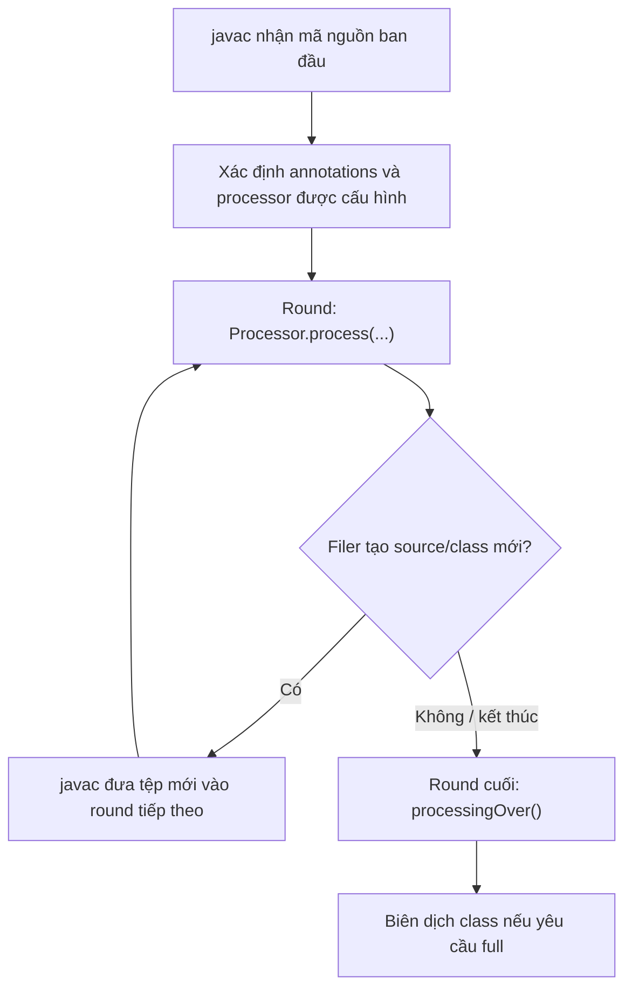

# Annotation processing và cấu hình processor tường minh khi build

**Annotation processing** là cơ chế mở rộng quá trình biên dịch Java: một *annotation processor* đọc các khai báo và annotation dưới dạng mô hình ngôn ngữ, kiểm tra quy tắc hoặc sinh thêm mã nguồn/tài nguyên. Trong Java 27, cơ chế chuẩn vẫn là API thuộc `javax.annotation.processing` và `javax.lang.model` của module `java.compiler` (thường gọi là **JSR 269** hoặc *pluggable annotation processing*).

Ví dụ thực tế gồm sinh mapper, source code tiện ích, metadata cho framework, mã kiểm tra ràng buộc hoặc lớp hỗ trợ theo cấu trúc đối tượng. Processor chạy **trong quá trình build**, không phải logic mà ứng dụng tự động thực thi khi chạy.

Điểm rất quan trọng đối với Java hiện hành: **từ JDK 23, `javac` không còn tự thực thi processor chỉ bằng cách quét classpath mà không có cấu hình annotation processing rõ ràng**. Vì vậy, một dự án chuyển sang JDK 27 có thể biên dịch thiếu mã được sinh nếu vẫn dựa vào cách phát hiện ngầm trước đây. Cấu hình hiện đại cần khai báo **processor nào được phép chạy** và **lấy processor từ đâu**.

Mục tiêu sau bài học:

- Phân biệt compile-time annotation processing với reflection tại runtime.
- Hiểu quá trình nhiều vòng (*rounds*) và các API `Processor`, `RoundEnvironment`, `Filer`, `Messager`.
- Tạo annotation và processor tối giản để sinh một class mới.
- Cấu hình processor tường minh với `javac`, Gradle và Maven.
- Nhận biết khác biệt JDK 23+ về quyền thực thi processor và những lỗi cấu hình phổ biến.
- Thiết kế build có thể tái lập, dễ kiểm tra và tránh thực thi processor không được lựa chọn.

## 1. Annotation là metadata; processor mới là công cụ xử lý

Khai báo một annotation không làm phát sinh xử lý nào nếu không có công cụ hoặc thư viện đọc và diễn giải annotation đó.

```java
import java.lang.annotation.ElementType;
import java.lang.annotation.Retention;
import java.lang.annotation.RetentionPolicy;
import java.lang.annotation.Target;

@Target(ElementType.TYPE)
@Retention(RetentionPolicy.SOURCE)
public @interface GenerateMeta {}
```

`@Target(TYPE)` cho phép gắn lên các khai báo kiểu thích hợp. `@Retention(SOURCE)` thể hiện annotation chỉ cần có trong mã nguồn cho mục đích xử lý khi biên dịch; không cần lưu trong class file để đọc bằng reflection lúc chạy.

```java
@GenerateMeta
public class Customer {}
```

Với mã trên, compiler vẫn có thể biên dịch `Customer` mà không sinh thêm class nào nếu không có processor được cấu hình để thực hiện việc đó.

### Compile-time processing và runtime reflection khác nhau

| Khía cạnh | Annotation processing | Reflection |
|---|---|---|
| Thời điểm | Trong quá trình biên dịch/build | Khi chương trình đang chạy |
| API chính | `javax.annotation.processing`, `javax.lang.model` | `java.lang.reflect` |
| Dữ liệu xử lý | `Element`, `TypeMirror`, annotation trong mô hình compiler | `Class`, `Method`, `Field` của các class khả dụng tại runtime |
| Mục đích thường gặp | Sinh mã, sinh metadata, báo lỗi biên dịch | Khám phá/gọi thành viên động, wiring runtime |
| Cần retention RUNTIME? | Không bắt buộc | Muốn đọc annotation lúc chạy thì cần `RUNTIME` |
| Có tự chạy khi annotation xuất hiện? | Không: cần processor và cấu hình | Không: cần mã/chương trình chủ động reflection |

Tên package `javax.annotation.processing` **vẫn chính xác trong Java 27**, không phải API lỗi thời cần đổi thành `jakarta.annotation.processing`. Đừng nhầm nó với các annotation thuộc thư viện Jakarta của ứng dụng. Java Language Model API xử lý cấu trúc mã nguồn mà không yêu cầu load class của ứng dụng bằng `Class.forName`.

### Retention và target cần phù hợp mục đích

```java
@Target({ElementType.TYPE, ElementType.METHOD})
@Retention(RetentionPolicy.SOURCE)
public @interface ValidateAtCompileTime {}
```

- `SOURCE`: compiler nhìn thấy annotation trên mã nguồn; thường đủ cho processor tạo mã.
- `CLASS`: lưu trong class file nhưng không mặc định được reflection runtime trả về.
- `RUNTIME`: lưu trong class file và có thể đọc qua reflection runtime.

Không chọn `RUNTIME` chỉ vì dùng annotation processor. Nếu ứng dụng không đọc annotation khi chạy, `SOURCE` thường mô tả chính xác hơn nhu cầu. Ngược lại, nếu một framework runtime cần đọc annotation, `SOURCE` không đáp ứng được yêu cầu đó.

## 2. Vì sao Java 27 yêu cầu cấu hình processor tường minh?

Trước JDK 23, công cụ `javac` có thể tự tìm và chạy processor trên classpath theo mặc định. Đây là nguồn rủi ro: một thư viện tình cờ hoặc không đáng tin cậy chứa đăng ký processor có thể khiến **mã của processor được thực thi trong môi trường build**, với quyền của tiến trình build.

Từ **JDK 23**, khi không có tùy chọn kích hoạt hoặc cấu hình annotation processing, `javac` **không thực hiện annotation processing**. Đây là thay đổi về mặc định của compiler, **không phải việc JSR 269 bị loại bỏ**. Processor vẫn được hỗ trợ đầy đủ khi được kích hoạt theo cách rõ ràng.

Các cách thể hiện ý định thường gặp:

| Tùy chọn `javac` | Ý nghĩa |
|---|---|
| `-processor com.example.MyProcessor` | Chọn đích danh processor cần chạy; không dùng discovery để chọn processor khác |
| `--processor-path path` hoặc `-processorpath path` | Chỉ định classpath dành riêng để tìm và tải processor; việc cấu hình path cũng kích hoạt processing theo chính sách hiện hành |
| `--processor-module-path path` | Chỉ định module path để tìm processor dạng module |
| `-proc:full` | Yêu cầu vừa xử lý annotation vừa biên dịch |
| `-proc:only` | Chỉ chạy annotation processing, không thực hiện pha biên dịch class thông thường tiếp theo |
| `-proc:none` | Biên dịch mà không chạy processor |
| `-s directory` | Chỉ định thư mục đầu ra cho Java source được sinh |
| `-d directory` | Chỉ định thư mục đầu ra cho class file |

**Khuyến nghị:** chọn **processor cụ thể** và đặt nó trên **processor path riêng**. Chỉ thêm `-proc:full` để quay lại kiểu quét tự do toàn bộ classpath có thể vô tình chạy các processor ngoài ý muốn; đây không phải cách cấu hình được ưu tiên cho build cần kiểm soát an toàn.

Một ví dụ cấu hình tường minh, giả sử bạn đã có JAR chứa annotation và JAR chứa processor:

```shell
javac --release 27 \
  --class-path lib/meta-annotations.jar \
  --processor-path lib/meta-processor.jar:lib/meta-annotations.jar \
  -processor demo.processor.GenerateMetaProcessor \
  -s build/generated \
  -d build/classes \
  src/main/java/demo/app/Customer.java
```

Lệnh là **mẫu dành cho shell Unix-like**, giả định JAR và các thư mục đầu ra đã được chuẩn bị. Trên Windows, dấu phân cách nhiều mục trong classpath/processor path thường là dấu chấm phẩy `;` thay vì dấu hai chấm `:`; cách xuống dòng của shell cũng khác nhau. Build tool là lựa chọn thuận tiện hơn để quản lý các đường dẫn và dependency xuyên nền tảng.

`--class-path` và `--processor-path` có hai vai trò khác nhau: code ứng dụng cần biết **kiểu annotation**, còn compiler cần tải và chạy **implementation của processor**. Khi processor phụ thuộc vào annotation API hoặc thư viện hỗ trợ riêng, các dependency đó cũng phải có trên processor path.

### Cách nhận biết cấu hình cũ đã hỏng

Giả sử source code gọi `CustomerMeta.originType()`, nhưng `CustomerMeta` phải được processor sinh ra. Nếu build không kích hoạt processor, rất dễ gặp lỗi kiểu:

```text
error: cannot find symbol
  symbol:   variable CustomerMeta
```

Đây có thể là **triệu chứng** thiếu annotation processing, không nhất thiết là lỗi import. Hãy kiểm tra xem processor có được khai báo, có thể được tải, có thực sự chạy và có sinh source đúng nơi hay không.

## 3. Kiến trúc JSR 269 và chu trình nhiều vòng

Annotation processing không chỉ là đọc các annotation rồi tạo file một lần. Nó có thể diễn ra qua nhiều **round**:



Một processor có thể được gọi nhiều lần trong cùng một phiên `javac`, bao gồm round cuối. Vì vậy, không nên dựa vào giả định `process()` luôn chỉ chạy một lần.

Các thành phần quan trọng:

- `Processor`: giao diện của annotation processor. Thực tế thường kế thừa `AbstractProcessor`.
- `@SupportedAnnotationTypes`: khai báo các tên annotation mà processor hỗ trợ.
- `getSupportedSourceVersion()` hoặc `@SupportedSourceVersion`: thông báo phiên bản ngôn ngữ được hỗ trợ.
- `RoundEnvironment`: truy cập các phần tử có annotation trong round hiện tại và kiểm tra `processingOver()`.
- `ProcessingEnvironment`: cung cấp `Filer`, `Messager`, `Elements`, `Types` và các option.
- `Element` / `TypeElement`: mô hình các khai báo thuộc ngôn ngữ Java, không phải đối tượng `Class` ở runtime.
- `Filer`: sinh source file, class file hoặc tài nguyên theo giao thức của compiler.
- `Messager`: báo lỗi/cảnh báo có vị trí ngay trong quá trình biên dịch.

Bảng quyết định:

| Nhu cầu | Dùng |
|---|---|
| Tìm các class được gắn `@GenerateMeta` | `roundEnv.getElementsAnnotatedWith(...)` |
| Xác định tên package và kiểu | `processingEnv.getElementUtils()` |
| Kiểm tra kiểu của tham số/phương thức | `javax.lang.model.type.TypeMirror` và `processingEnv.getTypeUtils()` |
| Sinh một file Java mới | `processingEnv.getFiler().createSourceFile(...)` |
| Báo lỗi gắn với một khai báo | `processingEnv.getMessager().printMessage(ERROR, ..., element)` |
| Xem round kết thúc | `roundEnv.processingOver()` |
| Nhận option do build truyền | `processingEnv.getOptions()` |

Khi `process(...)` trả về `true`, processor **claim** các kiểu annotation được giao ở round đó; các processor được xét sau sẽ không được đề nghị xử lý những annotation đã được claim theo quy tắc công cụ. Nếu trả `false`, chúng vẫn có thể được xử lý bởi processor khác. Đây không phải giá trị báo “thành công/thất bại” của thao tác sinh file.

## 4. Ví dụ: xây một processor sinh class metadata

Ta thiết kế một annotation `@GenerateMeta`. Khi gắn nó vào class `Customer`, processor tạo class `CustomerMeta` trong **cùng package**:

```text
demo.app.Customer.java       -- @GenerateMeta
             |
             |  annotation processing
             v
demo.app.CustomerMeta.java   -- được sinh bởi Filer
             |
             v
demo.app.CustomerMeta.class  -- được javac biên dịch
```

Để không bị vòng phụ thuộc, nên chia project hoặc artifact thành ba phần:

```text
meta-annotations/    # Chứa kiểu annotation công khai
meta-processor/      # Chứa processor, phụ thuộc meta-annotations
app/                 # Chứa nguồn sử dụng annotation
```

Processor JAR phải được biên dịch và có sẵn **trước** khi compiler biên dịch module `app` cần nó. Không nên dựa vào chuyện compiler đồng thời biên dịch mã nguồn processor lần đầu rồi tự phát hiện và thực thi chính processor đó trong cùng một compile task.

### 4.1. Annotation API

Tệp `meta-annotations/src/main/java/demo/annotations/GenerateMeta.java`:

```java
package demo.annotations;

import java.lang.annotation.ElementType;
import java.lang.annotation.Retention;
import java.lang.annotation.RetentionPolicy;
import java.lang.annotation.Target;

@Target(ElementType.TYPE)
@Retention(RetentionPolicy.SOURCE)
public @interface GenerateMeta {}
```

Trong ví dụ, chúng ta chỉ gắn annotation cho **top-level class/record**. Processor sẽ kiểm tra điều kiện này và báo lỗi rõ ràng nếu annotation bị sử dụng ngoài phạm vi hỗ trợ.

### 4.2. Processor implementation

Tệp `meta-processor/src/main/java/demo/processor/GenerateMetaProcessor.java`:

```java
package demo.processor;

import demo.annotations.GenerateMeta;
import java.io.IOException;
import java.util.Set;
import javax.annotation.processing.AbstractProcessor;
import javax.annotation.processing.RoundEnvironment;
import javax.annotation.processing.SupportedAnnotationTypes;
import javax.lang.model.SourceVersion;
import javax.lang.model.element.Element;
import javax.lang.model.element.NestingKind;
import javax.lang.model.element.TypeElement;
import javax.tools.Diagnostic;

@SupportedAnnotationTypes("demo.annotations.GenerateMeta")
public final class GenerateMetaProcessor extends AbstractProcessor {

    @Override
    public SourceVersion getSupportedSourceVersion() {
        return SourceVersion.latestSupported();
    }

    @Override
    public boolean process(
        Set<? extends TypeElement> annotations,
        RoundEnvironment roundEnv
    ) {
        if (roundEnv.processingOver()) {
            return true;
        }

        for (Element element :
                roundEnv.getElementsAnnotatedWith(GenerateMeta.class)) {

            if (!(element instanceof TypeElement type)
                    || type.getNestingKind() != NestingKind.TOP_LEVEL) {
                processingEnv.getMessager().printMessage(
                    Diagnostic.Kind.ERROR,
                    "@GenerateMeta chỉ hỗ trợ top-level type",
                    element
                );
                continue;
            }

            String packageName = processingEnv.getElementUtils()
                    .getPackageOf(type).getQualifiedName().toString();

            if (packageName.isEmpty()) {
                processingEnv.getMessager().printMessage(
                    Diagnostic.Kind.ERROR,
                    "Phải đặt type trong một named package",
                    type
                );
                continue;
            }

            String generatedName = type.getSimpleName() + "Meta";
            String qualifiedName = packageName + "." + generatedName;

            try {
                var file = processingEnv.getFiler()
                        .createSourceFile(qualifiedName, type);

                try (var writer = file.openWriter()) {
                    writer.write("package " + packageName + ";\n\n");
                    writer.write("public final class " + generatedName + " {\n");
                    writer.write("    private " + generatedName + "() {}\n");
                    writer.write(
                        "    public static String originType() {\n"
                    );
                    writer.write(
                        "        return \"" + type.getQualifiedName() + "\";\n"
                    );
                    writer.write("    }\n");
                    writer.write("}\n");
                }
            } catch (IOException exception) {
                processingEnv.getMessager().printMessage(
                    Diagnostic.Kind.ERROR,
                    "Không sinh được " + qualifiedName
                        + ": " + exception.getMessage(),
                    type
                );
            }
        }

        return true;
    }
}
```

Trong đoạn này:

1. `@SupportedAnnotationTypes` khai báo annotation đủ điều kiện để processor xử lý.
2. `getSupportedSourceVersion()` trả về phiên bản ngôn ngữ mà môi trường processor hiện tại hỗ trợ đầy đủ. Với processor phát hành cho nhiều JDK, bạn vẫn cần tự kiểm tra tính tương thích của mã được sinh và toolchain mục tiêu.
3. `RoundEnvironment` đưa các `Element` đã được compiler phân tích, không yêu cầu tải class của ứng dụng.
4. `createSourceFile(qualifiedName, type)` tạo source Java trong vùng output do compiler/build tool quản lý; đối số `type` là **originating element** giúp công cụ build hiểu quan hệ đầu vào–đầu ra.
5. `Messager` trả lỗi về đúng khai báo có vấn đề; một thông báo `ERROR` khiến compilation thất bại.
6. `return true` claim annotation mà processor xử lý.

Processor cố tình chỉ tạo **một file cho một top-level type**. Với processor phức tạp hơn, cần thiết kế quy tắc tên output, giải quyết xung đột và không tạo trùng file trong các round.

### 4.3. Mã nguồn sử dụng annotation

Tệp `app/src/main/java/demo/app/Customer.java`:

```java
package demo.app;

import demo.annotations.GenerateMeta;

@GenerateMeta
public class Customer {}
```

Tệp `app/src/main/java/demo/app/App.java`:

```java
package demo.app;

public class App {
    public static void main(String[] args) {
        System.out.println(CustomerMeta.originType());
    }
}
```

Khi processor được kích hoạt đúng cách, compiler sẽ tạo mã tương đương:

```java
package demo.app;

public final class CustomerMeta {
    private CustomerMeta() {}

    public static String originType() {
        return "demo.app.Customer";
    }
}
```

Kết quả chạy `App` sau khi biên dịch thành công:

```text
demo.app.Customer
```

Đây là ví dụ **sinh source tại compile time**. Processor không sửa file `Customer.java` và không cần `Customer` phải được load bằng reflection khi ứng dụng đang chạy.

## 5. Đăng ký processor để compiler có thể tìm thấy

Có hai cách phổ biến để javac xác định implementation của processor.

### Cách A: Chỉ định tên class bằng -processor

```shell
-processor demo.processor.GenerateMetaProcessor
```

Đây là cách tường minh nhất: compiler tải **đúng lớp** được chỉ định từ processor path/classpath phù hợp, không cần dựa vào việc quét tất cả service provider để chọn processor.

### Cách B: Dùng ServiceLoader metadata trên processor path

Khi dùng classpath processor và muốn hỗ trợ discovery, đóng gói tài nguyên:

`meta-processor/src/main/resources/META-INF/services/javax.annotation.processing.Processor`

với nội dung chính xác:

```text
demo.processor.GenerateMetaProcessor
```

Tài nguyên này phải nằm **bên trong JAR của processor** tại đường dẫn `META-INF/services/javax.annotation.processing.Processor`. File chứa tên đầy đủ của các lớp implementation, mỗi tên một dòng.

Khi build chủ động khai báo processor path, javac có thể dùng service-provider discovery để tìm các processor có trong vùng được cấp quyền. Nếu chỉ đưa JAR có service metadata lên classpath ứng dụng mà **không có bất kỳ cấu hình annotation processing nào**, đừng kỳ vọng javac Java 27 sẽ tự chạy processor.

### Processor trong named module

Nếu chọn xây processor JAR dạng **named module**, có thể khai báo service provider trong `module-info.java` của module processor:

```java
module demo.processor {
    requires java.compiler;
    requires demo.annotations;

    provides javax.annotation.processing.Processor
        with demo.processor.GenerateMetaProcessor;
}
```

Ví dụ giả định `demo.annotations` là named module riêng có exports phù hợp. Với cấu hình modular, dùng `--processor-module-path` thay cho classpath processor path theo thiết kế artifact. Đừng đưa một processor JAR lên cả hai loại path rồi mặc định discovery sẽ tự chọn đúng nơi.

Phương pháp `META-INF/services` và `provides ... with ...` giải quyết cùng mục tiêu đăng ký service nhưng thuộc **hai cách đóng gói/khám phá khác nhau**. Chọn cách phù hợp với việc processor là classpath JAR hay named module.

## 6. Cấu hình javac tường minh

Trong một môi trường có JDK 27, giả định đã tạo hai artifact:

```text
lib/meta-annotations.jar    # Chứa demo.annotations.GenerateMeta
lib/meta-processor.jar      # Chứa demo.processor.GenerateMetaProcessor
```

Mẫu lệnh `javac` trên Unix-like:

```shell
javac --release 27 \
  --class-path lib/meta-annotations.jar \
  --processor-path lib/meta-processor.jar:lib/meta-annotations.jar \
  -processor demo.processor.GenerateMetaProcessor \
  -s build/generated \
  -d build/classes \
  app/src/main/java/demo/app/Customer.java \
  app/src/main/java/demo/app/App.java
```

Chuẩn bị `build/generated` và `build/classes` trước nếu toolchain yêu cầu. Trong ví dụ, `meta-processor.jar` cần được build trước `app` và có quyền truy cập những dependency cần thiết để khởi tạo processor.

- `--release 27`: biên dịch source theo ngôn ngữ/API Java 27, với điều kiện compiler đang dùng hỗ trợ release đó.
- `--class-path`: cung cấp annotation API cho mã `Customer.java`.
- `--processor-path`: cung cấp processor và dependency mà processor cần.
- `-processor`: chọn processor được chạy, tránh discovery tùy tiện.
- `-s`: nơi chứa `CustomerMeta.java` được sinh.
- `-d`: nơi chứa các class file được biên dịch, bao gồm cả generated class.

`--release` không tự bật annotation processing, và `--processor-path` không thay thế dependency mà ứng dụng cần trên compile classpath.

Với Maven hoặc Gradle, nên để công cụ quản lý output generated sources và tập hợp source compile thay vì viết script `javac` thủ công cho từng module.

### Bật, tắt và chỉ xử lý annotation

```shell
javac -proc:none ...
javac -proc:only -processor demo.processor.GenerateMetaProcessor ...
javac -proc:full -processor demo.processor.GenerateMetaProcessor ...
```

- `-proc:none`: không tạo `CustomerMeta` từ processor; nếu `App.java` phụ thuộc vào class này, compilation có thể thất bại.
- `-proc:only`: chạy processor để lấy generated artifacts mà không yêu cầu biên dịch class của ứng dụng như chế độ full.
- `-proc:full`: xử lý rồi biên dịch đầy đủ.

**Không dùng** `-proc:full` đơn độc như một giải pháp lâu dài chỉ để kích hoạt mọi processor tình cờ có mặt trên classpath. Cấu hình explicit names + dedicated path giúp audit và giảm rủi ro supply chain.

## 7. Cấu hình Gradle Kotlin DSL

Gradle có cấu hình dependency riêng `annotationProcessor` cho các processor của source set `main`. Ví dụ file `app/build.gradle.kts`:

```kotlin
plugins {
    java
}

java {
    toolchain {
        languageVersion.set(JavaLanguageVersion.of(27))
    }
}

dependencies {
    // Annotation SOURCE chỉ cần có khi biên dịch ứng dụng.
    compileOnly("demo:meta-annotations:1.0.0")

    // Processor được đưa lên annotation processor path riêng.
    annotationProcessor("demo:meta-processor:1.0.0")
}

tasks.named<JavaCompile>("compileJava") {
    options.compilerArgs.addAll(
        listOf("-processor", "demo.processor.GenerateMetaProcessor")
    )
}
```

Các tọa độ `demo:...:1.0.0` **chỉ là placeholder** cho artifact do bạn tự build và đưa vào repository. Processor artifact cần khai báo dependency `meta-annotations` của chính nó một cách thích hợp, để runtime classloader của processor có thể tải annotation type.

Tách `compileOnly` và `annotationProcessor` giúp biểu diễn rõ hai nhu cầu:

- **Code được biên dịch** cần nhìn thấy `GenerateMeta`.
- **Compiler** cần tải code của `GenerateMetaProcessor` để chạy nó.

Lời gọi `-processor` giới hạn danh sách class processor được chạy. Nếu bạn có nhiều processor chủ đích, danh sách sau `-processor` là các tên đầy đủ phân cách bằng dấu phẩy, không chèn khoảng trắng.

Trong Gradle, các generated sources do `Filer` tạo đúng cách được quản lý như một phần của compile task. Thư mục thường gặp cho source set `main` là `build/generated/sources/annotationProcessor/java/main/`; tránh hardcode path này thành đầu vào của một compile task khác nếu Gradle đã quản lý tự động.

### Annotation processing trong test

Nếu **mã test** cũng sử dụng annotation có source generation riêng, cần cấu hình riêng cho source set test:

```kotlin
dependencies {
    testCompileOnly("demo:meta-annotations:1.0.0")
    testAnnotationProcessor("demo:meta-processor:1.0.0")
}

tasks.named<JavaCompile>("compileTestJava") {
    options.compilerArgs.addAll(
        listOf("-processor", "demo.processor.GenerateMetaProcessor")
    )
}
```

Không tự động áp dụng cờ `-processor` vào **mọi** task `JavaCompile` nếu một số task không có processor tương ứng trên processor path. Phân biệt `compileJava` và `compileTestJava` sẽ giúp tránh lỗi “processor not found”.

Gradle có cơ chế **incremental annotation processing** nhưng processor phải tuân thủ những quy tắc riêng. Processor tạo một output riêng cho mỗi input top-level type và khai báo originating element đúng cách sẽ dễ hỗ trợ incremental hơn processor gom mọi class vào một file tổng hợp. Tuy vậy, không tự tuyên bố processor ở ví dụ là incremental đã được Gradle nhận diện nếu chưa cung cấp metadata và kiểm tra theo tài liệu Gradle.

## 8. Cấu hình Maven 3 và Maven Compiler Plugin 3.x

Với **Maven 3 + Maven Compiler Plugin 3.x**, dùng `annotationProcessorPaths` để tạo processor path riêng. Để liệt kê chính xác class được phép thực thi, có thể khai báo thêm `annotationProcessors`.

Đoạn cấu hình trong `app/pom.xml` (các artifact demo phải tồn tại và có repository phù hợp):

```xml
<project>
  <!-- Các phần tử pom.xml thường lệ: modelVersion, groupId, artifactId... -->

  <properties>
    <maven.compiler.release>27</maven.compiler.release>
  </properties>

  <dependencies>
    <dependency>
      <groupId>demo</groupId>
      <artifactId>meta-annotations</artifactId>
      <version>1.0.0</version>
      <scope>provided</scope>
    </dependency>
  </dependencies>

  <build>
    <plugins>
      <plugin>
        <groupId>org.apache.maven.plugins</groupId>
        <artifactId>maven-compiler-plugin</artifactId>
        <version>3.14.1</version>
        <configuration>
          <annotationProcessorPaths>
            <path>
              <groupId>demo</groupId>
              <artifactId>meta-processor</artifactId>
              <version>1.0.0</version>
            </path>
          </annotationProcessorPaths>
          <annotationProcessors>
            <annotationProcessor>
              demo.processor.GenerateMetaProcessor
            </annotationProcessor>
          </annotationProcessors>
        </configuration>
      </plugin>
    </plugins>
  </build>
</project>
```

Đây là **fragment mô tả cấu hình**, không phải POM hoàn chỉnh có thể chạy độc lập nếu thiếu các trường bắt buộc và repository. Phiên bản compiler plugin được minh họa là nhánh 3.x hỗ trợ cấu hình trên; khi áp dụng cần pin một phiên bản thực sự tương thích với Maven/JDK của môi trường dự án.

- `maven.compiler.release` thiết lập `--release` cho compiler.
- `annotationProcessorPaths` cấp dependency dành riêng cho processor.
- `annotationProcessors` liệt kê processor class phải được chọn.
- `scope=provided` đưa annotation API lên compile classpath nhưng không tự gắn vào runtime dependencies như `compile` thông thường.

Nếu annotation còn cần đọc bằng reflection lúc chạy, hãy xem lại retention và scope dependency; `provided` hay `compileOnly` không thích hợp cho mọi annotation library.

## 9. Cấu hình Maven 4 và Maven Compiler Plugin 4.x

Maven 4 cùng Maven Compiler Plugin 4.x giới thiệu cách khai báo processor bằng **dependency type**. Tài liệu hiện hành của plugin khuyến nghị dùng `processor`, `classpath-processor` hoặc `modular-processor` thay cho `annotationProcessorPaths` trong cấu hình Maven 4.x.

Ví dụ, nếu processor là một JAR trên classpath:

```xml
<dependencies>
  <dependency>
    <groupId>demo</groupId>
    <artifactId>meta-annotations</artifactId>
    <version>1.0.0</version>
    <scope>provided</scope>
  </dependency>

  <dependency>
    <groupId>demo</groupId>
    <artifactId>meta-processor</artifactId>
    <version>1.0.0</version>
    <type>classpath-processor</type>
  </dependency>
</dependencies>
```

Kết hợp với một cấu hình Maven Compiler Plugin **4.x** phù hợp, dependency `classpath-processor` cho biết artifact phải được đặt trên processor classpath. Nếu processor là named module, `modular-processor` diễn đạt đúng lựa chọn module path. Loại `processor` chung để plugin tự đoán đường đặt artifact, nhưng nếu bạn biết rõ cách đóng gói, khai báo tường minh thường dễ kiểm soát hơn.

**Không trộn lẫn** khuyến nghị Maven 4/plugin 4.x với cú pháp chỉ phù hợp Maven 3/plugin 3.x mà không xem xét khả năng hỗ trợ của phiên bản đang dùng. Cả hai cách đều nhằm xác định rõ những processor được đưa vào quá trình build.

## 10. Vị trí source sinh ra và khả năng tái lập build

Một build có annotation processing thường tạo source mới trong khu vực output:

```text
app/
  src/main/java/demo/app/Customer.java
  src/main/java/demo/app/App.java
  build/generated/.../demo/app/CustomerMeta.java
  build/classes/.../demo/app/CustomerMeta.class
```

Đường dẫn `build/` bên trên là ví dụ cho Gradle; Maven thường sử dụng `target/generated-sources/annotations` và `target/classes`.

Các nguyên tắc:

1. **Đặt generated files ở vùng build output**, không ghi đè source do người phát triển duy trì.
2. **Sinh mã có tính quyết định** với cùng input và cùng phiên bản processor; tránh chèn thời điểm ngẫu nhiên, thứ tự không ổn định hoặc ID biến đổi vào source nếu không bắt buộc.
3. **Không tạo trùng cùng một file qua nhiều round**. `Filer` có thể ném `FilerException` khi một tên output được tạo quá một lần.
4. **Gắn originating elements** khi sinh file để công cụ build có thể liên hệ output với input.
5. **Khai báo dependencies và phiên bản processor rõ ràng** để các máy CI/local tái lập kết quả.
6. **Tránh commit generated source** nếu build có thể tái tạo từ processor và dữ liệu đầu vào; ngoại lệ cần được quy định rõ, tránh vừa commit vừa generate cùng một class.
7. **Không sửa source hiện có từ processor**, vì JSR 269/Filer được thiết kế cho việc sinh artifact mới.

Ví dụ lỗi phổ biến: processor sinh `demo.app.CustomerMeta` một lần trong round đầu, rồi cố `createSourceFile` cùng tên trong round tiếp theo. Chương trình có thể gặp `FilerException`. Không xử lý bằng cách ghi thẳng vào file system và bỏ qua `Filer`; hãy sửa logic round và quy tắc tên output.

## 11. Processor có thể làm gì và không nên làm gì?

Những việc phù hợp với annotation processing:

- Kiểm tra một kiểu có các phương thức hoặc annotation cần thiết rồi đưa ra lỗi biên dịch cụ thể.
- Sinh lớp bổ trợ, mapper, metadata hoặc adapter dựa trên cấu trúc source.
- Sinh các tài nguyên compile-time theo hợp đồng build.
- Chuẩn hóa kiểm tra theo compile-time thay vì đợi chương trình chạy mới phát hiện.

Những việc không nên giả định:

- **Không** nên kỳ vọng nó tự chạy chỉ vì annotation tồn tại.
- **Không** nên dùng reflection để tải các class ứng dụng đang trong quá trình biên dịch; nhiều class còn chưa tồn tại dưới dạng bytecode.
- **Không** nên sửa các Java source do người dùng viết bên ngoài vùng output do `Filer` quản lý.
- **Không** nên tải plugin hoặc thực thi lệnh mạng/ngẫu nhiên từ processor mà không có lý do, kiểm soát bảo mật và hợp đồng build.
- **Không** nên dùng compiler-internal API không ổn định nếu chỉ cần `javax.lang.model`; các API nội bộ có thể phụ thuộc phiên bản JDK và phá tính tương thích/incremental.

Một processor có thể tải và chạy code của chính processor trong JVM của compiler/build tool. Vì thế **processor dependency thuộc nhóm code được tin cậy để thực thi**, khác với việc chỉ dùng một thư viện như dữ liệu compile classpath. Cần pin phiên bản, kiểm tra nguồn phát hành, đánh giá transitive dependencies và tránh để processor lạ được kích hoạt ngoài ý muốn.

## 12. Xử lý lỗi và diagnostics chính xác

`Messager` cung cấp cách chuẩn để thông báo lỗi/warning trong quá trình build:

```java
processingEnv.getMessager().printMessage(
    Diagnostic.Kind.ERROR,
    "@GenerateMeta chỉ được gắn lên top-level type",
    element
);
```

Khi dùng overload có `Element`, compiler có thể liên kết thông báo tới khai báo gây lỗi. Các mức thường gặp gồm `ERROR`, `WARNING`, `MANDATORY_WARNING` và `NOTE`.

Không dùng `System.out.println` làm kênh duy nhất để báo vấn đề cấu hình processor. Thông báo `ERROR` qua `Messager` là cách rõ ràng để build thất bại thay vì lặng lẽ sinh thiếu mã.

### Nên báo lỗi ở đâu?

- Annotation đặt trên kiểu không hỗ trợ: báo `ERROR` tại phần tử có annotation.
- Không tìm thấy type hoặc member bắt buộc: báo `ERROR` gắn với nguồn có vấn đề.
- Một cấu hình không tối ưu nhưng vẫn hợp lệ: có thể báo `WARNING`.
- Thông tin điều tra: `NOTE`, nhưng không nên làm ngập log build bình thường.

Đối với thư viện processor công khai, cần tài liệu hóa những ràng buộc này để người dùng biết sửa cấu trúc source thay vì thử thay đổi thứ tự compile một cách mò mẫm.

## 13. Gỡ lỗi annotation processing trên javac

Khi generated type không xuất hiện, bắt đầu từ những kiểm tra mang tính quyết định:

```shell
javac -XprintRounds -XprintProcessorInfo \
  --processor-path lib/meta-processor.jar:lib/meta-annotations.jar \
  -processor demo.processor.GenerateMetaProcessor \
  ...
```

- `-XprintRounds` in thông tin các round xử lý.
- `-XprintProcessorInfo` in thông tin processor nào được yêu cầu xử lý annotation.
- `-s` cho phép quan sát vị trí source đã được sinh.
- `-proc:only` có thể hữu ích khi cần kiểm tra riêng kết quả generation trước bước compile thông thường.

Những flag dạng `-X` phục vụ chẩn đoán, không nên coi định dạng output của chúng là API ổn định để ứng dụng phụ thuộc vào.

### Checklist khi không thấy mã được sinh

| Triệu chứng | Kiểm tra |
|---|---|
| JDK 27 biên dịch nhưng không sinh source | Đã khai báo processor hoặc processor path chưa? |
| `Annotation processor ... not found` | JAR có đúng class, các dependency và path phù hợp không? |
| Processor có trên compile classpath nhưng không chạy | Đã có đường `annotationProcessor`/processor dependency riêng chưa? |
| Processor được gọi nhưng không thấy phần tử | `@SupportedAnnotationTypes` và annotation được gắn có cùng tên đầy đủ không? |
| `UnsupportedClassVersionError` | JDK dùng để chạy compiler có đủ mới cho bytecode của processor không? |
| `NoClassDefFoundError` khi tải processor | Processor path có đầy đủ dependency cần thiết không? |
| `FilerException` | Có cố tạo cùng qualified name qua nhiều round hoặc trùng source có sẵn không? |
| IDE báo lỗi nhưng CLI build thành công | IDE có dùng đúng toolchain, build model và annotation processing settings không? |
| Build cũ thành công, clean build thất bại | Có đang vô tình dựa vào source sinh từ lần build trước không? |
| Chạy được trên máy cá nhân nhưng thất bại ở CI | Có pin processor version, toolchain và dependency repository không? |

Nếu cần nhanh chóng xác nhận processor đang thực sự chạy, nên thử **clean build** trên project mẫu và xem generated source nằm trong output của build tool. Không dựa vào thư mục generated còn sót lại từ build cũ.

## 14. Compiler runtime, target release và module path

Một điểm dễ nhầm là khác biệt giữa **JDK đang chạy compiler** và **release của source/class đầu ra**.

Ví dụ:

```shell
javac --release 27 \
  --processor-path ... \
  -processor demo.processor.GenerateMetaProcessor \
  ...
```

- Processor được tải/chạy trong môi trường của công cụ build/compiler.
- `--release 27` quy định đặc tính source và API Java đích được phép dùng cho code ứng dụng.
- `SourceVersion.latestSupported()` trả phiên bản ngôn ngữ mới nhất mà môi trường xử lý hiện tại hỗ trợ đầy đủ; nó không thay thế việc kiểm tra khả năng tương thích với `--release` mục tiêu.
- Nếu processor được biên dịch thành bytecode mới hơn JVM đang chạy công cụ build, nó có thể không tải được.
- Nếu generated source dùng API không khả dụng ở target release, compilation sẽ thất bại dù processor tự chạy thành công.

Với JPMS, cần phân biệt ba khu vực:

| Khu vực | Chứa gì? |
|---|---|
| Module path/classpath của ứng dụng | Kiểu và dependency cần cho mã đang biên dịch |
| Processor classpath/module path | Implementation và dependency phục vụ annotation processing |
| Output của compiler | Source và class file được sinh |

Không phải processor nào cũng là named module; phần lớn dự án có thể dùng classpath processor với service registration hoặc `-processor`. Chỉ dùng `--processor-module-path` khi artifact và cấu hình module thực sự được thiết kế cho cách đó.

## 15. Các rủi ro trong build và nguyên tắc triển khai

| Rủi ro | Hệ quả | Khuyến nghị |
|---|---|---|
| Tin vào classpath scanning mặc định của JDK cũ | Java 27 không chạy processor như kỳ vọng | Khai báo processor tường minh |
| Chỉ bật `-proc:full` trên classpath rộng | Processor ngoài dự kiến có thể được chạy | Dùng `-processor` và processor path riêng |
| Đặt processor trong `implementation` thay vì processor configuration | Processor có thể không chạy | `annotationProcessor` (Gradle) hoặc processor dependency (Maven) |
| Processor dùng reflection để tìm class đang biên dịch | Không có hoặc sai class runtime | Dùng `Element`/`TypeMirror` |
| Sinh trùng qualified name | `FilerException` | Quản lý vòng xử lý và tên output |
| Tạo file ngoài `Filer` | Build tool khó theo dõi, cleanup/incremental kém | Dùng `Filer` |
| Không khai báo originating element | Khó xác định đầu vào thay đổi | Truyền element khi tạo output |
| Sửa code được sinh bằng tay | Mất thay đổi ở build sau | Sửa annotation hoặc processor |
| Trộn source generated cũ với mới | Build không tái lập | Clean build khi điều tra |
| Không pin version processor và toolchain | Khác biệt giữa CI và local | Version pin, lockfile và kiểm tra artifact |
| Processor thực thi mã không đáng tin | Rủi ro lộ thông tin/chạy code trong build | Chỉ dùng processor đã được thẩm định |

Cấu hình “tường minh” không chỉ làm build hoạt động trở lại trên Java 27 mà còn ghi rõ **ranh giới tin cậy** cho mã thực thi trong quá trình compile. Build được quản lý tốt thường nêu rõ artifact nào là source annotation API, artifact nào là processor implementation và processor class nào được phép chạy.

## 16. Bài tập thực hành

**Bài 1 — Kích hoạt đúng processor.** Dự án có JAR `meta-processor.jar` chứa `demo.processor.GenerateMetaProcessor`. Hãy viết cờ `javac` để chạy chính xác processor này, sinh Java source vào `generated/`, class vào `classes/`. Giải thích vì sao chỉ `--class-path meta-processor.jar` chưa phải cấu hình đáng tin cậy trên Java 27.

**Bài 2 — Annotation SOURCE.** Vì sao `@Retention(SOURCE)` vẫn phù hợp khi processor chỉ cần sinh code lúc compile? Trường hợp nào cần `RUNTIME`?

**Bài 3 — Hai round.** Một processor sinh ra `AHelper.java` ở round đầu. Tại sao compiler có thể xuất hiện round tiếp theo? Processor cần tránh hành vi nào để không bị `FilerException`?

**Bài 4 — Build Gradle.** Viết hai dependency riêng cho annotation API và processor bằng `compileOnly` và `annotationProcessor`. Tại sao không chỉ đặt cả hai trong `implementation`?

**Bài 5 — Build Maven.** Phân biệt cách khai báo `annotationProcessorPaths` trong Maven Compiler Plugin 3.x với dependency type `classpath-processor` trong Maven Compiler Plugin 4.x.

**Bài 6 — Xử lý sai mục tiêu.** Nếu `@GenerateMeta` bị gắn lên nested type trong ví dụ bài học, processor nên làm gì? Vì sao dùng `Messager` tốt hơn chỉ in một dòng log?

**Bài 7 — Bảo mật build.** Một thư viện phụ thuộc gián tiếp có kèm processor service metadata. Vì sao không nên kích hoạt quét toàn bộ classpath chỉ để “sửa” việc thiếu generated sources?

### Đáp án gợi ý

1. Dùng `--processor-path ... -processor demo.processor.GenerateMetaProcessor -s generated -d classes`; thêm annotation API trên compile classpath khi source có sử dụng annotation. JDK 23+ không kích hoạt processor chỉ vì JAR xuất hiện trên classpath.
2. `SOURCE` đủ cho kiểm tra/generation khi biên dịch. `RUNTIME` cần khi code/framework lúc chạy cần đọc annotation qua reflection.
3. Compiler đưa source vừa sinh vào round kế tiếp; không tạo lại cùng qualified name trong một phiên xử lý.
4. `compileOnly("demo:meta-annotations:1.0.0")` và `annotationProcessor("demo:meta-processor:1.0.0")`; implementation không biểu diễn processor path riêng.
5. Maven 3/plugin 3.x dùng `annotationProcessorPaths`; Maven 4/plugin 4.x dùng dependency type processor, có thể phân biệt classpath/module path.
6. Báo `Diagnostic.Kind.ERROR` gắn với `Element` không hợp lệ; compilation sẽ thất bại với thông báo đúng vị trí.
7. Processor là mã chạy trong môi trường build; phải chọn processor tin cậy thay vì thực thi mọi service được phát hiện tình cờ.

## 17. Tổng kết

Annotation processing theo JSR 269 vẫn là cơ chế **hiện hành trong Java 27** để kiểm tra và tạo mã lúc biên dịch. Kiểu annotation mô tả metadata; processor mới thực hiện công việc. Với `AbstractProcessor`, `RoundEnvironment`, `Filer`, `Messager` và `javax.lang.model`, một processor có thể tạo source mới và báo diagnostics mà không dùng reflection để tải class của ứng dụng.

Các nguyên tắc cần nhớ:

1. **Bật processor một cách tường minh trên JDK 23+**; không dựa vào việc compiler tự quét classpath như các phiên bản cũ.
2. **Tách annotation API và processor implementation** thành dependency khác trách nhiệm, và chọn processor path phù hợp.
3. **Giới hạn danh sách processor được chạy** bằng khai báo rõ tên hoặc dependency được quản lý.
4. **Sinh output qua `Filer` và tôn trọng các round**, không ghi đè source do người dùng viết.
5. **Pin phiên bản và kiểm tra toolchain** để clean build trên CI và local tạo kết quả nhất quán.
6. **Đặt ranh giới tin cậy cho build**: processor được cấp quyền thực thi, nên cần quản trị như một dependency có khả năng chạy code.

## Tài liệu tham khảo

- [Java SE 27 — The javac Command: Annotation Processing](https://docs.oracle.com/en/java/javase/27/docs/specs/man/javac.html#annotation-processing): `-processor`, `--processor-path`, `--processor-module-path`, `-proc`, các round và service discovery.
- [Oracle JDK 23 Release Notes — Annotation processing disabled by default](https://www.oracle.com/java/technologies/javase/23-relnote-issues.html): thay đổi mặc định khi chuyển lên JDK 23.
- [Inside Java — JDK 23 Changes Default Annotation Processing Policy](https://inside.java/2024/06/18/quality-heads-up/): giải thích thay đổi và các option kích hoạt.
- [Java SE 27 API — Processor](https://docs.oracle.com/en/java/javase/27/docs/api/java.compiler/javax/annotation/processing/Processor.html): hợp đồng processor và quá trình nhiều round.
- [Java SE 27 API — AbstractProcessor](https://docs.oracle.com/en/java/javase/27/docs/api/java.compiler/javax/annotation/processing/AbstractProcessor.html): lớp nền triển khai processor.
- [Java SE 27 API — Filer](https://docs.oracle.com/en/java/javase/27/docs/api/java.compiler/javax/annotation/processing/Filer.html): sinh source/resource, originating elements và hạn chế tên output.
- [Java SE 27 API — RoundEnvironment](https://docs.oracle.com/en/java/javase/27/docs/api/java.compiler/javax/annotation/processing/RoundEnvironment.html): các phần tử trong round.
- [Java SE 27 API — SourceVersion](https://docs.oracle.com/en/java/javase/27/docs/api/java.compiler/javax/lang/model/SourceVersion.html): phiên bản source và `latestSupported()`.
- [Apache Maven Compiler Plugin 4.x — Annotation processors](https://maven.apache.org/components/plugins/maven-compiler-plugin-4.x/examples/annotation-processor.html): cấu hình Maven 3/4 và processor dependencies.
- [Gradle — Java Plugin](https://docs.gradle.org/current/userguide/java_plugin.html): `annotationProcessor`, generated sources và incremental processing.
