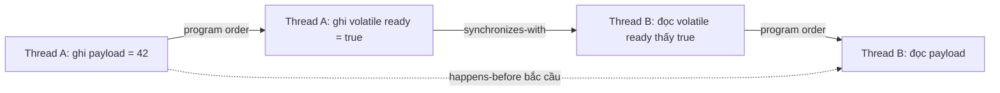

# Java Memory Model, visibility và quan hệ happens-before

Khi hai thread Java cùng truy cập dữ liệu, thứ tự câu lệnh trong mã nguồn **không đủ** để kết luận thread này sẽ nhìn thấy thay đổi của thread kia. Trình biên dịch, JIT, CPU và hệ thống bộ nhớ có thể tối ưu cách thực thi, trong khi việc lập lịch giữa các thread không được xác định trước. **Java Memory Model (JMM)** đặt ra những quy tắc chính thức về giá trị mà một phép đọc được phép quan sát, tính thứ tự của thao tác và cách các thread phối hợp an toàn.

Bài học thuộc chương **Nền tảng lập trình đồng thời**, module **JAVA_VERSION_JAVA27 — Java 27 và các kiến thức liên quan**. Nội dung dựa trên Java Language Specification (JLS) và API đồng thời **còn hiệu lực trong Java SE 27**. Các ví dụ sử dụng `synchronized`, `volatile`, `Thread.start()`/`join()`, `AtomicInteger` và tiện ích trong `java.util.concurrent`; không phụ thuộc cú pháp preview hoặc kỹ thuật điều phối thread đã lỗi thời.

Sau bài học, bạn sẽ có thể:

- Phân biệt **visibility** (khả năng thấy thay đổi), **ordering** (thứ tự quan sát) và **atomicity** (tính nguyên tử).
- Đọc và giải thích quan hệ **happens-before**, bao gồm thứ tự trong một thread, `synchronizes-with` và tính bắc cầu.
- Nhận diện **data race** và lý do một chương trình “chạy đúng trên máy mình” vẫn có thể sai.
- Chọn đúng `volatile`, `synchronized`, atomic classes, `Thread.join()` hoặc công cụ phối hợp ở mức cao hơn.
- Công bố dữ liệu (*safe publication*) đúng cách, đặc biệt khi có `final` và đối tượng bất biến.
- Tránh lạm dụng `sleep`, vòng lặp bận, kiểm thử bằng thời gian hoặc giả định rằng virtual threads tự giải quyết data races.

## 1. JMM giải quyết bài toán gì?

Hãy xét một đối tượng được hai thread sử dụng:

```java
class State {
    int value;
    boolean ready;

    void publish() {
        value = 42;
        ready = true;
    }

    int observe() {
        return ready ? value : -1;
    }
}
```

Nếu **cùng một thread** gọi `publish()` rồi `observe()`, kết quả dự kiến là `42`. Nhưng nếu thread A gọi `publish()` và thread B gọi `observe()` **mà không có đồng bộ**, không được suy luận rằng B thấy `ready == true` thì chắc chắn B phải thấy `value == 42`. Chương trình có **data race** trên các trường được chia sẻ và không có quan hệ đảm bảo công bố dữ liệu giữa hai thread.

Các khả năng đáng lưu ý:

- Thread B có thể đọc `ready == false` mặc dù thread A đã thực hiện câu lệnh gán trong quá trình chạy thực tế.
- Khi quan sát `ready == true`, việc đọc `value` không được bảo đảm theo dự định của người lập trình nếu không có đồng bộ phù hợp.
- Đoạn mã có thể xuất hiện “đúng” trong nhiều lần chạy rồi thất bại khi JIT tối ưu mạnh, chuyển kiến trúc CPU hoặc tăng mức cạnh tranh.

**Không nên** dùng ví dụ thiếu đồng bộ này làm phép thử với một kết quả đầu ra cố định. Mục đích của nó là nhận diện lỗi thiết kế chứ không phải dự đoán chính xác một interleaving.

JMM là **hợp đồng ngôn ngữ** về hành vi được phép của các thao tác bộ nhớ; nó không phải mô tả rằng mỗi biến Java nhất thiết nằm trong một cache CPU riêng, hoặc mỗi lần `volatile` đều trực tiếp “đẩy dữ liệu xuống RAM vật lý”.

## 2. Ba thuộc tính cần tách biệt: visibility, ordering và atomicity

| Thuộc tính | Câu hỏi | Ví dụ |
|---|---|---|
| **Visibility** | Khi A ghi dữ liệu, B có được bảo đảm thấy thay đổi đúng lúc cần không? | B đọc `ready == true` và nhìn thấy `value` đã được công bố |
| **Ordering** | Có bảo đảm thao tác A được quan sát trước thao tác B trong quan hệ bộ nhớ không? | Ghi payload trước khi phát tín hiệu `ready` |
| **Atomicity** | Một thao tác hoặc nhóm thao tác có bị thread khác xen vào làm sai trạng thái không? | Hai thread cùng tăng bộ đếm mà không mất lần tăng |

Một phép gán `volatile int counter = 1` là phép ghi volatile có các bảo đảm về bộ nhớ và tính nguyên tử của thao tác ghi đó, nhưng **`counter++` không nguyên tử**: biểu thức phải đọc giá trị cũ, cộng một và ghi lại. Hai thread có thể đọc cùng một giá trị rồi ghi đè kết quả của nhau.

Cũng cần phân biệt **visibility** với **liveness**: bảo đảm khi đọc một tín hiệu đồng bộ sẽ thấy dữ liệu phù hợp **không** tự bảo đảm thread luôn được CPU lập lịch, không bị chặn hoặc nhất định sẽ kết thúc trong thời hạn cụ thể.

## 3. Quan hệ happens-before được định nghĩa thế nào?

Theo JLS §17.4.5, viết `hb(A, B)` nghĩa là thao tác A **happens-before** thao tác B. Quan hệ này xác định một dạng thứ tự và khả năng quan sát giữa các thao tác, quan trọng nhất khi chúng thuộc các thread khác nhau.

Ba quy tắc nền tảng:

1. **Program order:** trong một thread, mỗi thao tác happens-before những thao tác xuất hiện sau nó theo *program order* của thread đó.
2. **Synchronizes-with:** nếu một thao tác đồng bộ A *synchronizes-with* thao tác B, thì `hb(A, B)`.
3. **Transitivity:** nếu `hb(A, B)` và `hb(B, C)` thì `hb(A, C)`.

Minh họa quan hệ:



Trong ví dụ, giả sử việc đọc `ready` của B quan sát giá trị đã được A công bố và không có các cập nhật tranh chấp khác. Việc ghi `payload` ở A sẽ happens-before việc đọc `payload` ở B. Đây chính là **message passing** qua một biến đồng bộ.

**Điểm tinh tế:** happens-before **không phải đồng hồ thời gian thực** và không có nghĩa JVM bắt buộc thực thi từng instruction vật lý theo thứ tự đó. JMM cho phép tối ưu và sắp xếp lại ở mức triển khai, miễn hành vi quan sát vẫn thuộc tập hành vi hợp lệ. Đồng thời, `hb(A, B)` không có nghĩa B luôn đọc giá trị A ghi nếu có một lần ghi khác vào cùng biến được phép xen vào.

## 4. Những cạnh happens-before thường dùng

| Cơ chế | Quan hệ bảo đảm | Điều kiện quan trọng |
|---|---|---|
| **Program order** | Thao tác trước trong cùng thread happens-before thao tác sau | Không tự tạo cạnh giữa hai thread |
| **Monitor** | Unlock của monitor M happens-before lock **tiếp theo** trên cùng M theo synchronization order | Cả hai phía phải dùng cùng monitor |
| **`volatile`** | Write volatile V happens-before read volatile V tiếp theo trong synchronization order | **Cùng biến volatile V**; không có mutual exclusion |
| **`Thread.start()`** | Hành động gọi `start()` happens-before các thao tác trong thread được khởi động | Không tạo chiều ngược lại tự động |
| **`Thread.join()`** | Các thao tác của thread đã hoàn thành happens-before thao tác sau `join()` trở về thành công ở thread chờ | Phải chờ thread mục tiêu hoàn tất; không nhầm với timeout khi nó còn chạy |
| **Interrupt** | Hành động `interrupt()` happens-before điểm thread khác phát hiện sự kiện ngắt | Có cơ chế phát hiện interruption |
| **Default initialization** | Việc ghi giá trị mặc định của biến happens-before thao tác khác theo quy tắc JMM | Không biến các lần gán thông thường sau đó thành an toàn |

Lớp thư viện `java.util.concurrent` bổ sung các **memory consistency effects** được quy định rõ, gồm `Future.get()`, `Executor.execute(...)`, `CountDownLatch.await()` và các concurrent collections. Những cơ chế này thường dễ dùng và diễn đạt ý định tốt hơn việc tự thiết kế protocol đồng bộ cấp thấp.

Đừng đồng nhất quan hệ *synchronizes-with* và *happens-before*: *synchronizes-with* tạo ra một số cạnh trực tiếp giữa các thao tác đồng bộ; *happens-before* còn bao gồm program order **và toàn bộ tính bắc cầu** của chúng.

## 5. Data race và tính nhất quán theo thứ tự

Hai thao tác truy cập **cùng một biến** xung đột nếu có ít nhất một thao tác là ghi. Theo JLS, khi hai thao tác xung đột **không được sắp thứ tự bởi happens-before**, chương trình có **data race**.

Ví dụ:

```java
class UnsafeCounter {
    int count = 0;

    void increment() {
        count++;
    }
}
```

Nếu hai thread gọi `increment()` đồng thời không có đồng bộ, các truy cập tới `count` không được bảo vệ, nên có thể mất lần tăng. Lỗi có thể xuất hiện **ngay cả khi** mỗi thread được lập lịch công bằng và không có bất kỳ ngoại lệ Java nào.

JLS đưa ra một bảo đảm mạnh: khi chương trình được **đồng bộ hóa đúng**, các hành vi của nó có thể được hiểu như một thứ tự thực thi tuần tự nhất quán (*sequential consistency*). Tức là lập trình viên có thể lập luận theo một thứ tự xen kẽ hợp lệ của các thao tác, thay vì đoán những biến đổi do cache/JIT.

Tuy nhiên, **không có data race không có nghĩa thuật toán luôn đúng**. Ví dụ hai lần thao tác nguyên tử riêng biệt “kiểm tra số dư” và “trừ số dư” vẫn có thể tạo lỗi nghiệp vụ nếu yêu cầu chúng phải là **một giao dịch không bị xen vào**. Không thể thay thế thiết kế invariant chỉ bằng việc mỗi truy cập riêng lẻ có visibility tốt.

## 6. `volatile`: công bố tín hiệu và dữ liệu

Từ khóa `volatile` thích hợp cho cờ trạng thái hoặc tham chiếu được công bố giữa các thread, đặc biệt khi một bên ghi và bên kia quan sát. Một phiên bản hợp lệ của ví dụ mở đầu:

```java
final class PublishedValue {
    private int payload;
    private volatile boolean ready;

    void publish(int value) {
        payload = value; // Ghi dữ liệu trước.
        ready = true;    // Write volatile công bố dữ liệu.
    }

    int readOrDefault() {
        if (!ready) {    // Read volatile.
            return -1;
        }
        return payload;  // Nhìn thấy lần ghi đã xảy ra trước publish.
    }
}
```

Ở đây, giả định **chỉ công bố một lần**, `payload` không bị sửa sau khi công bố và không có nhiều publisher tranh chấp. Nếu thread đọc `ready == true` sau lần ghi `ready = true` của publisher, việc ghi `payload` trước đó **happens-before** việc đọc `payload`.

Thứ tự **không được đảo ngược**:

```java
// Không an toàn để công bố payload:
// ready = true;   // Báo sẵn sàng quá sớm.
// payload = 42;   // Bên nhận có thể đọc dữ liệu trước khi được gán.
```

Đừng coi `volatile` là “khóa nhẹ” cho mọi tình huống. Nó không bảo vệ một chuỗi read-modify-write và không ngăn hai thread đồng thời sửa những trường khác của đối tượng. Nếu cần cập nhật nhiều trường như một thao tác bất khả phân, hãy dùng monitor/lock hoặc một snapshot bất biến được thay thế nguyên tử.

### 6.1. `volatile` không bảo đảm người chờ luôn hoàn thành

Một vòng:

```java
// Ví dụ ý tưởng, không nên dùng như cơ chế chờ mặc định:
// while (!ready) {
//     Thread.onSpinWait();
// }
```

`Thread.onSpinWait()` chỉ là **gợi ý tối ưu spin loop**, không tạo quan hệ happens-before mới và không có timeout. Nếu publisher không bao giờ chạy hoặc không bao giờ đặt `ready = true`, vòng lặp có thể chạy vô hạn và tiêu tốn tài nguyên. Trong ứng dụng thông thường, dùng `CountDownLatch`, `Future`, `BlockingQueue` hoặc cơ chế chờ có timeout theo nghiệp vụ.

## 7. `volatile counter++` vẫn không nguyên tử

Ví dụ lỗi phổ biến:

```java
class VolatileCounter {
    volatile int count;

    void increment() {
        count++; // Read + add + write: không phải một thao tác nguyên tử.
    }
}
```

Giả sử ban đầu `count = 0`:

| Bước | Thread A | Thread B |
|---|---|---|
| 1 | Đọc `count == 0` | |
| 2 | | Đọc `count == 0` |
| 3 | Tính `0 + 1`, ghi `1` | |
| 4 | | Tính `0 + 1`, ghi `1` |
| Kết quả | | **1 thay vì 2** |

Cả hai lần đọc/ghi đều có thể là volatile mà kết quả vẫn mất lần tăng. Cần **atomic read-modify-write**:

```java
import java.util.concurrent.atomic.AtomicInteger;

final class AtomicCounter {
    private final AtomicInteger count = new AtomicInteger();

    void increment() {
        count.incrementAndGet();
    }

    int current() {
        return count.get();
    }
}
```

`AtomicInteger.incrementAndGet()` thực hiện cập nhật nguyên tử với các hiệu ứng bộ nhớ được định nghĩa bởi `VarHandle`. Nó phù hợp cho một counter đơn giản. Tuy nhiên, nhiều trường có ràng buộc lẫn nhau không tự trở thành một giao dịch chỉ vì một trường dùng `AtomicInteger`.

Nếu có nhu cầu đếm với mức cạnh tranh cực cao, `LongAdder` có thể là lựa chọn phù hợp cho thống kê, nhưng `sum()` không phải snapshot nguyên tử khi các lần cập nhật còn đang diễn ra. Chọn công cụ theo **hợp đồng chính xác** cần bảo đảm, không chỉ theo benchmark.

## 8. `synchronized`: mutual exclusion và visibility

Một monitor bảo vệ critical section và tạo quan hệ happens-before giữa các lần lock/unlock **cùng một monitor**:

```java
final class SafeCounter {
    private int count;

    synchronized void increment() {
        count++;
    }

    synchronized int current() {
        return count;
    }
}
```

Với các thread chỉ dùng hai phương thức này để truy cập `count`:

- Một thread giữ monitor của `SafeCounter` tại một thời điểm.
- Các lần tăng không bị thread khác chen vào giữa thao tác đọc và ghi trong critical section.
- Việc thoát phương thức `synchronized` của thread trước là unlock; khi thread khác vào phương thức `synchronized` trên **cùng đối tượng**, lock tiếp theo nhận hiệu ứng bộ nhớ tương ứng.
- Người đọc thấy trạng thái nhất quán theo quy tắc đồng bộ đó.

Khi dùng block riêng, **khóa phải giống nhau ở cả bên ghi và bên đọc**:

```java
final class SharedBalance {
    private final Object lock = new Object();
    private long cents;

    void deposit(long amount) {
        if (amount < 0) throw new IllegalArgumentException();
        synchronized (lock) {
            cents = Math.addExact(cents, amount);
        }
    }

    long balance() {
        synchronized (lock) {
            return cents;
        }
    }
}
```

`synchronized(lockA)` ở phía ghi và `synchronized(lockB)` ở phía đọc **không** tạo cạnh unlock–lock theo cùng monitor. Một trường `lock` nên thường được giữ `private final` để tránh mã ngoài vô tình khóa cùng đối tượng hoặc thay thế tham chiếu khóa.

**Lưu ý:** `synchronized` hỗ trợ khóa tái nhập (*reentrant*), và JVM tự nhả monitor khi thoát block/method dù có ngoại lệ. Dù vậy, cần thiết kế thứ tự lấy nhiều lock để tránh **deadlock**; không giữ lock trong lúc thực hiện I/O chặn lâu nếu có thể tránh được.

## 9. `Thread.start()` và `Thread.join()`: hai chiều công bố

JMM có hai quy tắc đặc biệt hữu ích:

- **Trước → sau start:** mọi thao tác ở thread khởi động xảy ra trước lời gọi `start()` được sắp thứ tự happens-before các thao tác trong thread được khởi động.
- **Trước → sau join:** mọi thao tác của thread con happens-before những thao tác ở thread chờ sau khi `join()` hoàn thành thành công đối với thread đó.

```java
final class Result {
    int value;
}

Result result = new Result();
result.value = 7;

Thread worker = Thread.ofVirtual().start(() -> {
    // Thấy value=7 do thread tạo đã gán trước Thread.start().
    result.value = result.value * 6;
});

worker.join();
System.out.println(result.value); // 42.
```

Ở đây `Result.value` **không cần `volatile`**, vì giao thức chỉ sử dụng một thread con để cập nhật, còn thread cha đợi `join()` thành công **trước khi đọc**. Việc gán 7 trước start được công bố cho worker; việc worker gán 42 được công bố trở lại cho caller sau join. Nếu thread cha đọc `result.value` **khi worker còn đang chạy**, cần một cơ chế đồng bộ khác để tránh data race.

`Thread.ofVirtual()` là API ổn định được hỗ trợ trong Java 27. Một platform thread tạo bằng `Thread.ofPlatform()` cũng tuân thủ **cùng Java Memory Model**.

**Không suy luận từ `Thread.sleep(...)`** rằng thread khác đã hoàn tất việc ghi dữ liệu. `sleep` và `yield` không tạo quan hệ đồng bộ bộ nhớ; chúng không thay thế `join`, `volatile`, latch hoặc lock. Với timed join, nếu thời hạn đã hết mà worker vẫn sống, việc chờ không chứng minh worker đã hoàn thành.

### 9.1. Xử lý interrupt khi chờ

`join()` có thể ném `InterruptedException`. Trong phương thức khai báo `throws InterruptedException`, bạn có thể chuyển ngoại lệ lên caller. Nếu bắt ngoại lệ mà không thể xử lý, thông thường nên khôi phục trạng thái ngắt:

```java
try {
    worker.join();
} catch (InterruptedException ex) {
    Thread.currentThread().interrupt();
    // Hủy công việc hoặc trả quyền quyết định cho caller.
    throw new IllegalStateException("Bị ngắt khi chờ worker", ex);
}
```

Không được lặng lẽ nuốt interrupt rồi đọc dữ liệu như thể worker đã hoàn thành.

## 10. `final` fields: bảo đảm khởi tạo đặc biệt, không phải phép màu thread-safety

JLS §17.5 cung cấp **final-field semantics**: nếu các trường `final` được gán đúng trong constructor và tham chiếu tới đối tượng **không thoát ra trước khi constructor hoàn tất**, thread khác nhìn thấy đối tượng sẽ có bảo đảm đặc biệt đối với giá trị các trường `final` đã khởi tạo.

```java
final class Settings {
    final int maxRetries;
    final String endpoint;

    Settings(int maxRetries, String endpoint) {
        this.maxRetries = maxRetries;
        this.endpoint = java.util.Objects.requireNonNull(endpoint);
    }
}
```

Nhưng:

- `final` **không** làm đối tượng mà tham chiếu đó trỏ tới trở nên bất biến sâu.
- `final List<String> items` không ngăn thread khác thay đổi một `ArrayList` được chia sẻ.
- Các trường **không final** khác trong cùng đối tượng không tự nhận toàn bộ bảo đảm khởi tạo đặc biệt của final-field semantics.
- Không công bố `this` từ constructor qua biến dùng chung, callback, listener hoặc khởi chạy một thread có thể truy cập trạng thái chưa hoàn chỉnh.
- Thực hành an toàn nhất vẫn là **safe publication** đối tượng thông qua cơ chế đồng bộ rõ ràng.

Một record hoặc lớp bất biến với các thành phần bất biến, chẳng hạn `record Config(int retries, String endpoint) {}`, thường giúp giảm gánh nặng lập luận về tương tranh, miễn nội dung được dựng hợp lệ và công bố đúng cách.

## 11. Safe publication: công bố đối tượng thay vì chỉ các trường rời rạc

Nếu cần thay thế một tập cấu hình có nhiều thuộc tính như một đơn vị, có thể dựng một **snapshot bất biến**, rồi công bố bằng **một tham chiếu volatile**:

```java
record AppConfig(String endpoint, int timeoutMillis) {
    AppConfig {
        java.util.Objects.requireNonNull(endpoint);
        if (timeoutMillis <= 0) {
            throw new IllegalArgumentException("Timeout phải dương");
        }
    }
}

final class ConfigStore {
    private volatile AppConfig current =
            new AppConfig("https://example.test", 1_000);

    void replace(AppConfig next) {
        current = java.util.Objects.requireNonNull(next);
    }

    AppConfig snapshot() {
        return current;
    }
}
```

Một lần gọi `snapshot()` lấy ra **một tham chiếu AppConfig nhất quán**, có cả endpoint và timeout của cùng phiên bản. Không có tình huống đọc endpoint của cấu hình cũ nhưng timeout của cấu hình mới **nếu caller chỉ dùng các component từ cùng snapshot vừa lấy**, và record không bị làm rò trạng thái mutable.

`volatile` không làm thao tác `replace` và bất kỳ kiểm tra/cập nhật nhiều bước liên quan đến nhiều trạng thái khác thành một giao dịch. Nếu nhiều thread cùng tạo snapshot mới dựa trên snapshot hiện tại và cần tránh ghi đè mất cập nhật, dùng `AtomicReference<AppConfig>` với một vòng CAS/`updateAndGet` thích hợp.

### 11.1. Công bố an toàn khác với “tham chiếu không đổi”

Một `final` reference trỏ đến collection mutable không bảo vệ các lần chỉnh sửa sau constructor. Ngược lại, có thể công bố một cấu trúc bất biến bằng `volatile`, monitor, thread-safe queue hoặc hoàn tất một task rồi lấy `Future.get()`. Sau khi công bố, đừng thay đổi nội dung không được bảo vệ bên trong.

Với dữ liệu nhận vào là collection mutable, cân nhắc bản sao phòng vệ như `List.copyOf(source)` trước khi công bố, nhưng nhớ rằng bản sao này **không sao chép sâu** các đối tượng phần tử mutable.

## 12. Các công cụ đồng thời tạo happens-before ở mức cao

Không cần tự xây dựng mọi giao thức bộ nhớ từ `volatile` và monitor. Tài liệu package `java.util.concurrent` định nghĩa các **memory consistency effects** hữu ích:

| Công cụ | Quan hệ đáng chú ý | Trường hợp sử dụng |
|---|---|---|
| `Executor.execute(task)` | Thao tác trước khi gửi task happens-before việc task bắt đầu thực thi | Giao việc cho executor |
| `Future.get()` | Thao tác của tác vụ bất đồng bộ happens-before những thao tác sau khi lấy kết quả | Nhận kết quả đã hoàn tất |
| `CountDownLatch.countDown()` → `await()` | Thao tác trước `countDown` happens-before thao tác sau `await` trở về thành công | Chờ dữ liệu được chuẩn bị |
| `BlockingQueue.put()` → `take()` | Công bố thông qua thao tác đặt/lấy phần tử của concurrent collection | Truyền dữ liệu giữa producer/consumer |
| `Lock.unlock()` → `lock()` | Release–acquire trên cùng synchronizer | Bảo vệ trạng thái bằng `ReentrantLock` |
| `ConcurrentHashMap` | Có hiệu ứng bộ nhớ tương ứng với thao tác công bố/đọc phần tử | Bảng dữ liệu nhiều thread |

Không nên diễn dịch mỗi bảng tra cứu trong `ConcurrentHashMap` như một snapshot nhất quán của **toàn bộ map** khi các cập nhật còn diễn ra. Tính an toàn của thao tác đơn lẻ không tương đương nguyên tử của một quy trình gồm nhiều thao tác.

### 12.1. `CountDownLatch` truyền trạng thái mà không cần volatile ở payload

```java
import java.util.concurrent.CountDownLatch;

final class Handoff {
    int answer;
    final CountDownLatch done = new CountDownLatch(1);
}

Handoff handoff = new Handoff();

Thread producer = Thread.ofVirtual().start(() -> {
    handoff.answer = 42;
    handoff.done.countDown();
});

handoff.done.await();
System.out.println(handoff.answer); // 42.
producer.join(); // Dọn vòng đời worker; visibility đã có từ await.
```

Khi `await()` trở về thành công do latch đã về 0, thao tác ghi `answer = 42` trước `countDown()` được bảo đảm visible cho phần mã phía sau `await()`. Không cần khai báo `answer volatile` **nếu không có các cập nhật khác không được đồng bộ**.

Nếu dùng phiên bản `await(timeout, unit)`, phải **kiểm tra giá trị boolean**: timeout không xác nhận producer đã hoàn tất.

### 12.2. `Future.get()` và truyền kết quả

```java
import java.util.concurrent.ExecutorService;
import java.util.concurrent.Executors;
import java.util.concurrent.Future;

try (ExecutorService executor = Executors.newVirtualThreadPerTaskExecutor()) {
    Future<Integer> result = executor.submit(() -> 40 + 2);
    System.out.println(result.get()); // 42.
}
```

Trong Java 27, virtual-thread-per-task executor là API chính thức. `Future.get()` vừa cung cấp kết quả hoàn thành vừa có hiệu ứng bộ nhớ đối với các thao tác của task trước khi caller sử dụng kết quả. Cần xử lý `InterruptedException` và `ExecutionException` theo hợp đồng của phương thức bao quanh.

## 13. Atomic class, VarHandle và mức bảo đảm bộ nhớ

Một số công cụ thường gặp:

- `AtomicInteger`, `AtomicLong`, `AtomicBoolean` và `AtomicReference<T>`: công cụ cho các giá trị riêng lẻ với thao tác get/set và cập nhật nguyên tử phù hợp.
- `VarHandle`: API thấp hơn cung cấp các access mode như plain, opaque, acquire/release, volatile và compare-and-set.
- `ReentrantLock`, `Semaphore`, `CountDownLatch`: công cụ quản lý phối hợp thread.

`VarHandle.getVolatile()`/`setVolatile(...)` có các hiệu ứng bộ nhớ volatile tương ứng; `getAcquire()` và `setRelease(...)` biểu đạt các ràng buộc khác với cặp volatile đầy đủ. Không thay đổi bừa access mode chỉ để “tăng tốc” khi chưa chứng minh mọi cạnh đồng bộ cần thiết.

Mã ứng dụng thông thường nên bắt đầu từ **API cao cấp đơn giản nhất** diễn đạt đúng hợp đồng: `synchronized` cho một nhóm trạng thái, `AtomicInteger` cho một bộ đếm, `BlockingQueue` cho truyền thông điệp. Chỉ dùng VarHandle khi thật sự cần điều khiển bộ nhớ tinh vi và hiểu rõ đặc tả.

## 14. `long` và `double`: tính nguyên tử của từng lần đọc/ghi

Theo JLS §17.7, một lần đọc/ghi **không volatile** trên `long` hoặc `double` về mặt đặc tả có thể được xử lý thành hai nửa 32 bit ở một số triển khai. JVM hiện đại thường có tối ưu/đảm bảo thực tế tốt hơn trên nhiều nền tảng, nhưng không nên dựa vào giả định phần cứng thay cho hợp đồng Java.

Một lần đọc/ghi `volatile long` hoặc `volatile double` được bảo đảm **nguyên tử** ở cấp giá trị đó:

```java
final class Sequence {
    volatile long lastPublished;
}
```

Điều này **không** có nghĩa phép cộng `lastPublished++` nguyên tử, hoặc đọc hai trường volatile khác nhau sẽ tạo ra snapshot đồng thời của cả hai.

Nếu một cấu trúc cần cập nhật `long balance` và `long version` như một cặp không thể tách rời, hãy bảo vệ cả hai bằng **cùng monitor/lock** hoặc công bố một record bất biến qua một tham chiếu duy nhất.

## 15. Virtual threads cũng phải tuân theo JMM

Java 27 hỗ trợ **virtual threads** như một mô hình thread nhẹ cho nhiều tác vụ có thời gian chờ I/O. Tuy nhiên:

- Virtual threads và platform threads **đều** tuân thủ Java Memory Model.
- Thay `new Thread(...).start()` bằng `Thread.ofVirtual().start(...)` **không tự sửa** data race.
- `Thread.start()`, `join()`, `synchronized`, `volatile` và các tiện ích `java.util.concurrent` vẫn có ý nghĩa đồng bộ.
- Nhiều virtual threads cùng ghi một `HashMap` không đồng bộ vẫn là thiết kế không an toàn.
- Không suy luận rằng “nhiều virtual threads hơn” làm phép tăng bộ đếm không nguyên tử trở nên đúng.

Virtual threads giúp lựa chọn mô hình thực thi phù hợp, nhưng **correctness** vẫn xuất phát từ ranh giới chia sẻ trạng thái và quan hệ happens-before rõ ràng.

## 16. Ví dụ hoàn chỉnh chạy với Java 27

Tạo tệp `HappensBeforeDemo.java`:

```java
import java.util.concurrent.CountDownLatch;
import java.util.concurrent.atomic.AtomicInteger;

public class HappensBeforeDemo {
    static final class Holder {
        int value;
    }

    static final class SynchronizedCounter {
        private int count;

        synchronized void increment() {
            count++;
        }

        synchronized int get() {
            return count;
        }
    }

    static void repeat(int times, Runnable operation) {
        for (int i = 0; i < times; i++) {
            operation.run();
        }
    }

    public static void main(String[] args) throws InterruptedException {
        // A. Ghi trước start, đọc trong worker, rồi join.
        Holder initial = new Holder();
        initial.value = 7;

        Thread reader = Thread.ofVirtual().start(() ->
                System.out.println("start sees: " + initial.value));
        reader.join();

        // B. Worker ghi trường thường; join công bố kết quả cho main.
        Holder result = new Holder();
        Thread writer = Thread.ofVirtual().start(() ->
                result.value = 42);
        writer.join();
        System.out.println("join result: " + result.value);

        // C. Hai thread cùng tăng một counter qua cùng monitor.
        SynchronizedCounter counter = new SynchronizedCounter();
        Thread first = Thread.ofVirtual().start(
                () -> repeat(1_000, counter::increment));
        Thread second = Thread.ofVirtual().start(
                () -> repeat(1_000, counter::increment));
        first.join();
        second.join();
        System.out.println("synchronized counter: " + counter.get());

        // D. Atomic read-modify-write cho counter riêng lẻ.
        AtomicInteger atomic = new AtomicInteger();
        Thread a = Thread.ofVirtual().start(
                () -> repeat(1_000, atomic::incrementAndGet));
        Thread b = Thread.ofVirtual().start(
                () -> repeat(1_000, atomic::incrementAndGet));
        a.join();
        b.join();
        System.out.println("atomic counter: " + atomic.get());

        // E. Latch công bố dữ liệu: không yêu cầu volatile ở payload.
        Holder payload = new Holder();
        CountDownLatch done = new CountDownLatch(1);
        Thread publisher = Thread.ofVirtual().start(() -> {
            payload.value = 99;
            done.countDown();
        });
        done.await();
        System.out.println("latch result: " + payload.value);
        publisher.join();
    }
}
```

Chạy với JDK 27:

```bash
java --version
java HappensBeforeDemo.java
```

Kết quả:

```text
start sees: 7
join result: 42
synchronized counter: 2000
atomic counter: 2000
latch result: 99
```

Giải thích nhanh:

1. `initial.value = 7` trước `start`, nên worker đọc được giá trị đã chuẩn bị.
2. `result.value = 42` trong worker happens-before phần đọc của main **sau `join()`**.
3. Các lần tăng `counter` được bảo vệ bằng cùng monitor; main chờ cả hai thread nên quan sát đủ 2.000 lần tăng.
4. `AtomicInteger.incrementAndGet()` cung cấp atomic read-modify-write; `join` bảo đảm main đọc sau khi cả hai worker hoàn tất.
5. `CountDownLatch.countDown()` và `await()` tạo giao thức công bố; sau khi chờ thành công, main đọc được `payload.value == 99`.

Đây là **ví dụ có kết quả xác định bằng đồng bộ**, không cần cố tái hiện race condition phụ thuộc xác suất.

## 17. Các hiểu lầm và lỗi thường gặp

| Nhận định/thiết kế sai | Vì sao sai? | Cách làm phù hợp |
|---|---|---|
| “Thread A chạy trước về mặt thời gian nên thread B chắc chắn thấy mọi write.” | Thứ tự thực tế tự quan sát không thay thế happens-before. | Thiết lập đồng bộ qua monitor, volatile, join, latch hoặc API phù hợp. |
| “Gắn `volatile` vào counter sẽ làm `counter++` nguyên tử.” | `++` là read-modify-write gồm nhiều bước. | `AtomicInteger.incrementAndGet()` hoặc `synchronized`. |
| “Cùng dùng `synchronized` nhưng lock nào cũng được.” | Cạnh unlock–lock yêu cầu **cùng monitor**. | Chọn cùng đối tượng khóa cho cả đọc và ghi. |
| “`Thread.sleep(100)` đủ để chờ kết quả.” | Sleep không xác nhận worker kết thúc và không tạo đồng bộ. | `join`, `Future.get` hoặc latch, có timeout khi cần. |
| “Đã có `final` thì mọi trạng thái bên trong đều bất biến.” | Final không tự làm object/collection được tham chiếu thành immutable. | Tạo snapshot bất biến, tránh lộ tham chiếu mutable. |
| “Gọi `join()` một lần kể cả bị ngắt thì vẫn có kết quả.” | InterruptedException nghĩa là lời chờ không hoàn tất như mong đợi. | Truyền hoặc khôi phục interruption; không giả định worker xong. |
| “`volatile ready` cho phép nhiều writer cập nhật payload tùy ý.” | Protocol công bố một lần không tự giải quyết cập nhật chồng chéo. | Lock, atomic snapshot hoặc một cơ chế tuần tự hóa tác vụ. |
| “`ConcurrentHashMap` làm cả vòng kiểm tra–cập nhật nhiều bước nguyên tử.” | Thread-safe operation đơn lẻ không luôn bảo vệ invariant nhiều thao tác. | Sử dụng thao tác kết hợp như `compute` đúng hợp đồng hoặc đồng bộ tổng thể. |
| “Thêm virtual threads sẽ chữa race condition.” | Cơ chế lập lịch thay đổi, JMM không thay đổi. | Sửa giao thức chia sẻ trạng thái. |
| “Test chạy 10.000 lần không lỗi thì không có race.” | Data race có thể không biểu hiện trên cấu hình đã thử. | Thiết kế theo JMM, code review và dùng công cụ stress phù hợp. |
| “`volatile long` làm `long++` nguyên tử.” | Tính nguyên tử của một load/store không bao trùm phép cộng. | `AtomicLong` hoặc lock. |

## 18. Bài tập và ma trận kiểm thử

### Bài 1 — Nhận biết data race

Xem đoạn mã sau:

```java
class Pair {
    int x;
    int y;
}

Pair p = new Pair();
// Thread 1: p.x = 1; p.y = 1;
// Thread 2: int a = p.x; int b = p.y;
```

Hãy xác định những cặp thao tác nào xung đột và liệu đã có happens-before giữa hai thread chưa. Vì sao không được giả định thread 2 luôn nhận `(0, 0)` hoặc `(1, 1)`? Thiết kế một giải pháp dùng **một** monitor hoặc một tham chiếu volatile tới record bất biến.

### Bài 2 — Hai phép tăng

Cho hai thread, mỗi thread gọi `increment()` 1.000 lần trên cùng đối tượng. So sánh `int count`, `volatile int count`, `AtomicInteger` và phương thức `synchronized`. Những trường hợp nào bảo đảm tổng là 2.000 khi cả hai thread đã hoàn tất và caller đã `join`?

### Bài 3 — Công bố dữ liệu với volatile

Một producer ghi `payload = 123`, rồi `ready = true` với trường `ready` volatile. Một consumer đọc `ready` và, nếu nó trả về `true`, đọc `payload`. Vẽ chuỗi cạnh program order và synchronizes-with; giải thích điều gì sẽ thay đổi nếu producer viết `ready = true` **trước** `payload = 123`.

### Bài 4 — Thread start và join

Một thread main điền dữ liệu vào một `Holder`, rồi gọi `Thread.ofVirtual().start(...)`. Worker đọc và cập nhật holder, main gọi `join()`. Hãy vẽ hai hướng công bố: main → worker qua start, và worker → main qua join.

### Bài 5 — Timeout không phải thành công

Viết một ví dụ dùng `CountDownLatch.await(1, TimeUnit.SECONDS)`. Nếu trả về `false`, đừng đọc payload như thể nó đã sẵn sàng. Định nghĩa cách xử lý phù hợp: trả lỗi, hủy công việc hoặc thực hiện quy trình retry có giới hạn.

### Ma trận cần có khi review

| Tình huống | Câu hỏi kiểm tra |
|---|---|
| Ghi và đọc biến thường từ nhiều thread | Có data race không? |
| Có `volatile` | Các thao tác cần bảo vệ có thật sự chỉ là công bố/đọc trạng thái không? |
| Có `synchronized` | Cả bên đọc lẫn ghi dùng cùng monitor không? |
| Có `AtomicInteger` | Bất biến nghiệp vụ có nằm trong **một biến nguyên tử** không? |
| Có `join` hoặc `Future.get` | Caller có chờ hoàn thành thành công trước khi đọc kết quả không? |
| Có timeout/interrupt | Mã có nhận diện kết quả chờ không thành công không? |
| Có `final` và object graph | Constructor có để `this` thoát sớm? Phần tử mutable có bị chia sẻ không? |
| Có virtual threads | Thao tác chia sẻ trạng thái đã được đồng bộ như với platform threads chưa? |

## 19. Checklist thiết kế chương trình đồng thời an toàn

1. Liệt kê những dữ liệu có thể được **nhiều thread truy cập**, đặc biệt có thao tác ghi.
2. Xác định từng đường **ghi → đọc** cần được công bố; chỉ ra chính xác cạnh happens-before tương ứng.
3. Phân biệt nhu cầu **visibility**, **ordering** và **atomicity**; đừng chọn `volatile` để chữa read-modify-write.
4. Nếu dùng monitor, đặt cùng khóa ở cả bên ghi và đọc; tránh giữ nhiều lock không có quy tắc thứ tự.
5. Nếu công bố một nhóm giá trị, cân nhắc **snapshot bất biến** thay vì cập nhật rời rạc nhiều trường.
6. Giữ đối tượng trong trạng thái riêng tư tới khi constructor hoàn tất; không làm rò `this`.
7. Khi đợi thread hoặc task, dùng `join`/`Future.get`/latch/queue và xử lý **timeout, interrupt, lỗi của task**.
8. Không lấy `Thread.sleep`, `Thread.yield` hoặc `Thread.onSpinWait` làm bằng chứng visibility.
9. Xem hợp đồng của concurrent collections: thread-safe thao tác đơn lẻ **không** có nghĩa cả quy trình nhiều bước nguyên tử.
10. Dù dùng virtual threads, vẫn áp dụng đầy đủ JMM và hạn chế shared mutable state.
11. Dùng kiểm thử để hỗ trợ phát hiện vấn đề, nhưng chứng minh tính đúng bằng **các quy tắc đồng bộ**, không bằng may mắn khi lập lịch.

**Kết luận:** mấu chốt của Java Memory Model là **happens-before**, không phải một câu chuyện đơn giản về cache hoặc tốc độ thực thi. Khi có quan hệ happens-before đúng chỗ, một thread có thể quan sát những thao tác đã được công bố từ thread khác theo hợp đồng Java. `volatile` phù hợp với tín hiệu hoặc snapshot đã thiết kế cẩn thận; `synchronized` và atomic classes hỗ trợ cập nhật trạng thái đúng; các API đồng thời cấp cao giúp nối những giai đoạn công việc. Hãy ưu tiên **tính đúng và hợp đồng rõ ràng** trước khi tối ưu hiệu năng.

## 20. Tài liệu tham khảo chính thức

- [Java SE 27 — JLS §17.4: Memory Model](https://docs.oracle.com/en/java/javase/27/docs/specs/jls/jls-17.html#jls-17.4): các thao tác bộ nhớ, synchronization order, điều kiện thực thi hợp lệ.
- [Java SE 27 — JLS §17.4.4: Synchronization Order](https://docs.oracle.com/en/java/javase/27/docs/specs/jls/jls-17.html#jls-17.4.4): `synchronizes-with`, volatile, monitor, start, termination và interrupt.
- [Java SE 27 — JLS §17.4.5: Happens-before Order](https://docs.oracle.com/en/java/javase/27/docs/specs/jls/jls-17.html#jls-17.4.5): program order, bắc cầu và data races.
- [Java SE 27 — JLS §17.5: Final Field Semantics](https://docs.oracle.com/en/java/javase/27/docs/specs/jls/jls-17.html#jls-17.5): bảo đảm khởi tạo đối với final fields.
- [Java SE 27 — JLS §17.7: Non-Atomic Treatment of double and long](https://docs.oracle.com/en/java/javase/27/docs/specs/jls/jls-17.html#jls-17.7): giới hạn đọc/ghi không volatile đối với giá trị 64 bit.
- [Java SE 27 — `java.util.concurrent` Package](https://docs.oracle.com/en/java/javase/27/docs/api/java.base/java/util/concurrent/package-summary.html): memory consistency effects của `Executor`, `Future`, synchronizers và concurrent collections.
- [Java SE 27 — Thread API](https://docs.oracle.com/en/java/javase/27/docs/api/java.base/java/lang/Thread.html): `start`, `join`, interruption và virtual threads.
- [Java SE 27 — AtomicInteger API](https://docs.oracle.com/en/java/javase/27/docs/api/java.base/java/util/concurrent/atomic/AtomicInteger.html): nguyên tử của thao tác tăng và đọc/ghi.
- [Java SE 27 — VarHandle API](https://docs.oracle.com/en/java/javase/27/docs/api/java.base/java/lang/invoke/VarHandle.html): các access modes plain, opaque, acquire/release và volatile.
