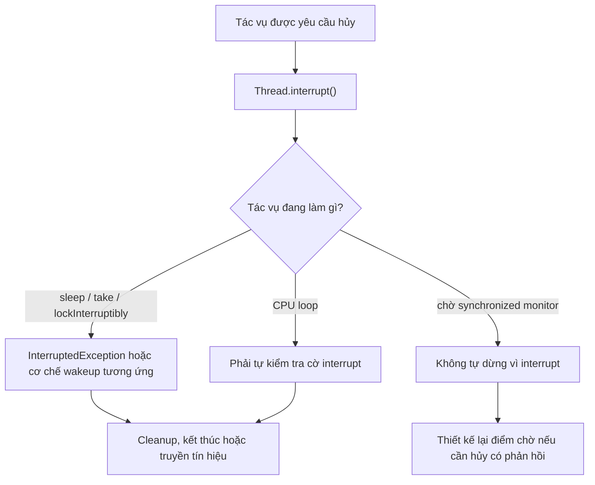
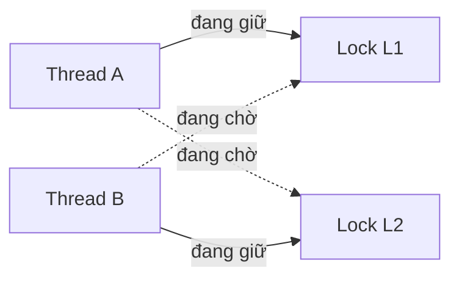
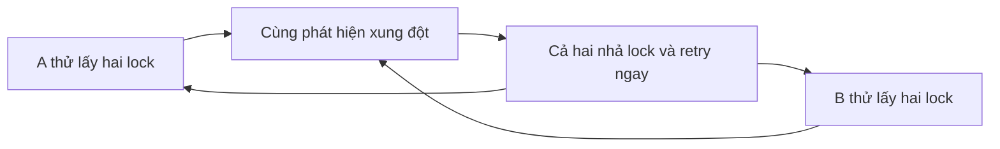
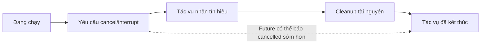

# Interruption, hủy tác vụ, deadlock, livelock và starvation

Trong Java 27, một ứng dụng đồng thời không chỉ cần **chạy nhiều tác vụ cùng lúc** mà còn phải **dừng chúng có kiểm soát** và tránh những tình huống các tác vụ không tiến triển. Ví dụ, người dùng hủy xuất báo cáo, HTTP request hết thời gian chờ, worker chờ hàng đợi trống, hay hai tác vụ cùng tranh chấp nhiều lock.

Bài này thuộc chương **Nền tảng lập trình đồng thời**, tập trung vào năm khái niệm:

- **Interruption:** gửi tín hiệu rằng một thread nên dừng hoặc điều chỉnh hoạt động của mình.
- **Hủy tác vụ (cancellation):** yêu cầu chấm dứt một công việc, thường thông qua `Future` và cơ chế phối hợp.
- **Deadlock:** nhiều bên chờ tài nguyên mà nhau đang nắm giữ, không bên nào có thể tiếp tục.
- **Livelock:** các bên vẫn hoạt động và phản ứng với nhau, nhưng không hoàn thành công việc hữu ích.
- **Starvation:** một tác vụ bị chậm hoặc không tiến triển vì liên tục không được cấp CPU, lock hoặc tài nguyên cần thiết.

Điểm xuyên suốt: **hủy là một giao thức hợp tác, không phải lệnh kết liễu an toàn bất kỳ thread nào**. Mã phải chủ động xử lý tín hiệu, giải phóng tài nguyên và duy trì bất biến. Các ví dụ dùng API Java SE 27 đã ổn định, bao gồm virtual threads từ Java 21; không dựa vào các phương thức buộc dừng thread không an toàn hoặc tính năng preview.

## 1. Hai nhóm vấn đề: dừng có chủ đích và mất khả năng tiến triển

| Tình huống | Dấu hiệu quan sát | Hướng xử lý chính |
|---|---|---|
| Người dùng nhấn “Hủy” | Cần kết thúc công việc đang chạy | `interrupt`/`Future.cancel`, kiểm tra cờ và cleanup |
| Request quá thời hạn | Người gọi không thể chờ mãi | Deadline, timeout, hủy công việc theo hợp đồng |
| Hai thread nắm hai lock theo thứ tự ngược | Cả hai chờ vô hạn | Thiết kế thứ tự lock cố định, tránh vòng chờ |
| Hai worker đều “nhường nhau” liên tục | Có activity nhưng không có kết quả | Randomized backoff, giới hạn retry, chọn bên ưu tiên |
| Một tác vụ luôn bị chen ngang | Chờ kéo dài dù hệ thống còn chạy | Giảm tranh chấp, chính sách công bằng và giám sát |
| Pool chỉ có một worker đang chờ một tác vụ khác của cùng pool | Tác vụ con không có worker để chạy | Không block chờ việc cần cùng nguồn lực đang bị chiếm |

Một hệ thống **có thread sống** chưa chắc **có tiến triển**. `Thread.State.WAITING`, `TIMED_WAITING` hoặc CPU sử dụng cao chỉ là tín hiệu chẩn đoán ban đầu; phải kết hợp stack trace, lock ownership, thời gian chờ và luồng nghiệp vụ để xác định nguyên nhân.

## 2. `Thread.interrupt()` là tín hiệu, không phải cưỡng chế dừng

Mỗi thread có một **interrupted status** — về mặt ý nghĩa là cờ yêu cầu dừng hoặc hủy hoạt động hiện tại. Gọi:

```java
workerThread.interrupt();
```

không bảo đảm thread lập tức kết thúc. Tùy thread đang làm gì:

1. Nếu đang chạy mã CPU-bound và không kiểm tra cờ, nó có thể tiếp tục chạy.
2. Nếu đang chờ ở **điểm chặn có hỗ trợ interruption** như `Thread.sleep`, `BlockingQueue.take` hoặc `ReentrantLock.lockInterruptibly`, thao tác thường kết thúc sớm bằng `InterruptedException`.
3. Nếu đang chờ lấy **intrinsic monitor** bằng `synchronized`, chỉ gọi `interrupt()` **không làm việc chờ monitor trở thành interruptible**.
4. Một số I/O API có hành vi ngắt riêng (ví dụ đóng `InterruptibleChannel` hoặc đánh thức `Selector`); không giả định mọi lời gọi I/O đều phản ứng giống `sleep`.



### Hai cách kiểm tra cờ không giống nhau

```java
boolean stillInterrupted =
        Thread.currentThread().isInterrupted();
```

`isInterrupted()` **đọc cờ mà không xóa cờ**. Đây thường là lựa chọn thích hợp cho vòng lặp kiểm tra việc hủy.

Ngược lại:

```java
boolean wasInterrupted = Thread.interrupted();
```

`Thread.interrupted()` là phương thức **static**, chỉ đọc **thread hiện tại** và **xóa interrupted status**. Gọi nó không đúng chỗ có thể “nuốt” tín hiệu hủy, khiến đoạn mã bên ngoài không còn nhìn thấy yêu cầu ngắt.

Ví dụ:

```java
while (!Thread.currentThread().isInterrupted()) {
    processNextChunk();
}
```

Trong ví dụ này, `processNextChunk()` là công việc ngắn, hữu hạn và không chặn lâu. Nếu nó có thể chặn hoặc bị treo vô hạn, việc kiểm tra cờ ở đầu mỗi vòng lặp vẫn không bảo đảm hủy nhanh.

## 3. Xử lý `InterruptedException` đúng hợp đồng

Nhiều thao tác chặn có hỗ trợ interruption ném `InterruptedException` khi nhận yêu cầu. **Thông thường exception này đã xóa interrupted status** của thread trước khi được ném. Vì vậy cách xử lý phụ thuộc vào việc phương thức hiện tại có thể truyền tiếp interruption hay không.

### Cách A — Truyền lên khi phương thức khai báo `throws InterruptedException`

```java
static String receive(
        java.util.concurrent.BlockingQueue<String> queue)
        throws InterruptedException {
    return queue.take(); // cho phép caller xử lý cancellation
}
```

Đây là lựa chọn rõ ràng nếu API của bạn cho phép người gọi quyết định khi bị ngắt. Không bắt `InterruptedException` chỉ để in log rồi tiếp tục chờ vô hạn.

### Cách B — Nếu không thể truyền lên, khôi phục cờ trước khi thoát

```java
static void runWorker() {
    try {
        Thread.sleep(1_000);
        doWork();
    } catch (InterruptedException interrupted) {
        Thread.currentThread().interrupt(); // khôi phục tín hiệu
        return;                              // kết thúc công việc
    }
}
```

`doWork()` đại diện một thao tác nghiệp vụ thông thường. Bản chất cần nhớ là **restore interrupt flag và kết thúc**, không phải gọi `Thread.currentThread().interrupt()` rồi tiếp tục công việc như chưa có chuyện gì xảy ra.

Nếu cần chuyển `InterruptedException` thành một exception khác để phù hợp API, hãy giữ nguyên cause và khôi phục interrupted status trước khi ném exception mới, nếu theo hợp đồng không thể truyền trực tiếp `InterruptedException`.

### Cách C — Dọn dẹp trong `finally`

```java
Lock lock = new ReentrantLock();
lock.lock();
try {
    updateProtectedState();
} finally {
    lock.unlock();
}
```

Ví dụ này minh họa quy tắc luôn nhả lock khi thoát nhánh bình thường hay exception. Trong code thật, việc `lock.lock()` là thao tác **không interruptible trong lúc chờ**; khi cần hủy trong thời gian chờ lấy lock, dùng `lockInterruptibly()` như các phần sau.

**Không dùng các thao tác buộc dừng thread không an toàn** để thay thế cleanup, vì chúng có thể kết thúc thread khi đang giữ lock hoặc chưa hoàn tất thay đổi dữ liệu.

## 4. Chương trình chạy được: hủy tác vụ bằng `Future.cancel(true)`

Ví dụ sử dụng **virtual threads** — tính năng đã hoàn thiện từ Java 21 — thông qua `Executors.newVirtualThreadPerTaskExecutor()`. Nó minh họa một worker đang `sleep`, yêu cầu hủy, xử lý `InterruptedException` và giải phóng tài nguyên.

Lưu thành `CooperativeCancellationDemo.java`:

```java
import java.util.concurrent.CountDownLatch;
import java.util.concurrent.ExecutorService;
import java.util.concurrent.Executors;
import java.util.concurrent.Future;

public class CooperativeCancellationDemo {
    public static void main(String[] args)
            throws InterruptedException {

        try (ExecutorService executor =
                     Executors.newVirtualThreadPerTaskExecutor()) {

            CountDownLatch started = new CountDownLatch(1);

            Future<?> task = executor.submit(() -> {
                started.countDown();

                try {
                    int completed = 0;
                    while (!Thread.currentThread().isInterrupted()) {
                        // Giả lập chờ một hoạt động có thể bị interrupt.
                        Thread.sleep(200);
                        System.out.println("Xử lý bước " + ++completed);
                    }
                } catch (InterruptedException interrupted) {
                    // sleep đã xóa cờ: phục hồi để caller/cleanup có thể biết.
                    Thread.currentThread().interrupt();
                    System.out.println("Đã nhận yêu cầu hủy");
                } finally {
                    // Ví dụ chỗ hoàn trả tài nguyên, ghi audit hoặc rollback.
                    System.out.println("Worker cleanup");
                }
            });

            // Đợi worker bắt đầu, tránh phụ thuộc thứ tự scheduler.
            started.await();
            Thread.sleep(350);

            boolean requested = task.cancel(true);
            System.out.println("Yêu cầu hủy được chấp nhận: " + requested);
            System.out.println("Future cancelled: " + task.isCancelled());
        } // ExecutorService.close() đợi các tác vụ kết thúc.
    }
}
```

Biên dịch và chạy với JDK 27:

```bash
javac --release 27 CooperativeCancellationDemo.java
java CooperativeCancellationDemo
```

Kết quả có thể tương tự:

```text
Xử lý bước 1
Yêu cầu hủy được chấp nhận: true
Future cancelled: true
Đã nhận yêu cầu hủy
Worker cleanup
```

**Thứ tự log giữa main thread và worker có thể thay đổi.** Không dùng một thứ tự in log cụ thể làm hợp đồng hủy; scheduler có thể chạy hai thread theo thứ tự khác nhau.

Giải thích:

- `submit` trả một `Future<?>` đại diện tác vụ.
- `started.await()` chỉ bảo đảm worker đã đi qua `countDown()`, không tạo cam kết về thời điểm hoàn thành xử lý.
- `task.cancel(true)` yêu cầu hủy và, đối với implementation executor này, cố gắng interrupt thread đang thực hiện tác vụ.
- Worker nhận interruption tại `Thread.sleep(200)`, khôi phục interrupted status và chạy `finally`.
- `task.isCancelled()` cho biết **trạng thái Future**, không phải bằng chứng mọi side effect của worker đã dừng ngay ở thời điểm đọc.
- `ExecutorService.close()` trong try-with-resources chờ các task kết thúc khi rời khối; đoạn ví dụ giới hạn công việc và phản hồi interruption nên không cần chờ vô hạn nếu worker tuân thủ hợp đồng.

Tình huống **hủy trước khi bắt đầu** có thể khiến phần thân worker không được chạy, nên code không được giả định `finally` của task nhất định đã thực thi sau một lệnh `cancel`. Cấp phát tài nguyên trong worker phải có chính sách dọn đúng vòng đời thực tế.

## 5. `Future.cancel`, timeout và vòng đời của ExecutorService

Hủy một `Future` và dừng tác vụ thật sự là **hai việc có liên hệ nhưng không đồng nhất**.

| API | Ý nghĩa | Giới hạn |
|---|---|---|
| `future.cancel(false)` | Cố hủy tác vụ; không yêu cầu interrupt thread đang chạy | Tác vụ đã chạy có thể tiếp tục thực hiện |
| `future.cancel(true)` | Cố hủy và yêu cầu interrupt thread thực hiện khi implementation biết thread | Không cưỡng chế dừng mã không hợp tác |
| `future.isCancelled()` | Kiểm tra trạng thái cancellation của Future | Không chứng minh mọi side effect đã kết thúc |
| `future.isDone()` | Tác vụ/future đã hoàn thành theo một trạng thái kết thúc | Bao gồm hoàn thành thường, lỗi hoặc cancellation |
| `future.get()` | Chờ và nhận kết quả | Có thể chặn; có thể ném InterruptedException, ExecutionException hoặc CancellationException |
| `future.get(timeout, unit)` | Chờ kết quả tối đa một khoảng thời gian | `TimeoutException` **không tự hủy** tác vụ |

Trong Java SE 27, `Future.cancel` trả giá trị thể hiện kết quả **yêu cầu hủy** theo hợp đồng implementation; tài liệu `Future` cũng lưu ý **đừng chỉ dựa vào boolean trả về để kết luận trạng thái**, mà dùng `isCancelled()`. Dù hủy thành công ở cấp Future, computation vẫn có thể đang kết thúc hoặc cleanup ở nền.

### Timeout không tự động làm việc dừng lại

Ví dụ một helper có deadline để đợi kết quả:

```java
import java.util.concurrent.ExecutionException;
import java.util.concurrent.ExecutorService;
import java.util.concurrent.Future;
import java.util.concurrent.TimeUnit;
import java.util.concurrent.TimeoutException;

static String getWithTimeout(ExecutorService executor)
        throws InterruptedException, ExecutionException, TimeoutException {

    Future<String> future = executor.submit(() -> {
        // Giả lập một thao tác chặn có thể ngắt.
        Thread.sleep(5_000);
        return "Đã xong";
    });

    try {
        return future.get(200, TimeUnit.MILLISECONDS);
    } catch (TimeoutException | InterruptedException failure) {
        future.cancel(true); // chủ động yêu cầu hủy công việc phía sau
        throw failure;
    }
}
```

Đặt helper này trong một class thích hợp và truyền vào một executor còn hoạt động. `get(200, ...)` chỉ giới hạn **thời gian chờ của caller**. Nếu muốn hủy task khi hết thời gian hoặc khi thread caller bị interrupt, mã phải gọi `cancel(true)` như trên. Dù vậy, không nên kỳ vọng tất cả thao tác I/O hoặc native code đều kết thúc tức thời khi bị interrupt.

### Khác nhau giữa `shutdown()`, `shutdownNow()` và `close()`

- `executor.shutdown()`: **không nhận task mới**, nhưng để các task đã nộp được xử lý theo chính sách executor; không chủ động interrupt mọi task đang chạy.
- `executor.shutdownNow()`: **cố gắng** dừng các task đang hoạt động, thường bằng interrupt, và trả về danh sách task đã chờ nhưng chưa bắt đầu; không bảo đảm tất cả task đang chạy đã kết thúc.
- `executor.awaitTermination(timeout, unit)`: đợi executor chấm dứt sau khi đã yêu cầu shutdown; boolean cho biết có terminated trong thời gian chờ hay không.
- `executor.close()`: dạng quản lý tài nguyên hiện hành của `ExecutorService`; yêu cầu shutdown và đợi task kết thúc theo hợp đồng `AutoCloseable`. **Không dùng `close()` như một timeout.** Nếu task bỏ qua interruption hoặc không bao giờ kết thúc, việc đợi có thể kéo dài không mong muốn.

Lựa chọn shutdown cần theo chính sách ứng dụng: **ngừng nhận việc mới**, **cho việc đã nhận hoàn thành**, hay **ưu tiên hủy càng sớm càng tốt**. Đây là quyết định về vòng đời, không phải ba tên hàm có thể hoán đổi tùy tiện.

## 6. `CompletableFuture.cancel(true)` không có cùng tác dụng ngắt worker

`CompletableFuture` cũng triển khai `Future`, nhưng cơ chế hủy **không giống** một task được quản lý bởi `FutureTask` trong executor.

Theo đặc tả Java SE 27:

```java
CompletableFuture<String> response = new CompletableFuture<>();

response.cancel(true);

System.out.println(response.isCancelled()); // true
```

Với `CompletableFuture`, việc hủy **hoàn thành future theo trạng thái ngoại lệ `CancellationException`**. Tham số `mayInterruptIfRunning` trong `cancel(boolean)` **không có tác dụng** vì class này không dùng interruption để kiểm soát computation gây ra kết quả.

Hệ quả:

- `CompletableFuture.cancel(true)` **không bảo đảm interrupt** thread đang chạy `supplyAsync` hoặc logic khác.
- Các dependent stages chưa hoàn thành thường tiếp tục đi theo nhánh hoàn thành ngoại lệ (`CompletionException` do `CancellationException`).
- Một computation nền vẫn có thể chạy và tạo side effect, dù future mà caller giữ đã báo cancelled.
- Các API timeout như `orTimeout` và `completeOnTimeout` tác động đến **kết quả future**, không tự biến một tác vụ không hợp tác thành tác vụ bị ngắt.

Nếu bắt buộc phải **dừng tác vụ nền**, hãy dùng một cơ chế cancellation được thiết kế từ đầu: `Future` của executor có khả năng interrupt, cờ huỷ do task chủ động kiểm tra, hoặc giao thức hủy của thư viện I/O được dùng. Không lấy trạng thái hoàn thành của `CompletableFuture` làm bằng chứng resource đã được giải phóng.

## 7. Vòng lặp CPU và cờ hủy tự quản lý

`InterruptedException` chủ yếu xuất hiện tại các thao tác có thể bị ngắt. Một vòng lặp CPU-bound không gọi API chặn có thể không bao giờ tự phát sinh `InterruptedException`; nó phải **kiểm tra cờ** định kỳ.

```java
static long computeUntilInterrupted() {
    long sum = 0;

    while (!Thread.currentThread().isInterrupted()) {
        // Mỗi vòng rất ngắn; với tác vụ lớn, kiểm tra theo từng chunk.
        sum += 1;
    }

    return sum; // chỉ minh họa, long có thể overflow
}
```

Nếu tác vụ đang dùng API trả về kết quả nhanh nhưng có thể block từng đoạn, hãy đặt checkpoint hủy ở những vị trí ý nghĩa. Không nhất thiết kiểm tra interrupted status sau **từng phép cộng** trong mã hiệu năng cao; mục tiêu là độ phản hồi hủy phù hợp với yêu cầu.

Một số API ứng dụng cần **tín hiệu hủy độc lập với interruption**, ví dụ một tác vụ điều khiển bằng đối tượng chung:

```java
import java.util.concurrent.atomic.AtomicBoolean;

final class CancellationToken {
    private final AtomicBoolean cancelled = new AtomicBoolean();

    public void cancel() {
        cancelled.set(true);
    }

    public boolean isCancelled() {
        return cancelled.get();
    }
}
```

`AtomicBoolean` cung cấp khả năng nhìn thấy thay đổi giữa các thread. Nó **không tự đánh thức** thread đang chờ ở `BlockingQueue.take()` hoặc `Thread.sleep()`. Nếu cần hủy nhanh cả khi đang chặn, hãy kết hợp token với interruption, API chờ có timeout hoặc một cơ chế đánh thức phù hợp.

**Đừng thay `AtomicBoolean` bằng một field `boolean` thông thường bị nhiều thread đọc/ghi mà không có đồng bộ hóa.** Điều đó có thể dẫn tới data race và không bảo đảm visibility theo Java Memory Model.

## 8. Các thao tác chặn có phản ứng khác nhau với interruption

Không phải mọi thao tác chờ đều có cùng hợp đồng:

| Thao tác đang chờ | Khi thread bị interrupt | Cần xử lý |
|---|---|---|
| `Thread.sleep(...)` | Thường ném `InterruptedException` và xóa cờ | Propagate hoặc restore rồi thoát |
| `Object.wait(...)` | Ném `InterruptedException` sau khi lấy lại monitor, cờ bị xóa | Kiểm tra vòng lặp điều kiện và cleanup |
| `BlockingQueue.take()/put()` | Có thể ném `InterruptedException` | Propagate/restore, không nuốt |
| `CountDownLatch.await()` | Ném `InterruptedException` | Không mặc định countdown đã về 0 |
| `Future.get()` | Có thể ném `InterruptedException` | Quyết định có cancel task phía sau không |
| `ReentrantLock.lockInterruptibly()` | Có thể ném `InterruptedException` trong lúc chờ lock | Không `unlock` nếu chưa lấy được |
| `ReentrantLock.lock()` | Không trả về chỉ vì thread bị interrupt | Dùng `lockInterruptibly` nếu cần hủy lúc chờ |
| Chờ vào `synchronized` monitor | Interruption không tự ngắt việc chờ monitor | Tránh giữ lock lâu; thay abstraction nếu cần |
| Vòng lặp CPU thuần | Cờ được đặt, không có exception tự phát | Kiểm tra `isInterrupted()` hoặc token định kỳ |

Đừng nhầm `Thread.sleep` với việc nhả monitor: **sleep không giải phóng intrinsic lock** mà thread đang giữ. `Object.wait` là cơ chế chờ có hợp đồng khác, có thể nhả monitor của đối tượng tương ứng trong lúc chờ, rồi lấy lại trước khi tiếp tục.

Ví dụ đợi lock theo cách có thể hủy:

```java
import java.util.concurrent.locks.ReentrantLock;

static void update(ReentrantLock lock) throws InterruptedException {
    lock.lockInterruptibly(); // có thể thoát nếu bị interrupt
    try {
        // Cập nhật trạng thái dưới lock.
    } finally {
        lock.unlock();        // chỉ chạy khi đã lấy được lock
    }
}
```

Ở đây `lockInterruptibly()` nằm **trước** khối `try`, nên nếu ném `InterruptedException` khi chưa có lock, `finally` không gọi `unlock` sai. Khi lock đã được lấy, mọi đường thoát khỏi critical section đều phải nhả lock.

## 9. Deadlock: hai hoặc nhiều tác vụ chờ nhau vô hạn

**Deadlock** là tình trạng một tập tác vụ đang chờ các tài nguyên/điều kiện mà chỉ các tác vụ khác trong chính tập đó mới có thể giải phóng, vì thế không bên nào tiến triển.

Ví dụ có hai lock `L1` và `L2`:

- Thread A lấy `L1` trước rồi chờ `L2`.
- Thread B lấy `L2` trước rồi chờ `L1`.
- Không ai nhả lock đang giữ khi còn đợi lock kia.



Đoạn mã minh họa **nguy hiểm — không chạy như một chương trình thử nghiệm không có cơ chế bảo vệ**, vì có thể làm chương trình treo:

```java
private static final Object L1 = new Object();
private static final Object L2 = new Object();

// Thread A có thể gọi:
static void operationA() {
    synchronized (L1) {
        synchronized (L2) {
            performA();
        }
    }
}

// Thread B có thể gọi:
static void operationB() {
    synchronized (L2) {
        synchronized (L1) {
            performB();
        }
    }
}
```

Ở đây `performA()`/`performB()` đại diện hoạt động nghiệp vụ, không phải các method được định nghĩa đầy đủ. Hai thread không chắc chắn deadlock ở mọi lần chạy; deadlock xảy ra nếu scheduler tạo đúng thứ tự xen kẽ nói trên.

Bốn điều kiện thường được dùng để phân tích deadlock:

1. **Mutual exclusion:** ít nhất một tài nguyên không thể được dùng đồng thời bởi nhiều tác vụ.
2. **Hold and wait:** tác vụ giữ tài nguyên này trong lúc đợi tài nguyên khác.
3. **No preemption:** tài nguyên không thể bị thu hồi tùy ý khi đang được giữ.
4. **Circular wait:** tồn tại chu trình chờ lẫn nhau.

Phá vỡ **một** trong bốn điều kiện ở phần thiết kế là cơ sở để ngăn deadlock. Trong mã với nhiều lock, cách phổ biến nhất là **thứ tự lấy lock thống nhất**, giúp tránh vòng chờ.

### Vì sao `interrupt()` không tự sửa deadlock?

Nếu hai tác vụ đang chờ vào `synchronized` monitor, interruption **không** làm chúng bỏ monitor đang chờ hoặc tự nhả monitor đang giữ. Với `ReentrantLock.lock()` (không interruptible), tín hiệu ngắt cũng không tự giải phóng lock. Vì vậy deadlock phải được ngăn bằng thiết kế, thay vì trông chờ một thread bên ngoài gọi `interrupt()` sẽ giải cứu mọi trường hợp.

## 10. Tránh deadlock bằng thứ tự lấy lock cố định

Nếu mọi thao tác cần nhiều lock đều lấy chúng theo **cùng thứ tự toàn cục** (ví dụ theo ID bất biến, duy nhất), sẽ không tạo chu trình lấy lock ngược thứ tự trong phần mã đó.

Ví dụ chuyển số dư giữa hai tài khoản. Mỗi tài khoản có một `ReentrantLock`; tác vụ có thể chuyển từ A sang B hoặc từ B sang A, nhưng **thứ tự lấy lock chỉ dựa trên ID**, không dựa trên chiều chuyển tiền.

Lưu thành `OrderedLockTransferDemo.java`:

```java
import java.util.concurrent.ExecutorService;
import java.util.concurrent.Executors;
import java.util.concurrent.Future;
import java.util.concurrent.locks.ReentrantLock;

public class OrderedLockTransferDemo {
    static final class Account {
        final long id;
        final ReentrantLock lock = new ReentrantLock();
        long balance;

        Account(long id, long balance) {
            if (balance < 0) {
                throw new IllegalArgumentException("Số dư ban đầu âm");
            }
            this.id = id;
            this.balance = balance;
        }
    }

    static void transfer(Account from, Account to, long amount)
            throws InterruptedException {
        if (from == to) {
            return;
        }
        if (from.id == to.id) {
            throw new IllegalArgumentException(
                    "ID tài khoản phải là duy nhất");
        }
        if (amount <= 0) {
            throw new IllegalArgumentException("Số tiền phải dương");
        }

        Account first = from.id < to.id ? from : to;
        Account second = from.id < to.id ? to : from;

        first.lock.lockInterruptibly();
        try {
            second.lock.lockInterruptibly();
            try {
                if (from.balance < amount) {
                    throw new IllegalStateException("Không đủ số dư");
                }

                // Tính giá trị mới trước khi sửa hai tài khoản.
                long newTargetBalance = Math.addExact(to.balance, amount);
                from.balance -= amount;
                to.balance = newTargetBalance;
            } finally {
                second.lock.unlock();
            }
        } finally {
            first.lock.unlock();
        }
    }

    public static void main(String[] args) throws Exception {
        Account a = new Account(1, 1_000);
        Account b = new Account(2, 1_000);

        try (ExecutorService executor =
                     Executors.newVirtualThreadPerTaskExecutor()) {

            Future<Void> first = executor.submit(() -> {
                transfer(a, b, 100);
                return null;
            });

            Future<Void> second = executor.submit(() -> {
                transfer(b, a, 50);
                return null;
            });

            first.get();
            second.get();
        }

        System.out.println("A = " + a.balance); // 950
        System.out.println("B = " + b.balance); // 1050
    }
}
```

Chạy bằng JDK 27:

```bash
javac --release 27 OrderedLockTransferDemo.java
java OrderedLockTransferDemo
```

**Vì sao đoạn này tránh vòng chờ theo hai lock tài khoản?**

- Dù A chuyển sang B hay B chuyển sang A, cả hai đều cố lấy lock tài khoản **ID nhỏ trước, ID lớn sau**.
- `lockInterruptibly()` cho phép task **phản hồi interruption khi đang chờ một lock**, không giống việc chờ monitor `synchronized`.
- Nếu bị ngắt khi đang chờ lock thứ hai, khối `finally` ngoài vẫn nhả lock thứ nhất. Không gọi `unlock` trên lock thứ hai nếu chưa lấy được.
- Cả hai phép kiểm tra số dư và cập nhật nằm trong critical section. `Math.addExact` kiểm tra overflow phía nhận trước khi trừ/cộng.
- `Future.get()` sau mỗi task giúp main chờ các task hoàn tất và quan sát lỗi (qua `ExecutionException` nếu có).

Đây là **ví dụ đồng thời**, không phải hệ thống giao dịch ngân hàng: chưa có lưu trữ bền vững, kiểm toán, xử lý nhiều loại tiền hoặc transaction xuyên dịch vụ. Thiết kế giả định ID tài khoản bất biến và duy nhất, mọi phép truy cập số dư khi có cạnh tranh đều dùng cùng hệ lock, và không có thứ tự lock khác ở mã còn lại.

### Giữ critical section nhỏ và nhả lock trong `finally`

Không làm I/O chậm hoặc gọi service bên ngoài trong lúc giữ nhiều lock nếu không bắt buộc. Những thao tác chặn lâu làm tăng thời gian tranh chấp, dễ gây deadlock và làm hủy tác vụ chậm hơn.

Tuyệt đối không viết `lock.lock(); update(); lock.unlock();` mà thiếu `try/finally`: một exception giữa chừng sẽ khiến thread thoát khỏi phương thức mà vẫn giữ lock.

## 11. `tryLock` có timeout: tránh chờ vô hạn nhưng phải quản lý thất bại

Thay vì luôn chờ tới khi lấy được lock, `ReentrantLock` hỗ trợ:

- `tryLock()`: thử lấy ngay, trả `false` nếu đang không sẵn sàng.
- `tryLock(timeout, unit)`: chờ tối đa một thời hạn, có hỗ trợ interruption.
- `lockInterruptibly()`: chờ có thể ngắt, nhưng không tự áp đặt deadline.

Ví dụ hai lock, với timeout cố định. Đoạn này chỉ minh họa kiểm soát tài nguyên, không thực hiện một giao dịch nghiệp vụ:

```java
import java.util.concurrent.TimeUnit;
import java.util.concurrent.locks.ReentrantLock;

static boolean withBothLocks(
        ReentrantLock first, ReentrantLock second)
        throws InterruptedException {

    if (first == second) {
        throw new IllegalArgumentException("Phải là hai lock khác nhau");
    }

    if (!first.tryLock(100, TimeUnit.MILLISECONDS)) {
        return false;
    }

    try {
        if (!second.tryLock(100, TimeUnit.MILLISECONDS)) {
            return false; // finally vẫn nhả first
        }
        try {
            // Chỉ thực hiện cập nhật khi sở hữu cả hai lock.
            return true;
        } finally {
            second.unlock();
        }
    } finally {
        first.unlock();
    }
}
```

Đoạn code có thể nhả lock đầu khi không lấy được lock thứ hai, từ đó giảm nguy cơ mắc kẹt vĩnh viễn nếu một bên khác cũng có cơ chế nhả tài nguyên phù hợp. Nó **không bảo đảm** hai bên sẽ hoàn thành (có thể liên tục trả `false`) và **không** thay thế quy tắc thứ tự lock nếu có thể tuân thủ.

**Timeout riêng cho từng lock không phải một deadline tổng hợp.** Ví dụ có hai lần chờ tối đa 100 ms thì tổng thời gian có thể gần 200 ms (chưa tính overhead). Nếu nghiệp vụ có deadline toàn cục, hãy tính **thời gian còn lại** dựa trên đồng hồ đơn điệu (ví dụ `System.nanoTime()`) và truyền phần thời gian còn lại cho từng lần đợi.

### Khi timeout không đủ

Một thao tác có thể bị timeout ở caller nhưng task nền vẫn đang chạy; cũng có thể task lấy được lock ngay trước deadline rồi mắc ở I/O không giới hạn. Đặt timeout ở **mọi điểm chặn có thể kiểm soát**, thiết kế giới hạn retry, và xử lý partial result theo hợp đồng.

Không dùng một timeout vô hạn chỉ vì đã có `Future.get(timeout)` ở caller; điều đó có thể khiến tài nguyên worker, kết nối hoặc lock bị chiếm quá lâu sau khi caller đã rời đi.

## 12. Livelock: luôn phản ứng nhưng không tiến triển

**Livelock** khác deadlock ở chỗ các thread **không đứng im chờ tài nguyên**; chúng liên tục làm một điều gì đó, thường nhằm “nhường nhau” hoặc xử lý xung đột, nhưng không hoàn thành công việc.

Ví dụ khái niệm:

1. Worker A và B cùng cần lấy hai tài nguyên.
2. Cả hai phát hiện tài nguyên thứ hai bận, nên nhả tài nguyên đã lấy.
3. Cả hai thử lại **cùng thời điểm**.
4. Chu trình này lặp mãi vì mỗi bên liên tục điều chỉnh hành vi theo bên còn lại.



Dấu hiệu đặc trưng là **có hoạt động** (retry/log/CPU hoặc số lần gọi tăng), nhưng **không có tiến độ hoàn thành**.

### Giảm livelock bằng randomized backoff và giới hạn retry

Ví dụ mô tả một chính sách retry (đặt trong class có method `tryPerformOperation()` được hiện thực bởi ứng dụng):

```java
import java.util.concurrent.ThreadLocalRandom;
import java.util.concurrent.TimeUnit;

static boolean retryWithBackoff() throws InterruptedException {
    final int maxAttempts = 8;

    for (int attempt = 1; attempt <= maxAttempts; attempt++) {
        if (Thread.currentThread().isInterrupted()) {
            throw new InterruptedException("Tác vụ được yêu cầu hủy");
        }

        if (tryPerformOperation()) {
            return true;
        }

        long delayMillis = ThreadLocalRandom.current()
                .nextLong(10, 60);
        TimeUnit.MILLISECONDS.sleep(delayMillis);
    }

    return false; // không hoàn tất sau số lần thử giới hạn
}
```

`tryPerformOperation()` là phép thử **không được giữ lock sau khi trả `false`** và phải có hợp đồng rõ ràng. Backoff ngẫu nhiên giúp các worker bớt lặp lại cùng một nhịp; giới hạn retry tránh hoạt động vô hạn. Tuy nhiên, **randomized backoff không chứng minh chắc chắn không thể có livelock**. Với yêu cầu chặt, dùng một quy tắc ưu tiên/ticket, arbiter hoặc thứ tự lock cố định để giải quyết xung đột từ gốc.

Nên kèm theo **deadline tổng, số lần retry và metric tiến độ** để không nhầm “rất bận” với “đang hoàn thành”.

## 13. Starvation: không được cấp đủ cơ hội tiến triển

**Starvation** xảy ra khi một tác vụ liên tục bị trì hoãn vì không được cung cấp tài nguyên cần thiết, dù hệ thống nói chung vẫn có tác vụ tiến triển.

Ví dụ:

- Một thread liên tục thất bại khi tranh chấp lock mà các thread khác lấy và nhả quá nhanh.
- Task ưu tiên thấp bị task ưu tiên cao chiếm gần hết CPU hoặc worker pool.
- Một nhóm request lớn chiếm hết connection/worker, khiến request nhỏ xếp hàng kéo dài.
- Một executor nhỏ có các task **chặn đợi chính những task cũng được xếp vào executor đó**, khiến không còn worker rảnh để xử lý việc đang được đợi (*thread-starvation deadlock*).

Ví dụ cuối có thể hình dung: một executor **chỉ có một worker** chạy task A; A nộp task B vào **cùng** executor rồi gọi `futureB.get()`. B đang xếp hàng nhưng worker duy nhất bị A chiếm để chờ B. Đây là thiết kế rất dễ mắc kẹt, đặc biệt nếu không có timeout hay cơ chế thực thi lại khác.

**Không chạy mô hình gây treo này chỉ để xem kết quả** khi chưa có giới hạn chờ và cơ chế teardown. Hãy sửa kiến trúc bằng cách tránh blocking wait trong task của cùng pool, tách nguồn lực phù hợp, hoặc tổ chức luồng tính toán có cấu trúc rõ ràng.

### `ReentrantLock(true)` và chính sách công bằng

`ReentrantLock` có constructor tùy chọn:

```java
ReentrantLock fairLock = new ReentrantLock(true);
```

Theo chính sách *fairness*, trong điều kiện có cạnh tranh, lock ưu tiên thread đã chờ lâu hơn; điều này có thể **giảm starvation ở mức lock acquisition**, nhưng thường đánh đổi thông lượng. Fairness của lock **không phải** fairness tuyệt đối của thread scheduler, nên không đảm bảo mọi thread luôn nhận CPU hoặc hoàn thành trong một thời gian xác định.

Đặc biệt, `tryLock()` **không áp dụng chính sách fairness** theo cách giống `lock()` hoặc timed `tryLock`; nó có thể lấy lock đang rảnh ngay cả khi có thread khác chờ. Vì vậy, đừng cho rằng chỉ bật `fair=true` rồi mọi đoạn mã dùng `tryLock()` sẽ tự nhiên công bằng.

Các chiến lược khác:

- Rút ngắn critical section và tránh I/O chặn khi giữ lock.
- Giới hạn số yêu cầu đồng thời theo resource (bounded concurrency).
- Tách các loại công việc có đặc tính chờ khác nhau vào pool phù hợp.
- Dùng hàng đợi, deadline, retry có giới hạn và đo **thời gian chờ theo percentile**, không chỉ throughput tổng.
- Đừng coi `Thread.setPriority` hoặc `Thread.yield` là cơ chế bảo đảm công bằng: chúng không cung cấp lời hứa portable về lượt chạy.

## 14. Phân biệt deadlock, livelock, starvation và chờ hợp lệ

Ba lỗi tiến triển có thể đều tạo cảm giác “chương trình không hoàn thành”, nhưng cách khắc phục khác nhau:

| Tiêu chí | Deadlock | Livelock | Starvation | Chờ hợp lệ |
|---|---|---|---|---|
| Thread đang làm gì? | Chờ nhau theo vòng hoặc phụ thuộc không thể giải quyết | Liên tục phản ứng/retry | Một số task bị thiếu lượt hoặc tài nguyên | Đang đợi sự kiện hoặc dữ liệu mà bên khác có thể cung cấp |
| Có hoạt động CPU/log không? | Có thể thấp, các bên đứng chờ | Thường có hoạt động đáng kể | Có thể hệ thống tổng vẫn rất bận | Phụ thuộc workload |
| Có task khác tiến triển? | Những task ngoài nhóm deadlock có thể vẫn tiến triển | Các task không liên quan vẫn có thể tiến triển | Có; đây là dấu hiệu nổi bật | Có thể có |
| Biện pháp chính | Phá vòng chờ, thứ tự lock, không giữ lock khi đợi | Backoff khác nhịp, arbiter, bounded retry | Fairness, giảm tranh chấp, phân bổ nguồn lực | Đảm bảo tín hiệu/wakeup, deadline hợp lý |
| Interrupt có giải quyết ngay không? | Không nếu chờ `synchronized`/`lock()`; tùy loại chờ | Chỉ nếu logic retry xử lý interrupt | Có thể kết thúc task cụ thể, không chữa chính sách phân bổ | Phụ thuộc hợp đồng chờ |

Ví dụ **một thread chờ `BlockingQueue.take()` khi queue trống** không tự động là deadlock: nó có thể đang chờ hợp lệ để producer đưa dữ liệu vào. Chỉ khi không có khả năng nào thỏa điều kiện chờ, hoặc hệ thống đã phá vỡ hợp đồng kết thúc, mới cần điều tra lỗi tiến triển.

Tương tự, một hệ thống có throughput cao vẫn có thể đang **starve** một nhóm yêu cầu nhỏ. Chỉ nhìn thông lượng trung bình mà không đo thời gian chờ/tác vụ bị bỏ đói sẽ bỏ sót vấn đề.

## 15. Chẩn đoán deadlock và chậm tiến triển trong Java 27

Không nên kết luận deadlock chỉ vì một thread ở trạng thái `BLOCKED` hoặc `WAITING`. Hãy kết hợp **stack trace**, **lock owner**, **thời gian chờ**, **hàng đợi** và mối quan hệ giữa các tác vụ.

### Sử dụng `ThreadMXBean` để phát hiện một số deadlock

Java cung cấp API quản lý thread cho **platform threads**:

```java
import java.lang.management.ManagementFactory;
import java.lang.management.ThreadMXBean;
import java.util.Arrays;

public class DeadlockDiagnostic {
    public static void main(String[] args) {
        ThreadMXBean bean = ManagementFactory.getThreadMXBean();

        try {
            long[] deadlocked = bean.findDeadlockedThreads();

            if (deadlocked == null) {
                System.out.println("Không phát hiện deadlock thuộc phạm vi MXBean");
            } else {
                System.out.println("Thread IDs: "
                        + Arrays.toString(deadlocked));
            }
        } catch (UnsupportedOperationException unsupported) {
            System.out.println(
                    "JVM không hỗ trợ kiểu phát hiện deadlock này");
        }
    }
}
```

`findDeadlockedThreads()` có thể phát hiện vòng deadlock liên quan tới intrinsic monitors và các **ownable synchronizers** như `ReentrantLock` trong phạm vi được công cụ hỗ trợ. Đây không phải một bộ kiểm tra mọi nguyên nhân ứng dụng không tiến triển.

**Rất quan trọng đối với Java hiện đại:** `java.lang.management.ThreadMXBean` **không quản lý hoặc theo dõi virtual threads** theo hợp đồng Java SE 27. Không dùng kết quả “không phát hiện deadlock” của MXBean làm bằng chứng rằng các virtual threads hoặc tác vụ ở một hệ thống phân tán chắc chắn không có vấn đề. Dùng thêm công cụ chẩn đoán hỗ trợ virtual threads, thread dumps/JFR phù hợp và telemetry ở mức nghiệp vụ.

### Thu thập bằng chứng trước khi sửa

Các chỉ số nên quan sát:

- Thời gian chờ lock, số lần thử lock thất bại, thời gian giữ lock và tần suất contention.
- Số task đang chạy/đang chờ, độ dài hàng đợi, tuổi tác vụ cũ nhất và tỉ lệ timeout.
- Số lần cancel và **thời gian thực tế từ yêu cầu cancel tới cleanup hoàn tất**.
- Số lần retry không tiến triển (dấu hiệu livelock).
- Chênh lệch thời gian chờ giữa các lớp ưu tiên hoặc nhóm khách hàng (dấu hiệu starvation).
- Stack trace, lock graph và quan hệ parent/child của task vào thời điểm hệ thống mất tiến độ.

Một thread dump là **ảnh chụp tại thời điểm**, không phải lịch sử. Với lỗi chập chờn, nên lấy dữ liệu theo thời gian, kết hợp trace, metric và log có correlation ID. Đừng lạm dụng logging trong critical section vì logging cũng có thể dùng lock/I/O và làm thay đổi lịch chạy.

## 16. Thiết kế giao thức hủy rõ ràng từ ranh giới ứng dụng

Một giao thức hủy tốt phải trả lời được những câu hỏi sau:

1. **Ai có quyền yêu cầu hủy?** HTTP client, scheduler, timeout, user action hay shutdown signal?
2. **Tín hiệu truyền bằng gì?** Interrupt, token, `Future.cancel`, đóng tài nguyên I/O hoặc API của thư viện?
3. **Task kiểm tra tín hiệu ở đâu?** Trước một bước nặng, ở điểm chặn, giữa các chunk, hay trong vòng lặp retry?
4. **Task phải làm gì khi hủy?** Dừng công việc mới, giải phóng lock, đóng kết nối, hoàn tác phần có thể hoàn tác, ghi trạng thái cuối?
5. **Làm sao xác nhận đã dừng thật?** Chờ tín hiệu cleanup, kết quả terminal phù hợp, `CountDownLatch` riêng hoặc theo dõi vòng đời executor — không chỉ đọc `isCancelled()`.
6. **Nếu không dừng thì sao?** Deadline leo thang, cách ly tác vụ, giám sát và cảnh báo; không tự động dùng cách cưỡng chế không an toàn.

### Phân biệt “đã nhận yêu cầu hủy” với “đã dừng hoàn toàn”



Mũi tên nét đứt biểu thị **không có bảo đảm `Future.isCancelled()` đồng thời với việc cleanup kết thúc**. Cần một tín hiệu hoặc quy trình chờ riêng khi việc giải phóng tài nguyên quan trọng.

### Cleanup cần idempotent và không che lỗi chính

Khi một task bị hủy ở nhiều ranh giới hoặc nhiều lần, việc cleanup có thể được thử nhiều lần theo kiến trúc ứng dụng. Đóng resource hoặc đổi trạng thái nghiệp vụ nên được thiết kế **idempotent** khi có thể, và exception trong cleanup cần được ghi nhận mà không làm mất nguyên nhân hủy ban đầu.

Không giữ lock trong khi gọi I/O chặn dài, và không tự động retry vô hạn sau `InterruptedException`. Nếu việc “rollback” có thể chặn, hãy có chính sách deadline và xử lý trạng thái chưa hoàn tất; chỉ dùng `finally` không tự làm mọi cleanup thành an toàn.

## 17. Virtual threads không thay đổi nguyên tắc tránh mất tiến triển

**Virtual threads** là cơ chế thread nhẹ đã ổn định từ Java 21, đặc biệt phù hợp cho nhiều công việc dành phần lớn thời gian để chờ I/O. Tuy nhiên, chúng vẫn có những vấn đề đồng thời cần xử lý:

- `Thread.interrupt()` và việc phản hồi interruption vẫn là cơ chế quan trọng.
- Các task dùng virtual thread vẫn có thể deadlock hoặc livelock nếu thiết kế lock/condition sai.
- Virtual threads không làm tài nguyên ngoài JVM (kết nối database, API rate limit, file descriptor) trở nên vô hạn.
- Một lượng lớn virtual threads đồng thời gọi cùng dịch vụ có thể gây overload và starvation ở **tài nguyên đích**.
- Vòng lặp CPU dài không trở nên hủy được chỉ nhờ chạy trên virtual thread.
- Các công cụ giám sát **platform threads** không nhất thiết mô tả đầy đủ vòng đời virtual threads.

Ví dụ tạo executor hiện hành:

```java
try (var executor =
        java.util.concurrent.Executors.newVirtualThreadPerTaskExecutor()) {
    // Mỗi tác vụ được chạy trên một virtual thread.
    // Cần đặt giới hạn ở các tài nguyên ngoài nếu chúng có capacity thấp.
}
```

Đừng dùng số lượng virtual thread lớn làm giải pháp cho deadlock; nếu một vòng chờ logic tồn tại, thêm thread chỉ có thể che lỗi tạm thời hoặc tạo thêm tranh chấp.

Trong ứng dụng dùng nhiều request, có thể cần thêm `Semaphore`/bounded queue để hạn chế số tác vụ đồng thời truy cập database hoặc dịch vụ bên ngoài. Chính sách admission control và backpressure là phần riêng của thiết kế, không tự xuất hiện do dùng virtual threads.

## 18. Những lỗi thường gặp

### 18.1. Bắt `InterruptedException` rồi bỏ qua

```java
try {
    Thread.sleep(1_000);
} catch (InterruptedException ignored) {
    // Sai nếu tiếp tục như chưa nhận yêu cầu hủy.
}
```

Cách đúng thường là **truyền tiếp exception** hoặc **khôi phục interrupted status rồi thoát**. Không log và tiếp tục vòng lặp vô tận.

### 18.2. Tin rằng `interrupt()` dừng bất kỳ đoạn mã nào

Interrupt là yêu cầu hợp tác. Một loop CPU không kiểm tra, một thao tác native hoặc chờ monitor `synchronized` có thể không phản ứng như mong muốn. Thiết kế checkpoint phù hợp.

### 18.3. Nghĩ `Future.cancel(true)` đồng nghĩa task đã cleanup

`isCancelled()` nói về trạng thái Future; worker có thể vẫn đang kết thúc. Nếu cần xác nhận resource đã nhả, theo dõi tín hiệu hoàn thành thật sự.

### 18.4. Dùng `CompletableFuture.cancel(true)` để “ngắt thread”

Tham số `true` **không có tác dụng interrupt worker** trong implementation `CompletableFuture` chuẩn. Nếu cần hủy computation, thiết kế cơ chế khác.

### 18.5. Gọi `Future.get(timeout)` rồi quên task phía sau

Timeout của `get` chỉ giải phóng việc chờ của caller. Task không tự dừng; caller cần xác định có gọi `cancel(true)` hay không.

### 18.6. Dùng `synchronized` nhiều tầng với thứ tự ngược

Nếu nhiều thread lấy A rồi B và B rồi A, có thể hình thành vòng chờ. Quy định thứ tự toàn cục, giảm lock lồng nhau.

### 18.7. Dùng `tryLock()` nhưng không nhả lock khi thất bại giữa chừng

Mọi nhánh sau khi lấy lock đều phải được bao bằng `try/finally` tương ứng. Chỉ gọi `unlock()` nếu thread thật sự đang giữ lock đó.

### 18.8. Retry lập tức và vô hạn

Hai worker cùng rollback và retry đồng nhịp có thể livelock. Dùng bounded retry/backoff/jitter, nhưng đừng xem đó là cách chứng minh tiến triển tuyệt đối.

### 18.9. Cho rằng fair lock bảo đảm toàn bộ hệ thống công bằng

`ReentrantLock(true)` hỗ trợ một chính sách công bằng ở mức tranh chấp lock, không bảo đảm lịch CPU hay công bằng của những tài nguyên khác. Untimed `tryLock()` còn có thể bỏ qua thứ tự chờ.

### 18.10. Dùng thread pool nhỏ cho tác vụ chờ task con của cùng pool

Nếu mọi worker đều đang chờ task chưa chạy nhưng chỉ có chính những worker ấy mới có thể chạy task, sẽ tạo *thread-starvation deadlock*. Đánh giá dependency và chính sách cấp worker thay vì tăng số worker tùy tiện.

### 18.11. Dựa vào thread priority để sửa starvation

Thread priority và `yield` không phải hợp đồng cấp lượt portable, đặc biệt trên virtual threads. Hãy kiểm soát hàng đợi, locks, tài nguyên và thời hạn.

### 18.12. Chỉ nhìn vào CPU để kết luận deadlock

Deadlock thường làm các bên chờ, livelock có thể tiêu thụ nhiều CPU, starvation có thể xảy ra khi toàn hệ thống vẫn bận. Dùng nhiều tín hiệu chẩn đoán, không dựa vào một chỉ số.

## 19. Kiểm thử cancellation và lỗi tiến triển mà không làm treo test

Kiểm thử đồng thời cần tránh phụ thuộc vào “may mắn” của scheduler. **Không** dùng những vòng lặp vô hạn, deadlock thật hoặc thời gian `sleep` tùy tiện rồi chờ test runner treo để chứng minh chương trình có lỗi.

### Dùng đồng bộ hóa để kiểm soát điểm bắt đầu

`CountDownLatch` giúp xác nhận worker đã bắt đầu trước khi gửi yêu cầu hủy. Trong ví dụ `CooperativeCancellationDemo`:

1. Worker gọi `started.countDown()`.
2. Main đợi `started.await()`.
3. Main yêu cầu `task.cancel(true)`.
4. Worker phản hồi interruption và thực thi cleanup.

Nếu muốn test **cleanup đã hoàn tất**, có thể thêm một `CountDownLatch stopped` rồi gọi `stopped.countDown()` trong `finally` của worker. Người kiểm thử gọi:

```java
if (!stopped.await(2, java.util.concurrent.TimeUnit.SECONDS)) {
    throw new AssertionError(
            "Worker không cleanup trong thời gian cho phép");
}
```

Đây là một đoạn kiểm tra dành cho test có biến `stopped` được khai báo và chia sẻ trước đó; không phải chương trình độc lập. Quan trọng là **kiểm tra một tín hiệu từ worker**, thay vì coi `Future.isCancelled()` là xác nhận cleanup.

### Ma trận kiểm thử nên có

| Kịch bản | Điều cần khẳng định |
|---|---|
| Interrupt khi worker đang `sleep` | Worker nhận `InterruptedException` và thoát/cleanup |
| Interrupt khi chạy vòng lặp CPU | Worker kiểm tra flag và dừng trong giới hạn được thiết kế |
| Hủy trước khi task bắt đầu | Task không được giả định đã chạy `finally`; tài nguyên ngoài task vẫn được xử lý đúng |
| `future.cancel(false)` với task đang chạy | Không giả định tác vụ tự ngừng ngay |
| `future.cancel(true)` với task hợp tác | Yêu cầu interrupt được xử lý, cleanup xác nhận bằng tín hiệu riêng |
| `future.get(timeout)` hết hạn | Caller nhận `TimeoutException`; quyết định hủy task là bước khác |
| `CompletableFuture.cancel(true)` | Future chuyển trạng thái hủy nhưng không suy rằng worker bị interrupt |
| Hai transfer đồng thời A→B và B→A | Không có vòng chờ do thứ tự lock; tổng số dư hợp lý |
| Một task bị interrupt khi chờ lock thứ hai | Lock thứ nhất được nhả trong `finally`, không để rò lock |
| Retry thường xuyên thất bại | Dừng theo max attempts/deadline; không retry vô hạn |
| Pool chỉ có một worker và task phụ thuộc cùng pool | Phân tích thiết kế, không chạy test có thể chờ vô hạn |
| Fair lock dưới tải | Đo phân bố wait time thay vì chỉ kiểm tra throughput |

### Kiểm thử đúng đắn không đồng nghĩa chứng minh không có deadlock ở mọi lịch chạy

Concurrency bug phụ thuộc interleaving, thời gian chờ I/O và scheduler. Stress tests với nhiều lượt và dữ liệu khác nhau hữu ích nhưng **không thể chứng minh** mọi thứ tự chạy đều an toàn. Kết hợp:

- Kiểm tra thiết kế (thứ tự lấy lock, không giữ lock qua I/O, ownership rõ).
- Unit tests ở các điểm chặn có thể điều khiển được.
- Integration tests có timeout, cleanup và teardown đáng tin cậy.
- Theo dõi thực tế bằng metric, thread dump, JFR và log có correlation ID.

Hạn chế sử dụng `Thread.sleep` làm cơ chế đồng bộ hóa trong test; `CountDownLatch`, `CyclicBarrier` hoặc cơ chế tín hiệu tương đương giúp kiểm soát thứ tự tốt hơn. Nếu test tạo executor, phải có quy trình kết thúc executor và không để worker mắc kẹt sau khi test thất bại.

## 20. Checklist triển khai và code review

- [ ] Mỗi tác vụ có **chủ sở hữu** và chính sách hủy rõ ràng chưa?
- [ ] Điểm chặn nào phản hồi interrupt; điểm nào không phản hồi?
- [ ] `InterruptedException` có được propagate hoặc restore trước khi thoát không?
- [ ] Vòng lặp dài có kiểm tra `isInterrupted()`/token theo thời gian hợp lý không?
- [ ] Caller có phân biệt timeout của `get` và việc hủy task thật không?
- [ ] Khi gọi `Future.cancel(true)`, có hiểu đây là best effort không?
- [ ] Có tránh dùng `CompletableFuture.cancel(true)` như một bảo đảm interrupt không?
- [ ] Resource và lock có được giải phóng trong `finally` theo đúng ownership không?
- [ ] Có thứ tự lấy nhiều lock thống nhất để tránh circular wait không?
- [ ] Khi dùng `tryLock`, có xử lý nhánh thất bại/timeout và nhả lock đã lấy không?
- [ ] Retry có giới hạn, backoff, jitter và deadline thích hợp không?
- [ ] Có xem xét starvation ở pool, lock, queue và tài nguyên ngoài JVM không?
- [ ] Có đo thời gian chờ và thời gian từ cancel tới cleanup xong không?
- [ ] Có tránh dùng thread priority/fair lock như “bảo đảm” tuyệt đối không?
- [ ] Có nhớ công cụ `ThreadMXBean` không theo dõi virtual threads không?
- [ ] Có test tình huống hủy, timeout, contention và shutdown trên workload thực tế không?

## 21. Bài tập thực hành

**Bài 1 — Cờ interruption.** Viết một worker chạy vòng lặp tính toán theo từng chunk và kiểm tra `isInterrupted()` sau mỗi chunk. Tạo một thread khác gọi `interrupt()`. Giải thích vì sao không nên dùng `Thread.interrupted()` để kiểm tra nếu cần giữ cờ cho caller.

**Bài 2 — Xử lý exception.** Tạo method chờ `BlockingQueue.take()` với `throws InterruptedException`. Viết một phiên bản `Runnable` không thể throws checked exception và phải restore cờ sau khi bắt `InterruptedException`. Kiểm thử cả hai.

**Bài 3 — Future cancellation.** Chạy `CooperativeCancellationDemo`, thêm `CountDownLatch stopped` trong `finally` để xác nhận cleanup đã xong. Thử yêu cầu hủy ngay sau khi worker bắt đầu và thử khi worker đã hoàn tất.

**Bài 4 — Timeout không phải cancellation.** Gửi một task ngủ 3 giây vào executor, gọi `future.get(100, MILLISECONDS)`. Giải thích vì sao task có thể vẫn chạy và bổ sung `cancel(true)` ở nhánh timeout. Đảm bảo executor được đóng đúng cách.

**Bài 5 — CompletableFuture.** Tạo một `CompletableFuture` hoàn thành từ một worker tự quản lý, gọi `cancel(true)` trên future, rồi quan sát việc worker có tiếp tục chạy hay không. Viết thêm token hoặc cơ chế interrupt riêng để thực sự yêu cầu dừng worker; không dựa vào trạng thái future.

**Bài 6 — Tránh deadlock.** Dùng hai tài khoản và hai tác vụ chuyển tiền ngược chiều từ ví dụ phần 10. Thử thay thứ tự lock theo chiều giao dịch và phân tích lịch chạy nào có thể tạo vòng chờ. Không chạy thử phiên bản gây deadlock không có timeout/teardown.

**Bài 7 — `tryLock` và livelock.** Viết hàm cố lấy hai lock trong một thời gian hữu hạn, nhả lock đầu nếu không lấy được lock thứ hai, thêm retry tối đa 5 lần với jitter. Ghi nhận số lần retry và giải thích vì sao bounded retry giúp **dừng** chứ không bảo đảm **thành công**.

**Bài 8 — Starvation.** Mô phỏng hàng đợi gồm tác vụ nhanh và chậm, đo thời gian chờ từng nhóm. So sánh chính sách FIFO, tách pool và giới hạn concurrency của tác vụ chậm. Đánh giá fairness trên percentile chứ không chỉ throughput.

**Bài 9 — Thread diagnostics.** Viết chương trình dùng `ThreadMXBean.findDeadlockedThreads()` để in kết quả trên platform threads khi API được hỗ trợ. Nêu rõ giới hạn của API với virtual threads và đề xuất công cụ/metric bổ sung.

## 22. Nguồn tham khảo chính thức

- [Java SE 27 — `Thread`](https://docs.oracle.com/en/java/javase/27/docs/api/java.base/java/lang/Thread.html): interrupted status, `interrupt`, `isInterrupted`, `interrupted`, platform threads và virtual threads.
- [Java SE 27 — `InterruptedException`](https://docs.oracle.com/en/java/javase/27/docs/api/java.base/java/lang/InterruptedException.html): ý nghĩa và xử lý interruption.
- [Java SE 27 — `Future`](https://docs.oracle.com/en/java/javase/27/docs/api/java.base/java/util/concurrent/Future.html): `cancel`, `isCancelled`, `get` và timeout.
- [Java SE 27 — `CompletableFuture`](https://docs.oracle.com/en/java/javase/27/docs/api/java.base/java/util/concurrent/CompletableFuture.html): cancellation là exceptional completion, tham số `mayInterruptIfRunning` không điều khiển computation.
- [Java SE 27 — `ExecutorService`](https://docs.oracle.com/en/java/javase/27/docs/api/java.base/java/util/concurrent/ExecutorService.html): `shutdown`, `shutdownNow`, `awaitTermination` và `close`.
- [Java SE 27 — `Executors`](https://docs.oracle.com/en/java/javase/27/docs/api/java.base/java/util/concurrent/Executors.html): tạo executor, bao gồm `newVirtualThreadPerTaskExecutor`.
- [Java SE 27 — `ReentrantLock`](https://docs.oracle.com/en/java/javase/27/docs/api/java.base/java/util/concurrent/locks/ReentrantLock.html): lock có thể interrupt, timed `tryLock` và fairness.
- [Java SE 27 — `BlockingQueue`](https://docs.oracle.com/en/java/javase/27/docs/api/java.base/java/util/concurrent/BlockingQueue.html): các thao tác chờ có hỗ trợ interruption.
- [Java SE 27 — `ThreadMXBean`](https://docs.oracle.com/en/java/javase/27/docs/api/java.management/java/lang/management/ThreadMXBean.html): phát hiện một số deadlock trên platform threads, giới hạn quan sát virtual threads.
- [Java Language Specification, Java SE 27 — Chapter 17: Threads and Locks](https://docs.oracle.com/javase/specs/jls/se27/html/jls-17.html): monitor, synchronization và Java Memory Model.
- [JEP 444 — Virtual Threads](https://openjdk.org/jeps/444): thiết kế và tình trạng ổn định của virtual threads từ Java 21.

**Kết luận:** Một hệ thống đồng thời tin cậy phải vừa **hủy công việc có hợp tác**, vừa **bảo đảm khả năng tiến triển**. Interruption không phải lệnh cưỡng chế dừng; `Future.cancel(true)` chỉ yêu cầu ngắt khi khả thi; `CompletableFuture.cancel(true)` không tự interrupt computation. Deadlock cần thiết kế thứ tự lock/loại bỏ vòng chờ, livelock cần ngăn retry đồng nhịp vô hạn, còn starvation cần chính sách phân bổ tài nguyên và giám sát thời gian chờ. Với Java 27, những giải pháp bền vững vẫn là **hợp đồng rõ ràng, timeout/deadline phù hợp, cleanup đúng, concurrency primitives hiện hành và kiểm thử có kiểm soát**.
