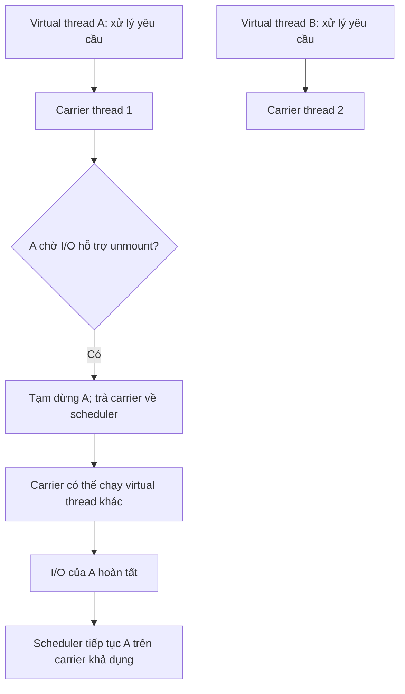

# Virtual thread, platform thread và mô hình thread-per-task

Java cho phép nhiều tác vụ chạy đồng thời thông qua `Thread` và các API trong `java.util.concurrent`. Khi xây dựng dịch vụ có hàng nghìn yêu cầu đang chờ dữ liệu từ cơ sở dữ liệu, HTTP hoặc hệ thống khác, lựa chọn **một thread cho mỗi tác vụ** có thể giúp mã đơn giản nhưng lại tốn tài nguyên nếu mỗi thread đều gắn với một thread của hệ điều hành.

**Virtual thread** giải quyết bài toán mở rộng quy mô này. Tính năng được chính thức hóa ở **Java 21 (JEP 444)** và tiếp tục được hỗ trợ trong Java 27. Nó cho phép giữ mô hình lập trình blocking, tuần tự, dễ theo dõi theo từng yêu cầu, trong khi JVM quản lý việc ghép nhiều virtual thread lên một số lượng nhỏ hơn các **platform thread** làm nhiệm vụ chạy chúng.

Bài học làm rõ bốn ý tưởng:

1. Platform thread và virtual thread khác nhau ở cách được lập lịch và sử dụng tài nguyên.
2. **Thread-per-task** có nghĩa là mỗi tác vụ có vòng đời riêng gắn với một thread, không phải lấy thread từ pool rồi trả lại.
3. Virtual thread cải thiện **khả năng phục vụ nhiều tác vụ đồng thời** (*throughput*) khi có nhiều thời gian chờ, chứ không tự làm phép tính CPU nhanh hơn.
4. Số lượng virtual thread có thể rất lớn nhưng **cơ sở dữ liệu, HTTP service, bộ nhớ và các tài nguyên bên ngoài vẫn có giới hạn**. Vì vậy, cần điều khiển mức đồng thời tại đúng tài nguyên.

Các ví dụ dùng API chuẩn, ổn định, không cần bật preview trong Java 27.

## 1. Bài toán khi dùng platform thread-per-task

Giả sử một dịch vụ nhận yêu cầu truy vấn hồ sơ khách hàng. Mỗi yêu cầu thực hiện:

```text
Nhận yêu cầu -> gọi cơ sở dữ liệu -> chờ I/O -> xử lý kết quả -> trả phản hồi
```

Phần xử lý thực tế trên CPU có thể ngắn, nhưng thời gian chờ cơ sở dữ liệu hoặc HTTP lâu hơn nhiều. Một cách triển khai truyền thống là dùng **một platform thread** cho mỗi yêu cầu:

```java
Thread requestThread = Thread.ofPlatform().start(() -> {
    // Một tác vụ phục vụ một yêu cầu.
    handleRequest();
});
```

`handleRequest()` là phương thức giả định của ứng dụng, không phải API Java. Nếu hàng nghìn yêu cầu đồng thời đều tạo platform thread, mỗi thread gắn với một OS thread và tiêu thụ tài nguyên hệ điều hành, stack và chi phí lập lịch. Đến một ngưỡng tải, mô hình này khó mở rộng.

Giải pháp truyền thống thường dùng **thread pool**:

```java
import java.util.concurrent.Executors;

try (var executor = Executors.newFixedThreadPool(32)) {
    executor.submit(() -> handleRequest());
    // Các task bổ sung được xếp hàng nếu toàn bộ thread đang bận.
}
```

Pool chỉ duy trì một số lượng thread tái sử dụng, tránh tạo quá nhiều OS thread. Nhưng với tác vụ chờ I/O, các thread trong pool có thể bị chiếm trong lúc đợi. Khi số yêu cầu lớn hơn số thread, yêu cầu còn lại phải chờ được lập lịch. Pool giải quyết giới hạn tài nguyên bằng cách hạn chế concurrency, đổi lại có thể ảnh hưởng throughput và độ trễ hàng đợi.

Virtual thread giúp giữ lập trình đồng bộ kiểu `handleRequest()` mà không cần dùng một OS thread chuyên dụng suốt vòng đời yêu cầu.

## 2. Platform thread là gì?

**Platform thread** là đối tượng `java.lang.Thread` gắn với một thread do hệ điều hành quản lý. JVM dựa vào OS để lập lịch chạy thread đó.

```java
Thread worker = Thread.ofPlatform()
    .name("report-platform")
    .start(() -> {
        System.out.println(Thread.currentThread().isVirtual()); // false
    });

worker.join();
```

Đặc điểm chính:

- Mỗi platform thread được gắn với một OS thread trong suốt vòng đời của nó.
- Có chi phí tương đối lớn hơn cho thread và stack so với virtual thread.
- Có thể là daemon hoặc non-daemon; thread mặc định do `Thread.ofPlatform()` tạo là non-daemon, trừ khi cấu hình khác.
- Phù hợp với tác vụ dài hạn, số lượng hạn chế, tác vụ chuyên dụng và phần việc CPU-bound khi số lượng thread được kiểm soát.
- Thread pool platform vẫn rất phù hợp với nhiều bài toán, nhất là khi muốn ràng buộc lượng công việc CPU đồng thời.

Không phải cứ thấy `Thread` là virtual thread: cách tạo quyết định loại thread. Trong Java hiện hành, các constructor truyền thống của `Thread` tạo **platform thread**; để tạo virtual thread, dùng các API dành riêng cho nó.

## 3. Virtual thread là gì và JVM lập lịch như thế nào?

Virtual thread cũng là một `java.lang.Thread`, nhưng không gắn cố định với một OS thread. JVM có thể **mount** virtual thread lên một **carrier thread** (một platform thread), cho nó chạy một đoạn mã, rồi **unmount** khi thao tác blocking được hỗ trợ có thể tạm dừng virtual thread.



Sơ đồ chỉ thể hiện nguyên lý, **không phải cam kết** virtual thread nào sẽ được gắn vào carrier cụ thể. Một virtual thread có thể được tiếp tục trên carrier khác sau khi unblock.

Điều quan trọng:

- Virtual thread **vẫn tiêu thụ CPU** khi chạy mã; virtual thread không biến một CPU thành nhiều CPU.
- Trong các thao tác chờ I/O được hỗ trợ, JVM có thể giải phóng carrier để chạy virtual thread khác.
- Không phải **mọi** blocking operation hoặc lời gọi native đều có thể unmount; các trường hợp pinning hoặc chặn OS thread vẫn cần được theo dõi.
- `Thread.currentThread()` bên trong tác vụ trả về **virtual thread** đang thực thi, không phải carrier thread bên dưới.
- Virtual threads có stack và dữ liệu trạng thái riêng; “nhẹ” không đồng nghĩa chi phí bằng 0.

Mục tiêu của virtual thread là mở rộng số tác vụ có thể **đang hoạt động hoặc chờ** trong một ứng dụng, đặc biệt trong mô hình request/response thực hiện nhiều blocking I/O.

## 4. So sánh platform thread và virtual thread

| Tiêu chí | Platform thread | Virtual thread |
|---|---|---|
| Kiểu API | `Thread` | `Thread` |
| Ai lập lịch trực tiếp? | Hệ điều hành | JVM scheduler, qua carrier là platform thread |
| Gắn với OS thread | Trong suốt vòng đời | Chỉ khi đang mount; có thể unmount khi chờ |
| Chi phí mỗi thread | Tương đối cao | Thấp hơn đáng kể trong nhiều workload |
| Số lượng hợp lý | Bị giới hạn mạnh bởi OS và tài nguyên | Có thể lớn hơn rất nhiều, nhưng vẫn bị giới hạn bởi tài nguyên thực |
| Kiểu tác vụ phù hợp | CPU-bound được kiểm soát, worker tồn tại lâu, thread đặc biệt | Nhiều task độc lập, chủ yếu chờ I/O |
| Có cần API bất đồng bộ mới? | Không | Không; có thể viết blocking code quen thuộc |
| Có phải thread daemon? | Tùy cấu hình | Luôn daemon |
| Priority | Có thể cấu hình trong giới hạn JVM/OS | Cố định, không tùy chỉnh được |
| Nên pool để tái sử dụng thread? | Thường có ích | **Không**; nên tạo mới cho mỗi task |

Virtual thread là giải pháp **bổ sung**, không thay thế mọi platform thread. Một chương trình có thể sử dụng cả hai trong những phần việc khác nhau.

## 5. Tạo và kiểm tra virtual thread bằng Thread API

### Tạo trực tiếp rồi chờ hoàn tất

```java
public class VirtualThreadBasics {
    public static void main(String[] args) throws InterruptedException {
        Thread task = Thread.ofVirtual()
            .name("customer-lookup")
            .start(() -> {
                System.out.println(
                    "virtual=" + Thread.currentThread().isVirtual()
                );
                System.out.println(
                    "name=" + Thread.currentThread().getName()
                );
            });

        task.join();
        System.out.println("Đã hoàn tất tác vụ");
    }
}
```

Kết quả ví dụ:

```text
virtual=true
name=customer-lookup
Đã hoàn tất tác vụ
```

`Thread.ofVirtual()` cung cấp `Thread.Builder.OfVirtual`. `start(Runnable)` tạo và khởi động thread. `join()` khiến thread gọi đợi đến khi virtual thread kết thúc; lời gọi có thể ném `InterruptedException`.

Cách viết ngắn:

```java
Thread task = Thread.startVirtualThread(() -> doWork());
task.join();
```

`doWork()` là phương thức ứng dụng giả định. Một cách khác là tạo thread ở trạng thái chưa chạy:

```java
Thread task = Thread.ofVirtual().unstarted(() -> doWork());
task.start();
task.join();
```

`Thread.ofPlatform().start(...)` có API tương tự, giúp lựa chọn loại thread trở nên tường minh.

### Đặt tên để quan sát dễ hơn

```java
var factory = Thread.ofVirtual()
    .name("request-", 0)
    .factory();

Thread first = factory.newThread(() -> System.out.println("A"));
Thread second = factory.newThread(() -> System.out.println("B"));

first.start();
second.start();

first.join();
second.join();
```

Factory được đặt tên theo prefix và số thứ tự giúp dễ nhận diện tác vụ khi debug. Trừ khi đặt tên, virtual thread mặc định có tên rỗng; không nên coi tên mặc định là ID nghiệp vụ.

### Virtual threads là daemon

```java
Thread thread = Thread.ofVirtual()
    .start(() -> {
        // Công việc có thể vẫn đang chạy khi main kết thúc.
        doWork();
    });
```

Virtual thread luôn là daemon và **không giữ JVM tiếp tục chạy** nếu tất cả non-daemon thread đã kết thúc. Vì vậy, không khởi chạy rồi bỏ mặc công việc quan trọng mà không có cơ chế đợi, quản lý vòng đời hoặc phối hợp dừng.

`Thread.join()`, `Future.get()` hoặc `ExecutorService.close()` giúp caller đợi tác vụ, nhưng mỗi cách có hợp đồng khác nhau về lỗi và hủy tác vụ.

## 6. Thread-per-task: mỗi tác vụ có một vòng đời độc lập

**Thread-per-task** là một mô hình tổ chức công việc: với mỗi đơn vị công việc độc lập (ví dụ một HTTP request, một cuộc gọi đến dịch vụ bên ngoài, một job đồng thời), tạo một thread mới, để nó hoàn thành tác vụ rồi kết thúc.

So sánh:

```text
Platform-thread pool:
  Task 1 -> Worker A ------> Worker A xử lý Task 4
  Task 2 -> Worker B ------> Worker B xử lý Task 5
  Task 3 -> Worker C ------> Worker C xử lý Task 6
  Nhiều task dùng lại một tập worker hữu hạn.

Virtual thread-per-task:
  Task 1 -> VirtualThread 1 -> kết thúc
  Task 2 -> VirtualThread 2 -> kết thúc
  Task 3 -> VirtualThread 3 -> kết thúc
  Task 4 -> VirtualThread 4 -> kết thúc
  Một virtual thread mới được tạo cho mỗi task.
```

Trong mô hình virtual thread-per-task, **không có pool virtual thread** để tái sử dụng từng virtual thread sau một yêu cầu. JVM quản lý carrier/scheduler phía dưới; ứng dụng không cần tự tái sử dụng virtual thread.

Java cung cấp API trực tiếp:

```java
import java.util.concurrent.Executors;

try (var executor = Executors.newVirtualThreadPerTaskExecutor()) {
    executor.submit(() -> processOrder("O-101"));
    executor.submit(() -> processOrder("O-102"));
}
```

`processOrder` là phương thức ví dụ thuộc ứng dụng. Mỗi lần `submit` tạo một virtual thread mới để thực thi tác vụ tương ứng.

**Chú ý:** `newVirtualThreadPerTaskExecutor()` **không giới hạn số lượng thread được tạo**. Nếu gửi rất nhiều task, hệ thống có thể giữ rất nhiều virtual thread và tài nguyên liên quan. Phải điều tiết lưu lượng đầu vào và tài nguyên phụ thuộc ở các tầng thích hợp.

## 7. Dùng ExecutorService và Future đúng cách

`Executors.newVirtualThreadPerTaskExecutor()` trả về `ExecutorService`. Với Java 27, `ExecutorService` triển khai `AutoCloseable`, do đó có thể dùng trong try-with-resources.

```java
import java.util.concurrent.Executors;
import java.util.concurrent.Future;
import java.util.concurrent.ExecutionException;

public class TwoLookups {
    static String lookup(String name, long waitMillis)
            throws InterruptedException {
        Thread.sleep(waitMillis); // Mô phỏng thời gian chờ I/O.
        return name + ": virtual=" + Thread.currentThread().isVirtual();
    }

    public static void main(String[] args)
            throws InterruptedException, ExecutionException {

        try (var executor = Executors.newVirtualThreadPerTaskExecutor()) {
            Future<String> customer = executor.submit(
                () -> lookup("customer", 150)
            );
            Future<String> inventory = executor.submit(
                () -> lookup("inventory", 100)
            );

            System.out.println(customer.get());
            System.out.println(inventory.get());
        }
    }
}
```

Output theo thứ tự đọc hai `Future`:

```text
customer: virtual=true
inventory: virtual=true
```

Hai task có thể chạy đồng thời, nhưng caller chọn **thứ tự in kết quả** bằng cách gọi `customer.get()` trước. Không nên suy ra task customer luôn hoàn tất trước inventory.

Ý nghĩa của các API:

- `submit(Callable<T>)` khởi động một task và trả về `Future<T>`.
- `Future.get()` đợi kết quả và có thể ném `ExecutionException` nếu task thất bại.
- `InterruptedException` báo thread đang đợi bị interrupt.
- `ExecutorService.close()` thực hiện shutdown có trật tự và **đợi các task đã gửi hoàn tất** theo hợp đồng API.

`close()` không nên bị hiểu là “đóng ngay lập tức và hủy mọi tác vụ”. Nó đợi, nên một tác vụ treo vô hạn có thể làm phạm vi try-with-resources không kết thúc đúng hạn. Ứng dụng thực tế cần đặt timeout cho các cuộc gọi I/O và thiết kế cancellation rõ ràng.

### Thread.join và Future.get khác nhau

`Thread.join()` đợi thread kết thúc nhưng **không tự chuyển ngoại lệ xảy ra trong Runnable sang thread gọi**. Ngược lại, `Future.get()` bộc lộ lỗi từ `Callable` qua `ExecutionException`.

Nếu cần kết quả hoặc cần xử lý lỗi của các tác vụ song song ở cùng nơi, dùng `Future<T>` thường rõ nghĩa hơn việc tạo `Thread` trực tiếp rồi chia sẻ biến kết quả.

## 8. Ví dụ hoàn chỉnh: nhiều tác vụ chờ I/O

Đặt toàn bộ mã sau vào file `VirtualThreadTaskDemo.java` và chạy bằng JDK 27. Ví dụ không gọi mạng hay cơ sở dữ liệu thật; `Thread.sleep` mô phỏng thao tác chờ để dễ kiểm tra vòng đời và kết quả.

```java
import java.util.ArrayList;
import java.util.List;
import java.util.concurrent.ExecutionException;
import java.util.concurrent.Executors;
import java.util.concurrent.Future;

public class VirtualThreadTaskDemo {

    record Request(String id, long delayMillis) {}

    record Result(String id, String response, boolean virtualThread) {}

    static Result fetch(Request request) throws InterruptedException {
        Thread.sleep(request.delayMillis());

        return new Result(
            request.id(),
            "OK-" + request.id(),
            Thread.currentThread().isVirtual()
        );
    }

    public static void main(String[] args)
            throws InterruptedException, ExecutionException {

        List<Request> requests = List.of(
            new Request("A", 140),
            new Request("B", 80),
            new Request("C", 110)
        );

        var results = new ArrayList<Result>();

        try (var executor = Executors.newVirtualThreadPerTaskExecutor()) {
            var futures = new ArrayList<Future<Result>>();

            for (var request : requests) {
                futures.add(executor.submit(() -> fetch(request)));
            }

            // Đọc kết quả theo thứ tự submit, không theo thứ tự hoàn tất.
            for (var future : futures) {
                results.add(future.get());
            }
        }

        for (var result : results) {
            System.out.println(
                result.id() + ": " + result.response()
                    + ", virtual=" + result.virtualThread()
            );
        }
    }
}
```

Lệnh:

```shell
javac --release 27 VirtualThreadTaskDemo.java
java VirtualThreadTaskDemo
```

Kết quả dự kiến:

```text
A: OK-A, virtual=true
B: OK-B, virtual=true
C: OK-C, virtual=true
```

Điều có thể quan sát:

1. Mỗi `submit` được thực thi trong một virtual thread riêng.
2. Mã nguồn của `fetch` vẫn là phong cách **blocking, tuần tự**.
3. `Thread.sleep` tạo điều kiện để tác vụ đợi; JVM có thể dùng carrier cho tác vụ khác thay vì buộc mỗi yêu cầu giữ một OS thread riêng.
4. Thu kết quả theo thứ tự `Future` không có nghĩa là các task đã chạy tuần tự.
5. Mọi `Future` được xử lý và executor đóng trước khi ứng dụng kết thúc.

Đây là **bài thực hành chức năng**, không phải benchmark. Không đo hiệu năng virtual thread chỉ bằng một vài tác vụ `sleep` rồi kết luận virtual thread chắc chắn nhanh hơn platform thread trong mọi workload.

## 9. Throughput khác latency: virtual thread giải quyết điều gì?

Hai chỉ số thường bị nhầm lẫn:

- **Latency:** khoảng thời gian để một yêu cầu riêng lẻ hoàn thành.
- **Throughput:** số yêu cầu hoàn thành trong một đơn vị thời gian, dưới tải xác định.

Giả sử một yêu cầu mất 10 ms tính toán và 190 ms chờ I/O. Nếu có nhiều yêu cầu cùng lúc, một thread pool nhỏ có thể phải xếp hàng vì worker giữ chỗ trong khi chờ. Virtual threads giúp giảm ràng buộc “một OS thread bị chiếm cho mỗi yêu cầu đang chờ”, cho phép nhiều yêu cầu đang in-flight hơn.

Nhưng một yêu cầu đơn lẻ vẫn phải đợi I/O hoàn thành. Virtual thread **không tự rút 190 ms mạng thành vài ms**, không tăng tốc cơ sở dữ liệu, và cũng không thay thế caching, query optimization hoặc quy hoạch kết nối.

### Khi nào virtual thread thường có lợi?

- HTTP server có nhiều request độc lập, mỗi request truy cập cơ sở dữ liệu hoặc dịch vụ khác.
- Ứng dụng thực hiện nhiều tác vụ chờ socket/network I/O.
- Xử lý tác vụ phân tán theo từng yêu cầu (*fan-out*), khi mỗi nhánh có thể viết theo kiểu blocking rõ ràng.
- Workload có số lượng đồng thời lớn và thời gian chờ chiếm tỷ lệ đáng kể.

### Khi nào lợi ích không rõ hoặc không phù hợp?

- Tính toán CPU-bound kéo dài (mã hóa, dựng hình, xử lý ma trận lớn).
- Số lượng task rất nhỏ, dễ đáp ứng bằng kiến trúc hiện tại.
- Workload phụ thuộc vào native blocking operation không có khả năng giải phóng carrier.
- Hệ thống chỉ có một số ít kết nối cơ sở dữ liệu hoặc bị giới hạn nghiêm ngặt bởi downstream; việc tạo thêm virtual thread không mở rộng khả năng xử lý của tài nguyên đó.

Không chọn công nghệ chỉ bằng phép so sánh “virtual thread tạo nhanh hơn”. Cần benchmark dưới tải thực, quan sát độ trễ, throughput, CPU, bộ nhớ, pool kết nối và hành vi khi lỗi.

## 10. Không pool virtual thread; hãy giới hạn tài nguyên khan hiếm

Một sai lầm phổ biến là tạo pool chỉ gồm 20 virtual thread rồi tái sử dụng chúng như platform thread chỉ vì hệ thống cơ sở dữ liệu cho phép tối đa 20 kết nối. Điều này trộn hai loại giới hạn khác nhau.

- **Virtual thread:** đơn vị thực thi một tác vụ; nên được tạo mới theo task.
- **Connection pool hoặc Semaphore:** điều khiển số tác vụ đồng thời được phép sử dụng một tài nguyên khan hiếm.

Ví dụ giới hạn tối đa ba tác vụ đang dùng một tài nguyên giả lập:

```java
import java.util.concurrent.Semaphore;

final class LimitedService {
    private final Semaphore permits = new Semaphore(3);

    String call(String requestId) throws InterruptedException {
        permits.acquire();
        try {
            // Mô phỏng truy cập một tài nguyên chỉ cho phép 3 tác vụ.
            Thread.sleep(100);
            return "OK-" + requestId;
        } finally {
            permits.release();
        }
    }
}
```

Có thể gọi `LimitedService.call` từ nhiều virtual thread thông qua `newVirtualThreadPerTaskExecutor()`. Chỉ tối đa ba cuộc gọi cùng lúc được thực thi trong vùng giữa `acquire` và `release`; các task còn lại đợi permit.

**Điểm cần phân biệt:** `Semaphore` chỉ giới hạn số task *đang ở bên trong* tài nguyên, **không giới hạn tổng số task đã được nhận hoặc tổng số virtual thread được tạo**. Nếu lượng công việc đến vô hạn, vẫn cần cơ chế *admission control*, giới hạn hàng đợi, timeout và từ chối/điều tiết yêu cầu từ phía caller.

Với một connection pool đã hỗ trợ giới hạn kết nối, có thể dùng trực tiếp tính năng quản lý kết nối của pool thay vì tự tạo semaphore trùng lặp. Nên bảo đảm giới hạn tại đúng tài nguyên bị nghẽn.

## 11. Interrupt, cancellation và timeout

Virtual thread dùng cùng cơ chế **interrupt** của `Thread` như platform thread. Để hệ thống có thể dừng các yêu cầu không còn cần thiết, task nên phản ứng với interrupt khi đang chờ hoặc tại các điểm kiểm tra phù hợp.

```java
Thread task = Thread.ofVirtual().start(() -> {
    try {
        Thread.sleep(10_000);
        System.out.println("Hoàn tất");
    } catch (InterruptedException exception) {
        // Kết thúc tác vụ có kiểm soát.
        Thread.currentThread().interrupt();
        System.out.println("Đã hủy theo tín hiệu ngắt");
    }
});

task.interrupt();
task.join();
```

Ví dụ in dòng hủy trong tình huống interrupt đã được xử lý ở `Thread.sleep`; thời điểm lập lịch có thể thay đổi nhưng interrupt vẫn là tín hiệu mà tác vụ phải được thiết kế để tôn trọng.

### Hủy một Future

```java
import java.util.concurrent.Executors;
import java.util.concurrent.TimeUnit;
import java.util.concurrent.TimeoutException;

try (var executor = Executors.newVirtualThreadPerTaskExecutor()) {
    var future = executor.submit(() -> {
        Thread.sleep(10_000);
        return "done";
    });

    try {
        System.out.println(future.get(100, TimeUnit.MILLISECONDS));
    } catch (TimeoutException exception) {
        future.cancel(true); // Yêu cầu interrupt task nếu đang chạy.
        System.out.println("Hết thời gian chờ, đã yêu cầu hủy");
    }
}
```

`Future.get(timeout, unit)` chỉ giới hạn **thời gian caller đợi kết quả**; tự nó không bảo đảm task đã bị hủy. `cancel(true)` yêu cầu interrupt; task chỉ dừng nhanh nếu thao tác của nó phản ứng phù hợp với interrupt. Đối với I/O thật, phải xem từng API/client có hỗ trợ timeout, cancellation và giải phóng tài nguyên hay không.

`InterruptedException` không phải lỗi kỹ thuật nên bị nuốt lặng lẽ. Thông thường nên ném tiếp hoặc khôi phục trạng thái interrupt sau khi xử lý, rồi kết thúc công việc hợp lý.

Lưu ý: ví dụ dùng `ExecutorService.close()` để đợi task hoàn tất. Với tác vụ bị kẹt vô hạn và bỏ qua interrupt, caller vẫn có nguy cơ đợi kéo dài. Thiết kế timeout ở **lời gọi I/O** là điều cần thiết trong ứng dụng thật.

## 12. Trạng thái riêng của tác vụ và ThreadLocal

Mỗi virtual thread có danh tính và ngăn xếp thực thi riêng. Dù carrier có thể thay đổi, `Thread.currentThread()` vẫn trả về cùng một virtual thread bên trong vòng đời của task.

Java hỗ trợ `ThreadLocal` trên virtual thread:

```java
public class RequestContextExample {
    private static final ThreadLocal<String> REQUEST_ID =
        new ThreadLocal<>();

    static void handle(String requestId) {
        REQUEST_ID.set(requestId);
        try {
            process();
        } finally {
            REQUEST_ID.remove();
        }
    }

    static void process() {
        System.out.println("Xử lý request: " + REQUEST_ID.get());
    }

    public static void main(String[] args) throws InterruptedException {
        Thread task = Thread.ofVirtual()
            .start(() -> handle("REQ-001"));
        task.join();
    }
}
```

`ThreadLocal` gắn với **virtual thread của tác vụ**, không phải dữ liệu lưu trên carrier thread. Không nên thiết kế logic phụ thuộc virtual thread “vẫn được mount trên OS thread ban đầu”.

Tuy nhiên, khi hệ thống có thể chạy rất nhiều virtual thread, mỗi thread giữ nhiều `ThreadLocal` chứa đối tượng lớn có thể tiêu tốn bộ nhớ đáng kể. Hãy tránh cache nặng theo thread và dùng `try/finally` để dọn trạng thái phù hợp.

Trong Java hiện đại còn có **`ScopedValue`** cho những tình huống truyền ngữ cảnh bất biến theo phạm vi gọi, và API này đã chính thức hóa từ Java 25. Nó có hợp đồng riêng, khác `ThreadLocal`. Vì chủ đề của bài là mô hình thread-per-task, việc chọn cơ chế truyền ngữ cảnh nên được giải thích sâu hơn trong bài chuyên về task context, thay vì giả định một cơ chế tự thay thế mọi trường hợp của cơ chế kia.

## 13. Pinning: điểm cần cập nhật khi dùng Java 27

Khi virtual thread đang chạy trong một đoạn mã không thể được unmount khỏi carrier mà lại bị block, **carrier có thể bị giữ lại**. Trường hợp này được gọi là *pinning*. Pinning không nhất thiết khiến logic sai, nhưng nếu xảy ra thường xuyên và kéo dài, nó có thể hạn chế scalability.

Một lời khuyên cũ dành cho Java 21–23 từng nói rằng blocking bên trong `synchronized` có thể gây pinning, và khuyên thay bằng `ReentrantLock` chỉ để tránh pinning.

**Trong Java 27, lời khuyên tổng quát đó không còn chính xác.** JDK 24 đã tích hợp **JEP 491 — Synchronize Virtual Threads without Pinning**: các thao tác đồng bộ bằng Java monitor (`synchronized`, chờ monitor) đã được cải tiến để virtual thread có thể giải phóng carrier trong các trường hợp vốn bị pin do monitor trước đây.

```java
private final Object lock = new Object();

void update() {
    synchronized (lock) {
        // synchronized vẫn là cơ chế đồng bộ hợp lệ trong Java 27.
        updateState();
    }
}
```

Không cần tự động thay toàn bộ `synchronized` bằng `ReentrantLock` chỉ vì đang dùng virtual threads trên JDK 27.

Điều đó **không** có nghĩa là mọi blocking đều an toàn cho throughput:

- Pinning vẫn có thể xảy ra trong **native method** hoặc thao tác foreign function.
- Một lời gọi I/O hoặc thư viện không thể nhả carrier trong mọi tình huống có thể hạn chế khả năng mở rộng.
- Giữ khóa quá lâu trong khi chờ mạng vẫn có thể làm **các task khác tranh chấp cùng khóa phải đợi**, dù bản thân monitor không còn gây loại pinning cũ.
- Khóa và pinning là hai vấn đề khác nhau: bỏ pinning không tự giải quyết contention, deadlock hay transaction kéo dài.

Dùng profiler/JDK Flight Recorder và tải thật để phát hiện những đoạn bị block hoặc pin kéo dài. Tránh áp dụng máy móc những hướng dẫn chỉ đúng với JDK 21–23 lên Java 27.

## 14. Thread-per-task không tự làm các vấn đề đồng thời biến mất

Virtual threads vẫn là threads; các quy tắc về **data race**, visibility, mutual exclusion và happens-before không thay đổi.

Ví dụ không an toàn nếu nhiều task cập nhật cùng biến:

```java
// Sai nếu được gọi đồng thời mà không có đồng bộ thích hợp:
private int completed;

void onTaskFinished() {
    completed++;
}
```

`completed++` không phải thao tác nguyên tử. Nếu cần bộ đếm chia sẻ, dùng cơ chế phù hợp như `AtomicInteger`, `LongAdder` hoặc bảo vệ bằng khóa:

```java
import java.util.concurrent.atomic.AtomicInteger;

private final AtomicInteger completed = new AtomicInteger();

void onTaskFinished() {
    completed.incrementAndGet();
}
```

Các dữ liệu chung như `HashMap`, `ArrayList` mutable cũng cần chiến lược đồng bộ hoặc thay bằng cấu trúc concurrent phù hợp nếu có cập nhật đồng thời.

Ngoài ra, nếu một task tạo thêm nhiều task con rồi trả kết quả trước khi các task con kết thúc, ứng dụng có thể **đánh mất sự gắn kết vòng đời của công việc**. Hãy tổ chức việc tạo, đợi và hủy task theo phạm vi rõ ràng. Đừng chỉ khởi chạy thread và hy vọng JVM sẽ chờ nó trước khi kết thúc.

## 15. Quan sát và vận hành virtual threads

Trong dịch vụ thật, nếu số lượng virtual thread lớn, việc ghi log tên mọi thread hoặc tạo stack trace một cách không kiểm soát có thể làm log phình to. Các công cụ của JDK hỗ trợ quan sát thread và sự kiện liên quan tới virtual thread.

Một số hướng kiểm tra:

- **JDK Flight Recorder (JFR):** theo dõi hoạt động của ứng dụng, sự kiện liên quan tới virtual threads và những thao tác gây pinning/đợi kéo dài trong cấu hình phù hợp.
- **Thread dump và công cụ `jcmd`:** quan sát thread và stack, sử dụng những khả năng mới dành cho số lượng virtual thread lớn.
- **Metrics ứng dụng:** theo dõi số yêu cầu in-flight, latency, throughput, CPU, heap, connection pool, timeout, error rate và hàng đợi.
- **Load testing:** tăng mức đồng thời theo kịch bản thực tế, quan sát điểm nghẽn ở downstream thay vì chỉ đếm tổng số thread.

Không nên xem mọi virtual thread ở trạng thái waiting là sự cố; với ứng dụng nhiều I/O, nhiều tác vụ đang chờ là bình thường. Điều quan trọng là chúng chờ **vì lý do gì**, mất bao lâu và có đang chiếm giữ tài nguyên khan hiếm hay không.

Trên Java 27, tránh dựa vào lời khuyên cũ rằng `jdk.tracePinnedThreads` phải được bật để tìm lỗi `synchronized` pinning. Chính sách chẩn đoán phụ thuộc phiên bản JDK; hãy dùng công cụ JFR và tài liệu hiện hành.

## 16. Mô hình di trú: từ pool worker sang thread-per-task

Một phương thức xử lý request có thể đã sử dụng fixed pool:

```java
import java.util.concurrent.Executors;
import java.util.concurrent.ExecutorService;

ExecutorService pool = Executors.newFixedThreadPool(64);

// Mỗi request là một tác vụ được gửi vào pool.
pool.submit(() -> handleRequest());
```

Nếu tác vụ chủ yếu chờ I/O, một bước chuyển đổi có thể là:

```java
try (var executor = Executors.newVirtualThreadPerTaskExecutor()) {
    executor.submit(() -> handleRequest());
}
```

Nhưng **ví dụ thứ hai không hoàn toàn tương đương về vòng đời**: try-with-resources ở phạm vi rất ngắn sẽ đợi tác vụ ngay khi kết thúc khối. Trong một server, executor có thể được quản lý ở phạm vi ứng dụng, hoặc tạo ở phạm vi fan-out của một request tùy mục tiêu. Không đưa toàn bộ vòng đời một HTTP server vào một khối try kết thúc ngay sau lần submit đầu tiên.

### Checklist trước khi triển khai

1. **Đánh giá workload:** tác vụ có chờ I/O nhiều và đủ đồng thời để hưởng lợi?
2. **Giữ ranh giới từng request/task:** có owner chịu trách nhiệm đợi, hủy và báo lỗi?
3. **Tách thread khỏi giới hạn tài nguyên:** DB pool, HTTP rate limit, semaphore, queue/admission control.
4. **Đặt timeout và cancellation:** bao gồm timeout ở client, database, RPC và tác vụ phối hợp.
5. **Đảm bảo thread safety:** giữ nguyên các quy tắc visibility/atomicity cho dữ liệu chia sẻ.
6. **Kiểm tra thư viện và native code:** tránh giả định mọi blocking đều giải phóng carrier.
7. **Không pool virtual threads:** dùng thread-per-task thay vì cố tái sử dụng một số ít virtual thread.
8. **Kiểm soát ThreadLocal:** tránh lưu payload lớn và dọn ngữ cảnh đúng phạm vi.
9. **Đo trong môi trường thật:** throughput, latency, CPU, heap, DB connection và số lượng lỗi.
10. **Xác minh đang chạy JDK 27:** không áp dụng máy móc hướng dẫn pinning chỉ phù hợp với JDK cũ.

Mô hình mới thường giảm độ phức tạp của asynchronous callback khi phải thực hiện nhiều lời gọi blocking, nhưng **không** làm một thư viện đồng bộ trở thành thread-safe nếu trước đó nó không có tính chất đó.

## 17. Bài tập thực hành

### Bài 1 — Tạo hai loại thread

Tạo một platform thread và một virtual thread; mỗi thread in `Thread.currentThread().isVirtual()\). Gọi `join()` để chờ hai thread kết thúc. Dự đoán giá trị của mỗi thread.

### Bài 2 — Nhiều tác vụ chờ

Dùng `Executors.newVirtualThreadPerTaskExecutor()` để chạy năm tác vụ `Thread.sleep(100)`. Trả về `Future<Integer>` cho mỗi task và thu kết quả theo thứ tự submit. Vì sao `Future.get()` theo thứ tự không buộc các task được thực thi tuần tự?

### Bài 3 — Giới hạn ba kết nối

Giả sử có 100 yêu cầu cần truy cập một dịch vụ chỉ cho tối đa 3 lời gọi đồng thời. Dùng `Semaphore(3)` trong hàm truy cập dịch vụ. Giải thích vì sao 100 virtual thread vẫn có thể được tạo dù chỉ 3 lời gọi thực sự đi vào vùng có permit.

### Bài 4 — Thời gian chờ

Một `Future.get(100, MILLISECONDS)` ném `TimeoutException`. Task có tự động bị dừng không? Nếu muốn yêu cầu hủy, bạn gọi phương thức gì? Task cần tuân thủ nguyên tắc nào?

### Bài 5 — Tính toán CPU-bound

Có 100 tác vụ tính toán CPU liên tục, không chờ I/O. Vì sao việc tạo 100 virtual thread không làm cho một máy 8 core thực thi 100 phép tính thật sự cùng lúc?

### Bài 6 — Cập nhật về pinning

Đối chiếu lời khuyên “mọi thao tác blocking trong `synchronized` đều gây pinning” với Java 27. JEP nào đã thay đổi điều này? Pinning có thể còn xảy ra trong loại mã nào?

### Bài 7 — Vòng đời của virtual thread

Tại sao chương trình sau không đáng tin nếu muốn bảo đảm tác vụ luôn hoàn tất trước khi JVM thoát?

```java
public static void main(String[] args) {
    Thread.ofVirtual().start(() -> saveImportantData());
}
```

`saveImportantData()` là phương thức ứng dụng minh họa. Hãy nêu ít nhất hai cách quản lý vòng đời an toàn hơn.

### Đáp án gợi ý

1. Platform thread in `false`, virtual thread in `true`.
2. Submit tạo các thread riêng; `get` chỉ đợi kết quả tương ứng, không điều khiển thứ tự task bắt đầu hoặc hoàn tất.
3. Semaphore giới hạn vào tài nguyên, không giới hạn số virtual thread được scheduler tạo.
4. Không; timeout chỉ kết thúc việc chờ kết quả của caller. Gọi `future.cancel(true)` và thiết kế tác vụ tôn trọng interrupt.
5. CPU vẫn bị giới hạn bởi số core và các thread tranh nhau thời gian CPU; virtual thread chủ yếu giúp khi có nhiều thời gian chờ.
6. JEP 491 của JDK 24 đã cải thiện Java monitors để tránh pinning loại cũ. Native method hoặc foreign function vẫn có thể gây pinning.
7. Virtual thread là daemon, không giữ JVM sống; có thể `join()` hoặc quản lý qua `ExecutorService` với `Future.get()` và đóng executor đúng vòng đời.

## 18. Tổng kết

Virtual thread và platform thread đều được biểu diễn bằng `java.lang.Thread`, nhưng khác nhau về cách liên kết với OS thread. Platform thread là tài nguyên tương đối đắt, hữu ích khi quản lý các worker giới hạn; virtual thread là đơn vị thực thi nhẹ hơn, được JVM lập lịch trên carrier, thích hợp với số lượng lớn tác vụ độc lập có thời gian chờ đáng kể.

**Thread-per-task** tận dụng virtual threads để mỗi tác vụ có vòng đời và stack thực thi riêng, giảm nhu cầu chuyển code blocking thành callback hoặc quản lý pool chỉ để tránh giữ OS thread trong lúc chờ. Tuy nhiên, nó không loại bỏ nhu cầu giới hạn tài nguyên, bảo vệ dữ liệu dùng chung, quản lý cancellation hay giám sát hiệu năng.

Trong Java 27, hãy ưu tiên `Thread.ofVirtual()` hoặc `Executors.newVirtualThreadPerTaskExecutor()` cho những tác vụ I/O-bound phù hợp, đồng thời nhớ rằng JDK 24 đã khắc phục phần lớn pinning liên quan tới `synchronized`. Chọn đúng phạm vi quản lý task, dùng timeout và giới hạn downstream, và đo lường hiệu quả thực tế thay vì mặc định “virtual” luôn nhanh hơn.

## Tài liệu tham khảo

- [Oracle Java SE 27 — Virtual Threads](https://docs.oracle.com/en/java/javase/27/core/virtual-threads.html): khái niệm platform/virtual threads, cách tạo thread, thread-per-task và ví dụ server.
- [Java SE 27 API — Thread](https://docs.oracle.com/en/java/javase/27/docs/api/java.base/java/lang/Thread.html): `Thread.ofVirtual`, `Thread.ofPlatform`, `startVirtualThread`, `isVirtual`, lifecycle và daemon.
- [Java SE 27 API — Executors](https://docs.oracle.com/en/java/javase/27/docs/api/java.base/java/util/concurrent/Executors.html): `newVirtualThreadPerTaskExecutor` và các executor factory.
- [Java SE 27 API — ExecutorService](https://docs.oracle.com/en/java/javase/27/docs/api/java.base/java/util/concurrent/ExecutorService.html): `submit`, `shutdown`, `close`, quản lý vòng đời.
- [Java SE 27 API — Future](https://docs.oracle.com/en/java/javase/27/docs/api/java.base/java/util/concurrent/Future.html): kết quả, cancellation, interrupt và timeout.
- [Java SE 27 API — Semaphore](https://docs.oracle.com/en/java/javase/27/docs/api/java.base/java/util/concurrent/Semaphore.html): giới hạn số tác vụ đồng thời truy cập tài nguyên.
- [Java SE 27 API — ThreadLocal](https://docs.oracle.com/en/java/javase/27/docs/api/java.base/java/lang/ThreadLocal.html): trạng thái theo thread và trách nhiệm quản lý vòng đời.
- [Oracle Java SE 27 — Scoped Values](https://docs.oracle.com/en/java/javase/27/core/scoped-values.html): mô hình ngữ cảnh bất biến theo phạm vi trong Java hiện hành.
- [JEP 444 — Virtual Threads](https://openjdk.org/jeps/444): thiết kế và chính thức hóa virtual threads ở JDK 21.
- [JEP 491 — Synchronize Virtual Threads without Pinning](https://openjdk.org/jeps/491): cải tiến pinning của monitor từ JDK 24.
