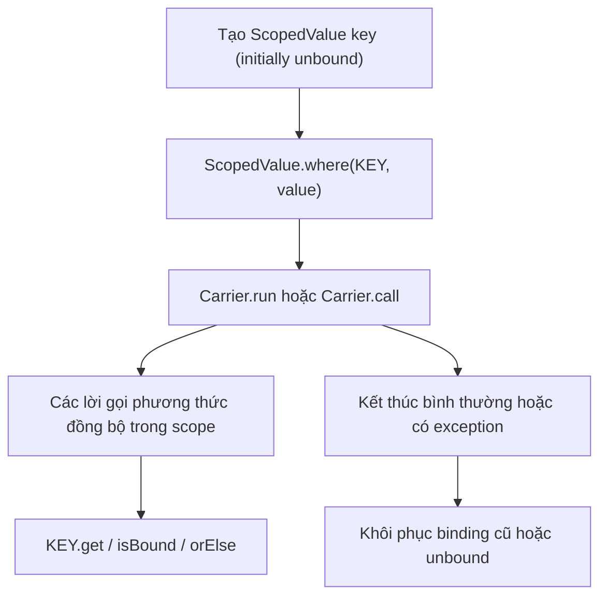
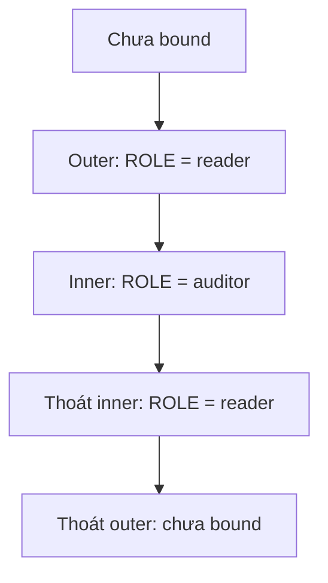
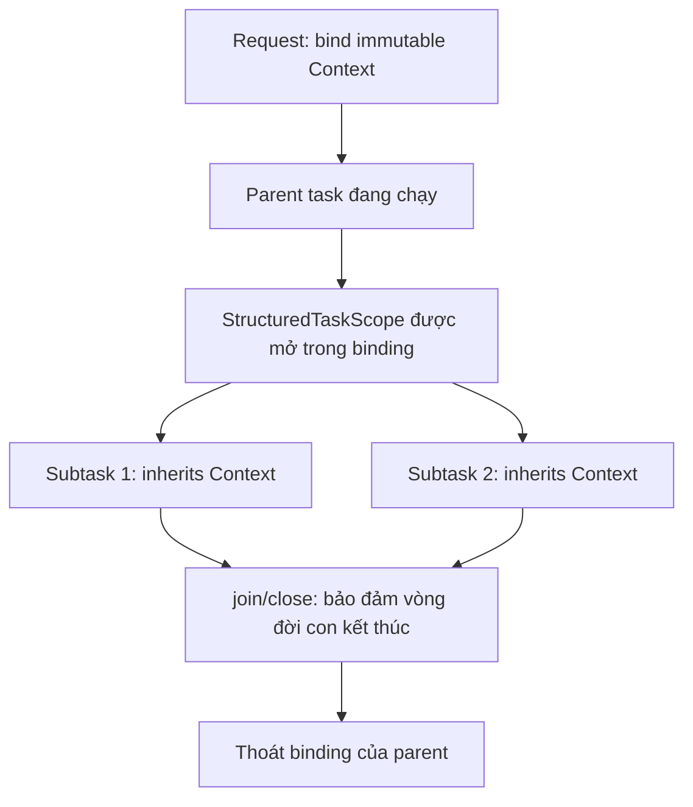

# ScopedValue cho ngữ cảnh bất biến có phạm vi

Trong ứng dụng Java, một yêu cầu thường mang theo **request ID**, mã tenant, thông tin người dùng đã xác thực, ngôn ngữ hoặc chính sách quan sát. Những dữ liệu đó có thể cần được đọc sâu trong chuỗi lời gọi `controller → service → repository`, dù các phương thức trung gian không thực sự xử lý chúng. Truyền tham số qua mọi tầng luôn minh bạch nhưng có thể tạo nhiều tham số lặp; lưu vào biến toàn cục thì gây rò rỉ dữ liệu giữa các yêu cầu.

**`ScopedValue<T>`** trong Java 27 cung cấp một cách truyền **ngữ cảnh chỉ đọc theo phạm vi thực thi** (*dynamically scoped, one-way context*). Mã ở đầu một luồng xử lý tạo binding từ một **khóa** đến một giá trị, chạy một khối công việc, và binding tự kết thúc khi khối đó kết thúc — kể cả khi có ngoại lệ. Phương thức sâu bên trong có thể đọc ngữ cảnh nếu được phép truy cập khóa, không cần thêm tham số qua từng tầng trung gian.

Đây là bài thuộc chương **Virtual threads và ngữ cảnh tác vụ**, module **JAVA_VERSION_JAVA27 — Java 27 và các kiến thức liên quan**. `ScopedValue` đã trở thành **API chính thức từ JDK 25 (JEP 506)** và vẫn được hỗ trợ trong Java 27: các ví dụ trọng tâm bên dưới **không cần `--enable-preview`**. Một API liên quan là `StructuredTaskScope` vẫn ở trạng thái **preview trong Java 27**, nên phần kết hợp với structured concurrency được giải thích về nguyên lý, không dùng nó làm ví dụ bắt buộc trong một bài chỉ sử dụng API ổn định.

## 1. Vì sao cần ngữ cảnh có phạm vi?

Giả sử ta có những lời gọi như sau:

```java
String handleRequest(String requestId) {
    return service(requestId);
}

String service(String requestId) {
    return repository(requestId);
}

String repository(String requestId) {
    return "trace=" + requestId;
}
```

Nếu ba tầng đều thực sự sử dụng `requestId`, việc truyền tham số là hợp lý. Nhưng khi rất nhiều tầng chỉ **chuyển tiếp** một tập ngữ cảnh phục vụ ghi log, tracing hoặc chính sách chung, chữ ký phương thức có thể bị chi phối bởi thông tin không thuộc nghiệp vụ chính.

Một hướng khác là lưu ngữ cảnh trong `ThreadLocal`. API đó vẫn hợp lệ và có những trường hợp sử dụng riêng, nhưng đối với luồng dữ liệu **chỉ đọc từ caller đến callee**, `ScopedValue` diễn đạt hợp đồng rõ hơn:

- Caller quyết định binding **trước** khi chạy tác vụ.
- Callee được phép đọc giá trị hiện tại, nhưng không có phương thức `set(...)` để thay đổi binding đang hoạt động.
- Mỗi binding có **vòng đời gắn với khối thực thi**, không cần nhớ gọi `remove()` trong `finally`.
- Có thể **rebind** một khóa trong phạm vi lồng nhau; khi thoát, giá trị ở phạm vi cha tự được khôi phục.

Điều quan trọng: đây là cơ chế truyền ngữ cảnh, **không phải** kho lưu trữ dữ liệu toàn cục, hệ thống bảo mật tự động, hay giải pháp quản lý giao dịch phân tán.

## 2. Ba thành phần: khóa, binding và dynamic scope

Một cách hình dung:



| Khái niệm | Ý nghĩa |
|---|---|
| **ScopedValue key** | Đối tượng `ScopedValue<T>` định danh nơi đọc ngữ cảnh; thường là trường `private static final` |
| **Binding** | Ánh xạ giữa một key và giá trị trong phạm vi hiện hành |
| **Carrier** | Đối tượng tích lũy một hoặc nhiều binding trước khi thực thi công việc |
| **Dynamic scope** | Toàn bộ chuỗi thực thi đồng bộ bên trong `run`/`call`, kể cả các lời gọi phương thức gián tiếp |
| **Rebinding** | Tạo binding lồng nhau cho cùng key, tạm che binding ngoài |

Dynamic scope khác **lexical scope** của biến cục bộ. Một phương thức được định nghĩa ở nơi khác vẫn đọc được scoped value khi nó **được gọi từ trong** phạm vi binding, miễn là mã có quyền truy cập key.

## 3. Tạo khóa và đọc ngữ cảnh

Ví dụ tối thiểu:

```java
public final class RequestTrace {
    private static final ScopedValue<String> REQUEST_ID =
            ScopedValue.newInstance();

    private static String buildLabel() {
        return "request=" + REQUEST_ID.get();
    }

    public static void main(String[] args) {
        ScopedValue.where(REQUEST_ID, "req-101").run(() -> {
            System.out.println(buildLabel());
        });
    }
}
```

Kết quả:

```text
request=req-101
```

Lời gọi `ScopedValue.newInstance()` tạo **một khóa chưa được bound**, không tạo giá trị mặc định. `ScopedValue.where(REQUEST_ID, "req-101")` trả về một `ScopedValue.Carrier`. Chính lời gọi `run(...)` mới thiết lập binding **cho thread đang thực thi** và chạy tác vụ trong phạm vi đó.

Phương thức `buildLabel()` không nhận `requestId` làm tham số, nhưng có thể đọc giá trị thông qua key `REQUEST_ID`. Nên giới hạn quyền truy cập key bằng `private static final`, rồi công khai những phương thức nghiệp vụ cần thiết nếu các lớp khác cần sử dụng ngữ cảnh.

**Không nhầm:** `ScopedValue<T>` là một key để truy cập giá trị; bản thân `T` không tự trở thành bất biến. Đây là khác biệt quan trọng ở mục 9.

## 4. `run(...)`, `call(...)` và các thao tác đọc

Java 27 cung cấp API chính:

| Thao tác | Công dụng | Lưu ý |
|---|---|---|
| `ScopedValue.newInstance()` | Tạo key mới, chưa có binding | Key thường được giữ ở trường static final |
| `ScopedValue.where(KEY, value)` | Tạo `Carrier` mang một binding | Chưa chạy tác vụ |
| `carrier.run(Runnable)` | Chạy tác vụ không trả về kết quả | Binding tự kết thúc sau tác vụ |
| `carrier.call(CallableOp)` | Chạy tác vụ có giá trị trả về | Ngoại lệ từ tác vụ được truyền ra |
| `KEY.get()` | Đọc giá trị bound hiện tại | Ném `NoSuchElementException` nếu chưa bound |
| `KEY.isBound()` | Kiểm tra key có binding trong thread hiện tại không | Không dựa vào giá trị có khác `null` hay không |
| `KEY.orElse(fallback)` | Đọc nếu bound, ngược lại trả về fallback | Không gọi lại công việc để bind |
| `KEY.orElseThrow(supplier)` | Đọc nếu bound, ngược lại ném ngoại lệ do supplier tạo | Hữu ích để biểu đạt bắt buộc có context |

Ví dụ `call(...)` trả về một chuỗi:

```java
private static final ScopedValue<String> TENANT =
        ScopedValue.newInstance();

static String tenantLabel() {
    return TENANT.get().toUpperCase(java.util.Locale.ROOT);
}

String label = ScopedValue.where(TENANT, "north")
        .call(() -> "Tenant: " + tenantLabel());

System.out.println(label); // Tenant: NORTH
```

Với code không nằm trong lớp khai báo `TENANT`, cần một phương thức truy cập thích hợp; ví dụ trên giả định các dòng nằm trong cùng lớp để truy cập key private.

### 4.1. Trạng thái chưa bound

```java
private static final ScopedValue<String> TRACE =
        ScopedValue.newInstance();

System.out.println(TRACE.isBound());          // false.
System.out.println(TRACE.orElse("không có")); // không có.

// TRACE.get(); // Ném NoSuchElementException.
String required = TRACE.orElseThrow(
        () -> new IllegalStateException("Thiếu trace context"));
```

Nếu context là một phần **bắt buộc** của hợp đồng, có thể dùng `get()` hoặc `orElseThrow(...)` để phát hiện lỗi tại nơi sử dụng, thay vì âm thầm gán giá trị mặc định có thể gây nhầm ngữ cảnh.

### 4.2. Binding có thể mang `null`, nhưng nên tránh nếu không cần

Đặc tả `where(KEY, value)` cho phép `value == null`. Khi đó:

```java
ScopedValue<String> key = ScopedValue.newInstance();

ScopedValue.where(key, null).run(() -> {
    System.out.println(key.isBound());        // true.
    System.out.println(key.get() == null);    // true.
    System.out.println(key.orElse("default")); // null.
});
```

`orElse(...)` trả về fallback **chỉ khi không có binding**, không phải khi có binding tới `null`. Đối với request context cần luôn hợp lệ, khuyến nghị kiểm tra đầu vào bằng `Objects.requireNonNull(...)` hoặc constructor có validation, để tránh hai cách diễn đạt “thiếu context”.

## 5. Ghép nhiều binding bằng `Carrier.where(...)`

Một yêu cầu có thể có request ID và mã tenant:

```java
private static final ScopedValue<String> REQUEST_ID =
        ScopedValue.newInstance();
private static final ScopedValue<String> TENANT_ID =
        ScopedValue.newInstance();

static String auditLabel() {
    return TENANT_ID.get() + "/" + REQUEST_ID.get();
}

String label = ScopedValue.where(REQUEST_ID, "req-8")
        .where(TENANT_ID, "shop-a")
        .call(() -> auditLabel());

System.out.println(label); // shop-a/req-8.
```

`ScopedValue.Carrier` là **immutable và thread-safe**. `where(key, value)` trên một carrier tạo **carrier mới** với binding bổ sung; nó không làm thay đổi carrier cũ. Nếu một key đã có trong carrier, mapping mới của carrier mới ghi đè mapping trước.

Một carrier chỉ lưu các binding **dự định** áp dụng; hành động thực sự gắn binding vào thread xảy ra khi gọi `run` hoặc `call`. Đừng xem việc tạo carrier là một cách thay thế cho bắt đầu một scope.

Trong chương trình thực tế, nếu luôn truyền cùng một nhóm dữ liệu, cách dưới đây thường tốt hơn là khai báo hàng chục key riêng.

## 6. Gói ngữ cảnh vào record bất biến

Đối với những trường liên quan với nhau, dùng một record mô tả **ngữ cảnh của một yêu cầu**:

```java
import java.util.Objects;

record RequestContext(String requestId, String tenantId, String locale) {
    RequestContext {
        Objects.requireNonNull(requestId, "requestId");
        Objects.requireNonNull(tenantId, "tenantId");
        Objects.requireNonNull(locale, "locale");
    }
}
```

Sau đó chỉ cần một key:

```java
private static final ScopedValue<RequestContext> CONTEXT =
        ScopedValue.newInstance();

static String describeRequest() {
    RequestContext ctx = CONTEXT.get();
    return ctx.tenantId() + " :: " + ctx.requestId();
}

RequestContext ctx = new RequestContext("req-21", "shop-b", "vi-VN");
String result = ScopedValue.where(CONTEXT, ctx)
        .call(() -> describeRequest());
```

Record có các component kiểu `String` ở ví dụ này là lựa chọn **bất biến theo quan sát**. Việc gom các trường liên quan:

- Giữ một snapshot thống nhất của request context.
- Giảm số key phải tìm kiếm và quản lý.
- Dễ thêm validation trong constructor.
- Hạn chế truyền rời rạc thông tin người dùng thuộc các request khác nhau.

**Chú ý:** record **không tự sao chép sâu**. Nếu một component chứa `List`, `Map` hoặc đối tượng mutable, cần dùng defensive copy và bảo đảm phần tử bên trong cũng đáp ứng quy tắc bất biến cần thiết.

## 7. Rebinding ở scope lồng nhau

Một key có thể được bound tới giá trị khác **chỉ trong một scope con**:

```java
private static final ScopedValue<String> ROLE =
        ScopedValue.newInstance();

ScopedValue.where(ROLE, "reader").run(() -> {
    System.out.println(ROLE.get()); // reader

    ScopedValue.where(ROLE, "auditor").run(() -> {
        System.out.println(ROLE.get()); // auditor
    });

    System.out.println(ROLE.get()); // reader
});

System.out.println(ROLE.isBound()); // false
```

Luồng binding:



Đây là **rebind động**, không phải `set` để sửa giá trị hiện tại. Code trong scope con chỉ đọc binding gần nhất; khi rời scope con, binding ngoài vẫn nguyên vẹn.

Một ví dụ sử dụng là tạm thay đổi **ngữ cảnh trình bày** hoặc **mã correlation cho một công đoạn nội bộ**. Với **quyền truy cập bảo mật**, đừng cấp quyền cao hơn chỉ bằng cách thay một chuỗi `role`; mọi quyết định phân quyền phải dựa trên quy trình xác thực/ủy quyền thực tế.

## 8. Phạm vi tự thu hồi kể cả khi có ngoại lệ

`ScopedValue.Carrier.run(...)` và `call(...)` khôi phục binding trước đó khi operation kết thúc, dù bình thường hay ném ngoại lệ.

```java
private static final ScopedValue<String> TASK =
        ScopedValue.newInstance();

try {
    ScopedValue.where(TASK, "import").run(() -> {
        System.out.println(TASK.get()); // import
        throw new IllegalStateException("Giả lập lỗi");
    });
} catch (IllegalStateException ex) {
    System.out.println("Đã bắt lỗi");
}

System.out.println(TASK.isBound()); // false
```

Điều này giảm nguy cơ **rò ngữ cảnh sang request kế tiếp** do quên dọn một `ThreadLocal` được tái sử dụng trong thread pool. Tuy nhiên, scoped values không tự quản lý transaction, connection hay file handle: nếu tác vụ tạo những tài nguyên đó, vẫn cần `try-with-resources`, rollback hoặc cleanup tương ứng.

### 8.1. Phạm vi theo call stack, không theo “biến toàn cục”

Nếu lưu tham chiếu đến một `Runnable` được tạo bên trong scope nhưng **thực thi nó sau khi scope kết thúc**, lời gọi `get()` tại thời điểm thực thi muộn **không** được bảo đảm thấy binding cũ.

```java
private static final ScopedValue<String> REQUEST =
        ScopedValue.newInstance();

Runnable delayed = ScopedValue.where(REQUEST, "req-10")
        .call(() -> (Runnable) () -> System.out.println(REQUEST.isBound()));

delayed.run(); // false: đang chạy ngoài dynamic scope.
```

Một closure có thể giữ tham chiếu tới **đối tượng giá trị** được capture bằng Java lambda, nhưng việc giữ một `Runnable` không kéo dài vòng đời binding `ScopedValue`. Nếu thật sự cần công việc bất đồng bộ có ngữ cảnh, truyền snapshot tường minh hoặc sử dụng cơ chế kế thừa có cấu trúc phù hợp.

## 9. “Binding bất biến” không có nghĩa giá trị bất biến sâu

Trong một scope, không có `KEY.set(next)` để tùy tiện cập nhật binding. Nhưng nếu `KEY.get()` trả về một `ArrayList` mutable, code vẫn có thể gọi `list.add(...)`:

```java
ScopedValue<java.util.List<String>> key =
        ScopedValue.newInstance();

var mutable = new java.util.ArrayList<>(java.util.List.of("A"));
ScopedValue.where(key, mutable).run(() -> {
    key.get().add("B"); // Thay đổi CHÍNH ĐỐI TƯỢNG được tham chiếu.
});

System.out.println(mutable); // [A, B].
```

Kết luận:

- ScopedValue bảo vệ **mapping trong dynamic scope**, không biến mọi đối tượng được gắn vào thành bất biến.
- Nếu nhiều thread có thể đọc cùng context, nên dùng **immutable object graph**; nếu phải mutable, mọi truy cập cần đồng bộ đúng.
- Nếu context có collection, cân nhắc tạo snapshot với `List.copyOf`, `Map.copyOf`; nhưng chúng vẫn không sao chép sâu phần tử mutable.
- Không lưu transaction state thay đổi thường xuyên, bộ đếm tranh chấp hoặc đối tượng cần update tùy ý vào ScopedValue như thể nó là một lock.

Mô hình khuyến nghị cho request context là **một record đã validation, với các thành phần bất biến**, được bind một lần tại biên request rồi chỉ đọc ở các tầng xử lý.

## 10. So sánh với `ThreadLocal` trong Java 27

`ThreadLocal` vẫn là API được hỗ trợ, không phải một tính năng cần loại bỏ bằng mọi giá. Tuy nhiên, nếu nhu cầu là **truyền context một chiều từ caller xuống callee**, `ScopedValue` thường khớp yêu cầu hơn.

| Tiêu chí | `ScopedValue` | `ThreadLocal` |
|---|---|---|
| Thiết lập ngữ cảnh | `where(...).run/call(...)` cho một dynamic scope | `set(value)` trên thread |
| Cập nhật sau khi thiết lập | Không có `set` cho binding hiện hành; có thể **rebind trong scope lồng** | Có thể gọi `set` bất kỳ khi có quyền truy cập key |
| Vòng đời | Tự khôi phục khi operation kết thúc | Tiếp tục tồn tại đến khi `remove`, thay thế hoặc thread kết thúc |
| Nguy cơ sót cleanup | Ít hơn nhờ scope rõ ràng | Phải quản lý `remove()`, đặc biệt ở thread pool |
| Giá trị có tự bất biến sâu? | Không | Không |
| Truyền ngữ cảnh vào thread khác | Không tự động qua một `Thread.start()` thông thường; có hỗ trợ đặc thù với structured concurrency | `ThreadLocal` thường không tự kế thừa; `InheritableThreadLocal` có cơ chế riêng |
| Use case phù hợp | Request/trace/tenant context không đổi trong luồng gọi | Trạng thái local của thread cần thay đổi theo thời gian, nếu thiết kế thực sự yêu cầu |

Ví dụ một `ThreadLocal` muốn truyền request ID ở thread pool cần dọn bằng `finally`:

```java
private static final ThreadLocal<String> CURRENT_REQUEST = new ThreadLocal<>();

static void process(String requestId) {
    CURRENT_REQUEST.set(requestId);
    try {
        // Gọi các phương thức sử dụng CURRENT_REQUEST.get().
    } finally {
        CURRENT_REQUEST.remove();
    }
}
```

Cùng mục đích truyền một chiều, ScopedValue thường đơn giản hơn:

```java
private static final ScopedValue<String> REQUEST_ID =
        ScopedValue.newInstance();

static void process(String requestId) {
    ScopedValue.where(REQUEST_ID, requestId)
            .run(() -> performRequest());
}
```

Không có lời gọi `remove()` vì binding tự kết thúc. Nếu thư viện phụ thuộc vào API `ThreadLocal` mutable hoặc thực sự cần thay đổi trạng thái theo từng giai đoạn, cần thiết kế lại giao thức trước khi chuyển, không thay thế máy móc.

## 11. Virtual threads: binding gắn với thread logic, không phải carrier thread

**Virtual threads** là API ổn định trong Java 27. Scoped values có thể được bind và đọc trong virtual thread giống platform thread. Mỗi thread chạy scope có **binding riêng**; không nên giả định nó “rò” qua các virtual threads chỉ vì JVM có thể dùng chung một carrier thread hệ điều hành để thực thi chúng.

```java
private static final ScopedValue<String> REQUEST =
        ScopedValue.newInstance();

Thread one = Thread.ofVirtual().start(() ->
        ScopedValue.where(REQUEST, "req-A")
                .run(() -> System.out.println(REQUEST.get())));

Thread two = Thread.ofVirtual().start(() ->
        ScopedValue.where(REQUEST, "req-B")
                .run(() -> System.out.println(REQUEST.get())));

one.join();
two.join();
```

Hai dòng có thể được in **theo bất kỳ thứ tự nào**, nhưng từng dòng sẽ là `req-A` hoặc `req-B` theo đúng binding của thread đang thực thi. Không có một biến context toàn cục bị hai request tranh giành.

### 11.1. Virtual thread tự tạo không tự kế thừa scoped binding

Đây là điểm dễ nhầm nhất:

```java
private static final ScopedValue<String> REQUEST =
        ScopedValue.newInstance();

boolean childBound = ScopedValue.where(REQUEST, "parent-request")
        .call(() -> {
            final java.util.concurrent.atomic.AtomicBoolean seen =
                    new java.util.concurrent.atomic.AtomicBoolean(true);

            Thread child = Thread.ofVirtual().start(() ->
                    seen.set(REQUEST.isBound()));
            child.join();
            return seen.get();
        });

System.out.println(childBound); // false.
```

Mặc dù parent đang ở trong một binding khi khởi động child bằng `Thread.ofVirtual().start(...)`, đây **không** phải một `StructuredTaskScope`. Binding của ScopedValue **không tự được kế thừa** vào thread tạo theo cách thông thường.

Nếu có lý do cụ thể cần đưa request context sang một thread khác mà không dùng API preview, hãy truyền **snapshot bất biến** tường minh và **bind mới trong thread đích**:

```java
private static final ScopedValue<String> REQUEST =
        ScopedValue.newInstance();

ScopedValue.where(REQUEST, "req-main").call(() -> {
    String snapshot = REQUEST.get();
    Thread child = Thread.ofVirtual().start(() ->
            ScopedValue.where(REQUEST, snapshot)
                    .run(() -> System.out.println(REQUEST.get())));
    child.join();
    return null;
});
```

Ví dụ này bảo đảm thread con in `req-main` bằng một **binding mới có chủ đích**. Cần xử lý `InterruptedException` khi chờ và không để công việc thoát vòng đời quản lý của request. Với khối lượng lớn công việc bất đồng bộ, ưu tiên cơ chế quản lý task có cấu trúc phù hợp; không tạo thread riêng chỉ để chuyển ngữ cảnh nếu một lời gọi trực tiếp là đủ.

## 12. Structured concurrency và phạm vi kế thừa

`ScopedValue` được thiết kế để phối hợp với **structured concurrency**: một tác vụ cha mở scope, tạo subtasks bên trong và chờ tất cả subtasks kết thúc trước khi ra khỏi scope. Điều này cho phép kế thừa scoped bindings từ tác vụ cha vào những subtasks được fork trong một `StructuredTaskScope` phù hợp.



**Trạng thái Java 27:** `StructuredTaskScope` **vẫn là preview API**, trong khi `ScopedValue` đã final. Muốn viết mã dùng `StructuredTaskScope`, phải chấp nhận các yêu cầu preview của phiên bản JDK và theo dõi thay đổi đặc tả. Vì SPECIAL_NOTE yêu cầu chỉ kiến thức hiện hành ổn định, bài này **không trình bày snippet StructuredTaskScope như API production không cần preview**.

Một số ràng buộc nguyên lý quan trọng:

- Bindings đang hoạt động trong parent được **capture khi mở structured task scope** và có thể được thừa hưởng bởi subtasks do scope tạo.
- Subtask có thể rebind một key trong phạm vi con mà không thay đổi binding của parent.
- Cơ chế quản lý vòng đời đảm bảo binding của parent không kết thúc trong khi subtasks còn cần dùng context đó.
- Không suy diễn điều này cho `Thread.ofVirtual().start(...)`, một executor bất kỳ, callback chạy muộn, hoặc một `CompletableFuture` có execution context riêng.
- Ngay cả khi bindings được kế thừa, giá trị được chia sẻ vẫn phải **bất biến** hoặc được đồng bộ đúng cách nếu nhiều thread cùng truy cập.

Khi đánh giá thiết kế dùng Java 27 cho ứng dụng dài hạn, tách rõ **phần ổn định (ScopedValue)** và **phần preview (StructuredTaskScope)** để không tạo phụ thuộc preview ngoài ý muốn.

## 13. Bảo mật: key như capability nhưng không tự xác thực danh tính

Một key `ScopedValue` nên được xem như một **capability**: mã phải giữ được tham chiếu tới key để đọc binding. Vì vậy, thường khai báo key `private static final` và bọc việc truy cập trong các phương thức có chủ đích.

Ví dụ:

```java
public final class AuditContext {
    private static final ScopedValue<String> REQUEST_ID =
            ScopedValue.newInstance();

    private AuditContext() {}

    public static void runWithRequest(String requestId, Runnable action) {
        java.util.Objects.requireNonNull(requestId, "requestId");
        ScopedValue.where(REQUEST_ID, requestId).run(action);
    }

    public static String currentRequestId() {
        return REQUEST_ID.orElseThrow(
                () -> new IllegalStateException("Missing request context"));
    }
}
```

Không công khai key nếu không có lý do rõ ràng. Nếu công khai key, mã khác cũng có thể bind/rebind key đó, không chỉ đọc. Nhưng **ẩn key không tạo thành hệ thống phân quyền hoàn chỉnh**:

- Giá trị danh tính phải được tạo từ kết quả **xác thực đáng tin cậy**, không từ tham số do client tự tuyên bố.
- Trước khi truy cập dữ liệu, kiểm tra quyền trên tài nguyên theo chính sách thực tế.
- Đừng đưa token, mật khẩu hoặc thông tin nhạy cảm vào log chỉ vì chúng được lưu trong ScopedValue.
- Rebinding không đồng nghĩa người dùng được cấp quyền mới; không sử dụng một chuỗi `role` do ứng dụng tự đặt như bằng chứng authorization.
- ScopedValue không tự truyền ngữ cảnh qua HTTP, message queue hoặc giữa các process; việc truyền qua ranh giới hệ thống cần format, validation và cơ chế bảo mật riêng.

## 14. Ví dụ hoàn chỉnh chạy trên JDK 27

Tạo tệp `ScopedValueDemo.java`. Ví dụ cố ý **không dùng API preview**:

```java
import java.util.Objects;

public class ScopedValueDemo {
    private static final ScopedValue<RequestContext> CONTEXT =
            ScopedValue.newInstance();

    record RequestContext(String requestId, String tenantId) {
        RequestContext {
            Objects.requireNonNull(requestId, "requestId");
            Objects.requireNonNull(tenantId, "tenantId");
        }
    }

    static String repository() {
        RequestContext ctx = CONTEXT.get();
        return ctx.tenantId() + ":" + ctx.requestId();
    }

    static String service() {
        return repository();
    }

    public static void main(String[] args) {
        System.out.println("Bound before: " + CONTEXT.isBound());

        RequestContext outer = new RequestContext("req-101", "tenant-A");
        String result = ScopedValue.where(CONTEXT, outer).call(() -> {
            System.out.println("Within: " + service());

            RequestContext inner =
                    new RequestContext("req-102", "tenant-B");
            String nested = ScopedValue.where(CONTEXT, inner)
                    .call(ScopedValueDemo::service);
            System.out.println("Nested: " + nested);

            System.out.println("Restored: " + service());
            return service();
        });

        System.out.println("Result: " + result);
        System.out.println("Bound after: " + CONTEXT.isBound());

        try {
            ScopedValue.where(
                    CONTEXT, new RequestContext("req-error", "tenant-X"))
                    .run(() -> {
                        throw new IllegalStateException("Demo error");
                    });
        } catch (IllegalStateException ex) {
            System.out.println("Error cleaned: " + !CONTEXT.isBound());
        }
    }
}
```

Chạy:

```bash
java --version
java ScopedValueDemo.java
```

Kết quả:

```text
Bound before: false
Within: tenant-A:req-101
Nested: tenant-B:req-102
Restored: tenant-A:req-101
Result: tenant-A:req-101
Bound after: false
Error cleaned: true
```

Kết quả cho thấy:

1. Trước khi gọi `where(...).call(...)`, key chưa có binding.
2. Bên trong scope ngoài, `service()` và `repository()` đọc cùng một request context mà không truyền thêm tham số.
3. Scope con bind một ngữ cảnh khác, nhưng scope cha không bị thay đổi.
4. Sau khi scope con kết thúc, context ngoài được khôi phục.
5. Sau khi scope ngoài kết thúc, key trở về trạng thái chưa bound.
6. Kể cả khi tác vụ ném ngoại lệ, binding cũng được thu hồi.

## 15. Lỗi thường gặp và cách xử lý

| Sai lầm | Hậu quả | Cách sửa |
|---|---|---|
| Gọi `KEY.get()` khi không nằm trong binding | `NoSuchElementException` | Thiết lập scope ở entry point hoặc dùng `orElseThrow` với thông báo phù hợp |
| Tưởng `ScopedValue.where(KEY, value)` tự bind ngay | `KEY.get()` vẫn không có context ngoài `run/call` | Thực thi `carrier.run(...)` hoặc `carrier.call(...)` |
| Giả định bound `null` tương đương unbound | `isBound()` vẫn `true`, `orElse` có thể trả `null` | Tránh `null` bằng validation nếu context phải có giá trị |
| Cố gọi `KEY.set(next)` | ScopedValue không có `set` | Dùng nested `where(...).run/call(...)` nếu cần rebinding |
| Truyền `ArrayList` mutable làm request context dùng chung | Giá trị có thể bị sửa dù binding không thay đổi | Bind record/object graph bất biến, defensive copy |
| Mong một `Thread.ofVirtual().start(...)` bất kỳ kế thừa binding | Child có thể thấy key chưa bound | Truyền snapshot tường minh, bind mới ở child hoặc dùng structured concurrency phù hợp |
| Lưu closure trong scope rồi chạy sau khi scope đã hết | Không còn binding tại lúc callback chạy | Thiết kế vòng đời callback, truyền context tường minh |
| Cho rằng ScopedValue tự truyền context qua network | Request ở process khác không có key/binding tương ứng | Dùng propagation protocol rõ ràng, xác thực và lọc dữ liệu |
| Công khai key ScopedValue cho mọi code | Code khác có thể tự bind/rebind key | Giữ key private, bọc API truy cập tối thiểu |
| Dùng ScopedValue như kho mutable state hoặc transaction holder | Dễ chia sẻ state không an toàn, khó kiểm thử | Chỉ dùng cho read-mostly immutable context; dùng state/transaction API đúng mục đích |
| Thay mọi ThreadLocal bằng ScopedValue mà không xem hợp đồng | Thay đổi vòng đời và khả năng set ngữ cảnh | Chỉ di chuyển use case truyền dữ liệu một chiều |
| Tưởng StructuredTaskScope đã final trong Java 27 | Mã dùng preview API, có yêu cầu biên dịch/chạy riêng | Phân biệt API preview với ScopedValue đã chính thức |

## 16. Kiểm thử scoped context như thế nào?

| Trường hợp | Kết quả cần kiểm tra |
|---|---|
| Trước scope | `isBound() == false` |
| Trong scope với giá trị hợp lệ | `get()` trả về đúng dữ liệu đã bind |
| Truy cập ở hàm sâu | Hàm không nhận tham số context vẫn đọc đúng key |
| Scope lồng cùng key | Thấy binding trong cùng scope gần nhất |
| Thoát scope con | Binding của scope cha được khôi phục |
| Thoát scope ngoài | Trở về unbound hoặc giá trị trước đó |
| Tác vụ ném ngoại lệ | Binding được khôi phục và ngoại lệ được truyền ra |
| Hai virtual threads bind hai giá trị khác nhau | Mỗi thread thấy đúng binding của nó; không phụ thuộc thứ tự in |
| Thread mới không được bind tường minh | Không tự kế thừa binding theo `Thread.ofVirtual().start` |
| Context có object mutable | Nhận diện rủi ro trạng thái bị sửa mặc dù mapping không đổi |
| Context bắt buộc nhưng bị thiếu | Phương thức truy cập báo lỗi rõ ràng |

Nên kiểm thử tính **cô lập giữa hai request** và cả trường hợp xử lý lỗi. Với test đơn vị, mỗi test có thể gọi một entry point thiết lập binding riêng rồi kiểm tra kết quả; không nên phụ thuộc vào một scope toàn cục còn sót từ test trước.

### Bài tập 1 — Áp dụng trong pipeline request

Tạo `record RequestContext(String requestId, String tenantId)` và một phương thức `handle(RequestContext)` bind context. Các phương thức `service()` và `repository()` không nhận context; `repository()` trả về chuỗi `tenantId + "/" + requestId`. Kiểm tra hai request liên tiếp không rò ngữ cảnh.

### Bài tập 2 — Nested rebinding

Trong scope `tenant-A`, mở scope con `tenant-B` và gọi cùng một phương thức đọc. Giải thích tại sao khi rời scope con, giá trị quay lại `tenant-A`. Thử tạo ngoại lệ trong scope con và xác nhận binding cha vẫn được khôi phục.

### Bài tập 3 — Thread boundary

Từ một scope đã bind, tạo virtual thread độc lập, kiểm tra `isBound()` ở thread con. Sau đó capture một immutable context và bind lại trong chính thread con. Vì sao hai lần kiểm tra khác nhau?

### Bài tập 4 — Bảo vệ giá trị mutable

Cho một `ScopedValue<List<String>>` trỏ tới `ArrayList`. Giải thích vì sao callee vẫn có thể `add`. Sửa thiết kế bằng record chứa `List.copyOf(...)` và nêu giới hạn nếu phần tử bên trong danh sách vẫn mutable.

## 17. Checklist lựa chọn ScopedValue

1. Dữ liệu có phải **ngữ cảnh truyền một chiều** từ entry point tới các phương thức sâu bên trong không?
2. Đã xác định chính xác **vòng đời của tác vụ** để đặt `where(...).run/call(...)`?
3. Key có được giữ `private static final` khi có thể, hạn chế quyền bind/rebind không?
4. Giá trị đã **validate** và có bất biến sâu phù hợp, nhất là khi dùng nhiều thread chưa?
5. Caller có xử lý rõ trường hợp **không có binding** thay vì mặc định giá trị không an toàn không?
6. Nếu cần nhiều trường context, đã cân nhắc **một record** thay cho nhiều key rời rạc chưa?
7. Có nested scope nào có thể rebind và thay đổi hành vi không? Việc này có thật sự được phép?
8. Có callback hoặc công việc bất đồng bộ chạy **ngoài scope** không? Nếu có, truyền context tường minh hoặc quản lý bằng cơ chế phù hợp.
9. Có đang giả định **virtual thread tự kế thừa binding** không? Quy tắc kế thừa phụ thuộc cơ chế cấu trúc, không chỉ việc tạo thread.
10. Có vô tình đưa API **StructuredTaskScope preview** vào mã muốn chỉ dùng Java 27 ổn định không?
11. Khi dùng scoped context cho identity hoặc tenant, chính sách xác thực/ủy quyền đã được thực thi ngoài cơ chế binding chưa?
12. Đã kiểm thử scope lồng nhau, exception cleanup, cô lập request và ranh giới thread chưa?

**Kết luận:** `ScopedValue` là cách biểu đạt **ngữ cảnh chỉ đọc và có vòng đời rõ ràng**, đặc biệt hữu ích khi ứng dụng có nhiều lời gọi sâu và nhiều virtual threads. Một binding không thể bị callee thay đổi tùy ý bằng `set`; scope lồng được rebind có kiểm soát, và khi thoát binding tự được khôi phục. Nó không giải quyết tự động mutable shared state, phân quyền hoặc truyền dữ liệu qua tác vụ bất đồng bộ. Hãy sử dụng `ScopedValue` cho **immutable request/task context**, đồng thời giữ tường minh ranh giới thread và vòng đời công việc.

## 18. Tài liệu tham khảo chính thức

- [Java SE 27 — `ScopedValue` API](https://docs.oracle.com/en/java/javase/27/docs/api/java.base/java/lang/ScopedValue.html): dynamic scope, per-thread binding, rebinding, `get`, `isBound`, `orElse` và hướng dẫn sử dụng.
- [Java SE 27 — `ScopedValue.Carrier` API](https://docs.oracle.com/en/java/javase/27/docs/api/java.base/java/lang/ScopedValue.Carrier.html): `where`, `run`, `call`, carrier immutable và tự khôi phục binding.
- [JEP 506 — Scoped Values](https://openjdk.org/jeps/506): tính năng được hoàn thiện từ JDK 25, mục tiêu thiết kế và tương tác với virtual threads.
- [Java SE 27 — `ThreadLocal` API](https://docs.oracle.com/en/java/javase/27/docs/api/java.base/java/lang/ThreadLocal.html): so sánh với context lưu theo thread và phương thức `remove`.
- [Java SE 27 — `Thread` API](https://docs.oracle.com/en/java/javase/27/docs/api/java.base/java/lang/Thread.html): tạo và quản lý virtual threads.
- [Java SE 27 — `StructuredTaskScope` API (PREVIEW)](https://docs.oracle.com/en/java/javase/27/docs/api/java.base/java/util/concurrent/StructuredTaskScope.html): kế thừa scoped bindings có cấu trúc; **API vẫn preview ở Java 27**.
- [Java SE 27 — Danh sách preview API](https://docs.oracle.com/en/java/javase/27/docs/api/preview-list.html): kiểm tra chính xác phần nào còn preview trong Java 27.
