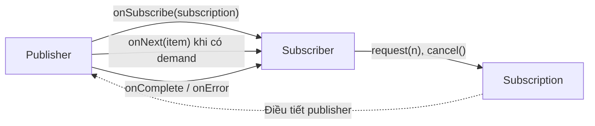

# Flow, publisher, subscriber và backpressure

Khi xây dựng một hệ thống bất đồng bộ, một luồng sự kiện có thể được tạo ra nhanh hơn tốc độ xử lý của bên nhận: dịch vụ gửi thông báo tạo hàng nghìn sự kiện mỗi giây, trong khi bộ ghi dữ liệu chỉ xử lý được vài trăm. Nếu cứ đẩy dữ liệu không giới hạn, hàng đợi có thể lớn dần, tăng độ trễ và làm cạn bộ nhớ. Nếu chặn toàn bộ hệ thống một cách tùy tiện, throughput lại giảm hoặc tạo điểm nghẽn.

**Backpressure** (*điều tiết áp lực ngược*) là cơ chế để phía tiêu thụ thể hiện **còn khả năng nhận bao nhiêu phần tử**, từ đó phía phát kiểm soát việc giao thêm dữ liệu.

Trong Java 27, gói `java.util.concurrent` cung cấp **`Flow`**, mô hình publish–subscribe chuẩn dựa trên nhu cầu (*demand*) theo từng subscription. Bốn interface cốt lõi là:

- `Flow.Publisher<T>`: nguồn phát các phần tử kiểu `T`.
- `Flow.Subscriber<T>`: nơi nhận các phần tử và tín hiệu vòng đời.
- `Flow.Subscription`: liên kết giữa publisher và subscriber, nhận yêu cầu `request(n)` hoặc `cancel()`.
- `Flow.Processor<T,R>`: vừa nhận `T` như một subscriber, vừa phát `R` như một publisher.

Lớp `SubmissionPublisher<T>` là một implementation sẵn có để phát dữ liệu bất đồng bộ, có buffer riêng cho từng subscriber. API này đã hiện diện từ Java 9 và tiếp tục được hỗ trợ chính thức trong Java 27; các ví dụ dưới đây **không dùng tính năng preview hay API đã lỗi thời**.

## 1. Bài toán: producer nhanh hơn consumer

Giả sử một hệ thống quản lý đơn hàng nhận dữ liệu:

```text
Producer: 1.000 sự kiện / giây
Consumer:   100 sự kiện / giây
Chênh lệch: 900 sự kiện / giây tích tụ nếu không điều tiết
```

Một hàng đợi tăng 900 phần tử mỗi giây sẽ tích lũy khoảng 54.000 phần tử chỉ sau một phút. Đây là phép tính minh họa; trong hệ thống thật, kích thước mỗi phần tử và cách lưu trữ còn quyết định lượng bộ nhớ tiêu thụ.

Có một số chiến lược khác nhau:

| Chiến lược | Hành vi | Khi cân nhắc |
|---|---|---|
| Giảm tốc hoặc tạm dừng producer | Bên phát chờ cho đến khi có khả năng nhận | Không muốn bỏ dữ liệu và producer có thể chậm lại |
| Buffer có giới hạn | Chấp nhận chênh lệch tốc độ tạm thời | Tải lên xuống trong giới hạn tài nguyên |
| Loại bớt dữ liệu theo chính sách | Không giao một số phần tử khi quá tải | Sự kiện có thể mất, như telemetry không trọng yếu |
| Lưu vào hệ thống hàng đợi bền vững | Giữ dữ liệu qua lỗi và khởi động lại | Cần retry, durability hoặc phân tán |
| Từ chối/điều tiết yêu cầu đầu vào | Giới hạn lượng công việc nhận | Hệ thống downstream đã quá tải |

`Flow` cung cấp **giao thức điều tiết demand**, không tự tạo persistence, retry, acknowledgment xuyên mạng hay khả năng xử lý đúng một lần (*exactly once*). Phải thiết kế các yêu cầu đó ở tầng nghiệp vụ hoặc hệ thống lưu trữ phù hợp.

## 2. Bốn vai trò trong Flow



Đây là sơ đồ khái niệm. `Subscription` thường do publisher cung cấp, đại diện cho **một quan hệ đăng ký cụ thể**, không phải một bộ đếm toàn cục dùng chung cho mọi subscriber.

### Flow.Publisher<T>

Giao diện `Publisher` có một phương thức chính:

```java
void subscribe(Flow.Subscriber<? super T> subscriber);
```

Khi đăng ký được chấp nhận, publisher thông báo `onSubscribe(subscription)` cho subscriber. Một publisher có thể chỉ hỗ trợ một subscriber hoặc nhiều subscriber, tùy hợp đồng implementation. Chỉ có tên `Publisher` chưa đủ để kết luận nó có phát lại dữ liệu cũ, chia sẻ một stream, hay tạo stream riêng cho mỗi lần đăng ký.

### Flow.Subscriber<T>

Subscriber nhận bốn loại callback:

```java
void onSubscribe(Flow.Subscription subscription);
void onNext(T item);
void onError(Throwable error);
void onComplete();
```

Với một subscription hợp lệ:

1. `onSubscribe` được gửi trước các tín hiệu khác.
2. `onNext` mang phần tử dữ liệu **khi có demand hợp lệ**.
3. Khi kết thúc bình thường, subscriber nhận `onComplete`.
4. Khi gặp lỗi không thể phục hồi thuộc giao thức publisher/subscription, subscriber nhận `onError`.
5. `onError` và `onComplete` là **tín hiệu kết thúc loại trừ nhau**; không có `onNext` tiếp theo trên subscription đó sau khi đã nhận tín hiệu kết thúc.

Các callback cho **cùng một subscription** được gọi theo thứ tự tuần tự, không chồng lấp. Tuy nhiên, hai subscription khác nhau có thể chạy đồng thời trên các thread khác nhau: không mặc định dùng một biến mutable dùng chung mà không đồng bộ.

### Flow.Subscription

```java
void request(long n);
void cancel();
```

`request(n)` bổ sung `n` đơn vị demand, còn `cancel()` yêu cầu ngừng nhận tín hiệu. Demand được quản lý cho từng subscription, nên subscriber chậm và subscriber nhanh không nhất thiết có cùng số lượng phần tử đang chờ xử lý.

### Flow.Processor<T,R>

```java
interface Flow.Processor<T, R>
        extends Flow.Subscriber<T>, Flow.Publisher<R> {}
```

Processor có thể biến đổi, lọc, kiểm tra hoặc tổng hợp dữ liệu rồi truyền kết quả cho các subscriber ở downstream. Nó phải chú ý **backpressure ở cả hai phía**: nhận từ upstream và giao cho downstream.

## 3. Vòng đời một subscription

Một chuỗi tương tác thường gặp:

```text
Subscriber                        Publisher / Subscription
    |                                        |
    |---- subscribe(subscriber) ------------>|
    |<--- onSubscribe(subscription) ---------|
    |---- request(2) ----------------------->|
    |<--- onNext(event-1) -------------------|
    |<--- onNext(event-2) -------------------|
    |---- request(1) ----------------------->|
    |<--- onNext(event-3) -------------------|
    |<--- onComplete() ----------------------|
```

Sau `request(2)`, publisher được phép giao tối đa **hai** phần tử dữ liệu cho subscription đó nếu chưa có demand trước đó. `request(1)` tiếp theo cộng thêm một đơn vị demand.

Điểm khác biệt giữa **data signal** và **terminal signal**:

- `onNext(item)` tiêu thụ một đơn vị demand.
- `onComplete()` hoặc `onError(error)` là tín hiệu kết thúc, không phải một phần tử dữ liệu.
- Một stream có thể kết thúc sau ít phần tử hơn số đã yêu cầu; `request(10)` không phải lệnh bắt buộc publisher tạo đủ 10 phần tử.
- Với implementation có buffer, phần tử có thể đã được đưa vào buffer nhưng chưa được chuyển tới `onNext` cho tới khi có demand.

Dòng thời gian ở trên thể hiện thứ tự logic, không cam kết publisher gọi callback trên thread nào. `SubmissionPublisher` dùng `Executor` để phát tín hiệu bất đồng bộ.

## 4. Demand: quy tắc của request(n)

`Flow.Subscription.request(long n)` cộng thêm lượng nhu cầu chưa được đáp ứng.

```java
subscription.request(1);  // Cho phép một onNext mới
subscription.request(4);  // Bổ sung thêm bốn đơn vị demand
```

Tổng demand phát sinh ở đây là 5 trước khi trừ các phần tử đã giao. Khi consumer đã xử lý xong một phần tử, nó có thể yêu cầu tiếp.

### Điều kiện n phải dương

```java
subscription.request(0);  // Không hợp lệ
subscription.request(-1); // Không hợp lệ
```

Theo hợp đồng, `n <= 0` dẫn đến tín hiệu `onError` với `IllegalArgumentException`. Không dùng `request(0)` như cách “tạm dừng”: muốn tạm thời không nhận thêm dữ liệu thì đơn giản là **chưa yêu cầu thêm demand**, hoặc hủy subscription nếu không còn cần dữ liệu.

### Demand có thể được yêu cầu theo từng batch

```java
final class BatchSubscriber implements Flow.Subscriber<String> {
    private Flow.Subscription subscription;
    private int remaining;

    @Override
    public void onSubscribe(Flow.Subscription subscription) {
        this.subscription = subscription;
        this.remaining = 4;
        subscription.request(4);
    }

    @Override
    public void onNext(String item) {
        process(item); // Hàm nghiệp vụ giả định, đồng bộ.
        if (--remaining == 0) {
            remaining = 4;
            subscription.request(4);
        }
    }

    @Override
    public void onError(Throwable error) {
        report(error); // Hàm ứng dụng giả định.
    }

    @Override
    public void onComplete() {
        finish(); // Hàm ứng dụng giả định.
    }
}
```

Subscriber đặt cửa sổ demand ban đầu là 4, sau mỗi 4 phần tử đã xử lý sẽ yêu cầu thêm 4. Hợp đồng này cho phép publisher biết giới hạn phần tử đang được mong đợi, nhưng **không phải một cam kết bộ nhớ cố định cho toàn pipeline** nếu publisher vẫn tạo trước dữ liệu hoặc có nhiều tầng buffer khác.

Có thể chọn `subscription.request(Long.MAX_VALUE)` để biểu thị nhu cầu gần như không giới hạn. Cách này phù hợp khi consumer đủ nhanh hoặc đã có giới hạn khác, nhưng làm mất lợi ích giới hạn demand tại tầng subscriber đó.

## 5. Backpressure không đồng nghĩa với buffer

Hai cơ chế liên quan nhưng khác nhau:

- **Demand**: số phần tử subscriber đã yêu cầu nhưng chưa nhận đủ.
- **Buffer**: vùng nhớ giữ phần tử đã được publisher chấp nhận nhưng chưa giao hoặc chưa xử lý xong.

Ví dụ publisher có buffer tối đa 4 phần tử và subscriber chưa gửi `request`:

```text
Publisher cố phát: E1, E2, E3, E4, E5
Buffer cho subscriber: [E1, E2, E3, E4]
Demand của subscriber: 0
E5: phải đợi, bị từ chối hoặc bị bỏ theo chính sách publisher
```

Khi subscriber gọi `request(2)`, publisher có thể giao E1 và E2, từ đó mở thêm chỗ trong buffer. Cách xử lý E5 phụ thuộc API và chính sách phát (`submit`, `offer`, timeout, drop handler...).

Đừng nhầm hai kiểu “4”:

- `request(4)` là **lượng demand**.
- `maxBufferCapacity = 4` là **mức chứa tối đa dự kiến** cho mỗi subscriber của `SubmissionPublisher`. Dung lượng thực tế có thể được làm tròn theo quy tắc implementation.

Vì vậy, `request(n)` không tự mở rộng buffer lên `n`; và cấu hình buffer lớn không có nghĩa subscriber đồng ý nhận ngần ấy `onNext` khi chưa có demand.

## 6. SubmissionPublisher: publisher có sẵn trong Java

`SubmissionPublisher<T>` là lớp triển khai `Flow.Publisher<T>` phục vụ việc phát dữ liệu bất đồng bộ.

```java
import java.util.concurrent.SubmissionPublisher;

try (var publisher = new SubmissionPublisher<String>()) {
    // Đăng ký subscriber trước khi bắt đầu phát.
    publisher.subscribe(subscriber);

    publisher.submit("EVENT-001");
    publisher.submit("EVENT-002");
    publisher.close();
}
```

Trong ví dụ, `subscriber` là đối tượng `Flow.Subscriber<String>` đã được tạo trước đó.

Các điểm cần nhớ:

- `SubmissionPublisher` gửi phần tử đến các subscriber **hiện đang đăng ký**.
- Mỗi subscriber có buffer riêng; một subscriber chậm có thể gây backpressure tới publisher theo chính sách phát.
- `submit` phát tới các subscriber hiện tại, **có thể chặn thread gọi** khi buffer của một subscriber không còn chỗ.
- `SubmissionPublisher` không tự lưu sự kiện để phát lại cho người đăng ký sau.
- Không được `submit(null)`; item null gây `NullPointerException`.
- `close()` phát tín hiệu kết thúc bình thường và ngăn gửi tiếp; `closeExceptionally(error)` phát tín hiệu lỗi.
- Các callback được giao bất đồng bộ qua `Executor` mà publisher sử dụng.

### Dùng Executor và dung lượng buffer tường minh

```java
import java.util.concurrent.Executors;
import java.util.concurrent.SubmissionPublisher;

try (var deliveryExecutor = Executors.newFixedThreadPool(2);
     var publisher = new SubmissionPublisher<String>(
         deliveryExecutor, 16
     )) {
    // Đăng ký subscriber và phát dữ liệu...
}
```

Constructor trên chọn executor dùng **cho việc giao tín hiệu đến subscriber** và đặt mức buffer. Không mặc định executor là số thread tương đương số subscriber; lựa chọn này phụ thuộc mức tiêu thụ, các callback có chặn lâu hay không và tải ứng dụng.

Constructor không đối số thường sử dụng `ForkJoinPool.commonPool()` và `Flow.defaultBufferSize()`. Đây là mặc định tiện lợi, nhưng không nhất thiết tối ưu cho callback có nhiều blocking I/O. Nếu consumer phải làm I/O lâu, nên xem xét cách tổ chức các tầng xử lý và executor có vòng đời rõ ràng.

## 7. Ví dụ chạy độc lập: hai subscriber với demand khác nhau

Chương trình sau có một publisher và hai subscriber:

- Subscriber thứ nhất xử lý từng phần tử và `request(1)`.
- Subscriber thứ hai yêu cầu theo batch `request(2)`.
- Producer phát năm sự kiện.
- `CompletableFuture` dùng làm tín hiệu kiểm tra **subscriber đã thực sự hoàn thành**, thay vì suy ra rằng `publisher.close()` đồng nghĩa mọi callback đã chạy xong.

Lưu đoạn sau vào file `FlowDemandDemo.java`:

```java
import java.util.ArrayList;
import java.util.List;
import java.util.concurrent.CompletableFuture;
import java.util.concurrent.Executors;
import java.util.concurrent.Flow;
import java.util.concurrent.SubmissionPublisher;
import java.util.concurrent.TimeUnit;

public class FlowDemandDemo {

    record Event(int id, String code) {}

    record Result(String subscriberName, List<String> codes) {}

    static final class CollectingSubscriber implements Flow.Subscriber<Event> {
        private final String name;
        private final int batchSize;
        private final List<String> codes = new ArrayList<>();
        private final CompletableFuture<Result> finished =
            new CompletableFuture<>();

        private Flow.Subscription subscription;

        CollectingSubscriber(String name, int batchSize) {
            if (batchSize <= 0) {
                throw new IllegalArgumentException("batchSize phải dương");
            }
            this.name = name;
            this.batchSize = batchSize;
        }

        @Override
        public void onSubscribe(Flow.Subscription subscription) {
            this.subscription = subscription;
            subscription.request(batchSize);
        }

        @Override
        public void onNext(Event item) {
            codes.add(item.code());

            // Chỉ yêu cầu batch tiếp theo sau khi đã xử lý batch hiện tại.
            if (codes.size() % batchSize == 0) {
                subscription.request(batchSize);
            }
        }

        @Override
        public void onError(Throwable error) {
            finished.completeExceptionally(error);
        }

        @Override
        public void onComplete() {
            finished.complete(new Result(name, List.copyOf(codes)));
        }

        CompletableFuture<Result> result() {
            return finished;
        }
    }

    public static void main(String[] args) throws Exception {
        try (var executor = Executors.newFixedThreadPool(2);
             var publisher = new SubmissionPublisher<Event>(executor, 8)) {

            var oneByOne = new CollectingSubscriber("one-by-one", 1);
            var batchTwo = new CollectingSubscriber("batch-two", 2);

            publisher.subscribe(oneByOne);
            publisher.subscribe(batchTwo);

            for (int id = 1; id <= 5; id++) {
                publisher.submit(new Event(id, "E-" + id));
            }

            publisher.close(); // Gửi tín hiệu kết thúc, không đợi callbacks.

            // Đợi callback onComplete() của TỪNG subscriber.
            Result first = oneByOne.result().get(5, TimeUnit.SECONDS);
            Result second = batchTwo.result().get(5, TimeUnit.SECONDS);

            System.out.println(first.subscriberName() + ": " + first.codes());
            System.out.println(second.subscriberName() + ": " + second.codes());
        }
    }
}
```

Chạy với JDK 27:

```shell
javac --release 27 FlowDemandDemo.java
java FlowDemandDemo
```

Kết quả dự kiến:

```text
one-by-one: [E-1, E-2, E-3, E-4, E-5]
batch-two: [E-1, E-2, E-3, E-4, E-5]
```

Hai subscriber đều nhận dữ liệu theo **thứ tự phát** trên subscription của mình. Dù callback của hai subscriber có thể được chạy trên các thread khác nhau, `List.copyOf(codes)` chỉ được tạo khi `onComplete` đã đến. `CompletableFuture.get` cho thread main điểm đồng bộ để đọc kết quả đã hoàn tất.

Lưu ý thực hành:

1. `subscribe` được gọi **trước khi** producer phát dữ liệu. Đây là yêu cầu quan trọng khi dùng `SubmissionPublisher` cho dữ liệu không được phát lại.
2. Mỗi subscriber tự quản lý `subscription` và `request`; publisher không tự đoán khả năng xử lý.
3. Dữ liệu đầu ra được gom vào `ArrayList` của từng subscriber, không chia sẻ cho cả hai.
4. `onComplete` và `onError` hoàn tất future theo hai cách khác nhau.
5. `get(5, TimeUnit.SECONDS)` chỉ giới hạn thời gian đợi của caller. Nếu hệ thống thật có khả năng treo, cần thêm chiến lược timeout/cancellation/cleanup phù hợp.

Đây là ví dụ chức năng, không phải benchmark và không khẳng định mỗi sự kiện đã được ghi bền vững vào cơ sở dữ liệu.

## 8. submit và offer: chờ hay chấp nhận mất dữ liệu?

`SubmissionPublisher` có hai nhóm API với hành vi khi quá tải khác nhau.

### submit(item): chờ có chỗ trong buffer

```java
int lagEstimate = publisher.submit(event);
```

`submit` đưa một phần tử tới mỗi subscriber hiện tại và có thể **chặn không gián đoạn theo interrupt** (*blocking uninterruptibly*) khi tài nguyên buffer của một subscriber đang đầy. Giá trị trả về là một **ước lượng** về độ trễ hàng đợi lớn nhất giữa các subscriber, không phải ACK rằng đã ghi dữ liệu bền vững hoặc callback đã xử lý xong.

Nếu ứng dụng bắt buộc không được mất dữ liệu, `submit` có thể phù hợp cho một luồng xử lý có giới hạn rõ ràng. Nhưng nó **không** biến publisher thành durable queue và cũng không có timeout tích hợp cho việc chờ chỗ trống.

### offer(item, onDrop): có thể bỏ dữ liệu

```java
int status = publisher.offer(
    event,
    (subscriber, droppedItem) -> {
        System.err.println("Quá tải; bỏ sự kiện " + droppedItem);
        return false; // Không thử phát lại ở lần offer này.
    }
);

if (status < 0) {
    System.err.println("Có subscriber không nhận được sự kiện");
}
```

`event` và `publisher` ở đây là biến đã có với các kiểu tương thích.

Theo API:

- `offer` cố gắng gửi phần tử nhưng có thể bỏ phần tử cho **một hoặc nhiều subscriber** nếu tài nguyên không đủ.
- `onDrop` được gọi khi cần xử lý sự kiện không thể gửi do giới hạn tài nguyên.
- Nếu handler trả `true`, implementation **thử lại một lần**; không bảo đảm lần thử lại thành công.
- Nếu trả `false`, nó không thử lại trong lần offer đó.
- Kết quả âm biểu diễn **số lượt phát không thành công** (ở dạng số âm); kết quả không âm là ước lượng maximum lag.

Không nên mặc định phần tử hoặc sự kiện bị bỏ là không quan trọng. Hệ thống cần xác định một chính sách rõ ràng: bỏ telemetry không trọng yếu, retry ở nơi khác, chuyển sang hàng đợi bền vững hoặc báo lỗi để caller xử lý.

### offer với timeout

```java
int status = publisher.offer(
    event,
    200,
    TimeUnit.MILLISECONDS,
    (subscriber, droppedItem) -> false
);
```

Overload này chờ tài nguyên tối đa theo timeout được truyền vào, hoặc cho tới khi thread gọi bị interrupt, rồi có thể áp dụng drop handler. Nó hữu ích khi producer cần **giới hạn thời gian bị chặn** vì một subscriber chậm. Các chính sách retry và bảo toàn dữ liệu vẫn phải được thiết kế riêng.

| API | Khi buffer đầy | Có thể mất phần tử? | Dùng khi |
|---|---|---|---|
| `submit(item)` | Chờ có tài nguyên | Không chủ động drop do buffer đầy; vẫn có các lỗi khác | Không muốn drop tự động và producer có thể chờ |
| `offer(item, onDrop)` | Có thể gọi handler và bỏ phần tử | Có | Cho phép giảm tải bằng chính sách drop |
| `offer(item, timeout, unit, onDrop)` | Đợi tối đa theo chính sách rồi xử lý drop | Có | Cần giới hạn thời gian chờ của producer |

**Lưu ý:** callback xử lý drop không nên thực hiện công việc chậm hoặc dễ deadlock. Tài liệu API nêu rằng các lời gọi khác đến publisher có thể bị chặn trong lúc handler đang chạy.

## 9. Nhiều subscriber: demand và buffer độc lập

Với một `SubmissionPublisher<T>`, dữ liệu được gửi tới các subscriber đang đăng ký, nhưng **mỗi subscriber có buffer và demand riêng**.

```text
                 +--> Subscriber A: request(10), xử lý nhanh
Publisher -------|
                 +--> Subscriber B: request(1), xử lý chậm
```

Khi B không có demand và buffer của B đầy:

- `submit` có thể làm producer bị chặn, dù A đang xử lý nhanh.
- `offer` có thể bỏ phần tử đối với B mà A vẫn nhận được phần tử đó.
- Một số đo `lag` toàn cục không đủ để suy ra từng subscriber xử lý xong bao nhiêu phần tử.

Vì thế, trong broadcast fan-out, cần xác định rõ **subscriber chậm nhất có được phép làm chậm cả producer không**. Nếu mỗi downstream có chất lượng dịch vụ khác nhau, đôi khi nên tách publisher hoặc thêm hàng đợi/đường ống riêng.

### Hot publisher và việc đăng ký muộn

`SubmissionPublisher` thông thường chỉ giao các phần tử **được phát khi subscriber đang đăng ký**. Subscriber đến sau không tự nhận lại lịch sử.

```java
publisher.submit("before-subscribe");

publisher.subscribe(subscriber);

publisher.submit("after-subscribe");
```

Đừng trông chờ subscriber nhận `"before-subscribe"`. Bản thân giao diện `Flow.Publisher` **không bắt buộc** mọi implementation đều là “hot”; một publisher tự xây có thể tạo luồng dữ liệu riêng cho từng subscriber khi nhận demand. Cần đọc hợp đồng cụ thể của từng implementation.

Nếu nghiệp vụ cần phát lại lịch sử, bền vững qua restart hoặc consumer tiếp tục từ offset, `SubmissionPublisher` một mình không đáp ứng được.

## 10. Processor: vừa Subscriber vừa Publisher

Một `Flow.Processor<T,R>` giúp tạo pipeline biến đổi:

```text
Publisher<String>
       |
       v
Processor<String, String>   (chuẩn hóa dữ liệu)
       |
       v
Subscriber<String>          (ghi nhận kết quả)
```

Ví dụ minh họa sau kế thừa `SubmissionPublisher<String>` để tái sử dụng cơ chế phát downstream:

```java
import java.util.Locale;
import java.util.concurrent.Executor;
import java.util.concurrent.Flow;
import java.util.concurrent.SubmissionPublisher;

final class UppercaseProcessor extends SubmissionPublisher<String>
        implements Flow.Processor<String, String> {

    private Flow.Subscription upstream;

    UppercaseProcessor(Executor executor) {
        super(executor, 8);
    }

    @Override
    public void onSubscribe(Flow.Subscription subscription) {
        upstream = subscription;
        subscription.request(1);
    }

    @Override
    public void onNext(String item) {
        try {
            // submit có thể chờ khi downstream không còn chỗ.
            submit(item.toUpperCase(Locale.ROOT));
            upstream.request(1);
        } catch (RuntimeException error) {
            upstream.cancel();
            closeExceptionally(error);
        }
    }

    @Override
    public void onError(Throwable error) {
        closeExceptionally(error);
    }

    @Override
    public void onComplete() {
        close();
    }
}
```

Processor này:

1. Yêu cầu một phần tử từ upstream.
2. Khi `onNext` đến, chuyển phần tử thành chữ hoa.
3. Gửi phần tử đã biến đổi xuống downstream bằng `submit`.
4. Chỉ yêu cầu thêm một phần tử sau khi thao tác `submit` đã trả về.
5. Truyền tín hiệu `onError`/`onComplete` xuống downstream.

Lưu ý tinh tế: `submit` trả về khi dữ liệu đã được publisher **chấp nhận/gửi vào hệ thống giao bất đồng bộ**, không có nghĩa downstream đã xử lý xong. Một processor có thể phải thiết kế chính sách demand sâu hơn nếu cần **giới hạn end-to-end** chặt chẽ hơn một buffer đơn giản.

Đoạn code là processor minh họa, không phải implementation sản xuất cho mọi tình huống. Trong hệ thống thực tế, cần xử lý chống đăng ký trùng, kiểm soát nguồn phát đồng thời, cancellation theo hai chiều, dependency của executor và hành vi khi subscriber downstream không còn, nhất là khi `submit` đang chặn. Cũng nên kết nối subscriber **ở downstream trước** rồi mới đăng ký processor với upstream nếu tránh bỏ các sự kiện đầu tiên là yêu cầu quan trọng.

## 11. Kết thúc bình thường, kết thúc lỗi và hủy subscription

Có ba nhóm sự kiện thường bị nhầm:

| Sự kiện | Ai chủ động? | Ý nghĩa |
|---|---|---|
| `onComplete()` | Publisher | Luồng kết thúc bình thường |
| `onError(Throwable)` | Publisher | Luồng/subscription kết thúc do lỗi |
| `cancel()` | Subscriber thông qua `Subscription` | Không muốn tiếp tục nhận các tín hiệu theo subscription |

### close() và closeExceptionally()

```java
publisher.close(); // Kết thúc bình thường

// Hoặc:
publisher.closeExceptionally(
    new IllegalStateException("Nguồn dữ liệu không khả dụng")
);
```

`SubmissionPublisher.close()` báo publisher không nhận thêm dữ liệu và sắp gửi `onComplete` cho subscriber hiện tại. **Nó không đợi tất cả subscriber gọi xong onComplete trước khi trả về**. Tương tự, `closeExceptionally` phát tín hiệu lỗi nhưng không bảo đảm callback đã hoàn tất khi phương thức trả về.

Nếu caller cần biết subscriber xử lý xong, hãy cung cấp cơ chế quan sát riêng: `CompletableFuture`, latch hoặc một hợp đồng completion được triển khai rõ.

### cancel() là best-effort

```java
subscription.cancel();
```

`cancel` yêu cầu ngừng phát tới subscriber, nhưng có thể còn một số callback đã được xếp lịch. Theo hợp đồng, một subscription bị hủy **không bắt buộc nhận `onComplete` hoặc `onError`**. Vì vậy, đừng tạo một future chỉ có thể hoàn thành từ `onComplete` rồi giả định nó sẽ luôn hoàn thành sau `cancel`.

Một cách thiết kế subscriber có quyền chủ động hủy là tự hoàn tất trạng thái “đã hủy” ở phía ứng dụng và không giữ tài nguyên chờ terminal signal mãi mãi.

### Lỗi trong onNext

Nếu `Subscriber.onNext` ném ngoại lệ, `SubmissionPublisher` có thể **hủy subscription** liên quan; không nên giả định subscriber đó sẽ luôn được gọi tiếp `onError` để tự xử lý chính lỗi do callback của nó vừa ném ra.

Vì vậy, khi subscriber làm việc với cơ sở dữ liệu, nội dung không hợp lệ hoặc logic có thể thất bại, hãy xử lý lỗi ngay trong `onNext`, báo trạng thái lỗi ra cơ chế quan sát của ứng dụng và cân nhắc hủy subscription. Không dựa vào `onError` như một `catch` bao quanh mọi exception của consumer.

## 12. Quản lý vòng đời và kết quả bằng CompletableFuture

`Flow` mô hình hóa **nhiều phần tử theo thời gian**, còn `CompletableFuture<T>` mô hình hóa **một kết quả cuối cùng có thể xuất hiện sau này**. Hai API thường phối hợp với nhau:

```java
final class CountingSubscriber implements Flow.Subscriber<String> {
    private Flow.Subscription subscription;
    private long count;

    private final CompletableFuture<Long> completed =
        new CompletableFuture<>();

    @Override
    public void onSubscribe(Flow.Subscription subscription) {
        this.subscription = subscription;
        subscription.request(1);
    }

    @Override
    public void onNext(String item) {
        count++;
        subscription.request(1);
    }

    @Override
    public void onError(Throwable error) {
        completed.completeExceptionally(error);
    }

    @Override
    public void onComplete() {
        completed.complete(count);
    }

    CompletableFuture<Long> completed() {
        return completed;
    }
}
```

`count` được cập nhật bên trong callback tuần tự của **một subscription**, rồi kết quả được publish qua `CompletableFuture.complete`. Caller có thể dùng `completed().get(timeout, unit)` để đợi và xử lý lỗi một cách rõ ràng.

Nếu subscriber có thể chủ động cancel, phải mở rộng hợp đồng completion để xử lý đường hủy; nếu một callback tự thất bại, cũng cần đưa lỗi đó tới future hoặc bộ xử lý lỗi khác, tránh future chờ vô hạn.

### SubmissionPublisher.consume: trường hợp đơn giản

Khi consumer chỉ cần xử lý từng phần tử và không muốn viết đầy đủ bốn callback, `SubmissionPublisher.consume(Consumer)` cung cấp tiện ích:

```java
import java.util.concurrent.SubmissionPublisher;

try (var publisher = new SubmissionPublisher<String>()) {
    var finished = publisher.consume(System.out::println);

    publisher.submit("A");
    publisher.submit("B");
    publisher.close();

    finished.join(); // Đợi quá trình tiêu thụ kết thúc hoặc ném lỗi.
}
```

`consume` trả về `CompletableFuture<Void>` phản ánh kết quả của consumer. Đây là API tiện dụng nhưng **không minh họa chiến lược demand từng phần tử do người dùng kiểm soát**. Khi cần batch, timeout, cancellation hoặc backpressure chuyên biệt, hãy triển khai `Flow.Subscriber` có hợp đồng riêng.

## 13. Flow khác Stream, CompletableFuture và virtual thread ra sao?

Cùng xử lý “dữ liệu” hoặc “bất đồng bộ”, nhưng mục đích của những API sau khác nhau:

| Công cụ | Mô hình | Bài toán phù hợp |
|---|---|---|
| `java.util.stream.Stream<T>` | Pipeline xử lý dữ liệu kiểu pull khi terminal operation chạy | Lọc, biến đổi, tổng hợp một nguồn dữ liệu |
| `CompletableFuture<T>` | Một giá trị hoặc lỗi hoàn thành về sau | Kết hợp kết quả các lời gọi bất đồng bộ |
| `Flow.Publisher<T>` | Luồng nhiều phần tử theo thời gian, điều tiết bằng demand | Truyền sự kiện hoặc dữ liệu bất đồng bộ với backpressure |
| `Thread`/virtual threads | Đơn vị thực thi tác vụ | Chạy logic blocking, phối hợp công việc và I/O |
| Queue có giới hạn | Container và phối hợp producer/consumer | Đệm dữ liệu và giới hạn số phần tử chờ |

Ví dụ một `Stream` có thể biến đổi một `List` hiện có bằng `map`, `filter`, `collect`. Còn `Flow` mô tả cách **nguồn phát tín hiệu dần theo thời gian**, cách subscriber yêu cầu và nhận tín hiệu.

Virtual thread có thể được dùng để chạy producer hoặc consumer với blocking I/O, nhưng không tự đem lại giao thức `request(n)`; Flow và virtual threads giải quyết **hai vấn đề khác nhau**. Trong nhiều ứng dụng có thể kết hợp cả hai khi có lý do kiến trúc rõ ràng.

Không nhầm `java.util.stream.Stream` với interface `Flow.Publisher` chỉ vì cả hai xử lý chuỗi phần tử. Chúng không thể thay thế trực tiếp chỉ bằng đổi tên kiểu.

## 14. Flow trong HTTP Client hiện đại

Java HTTP Client (`java.net.http`) sử dụng các interface `Flow` làm nền cho luồng dữ liệu request/response:

- `HttpRequest.BodyPublisher` mở rộng `Flow.Publisher<ByteBuffer>`.
- `HttpResponse.BodySubscriber<T>` mở rộng `Flow.Subscriber<List<ByteBuffer>>`.

Đây là ví dụ thực tế cho thấy `Flow` không chỉ dùng trong các demo tự xây sự kiện. Một HTTP body có thể rất lớn, cần giao các phần byte theo nhu cầu tiêu thụ để giảm áp lực bộ nhớ.

Với BodyPublisher tự triển khai, phải tuân thủ thêm hợp đồng của HTTP Client như `contentLength()`, cách xử lý nhiều lần subscribe khi gửi lại request, và vòng đời `ByteBuffer`. Không nên tự triển khai chỉ để gửi một chuỗi nhỏ; các factory như `HttpRequest.BodyPublishers.ofString(...)` đã giải quyết nhu cầu đơn giản.

Nếu đang dùng framework reactive hoặc streaming bên thứ ba, hãy kiểm tra framework đó có hỗ trợ `Flow` trực tiếp hay cần adapter. Không giả định mọi thư viện có interface tên `Publisher` sẽ tự tương thích nhị phân với `Flow.Publisher`.

## 15. Chọn kích thước request, buffer và executor

Không tồn tại một giá trị batch size hoặc buffer size tối ưu cho mọi hệ thống. Cách chọn phụ thuộc tốc độ producer, thời gian xử lý của consumer, số lượng subscription, kích thước mỗi phần tử và mức độ chấp nhận mất dữ liệu.

### Batch size: request một lần hay từng nhóm?

`request(1)`:

- Dễ quan sát và đặt điểm ranh giới sau mỗi phần tử.
- Có thể tăng chi phí trao đổi demand khi tốc độ cao.

`request(32)` hoặc `request(64)`:

- Giảm tần suất gọi `request`.
- Cho phép có nhiều phần tử đang được mong đợi hơn.
- Cần kiểm soát kích thước dữ liệu và khả năng tiêu thụ.

`request(Long.MAX_VALUE)`:

- Biểu thị nhu cầu gần như không giới hạn.
- Phù hợp khi pipeline khác đã kiểm soát tài nguyên hoặc subscriber thực sự sẵn sàng nhận.
- Không nên dùng theo thói quen nếu chính mục tiêu là backpressure.

### Buffer và tổng bộ nhớ

Với `SubmissionPublisher`, mỗi subscriber có buffer riêng. Một ước lượng đơn giản:

```text
Tổng bộ nhớ buffer ≈ số subscriber
                    × mức sử dụng buffer trung bình
                    × kích thước trung bình mỗi item
```

Đó chỉ là ước lượng thô; object overhead, giá trị metadata, các container ngoài pipeline và bộ nhớ do callback giữ lại còn làm thay đổi kết quả thực tế. Khi chọn `maxBufferCapacity`, cần nhớ dung lượng thực thi có thể được làm tròn.

### Executor

Executor của publisher dùng để chạy callback giao dữ liệu. Khi callback thực hiện I/O blocking lâu, một pool platform nhỏ có thể khiến nhiều subscriber bị ảnh hưởng vì các task giao tín hiệu cạnh tranh worker.

Nên đo và xác định rõ:

- Callback có CPU-bound hay blocking I/O?
- Có bao nhiêu subscriber và bao nhiêu publisher chia sẻ executor?
- Có cần tách executor cho khâu xử lý nặng khỏi executor phát tín hiệu?
- Có đang giữ lock hoặc tài nguyên trong `onNext` quá lâu không?
- Khi ứng dụng đóng, ai chịu trách nhiệm đóng publisher và executor?

Có thể cân nhắc virtual-thread-based executor trong workload phù hợp, nhưng không coi đó là lý do bỏ các giới hạn về queue, bộ nhớ và tài nguyên downstream. Với `SubmissionPublisher`, vẫn phải đọc hợp đồng của callback và quan sát thực tế.

## 16. Sai lầm phổ biến và cách khắc phục

| Sai lầm | Hậu quả | Cách làm phù hợp |
|---|---|---|
| Không gọi `request(n)` sau `onSubscribe` | Không có `onNext` dù publisher đã có dữ liệu | Yêu cầu số phần tử dương phù hợp |
| Gọi `request(0)` để tạm dừng | `onError(IllegalArgumentException)` | Ngừng yêu cầu thêm; hủy nếu không còn cần |
| Luôn gọi `request(Long.MAX_VALUE)` để “bật stream” | Không có giới hạn demand hữu ích | Dùng batch/window theo tốc độ xử lý |
| Dùng `submit` nhưng giả định không chặn | Producer có thể bị giữ khi buffer đầy | Dùng `offer` có timeout/chính sách khi cần |
| Dùng `offer` nhưng bỏ qua mã trả về | Có thể mất dữ liệu ở một số subscriber | Theo dõi số drop và định nghĩa chính sách |
| Cho rằng `close()` đợi mọi callback hoàn tất | Đọc kết quả quá sớm | Đợi completion của subscriber bằng future/latch |
| Cho rằng `cancel()` sẽ luôn kích hoạt `onComplete()` | Chờ vô hạn | Tự quản lý trạng thái hủy |
| Để exception thoát khỏi `onNext` rồi chỉ đợi `onError` | Subscription có thể bị hủy mà không báo lỗi như mong đợi | Bắt và báo lỗi trong callback |
| Tăng buffer liên tục để xử lý consumer chậm | Nguy cơ hết bộ nhớ, chỉ che vấn đề tải | Giới hạn buffer và điều tiết đầu vào |
| Dùng nhiều subscriber nhưng nghĩ demand là toàn cục | Một subscriber chậm làm kết quả khó đoán | Theo dõi demand và mục tiêu riêng từng subscription |
| Đăng ký sau khi producer đã gửi dữ liệu | Không nhận lịch sử của `SubmissionPublisher` | Đăng ký trước hoặc dùng cơ chế replay riêng |
| Xem Flow như hàng đợi bền vững | Không có bảo đảm lưu qua lỗi/khởi động lại | Dùng hệ thống lưu bền vững nếu cần |
| Xem một callback tuần tự là toàn hệ thống single-threaded | Data race giữa các subscription | Đồng bộ dữ liệu chia sẻ hoặc tách trạng thái |
| Cấu hình executor không theo workload | Callback chậm làm nghẽn việc phát tín hiệu | Chọn executor, đo tải và giới hạn downstream |

### Các điều kiện bất thường cần kiểm thử

1. Publisher đóng ngay sau khi subscribe nhưng trước khi subscriber gửi demand.
2. Subscriber yêu cầu ít phần tử hơn tổng số được phát.
3. Subscriber hủy sau một phần tử.
4. Một subscriber chậm và một subscriber nhanh nhận cùng nguồn.
5. Buffer đầy, `submit` chờ hoặc `offer` trả về mã drop.
6. Consumer tự phát sinh lỗi ở giữa quá trình.
7. Producer phát `null` hoặc gọi `submit` sau `close`.
8. Ứng dụng cần thoát nhưng còn subscriber chưa hoàn tất.
9. Executor từ chối task (`RejectedExecutionException`).
10. Xử lý nhiều subscription hoặc nhiều nguồn phát có chia sẻ trạng thái.

Trong kiểm thử bất đồng bộ, tránh chỉ dùng `Thread.sleep` để suy ra công việc đã hoàn thành; nên dùng tín hiệu đồng bộ hoặc future cụ thể và timeout hữu hạn.

## 17. Bài tập thực hành

### Bài 1 — Demand từng phần tử

Viết `Flow.Subscriber<Integer>` gọi `request(1)` trong `onSubscribe`, in số vừa nhận trong `onNext`, rồi gọi `request(1)` tiếp. Với năm giá trị từ 1 đến 5, giải thích vì sao publisher không được gọi năm `onNext` trước khi nhận demand tương ứng.

### Bài 2 — Request theo batch

Đổi subscriber ở bài 1 thành `request(3)` ban đầu, sau mỗi 3 phần tử đã xử lý yêu cầu thêm 3. Với 8 phần tử, giải thích vì sao batch cuối chỉ có hai phần tử, và khi nào `onComplete` có thể xuất hiện.

### Bài 3 — Nhiều subscriber

Tạo hai subscriber với batch size lần lượt 1 và 4. Sử dụng `SubmissionPublisher` phát 10 phần tử, chờ hai `CompletableFuture` hoàn thành rồi so sánh danh sách nhận. Vì sao thứ tự xử lý **giữa** hai subscriber không nhất thiết giống nhau dù thứ tự **trong mỗi** subscriber vẫn được bảo đảm?

### Bài 4 — Chọn chính sách quá tải

Hệ thống telemetry cho phép mất một số metric không quan trọng khi quá tải. Bạn chọn `submit` hay `offer`? Cần kiểm tra hoặc ghi lại thông tin gì để biết lượng dữ liệu bị bỏ?

### Bài 5 — Tác vụ bắt buộc không mất

Các sự kiện thanh toán phải có thể phục hồi sau khi tiến trình gặp sự cố. Vì sao `SubmissionPublisher` không đủ để bảo đảm yêu cầu này, kể cả khi dùng `submit`?

### Bài 6 — Cancellation

Một subscriber chủ động gọi `subscription.cancel()` sau khi nhận ba phần tử. Có thể khẳng định nó sẽ nhận `onComplete` ngay không? Nếu caller đang chờ `CompletableFuture`, cần thiết kế thêm nhánh hoàn tất nào?

### Bài 7 — Processor

Tạo `Flow.Processor<String, Integer>` biến mỗi chuỗi thành độ dài của nó. Tại sao processor cần xử lý `request` từ upstream và không thể chỉ gọi `downstream.onNext` không kiểm soát?

### Đáp án gợi ý

**1.** `onNext` chỉ được giao khi còn demand. Sau mỗi phần tử được xử lý, gọi thêm `request(1)` để duy trì một đơn vị nhu cầu.

**2.** `request(3)` không bắt buộc phải có đủ 3 phần tử trước khi kết thúc; publisher có thể kết thúc bình thường khi hết nguồn, sau khi giao xong những phần tử được phép giao.

**3.** Callback của từng subscription tuần tự, nhưng publisher có thể sử dụng các task/thread khác nhau giữa subscription, dẫn đến thứ tự thực thi xen kẽ không xác định.

**4.** `offer` với drop handler hoặc timeout phù hợp. Theo dõi kết quả âm, số lần drop, subscriber bị ảnh hưởng và tác động lên mục tiêu nghiệp vụ.

**5.** `SubmissionPublisher` chủ yếu giữ buffer trong bộ nhớ, không phải durable event log hay cơ chế commit/acknowledgment xuyên restart. Cần lưu bền vững và thiết kế retry/idempotency phù hợp.

**6.** Không; `cancel` là best-effort và không bắt buộc có terminal callback. Ứng dụng phải tự ghi nhận trạng thái hủy và hoàn tất/cancel future theo hợp đồng riêng.

**7.** Processor là subscriber của upstream và publisher của downstream. Nó phải tuân thủ demand ở cả hai hướng và tránh làm đầy buffer hoặc phá hợp đồng của downstream.

## 18. Tổng kết

`Flow` là giao thức chuẩn trong Java 27 để xây dựng **luồng nhiều phần tử bất đồng bộ có kiểm soát nhu cầu**. Bốn interface `Publisher`, `Subscriber`, `Subscription`, `Processor` phân tách rõ nguồn phát, nơi tiêu thụ, giao thức demand và bước biến đổi.

Điểm cốt lõi của backpressure là: **subscriber chủ động yêu cầu số lượng phần tử thông qua `request(n)`**, thay vì bị buộc nhận dữ liệu không giới hạn. `SubmissionPublisher` bổ sung buffer có giới hạn cho từng subscriber và các lựa chọn xử lý quá tải bằng `submit` hoặc `offer`. Nhưng `Flow` không tự cung cấp persistence, retry, exactly-once, hay cơ chế bảo đảm mọi subscriber đã hoàn tất khi publisher `close`.

Khi dùng Flow trong dự án, hãy chọn cửa sổ demand, kích thước buffer, chính sách quá tải, executor và cơ chế báo hoàn tất theo hợp đồng nghiệp vụ. Đặc biệt, phải kiểm thử với subscriber chậm và lỗi bất đồng bộ thay vì chỉ kiểm tra trường hợp mọi phần tử đều đến ngay lập tức.

## Tài liệu tham khảo

- [Java SE 27 API — Flow](https://docs.oracle.com/en/java/javase/27/docs/api/java.base/java/util/concurrent/Flow.html): giao thức flow-controlled components, vai trò và ví dụ demand.
- [Java SE 27 API — Flow.Publisher](https://docs.oracle.com/en/java/javase/27/docs/api/java.base/java/util/concurrent/Flow.Publisher.html): hợp đồng publisher và `subscribe`.
- [Java SE 27 API — Flow.Subscriber](https://docs.oracle.com/en/java/javase/27/docs/api/java.base/java/util/concurrent/Flow.Subscriber.html): bốn callback và bảo đảm tuần tự của callback cho từng subscription.
- [Java SE 27 API — Flow.Subscription](https://docs.oracle.com/en/java/javase/27/docs/api/java.base/java/util/concurrent/Flow.Subscription.html): `request(n)`, `cancel()` và điều kiện demand.
- [Java SE 27 API — Flow.Processor](https://docs.oracle.com/en/java/javase/27/docs/api/java.base/java/util/concurrent/Flow.Processor.html): kết hợp publisher/subscriber trong pipeline.
- [Java SE 27 API — SubmissionPublisher](https://docs.oracle.com/en/java/javase/27/docs/api/java.base/java/util/concurrent/SubmissionPublisher.html): buffer theo subscriber, `submit`, `offer`, `close`, `consume` và chính sách xử lý lỗi.
- [Java SE 27 API — CompletableFuture](https://docs.oracle.com/en/java/javase/27/docs/api/java.base/java/util/concurrent/CompletableFuture.html): phối hợp tín hiệu hoàn thành và xử lý lỗi bất đồng bộ.
- [Java SE 27 API — HttpRequest.BodyPublisher](https://docs.oracle.com/en/java/javase/27/docs/api/java.net.http/java/net/http/HttpRequest.BodyPublisher.html): `Flow.Publisher<ByteBuffer>` trong HTTP Client.
- [Java SE 27 API — HttpResponse.BodySubscriber](https://docs.oracle.com/en/java/javase/27/docs/api/java.net.http/java/net/http/HttpResponse.BodySubscriber.html): `Flow.Subscriber<List<ByteBuffer>>` trong HTTP Client.
- [Reactive Streams — Specification](https://www.reactive-streams.org/): nền tảng quy tắc xử lý luồng bất đồng bộ với backpressure mà `Flow` tương thích về mô hình.
