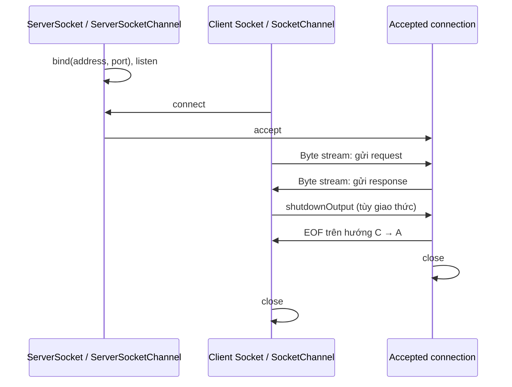
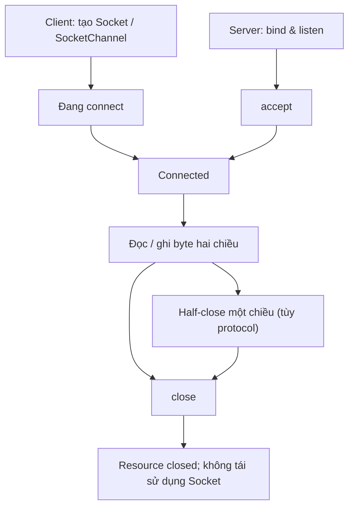
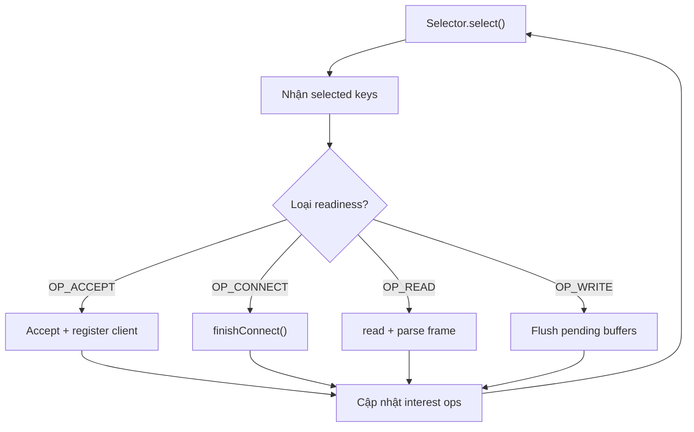

# TCP socket, channel và vòng đời kết nối

TCP là nền tảng vận chuyển dữ liệu cho nhiều giao thức ứng dụng như HTTP/1.1, HTTP/2 và các giao thức nhị phân riêng. Trong Java 27, bạn có thể làm việc với kết nối TCP bằng **`Socket` / `ServerSocket`** trong `java.net`, hoặc bằng **`SocketChannel` / `ServerSocketChannel` / `Selector`** trong Java NIO. Mỗi lựa chọn có mô hình đọc, ghi, chờ dữ liệu và quản lý vòng đời riêng, nhưng đều phải tôn trọng bản chất của **TCP byte stream**.

Bài thuộc chương **Mạng và HTTP**, module **JAVA_VERSION_JAVA27 — Java 27 và các kiến thức liên quan**. Nội dung sử dụng các API được hỗ trợ trong Java SE 27, ưu tiên cách thiết kế hiện đại với `try-with-resources`, virtual threads khi phù hợp, kiểm soát timeout, đóng kết nối và giới hạn tài nguyên. Các ví dụ trọng tâm không sử dụng API preview hay kỹ thuật đã lỗi thời.

## 1. Mục tiêu và mô hình tư duy

Sau bài học, bạn có thể:

1. Mô tả rõ các trạng thái **lắng nghe → kết nối → trao đổi byte → half-close → close**.
2. Phân biệt socket phía client với *listening socket* phía server và socket đã được `accept()`.
3. Hiểu tại sao một lần `write` không tương ứng một lần `read` và phải tự thiết kế **message framing**.
4. Đọc/ghi an toàn bằng `InputStream`/`OutputStream`, hoặc `ByteBuffer` với `SocketChannel`.
5. So sánh **blocking I/O với virtual threads** và **non-blocking I/O với Selector**.
6. Xử lý EOF, partial I/O, timeout, lỗi mạng, hủy tác vụ và giới hạn dung lượng dữ liệu.
7. Chọn API phù hợp cho TCP thuần, TLS và HTTP/HTTPS thay vì tự triển khai lại giao thức không cần thiết.

Sơ đồ khái quát:



**`ServerSocket` không phải là kết nối ứng dụng với một client cụ thể.** Nó lắng nghe và trả về một **`Socket` mới** sau mỗi lần accept. Tương tự, `ServerSocketChannel.accept()` trả về một `SocketChannel` riêng của kết nối đã thiết lập; channel lắng nghe tiếp tục phục vụ các kết nối khác.

## 2. TCP là byte stream, không phải hàng đợi thông điệp

Với TCP, phía gửi tạo **một chuỗi byte có thứ tự**. TCP bảo toàn thứ tự byte khi chúng được giao thành công cho ứng dụng nhận, nhưng **không bảo toàn ranh giới giữa các lời gọi `write`**.

Ví dụ client ghi hai đoạn:

```java
output.write("HELLO".getBytes(java.nio.charset.StandardCharsets.UTF_8));
output.write("WORLD".getBytes(java.nio.charset.StandardCharsets.UTF_8));
```

Phía server có thể đọc lần lượt `"HELLOWORLD"` trong một lần, hoặc `"HE"` rồi `"LLOW"` rồi `"ORLD"`, hoặc các cách chia khác. Hai lời gọi ghi **không tạo ra hai gói thông điệp ứng dụng**.

Các quy tắc cần ghi nhớ:

- **`read(...)` có thể nhận ít byte hơn yêu cầu**, dù bên gửi đã gọi `write` với một buffer lớn.
- Một lần đọc có thể chứa **một phần hoặc nhiều thông điệp** khi các thông điệp đã được ghi nối tiếp.
- Gọi `flush()` **không** tạo ranh giới message cho TCP, và không bảo đảm peer đã xử lý dữ liệu.
- TCP là luồng **full-duplex**: hai chiều gửi và nhận tồn tại tương đối độc lập.
- Nếu kết nối bị ngắt sau một lần ghi, không thể suy luận chỉ từ việc `write` thành công rằng ứng dụng phía nhận đã xử lý dữ liệu đúng một lần.

Vì vậy, **application protocol** phải quy định cách nhận biết một thông điệp hoàn chỉnh.

## 3. Chọn message framing đúng với giao thức

Một số chiến lược phổ biến:

| Chiến lược | Cách nhận biết ranh giới | Rủi ro cần quản lý |
|---|---|---|
| **Length-prefix** | Ghi trước độ dài, rồi ghi đúng số byte payload | Giới hạn kích thước, giá trị độ dài âm/quá lớn, truncated frame |
| **Delimiter** | Ví dụ kết thúc bằng ký tự xuống dòng | Escape/encoding khi dữ liệu chứa delimiter, giới hạn độ dài dòng |
| **Fixed-size record** | Mỗi record có đúng N byte | Quản lý phiên bản định dạng, byte order và padding |
| **Connection-close framing** | EOF đánh dấu kết thúc dữ liệu theo một chiều | Không tái sử dụng cùng chiều kết nối cho nhiều thông điệp |
| **Định dạng giao thức có sẵn** | HTTP, gRPC hoặc một protocol thư viện | Tuân thủ đầy đủ framing/semantics của giao thức đó |

Ví dụ **length-prefix**: 4 byte đầu diễn tả số byte payload; sau đó là đúng lượng byte UTF-8. Cả hai phía phải đồng thuận **byte order**. `DataOutputStream.writeInt` và `DataInputStream.readInt` cùng dùng **big-endian**:

```text
+-------------------------+-----------------------------+
| 4 byte length (big-end) | N byte payload (UTF-8)      |
+-------------------------+-----------------------------+
| 00 00 00 05             | 48 65 6C 6C 6F ("Hello")   |
+-------------------------+-----------------------------+
```

**Giới hạn độ dài trước khi cấp phát:** nếu đọc độ dài do client cung cấp rồi cấp phát ngay `new byte[length]` mà không kiểm tra, một kết nối có thể gây áp lực bộ nhớ lớn hoặc làm ứng dụng lỗi. Luôn xác định giới hạn kích thước và chính sách từ chối dữ liệu không hợp lệ.

### 3.1. Helper đọc/ghi một frame

```java
import java.io.DataInputStream;
import java.io.DataOutputStream;
import java.io.IOException;
import java.nio.charset.StandardCharsets;

static final int MAX_FRAME_BYTES = 4 * 1024;

static void sendFrame(DataOutputStream out, String message)
        throws IOException {
    byte[] body = message.getBytes(StandardCharsets.UTF_8);
    if (body.length > MAX_FRAME_BYTES) {
        throw new IOException("Frame quá lớn");
    }
    out.writeInt(body.length);
    out.write(body);
    out.flush();
}

static String receiveFrame(DataInputStream in) throws IOException {
    int length = in.readInt();
    if (length < 0 || length > MAX_FRAME_BYTES) {
        throw new IOException("Độ dài frame không hợp lệ: " + length);
    }
    byte[] body = new byte[length];
    in.readFully(body);
    return new String(body, StandardCharsets.UTF_8);
}
```

`readFully(body)` chờ đủ đúng số byte hoặc ném `EOFException` khi luồng kết thúc quá sớm; nó không dựa vào giả định một lần `read` luôn đủ. Trong ví dụ này, `new String(..., UTF_8)` dùng chính sách giải mã thay thế byte lỗi bằng ký tự thay thế; nếu giao thức cần **từ chối** UTF-8 không hợp lệ, hãy dùng `CharsetDecoder` với `CodingErrorAction.REPORT`.

## 4. Vòng đời TCP nhìn từ Java

Một kết nối TCP đi qua các giai đoạn chính:



Đây là **mô hình cấp ứng dụng**, không liệt kê từng trạng thái của TCP state machine trong hệ điều hành như `SYN_SENT`, `ESTABLISHED`, `FIN_WAIT` hoặc `TIME_WAIT`. Những trạng thái cấp OS còn phụ thuộc thứ tự đóng và điều kiện mạng.

Trong Java cần phân biệt:

- **Bound:** socket phía server gắn với địa chỉ/port cục bộ để lắng nghe; client cũng có local address/port khi kết nối.
- **Connected:** TCP connection đã được thiết lập và có thể trao đổi byte.
- **Half-closed:** một hướng truyền đã được shutdown; hướng còn lại có thể tiếp tục hoạt động.
- **Closed:** tài nguyên socket phía Java đã đóng; không thể tái sử dụng chính instance đó để reconnect.

`Socket.isConnected()` là trạng thái **đã từng kết nối thành công**, không phải phép thử đáng tin cậy rằng peer **hiện vẫn sống**. Theo API, một socket đã connect rồi `close()` vẫn có thể trả về `true` ở `isConnected()`. Cần dựa vào I/O, timeout và protocol heartbeat khi muốn theo dõi sức khỏe kết nối.

## 5. ServerSocket: bind, listen và accept

Ví dụ server TCP đơn giản trên địa chỉ loopback:

```java
import java.net.InetAddress;
import java.net.ServerSocket;
import java.net.Socket;

try (ServerSocket listener =
        new ServerSocket(0, 16, InetAddress.getLoopbackAddress())) {

    int port = listener.getLocalPort();
    System.out.println("Đang lắng nghe trên port " + port);

    try (Socket client = listener.accept()) {
        System.out.println("Peer: " + client.getRemoteSocketAddress());
        // Đọc/ghi protocol trong phạm vi accepted Socket này.
    }
}
```

Trong ví dụ, `port = 0` yêu cầu hệ điều hành chọn port cục bộ còn trống. Dùng `getLocalPort()` để lấy port thực tế. `InetAddress.getLoopbackAddress()` giới hạn việc lắng nghe vào máy hiện tại, phù hợp cho thử nghiệm; không vô tình mở service ra mạng công cộng.

Tham số `16` là **requested backlog** — một gợi ý về hàng đợi kết nối đang chờ accept mà hệ thống có thể điều chỉnh. Nó **không** có nghĩa server chỉ có thể phục vụ 16 client trong suốt vòng đời.

Một `accept()` trên `ServerSocket` dạng blocking sẽ chờ tới khi có kết nối hoặc xảy ra lỗi/timeout/đóng socket. Sau mỗi accept thành công, tạo phiên xử lý riêng cho accepted `Socket`; không đóng listening socket chỉ vì một client đã ngắt nếu server còn phải tiếp tục phục vụ.

### 5.1. Quản lý vòng đời của listening socket

- `try-with-resources` bảo đảm đóng cả listening socket và accepted socket trong đúng phạm vi.
- Khi một luồng đang chờ `accept()`, đóng listening socket có thể làm thao tác chờ ném `SocketException` — đây thường là **tín hiệu dừng** hợp lệ trong quá trình shutdown.
- Đối với server dài hạn, cần có tín hiệu dừng, kế hoạch đóng listening socket và chờ các request đang chạy; không dùng vòng `while(true)` mà không có cơ chế hủy.
- Accepted socket **khác** listening socket. Đóng một client socket không tự đóng listener.

## 6. Client Socket: connect, read, write và timeout

`Socket` ở phía client thường được tạo trước, sau đó gọi `connect(endpoint, timeoutMillis)`:

```java
import java.net.InetSocketAddress;
import java.net.Socket;

try (Socket socket = new Socket()) {
    socket.connect(new InetSocketAddress("127.0.0.1", 8080), 3_000);
    socket.setSoTimeout(5_000);

    // Kết nối TCP đã được thiết lập.
    // Dùng socket.getInputStream()/getOutputStream() cho protocol.
}
```

Đây là **đoạn minh họa**, chỉ thành công nếu có server tương ứng trên cổng 8080. Ví dụ chạy đầy đủ tại mục 10 sẽ tự tạo server loopback và không phụ thuộc server bên ngoài.

Có ít nhất ba loại thời hạn cần phân biệt:

| Thời hạn | Cơ chế | Tác động |
|---|---|---|
| **Connect timeout** | `socket.connect(endpoint, millis)` | Giới hạn thời gian chờ thiết lập kết nối theo hợp đồng API |
| **Read timeout** | `socket.setSoTimeout(millis)` | Giới hạn một thao tác đọc blocking qua `InputStream` của Socket |
| **Deadline toàn request** | Chính sách ứng dụng | Bao gồm các bước DNS/connect/send/read/process; phải tự tổ chức tổng thời gian |

`setSoTimeout(0)` nghĩa là không có read timeout được cấu hình; không phải “timeout ngay”. Nếu thao tác đọc vượt read timeout, `SocketTimeoutException` có thể được ném, nhưng **socket chưa nhất thiết bị đóng**. Caller phải quyết định retry, hủy, đóng socket hoặc coi request thất bại.

Read timeout của `Socket` **không** tự động tạo deadline chung cho toàn bộ nhiều lần đọc frame. Ví dụ một peer liên tục gửi vài byte trước mỗi read timeout có thể khiến tổng thời gian xử lý vẫn rất dài. Với hệ thống thật, kết hợp timeout từng thao tác với **deadline end-to-end** và giới hạn kích thước.

### 6.1. Hai stream cùng một socket

`socket.getInputStream()` và `socket.getOutputStream()` đại diện cho **hai hướng** dữ liệu. Việc đóng stream lấy từ socket cũng sẽ đóng socket tương ứng, không chỉ riêng hướng đọc/ghi. Nếu cần kết thúc **một chiều** mà vẫn dùng chiều còn lại, chọn `shutdownOutput()` hoặc `shutdownInput()`, chứ không gọi `close()` trên stream.

TCP thuần **không mã hóa dữ liệu**. Đối với giao tiếp thực tế qua mạng không tin cậy, phải sử dụng TLS, ví dụ `SSLSocket` khi làm việc ở mức socket hoặc `java.net.http.HttpClient` cho HTTP/HTTPS. Không tự viết một “mã hóa TCP” thay thế giao thức TLS đã được kiểm chứng.

## 7. Half-close: đóng hướng ghi nhưng vẫn đọc phản hồi

Một socket TCP là **full-duplex**. `shutdownOutput()` thông báo ứng dụng **không ghi thêm byte ở chiều gửi**, đồng thời báo kết thúc byte stream theo chiều đó tới peer (trong điều kiện đóng bình thường); chiều nhận của chính socket vẫn có thể hoạt động.

Một protocol đơn giản dựa trên EOF:

```text
Client                                  Server
  | ---- dữ liệu yêu cầu ----------------> |
  | ---- shutdownOutput / FIN ----------> |
  |                                      | read() -> -1 khi đã tiêu thụ hết byte
  | <--------------- phản hồi ---------- |
  | <--------------- close / EOF ------- |
  | ---- close ------------------------>   |
```

Trong Java:

```java
// Sau khi client đã gửi đủ dữ liệu:
socket.shutdownOutput();

// Hướng nhận vẫn có thể đọc reply:
int firstResponseByte = socket.getInputStream().read();
```

Cần phân biệt:

- **EOF**: với `InputStream.read()`, `-1` nghĩa là không còn byte nào trong luồng; với `SocketChannel.read(buffer)`, `-1` cũng báo end-of-stream.
- **Không có dữ liệu tạm thời**: trong `SocketChannel` non-blocking, `read` có thể trả về `0`; **không** được coi đây là EOF.
- **Remote reset/lỗi mạng**: có thể ném `IOException` hoặc `SocketException` thay vì trả về EOF bình thường.
- **Half-close không phải close hoàn toàn**: sau `shutdownOutput()`, socket chưa đóng và vẫn phải được `close()` để giải phóng tài nguyên.

Đừng dùng half-close nếu giao thức yêu cầu nhiều lượt trao đổi hai chiều trên cùng kết nối; khi đã shutdown output, không thể gửi thông điệp tiếp theo bằng chiều đó.

## 8. Đọc/ghi chưa đủ byte và cách xử lý

Đối với TCP byte stream, không có lời hứa một lần đọc là đủ payload. Với API streaming, `DataInputStream.readFully(...)` hoặc vòng lặp kiểm tra byte count là cách đọc đúng một frame có kích thước đã biết. Với NIO, cần vòng lặp dựa trên `ByteBuffer.hasRemaining()`.

Ví dụ ý tưởng cho **blocking SocketChannel đã kết nối**:

```java
import java.io.EOFException;
import java.io.IOException;
import java.nio.ByteBuffer;
import java.nio.channels.SocketChannel;

static void readExactly(SocketChannel channel, ByteBuffer dst)
        throws IOException {
    while (dst.hasRemaining()) {
        int n = channel.read(dst);
        if (n < 0) {
            throw new EOFException("Peer đóng trước khi đủ dữ liệu");
        }
        if (n == 0) {
            // Với blocking channel, trường hợp này có thể do dst không còn
            // chỗ; ở đầu vòng lặp hasRemaining đã kiểm tra điều đó.
            throw new IOException("Không có tiến triển khi đọc");
        }
    }
}

static void writeExactly(SocketChannel channel, ByteBuffer src)
        throws IOException {
    while (src.hasRemaining()) {
        int n = channel.write(src);
        if (n == 0) {
            throw new IOException("Không có tiến triển khi ghi");
        }
    }
}
```

Các helper trên dành cho **blocking channel**, với giả định buffer có chỗ cho dữ liệu và đường truyền tiến triển bình thường. Trong non-blocking mode, `0` là kết quả được phép khi chưa có dữ liệu hoặc chưa thể ghi; **không được** dùng cách xử lý `0` như lỗi ở trên. Thay vào đó, lưu trạng thái buffer và đợi readiness tiếp theo từ `Selector`.

Đối với một lượng dữ liệu lớn, muốn chặn **đến khi đủ N byte** vẫn phải đặt giới hạn kích thước và timeout/deadline. Nếu không, một client gửi vài byte rồi ngừng có thể khiến thread chờ lâu.

## 9. Tạo kết nối bằng virtual threads

Java 27 hỗ trợ virtual threads như API chính thức. Một thiết kế server khá rõ ràng cho **blocking I/O** là một virtual thread cho mỗi kết nối:

```java
// Ví dụ cấu trúc, các phương thức serveClient và isRunning
// là phần ứng dụng cần triển khai:
try (ServerSocket server = new ServerSocket(8080)) {
    while (isRunning()) {
        Socket client = server.accept();
        Thread.ofVirtual().start(() -> {
            try (client) {
                serveClient(client);
            } catch (java.io.IOException ex) {
                // Ghi nhận lỗi / đóng phiên; không để lỗi một client
                // khiến server mất quyền phục vụ tất cả client.
            }
        });
    }
}
```

Ví dụ này **chỉ là khung cấu trúc**, không phải chương trình chạy độc lập. Với production server phải quản lý **vòng đời task**: khi dừng listener, cần đợi hoặc hủy những virtual threads đang phục vụ, bảo đảm tài nguyên được đóng và có chính sách quá tải.

Các điểm quan trọng:

- Virtual thread giúp chờ I/O blocking với chi phí thread thuận lợi hơn nhiều tình huống sử dụng platform thread.
- Virtual thread **không** làm socket hoặc protocol tự an toàn khỏi dữ liệu không tin cậy.
- Không tạo vô hạn request/task chỉ vì thread nhẹ: số file descriptors, bộ nhớ cho buffer, kết nối tới database và tài nguyên downstream **vẫn hữu hạn**.
- Có thể dùng `Semaphore`, giới hạn số kết nối đang hoạt động, quota và timeout để kiểm soát tải.
- Không tự suy luận virtual threads khiến một thao tác blocking SocketChannel hoặc Socket chạy nhanh hơn trên mạng; chúng thay đổi mô hình quản lý chờ I/O, không thay đổi tốc độ truyền dữ liệu vật lý.

Với tác vụ HTTP/HTTPS phổ biến, `HttpClient` thường thích hợp hơn việc tự dựng tầng protocol TCP.

## 10. Ví dụ chạy hoàn chỉnh: TCP length-prefix trên loopback

Ví dụ sau kết hợp:

1. `ServerSocket` lắng nghe **một** kết nối ở cổng hệ điều hành chọn.
2. Server xử lý accepted `Socket` trong **virtual thread**.
3. Client kết nối qua loopback với connect timeout và read timeout.
4. Client gửi frame UTF-8 có giới hạn, gọi `shutdownOutput()` để báo hết dữ liệu theo chiều gửi.
5. Server xác nhận EOF sau frame rồi trả frame phản hồi.
6. Cả hai phía đóng socket bằng `try-with-resources`, main `join()` worker trước khi kết thúc.

Lưu tệp riêng tên `TcpLifecycleDemo.java` để thực hành:

```java
import java.io.DataInputStream;
import java.io.DataOutputStream;
import java.io.IOException;
import java.io.UncheckedIOException;
import java.net.InetAddress;
import java.net.InetSocketAddress;
import java.net.ServerSocket;
import java.net.Socket;
import java.nio.charset.StandardCharsets;
import java.util.concurrent.atomic.AtomicReference;

public class TcpLifecycleDemo {
    private static final int MAX_FRAME_BYTES = 4 * 1024;
    private static final int TIMEOUT_MS = 5_000;

    static void sendFrame(DataOutputStream output, String message)
            throws IOException {
        byte[] payload = message.getBytes(StandardCharsets.UTF_8);
        if (payload.length > MAX_FRAME_BYTES) {
            throw new IOException("Frame vượt giới hạn");
        }
        output.writeInt(payload.length);
        output.write(payload);
        output.flush();
    }

    static String receiveFrame(DataInputStream input) throws IOException {
        int length = input.readInt();
        if (length < 0 || length > MAX_FRAME_BYTES) {
            throw new IOException("Độ dài frame không hợp lệ");
        }
        byte[] payload = new byte[length];
        input.readFully(payload);
        return new String(payload, StandardCharsets.UTF_8);
    }

    public static void main(String[] args) throws Exception {
        InetAddress loopback = InetAddress.getLoopbackAddress();
        AtomicReference<IOException> serverError = new AtomicReference<>();

        try (ServerSocket listener = new ServerSocket(0, 16, loopback)) {
            Thread worker = Thread.ofVirtual().start(() -> {
                try (Socket peer = listener.accept()) {
                    peer.setSoTimeout(TIMEOUT_MS);
                    DataInputStream input =
                            new DataInputStream(peer.getInputStream());
                    DataOutputStream output =
                            new DataOutputStream(peer.getOutputStream());

                    String request = receiveFrame(input);
                    if (input.read() != -1) {
                        throw new IOException("Client gửi byte thừa sau frame");
                    }
                    sendFrame(output, "ACK: " + request);
                } catch (IOException ex) {
                    serverError.set(ex);
                }
            });

            try {
                try (Socket client = new Socket()) {
                    client.connect(
                            new InetSocketAddress(
                                    loopback, listener.getLocalPort()),
                            TIMEOUT_MS);
                    client.setSoTimeout(TIMEOUT_MS);

                    DataInputStream input =
                            new DataInputStream(client.getInputStream());
                    DataOutputStream output =
                            new DataOutputStream(client.getOutputStream());

                    sendFrame(output, "Xin chào Java 27");
                    client.shutdownOutput();

                    System.out.println(receiveFrame(input));
                    System.out.println("EOF từ server: " + (input.read() == -1));
                }
            } finally {
                listener.close(); // Bỏ chờ accept nếu client lỗi.
                worker.join();    // Thu hồi vòng đời server task.
            }

            if (serverError.get() != null) {
                throw new UncheckedIOException(serverError.get());
            }
        }
    }
}
```

Chạy trực tiếp bằng JDK 27:

```bash
java --version
java TcpLifecycleDemo.java
```

Kết quả dự kiến:

```text
ACK: Xin chào Java 27
EOF từ server: true
```

Ví dụ chỉ lắng nghe trên loopback nên không cần Internet hoặc dịch vụ bên ngoài, nhưng **có mở socket TCP cục bộ** khi người học chạy. Trên hệ thống chặn kết nối loopback bằng chính sách bảo mật, việc bind/connect có thể thất bại và ném lỗi I/O.

Ở phiên bản demo này, server chấp nhận đúng **một** kết nối rồi kết thúc. Một server dài hạn cần vòng accept với tín hiệu dừng, giới hạn tài nguyên, xử lý protocol theo trạng thái và giám sát lỗi riêng. `AtomicReference<IOException>` dùng để đưa lỗi I/O từ virtual thread về main sau `join()`; nó không phải cơ chế tự động retry.

## 11. SocketChannel và ServerSocketChannel là gì?

Java NIO hỗ trợ những channel chọn được (*selectable channels*) cho kết nối TCP:

| API | Vai trò | Chế độ I/O |
|---|---|---|
| `ServerSocket` | Lắng nghe TCP theo mô hình stream cổ điển | Blocking accept |
| `Socket` | Kết nối TCP và dùng InputStream/OutputStream | Blocking stream I/O |
| `ServerSocketChannel` | Lắng nghe, trả về `SocketChannel` sau accept | Blocking hoặc non-blocking |
| `SocketChannel` | Kết nối TCP, đọc/ghi qua `ByteBuffer` | Blocking hoặc non-blocking |
| `Selector` | Theo dõi readiness của nhiều selectable channels | Multiplexing nhiều kết nối |

Tạo và bind một listening channel:

```java
import java.net.InetAddress;
import java.net.InetSocketAddress;
import java.nio.channels.ServerSocketChannel;
import java.nio.channels.SocketChannel;

try (ServerSocketChannel server = ServerSocketChannel.open()) {
    server.bind(new InetSocketAddress(
            InetAddress.getLoopbackAddress(), 0));
    System.out.println("Bound: " + server.getLocalAddress());

    // Chờ kết nối. Chỉ chạy nếu có client thực sự kết nối tới cổng này.
    try (SocketChannel accepted = server.accept()) {
        System.out.println("Connected: " + accepted.getRemoteAddress());
    }
}
```

Ví dụ minh họa này có `accept()` blocking nên nếu không có client sẽ **chờ**; không phải đoạn thử nghiệm độc lập có thể chạy đến cuối. Với `ServerSocketChannel.configureBlocking(false)`, `accept()` có thể trả về `null` nếu chưa có kết nối sẵn sàng.

`SocketChannel.open()` tạo một channel chưa kết nối; phải gọi `connect(...)` trước khi đọc/ghi. Các thao tác đọc/ghi trên channel chưa kết nối có thể ném `NotYetConnectedException`.

**Không nhầm `FileChannel` với `SocketChannel`:** FileChannel có overload `read(buffer, filePosition)` để truy cập tệp theo offset; SocketChannel là luồng TCP và **không** có cách đọc “byte ở offset của kết nối” như một tệp. TCP là luồng tuần tự theo thời gian.

## 12. ByteBuffer trong SocketChannel: flip, compact và partial I/O

`SocketChannel.read(dst)` chuyển byte từ kết nối vào buffer từ `position` hiện tại đến `limit`. `SocketChannel.write(src)` lấy byte trong vùng còn lại của buffer để gửi; cả hai cập nhật **buffer position** theo số byte thực sự chuyển.

```java
import java.nio.ByteBuffer;
import java.nio.channels.SocketChannel;
import java.nio.charset.StandardCharsets;

// Giả định channel đã kết nối và ở blocking mode.
static void sendText(SocketChannel channel, String text)
        throws java.io.IOException {
    ByteBuffer src = StandardCharsets.UTF_8.encode(text);
    while (src.hasRemaining()) {
        int written = channel.write(src);
        if (written == 0) {
            throw new java.io.IOException("Ghi không có tiến triển");
        }
    }
}
```

Đối với việc nhận dữ liệu theo từng chunk:

```java
// Giả định channel đã kết nối; ví dụ minh họa nhận bytes.
ByteBuffer buffer = ByteBuffer.allocate(8 * 1024);

while (true) {
    int read = channel.read(buffer);
    if (read < 0) {
        // Peer kết thúc luồng gửi; xử lý phần frame còn dở rồi kết thúc.
        break;
    }
    if (read == 0) {
        // Với non-blocking mode phải chờ readiness; không busy-spin.
        continue;
    }
    buffer.flip();
    while (buffer.hasRemaining()) {
        byte value = buffer.get();
        // Chuyển từng byte vào bộ phân tích protocol.
    }
    buffer.clear();
}
```

Đoạn nhận này minh họa vòng đời buffer, không phải một parser length-prefix hoàn chỉnh. Với dữ liệu protocol bị chia qua các lần đọc, giữ trạng thái parsing giữa các lần `read`. Nếu decoder mới tiêu thụ **một phần** buffer, dùng `compact()` để giữ byte chưa xử lý, không dùng `clear()` khiến mất chúng.

### 12.1. Kết quả của `read`/`write`

| Kết quả | Ý nghĩa |
|---|---|
| `read(...) > 0` | Đã nhận được byte; buffer position tăng |
| `read(...) == 0` | Chưa chuyển byte trong lần gọi này; có thể bình thường ở non-blocking mode |
| `read(...) == -1` | End-of-stream của hướng đọc |
| `write(...) > 0` | Đã chuyển một số byte từ buffer sang tầng gửi; chưa đồng nghĩa peer xử lý |
| `write(...) == 0` | Hiện không thể gửi thêm byte (thường ở non-blocking mode) |
| `IOException` | Lỗi I/O, đóng ngang, reset, ngắt hoặc sự cố khác theo loại exception |

Điều kiện đóng framing không liên quan trực tiếp đến việc `buffer.position() == 0`. `ByteBuffer.flip()` chuyển từ giai đoạn **nhận vào buffer** sang **đọc byte đã nhận**, còn `ByteBuffer.clear()` chuẩn bị nhận tiếp và **không xóa dữ liệu vật lý** đang có.

## 13. Blocking và non-blocking: sự khác nhau thực sự

**Blocking I/O:** thread gọi `accept`, `connect`, `read` hoặc `write` có thể chờ đến khi thao tác có điều kiện hoàn thành hoặc xảy ra lỗi. Mã viết theo luồng điều khiển tuần tự, dễ kết hợp với virtual threads.

**Non-blocking I/O:** `configureBlocking(false)` cho phép thao tác trở về khi chưa sẵn sàng. Ứng dụng phải quản lý các bước chưa hoàn tất và đăng ký **readiness** để tiếp tục vào thời điểm phù hợp.

Ví dụ khởi tạo một non-blocking channel:

```java
import java.net.InetSocketAddress;
import java.nio.channels.SocketChannel;

try (SocketChannel channel = SocketChannel.open()) {
    channel.configureBlocking(false);
    boolean connected = channel.connect(new InetSocketAddress(
            "127.0.0.1", 8080));

    if (!connected) {
        // Chưa connected: phải chờ OP_CONNECT rồi gọi finishConnect().
        // Không đọc/ghi ngay khi kết nối còn pending.
    }
}
```

Đoạn mã minh họa kết nối tới một server giả định trên cổng 8080, không phải chương trình độc lập. Trong non-blocking mode:

- `connect(...)` có thể trả `true` nếu kết nối hoàn thành ngay.
- Nếu trả `false`, kênh đang kết nối; cần theo dõi **`OP_CONNECT`** và gọi `finishConnect()`.
- `finishConnect()` có thể tiếp tục trả `false` nếu vẫn chưa hoàn thành; chỉ chuyển sang đọc/ghi khi đã trả `true`.
- Nếu kết nối lỗi, sẽ có exception tương ứng. Không xem trạng thái `isConnectionPending()` là xác nhận kết nối thành công.

**Lưu ý:** `Socket.setSoTimeout(...)` chủ yếu áp dụng cho thao tác đọc qua `Socket.getInputStream()`; không phải bộ điều khiển thời gian chung cho `SocketChannel.read()`. Với non-blocking channel, tự quản lý **deadline** cùng vòng Selector/event loop. Việc gọi adapter stream trên một channel đang ở non-blocking mode có thể ném `IllegalBlockingModeException`.

## 14. Selector: điều phối readiness cho nhiều kết nối

`Selector` theo dõi nhiều selectable channels trên một hoặc một số event-loop threads. Nó nhận các **interest operations** qua `SelectionKey`:

| Key operation | Thông thường dùng cho | Cách xử lý |
|---|---|---|
| `OP_ACCEPT` | `ServerSocketChannel` | Gọi `accept()`, đăng ký channel mới |
| `OP_CONNECT` | `SocketChannel` đang kết nối | Gọi `finishConnect()` |
| `OP_READ` | `SocketChannel` đã kết nối | Gọi `read(...)`, xử lý 0/EOF/partial frame |
| `OP_WRITE` | `SocketChannel` có dữ liệu chờ gửi | Gọi `write(...)`, giữ phần còn lại nếu chưa gửi hết |

Trước khi đăng ký với Selector, channel phải ở **non-blocking mode**:

```java
import java.net.InetAddress;
import java.net.InetSocketAddress;
import java.nio.channels.SelectionKey;
import java.nio.channels.Selector;
import java.nio.channels.ServerSocketChannel;

try (Selector selector = Selector.open();
     ServerSocketChannel server = ServerSocketChannel.open()) {
    server.bind(new InetSocketAddress(
            InetAddress.getLoopbackAddress(), 0));
    server.configureBlocking(false);
    server.register(selector, SelectionKey.OP_ACCEPT);
    // Event loop của ứng dụng sẽ xử lý các selected keys.
}
```

Một khung event loop thường có dạng:

```java
// Khung thuật toán — không phải chương trình độc lập:
while (running) {
    selector.select(1_000); // Chờ readiness, có thể hết timeout.

    var iterator = selector.selectedKeys().iterator();
    while (iterator.hasNext()) {
        var key = iterator.next();
        iterator.remove(); // Tránh xử lý lại key cũ trong vòng tiếp theo.

        if (!key.isValid()) continue;

        if (key.isAcceptable()) {
            // accept client; cấu hình non-blocking; register OP_READ.
        }
        if (key.isConnectable()) {
            // finishConnect(); khi thành công, đổi interest sang OP_READ.
        }
        if (key.isReadable()) {
            // read; ghép frame qua nhiều lần đọc; -1 => đóng/cleanup.
        }
        if (key.isWritable()) {
            // write từ output queue; gửi chưa đủ thì giữ buffer còn lại.
        }
    }
}
```

Sơ đồ xử lý:



**Readiness không phải cam kết chuyển được toàn bộ dữ liệu.** Giữa lúc Selector báo một key sẵn sàng và lúc ứng dụng gọi I/O, điều kiện có thể thay đổi. Một lần đọc/ghi vẫn có thể trả về `0` hoặc xử lý ít byte hơn mong muốn.

### 14.1. Tránh vòng lặp bận vì `OP_WRITE`

TCP socket thường **writable** trong phần lớn thời gian. Nếu luôn giữ `OP_WRITE` trong interest set ngay cả khi không có byte cần gửi, Selector có thể liên tục báo writable làm event loop tiêu tốn CPU.

Chiến lược phù hợp:

1. Khi output queue đang rỗng, **không** đăng ký `OP_WRITE`.
2. Khi có byte cần gửi, thử ghi hoặc thêm `OP_WRITE` vào interest set.
3. Khi ghi chưa hết, giữ lại buffer với `position` đã cập nhật, tiếp tục chờ writable.
4. Khi đã gửi hết output queue, **gỡ `OP_WRITE`**.

Đối với non-blocking server, mỗi kết nối cần trạng thái riêng (input buffer, parser, output queue, deadline, trạng thái half-close). Không dùng chung một `ByteBuffer` mutable cho nhiều kết nối nếu không có phân chia dữ liệu và đồng bộ phù hợp.

### 14.2. `Selector.select(timeout)` không tự là deadline cho một request

Tham số timeout giới hạn **một lần đợi của Selector**; nó không tự đếm thời gian của một connection từ lúc bắt đầu đến lúc trả lời. Cần lưu deadline cho từng kết nối, so sánh với đồng hồ monotonic như `System.nanoTime()` và đóng/cancel các kết nối đã quá hạn.

Nếu event loop đang đợi trong `select()` mà thread khác thay đổi interest hoặc đăng ký công việc mới, cần thiết kế phối hợp với `selector.wakeup()` và một hàng đợi tác vụ có đồng bộ đúng; tránh chỉnh trạng thái per-connection tùy tiện từ nhiều thread.

## 15. Quản lý áp lực tài nguyên và backpressure

Một server TCP có thể bị quá tải ngay cả khi các thao tác I/O đều hợp lệ. Các rủi ro điển hình:

- **Too many open files:** quá nhiều kết nối chiếm file descriptors.
- **Slow client / slow receiver:** bên kia không đọc đủ nhanh; output queue phình to.
- **Slow sender:** client mở kết nối rồi gửi một vài byte rất chậm.
- **Frame không giới hạn:** header khai báo kích thước quá lớn.
- **CPU-bound work trong event loop:** làm mọi kết nối khác bị chậm theo.
- **Shutdown không đầy đủ:** sockets và worker tasks vẫn còn sau khi listener dừng.

Cơ chế phòng vệ phù hợp:

1. Giới hạn số kết nối đồng thời và số tác vụ đang chờ.
2. Áp giới hạn kích thước frame, độ dài header và số byte đệm cho mỗi connection.
3. Áp connect/read/idle timeout cùng deadline toàn request theo từng protocol.
4. Quản lý **backpressure**: nếu không gửi kịp, tạm dừng nhận thêm hoặc từ chối thay vì giữ output queue vô hạn.
5. Đưa xử lý CPU nặng ra khỏi event loop, nhưng vẫn quản lý giới hạn task và thứ tự phản hồi.
6. Đóng socket và hủy các key/worker theo quy trình shutdown rõ ràng.
7. Dùng metrics về số kết nối, thời gian chờ, lượng byte, error rate và queue size.

Virtual threads giúp đơn giản hóa logic blocking theo một connection, **không loại bỏ** giới hạn file descriptors, bộ nhớ hay băng thông mạng.

## 16. Các lựa chọn socket quan trọng

Một số tùy chọn TCP thường gặp:

| Tùy chọn | API ví dụ | Ý nghĩa và lưu ý |
|---|---|---|
| `TCP_NODELAY` | `socket.setTcpNoDelay(true)` | Vô hiệu hóa thuật toán Nagle; không mặc định nhanh hơn mọi workload |
| `SO_KEEPALIVE` | `socket.setKeepAlive(true)` | Yêu cầu keepalive cấp TCP; không thay thế heartbeat của ứng dụng |
| `SO_RCVBUF` | `socket.setReceiveBufferSize(size)` | Gợi ý kích thước bộ đệm nhận; hệ điều hành có thể điều chỉnh |
| `SO_SNDBUF` | `socket.setSendBufferSize(size)` | Gợi ý kích thước bộ đệm gửi |
| `SO_REUSEADDR` | `server.setReuseAddress(true)` trước bind | Hỗ trợ chính sách tái sử dụng địa chỉ theo nền tảng; không phải cách mở port đang bị process khác chiếm |
| `SO_TIMEOUT` | `socket.setSoTimeout(millis)` | Read timeout cho blocking InputStream; phía `ServerSocket` là accept timeout |

Nếu dùng NIO, cấu hình tùy chọn qua `SocketChannel.setOption(StandardSocketOptions.TCP_NODELAY, true)` hoặc các option được channel hỗ trợ:

```java
import java.net.StandardSocketOptions;
import java.nio.channels.SocketChannel;

try (SocketChannel channel = SocketChannel.open()) {
    channel.setOption(StandardSocketOptions.TCP_NODELAY, true);
    channel.setOption(StandardSocketOptions.SO_KEEPALIVE, true);
    // Cần connect(...) mới dùng được như một kết nối TCP.
}
```

Không bật mọi option như một “bộ tối ưu mặc định”. `TCP_NODELAY` ảnh hưởng việc gộp segment nhỏ; `SO_KEEPALIVE` có các đặc tính và chu kỳ phụ thuộc OS. Các chỉ số latency, throughput, packet rate và memory footprint mới quyết định cấu hình phù hợp.

## 17. Lỗi kết nối, EOF và chiến lược retry

| Tình huống | Dấu hiệu thường gặp | Hướng xử lý |
|---|---|---|
| Không có server trên port đích | `ConnectException` hoặc `IOException` khi connect | Kiểm tra endpoint, service discovery, trạng thái listener |
| Connect vượt thời hạn | `SocketTimeoutException` ở `Socket.connect(..., timeout)` | Đặt retry có giới hạn, backoff, tổng deadline |
| Đọc quá lâu | `SocketTimeoutException` nếu có `SO_TIMEOUT` | Hủy/đóng hoặc retry theo giao thức |
| Peer đóng hướng ghi bình thường | `InputStream.read() == -1` hoặc `SocketChannel.read() == -1` | Kiểm tra frame đã hoàn chỉnh, cleanup |
| Peer reset hoặc network error | `IOException`/`SocketException` | Phân loại lỗi, đóng connection, cân nhắc retry |
| Channel non-blocking chưa có dữ liệu | `read() == 0` | Chờ `OP_READ`, không coi là EOF |
| Channel non-blocking chưa ghi được | `write() == 0` | Giữ pending buffer, chờ `OP_WRITE` |
| Frame khai báo độ dài không hợp lệ | Lỗi protocol do ứng dụng xác định | Từ chối và đóng kết nối theo chính sách |
| Socket đã close nhưng `isConnected() == true` | `isConnected` chỉ ghi nhớ đã từng connected | Kiểm tra trạng thái closed và kết quả I/O, không dùng làm heartbeat |

**Retry không luôn an toàn.** Một lần ghi có thể đã được peer nhận một phần hoặc thậm chí xử lý trước khi client nhận được lỗi. Nếu ứng dụng tự retry một lệnh “trừ tiền” mà không có request ID và cơ chế idempotency, thao tác có thể bị thực hiện hai lần. Tách rõ **lỗi transport** khỏi **trạng thái xử lý nghiệp vụ**.

Không in toàn bộ dữ liệu nhạy cảm từ request vào log khi protocol lỗi. Cần có giới hạn log và chính sách bảo vệ dữ liệu.

## 18. TCP, TLS và HTTP: chọn đúng tầng

| Nhu cầu | API Java 27 phù hợp | Ghi chú |
|---|---|---|
| Client gọi REST/HTTP hoặc HTTPS | `java.net.http.HttpClient` | Hỗ trợ HTTP/1.1, HTTP/2, async request, TLS qua HTTPS |
| Kết nối TCP thuần với protocol riêng đơn giản | `Socket` + stream I/O | Dễ dùng cùng virtual threads, cần tự làm framing |
| TCP với event loop/selectable channels | `SocketChannel` + `Selector` | Kiểm soát readiness, buffer và trạng thái nhiều connection |
| TCP riêng cần bảo mật truyền tải | `SSLSocket` / `SSLServerSocket` hoặc TLS framework đáng tin cậy | Không tự triển khai TLS handshake/cipher |
| HTTP server thực tế | HTTP server/framework với xử lý HTTP đúng chuẩn | Không viết HTTP parser bằng các lần gọi `Socket.read` tùy tiện |

TCP chỉ vận chuyển byte; **HTTP** còn quy định method, URL/URI, header, body framing, status code, connection reuse, v.v. Nên dùng `HttpClient` cho HTTP thay vì tự ghép request text qua TCP — nhất là khi liên quan đến HTTP/2, TLS, redirect, proxy và timeout.

Ví dụ client HTTP chính thức:

```java
import java.net.URI;
import java.net.http.HttpClient;
import java.net.http.HttpRequest;
import java.net.http.HttpResponse;
import java.time.Duration;

try (HttpClient client = HttpClient.newHttpClient()) {
    HttpRequest request = HttpRequest.newBuilder(
                    URI.create("https://example.com"))
            .timeout(Duration.ofSeconds(5))
            .GET()
            .build();
    HttpResponse<String> response = client.send(
            request, HttpResponse.BodyHandlers.ofString());
    System.out.println(response.statusCode());
}
```

Ví dụ HTTP trên **cần truy cập mạng** nếu chạy và không phải một phần của demo loopback ở mục 10. Với chương trình thực tế, cấu hình connect timeout của `HttpClient`, request timeout, chính sách redirect và xử lý lỗi theo ngữ cảnh; đừng tự triển khai HTTP framing để thay thế API có sẵn.

## 19. Bảng so sánh: blocking socket và NIO selector

| Tiêu chí | `Socket` + virtual threads | `SocketChannel` + `Selector` |
|---|---|---|
| Mô hình | Một luồng điều khiển tuần tự cho mỗi connection/task | Một event loop xử lý readiness của nhiều connection |
| Đọc/ghi | `InputStream`/`OutputStream` | `ByteBuffer` và `read/write` có thể trả 0 |
| Connect | `connect(address, timeout)` | `connect`/`finishConnect` ở non-blocking mode |
| Duy trì trạng thái parser | Có thể viết tuần tự dễ hiểu | Thường cần per-connection state machine |
| Quản lý partial I/O | `readFully`/read loops | Buffer position, `flip/compact` và output queue |
| Giới hạn thực tế | FDs, buffer, CPU, downstream services | Tương tự; thêm chi phí quản lý state/event loop |
| Khi nên cân nhắc | Dịch vụ I/O-bound với logic request rõ ràng | Cần tích hợp event loop, nhiều kết nối, hoặc kiểm soát readiness chi tiết |

Đừng mặc định một mô hình **luôn nhanh hơn** mô hình kia. Java 27 cung cấp virtual threads để nhiều chương trình blocking I/O có cấu trúc đơn giản mà vẫn phục vụ nhiều kết nối. Non-blocking NIO vẫn có giá trị khi cần event loop với trạng thái và buffer được quản lý chi tiết. Đánh giá bằng workload, số kết nối, độ trễ, allocation và chi phí vận hành thật.

## 20. Bài tập thực hành

**Bài 1 — Đọc đủ frame.** Dùng `TcpLifecycleDemo`, thử đổi payload từ `"A"` thành một chuỗi UTF-8 dài dưới 4 KiB. Giải thích tại sao `DataInputStream.readFully` vẫn đúng nếu payload bị chia thành nhiều lần đọc.

**Bài 2 — Giới hạn đầu vào.** Sửa client gửi một header báo `length = 1_000_000` nhưng không gửi body. Server phải từ chối **trước khi cấp phát** buffer lớn và không chờ mãi ở `readFully`. Kiểm tra exception và cleanup.

**Bài 3 — Half-close.** Bỏ lời gọi `client.shutdownOutput()` trong demo nhưng vẫn giữ `server.input.read()` để chờ EOF trước khi phản hồi. Giải thích vì sao có thể gây chờ lẫn nhau và sau đó khôi phục protocol đúng.

**Bài 4 — Readiness.** Với một non-blocking `SocketChannel`, liệt kê hành động khi `connect` trả `false`, `read` trả `0`, `read` trả `-1` và `write` chỉ gửi 10 trong 100 byte. Vì sao không được xóa output buffer sau lần ghi đầu?

**Bài 5 — Protocol lựa chọn.** Thiết kế API cho ứng dụng gọi HTTPS đến dịch vụ bên ngoài. So sánh `HttpClient` với tự tạo `SSLSocket`. Chỉ ra các yêu cầu về framing, authentication, redirect, HTTP/2 và xử lý lỗi.

**Bài 6 — Backpressure.** Giả sử client gửi yêu cầu nhanh hơn tốc độ server có thể phản hồi. Xác định giới hạn số frame trong hàng đợi, mức bộ nhớ tối đa mỗi connection, quy tắc tạm dừng đọc và chính sách đóng sau timeout.

## 21. Checklist thiết kế kết nối TCP an toàn

1. **Giao thức:** Message framing là length-prefix, delimiter hay protocol có sẵn? Giới hạn byte của mỗi frame là bao nhiêu?
2. **Địa chỉ:** Có vô tình bind `0.0.0.0`/mọi interface khi chỉ cần loopback không?
3. **Vòng đời:** Ai tạo, sở hữu, đóng listener, accepted socket, client socket, Selector và mỗi buffer?
4. **Partial I/O:** Mọi thao tác đọc/ghi có kiểm tra số byte thực sự chuyển, EOF và zero-read/zero-write không?
5. **Timeout:** Có connect timeout, read/idle timeout, toàn request deadline và quy tắc hủy rõ ràng không?
6. **Half-close:** Protocol có dùng `shutdownOutput()` không? Có tình huống hai phía chờ nhau đến vô hạn không?
7. **Non-blocking:** Đã xử lý `connect()/finishConnect()` và các trạng thái `OP_CONNECT/READ/WRITE` đúng chưa?
8. **Selector:** Có xóa selected keys đã xử lý, gỡ `OP_WRITE` khi không còn dữ liệu chờ gửi và tránh busy-spin không?
9. **Tài nguyên:** Có giới hạn số kết nối, output queue, memory buffer và task concurrency không?
10. **Bảo mật:** Giao tiếp nhạy cảm đã có TLS và xác thực/ủy quyền phù hợp chưa?
11. **Retry:** Thao tác có idempotency hoặc request ID đủ để tránh xử lý lặp không?
12. **Quan sát:** Có log an toàn, metrics, timeout/error classification và graceful shutdown không?
13. **API lựa chọn:** Nếu mục tiêu là HTTP/HTTPS, có lý do chính đáng nào để không dùng `HttpClient`/framework hỗ trợ chuẩn?

**Kết luận:** `Socket` và `SocketChannel` đều là cách tiếp cận TCP hiện hành trong Java 27. Điểm quan trọng nhất không phải chọn API nào “hiện đại hơn”, mà là hiểu rõ **byte stream không có ranh giới message, partial I/O, connect/accept, EOF/half-close, timeout và quyền sở hữu tài nguyên**. Khi protocol và vòng đời được thiết kế tường minh, blocking I/O với virtual threads hoặc non-blocking I/O với Selector đều có thể là lựa chọn đúng tùy workload.

## 22. Tài liệu tham khảo chính thức

- [Java SE 27 — `Socket`](https://docs.oracle.com/en/java/javase/27/docs/api/java.base/java/net/Socket.html): connect timeout, `setSoTimeout`, luồng đọc/ghi, half-close và các tùy chọn socket.
- [Java SE 27 — `ServerSocket`](https://docs.oracle.com/en/java/javase/27/docs/api/java.base/java/net/ServerSocket.html): bind, backlog, accept, close và timeout.
- [Java SE 27 — `SocketChannel`](https://docs.oracle.com/en/java/javase/27/docs/api/java.base/java/nio/channels/SocketChannel.html): `connect`/`finishConnect`, blocking mode, `ByteBuffer`, EOF và shutdown.
- [Java SE 27 — `ServerSocketChannel`](https://docs.oracle.com/en/java/javase/27/docs/api/java.base/java/nio/channels/ServerSocketChannel.html): lắng nghe và nhận kết nối trong NIO.
- [Java SE 27 — `Selector`](https://docs.oracle.com/en/java/javase/27/docs/api/java.base/java/nio/channels/Selector.html): multiplexing, selected-key set và chọn readiness.
- [Java SE 27 — `SelectionKey`](https://docs.oracle.com/en/java/javase/27/docs/api/java.base/java/nio/channels/SelectionKey.html): `OP_ACCEPT`, `OP_CONNECT`, `OP_READ`, `OP_WRITE` và interest operations.
- [Java SE 27 — `ByteBuffer`](https://docs.oracle.com/en/java/javase/27/docs/api/java.base/java/nio/ByteBuffer.html): `position`, `limit`, `flip`, `clear` và `compact`.
- [Java SE 27 — `Thread`](https://docs.oracle.com/en/java/javase/27/docs/api/java.base/java/lang/Thread.html): vòng đời và virtual threads.
- [Java SE 27 — `HttpClient`](https://docs.oracle.com/en/java/javase/27/docs/api/java.net.http/java/net/http/HttpClient.html): lựa chọn cấp cao cho HTTP/HTTPS.
- [Java SE 27 — `SSLSocket`](https://docs.oracle.com/en/java/javase/27/docs/api/java.base/javax/net/ssl/SSLSocket.html): giao tiếp socket dùng TLS.
