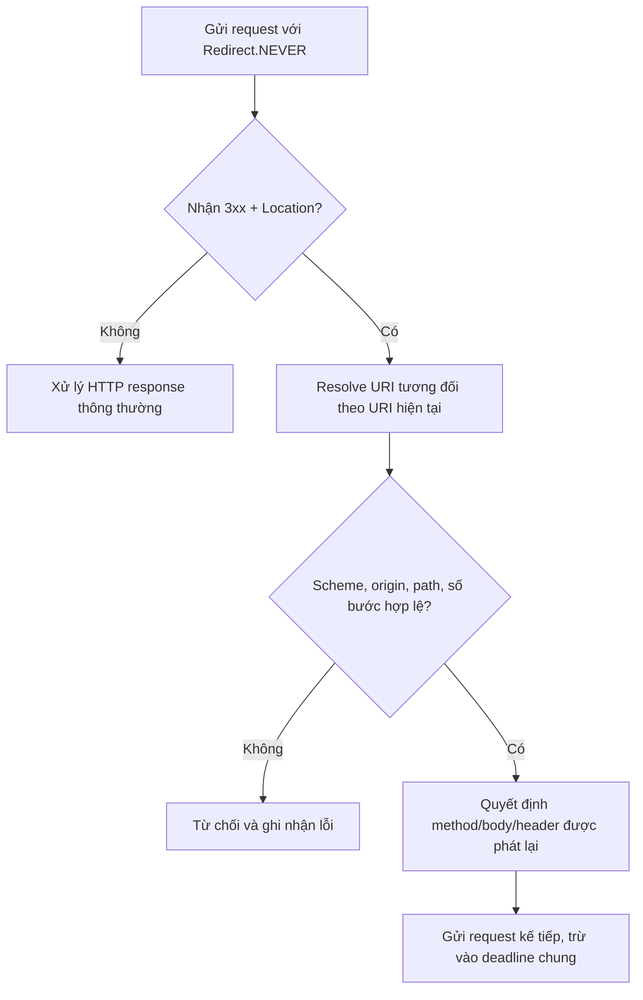
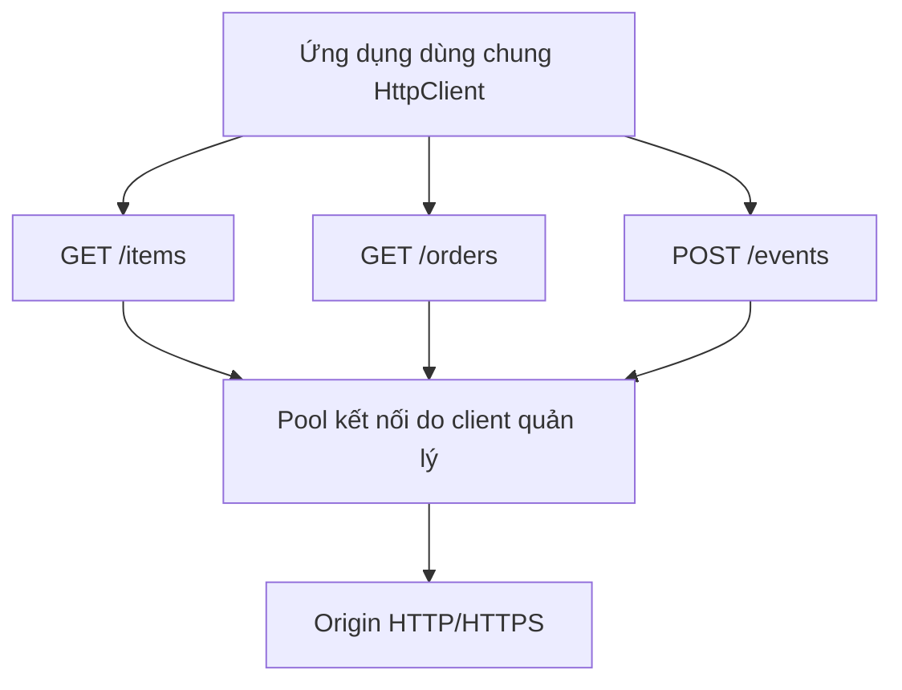
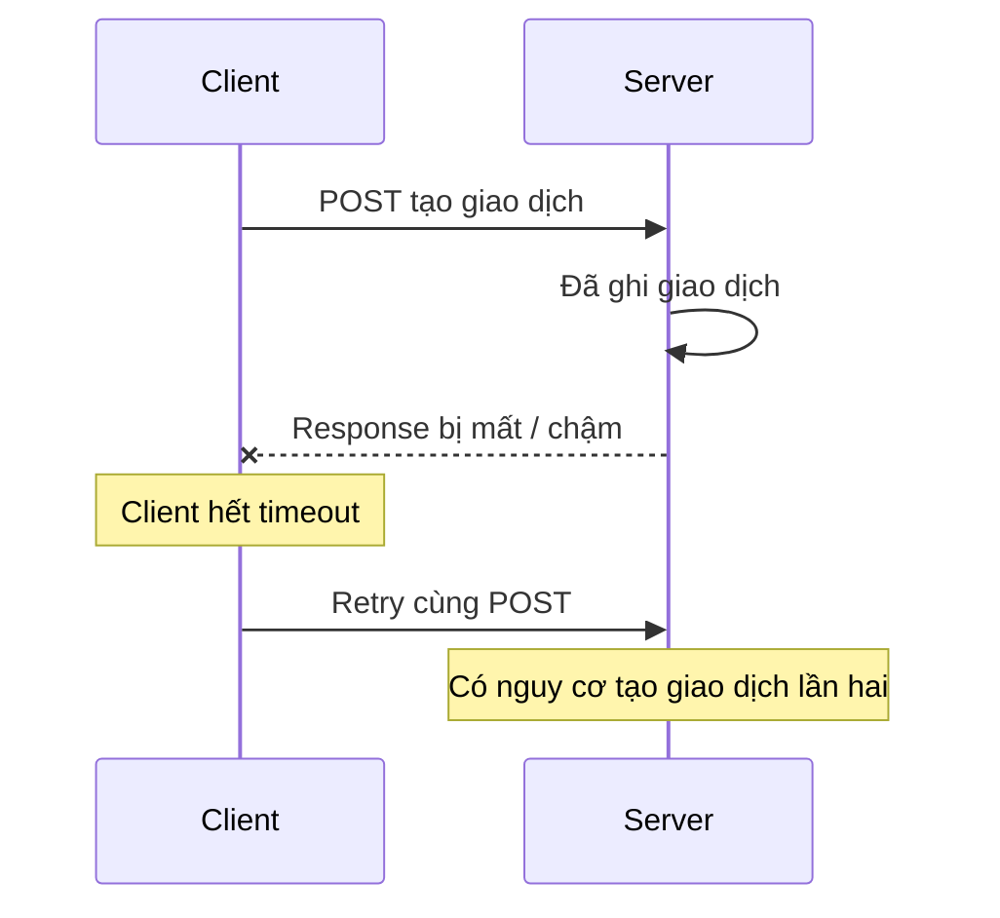

# Timeout, redirect, proxy và quản lý kết nối HTTP

Trong Java 27, `java.net.http.HttpClient` là API HTTP chuẩn để gửi yêu cầu đồng bộ hoặc bất đồng bộ. Một chương trình gọi API bên ngoài không chỉ cần gửi được `GET` hoặc `POST` mà còn phải kiểm soát **thời gian chờ**, **chuyển hướng**, **proxy**, **tái sử dụng kết nối** và **vòng đời tài nguyên**.

Ví dụ một dịch vụ gọi API thanh toán: kết nối có thể không thiết lập được, server có thể phản hồi chậm, endpoint có thể trả `302` sang một URL khác, môi trường triển khai bắt buộc đi qua proxy, hoặc một response body dạng stream chưa được đóng làm request chưa hoàn tất. Nếu không thiết kế rõ, chương trình có thể treo lâu, rò tài nguyên, chuyển tiếp credential nhầm nơi hoặc tạo quá nhiều kết nối.

Bài học thuộc chương **Mạng và HTTP**, dành cho Java 27 và các API còn hiện hành. `HttpClient` đã là API chuẩn từ Java 11; trong Java 27, nó hỗ trợ quản lý vòng đời qua `AutoCloseable` và có những khả năng giao thức mới hơn. Không cần API HTTP cũ để triển khai những tình huống chính trong bài, cũng không cần bật tính năng preview.

## 1. Phân biệt cấu hình client, request và response

Ba thành phần có trách nhiệm khác nhau:

| Thành phần | Cấu hình/trách nhiệm | Ví dụ |
|---|---|---|
| `HttpClient` | Chính sách dùng chung: timeout khi thiết lập kết nối, redirect, proxy, TLS, phiên bản HTTP ưu tiên, executor, vòng đời/connection pool | `HttpClient.newBuilder().connectTimeout(...).build()` |
| `HttpRequest` | Một yêu cầu cụ thể: URI, method, headers, request body, timeout của request | `HttpRequest.newBuilder(uri).timeout(...).GET().build()` |
| `HttpResponse<T>` | Kết quả: status code, headers, URI cuối, protocol version, response body theo `BodyHandler<T>` | `response.statusCode()`, `response.body()` |

`HttpClient` và `HttpRequest` đã xây dựng là đối tượng có thể tái sử dụng theo hợp đồng; các builder dùng để **cấu hình trước khi build**, không được thiết kế cho nhiều thread cùng sửa mà thiếu đồng bộ hóa.

Ví dụ cấu hình:

```java
import java.net.URI;
import java.net.http.HttpClient;
import java.net.http.HttpRequest;
import java.time.Duration;

HttpClient client = HttpClient.newBuilder()
        .connectTimeout(Duration.ofSeconds(3))
        .followRedirects(HttpClient.Redirect.NEVER)
        .build();

HttpRequest request = HttpRequest.newBuilder(
        URI.create("https://api.example.com/v1/items"))
        .timeout(Duration.ofSeconds(8))
        .GET()
        .build();
```

Đoạn này chỉ tạo client và request, **chưa gửi mạng**. `api.example.com` là hostname minh họa, không cần tồn tại hay truy cập được. Khi triển khai thực, hãy kiểm soát nguồn cấu hình host, scheme, proxy và credential.

## 2. Hai loại timeout quan trọng: kết nối và thực thi request

Một sai lầm phổ biến là chỉ cấu hình `connectTimeout` rồi cho rằng toàn bộ request có giới hạn thời gian.

| Thuộc tính | Đặt ở đâu | Đo phạm vi nào? | Khi hết hạn |
|---|---|---|---|
| `HttpClient.Builder.connectTimeout(Duration)` | Client | Chỉ **pha thiết lập kết nối mới**; không có hiệu lực nếu tái sử dụng kết nối có sẵn | `HttpConnectTimeoutException` |
| `HttpRequest.Builder.timeout(Duration)` | Request | Từ khi bắt đầu thực thi request đến **ít nhất** khi `HttpResponse` được tạo; bao gồm lấy kết nối và nhận response headers. Với JDK HTTP client, timer dừng khi body subscriber hoàn tất | `HttpTimeoutException` |
| Deadline nghiệp vụ | Ứng dụng | Toàn bộ chuỗi nhiều request, retry, xử lý dữ liệu và ghi kết quả | Do ứng dụng tự quản lý |

`HttpConnectTimeoutException` là **subtype** của `HttpTimeoutException`, còn `HttpTimeoutException` là subtype của `IOException`.

Chỉ cần một kết nối đã mở sẵn, `connectTimeout` có thể **không được sử dụng** trong lần gửi request tiếp theo. Nó không phải giới hạn thời gian chờ server trả dữ liệu.

### Timeout của request không phải deadline cho cả workflow

Theo đặc tả, `HttpRequest.timeout` bảo đảm đo tối thiểu đến lúc tạo `HttpResponse`. **JDK implementation** trong Java 27 áp dụng timer đến khi `BodySubscriber` hoàn thành. Tuy nhiên, với những `BodyHandler` streaming như `ofInputStream()`, response có thể được trả về sau khi có headers trong lúc phần body vẫn chưa đọc xong; việc **ứng dụng** đọc stream/giải mã/xử lý sau đó vẫn cần chính sách deadline riêng. Không thể suy rằng một con số `timeout` mặc nhiên bao toàn bộ hoạt động nghiệp vụ sau khi `send()` trả về.

Không cấu hình timeout thường có ý nghĩa **chờ vô thời hạn** đối với phạm vi timeout đó theo hợp đồng, vì vậy dịch vụ production nên có giới hạn phù hợp với SLA.

### Timeout phải là `Duration` dương

`connectTimeout(Duration.ZERO)` hoặc `request.timeout(Duration.ofMillis(-1))` không hợp lệ: builder ném `IllegalArgumentException` cho giá trị không dương. Đừng dùng `Duration.ZERO` để ám chỉ “không timeout”; hãy **không đặt timeout** nếu hợp đồng thật sự yêu cầu không giới hạn, và ghi rõ lý do vận hành.

## 3. Ví dụ hoàn chỉnh trên localhost: timeout và redirect

Để thực hành **không phụ thuộc Internet**, chương trình dưới đây tạo một HTTP server trên loopback rồi dùng `HttpClient` kết nối đến chính server đó.

Ví dụ sử dụng `com.sun.net.httpserver.HttpServer` từ module `jdk.httpserver` của JDK để tạo server thử nghiệm; mã client vẫn dùng API HTTP chuẩn `java.net.http`. Lưu toàn bộ vào `HttpPolicyDemo.java`:

```java
import com.sun.net.httpserver.HttpExchange;
import com.sun.net.httpserver.HttpServer;
import java.io.IOException;
import java.net.InetSocketAddress;
import java.net.URI;
import java.net.http.HttpClient;
import java.net.http.HttpRequest;
import java.net.http.HttpResponse;
import java.net.http.HttpTimeoutException;
import java.nio.charset.StandardCharsets;
import java.time.Duration;

public class HttpPolicyDemo {
    public static void main(String[] args)
            throws IOException, InterruptedException {

        HttpServer server = HttpServer.create(
                new InetSocketAddress("127.0.0.1", 0), 0);

        server.createContext("/ok",
                exchange -> reply(exchange, 200, "OK"));

        server.createContext("/redirect", exchange -> {
            exchange.getResponseHeaders().set("Location", "/ok");
            exchange.sendResponseHeaders(302, -1);
            exchange.close();
        });

        server.createContext("/slow", exchange -> {
            try {
                Thread.sleep(800);
                reply(exchange, 200, "SLOW");
            } catch (InterruptedException interrupted) {
                Thread.currentThread().interrupt();
                exchange.close();
            }
        });

        server.start();

        URI base = URI.create(
                "http://127.0.0.1:" + server.getAddress().getPort());

        try (HttpClient client = HttpClient.newBuilder()
                .version(HttpClient.Version.HTTP_1_1)
                .proxy(HttpClient.Builder.NO_PROXY)
                .connectTimeout(Duration.ofSeconds(2))
                .followRedirects(HttpClient.Redirect.NORMAL)
                .build()) {

            HttpRequest normal = HttpRequest.newBuilder(
                    base.resolve("/ok"))
                    .timeout(Duration.ofSeconds(3))
                    .GET()
                    .build();

            HttpResponse<String> ok = client.send(
                    normal, HttpResponse.BodyHandlers.ofString());

            System.out.println("GET /ok: "
                    + ok.statusCode() + ", body=" + ok.body());

            HttpRequest redirect = HttpRequest.newBuilder(
                    base.resolve("/redirect"))
                    .timeout(Duration.ofSeconds(3))
                    .GET()
                    .build();

            HttpResponse<String> redirected = client.send(
                    redirect, HttpResponse.BodyHandlers.ofString());

            System.out.println("GET /redirect: "
                    + redirected.statusCode()
                    + ", final path=" + redirected.uri().getPath());

            HttpRequest slow = HttpRequest.newBuilder(
                    base.resolve("/slow"))
                    .timeout(Duration.ofMillis(150))
                    .GET()
                    .build();

            try {
                client.send(slow, HttpResponse.BodyHandlers.ofString());
                System.out.println("Unexpected: no timeout");
            } catch (HttpTimeoutException expected) {
                System.out.println("GET /slow: timeout as expected");
            }
        } finally {
            server.stop(0);
        }
    }

    private static void reply(HttpExchange exchange,
                              int status, String text)
            throws IOException {
        byte[] body = text.getBytes(StandardCharsets.UTF_8);
        exchange.getResponseHeaders().set(
                "Content-Type", "text/plain; charset=utf-8");
        exchange.sendResponseHeaders(status, body.length);
        try (var output = exchange.getResponseBody()) {
            output.write(body);
        } finally {
            exchange.close();
        }
    }
}
```

Biên dịch và chạy với JDK 27; `--add-modules jdk.httpserver` giúp module dùng để dựng server được resolve tường minh:

```bash
javac --release 27 --add-modules jdk.httpserver HttpPolicyDemo.java
java --add-modules jdk.httpserver HttpPolicyDemo
```

Kết quả kỳ vọng (thứ tự ba dòng chính):

```text
GET /ok: 200, body=OK
GET /redirect: 200, final path=/ok
GET /slow: timeout as expected
```

Server dùng cổng ngẫu nhiên (`0` khi bind) trên loopback, tránh cố định một cổng phổ biến. Chính sách `NO_PROXY` giúp bài thử không bị ảnh hưởng bởi cấu hình proxy mặc định của máy. `HTTP_1_1` được chọn để tương thích với server HTTP đơn giản trong ví dụ; ứng dụng thực tế có thể ưu tiên phiên bản giao thức khác.

**Chú ý:** Đây là demo cho luồng thông thường và timeout. Khi một client đã timeout, server có thể đã bắt đầu xử lý `/slow`; không có bảo đảm rằng timeout làm server “quay ngược” thao tác. Hành vi hủy, retry và idempotency của nghiệp vụ phải được thiết kế riêng.

## 4. Bắt lỗi timeout đúng loại và giữ interrupted status

Với `send()`, cần phân biệt lỗi thiết lập kết nối, lỗi timeout của request và interruption của thread gọi.

Ví dụ helper xử lý một request; đây là đoạn mã dùng bên trong một class phù hợp:

```java
import java.io.IOException;
import java.net.http.HttpClient;
import java.net.http.HttpConnectTimeoutException;
import java.net.http.HttpRequest;
import java.net.http.HttpResponse;
import java.net.http.HttpTimeoutException;

static String fetchText(HttpClient client, HttpRequest request)
        throws IOException, InterruptedException {
    try {
        HttpResponse<String> response = client.send(
                request, HttpResponse.BodyHandlers.ofString());
        if (response.statusCode() < 200 || response.statusCode() >= 300) {
            throw new IOException(
                    "HTTP status không thành công: "
                            + response.statusCode());
        }
        return response.body();
    } catch (HttpConnectTimeoutException connectTimedOut) {
        // Kết nối mới không được tạo trong giới hạn đã đặt.
        throw new IOException("Không thiết lập được kết nối kịp thời",
                connectTimedOut);
    } catch (HttpTimeoutException requestTimedOut) {
        // Request đã vượt timeout tương ứng.
        throw new IOException("Request HTTP quá thời hạn",
                requestTimedOut);
    }
}
```

`InterruptedException` **được truyền tiếp** để caller quyết định hủy hoặc thoát, thay vì bị bắt và bỏ qua. Nếu một phương thức không thể khai báo `throws InterruptedException`, thông thường cần `Thread.currentThread().interrupt()` để khôi phục cờ rồi thoát có kiểm soát.

Trong `sendAsync`, timeout thường xuất hiện dưới dạng **kết quả CompletableFuture hoàn thành ngoại lệ**, không phải exception được ném trực tiếp ngay tại lệnh gọi `sendAsync`.

## 5. Redirect: `NEVER`, `NORMAL` và `ALWAYS`

Redirect là một phản hồi HTTP nhóm `3xx`, thường chứa header `Location` chỉ nơi tài nguyên được chuyển đến. Với `HttpClient`, chính sách tự theo redirect được cấu hình **ở cấp client**:

```java
HttpClient client = HttpClient.newBuilder()
        .followRedirects(HttpClient.Redirect.NORMAL)
        .build();
```

Ba giá trị của `HttpClient.Redirect`:

| Chính sách | Hành vi | Khi nào cân nhắc |
|---|---|---|
| `NEVER` | Không tự theo redirect; trả phản hồi `3xx` để ứng dụng tự xử lý | Cần kiểm soát URL/host hoặc giao dịch nhạy cảm |
| `NORMAL` | Tự theo redirect, **trừ redirect từ HTTPS sang HTTP** | Gọi endpoint đáng tin cậy có thể đổi vị trí, tránh downgrade |
| `ALWAYS` | Cho phép tự theo redirect, kể cả HTTPS sang HTTP | Chỉ khi mô hình bảo mật đã chấp nhận điều này |

**Mặc định của HttpClient là `NEVER`** nếu builder không cấu hình `followRedirects`. Đừng giả định Java tự theo mọi phản hồi `301` hoặc `302` giống trình duyệt.

Với `NEVER`, mã có thể xem trực tiếp thông tin `Location`:

```java
HttpResponse<String> response = client.send(
        request, HttpResponse.BodyHandlers.ofString());

if (response.statusCode() >= 300 && response.statusCode() < 400) {
    response.headers().firstValue("Location")
            .ifPresent(location ->
                    System.out.println("Đề xuất redirect: " + location));
}
```

Với `NORMAL` trong ví dụ localhost ở phần 3, client nhận `302` tại `/redirect`, theo `Location: /ok`, và trả về phản hồi cuối cùng `200` từ `/ok`. Khi cần audit, dùng `response.uri()` để biết **URI thực tế nhận response** và `response.previousResponse()` để truy xuất các phản hồi trung gian mà client lưu.

### Những chi tiết của redirect dễ gây sai nghiệp vụ

- **Redirect có thể thay đổi phương thức HTTP.** Trong HTTP client JDK, `301` và `302` khiến request `POST` được chuyển thành `GET` khi tự redirect. Các trạng thái `307`/`308` có mục đích giữ method/body; phải kiểm tra khả năng phát lại request body và hợp đồng server.
- **Request có side effect không nên retry/redirect mù quáng.** Ví dụ một POST tạo đơn hàng có thể đã được server xử lý dù client chưa nhận thành công. Cần idempotency key hoặc cơ chế xác nhận phù hợp.
- `NORMAL` chỉ tự ngăn **HTTPS → HTTP**; nó không phải chính sách chỉ-cho-phép-cùng-host. Redirect sang một HTTPS origin khác vẫn có thể xảy ra, nên cần chính sách tin cậy riêng nếu request có thông tin nhạy cảm.
- Đừng dựa vào số lượng bước redirect “vô hạn”. HTTP client có cơ chế giới hạn/phát hiện chuỗi redirect theo implementation; phía ứng dụng vẫn nên kiểm soát workflow và timeout tổng.
- Với một endpoint yêu cầu không đổi origin, `NEVER` và kiểm tra `Location` thủ công thường đơn giản hơn tin rằng một redirect policy tổng quát giải quyết hết bảo mật.

## 6. Redirect thủ công khi cần kiểm soát domain và scheme

Nếu ứng dụng được phép theo redirect **chỉ trong một miền xác định**, có thể tắt tự động và kiểm tra URI mới:

```java
import java.net.URI;

static URI validateRedirect(URI current, String location) {
    URI next = current.resolve(location);

    if (!"https".equalsIgnoreCase(next.getScheme())
            || !"api.partner.example".equalsIgnoreCase(next.getHost())
            || next.getUserInfo() != null) {
        throw new SecurityException(
                "Redirect không thuộc phạm vi được phép: " + next);
    }
    return next;
}
```

Đây là **một bước kiểm tra minh họa**, không phải trình xử lý redirect hoàn chỉnh. Trong ứng dụng thực tế cần giới hạn số bước, kiểm soát chuyển tiếp credential, xác thực danh sách origin hợp lệ (bao gồm port nếu cần), chính sách DNS/IP và ngăn truy cập dịch vụ nội bộ ngoài dự kiến. Nếu endpoint do người dùng nhập, đặc biệt lưu ý **Server-Side Request Forgery (SSRF)**: kiểm tra chuỗi hostname đơn thuần không giải quyết mọi trường hợp DNS rebinding hoặc proxy tùy biến.

Một luồng kiểm soát thường là:



**Không tự động chuyển tiếp token/cookie/header `Authorization` sang một origin khác** chỉ vì nhận được `Location`. Việc đó phải là quyết định bảo mật rõ ràng; khi viết cơ chế redirect thủ công, đừng sao chép mọi header từ request trước một cách máy móc.

## 7. Proxy: mặc định hệ thống, proxy tường minh hoặc kết nối trực tiếp

**HTTP proxy** là một máy chủ trung gian được cấu hình để xử lý kết nối đến đích. Trong mạng doanh nghiệp, proxy có thể cần để đi ra Internet, kiểm soát truy cập, giám sát hoặc áp dụng chính sách mạng.

`HttpClient.Builder.proxy(ProxySelector)` cho phép đặt proxy selector cho client:

```java
import java.net.InetSocketAddress;
import java.net.ProxySelector;
import java.net.http.HttpClient;

HttpClient client = HttpClient.newBuilder()
        .proxy(ProxySelector.of(
                new InetSocketAddress("proxy.internal.example", 8080)))
        .build();
```

Đoạn này **chỉ minh họa cấu hình**, không gọi một proxy thực. `ProxySelector.of` tạo selector dùng proxy đã chỉ định cho request HTTP/HTTPS. Cổng và hostname cần lấy từ cấu hình deployment đáng tin cậy, không ghi cố định credential vào source code.

### Ba lựa chọn thường gặp

| Ý định | Cách cấu hình | Lưu ý |
|---|---|---|
| Sử dụng chính sách proxy hệ thống | Không gọi `builder.proxy(...)` | JDK HTTP client sử dụng default proxy selector; không có nghĩa chắc chắn kết nối trực tiếp |
| Dùng một HTTP proxy tường minh | `proxy(ProxySelector.of(address))` | Áp dụng selector này cho các request phù hợp; cần kiểm thử mạng/proxy thực |
| Luôn kết nối trực tiếp, bỏ qua proxy mặc định | `proxy(HttpClient.Builder.NO_PROXY)` | Giá trị tiện ích hiện hành trong Java 27, phù hợp test localhost và trường hợp có chủ đích |
| Quy tắc theo URI | `proxy(customProxySelector)` | Phải tự triển khai chọn proxy, xử lý URI và `connectFailed` |

Một chi tiết dễ nhầm: `client.proxy()` trả `Optional<ProxySelector>` phản ánh selector **được cấu hình tường minh** trong builder. Optional rỗng **không** chứng minh client sẽ không dùng proxy; JDK implementation vẫn có thể sử dụng **default selector không công bố qua optional đó**.

### System properties và thời điểm xây client

Default selector của JDK có thể đọc các system properties cho proxy, ví dụ:

```text
-Dhttp.proxyHost=proxy.internal.example
-Dhttp.proxyPort=8080
-Dhttps.proxyHost=proxy.internal.example
-Dhttps.proxyPort=8080
```

Các thuộc tính như `http.nonProxyHosts` có thể ảnh hưởng trường hợp bypass theo quy tắc Java. Chính sách proxy còn phụ thuộc việc triển khai `ProxySelector` và cấu hình môi trường; **không giả định biến môi trường kiểu `HTTP_PROXY`/`HTTPS_PROXY` luôn tự động được HttpClient Java hiểu giống mọi công cụ dòng lệnh khác**.

Các giá trị mặc định toàn hệ thống được client tiếp nhận khi xây dựng. Đổi default proxy selector sau khi một client đã được tạo **không cập nhật tự động** cấu hình của client đó theo hợp đồng.

## 8. Proxy authentication, HTTPS và các lưu ý bảo mật

Có thể cấu hình `Authenticator` cho HTTP client:

```java
HttpClient client = HttpClient.newBuilder()
        .proxy(ProxySelector.of(
                new java.net.InetSocketAddress(
                        "proxy.internal.example", 8080)))
        .authenticator(authenticator)
        .build();
```

Đoạn trên giả định `authenticator` là một `java.net.Authenticator` do ứng dụng cấu hình an toàn; không phải chương trình tự chạy.

Những nguyên tắc cần tuân thủ:

- **Không ghi mật khẩu/token vào URL, log hoặc source code.** Dùng kho bí mật và cơ chế xác thực được tổ chức cho phép; hạn chế vòng đời credential.
- Proxy authentication và authentication tới **origin server** là hai vai trò khác nhau. Với `Authenticator` tự viết, kiểm tra `getRequestorType()` nếu cần quyết định credential tương ứng.
- Với HTTPS qua HTTP proxy, kết nối thường dùng cơ chế tunnel (`CONNECT`) để thiết lập TLS đến origin; không phải lý do tắt kiểm tra chứng chỉ hoặc hostname.
- API `HttpClient` không bảo đảm tự hỗ trợ mọi phương thức xác thực proxy của doanh nghiệp. JDK implementation hiện hành hỗ trợ giới hạn các cơ chế HTTP authentication; cần thử trong môi trường cụ thể.
- Nếu ứng dụng tự đặt `Authorization` hoặc `Proxy-Authorization`, cách `Authenticator` được gọi có thể thay đổi. Đừng vô tình gửi token origin cho proxy hoặc ngược lại.
- Trong ví dụ thử nghiệm, `HttpClient.Builder.NO_PROXY` chỉ là lựa chọn **không dùng proxy**, không phải một cách vượt kiểm soát egress của môi trường production.

### Proxy selector tự viết cần xét cả lỗi kết nối

Một implementation `ProxySelector` tùy biến phải có `select(URI)` và `connectFailed(URI, SocketAddress, IOException)`. `select` có thể chọn các proxy tùy scheme/host hoặc `Proxy.NO_PROXY` cho địa chỉ nội bộ, nhưng phải chịu trách nhiệm ngăn bypass ngoài chính sách. Không giả định mọi client/protocol đi qua một selector theo cùng cách, và hãy kiểm thử khi proxy không khả dụng.

## 9. Quản lý kết nối: tái sử dụng `HttpClient` thay vì tạo liên tục

Một `HttpClient` sau khi được xây dựng có thể gửi **nhiều request**, kể cả từ nhiều phần mã cùng sử dụng. JDK implementation thường có **connection pool gắn với từng client** để tái sử dụng những kết nối còn phù hợp.



**Mẫu sử dụng tốt:** tạo client theo vòng đời ứng dụng/dịch vụ và dùng lại khi nhiều request có **cùng chính sách redirect, proxy, TLS và kết nối**.

```java
import java.net.http.HttpClient;
import java.time.Duration;

public final class ApiTransport implements AutoCloseable {
    private final HttpClient client = HttpClient.newBuilder()
            .connectTimeout(Duration.ofSeconds(3))
            .followRedirects(HttpClient.Redirect.NEVER)
            .build();

    public HttpClient client() {
        return client;
    }

    @Override
    public void close() {
        client.close();
    }
}
```

Đây là ví dụ *quản lý tài nguyên*; lớp bao `ApiTransport` còn cần giới hạn phạm vi truy cập và chính sách lỗi nếu đưa vào ứng dụng thực tế. Có thể chia sẻ `HttpClient`, nhưng **không nên chia sẻ một `HttpRequest.Builder` mutable** rồi sửa đồng thời ở nhiều thread. Mỗi request nên có builder riêng.

### Vì sao không tạo client mới ở mỗi lần gọi API?

```java
// Không nên là cách mặc định trong hot path:
try (HttpClient client = HttpClient.newHttpClient()) {
    return client.send(request, HttpResponse.BodyHandlers.ofString());
}
```

Đoạn này hợp lệ trong chương trình nhỏ, nhưng nếu thực hiện mỗi request trong dịch vụ dài hạn có thể làm mất cơ hội tái sử dụng connection pool, lặp lại thiết lập TCP/TLS, tăng chi phí hệ thống và gây nhiều kết nối hơn cần thiết. Các connection pool **thường không dùng chung giữa các instance** `HttpClient` khác nhau.

Việc tái sử dụng vẫn phụ thuộc server, proxy, phiên bản HTTP, chính sách kết nối và lỗi mạng. Không có bảo đảm một request thứ hai chắc chắn sẽ sử dụng đúng socket của request trước.

### Connection pool không phải cache response

Giữ `HttpClient` lâu hơn giúp chia sẻ **kết nối/tài nguyên truyền tải**, không có nghĩa client mặc nhiên cache response như một cache HTTP đầy đủ. `GET` lần sau vẫn là một request mới trừ khi có cơ chế cache riêng theo hợp đồng ứng dụng.

## 10. Phiên bản giao thức: HTTP/1.1, HTTP/2 và HTTP/3 trong Java 27

Java 27 hỗ trợ các giá trị `HttpClient.Version.HTTP_1_1`, `HTTP_2` và `HTTP_3`. JDK HTTP client mặc định **ưu tiên HTTP/2**, nhưng việc thực sự dùng phiên bản nào còn phụ thuộc server, khả năng thương lượng TLS/ALPN, proxy và các hạn chế cấu hình.

```java
HttpClient client = HttpClient.newBuilder()
        .version(HttpClient.Version.HTTP_2)
        .build();

HttpRequest request = HttpRequest.newBuilder(
        java.net.URI.create("https://api.example.com/data"))
        .timeout(java.time.Duration.ofSeconds(5))
        .GET()
        .build();
```

Khi đã có phản hồi, kiểm tra **giao thức thực tế**:

```java
HttpResponse<String> response = client.send(
        request, HttpResponse.BodyHandlers.ofString());

System.out.println("Used HTTP version: " + response.version());
```

| Phiên bản | Ý nghĩa khi quản lý kết nối |
|---|---|
| HTTP/1.1 | Có thể tái sử dụng các kết nối đủ điều kiện; nhiều request đồng thời có thể cần nhiều connection |
| HTTP/2 | Có thể multiplex nhiều stream trên cùng kết nối khi giao thức và hệ thống hỗ trợ |
| HTTP/3 | Giao thức mới trên QUIC, được JDK HTTP client của Java 27 hỗ trợ; khả năng sử dụng phụ thuộc thương lượng, môi trường mạng, TLS và tùy chọn tương ứng |

Đặt `version(HTTP_2)` hoặc `version(HTTP_3)` biểu thị **mức ưu tiên/yêu cầu cấu hình giao thức**, không có nghĩa mọi response đều chắc chắn dùng phiên bản đó. Khi không đáp ứng được lựa chọn phiên bản, API có thể dùng phiên bản khác theo khả năng thương lượng, hoặc lỗi với những cấu hình không hỗ trợ trường hợp cụ thể. Hãy dựa vào `response.version()` và tài liệu triển khai thay vì giả định.

**Không tự chỉnh sửa những header điều khiển truyền tải** như `Connection` hoặc `Content-Length` để “ép” pooling; một số header bị HTTP client hạn chế và các quyết định quản lý kết nối phụ thuộc implementation.

## 11. Response body quyết định request đã hoàn tất hay chưa

Một request không nhất thiết được coi là hoàn tất chỉ vì bạn đã nhận được `HttpResponse`. Điều đó phụ thuộc `BodyHandler<T>`:

| BodyHandler | Kết quả `T` | Vòng đời/chi phí cần nhớ |
|---|---|---|
| `BodyHandlers.ofString()` | `String` | Tích lũy toàn bộ body thành chuỗi; không nên dùng cho nội dung quá lớn hoặc không tin cậy mà không giới hạn |
| `BodyHandlers.ofByteArray()` | `byte[]` | Lưu toàn bộ body trong bộ nhớ |
| `BodyHandlers.ofFile(path)` | `Path` | Ghi body xuống file; cần chính sách đích, dung lượng, lỗi và dọn dẹp |
| `BodyHandlers.discarding()` | `Void` | Tiêu thụ và bỏ body, hữu ích khi không cần nội dung |
| `BodyHandlers.ofInputStream()` | `InputStream` | Streaming; **caller phải đọc hết hoặc đóng** stream |
| `BodyHandlers.ofLines()` | `Stream<String>` | Streaming; **caller phải đóng** stream |
| `BodyHandlers.ofPublisher()` | `Flow.Publisher<List<ByteBuffer>>` | Caller phải subscribe/tiêu thụ hoặc cancel theo hợp đồng để request hoàn tất |

Các body handlers có sẵn **không tự ném lỗi chỉ vì HTTP status là `404` hoặc `500`**. Bạn phải kiểm tra `response.statusCode()` và quyết định cách xử lý body lỗi.

### Đọc streaming body đúng cách

```java
import java.io.IOException;
import java.io.InputStream;
import java.net.http.HttpClient;
import java.net.http.HttpRequest;
import java.net.http.HttpResponse;

static byte[] readSmallResponse(
        HttpClient client, HttpRequest request)
        throws IOException, InterruptedException {

    HttpResponse<InputStream> response = client.send(
            request, HttpResponse.BodyHandlers.ofInputStream());

    try (InputStream body = response.body()) {
        if (response.statusCode() != 200) {
            throw new IOException(
                    "HTTP status không mong đợi: "
                            + response.statusCode());
        }
        return body.readNBytes(1_024);
    }
}
```

Đây là đoạn **minh họa đọc tối đa 1 KiB**, không phải hàm tải file. Vì chỉ đọc một phần, việc đóng stream có thể khiến kết nối không còn tái sử dụng được; điều quan trọng là **giải phóng request/tài nguyên đúng cách**. Nếu muốn đọc hết response, dùng vòng lặp tiêu thụ có kiểm soát, hoặc body handler thích hợp.

Đặc biệt với response rất lớn, nên giới hạn tổng byte được chấp nhận để tránh cạn bộ nhớ/ổ đĩa. `Content-Length` có thể thiếu hoặc không đáng tin cậy đối với nguồn không tin cậy; chỉ dựa vào header này là không đủ.

### Vì sao body stream có thể làm `close()` bị chờ lâu?

Với `ofInputStream` hoặc `ofLines`, `send` có thể trả về khi **headers đã nhận đủ**, trước khi body được đọc hết. Nếu caller bỏ quên stream mà không đọc, đóng hoặc cancel, request có thể vẫn còn dang dở và cản trở việc giải phóng tài nguyên hoặc shutdown client. Đối với `ofPublisher`, subscription cần được tiêu thụ hoặc hủy phù hợp.

Nên có quy ước rõ: **ai nhận stream thì người đó chịu trách nhiệm đóng**, trừ khi một lớp khác đã nhận quyền sở hữu một cách tường minh. Không giấu `InputStream` trong một object rồi không có phương thức `close()` tương ứng.

## 12. Vòng đời `HttpClient`: `close`, `shutdown` và `shutdownNow`

Trong Java 27, `HttpClient` triển khai `AutoCloseable`, vì vậy có thể sử dụng `try`-with-resources trong chương trình ngắn:

```java
try (HttpClient client = HttpClient.newBuilder().build()) {
    HttpResponse<String> response = client.send(
            request, HttpResponse.BodyHandlers.ofString());
    System.out.println(response.statusCode());
}
```

Với ứng dụng server chạy dài hạn, nên **quản lý một client theo vòng đời service** rồi đóng khi ứng dụng dừng, thay vì `close()` sau mỗi request.

| API vòng đời | Tác dụng |
|---|---|
| `client.shutdown()` | Bắt đầu shutdown có trật tự: ngừng nhận request mới, cho request đã gửi tiếp tục hoàn thành; không chờ |
| `client.awaitTermination(duration)` | Chờ client kết thúc trong khoảng cho trước; có thể trả `false` khi timeout |
| `client.isTerminated()` | Xác nhận đã kết thúc sau shutdown, theo hợp đồng implementation |
| `client.close()` | Bắt đầu orderly shutdown rồi **chờ** các operation hoàn thành; có thể chặn lâu |
| `client.shutdownNow()` | Cố gắng shutdown ngay, có thể hủy request đang chạy; **best effort**, không bảo đảm dừng tức thời |

Các phương thức quản lý vòng đời này được bổ sung cho `HttpClient` từ Java 21 và hiện còn được hỗ trợ trong Java 27.

### Shutdown có thời hạn

Nếu một dịch vụ cần shutdown nhưng không thể chờ mãi:

```java
client.shutdown();

if (!client.awaitTermination(java.time.Duration.ofSeconds(5))) {
    client.shutdownNow(); // yêu cầu cưỡng bức best effort
}
```

Đặt đoạn này trong method có `throws InterruptedException` hoặc xử lý interruption đúng cách. `shutdownNow()` **không có hợp đồng bảo đảm** mọi hoạt động đã kết thúc ngay sau khi gọi. Nếu cần theo dõi hết tài nguyên, dùng thêm quan sát/điều phối vòng đời và tránh bỏ quên streaming bodies.

**Không để một body stream chưa tiêu thụ làm shutdown kẹt vô hạn.** `close()` không phải “đóng socket bất kể đang có request nào”; nó cố gắng kết thúc những operation trước đó một cách có trật tự.

## 13. `sendAsync`, timeout và hủy HTTP exchange

`HttpClient.sendAsync(...)` trả về một `CompletableFuture<HttpResponse<T>>`. Thao tác này cho phép ứng dụng kết hợp các request bất đồng bộ, nhưng vẫn phải phân biệt **future hoàn thành** với **server chắc chắn không còn xử lý request**.

Ví dụ gửi request bất đồng bộ:

```java
import java.net.http.HttpClient;
import java.net.http.HttpRequest;
import java.net.http.HttpResponse;
import java.util.concurrent.CompletableFuture;

CompletableFuture<HttpResponse<String>> pending =
        client.sendAsync(
                request, HttpResponse.BodyHandlers.ofString());

pending.thenAccept(response -> {
    System.out.println("HTTP " + response.statusCode());
    System.out.println("Body: " + response.body());
});
```

Đoạn mã này giả định `client` và `request` đã được tạo, và **phải có chiến lược quản lý vòng đời** của future/client trong ứng dụng thực tế. Chỉ viết `thenAccept` không bảo đảm main thread tự chờ cho callback hoàn tất trước khi thoát chương trình.

### Hủy một future do HTTP client JDK trả về

Với JDK HTTP client, các `CompletableFuture` do `sendAsync` trả về **có khả năng hủy HTTP exchange theo best effort**:

```java
CompletableFuture<HttpResponse<String>> pending =
        client.sendAsync(
                request, HttpResponse.BodyHandlers.ofString());

// Khi caller thật sự muốn hủy:
pending.cancel(true);
```

Đặc biệt lưu ý:

- JDK implementation **cố gắng hủy HTTP exchange** để giải phóng tài nguyên khi hủy một future chưa hoàn tất. Hủy **không được bảo đảm xảy ra ngay**; request có thể đã được server nhận và xử lý.
- Với HTTP/1.1, việc hủy có thể khiến kết nối bị đóng đột ngột; với HTTP/2, có thể reset stream. Tính tái sử dụng kết nối sau đó không được giả định.
- `CompletableFuture.cancel(true)` của **một CompletableFuture thông thường** không tự có cơ chế interrupt công việc nền. `sendAsync` của JDK HTTP client có cơ chế hủy **đặc thù** cho future mà client trả về; đừng đánh đồng hai trường hợp.
- `future.orTimeout(...)` chỉ cấu hình một cách hoàn thành future khi quá thời gian, **không thay cho** một chính sách hủy HTTP exchange nếu caller muốn dừng. Ưu tiên `HttpRequest.timeout(...)` cho timeout của HTTP request và gọi `cancel(...)` có chủ đích khi cần hủy.

### Một timeout từ caller không tự hủy future

Khi cần giới hạn **thời gian caller chờ**:

```java
import java.util.concurrent.ExecutionException;
import java.util.concurrent.TimeUnit;
import java.util.concurrent.TimeoutException;

static HttpResponse<String> awaitOrCancel(
        CompletableFuture<HttpResponse<String>> pending)
        throws InterruptedException, ExecutionException, TimeoutException {

    try {
        return pending.get(2, TimeUnit.SECONDS);
    } catch (TimeoutException | InterruptedException timedOut) {
        pending.cancel(true);
        throw timedOut;
    }
}
```

Helper này minh họa việc chủ động yêu cầu hủy khi caller bị timeout hoặc interrupt. Khi đang dùng `HttpRequest.timeout`, cần tránh một “rừng timeout” mâu thuẫn giữa request, future và deadline nghiệp vụ: đặt trách nhiệm rõ cho từng lớp.

### Request bị interrupt khi gọi `send` đồng bộ

Nếu thread đang đợi `client.send(...)` bị interrupt, JDK HTTP client **cố gắng hủy exchange** và ném `InterruptedException`. Tuy vậy, server có thể đã xử lý request và việc giải phóng tài nguyên có thể hoàn tất bất đồng bộ. Khi chuyển exception cho tầng trên, không mặc định request chưa hề được gửi.

## 14. Retry, timeout tổng và idempotency của nghiệp vụ

Một lần timeout hoặc lỗi mạng không cho biết chắc chắn **server đã xử lý request hay chưa**. Điều này đặc biệt nguy hiểm khi retry một `POST` chuyển tiền hoặc tạo giao dịch.

Ví dụ timeline:



Chọn chính sách retry theo **ý nghĩa nghiệp vụ và HTTP method**:

| Tình huống | Hướng xử lý |
|---|---|
| `GET` đọc dữ liệu, retry được theo hợp đồng | Có thể retry số lần giới hạn khi gặp lỗi tạm thời |
| `POST` tạo giao dịch | Cần idempotency key/hợp đồng khử trùng và xác minh trạng thái, không retry mù |
| HTTP `429` | Tôn trọng chính sách rate limit, cân nhắc `Retry-After` |
| HTTP `503` | Cân nhắc retry có backoff nếu endpoint/idempotency cho phép |
| HTTP `401`/`403` | Kiểm tra credential/permission; không mặc định retry nhiều lần |
| Lỗi chứng chỉ TLS | Điều tra trust/hostname; **không tắt kiểm tra TLS** hoặc retry vô hạn |
| Timeout kết nối | Có thể không tạo kết nối mới kịp; vẫn cần giới hạn retry và xem xét hiệu ứng nếu đã có lần gửi trước |

Thay vì `retry` ngay và vô hạn, ưu tiên **bounded retries + backoff + jitter + deadline chung**, đồng thời phân biệt timeout của **mỗi request** và ngân sách thời gian của toàn bộ workflow.

Giả sử quy trình có 8 giây để hoàn tất tất cả bước:

1. Lấy thời điểm bắt đầu bằng `System.nanoTime()`, xây dựng deadline đơn điệu.
2. Trước mỗi lần thử, tính lại thời gian **còn lại**.
3. Đặt `HttpRequest.timeout` không dài hơn ngân sách còn lại.
4. Khi lỗi có thể thử lại, chờ backoff hữu hạn, tránh vượt deadline.
5. Hết deadline thì dừng retry và trả lỗi rõ ràng cho caller.

Không dùng `System.currentTimeMillis()` đơn thuần để tính khoảng thời gian chờ khi đồng hồ hệ thống có thể bị điều chỉnh; `System.nanoTime()` phù hợp để đo khoảng thời gian trong tiến trình.

## 15. Giới hạn mức đồng thời: connection pool không phải backpressure

Tái sử dụng connection pool giúp giảm chi phí thiết lập kết nối, nhưng **không** giới hạn tự động số yêu cầu mà ứng dụng đẩy tới một dịch vụ bên ngoài theo đúng capacity nghiệp vụ.

Ví dụ bảo vệ một HTTP endpoint bằng `Semaphore`:

```java
import java.io.IOException;
import java.net.http.HttpClient;
import java.net.http.HttpRequest;
import java.net.http.HttpResponse;
import java.util.concurrent.Semaphore;

final class LimitedApiClient {
    private final HttpClient client;
    private final Semaphore permits = new Semaphore(20);

    LimitedApiClient(HttpClient client) {
        this.client = client;
    }

    HttpResponse<String> send(HttpRequest request)
            throws IOException, InterruptedException {
        permits.acquire();
        try {
            return client.send(
                    request, HttpResponse.BodyHandlers.ofString());
        } finally {
            permits.release();
        }
    }
}
```

Ví dụ giới hạn tối đa **20 lời gọi `send` đang thực hiện đồng thời trong cùng instance `LimitedApiClient`**. Với `ofString`, `send` thường trả về sau khi body được tiêu thụ xong theo handler, nên thời gian giữ permit bao phủ phần tải body tương ứng.

Nếu đổi thành `BodyHandlers.ofInputStream()`, `send` có thể trả trước khi body đọc hết; **không được nhả permit sớm** rồi tin rằng chỉ có 20 request thực sự đang chiếm tài nguyên mạng. Khi dùng streaming, permit cần gắn với **toàn bộ vòng đời body** và được nhả sau khi đọc/đóng đúng cách.

Giới hạn đồng thời cũng nên xét những tài nguyên như connection pool ở server, quota API, memory buffer, socket và thread/executor. `Semaphore` không tự có timeout khi `acquire()`: nếu không muốn đợi vô hạn, dùng `tryAcquire(timeout, unit)` và trả lỗi/backpressure theo hợp đồng.

## 16. HTTP status, lỗi transport và thứ tự xử lý response

Một phản hồi HTTP có status `404`, `429` hay `503` **vẫn có thể là một response được nhận thành công ở tầng truyền tải**. `HttpClient.send` không biến mọi mã `4xx`/`5xx` thành `IOException`. Vì vậy:

```java
HttpResponse<String> response = client.send(
        request, HttpResponse.BodyHandlers.ofString());

int status = response.statusCode();
if (status >= 200 && status < 300) {
    handleSuccess(response.body());
} else if (status == 429 || status == 503) {
    handleTemporaryFailure(status, response.headers());
} else {
    handleHttpError(status, response.body());
}
```

Các method `handleSuccess`, `handleTemporaryFailure` và `handleHttpError` trong snippet đại diện hành vi ứng dụng, không phải API Java có sẵn. Với response body lớn hoặc nhạy cảm, không nên log toàn bộ nội dung lỗi.

### Đọc status và headers mà không gây rò tài nguyên

Nếu không cần body, `BodyHandlers.discarding()` là lựa chọn phù hợp cho nhiều request:

```java
HttpResponse<Void> response = client.send(
        request, HttpResponse.BodyHandlers.discarding());

System.out.println(response.statusCode());
```

Tuy nhiên, nếu cần phân tích phản hồi lỗi có payload, `discarding` sẽ không giữ dữ liệu đó. Chọn `BodyHandler` theo dung lượng và mục đích từ trước; có thể viết custom `BodyHandler` nếu cần xử lý khác nhau tùy status code.

**Thứ tự đề xuất khi xử lý response:** xác nhận status → áp dụng chính sách retry/error → parse đúng định dạng body → kiểm tra schema/validation → chỉ sau đó cập nhật trạng thái nghiệp vụ.

## 17. TLS, redirects và proxy là một chuỗi tin cậy

Với HTTPS, Java HTTP client dùng cấu hình TLS (`SSLContext`, `SSLParameters`) để xác minh kết nối theo chính sách của JDK và ứng dụng. Proxy có thể là trung gian kết nối nhưng **không thay** yêu cầu kiểm tra danh tính origin và certificate chain.

Những quy tắc an toàn còn hiện hành:

- Dùng `https://` cho dữ liệu bí mật; `http://` trong ví dụ phần 3 chỉ dùng với loopback để không cần chứng chỉ thử nghiệm.
- Không tắt certificate hoặc hostname verification để “sửa nhanh” lỗi proxy/TLS. Cần cài đúng truststore, certificate chain hoặc cấu hình mTLS theo chính sách.
- Với redirect tự động, `NORMAL` ngăn HTTPS → HTTP nhưng không kiểm soát mọi cross-origin redirect.
- Không chuyển tiếp `Authorization`, cookie nhạy cảm hay header bí mật sang URL mới không được phê duyệt.
- Không ghi credential, access token, query string chứa secret hoặc body bí mật vào logs/metrics.
- Nếu URL đến từ người dùng, cần ngăn SSRF ở cả URL gốc **và các redirect**, kể cả DNS/IP và mạng nội bộ.
- Tách cấu hình proxy, truststore và credential theo môi trường; một HTTP client được xây dựng bằng cấu hình cũ không phải lúc nào tự nhận thay đổi toàn hệ thống lúc runtime.

HTTPS giúp bảo vệ trên đường truyền khi cấu hình đúng, nhưng **không** thay cho xác thực và ủy quyền HTTP cũng như validation dữ liệu.

## 18. Chẩn đoán lỗi: phân biệt mạng, HTTP status và timeout

Khi một request thất bại, thông điệp “API không gọi được” là không đủ để quyết định retry hay đổi cấu hình. Hãy phân loại lỗi:

| Dấu hiệu/exception | Ý nghĩa thường gặp | Hướng điều tra |
|---|---|---|
| `UnknownHostException` | Không phân giải được hostname | Kiểm tra DNS, tên host, môi trường mạng |
| `ConnectException` | Không kết nối được tới điểm đích/proxy | Kiểm tra cổng, firewall, server/listener, proxy |
| `HttpConnectTimeoutException` | Hết thời gian thiết lập **kết nối mới** | Kiểm tra mạng/TLS/proxy/connect timeout |
| `HttpTimeoutException` | Hết thời hạn request đã cấu hình | Kiểm tra server latency, response body, request timeout |
| `SSLHandshakeException` | Lỗi thương lượng hoặc xác thực TLS | Kiểm tra truststore, chứng chỉ, hostname, giao thức/cipher theo chính sách |
| `InterruptedException` từ `send` | Thread caller bị interrupt khi đang đợi | Truyền tiếp/restore theo hợp đồng, xem quy trình hủy |
| `CompletionException` / `ExecutionException` từ future | Bao bọc exception của thao tác bất đồng bộ | Kiểm tra `getCause()` và phân loại nguyên nhân thực |
| HTTP `3xx` | Server yêu cầu chuyển hướng | Kiểm tra `Location` và policy redirect |
| HTTP `401`/`403` | Authentication/authorization không thành công | Kiểm tra token, quyền và chính sách |
| HTTP `429` | Server áp dụng giới hạn tốc độ | Đánh giá `Retry-After` và backoff |
| HTTP `502`/`503`/`504` | Lỗi gateway/dịch vụ tạm thời theo ngữ nghĩa HTTP | Đánh giá retry có điều kiện, proxy/gateway và idempotency |

`HttpTimeoutException` là một loại `IOException`; nếu đặt `catch (IOException)` trước `catch (HttpTimeoutException)` thì nhánh timeout chuyên biệt không còn đến lượt xử lý. Tương tự, phải bắt `HttpConnectTimeoutException` **trước** `HttpTimeoutException` nếu muốn thông điệp riêng cho timeout kết nối.

### Không kết luận nguyên nhân chỉ từ một exception

Ví dụ HTTP `504` là **mã phản hồi server/gateway**, không phải `HttpTimeoutException` do Java HTTP client tự tạo. Hai trường hợp cần xử lý khác nhau, dù đều có chữ “timeout” trong tên/ý nghĩa.

Một `IOException` khi đọc streaming body cũng có thể phát sinh **sau khi `HttpResponse` đã trả về**. Nếu hệ thống chỉ đếm lỗi ở lệnh `send`, bạn sẽ bỏ sót lỗi của giai đoạn đọc body.

## 19. Quan sát hiệu năng và connection lifecycle

Với mỗi request, telemetry nên giúp trả lời:

1. Request được gửi tới **dịch vụ/route** nào (không ghi query chứa dữ liệu nhạy cảm)?
2. Kết quả là status code nào, có redirect tới origin khác không?
3. Thời gian đo được gồm bao nhiêu cho toàn bộ request/body/parse ở góc nhìn ứng dụng?
4. Có timeout kết nối, timeout request, cancellation, TLS hay proxy error không?
5. Có retry không, số lần bao nhiêu, retry có vượt deadline không?
6. Có bao nhiêu request đang thực hiện và bao nhiêu streaming bodies chưa được đóng?

Đo khoảng thời gian bằng đồng hồ đơn điệu:

```java
long started = System.nanoTime();

try {
    HttpResponse<String> response = client.send(
            request, HttpResponse.BodyHandlers.ofString());
    System.out.println("HTTP status: " + response.statusCode());
} finally {
    long elapsedNanos = System.nanoTime() - started;
    System.out.println("Elapsed ms: "
            + elapsedNanos / 1_000_000.0);
}
```

Đoạn này đo thời gian bao quanh `send`, **không** bao gồm xử lý nghiệp vụ tiếp theo. Với `ofInputStream` hoặc `ofLines`, phải đo thêm thời gian đọc/đóng stream nếu muốn biết độ trễ toàn bộ.

Có thể đọc `response.version()`, `response.uri()`, `response.previousResponse()` để chẩn đoán giao thức/redirect. Tuy nhiên, những chi tiết nội bộ connection pool không phải tất cả đều là chỉ số chuẩn có thể lấy qua API chung. Không suy từ việc cùng `HttpClient` rằng mọi request đều tái sử dụng cùng socket.

### Thời hạn kết thúc phải thuộc cả telemetry và shutdown

Nếu client bị `close()` trong lúc request còn streaming body mà caller quên đóng, shutdown có thể chờ lâu. Cần phát hiện các request còn mở, thời gian đọc body và lỗi cleanup. Một chiến lược vận hành tốt gắn ownership của request, client và response stream với phạm vi sống rõ ràng (application, request hoặc job).

## 20. Mẫu cấu hình cho một HTTP integration trong ứng dụng

Khi gọi một API bên ngoài theo hợp đồng cụ thể, có thể bắt đầu từ các quyết định sau:

| Nhóm cấu hình | Gợi ý trách nhiệm |
|---|---|
| Client instance | Dùng chung cho một nhóm request có cùng proxy/TLS/redirect policy |
| Connect timeout | Chỉ giới hạn thiết lập kết nối mới; chọn theo mạng và SLA |
| Request timeout | Giới hạn thực thi mỗi request; không thay deadline của retry workflow |
| Redirect | Ưu tiên `NEVER` cho API nhạy cảm; chọn `NORMAL` có chủ đích khi endpoint đáng tin |
| Proxy | Chọn rõ dùng default selector, proxy tường minh hay `NO_PROXY` |
| TLS | Giữ xác thực chứng chỉ/hostname; truststore và credential được quản lý |
| BodyHandler | Chọn `ofString` cho payload nhỏ, streaming/file cho payload lớn |
| Concurrency | Đặt giới hạn theo năng lực dịch vụ downstream, không chỉ theo số thread |
| Retry | Giới hạn số lần; cân nhắc idempotency, backoff/jitter và deadline tổng |
| Shutdown | Đóng client khi service ngừng, đóng mọi streaming body trước khi shutdown |
| Observability | Đo status, thời gian, exception, redirect, retry và tài nguyên chưa giải phóng |

Một client gắn với dịch vụ cụ thể có thể có cấu hình rõ ràng:

```java
HttpClient apiClient = HttpClient.newBuilder()
        .connectTimeout(Duration.ofSeconds(3))
        .followRedirects(HttpClient.Redirect.NEVER)
        .version(HttpClient.Version.HTTP_2)
        .build();
```

Mỗi request mang giới hạn riêng:

```java
HttpRequest request = HttpRequest.newBuilder(
        URI.create("https://api.example.com/v1/resources"))
        .timeout(Duration.ofSeconds(8))
        .header("Accept", "application/json")
        .GET()
        .build();
```

Nếu triển khai thực dùng các cấu hình này, đừng copy ví dụ rồi coi mọi timeout đều là giá trị tối ưu. Các con số `3s`/`8s` **chỉ minh họa**, cần chọn dựa trên phân phối độ trễ mạng, SLA, proxy và deadline chung của nghiệp vụ.

## 21. Những lỗi thường gặp

### 21.1. Chỉ đặt `connectTimeout` rồi gọi đó là “request timeout”

Nếu server đã mở kết nối nhưng phản hồi chậm, `connectTimeout` không giới hạn toàn bộ request. Đặt `HttpRequest.timeout` và deadline nghiệp vụ thích hợp.

### 21.2. Tưởng redirect tự bật

Mặc định là `Redirect.NEVER`. Một `302` không tự động là lỗi transport; kiểm tra status/`Location` hoặc đặt `followRedirects` theo nhu cầu.

### 21.3. Chọn `Redirect.ALWAYS` mà không kiểm tra bảo mật

`ALWAYS` có thể cho phép HTTPS chuyển sang HTTP. `NORMAL` ngăn downgrade nhưng không phải danh sách host tin cậy. Với API bí mật hoặc URL không tin cậy, cần chính sách redirect phù hợp.

### 21.4. Gửi lại POST khi timeout mà không xác minh trạng thái

Server có thể đã xử lý yêu cầu dù client không nhận response. Dùng idempotency key hoặc giao thức khử trùng/tra cứu trạng thái phù hợp.

### 21.5. Tưởng không đặt proxy nghĩa là kết nối trực tiếp

JDK HTTP client có thể dùng default `ProxySelector`. Khi bắt buộc kết nối trực tiếp, cấu hình tường minh `HttpClient.Builder.NO_PROXY`.

### 21.6. Tạo `HttpClient` mới ở mỗi request

Làm mất cơ hội tái sử dụng connection pool và gây thêm overhead. Nên quản lý client ở phạm vi dịch vụ/ứng dụng.

### 21.7. Không đọc/đóng streaming body

`ofInputStream`, `ofLines` và `ofPublisher` yêu cầu người tiêu dùng quản lý body; bỏ quên có thể giữ request mở và cản trở `close()`/pool reuse.

### 21.8. Nghĩ `close()` tức là dừng ngay mọi request

`close()` thực hiện orderly shutdown và có thể **chờ**. Nếu cần chính sách shutdown có thời hạn, dùng `shutdown`, `awaitTermination`, `shutdownNow` theo hợp đồng.

### 21.9. Coi `orTimeout` là cách chắc chắn hủy HTTP ở server

Một future hết hạn không chứng minh server chưa xử lý. `HttpRequest.timeout` và cancellation của `sendAsync` là các cơ chế khác nhau; hủy vẫn best effort.

### 21.10. Không giới hạn body hoặc mức đồng thời

`ofString`/`ofByteArray` có thể giữ body lớn trong bộ nhớ; HTTP/2 multiplexing hoặc virtual threads không tự đặt giới hạn tải lên dịch vụ downstream.

### 21.11. Bỏ qua status `4xx`/`5xx`

`send` vẫn có thể trả `HttpResponse` thông thường khi server phản hồi lỗi. Kiểm tra `statusCode()` trước khi coi payload là kết quả thành công.

### 21.12. Vô hiệu hóa TLS để giải quyết lỗi proxy

Đây là cách sửa không an toàn. Hãy xử lý chứng chỉ, truststore, proxy tunnel và hostname theo cấu hình được phép.

## 22. Ma trận kiểm thử trước khi triển khai

| Kịch bản | Cách tạo dữ liệu thử | Điều phải kiểm tra |
|---|---|---|
| GET bình thường | `HttpServer` trả `200` | Status/body chính xác, request hoàn tất |
| Redirect `302` với `NEVER` | Server trả `Location` | Client trả `302`, không tự theo |
| Redirect `302` với `NORMAL` | `Location: /ok` | Client theo đến `/ok` và trả `200` |
| Redirect HTTPS → HTTP | Môi trường HTTPS test có kiểm soát | `NORMAL` không tự downgrade |
| Server trả headers/body chậm | Route `/slow` | `HttpRequest.timeout` gây `HttpTimeoutException` |
| Connect timeout | Môi trường mạng kiểm soát có kết nối bị treo | Có thể có `HttpConnectTimeoutException`; không dùng “cổng đóng” để giả lập timeout chắc chắn |
| Proxy sai hoặc ngắt kết nối | Proxy thử nghiệm | Lỗi cấu hình proxy được ghi nhận, không rò credential |
| Proxy mặc định được bật | Cấu hình máy thử có proxy | So sánh với `HttpClient.Builder.NO_PROXY` |
| `BodyHandlers.ofInputStream` | Server trả body nhiều phần | Caller đọc/đóng stream, tài nguyên giải phóng |
| Client đóng sau request | `try`-with-resources | Không còn streaming body bỏ quên hoặc shutdown treo |
| Request `POST` timeout sau khi server xử lý | Endpoint thử có lưu trạng thái | Không tự retry gây duplicate side effect |
| Bùng nổ request đồng thời | Nhiều request tới test server | Giới hạn đồng thời, timeout và tài nguyên hoạt động đúng |
| HTTP/2/HTTP/3 khi hỗ trợ | Endpoint phù hợp giao thức | Ghi lại `response.version()` thực tế, không suy theo version ưu tiên |

Đối với **connect timeout**, mạng thật có thể từ chối kết nối ngay, lỗi DNS hoặc trả một exception khác trước khi hết timeout. Muốn kiểm thử chắc chắn cần mô phỏng ở tầng network có kiểm soát; không nên viết unit test phụ thuộc vào địa chỉ Internet bất kỳ rồi mong luôn ném đúng `HttpConnectTimeoutException`.

Có thể mở rộng `HttpPolicyDemo` từ phần 3 bằng cách tạo thêm client `Redirect.NEVER` và kiểm tra status `302`, hoặc thêm route `/error` trả `503` để xác minh code không ném `IOException` chỉ vì status lỗi.

## 23. Bài tập thực hành

**Bài 1 — Hai timeout.** Viết một `HttpClient` với connect timeout 2 giây và hai request lần lượt có timeout 1 giây/5 giây. Giải thích trong trường hợp nào connect timeout không có hiệu lực do pool tái sử dụng kết nối.

**Bài 2 — Redirect policy.** Dùng server localhost tạo các route `/a`, `/b` với `302 Location`. Chạy bằng hai client `NEVER` và `NORMAL`; so sánh `statusCode()`, `uri()` và `previousResponse()`.

**Bài 3 — Redirect an toàn.** Viết helper nhận `Location` và chỉ cho phép URI với scheme `https` và host trong allowlist. Đặt giới hạn 3 bước redirect và không chuyển tiếp `Authorization` khi origin thay đổi.

**Bài 4 — Proxy.** Tạo hai `HttpClient`: một dùng `ProxySelector.of(...)`, một dùng `HttpClient.Builder.NO_PROXY`. Giải thích tại sao `client.proxy().isEmpty()` không có nghĩa không có proxy mặc định.

**Bài 5 — Body stream.** Dùng `BodyHandlers.ofInputStream()` để đọc một nội dung lớn từng đoạn và đóng stream trong `try`-with-resources. Giới hạn tổng byte; không đưa toàn bộ file vào `String`.

**Bài 6 — Timeout + cancellation.** Tạo một request bất đồng bộ tới route `/slow`, gọi `future.get(timeout, unit)` rồi `cancel(true)` nếu timeout. Giải thích vì sao server có thể vẫn hoàn thành xử lý.

**Bài 7 — Retry an toàn.** Thiết kế retry tối đa 3 lần cho một endpoint `GET` idempotent khi nhận `503`, với backoff và deadline tổng. Không áp dụng lại chính sách này một cách vô điều kiện cho `POST` tạo giao dịch.

**Bài 8 — Connection management.** Viết service dùng một `HttpClient` chung, phát nhiều request nhỏ rồi shutdown có thời hạn. Kiểm tra vì sao tạo client mới trong từng lần gọi là lựa chọn kém hơn.

**Bài 9 — Load control.** Bọc `HttpClient` bằng `Semaphore` giới hạn 10 request cùng lúc. Chuyển `BodyHandler` sang streaming và điều chỉnh để chỉ nhả permit sau khi đã đóng/tiêu thụ body.

## 24. Checklist code review

- [ ] Đã phân biệt `connectTimeout` và `HttpRequest.timeout` chưa?
- [ ] Có deadline chung cho retry/workflow, thay vì chỉ timeout từng request?
- [ ] Đã phân loại `HttpConnectTimeoutException` và `HttpTimeoutException` đúng thứ tự?
- [ ] Redirect policy có rõ ràng, bao gồm trường hợp HTTPS → HTTP và cross-origin?
- [ ] Có xử lý POST/credential/idempotency khi redirect hoặc retry?
- [ ] Proxy mặc định, proxy tường minh hoặc `NO_PROXY` có được chọn có chủ đích?
- [ ] Credential của proxy/origin có được phân vùng và không ghi vào log?
- [ ] HTTP client có được tái sử dụng để hưởng connection pooling?
- [ ] Giao thức thực tế có được quan sát qua `response.version()` khi quan trọng?
- [ ] BodyHandler có phù hợp dung lượng dữ liệu và mọi streaming body có được đóng?
- [ ] Có hiểu `close()` có thể chờ, `shutdownNow()` chỉ best effort?
- [ ] Có kiểm soát số request đồng thời, retry và response size?
- [ ] Có kiểm tra status HTTP và không nhầm `5xx` với exception của Java?
- [ ] Có metric/trace cho thời gian, timeout, redirect, proxy và cancellation?
- [ ] Có thử với localhost, môi trường proxy/TLS thật và lỗi mạng được kiểm soát?

## 25. Tài liệu tham khảo chính thức

- [Java SE 27 — `HttpClient`](https://docs.oracle.com/en/java/javase/27/docs/api/java.net.http/java/net/http/HttpClient.html): thiết kế client, connection pooling, protocol versions, đồng bộ/bất đồng bộ, `close`/`shutdown`.
- [Java SE 27 — `HttpClient.Builder`](https://docs.oracle.com/en/java/javase/27/docs/api/java.net.http/java/net/http/HttpClient.Builder.html): `connectTimeout`, `followRedirects`, `proxy`, `NO_PROXY`, TLS và cấu hình client.
- [Java SE 27 — `HttpRequest.Builder`](https://docs.oracle.com/en/java/javase/27/docs/api/java.net.http/java/net/http/HttpRequest.Builder.html): `timeout`, method, URI và headers của request.
- [Java SE 27 — `HttpClient.Redirect`](https://docs.oracle.com/en/java/javase/27/docs/api/java.net.http/java/net/http/HttpClient.Redirect.html): `NEVER`, `NORMAL`, `ALWAYS` và biến đổi method khi tự redirect.
- [Java SE 27 — `HttpClient.Version`](https://docs.oracle.com/en/java/javase/27/docs/api/java.net.http/java/net/http/HttpClient.Version.html): các giá trị `HTTP_1_1`, `HTTP_2`, `HTTP_3`.
- [Java SE 27 — `HttpResponse`](https://docs.oracle.com/en/java/javase/27/docs/api/java.net.http/java/net/http/HttpResponse.html): status, headers, `uri`, `previousResponse`, `version`.
- [Java SE 27 — `HttpResponse.BodyHandlers`](https://docs.oracle.com/en/java/javase/27/docs/api/java.net.http/java/net/http/HttpResponse.BodyHandlers.html): streaming, đọc theo file, tiêu thụ body và vòng đời.
- [Java SE 27 — `ProxySelector`](https://docs.oracle.com/en/java/javase/27/docs/api/java.base/java/net/ProxySelector.html): proxy mặc định, `of`, `select`, `connectFailed`.
- [Java SE 27 — `HttpTimeoutException`](https://docs.oracle.com/en/java/javase/27/docs/api/java.net.http/java/net/http/HttpTimeoutException.html) và [`HttpConnectTimeoutException`](https://docs.oracle.com/en/java/javase/27/docs/api/java.net.http/java/net/http/HttpConnectTimeoutException.html): phân biệt loại timeout.
- [JDK 27 — `HttpServer`](https://docs.oracle.com/en/java/javase/27/docs/api/jdk.httpserver/com/sun/net/httpserver/HttpServer.html): HTTP server dùng cho ví dụ localhost và kiểm thử tích hợp.
- [JEP 321 — HTTP Client (Standard)](https://openjdk.org/jeps/321): lý do và kiến trúc API HTTP Client hiện đại, ổn định từ Java 11.

**Kết luận:** Một HTTP integration đáng tin cậy trong Java 27 cần **đúng timeout cho từng pha**, **redirect được phép theo chính sách bảo mật**, **proxy có cấu hình minh bạch**, **HttpClient được tái sử dụng**, và **response body/client được đóng đúng vòng đời**. `connectTimeout` không thay timeout của request; timeout hoặc cancellation không bảo đảm server chưa xử lý; HTTP client tự quản lý connection pool nhưng không tự giới hạn tải nghiệp vụ. Khi thêm deadline tổng, idempotency, giới hạn concurrency, TLS đúng cấu hình và kiểm thử lỗi mạng, ứng dụng mới có thể vận hành HTTP ổn định ngoài tình huống thành công đơn giản.
