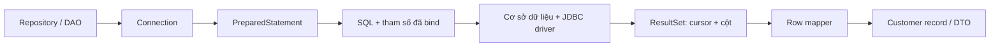

# ResultSet và ánh xạ dữ liệu sang mô hình Java

Trong Java 27, **JDBC** vẫn là API chuẩn để một ứng dụng Java làm việc với cơ sở dữ liệu quan hệ thông qua driver phù hợp. Sau khi thực thi một truy vấn SQL bằng `PreparedStatement`, ứng dụng thường nhận một `ResultSet`: tập các dòng kết quả có con trỏ (*cursor*), có thể đọc tuần tự và chuyển thành các đối tượng nghiệp vụ, DTO hoặc `record` Java.

Từ một dòng SQL như:

```text
id | email             | credit_limit | joined_on  | active | loyalty_points
---+-------------------+--------------+------------+--------+---------------
 7 | lan@example.test  |       250.50 | 2026-11-27 | true   | NULL
```

ứng dụng muốn tạo một giá trị Java có kiểu rõ ràng:

```java
record Customer(
    long id,
    String email,
    BigDecimal creditLimit,
    LocalDate joinedOn,
    boolean active,
    Integer loyaltyPoints
) {}
```

Phép chuyển đổi đó không chỉ là gọi `getString()` cho mọi cột. Cần biết **kiểu SQL**, cách xử lý **SQL NULL**, thứ tự di chuyển cursor, thời điểm đóng tài nguyên, ràng buộc của miền dữ liệu và khả năng chuyển đổi mà **JDBC driver** đang sử dụng hỗ trợ.

Mục tiêu của bài học thuộc chương **Truy cập cơ sở dữ liệu**:

- Hiểu vòng đời `Connection → PreparedStatement → ResultSet`.
- Đọc kết quả qua column label hoặc column index một cách có kiểm soát.
- Ánh xạ `VARCHAR`, `BIGINT`, `DECIMAL`, `BOOLEAN`, `DATE` và dữ liệu nullable vào các kiểu Java phù hợp.
- Viết một **row mapper** tách biệt giữa SQL và mô hình Java.
- Sử dụng `try-with-resources`, `SQLException`, metadata và các kỹ thuật giảm chi phí khi kết quả lớn.
- Tránh những lỗi như làm mất SQL NULL, giảm độ chính xác tiền tệ, lệch alias hoặc để `ResultSet` sống quá thời gian mở kết nối.

Nội dung dùng API JDBC còn được hỗ trợ chính thức trong Java SE 27, không dựa vào cơ chế cũ đã lỗi thời.

## 1. ResultSet nằm ở đâu trong quy trình truy cập dữ liệu?

Một truy vấn đi qua các thành phần:



**`Connection`** đại diện cho một phiên làm việc JDBC với database. **`PreparedStatement`** đại diện cho câu SQL đã chuẩn bị cùng các tham số giá trị. **`ResultSet`** đại diện cho kết quả truy vấn, không phải một `List` tự động giữ sẵn các đối tượng Java của miền nghiệp vụ.

Ví dụ khung:

```java
import java.sql.Connection;
import java.sql.PreparedStatement;
import java.sql.ResultSet;
import java.sql.SQLException;

static void printEmails(Connection connection) throws SQLException {
    String sql = """
        SELECT email
        FROM customers
        WHERE active = ?
        ORDER BY id
        """;

    try (PreparedStatement statement = connection.prepareStatement(sql)) {
        statement.setBoolean(1, true);

        try (ResultSet rs = statement.executeQuery()) {
            while (rs.next()) {
                System.out.println(rs.getString("email"));
            }
        }
    }
}
```

Đoạn mã giả định bảng `customers` có các cột tương ứng và `connection` đã được khởi tạo. `PreparedStatement.executeQuery()` dành cho câu SQL tạo ra một tập kết quả; với thao tác `INSERT`, `UPDATE`, `DELETE` thông thường, sử dụng `executeUpdate()` hoặc API chuyên biệt tương ứng.

`ResultSet` thường phụ thuộc vào `Statement` và `Connection` đã tạo ra nó. Vì vậy, hãy ánh xạ dữ liệu **bên trong phạm vi tài nguyên còn mở**, sau đó trả về DTO/record độc lập thay vì trả một `ResultSet` đang sống cho tầng trình bày.

## 2. Cursor của ResultSet: trước dòng đầu tiên, next(), kết thúc

Theo Java SE 27 API, khi nhận `ResultSet`, cursor ban đầu ở **trước dòng đầu tiên** (*before first*). Gọi `rs.next()` để chuyển đến dòng dữ liệu tiếp theo:

```java
try (ResultSet rs = statement.executeQuery()) {
    while (rs.next()) {
        long id = rs.getLong("id");
        System.out.println(id);
    }
}
```

`next()` trả về:

- `true`: cursor đã chuyển tới một dòng hợp lệ, có thể gọi các getter trên dòng đó.
- `false`: không còn dòng tiếp theo.

Với kết quả rỗng, `next()` trả `false` ngay lần đầu; vòng lặp không chạy.

```text
Vừa thực thi truy vấn:
    cursor -> [trước dòng 1]

rs.next() == true:
    [dòng 1] <- cursor

rs.next() == true:
    [dòng 2] <- cursor

rs.next() == false:
    [sau dòng cuối]
```

### Không đọc trước khi gọi next()

```java
try (ResultSet rs = statement.executeQuery()) {
    // Sai: chưa đưa cursor tới dòng dữ liệu nào.
    // String email = rs.getString("email");

    if (rs.next()) {
        String email = rs.getString("email");
    }
}
```

Đừng viết `rs.next()` một lần để “khởi tạo”, rồi bắt đầu `while (rs.next())`; mẫu đó sẽ **bỏ qua dòng đầu tiên**.

### Tìm đúng một dòng

Nếu truy vấn được kỳ vọng trả nhiều nhất một dòng, dùng `if`:

```java
try (ResultSet rs = statement.executeQuery()) {
    if (!rs.next()) {
        // Không có dữ liệu.
    } else {
        // Đọc một dòng đã tìm thấy.
    }
}
```

Nếu hợp đồng nghiệp vụ **bắt buộc đúng một dòng**, còn cần kiểm tra `rs.next()` lần nữa để phát hiện hai dòng trở lên. Tốt hơn hết, SQL nên có ràng buộc khóa duy nhất phù hợp và truy vấn dùng đúng khóa, thay vì chỉ kiểm tra số dòng ở phía Java.

### Scrollable ResultSet có tồn tại, nhưng không phải mặc định

`ResultSet` mặc định là loại **forward-only, read-only**:

```java
ResultSet.TYPE_FORWARD_ONLY
ResultSet.CONCUR_READ_ONLY
```

JDBC có các loại khác như `TYPE_SCROLL_INSENSITIVE` và `TYPE_SCROLL_SENSITIVE`, cùng cursor navigation `absolute`, `relative`, `previous`. Việc driver và database hỗ trợ tới mức nào khác nhau; đừng gọi các thao tác scroll trên một `ResultSet` forward-only rồi giả định chúng luôn hoạt động.

Đối với các dịch vụ chủ yếu đọc dữ liệu và ánh xạ vào record/DTO, **duyệt tiến bằng `next()`** thường là lựa chọn đơn giản, dễ kiểm soát bộ nhớ và dễ tương thích.

## 3. Đọc cột bằng index hay column label?

JDBC cho phép lấy giá trị qua **số thứ tự cột** hoặc **nhãn cột**:

```java
long id = rs.getLong(1);
String email = rs.getString(2);
```

hoặc:

```java
long id = rs.getLong("customer_id");
String email = rs.getString("customer_email");
```

**Column index bắt đầu từ 1**, không phải 0 như `List` hay mảng Java. Thứ tự cột tính theo thứ tự xuất hiện trong câu `SELECT`, không nhất thiết theo thứ tự khai báo trong bảng.

Ví dụ dùng alias để tách tên bên trong database khỏi tên đầu ra:

```sql
SELECT
    c.id    AS customer_id,
    c.email AS customer_email
FROM customers c
```

Đọc đúng các **nhãn kết quả**:

```java
long id = rs.getLong("customer_id");
String email = rs.getString("customer_email");
```

Nếu dùng `AS`, nhãn trả về là alias; khi không dùng `AS`, nhãn thường là tên cột. Trong truy vấn có `JOIN`, đặc biệt tránh trùng nhãn như `id`, `name` ở nhiều bảng vì khi tra cứu theo tên, JDBC có thể chọn **cột khớp đầu tiên**.

| Cách truy cập | Ưu điểm | Rủi ro |
|---|---|---|
| `getLong(1)` | Ngắn, có thể giảm chi phí tra cứu tên | Đổi thứ tự `SELECT` dễ làm mapper sai |
| `getLong("customer_id")` | Tự mô tả, gắn với alias rõ ràng | Đổi alias sẽ làm mapper phải cập nhật |
| `findColumn("customer_id")` | Lấy index từ nhãn khi cần dùng lặp lại | Cần xử lý `SQLException` nếu nhãn không hợp lệ |

**Khuyến nghị:** truy vấn ứng dụng nên liệt kê các cột cần dùng, đặt alias duy nhất và viết mapper bám theo alias. Tránh `SELECT *` trong phần lớn repository vì schema thay đổi có thể kéo theo dữ liệu thừa, tên cột trùng và những phụ thuộc ngoài ý muốn.

## 4. Chọn getter tương ứng với kiểu SQL

Các phương thức `ResultSet` sẽ nhờ driver chuyển dữ liệu từ SQL sang kiểu Java. Những mapping phổ biến:

| Kiểu SQL | Getter Java thường dùng | Kiểu Java |
|---|---|---|
| `VARCHAR`, `CHAR`, `NVARCHAR` | `getString(...)` | `String` |
| `INTEGER` | `getInt(...)` | `int` |
| `BIGINT` | `getLong(...)` | `long` |
| `BOOLEAN` / kiểu tương đương của hệ DB | `getBoolean(...)` | `boolean` |
| `DECIMAL(p,s)`, `NUMERIC(p,s)` | `getBigDecimal(...)` | `BigDecimal` |
| `DATE` | `getObject(label, LocalDate.class)` | `LocalDate` |
| `TIME` | `getObject(label, LocalTime.class)` | `LocalTime` |
| `TIMESTAMP` không có múi giờ | `getObject(label, LocalDateTime.class)` | `LocalDateTime` |
| `TIMESTAMP WITH TIME ZONE` | `getObject(label, OffsetDateTime.class)` | `OffsetDateTime` |
| `VARBINARY` | `getBytes(...)` | `byte[]` |
| `BLOB`, `CLOB` | `getBinaryStream(...)`, `getCharacterStream(...)` hoặc LOB API thích hợp | `InputStream`, `Reader`, `Blob`, `Clob` |

Đây là **hướng dẫn lựa chọn ban đầu**, không phải cam kết mọi driver đều hỗ trợ mọi chuyển đổi kiểu: khả năng hỗ trợ phụ thuộc JDBC specification, phiên bản driver, kiểu SQL cụ thể và cách database lưu dữ liệu. Ví dụ `BOOLEAN`, `TIMESTAMP WITH TIME ZONE` và `UUID` có thể được hiện thực khác nhau giữa các hệ cơ sở dữ liệu.

Đối với kiểu số nguyên nullable, getter primitive `getInt`/`getLong` cần `wasNull()` hoặc một getter object phù hợp để giữ thông tin thiếu dữ liệu.

### Không coi mọi cột như một String

```java
// Kém phù hợp nếu credit_limit là DECIMAL:
BigDecimal limit = new BigDecimal(rs.getString("credit_limit"));

// Rõ nghĩa hơn và giữ precision số thập phân:
BigDecimal limit = rs.getBigDecimal("credit_limit");
```

Dùng `getBigDecimal` cho DECIMAL/NUMERIC thay vì `getDouble` rồi chuyển lại. Khi xử lý số tiền, không làm tròn âm thầm trong tầng mapper nếu chính sách nghiệp vụ yêu cầu giữ giá trị nguyên gốc để đối soát.

## 5. SQL NULL và bẫy với getter primitive

SQL `NULL` khác với chuỗi rỗng `""`, số `0` hoặc boolean `false`. Tuy nhiên, getter Java trả kiểu primitive không thể biểu diễn `null`.

Ví dụ với một cột `loyalty_points INTEGER NULL`:

```java
int points = rs.getInt("loyalty_points");

if (rs.wasNull()) {
    System.out.println("Điểm chưa được xác định");
} else {
    System.out.println("Điểm: " + points);
}
```

Đối với giá trị SQL `NULL`:

- `getInt(...)` trả `0`.
- `getLong(...)` trả `0L`.
- `getBoolean(...)` trả `false`.
- `wasNull()` cho biết **cột vừa đọc bằng getter gần nhất có phải SQL NULL không**.

Không có `wasNull()`, số điểm `0` và số điểm **chưa tồn tại** bị nhập làm một. Tương tự, tài khoản `false` và trạng thái chưa xác định có thể bị nhầm lẫn.

### wasNull phải gọi ngay sau getter cần kiểm tra

```java
int points = rs.getInt("loyalty_points");
boolean pointsMissing = rs.wasNull(); // Kiểm tra đúng cột vừa đọc.

String email = rs.getString("email");
// rs.wasNull() lúc này sẽ nói về email, KHÔNG còn là points.

Integer nullablePoints = pointsMissing ? null : points;
```

Đây là một trong những lỗi phổ biến nhất khi mapper có nhiều cột nullable.

### Getter trả object xử lý NULL tự nhiên hơn

```java
String nickname = rs.getString("nickname");        // null nếu SQL NULL
BigDecimal price = rs.getBigDecimal("credit_limit"); // null nếu SQL NULL
```

Overload có kiểu đích có thể tiện khi driver hỗ trợ:

```java
Integer nullablePoints = rs.getObject(
    "loyalty_points",
    Integer.class
);
```

Theo hợp đồng `getObject(columnLabel, Class<T>)`, driver chỉ chuyển đổi khi kiểu được hỗ trợ; các kiểu chuyển đổi không hỗ trợ có thể ném `SQLException` hoặc `SQLFeatureNotSupportedException`. Không áp dụng một mapping đối tượng tiện dụng nhưng chưa kiểm tra vào mọi database/driver một cách mù quáng.

### Required và optional: quyết định ở boundary

- Cột **bắt buộc** theo schema/miền nghiệp vụ: nếu SQL trả `NULL`, mapper nên báo lỗi có ngữ cảnh, tránh tạo record không hợp lệ.
- Cột **tùy chọn**: cho phép `null` trong DTO nếu hợp đồng thể hiện rõ, hoặc chuyển sang mô hình miền phù hợp ở tầng sau.
- Không tự đổi `NULL` thành `0`, `false`, `""` hoặc ngày hiện tại nếu không có quy tắc nghiệp vụ xác nhận.

`Optional<T>` hữu ích để biểu thị **có hoặc không có một đối tượng kết quả** trong API repository; không bắt buộc bọc mọi thuộc tính record bằng `Optional<T>`. Nên xác định rõ hợp đồng nullability của từng thuộc tính.

## 6. getObject(..., Class<T>) và thời gian của java.time

Từ JDBC 4.2, JDBC có các mapping hỗ trợ các kiểu ngày giờ hiện đại trong `java.time`, tùy driver và kiểu cột:

```java
import java.time.LocalDate;
import java.time.LocalDateTime;
import java.time.OffsetDateTime;

LocalDate joinedOn = rs.getObject("joined_on", LocalDate.class);

LocalDateTime createdLocal = rs.getObject(
    "created_local",
    LocalDateTime.class
);

OffsetDateTime createdOffset = rs.getObject(
    "created_with_offset",
    OffsetDateTime.class
);
```

Đây là các ví dụ riêng, giả định câu truy vấn có đủ các cột tương ứng.

| Trường hợp | Kiểu Java nên cân nhắc | Điều cần xác định |
|---|---|---|
| Ngày sinh/ngày gia nhập | `LocalDate` | Không có giờ, không có múi giờ |
| Giờ địa phương | `LocalTime` | Quy tắc ngày và múi giờ đến từ nơi khác |
| Thời gian lịch địa phương | `LocalDateTime` | Không đại diện duy nhất cho một instant |
| Thời gian có độ lệch UTC | `OffsetDateTime` | Driver/schema có hỗ trợ lưu và khôi phục offset không? |
| Thời điểm tuyệt đối | `Instant` trong model ứng dụng | Cần hợp đồng chuyển đổi rõ từ kiểu SQL/driver |

**Đặc biệt:** `LocalDateTime` không có timezone; không thể tự suy ra thời điểm tuyệt đối chỉ từ `2026-11-27T09:00:00` nếu chưa biết vùng giờ. `TIMESTAMP WITH TIME ZONE` cũng có ngữ nghĩa khác nhau theo từng DB, không phải DB nào cũng lưu nguyên offset ban đầu.

Nếu dùng `rs.getTimestamp(...).toInstant()` làm fallback, hãy kiểm tra ý nghĩa của cột và cách driver chuyển múi giờ; với `TIMESTAMP` không có timezone, phép chuyển có thể phụ thuộc cấu hình và dẫn đến hiểu sai thời điểm.

Không dùng API ngày giờ cũ chỉ vì những ví dụ JDBC trước đây từng dùng nó; ưu tiên `java.time` và mapping được driver hỗ trợ, có kiểm thử round-trip cho thời gian và timezone.

## 7. Thiết kế record/DTO thay vì chuyển ResultSet lên tầng nghiệp vụ

Một mapper tốt tạo ra **giá trị Java độc lập** với tài nguyên JDBC.

Ví dụ model đọc dữ liệu:

```java
import java.math.BigDecimal;
import java.time.LocalDate;

record CustomerView(
    long id,
    String email,
    String displayName,
    BigDecimal creditLimit,
    LocalDate joinedOn,
    boolean active,
    Integer loyaltyPoints
) {}
```

Lợi ích:

- Tầng nghiệp vụ không phải biết `SQLException` hoặc column index khi đọc thuộc tính.
- Một record có tên component rõ ràng, thích hợp làm DTO bất biến nông.
- Không giữ `ResultSet`, `Connection` hoặc `Statement` trong đối tượng kết quả.
- Có thể viết test cho mapper và nghiệp vụ riêng.
- Dễ diễn đạt điều kiện bắt buộc/tùy chọn ở ranh giới dữ liệu.

Tuy nhiên, record không tự xác thực giá trị từ database. Nếu cần ràng buộc `email` không rỗng, `creditLimit` không âm hoặc `joinedOn` không null, hãy kiểm tra trong mapper, record constructor hoặc lớp domain phù hợp. Cần thống nhất nơi chịu trách nhiệm để tránh hai tầng trả ra các loại lỗi mâu thuẫn.

### Row mapper có trách nhiệm gì?

```java
@FunctionalInterface
interface RowMapper<T> {
    T map(java.sql.ResultSet rs) throws java.sql.SQLException;
}
```

Một `RowMapper` chuyển **dòng hiện tại** của `ResultSet` thành một đối tượng. Nó **không** tự gọi `rs.next()` nếu vòng lặp chính đang sở hữu cursor. Tránh trộn điều khiển cursor với ánh xạ thuộc tính, vì sẽ làm bỏ dòng hoặc đọc chồng các dòng.

Các quy ước nên tuân thủ:

1. Mapper nhận `ResultSet` **đã nằm ở dòng hợp lệ**.
2. Mapper đọc đúng các alias đã công bố trong câu SQL.
3. Mapper kiểm tra SQL NULL trước khi biến thành primitive/domain value.
4. Mapper không giữ tham chiếu tới `ResultSet` hoặc LOB resource cần tiếp tục sống sau khi cursor đóng.
5. Mapper không thực hiện query khác cho mỗi dòng nếu có thể thiết kế một truy vấn/batch thích hợp.

## 8. Ví dụ hoàn chỉnh: query và ánh xạ ResultSet sang Customer record

Ví dụ sau dùng đúng **JDBC API của JDK 27**; phần kết nối cần **JDBC driver** của database thực tế. JDK cung cấp API JDBC nhưng không tự chứa driver cho mọi cơ sở dữ liệu.

### 8.1. Lược đồ dữ liệu minh họa

SQL dưới đây thể hiện ý nghĩa các cột, có thể cần điều chỉnh cú pháp/boolean type theo DBMS:

```sql
CREATE TABLE customers (
    id             BIGINT PRIMARY KEY,
    email          VARCHAR(255) NOT NULL,
    display_name   VARCHAR(200),
    credit_limit   DECIMAL(12, 2) NOT NULL,
    joined_on      DATE NOT NULL,
    active         BOOLEAN NOT NULL,
    loyalty_points INTEGER
);
```

Một dòng mẫu:

```text
id=7
email=lan@example.test
display_name=Lan
credit_limit=250.50
joined_on=2026-11-27
active=true
loyalty_points=NULL
```

Mỗi database có quy tắc riêng về `BOOLEAN`, `DATE`, tên schema và tài khoản kết nối. Ví dụ này không khẳng định DDL chạy nguyên văn trên mọi DBMS.

### 8.2. Mã nguồn Java

Lưu thành **`CustomerResultSetDemo.java`**:

```java
import java.math.BigDecimal;
import java.sql.Connection;
import java.sql.DriverManager;
import java.sql.PreparedStatement;
import java.sql.ResultSet;
import java.sql.SQLException;
import java.time.LocalDate;
import java.util.ArrayList;
import java.util.List;

public class CustomerResultSetDemo {

    record Customer(
        long id,
        String email,
        String displayName,
        BigDecimal creditLimit,
        LocalDate joinedOn,
        boolean active,
        Integer loyaltyPoints
    ) {}

    private static <T> T required(T value, String column)
            throws SQLException {
        if (value == null) {
            throw new SQLException(
                "Cột bắt buộc có giá trị NULL: " + column
            );
        }
        return value;
    }

    static Customer mapCustomer(ResultSet rs) throws SQLException {
        long id = rs.getLong("customer_id");
        if (rs.wasNull()) {
            throw new SQLException("customer_id không được NULL");
        }

        String email = required(
            rs.getString("customer_email"), "customer_email"
        );

        String displayName = rs.getString("display_name"); // Nullable.

        BigDecimal creditLimit = required(
            rs.getBigDecimal("credit_limit"), "credit_limit"
        );

        LocalDate joinedOn = required(
            rs.getObject("joined_on", LocalDate.class), "joined_on"
        );

        boolean active = rs.getBoolean("active");
        if (rs.wasNull()) {
            throw new SQLException("active không được NULL");
        }

        int rawPoints = rs.getInt("loyalty_points");
        Integer loyaltyPoints = rs.wasNull() ? null : rawPoints;

        return new Customer(
            id,
            email,
            displayName,
            creditLimit,
            joinedOn,
            active,
            loyaltyPoints
        );
    }

    static List<Customer> findActiveCustomers(Connection connection)
            throws SQLException {

        String sql = """
            SELECT
                id           AS customer_id,
                email        AS customer_email,
                display_name,
                credit_limit,
                joined_on,
                active,
                loyalty_points
            FROM customers
            WHERE active = ?
            ORDER BY id
            """;

        var customers = new ArrayList<Customer>();

        try (PreparedStatement statement =
                     connection.prepareStatement(sql)) {
            statement.setBoolean(1, true);

            try (ResultSet rs = statement.executeQuery()) {
                while (rs.next()) {
                    customers.add(mapCustomer(rs));
                }
            }
        }

        return List.copyOf(customers);
    }

    public static void main(String[] args) throws SQLException {
        String url = System.getenv("JDBC_URL");
        String user = System.getenv("JDBC_USER");
        String password = System.getenv("JDBC_PASSWORD");

        if (url == null || user == null || password == null) {
            throw new IllegalStateException(
                "Cần cấu hình JDBC_URL, JDBC_USER và JDBC_PASSWORD"
            );
        }

        try (Connection connection =
                     DriverManager.getConnection(url, user, password)) {

            for (Customer customer : findActiveCustomers(connection)) {
                System.out.println(
                    "id=" + customer.id()
                    + ", email=" + customer.email()
                    + ", creditLimit=" + customer.creditLimit()
                    + ", joinedOn=" + customer.joinedOn()
                    + ", points=" + customer.loyaltyPoints()
                );
            }
        }
    }
}
```

Cách chạy (ví dụ shell Unix-like, sau khi đã cấu hình database và driver thích hợp):

```shell
# Driver JAR do nhà cung cấp database hoặc hệ thống build cung cấp.
javac --release 27 CustomerResultSetDemo.java

# Linux/macOS: dùng ':' để phân tách classpath.
java -cp ".:path/to/jdbc-driver.jar" CustomerResultSetDemo
```

Trước khi chạy, cung cấp biến môi trường `JDBC_URL`, `JDBC_USER`, `JDBC_PASSWORD` trong shell hoặc công cụ cấu hình an toàn. Ví dụ không nhúng mật khẩu vào source. Trên Windows, classpath separator thông thường là `;`; trong Gradle/Maven, nên khai báo JDBC driver như một dependency runtime thay vì quản lý JAR bằng tay.

**Quan trọng:** ví dụ **biên dịch bằng JDBC API chuẩn**; để kết nối và đọc dữ liệu thực, bạn phải có driver tương thích, bảng `customers` và quyền truy cập. Vì dữ liệu thật chưa được cung cấp, output phụ thuộc các dòng đang có trong database. Với dòng mẫu ở trên (và `active = true`), output tương ứng có dạng:

```text
id=7, email=lan@example.test, creditLimit=250.50, joinedOn=2026-11-27, points=null
```

Một số driver/DBMS có thể khác nhau về cách trình bày scale của `BigDecimal`, hỗ trợ `getObject(..., LocalDate.class)` và kiểu `BOOLEAN`; cần integration test với đúng driver đang vận hành.

### Phân tích ví dụ

- Câu `SELECT` công bố alias `customer_id` và `customer_email`, nên mapper không phụ thuộc vào vị trí cột.
- `getLong`, `getBoolean`, `getInt` được kiểm tra `wasNull` **ngay sau getter**.
- `getBigDecimal` giữ số thập phân, không chuyển qua `double`.
- `LocalDate` biểu diễn ngày gia nhập không có giờ.
- `displayName` và `loyaltyPoints` có thể null; model biểu diễn rõ bằng `String`/`Integer`.
- Statement và ResultSet được đóng trong khối try; Connection do `main` sở hữu và đóng khi hoàn tất.
- Phương thức `findActiveCustomers` thu kết quả về List. Cách này phù hợp **khi số dòng đã được giới hạn**; không nên dùng để nạp vô hạn dữ liệu.

## 9. RowMapper tái sử dụng: tách kiểm soát cursor khỏi logic chuyển đổi

Nếu nhiều truy vấn cùng ánh xạ một dạng dữ liệu, có thể khai báo interface với exception phù hợp:

```java
@FunctionalInterface
interface RowMapper<T> {
    T map(java.sql.ResultSet rs) throws java.sql.SQLException;
}
```

Tạo một phương thức chỉ đọc qua cursor và ánh xạ:

```java
static <T> List<T> mapAll(
        java.sql.ResultSet rs,
        RowMapper<T> mapper) throws java.sql.SQLException {

    var items = new java.util.ArrayList<T>();

    while (rs.next()) {
        items.add(mapper.map(rs));
    }

    return List.copyOf(items);
}
```

Sử dụng trong phạm vi ResultSet còn mở:

```java
try (ResultSet rs = statement.executeQuery()) {
    List<CustomerResultSetDemo.Customer> customers =
        mapAll(rs, CustomerResultSetDemo::mapCustomer);
}
```

Đoạn gọi trên giả định phương thức `mapAll` được đặt trong phạm vi có thể truy cập kiểu và mapper của `CustomerResultSetDemo`; nếu tổ chức thành lớp thư viện riêng, cần chỉnh visibility và khai báo package tương ứng.

Điểm then chốt là **một nơi duy nhất chịu trách nhiệm `rs.next()`**. Mapper chỉ xử lý dòng hiện tại. Không trộn `next()` vào mapper rồi đặt mapper trong `while (rs.next())`; thao tác đó dễ làm mất các dòng xen kẽ.

### Không trả ResultSet làm đối tượng đầu ra của DAO

Mẫu nên tránh:

```java
// Tránh thiết kế API kiểu này:
ResultSet findCustomers();
```

Nó làm caller phải giữ/đóng statement, connection và xử lý `SQLException` ở tầng không phù hợp. Đặc biệt, nếu DAO đã đóng connection rồi mới trả ResultSet, caller có thể không đọc được dữ liệu.

Một repository nên có API trả về kiểu Java như `List<Customer>`, `Optional<Customer>`, `Page<Customer>` hoặc một cơ chế xử lý tuần tự có **vòng đời rõ ràng**.

## 10. Lấy một dòng bằng Optional<T>

Nếu truy vấn theo khóa duy nhất, API có thể trả về `Optional<Customer>`:

```java
import java.sql.Connection;
import java.sql.PreparedStatement;
import java.sql.ResultSet;
import java.sql.SQLException;
import java.util.Optional;

static Optional<CustomerResultSetDemo.Customer> findById(
        Connection connection,
        long id) throws SQLException {

    String sql = """
        SELECT
            id AS customer_id,
            email AS customer_email,
            display_name,
            credit_limit,
            joined_on,
            active,
            loyalty_points
        FROM customers
        WHERE id = ?
        """;

    try (PreparedStatement statement =
                 connection.prepareStatement(sql)) {

        statement.setLong(1, id);

        try (ResultSet rs = statement.executeQuery()) {
            if (!rs.next()) {
                return Optional.empty();
            }

            var customer = CustomerResultSetDemo.mapCustomer(rs);

            if (rs.next()) {
                throw new SQLException(
                    "Truy vấn theo ID trả về nhiều hơn một dòng"
                );
            }

            return Optional.of(customer);
        }
    }
}
```

`Optional.empty()` thể hiện **không tồn tại dòng**. Điều này khác với một dòng có một số cột SQL NULL. Với `id` là primary key, cơ sở dữ liệu có trách nhiệm bảo đảm tính duy nhất; kiểm tra thêm chỉ giúp phát hiện dữ liệu hoặc truy vấn không đúng giả định.

**Không** dùng `Optional.ofNullable(mapCustomer(rs))` như cách thay thế kiểm tra không có dòng: mapper chỉ được gọi khi cursor đã chuyển tới dòng hợp lệ.

## 11. ResultSetMetaData: kiểm tra hình dạng kết quả

Khi xây công cụ đọc dữ liệu động hoặc muốn chẩn đoán lỗi schema, dùng `ResultSetMetaData`:

```java
import java.sql.ResultSetMetaData;
import java.sql.Types;

try (ResultSet rs = statement.executeQuery()) {
    ResultSetMetaData meta = rs.getMetaData();

    for (int column = 1; column <= meta.getColumnCount(); column++) {
        System.out.println(
            meta.getColumnLabel(column)
            + " | SQL type=" + meta.getColumnTypeName(column)
            + " | JDBC code=" + meta.getColumnType(column)
        );
    }
}
```

Các phương thức hữu ích:

| API | Tác dụng |
|---|---|
| `getColumnCount()` | Số cột trong kết quả |
| `getColumnLabel(i)` | Nhãn cột, ưu tiên alias của `AS` |
| `getColumnName(i)` | Tên cột theo metadata của driver |
| `getColumnType(i)` | Mã kiểu SQL theo `java.sql.Types` |
| `getColumnTypeName(i)` | Tên kiểu do DBMS/driver trả |
| `getColumnClassName(i)` | Lớp Java thường trả về từ `getObject(i)` |
| `getPrecision(i)`, `getScale(i)` | Thông số số học hoặc kích thước theo metadata |
| `isNullable(i)` | Khả năng NULL: có, không hoặc không biết |

Nếu `isNullable(i)` trả `columnNullableUnknown`, **không được** suy ra cột không có NULL. Metadata là thông tin từ driver/database, không thay cho hợp đồng nghiệp vụ. Truy vấn với biểu thức, JOIN hoặc aggregate có thể tạo ra cột mang kiểu/nullability khác so với cột gốc.

`getColumnLabel` khác `getColumnName`; khi dùng `AS`, hãy tập trung vào **label** mà mapper đang đọc.

### Không dùng metadata để thay thế schema versioning

Một mapper dùng riêng cho ứng dụng thường nên dựa trên một SQL projection ổn định và schema migration được kiểm soát. Việc đọc metadata cho tất cả truy vấn rồi tự đoán cách ánh xạ có thể làm hệ thống khó phát hiện schema drift.

Metadata phù hợp cho export dữ liệu động, trình xem kết quả query, công cụ admin hoặc thông báo chẩn đoán. Với domain model tĩnh, tên cột và kiểu Java rõ ràng thường an toàn và dễ kiểm thử hơn.

## 12. Mapping JOIN và aggregate: một dòng SQL không luôn là một entity

Ví dụ JOIN:

```sql
SELECT
    o.id AS order_id,
    o.customer_id AS order_customer_id,
    i.id AS item_id,
    i.quantity AS item_quantity
FROM orders o
JOIN order_items i ON i.order_id = o.id
ORDER BY o.id, i.id
```

Một đơn hàng có ba dòng hàng sẽ xuất hiện **ba dòng trong ResultSet**. Nếu mapper tạo một `Order` hoàn chỉnh cho mỗi dòng, bạn có thể tạo ra ba đối tượng order trùng lặp và thiếu logic gom các dòng con.

Có hai chiến lược thường gặp:

1. **Projection phẳng:** ánh xạ mỗi dòng thành `OrderItemRow(orderId, customerId, itemId, quantity)`, sau đó nhóm theo `orderId` trong bước riêng.
2. **Aggregate assembler:** duyệt ResultSet có thứ tự, tạo/bổ sung một aggregate `Order` cho mỗi `orderId`, kiểm soát duplicate và dữ liệu con.

Nếu dùng `LEFT JOIN`, các cột phía bảng con có thể là SQL NULL khi không có phần tử con. Không được gọi `getLong("item_id")` rồi tạo item ID bằng 0 nếu NULL thực sự nghĩa là **không có item**.

Các truy vấn aggregate như `COUNT(*)` hoặc `SUM(amount)` cũng có kiểu/nullability riêng: `COUNT(*)` thường trả số đếm không NULL, còn `SUM(...)` có thể trả NULL khi không có giá trị hợp lệ để tổng hợp. Chọn `Long`, `BigDecimal` và cách xử lý trường hợp rỗng dựa trên truy vấn cụ thể, không dựa trên kiểu cột gốc đơn lẻ.

## 13. Những kiểu khó: enum, JSON, array và LOB

Không phải mọi kiểu SQL đều có một cách chuyển Java thống nhất trên mọi database.

### Enum lưu dưới dạng VARCHAR

```java
enum OrderStatus {
    NEW, PAID, CANCELLED
}

String rawStatus = rs.getString("status");

if (rawStatus == null) {
    throw new SQLException("status không được NULL");
}

OrderStatus status;
try {
    status = OrderStatus.valueOf(rawStatus);
} catch (IllegalArgumentException exception) {
    throw new SQLException(
        "Giá trị status không được hỗ trợ: " + rawStatus,
        exception
    );
}
```

`valueOf` phân biệt chữ hoa/thường và chỉ chấp nhận tên enum chính xác. Khi dữ liệu ngoài database hoặc version khác nhau có thể sinh trạng thái mới, cần chính sách versioning: fail-fast, mapping tương thích hoặc giá trị `UNKNOWN` được định nghĩa rõ. Đừng tự chuyển lỗi thành một enum mặc định nếu điều đó làm mất ý nghĩa nghiệp vụ.

### JSON, UUID, ARRAY

- `JSON` có thể được driver trả về `String`, đối tượng chuyên biệt hoặc kiểu SQL mở rộng.
- `UUID` có thể hỗ trợ `getObject(label, UUID.class)` trên một số driver, nhưng không phải hợp đồng chung cho mọi kiểu cột/string.
- `ARRAY` có thể đọc qua `ResultSet.getArray`, nhưng kiểu phần tử, quy tắc null và cách giải phóng resource phụ thuộc driver.

Với JSON, nên dùng parser/serializer đúng chuẩn schema thay vì tự cắt chuỗi. Với UUID, nếu DB lưu văn bản, có thể đọc bằng `getString` và `UUID.fromString` sau khi xác thực, hoặc dùng typed getter **khi driver đã được kiểm chứng**.

### BLOB/CLOB và tài nguyên luồng

Với file đính kèm hoặc tài liệu lớn, không nên đưa toàn bộ dữ liệu vào `byte[]` hay `String` nếu kích thước không được giới hạn.

```java
try (ResultSet rs = statement.executeQuery()) {
    while (rs.next()) {
        try (var input = rs.getBinaryStream("file_payload")) {
            if (input != null) {
                // Chuyển dữ liệu theo luồng tới nơi được phép lưu.
                copyPayload(input);
            }
        }
    }
}
```

`copyPayload` là phương thức ứng dụng giả định nhận `InputStream`; nó phải có chính sách giới hạn kích thước, xử lý lỗi và nơi lưu thích hợp. `getCharacterStream` dành cho dữ liệu ký tự lớn.

**Lưu ý:** các stream lấy từ ResultSet có thể chỉ còn hợp lệ khi cursor/ResultSet tương ứng còn mở, và một số driver có hạn chế khi chuyển cursor hoặc đọc cột khác. Xử lý nội dung trong phạm vi dòng hiện tại, đóng tài nguyên đúng cách, không giữ stream để đọc sau khi DAO đã đóng connection.

## 14. Vòng đời và try-with-resources

Một phạm vi tài nguyên rõ ràng:

```java
try (Connection connection = dataSource.getConnection();
     PreparedStatement statement = connection.prepareStatement(sql)) {

    statement.setLong(1, customerId);

    try (ResultSet rs = statement.executeQuery()) {
        while (rs.next()) {
            // Chuyển dữ liệu sang object Java tại đây.
        }
    }
}
```

Trong ví dụ, `dataSource`, `sql` và `customerId` đã được khai báo ở tầng ứng dụng. Cách viết dùng `javax.sql.DataSource` hiện hành phù hợp với ứng dụng server và connection pooling.

Try-with-resources:

- Đóng `ResultSet`, rồi `PreparedStatement`, rồi `Connection` theo thứ tự ngược với cách tài nguyên được mở.
- Đóng cả khi mapper ném `SQLException` hoặc một lỗi runtime.
- Cho phép caller quyết định xử lý lỗi thay vì nuốt lỗi trong DAO.
- Với `DataSource` có pooling, `Connection.close()` thường **trả kết nối về pool** theo implementation, không nhất thiết đóng socket vật lý ngay.

Không nên giữ một `ResultSet` làm field trong singleton hay chia sẻ cùng ResultSet cho nhiều virtual thread: cursor có trạng thái và các thao tác JDBC chưa tự nhiên trở thành thread-safe chỉ vì ứng dụng dùng thread concurrency hiện đại.

### Close có thể xảy ra sớm hơn bạn nghĩ

Một `Statement` thường đóng `ResultSet` hiện tại khi nó được đóng hoặc được thực thi lại theo quy tắc JDBC. Vậy nên, đừng dùng lại cùng một `PreparedStatement` để thực hiện query khác khi caller vẫn đang tiêu thụ kết quả trước đó.

Nếu business logic gọi API ngoài (HTTP, email, RPC) trong `while(rs.next())`, kết nối database có thể bị giữ lâu trong suốt thời gian chờ mạng. Nên tách bước lấy dữ liệu với bước xử lý ngoài database khi có thể và khi bộ nhớ cho phép, hoặc tổ chức streaming/transaction có giới hạn rõ ràng.

## 15. Đọc kết quả lớn: fetchSize, giới hạn dòng và phân trang

Ví dụ `findActiveCustomers` trước đó lưu mọi dòng vào `ArrayList`. Nếu bảng có vài triệu dòng, cách này tốn bộ nhớ và giữ kết nối lâu.

### setFetchSize chỉ là một gợi ý

```java
try (PreparedStatement statement =
         connection.prepareStatement(sql)) {

    statement.setFetchSize(200);

    try (ResultSet rs = statement.executeQuery()) {
        while (rs.next()) {
            processRow(rs);
        }
    }
}
```

`setFetchSize(200)` là **hint** về số dòng driver nên lấy mỗi lần khi cần thêm dữ liệu; không phải giới hạn chính xác 200 dòng, không phải phân trang, và **không** bảo đảm mọi driver sẽ stream thay vì tải tất cả kết quả về bộ nhớ. Có driver yêu cầu cấu hình transaction, fetch mode hoặc URL riêng.

`processRow(rs)` ở ví dụ là phương thức xử lý dòng hiện tại, cần thực hiện nhanh và không giữ tài nguyên ngoài phạm vi.

### setMaxRows không thay thế chính sách pagination

```java
statement.setMaxRows(500);
```

Theo API, đây là giới hạn tối đa số dòng của một `ResultSet` do statement tạo ra. Nó hữu ích để tránh đọc quá nhiều dòng, nhưng không bảo đảm database sẽ thực thi câu query hiệu quả như SQL có `WHERE`, `ORDER BY` và giới hạn hàng phù hợp; cũng không tự cung cấp pagination ổn định.

### Phân trang bằng khóa

Với nhiều giao dịch hoặc bảng lớn, có thể dùng *keyset pagination* trên khóa có thứ tự ổn định:

```sql
SELECT id, email, credit_limit
FROM customers
WHERE id > ?
ORDER BY id
FETCH FIRST 100 ROWS ONLY
```

`FETCH FIRST ... ROWS ONLY` được hỗ trợ ở nhiều DBMS hiện hành, nhưng cú pháp giới hạn hàng có thể khác nhau giữa các hệ thống. Dùng cú pháp đúng cho DBMS đang triển khai; `? ` trong truy vấn trên là parameter của `PreparedStatement`, không phải phép thay thế cho tên bảng/cột.

Keyset pagination giảm rủi ro offset quá lớn, nhưng dữ liệu thay đổi đồng thời vẫn có thể tác động tới tập kết quả tùy transaction isolation và business contract. Nếu thứ tự không duy nhất, hãy thêm khóa phụ để có một thứ tự xác định.

### Đừng biến ResultSet thành Java Stream một cách tùy tiện

JDBC `ResultSet` có con trỏ và vòng đời phụ thuộc connection; nó **không tự là `java.util.stream.Stream`**. Một adapter `Stream<Customer>` nếu không quản lý close và exception rõ ràng sẽ dễ gây rò rỉ connection hoặc chỉ phát hiện lỗi I/O khi caller đã thoát khỏi phạm vi DAO.

Với khối lượng lớn, API nhận callback/lambda có checked `SQLException`, cơ chế phân trang, hoặc chuyên biệt cho batch thường dễ kiểm soát hơn việc phơi bày một stream lazy không có chủ sở hữu tài nguyên.

## 16. SQLException và chẩn đoán lỗi ánh xạ

Các nguyên nhân lỗi có thể gồm:

- Không tìm thấy column label do alias đã đổi.
- Driver không hỗ trợ chuyển từ kiểu SQL sang kiểu Java được yêu cầu.
- Dữ liệu cột không hợp lệ với ràng buộc domain.
- Kết nối đã đóng hoặc ResultSet đã đóng.
- Mạng/database thất bại trong khi fetch các dòng sau.
- Schema migration và mã ứng dụng đang ở hai version không tương thích.

Ví dụ:

```java
try {
    // Thực hiện query và mapping.
} catch (SQLException exception) {
    System.err.println(
        "SQLState=" + exception.getSQLState()
        + ", vendorCode=" + exception.getErrorCode()
    );
    throw exception;
}
```

`SQLException.getSQLState()` và `getErrorCode()` có thể hỗ trợ phân loại sự cố, nhưng mã chi tiết còn phụ thuộc DBMS/driver. Không log toàn bộ câu SQL có tham số nhạy cảm hoặc dữ liệu cá nhân chỉ để debug.

Một mapper cũng có thể ném lỗi validation khi dữ liệu vi phạm invariant. Hãy phân biệt **dữ liệu bất thường**, **lỗi conversion** và **lỗi hạ tầng** theo hợp đồng tầng truy cập; không tùy tiện chuyển mọi exception thành “không tìm thấy khách hàng”.

### Không âm thầm thay giá trị khi mapping thất bại

```java
// Không nên:
// try {
//     return rs.getObject("joined_on", LocalDate.class);
// } catch (SQLException e) {
//     return LocalDate.now();
// }
```

Ngày hiện tại không phải giá trị tương đương với ngày gia nhập bị lỗi đọc. Việc này khiến dữ liệu sai trông như hợp lệ và cản trở kiểm toán.

Nếu cần fallback vì driver không hỗ trợ typed getter, hãy xác định trước mapping tương đương, triển khai có kiểm thử và chỉ bắt loại lỗi liên quan, thay vì bắt mọi `SQLException` rồi mặc định tự thay dữ liệu.

## 17. An toàn dữ liệu và truy vấn có tham số

`ResultSet` chủ yếu là API đọc kết quả, nhưng mapper chỉ đáng tin khi đầu vào SQL được tạo đúng cách.

### Tránh SQL injection bằng PreparedStatement

```java
String sql = """
    SELECT id, email
    FROM customers
    WHERE email = ?
    """;

try (PreparedStatement statement =
         connection.prepareStatement(sql)) {
    statement.setString(1, userEmail);

    try (ResultSet rs = statement.executeQuery()) {
        while (rs.next()) {
            // Mapping theo cột đã khai báo.
        }
    }
}
```

Giá trị `userEmail` được bind như **dữ liệu**, không ghép vào cấu trúc SQL. Dấu `?` đại diện cho **giá trị tham số**, không đại diện cho tên bảng, tên cột hoặc đoạn SQL tùy ý. Với yêu cầu sort/field động, dùng **allowlist** tên cột được chương trình cho phép và xây câu SQL có kiểm soát.

### Không đưa dữ liệu nhạy cảm ra log

Các cột như email, số tài khoản, token hoặc thông tin cá nhân có thể nằm trong ResultSet. Chỉ log thông tin cần chẩn đoán và được phép ghi nhận; tránh `System.out.println(rs.getString("password_hash"))` hoặc dump mọi cột metadata/value trong production.

### Không tự tin rằng Java model bất biến là dữ liệu đã an toàn

`record` bất biến nông giúp giảm lỗi thay đổi thuộc tính ngoài ý muốn. Nhưng dữ liệu database vẫn phải được kiểm tra khi dùng trong các ngữ cảnh khác: HTML, JSON, SQL thứ cấp, đường dẫn tệp hoặc quy tắc nghiệp vụ. Mapper không thay thế bộ mã hóa đầu ra hoặc lớp kiểm soát quyền truy cập.

## 18. Kiểm thử mapper và tích hợp JDBC

Test một row mapper nên bao phủ các trường hợp **có dữ liệu**, **thiếu dữ liệu** và **sai dữ liệu**.

| Trường hợp | Kỳ vọng |
|---|---|
| Một dòng đầy đủ | Tạo đúng record/DTO |
| Không có dòng | Repository trả list rỗng hoặc `Optional.empty()` |
| SQL NULL ở thuộc tính tùy chọn | Giữ `null` hoặc biểu diễn “không có” đã thống nhất |
| SQL NULL ở thuộc tính bắt buộc | Báo lỗi rõ ràng, không tự thay bằng giá trị mặc định |
| `0` ở cột nullable integer | Phân biệt với SQL NULL bằng `wasNull` |
| `false` ở cột nullable boolean | Phân biệt với SQL NULL nếu cần |
| DECIMAL có scale lớn | Giữ `BigDecimal` không mất precision |
| Ngày tháng và timezone | Kiểm tra mapping đúng miền ngày/giờ |
| Alias hoặc schema thay đổi | Phát hiện lỗi mapping khi clean test |
| Nhiều dòng và JOIN | Đúng số phần tử, không bỏ dòng đầu hoặc nhân bản aggregate |
| Driver không hỗ trợ conversion | Có xử lý lỗi/phương án mapping được kiểm chứng |
| Ngoại lệ khi duyệt ResultSet | Statement/ResultSet/Connection vẫn được đóng |

### Nên kiểm thử với driver thật

Kiểm thử unit bằng mock `ResultSet` giúp kiểm tra luồng gọi getter và `wasNull`, nhưng **không** mô phỏng hết kiểu dữ liệu và conversion của driver.

Một integration test với DBMS/driver giống môi trường triển khai cần xác nhận:

1. Các cột DATE/TIMESTAMP có được trả đúng kiểu `java.time` hay không.
2. DECIMAL/NUMERIC có giữ scale/precision đúng hay không.
3. NULL và alias hoạt động như mong đợi.
4. `setFetchSize`, transaction, cursor và timeout có hành vi phù hợp.
5. Query vẫn đúng sau các lần schema migration.

JDK 27 cung cấp API JDBC; **driver database không phải thành phần mặc định của JDK cho mọi DBMS**. Không coi ví dụ Java chỉ dùng `java.sql` là integration test đã thành công khi chưa có một database và driver thực sự.

## 19. Checklist thiết kế mapper

Trước khi hoàn thành một repository đọc dữ liệu, hãy tự kiểm tra:

1. **Projection có rõ ràng không?** `SELECT` chỉ lấy cột cần thiết, alias duy nhất, tránh `SELECT *`.
2. **Có một nơi duy nhất gọi `ResultSet.next()` không?** Tránh bỏ dòng đầu.
3. **Kiểu Java có phản ánh kiểu SQL không?** Dùng `BigDecimal` cho DECIMAL, `java.time` cho ngày/giờ phù hợp.
4. **SQL NULL có được xử lý tường minh không?** Nhất là primitive getter và `wasNull`.
5. **Ràng buộc required/optional đã xác định chưa?** Không đổi thiếu dữ liệu thành giá trị mặc định tùy tiện.
6. **Mapper có tách khỏi business flow không?** Nó chỉ biến dòng hiện tại thành một đối tượng.
7. **Có giữ `ResultSet`/stream LOB ra khỏi phạm vi đóng tài nguyên không?**
8. **Có kiểm soát số dòng và fetch size không?** Không nạp dữ liệu vô hạn vào `List`.
9. **Có giữ truy vấn an toàn không?** Dùng `PreparedStatement` và bind giá trị.
10. **Có kiểm thử với driver DB thật và schema migration không?**
11. **Có timeout, kế hoạch đóng connection và quản lý transaction không?**
12. **Có phân biệt lỗi không có dòng với lỗi đọc dữ liệu không?**

Một mapper tốt không phải mapper có ít dòng code nhất; nó là mapper **giữ nguyên ý nghĩa của dữ liệu**, làm rõ hợp đồng và để lỗi lộ ra đúng nơi.

## 20. Bài tập thực hành

### Bài 1 — Cursor

Với `ResultSet` có 3 dòng, đoạn code sau đọc bao nhiêu dòng?

```java
rs.next();
while (rs.next()) {
    System.out.println(rs.getLong("id"));
}
```

Hãy sửa để duyệt đủ 3 dòng.

### Bài 2 — Null với getter primitive

Cột `discount_percent INTEGER NULL` có thể là `0`, `20` hoặc `NULL`. Viết đoạn Java ánh xạ thành `Integer` sao cho ba trạng thái được giữ đúng.

### Bài 3 — Alias

Cho SQL:

```sql
SELECT c.id AS customer_id, o.id AS order_id
FROM customers c
JOIN orders o ON o.customer_id = c.id
```

Tại sao `rs.getLong("id")` không phải lựa chọn phù hợp? Hãy viết hai lời gọi đúng với alias.

### Bài 4 — DATE và DECIMAL

Ánh xạ `joined_on DATE NOT NULL` và `balance DECIMAL(12,2) NOT NULL` vào `LocalDate` và `BigDecimal`. Nếu một cột trả SQL NULL dù schema quy định NOT NULL, mapper nên làm gì?

### Bài 5 — Trả về Optional

Viết repository `findById(Connection, long)` trả `Optional<Customer>`; phân biệt trường hợp **không có dòng** với **dòng có cột tùy chọn NULL**.

### Bài 6 — Dữ liệu lớn

Một truy vấn trả 5 triệu dòng. Giải thích vì sao `while(rs.next()) { list.add(map(rs)); }` có thể không phù hợp và nêu ít nhất hai lựa chọn khác.

### Bài 7 — Metadata

Viết code lấy `getColumnCount()` và duyệt từ `1` đến số cột để in `getColumnLabel(i)` cùng `getColumnTypeName(i)`.

### Bài 8 — JOIN một-nhiều

Một đơn hàng có 4 items tạo 4 dòng từ JOIN. Hãy thiết kế `OrderItemRow` hoặc một cách gom dòng thành `Order` có 4 items, không tạo 4 order riêng.

### Bài 9 — JDBC và bảo mật

Truy vấn theo email được nhập từ bên ngoài. Vì sao `"WHERE email = '" + email + "'"` nguy hiểm? Dùng công cụ nào để đưa email vào SQL như giá trị thay vì đoạn cú pháp?

### Bài 10 — Driver-specific

Một driver ném `SQLFeatureNotSupportedException` khi gọi `getObject("joined_on", LocalDate.class)`. Hãy nêu các bước tìm nguyên nhân và yêu cầu kiểm thử trước khi đổi sang một phương thức chuyển đổi khác.

### Đáp án gợi ý

```java
// Bài 1: không gọi next() trước vòng lặp.
while (rs.next()) {
    System.out.println(rs.getLong("id"));
}

// Bài 2: giữ nguyên NULL.
int rawDiscount = rs.getInt("discount_percent");
Integer discount = rs.wasNull() ? null : rawDiscount;

// Bài 3: alias rõ ràng.
long customerId = rs.getLong("customer_id");
long orderId = rs.getLong("order_id");

// Bài 4: kiểu và ràng buộc.
LocalDate joined = rs.getObject("joined_on", LocalDate.class);
BigDecimal balance = rs.getBigDecimal("balance");

if (joined == null || balance == null) {
    throw new SQLException("Cột bắt buộc bị NULL");
}

// Bài 7: metadata dùng index 1-based.
var metadata = rs.getMetaData();
for (int i = 1; i <= metadata.getColumnCount(); i++) {
    System.out.println(
        metadata.getColumnLabel(i)
        + " -> " + metadata.getColumnTypeName(i)
    );
}
```

Bài 5: dùng `if (!rs.next()) return Optional.empty()`, còn cột nullable được giữ ở đối tượng mapping. Bài 6: dùng pagination, callback xử lý từng dòng hoặc một kết quả đã được DB aggregate; `setFetchSize` là hint, không tự giải quyết việc lưu cả 5 triệu đối tượng vào RAM. Bài 8: gom theo `orderId` hoặc xây projection phẳng rồi assemble có chủ đích. Bài 9: dùng `PreparedStatement` với `?` và `setString`. Bài 10: kiểm tra kiểu SQL, version driver, hợp đồng JDBC và test với database thật; không nuốt mọi lỗi chuyển đổi.

## 21. Tổng kết

`ResultSet` trong Java 27 là một **cursor trên kết quả JDBC**, không phải danh sách các domain object. Nó bắt đầu trước dòng đầu tiên, cần `next()` để di chuyển và cần được đọc khi `Statement`/`Connection` còn hợp lệ. Getter đọc giá trị SQL theo index hoặc label và phụ thuộc vào quy tắc chuyển đổi của driver.

Ánh xạ đúng dữ liệu sang Java đòi hỏi:

- **Tên cột/alias ổn định và duy nhất**.
- **Kiểu Java phù hợp**: `BigDecimal` cho decimal, `LocalDate`/`LocalDateTime`/`OffsetDateTime` theo nghĩa thời gian, kiểu reference cho giá trị nullable.
- **Kiểm tra `wasNull()` ngay sau primitive getter** để không nhầm SQL NULL với `0` hoặc `false`.
- **Row mapper có trách nhiệm rõ ràng**, tạo record/DTO độc lập và không tự điều khiển cursor nếu caller đã duyệt.
- **Quản lý vòng đời bằng try-with-resources**, kết hợp phân trang, giới hạn số dòng, timeout và chính sách xử lý `SQLException`.
- **Integration test với đúng DBMS/driver**, đặc biệt khi ánh xạ thời gian, LOB, kiểu mở rộng và dữ liệu không thể biểu diễn mặc định.

Khi tuân thủ các nguyên tắc đó, tầng truy cập dữ liệu sẽ dễ bảo trì và giảm nguy cơ làm sai ý nghĩa dữ liệu ngay tại ranh giới giữa SQL và Java.

## Tài liệu tham khảo

- [Java SE 27 API — ResultSet](https://docs.oracle.com/en/java/javase/27/docs/api/java.sql/java/sql/ResultSet.html): cursor, `next()`, getter theo cột, `wasNull()`, `getObject(..., Class<T>)` và vòng đời.
- [Java SE 27 API — ResultSetMetaData](https://docs.oracle.com/en/java/javase/27/docs/api/java.sql/java/sql/ResultSetMetaData.html): `getColumnCount`, label, name, SQL type, precision, scale và nullability.
- [Java SE 27 API — PreparedStatement](https://docs.oracle.com/en/java/javase/27/docs/api/java.sql/java/sql/PreparedStatement.html): bind tham số, `executeQuery()` và quản lý statement.
- [Java SE 27 API — Connection](https://docs.oracle.com/en/java/javase/27/docs/api/java.sql/java/sql/Connection.html): quản lý kết nối, transaction và vòng đời tài nguyên.
- [Java SE 27 API — Statement](https://docs.oracle.com/en/java/javase/27/docs/api/java.sql/java/sql/Statement.html): fetch size, giới hạn dòng, query timeout và result set.
- [Java SE 27 API — SQLException](https://docs.oracle.com/en/java/javase/27/docs/api/java.sql/java/sql/SQLException.html): SQLState, error code và chuỗi nguyên nhân.
- [Java SE 27 API — Types](https://docs.oracle.com/en/java/javase/27/docs/api/java.sql/java/sql/Types.html): các mã kiểu JDBC.
- [Java SE 27 API — BigDecimal](https://docs.oracle.com/en/java/javase/27/docs/api/java.base/java/math/BigDecimal.html): biểu diễn số thập phân chính xác.
- [Java SE 27 API — LocalDate](https://docs.oracle.com/en/java/javase/27/docs/api/java.base/java/time/LocalDate.html): ngày không có thông tin giờ và múi giờ.
- [Java SE 27 API — DataSource](https://docs.oracle.com/en/java/javase/27/docs/api/java.sql/javax/sql/DataSource.html): cơ chế lấy kết nối trong ứng dụng.
- [JDBC 4.3 Specification (JSR 221)](https://jcp.org/en/jsr/detail?id=221): quy tắc chuyển đổi giữa JDBC/SQL và kiểu Java; cần đối chiếu driver đang vận hành.
