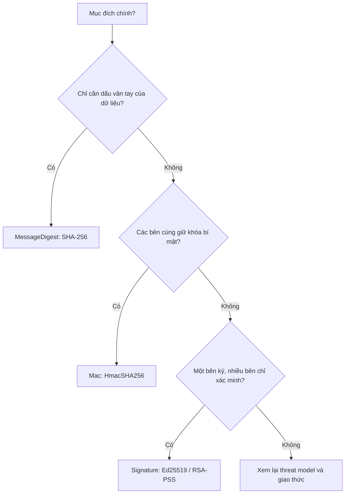
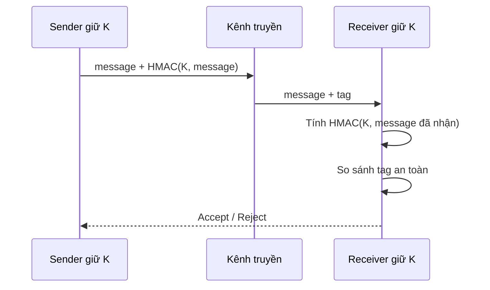
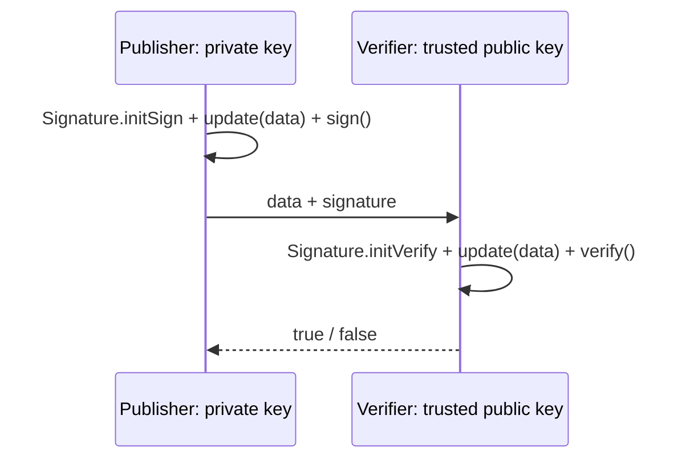

# MessageDigest, MAC, chữ ký số và mục đích sử dụng

Trong Java 27, ba nhóm API thường xuất hiện trong bảo mật dữ liệu là **`MessageDigest`**, **`Mac`** và **`Signature`**. Chúng đều xử lý byte và tạo một kết quả có liên quan tới nội dung thông điệp, nhưng giải quyết **ba bài toán khác nhau**:

- **Hash (message digest):** tạo dấu vân tay của dữ liệu, không dùng khóa bí mật.
- **MAC (Message Authentication Code):** dùng **khóa bí mật dùng chung** để kiểm tra tính toàn vẹn và việc người gửi có nắm khóa hay không.
- **Chữ ký số (digital signature):** bên ký dùng **private key**, bên kiểm tra dùng **public key**; phù hợp khi nhiều bên cần xác minh nội dung mà không được nắm khóa ký.

Nhầm lẫn giữa chúng có thể làm hệ thống chấp nhận dữ liệu bị sửa, lưu mật khẩu không an toàn hoặc coi chữ ký của một khóa không đáng tin là bằng chứng danh tính. Bài học thuộc chương **Bảo mật ứng dụng Java**, module **JAVA_VERSION_JAVA27 — Java 27 và các kiến thức liên quan**. Nội dung sử dụng các thuật toán và API còn phù hợp trong Java SE 27, ưu tiên **SHA-256**, **HmacSHA256** và **Ed25519**, tránh chọn thuật toán hash đã không còn phù hợp cho ứng dụng bảo mật mới như MD5 hoặc SHA-1.

Sau bài học, bạn sẽ biết cách chọn cơ chế theo *threat model*, dùng JCA/JCE đúng cách, tạo và xác minh giá trị mật mã, xử lý byte/khóa an toàn, tránh replay và phân biệt toàn vẹn, xác thực với mã hóa.

## 1. Chọn đúng công cụ trước khi viết mã

| Tình huống | Công cụ phù hợp | Bên kiểm tra cần gì? | Giới hạn chính |
|---|---|---|---|
| So sánh tệp với **digest được nhận từ nguồn đáng tin** | `MessageDigest`, ví dụ `SHA-256` | Bản digest đáng tin | Không tự xác thực nguồn cung cấp digest |
| Xác thực webhook giữa **hai hệ thống cùng giữ bí mật** | `Mac` với `HmacSHA256` | Cùng secret key | Bên nào có secret cũng có thể tạo MAC |
| Phát hành gói phần mềm cho nhiều bên kiểm tra | `Signature` với `Ed25519` hoặc lựa chọn chữ ký tương thích | Public key **đã được xác thực** | Không tự chứng minh danh tính nếu không có niềm tin vào public key |
| Bảo vệ nội dung khỏi bị người khác đọc | AEAD encryption như AES-GCM | Khóa giải mã hợp lệ | Hash, MAC, signature **không mã hóa** nội dung |
| Lưu mật khẩu để đăng nhập | Password hashing chuyên dụng như **Argon2id** | Salt, tham số và verifier | Không dùng SHA-256 trực tiếp hoặc HMAC đơn giản thay password hashing |

Sơ đồ quyết định:



Một ứng dụng có thể cần **nhiều lớp bảo vệ** cùng lúc: TLS bảo vệ đường truyền, HMAC xác thực một webhook và cơ chế chống replay ngăn gửi lại request hợp lệ. Không có một phép hash nào thay thế toàn bộ hệ thống bảo mật.

## 2. Kiến trúc JCA/JCE và tên thuật toán

Java Cryptography Architecture (JCA) cung cấp các API mức cao để ứng dụng sử dụng một **cryptographic provider**. Java Cryptography Extension (JCE) cung cấp thêm các dịch vụ, bao gồm `javax.crypto.Mac` và `javax.crypto.Cipher`.

| API | Package | Vai trò |
|---|---|---|
| `MessageDigest` | `java.security` | Hash một chuỗi byte |
| `Mac` | `javax.crypto` | Tạo và xác minh MAC dựa trên secret |
| `Signature` | `java.security` | Ký bằng private key, kiểm tra bằng public key |
| `KeyGenerator` | `javax.crypto` | Tạo secret key cho thuật toán đối xứng/MAC |
| `KeyPairGenerator` | `java.security` | Tạo cặp private/public key |
| `SecureRandom` | `java.security` | Sinh giá trị ngẫu nhiên mật mã phù hợp |
| `KeyStore` | `java.security` | API lưu/truy cập key và certificate theo provider/định dạng |

Các factory thường có dạng `getInstance("TênThuậtToán")`:

```java
import java.security.MessageDigest;
import java.security.Signature;
import javax.crypto.Mac;

MessageDigest digest = MessageDigest.getInstance("SHA-256");
Mac mac = Mac.getInstance("HmacSHA256");
Signature signature = Signature.getInstance("Ed25519");
```

Tên thuật toán phải khớp với tên được JDK/provider hỗ trợ. Nếu không có implementation tương ứng, `getInstance(...)` ném `NoSuchAlgorithmException`. Đừng tự xây thuật toán mã hóa/hash bằng phép XOR, nối chuỗi hoặc một công thức tự chế.

Theo hướng dẫn Oracle, ứng dụng thông thường **không cần khóa cứng tên provider** như `"SunJCE"` trong `getInstance`. Cấu hình provider, chính sách bảo mật và mô-đun phần cứng có thể khác nhau giữa môi trường; nên kiểm thử triển khai thực tế trên JDK đích.

## 3. Hash với `MessageDigest`: dấu vân tay không có bí mật

Một hàm hash mật mã nhận input có độ dài linh hoạt và tạo output có kích thước cố định. SHA-256 tạo digest **256 bit = 32 byte**.

```java
import java.nio.charset.StandardCharsets;
import java.security.MessageDigest;
import java.util.HexFormat;

byte[] message = "Java 27".getBytes(StandardCharsets.UTF_8);
byte[] hash = MessageDigest.getInstance("SHA-256").digest(message);

System.out.println(hash.length);                     // 32.
System.out.println(HexFormat.of().formatHex(hash));   // Chuỗi hex 64 ký tự.
```

Các thuộc tính cần hiểu:

- Cùng **đúng một chuỗi byte** và cùng thuật toán sẽ cho cùng digest.
- Chỉ sửa một byte thường tạo digest rất khác, nhưng digest **không chứa thông tin danh tính người tạo**.
- Digest có độ dài hữu hạn, vì vậy **collision tồn tại về mặt toán học**; tính an toàn dựa trên việc rất khó tìm collision cho các thuật toán hiện đại phù hợp.
- Hash không phải encryption. Không có thao tác “giải mã SHA-256” để lấy lại dữ liệu gốc.
- Nếu input đến từ một tập nhỏ dễ đoán, kẻ tấn công có thể **thử từng giá trị rồi hash**; tính một chiều không có nghĩa thông tin yếu không thể bị đoán.

SHA-256 là lựa chọn phổ biến cho dấu vân tay dữ liệu. SHA-384, SHA-512 hoặc SHA-3 có thể thích hợp tùy yêu cầu tương thích/tiêu chuẩn; không nên chọn MD5 hay SHA-1 cho **tính chống va chạm** của hệ thống bảo mật mới.

### 3.1. `update(...)` rồi `digest()`

Không cần giữ toàn bộ nội dung lớn trong bộ nhớ. Có thể cập nhật từng đoạn:

```java
MessageDigest sha256 = MessageDigest.getInstance("SHA-256");
sha256.update("Java ".getBytes(StandardCharsets.UTF_8));
sha256.update("27".getBytes(StandardCharsets.UTF_8));

byte[] result = sha256.digest();
```

Kết quả giống hash của một mảng byte chứa `"Java 27"` vì các đoạn đã được đưa vào **theo cùng thứ tự**.

Sau `digest()`, đối tượng `MessageDigest` được **reset** về trạng thái ban đầu theo API. Tuy nhiên, không nên dùng chung một instance đang cập nhật dở giữa nhiều thread; các lời gọi của chúng có thể trộn dữ liệu. Dễ nhất là tạo **instance riêng cho mỗi phép tính** hoặc quản lý vòng đời một cách rõ ràng.

## 4. Khi nào hash đơn thuần là chưa đủ?

Giả sử một máy chủ công bố tệp cùng `SHA-256(file)`. Nếu kẻ tấn công có thể thay đổi **cả tệp lẫn digest đi kèm**, họ chỉ việc tạo hash mới cho tệp giả. Người nhận vẫn thấy hash khớp nhưng không có bằng chứng nội dung đến từ máy chủ thật.

```text
Tệp tốt         + SHA-256(tệp tốt)       → khớp
Tệp bị thay đổi  + SHA-256(tệp bị thay đổi) → vẫn khớp
                                              nếu cả hai đều do attacker cung cấp
```

Vì vậy:

- **Digest giúp phát hiện thay đổi** chỉ khi giá trị digest kỳ vọng được lấy qua **kênh đáng tin** hoặc được xác thực bằng phương thức khác.
- Không dùng `hash(secret + message)` làm MAC tự chế. Cấu trúc naïve có thể mắc các vấn đề thiết kế như *length-extension* với những loại hash phù hợp; hãy dùng HMAC chuẩn.
- Không dùng `SHA-256(password)` để lưu mật khẩu, kể cả khi kèm một salt tự nối vào chuỗi; cần một password hashing/KDF có tham số chi phí phù hợp.
- Digest không tạo **confidentiality** và không thay TLS hoặc AEAD encryption.

### 4.1. So sánh digest

Khi cần so sánh hai digest dưới dạng byte, dùng:

```java
boolean matches = MessageDigest.isEqual(expectedDigest, calculatedDigest);
```

`MessageDigest.isEqual` có hành vi so sánh tránh phụ thuộc thời gian vào nội dung byte theo ghi chú triển khai của JDK, với những điều kiện về độ dài được tài liệu nêu rõ. Nó phù hợp hơn việc tự viết vòng lặp kết thúc ở byte sai đầu tiên khi kiểm tra MAC/digest. Không suy diễn rằng toàn bộ đường đi xử lý request đều có thời gian cố định chỉ vì đã dùng một hàm so sánh.

## 5. Tạo SHA-256 cho tệp lớn bằng streaming

Mẫu đọc theo chunk cho tệp lớn:

```java
import java.io.IOException;
import java.io.InputStream;
import java.nio.file.Files;
import java.nio.file.Path;
import java.security.MessageDigest;
import java.security.NoSuchAlgorithmException;

static byte[] sha256File(Path file)
        throws IOException, NoSuchAlgorithmException {
    MessageDigest digest = MessageDigest.getInstance("SHA-256");
    byte[] chunk = new byte[8192];

    try (InputStream in = Files.newInputStream(file)) {
        int count;
        while ((count = in.read(chunk)) != -1) {
            if (count > 0) {
                digest.update(chunk, 0, count);
            }
        }
    }
    return digest.digest();
}
```

`try-with-resources` đóng stream ngay cả khi đọc lỗi. Một chunk 8 KiB chỉ là ví dụ, không phải kích thước bắt buộc. Với dữ liệu nhạy cảm, cần quản lý cả vòng đời bản sao của input; việc xóa biến tham chiếu không tự chứng minh vùng nhớ đã được xóa an toàn.

Nếu một tệp bị chỉnh sửa **đồng thời** trong khi đọc, digest có thể phản ánh nội dung không nhất quán theo mong muốn nghiệp vụ. Với phát hành artifact, cần chốt phiên bản tệp hoặc dùng quy trình lưu trữ/kiểm tra phù hợp trước khi công bố digest hay chữ ký.

## 6. MAC với `HmacSHA256`: integrity và xác thực người có khóa

**MAC** dùng khóa bí mật `K` để tạo tag trên thông điệp `M`:

```text
tag = HMAC-SHA256(K, M)
```

Người nhận có **cùng khóa K** tính lại tag rồi so sánh. Nếu một kẻ tấn công không biết khóa, việc tạo tag hợp lệ cho thông điệp đã sửa được giả định là bất khả thi về mặt tính toán với thuật toán và khóa được sử dụng đúng.

HMAC có tác dụng:

1. **Integrity:** thay đổi payload đã được MAC sẽ làm kiểm tra thất bại, trừ xác suất giả mạo không đáng kể.
2. **Authentication theo khóa chia sẻ:** thông điệp được tạo bởi một bên **nắm secret**, không nhất thiết chứng minh chính xác người nào trong các bên cùng nắm khóa.
3. **Không bảo mật nội dung:** payload vẫn có thể đọc được nếu truyền không mã hóa.
4. **Không chống replay tự động:** một cặp (payload, tag) hợp lệ có thể được gửi lại.

### 6.1. Sinh khóa HMAC đúng cách

Ưu tiên `KeyGenerator` thay vì tự đặt secret yếu như `"secret123"`:

```java
import java.security.SecureRandom;
import javax.crypto.KeyGenerator;
import javax.crypto.SecretKey;

KeyGenerator generator = KeyGenerator.getInstance("HmacSHA256");
generator.init(256, new SecureRandom());
SecretKey key = generator.generateKey();
```

Ở ví dụ, khóa có độ dài 256 bit và được tạo từ nguồn ngẫu nhiên mật mã. **Không in key**, nhúng key vào mã nguồn, commit lên Git, đưa vào log hoặc lưu key cùng payload theo cách ai cũng đọc được.

Trong hệ thống thực tế, các bên phải nhận được **cùng một khóa thông qua quy trình quản lý bí mật an toàn**; việc mỗi bên tự gọi `generateKey()` sẽ cho các khóa khác nhau và không thể kiểm tra MAC của nhau.

### 6.2. Tạo HMAC và xác minh

```java
import java.security.MessageDigest;
import javax.crypto.Mac;
import javax.crypto.SecretKey;

static byte[] hmacSha256(SecretKey key, byte[] bytes)
        throws java.security.GeneralSecurityException {
    Mac mac = Mac.getInstance("HmacSHA256");
    mac.init(key);
    return mac.doFinal(bytes);
}

static boolean verifyHmac(SecretKey key, byte[] bytes, byte[] receivedTag)
        throws java.security.GeneralSecurityException {
    if (receivedTag == null) {
        return false;
    }
    byte[] expectedTag = hmacSha256(key, bytes);
    return MessageDigest.isEqual(expectedTag, receivedTag);
}
```

Mỗi lời gọi tạo `Mac` riêng, không chia sẻ state đang được cập nhật giữa các thread. `Mac.doFinal(...)` xử lý dữ liệu rồi hoàn tất phép tính. Khi dùng streaming, có thể gọi `mac.update(...)` nhiều lần và kết thúc bằng `mac.doFinal()`.

Không sử dụng `String.equals` để so sánh Base64 tag khi dữ liệu tag thực chất là byte bảo mật. Hãy decode Base64/hex theo định dạng đã quy định, kiểm tra input/length hợp lệ và so sánh **byte tag**.

## 7. So sánh hash và HMAC trong một cuộc tấn công

Giả sử webhook gửi:

```text
order=42&amount=1500
```

**Nếu chỉ có hash công khai:** ai cũng có thể đổi `amount=1500` thành `amount=9500` rồi tính hash tương ứng; người nhận không biết nội dung nào do bên gửi đáng tin tạo.

**Nếu có HMAC:** kẻ tấn công có thể đổi payload nhưng không có khóa để tạo tag đúng cho payload mới. Phía nhận phải tính HMAC **trên chính các byte đã nhận** và từ chối khi tag không khớp.



Trong mô hình dùng chung secret, cả A và B đều có thể tạo MAC hợp lệ. Vì thế HMAC **không cung cấp tính kiểm chứng công khai** như chữ ký số, và không đủ để chứng minh một bên cụ thể đã ký nếu hai bên cùng có khả năng tạo tag.

## 8. Chữ ký số với `Signature`: private key ký, public key xác minh

Chữ ký số dùng **cặp khóa bất đối xứng**:

- **Private key:** chỉ bên ký được giữ; dùng với `Signature.initSign(...)`.
- **Public key:** có thể phân phối cho bên xác minh; dùng với `Signature.initVerify(...)`.
- **Signature bytes:** kết quả của `sign()`, được gửi kèm dữ liệu và metadata giao thức.



Người nhận **không cần biết private key** để kiểm tra chữ ký. Một public key có thể được phân phối cho nhiều khách hàng trong mô hình phát hành phần mềm, tài liệu hoặc dữ liệu do một nguồn phát hành xác định ký.

**Nhưng public key phải đáng tin.** Nếu kẻ tấn công được phép thay thế cả payload, chữ ký và public key đi kèm, họ có thể ký bằng khóa của chính mình và làm phép kiểm tra chữ ký nội tại trả về `true`. Việc ràng buộc public key với danh tính nguồn phát hành cần cấu hình tin cậy (key pinning, certificate/PKI, trust store hoặc một cơ chế xác thực khóa tương đương).

## 9. Chữ ký Ed25519 trên Java 27

`Ed25519` là thuật toán chữ ký số hiện đại đã được JDK hỗ trợ chính thức từ nhiều phiên bản trước Java 27. Nó có tên thuật toán JCA riêng, được cung cấp trong các provider chuẩn của JDK thông dụng.

### 9.1. Tạo key pair

```java
import java.security.KeyPair;
import java.security.KeyPairGenerator;

KeyPairGenerator generator = KeyPairGenerator.getInstance("Ed25519");
KeyPair pair = generator.generateKeyPair();
```

`Ed25519` đã xác định bộ tham số/đường cong cụ thể, nên ví dụ không yêu cầu chọn độ dài khóa RSA hoặc tự chỉ định hàm băm. Việc tạo khóa trong mã ở đây nhằm minh họa API; hệ thống production phải có kế hoạch **bảo vệ, lưu, phân phối, thay thế và thu hồi khóa**.

### 9.2. Ký dữ liệu

```java
import java.security.PrivateKey;
import java.security.Signature;

static byte[] signEd25519(PrivateKey privateKey, byte[] bytes)
        throws java.security.GeneralSecurityException {
    Signature signer = Signature.getInstance("Ed25519");
    signer.initSign(privateKey);
    signer.update(bytes);
    return signer.sign();
}
```

### 9.3. Xác minh chữ ký

```java
import java.security.PublicKey;
import java.security.Signature;

static boolean verifyEd25519(PublicKey publicKey,
                             byte[] bytes,
                             byte[] signatureBytes)
        throws java.security.GeneralSecurityException {
    Signature verifier = Signature.getInstance("Ed25519");
    verifier.initVerify(publicKey);
    verifier.update(bytes);
    return verifier.verify(signatureBytes);
}
```

`verify(...)` trả `true` khi chữ ký hợp lệ **cho những byte đã đưa vào `update` và public key đang sử dụng**. Chữ ký hoặc khóa không hợp lệ cũng có thể dẫn tới exception theo hợp đồng provider. Trong endpoint thực tế, cần xem cả `false` lẫn các lỗi dữ liệu/chữ ký không hợp lệ là **xác minh thất bại**, nhưng không được nuốt những lỗi cấu hình hoặc key store quan trọng mà không ghi nhận, cảnh báo.

**Không băm SHA-256 bằng tay trước khi ký Ed25519** rồi tưởng kết quả vẫn là một chữ ký Ed25519 trên thông điệp gốc. Nếu đưa digest vào `Signature.update(...)` thì bạn thực tế đang ký **digest đó** theo một giao thức khác; Ed25519 đã có cách xử lý thông điệp được xác định trong thuật toán. Các bên phải đồng thuận chính xác thông điệp/định dạng được ký.

## 10. Ví dụ hoàn chỉnh chạy trên JDK 27

Tạo tệp `CryptoIntegrityDemo.java` để thực hành. Bài toán: tạo hash cho payload, tạo HMAC bằng secret ngẫu nhiên, tạo chữ ký Ed25519 bằng private key và chứng minh việc sửa nội dung khiến MAC/chữ ký bị từ chối.

```java
import java.nio.charset.StandardCharsets;
import java.security.GeneralSecurityException;
import java.security.KeyPair;
import java.security.KeyPairGenerator;
import java.security.MessageDigest;
import java.security.PrivateKey;
import java.security.PublicKey;
import java.security.SecureRandom;
import java.security.Signature;
import javax.crypto.KeyGenerator;
import javax.crypto.Mac;
import javax.crypto.SecretKey;

public class CryptoIntegrityDemo {
    static byte[] sha256(byte[] payload) throws GeneralSecurityException {
        return MessageDigest.getInstance("SHA-256").digest(payload);
    }

    static byte[] hmac(SecretKey key, byte[] payload)
            throws GeneralSecurityException {
        Mac mac = Mac.getInstance("HmacSHA256");
        mac.init(key);
        return mac.doFinal(payload);
    }

    static boolean verifyHmac(SecretKey key, byte[] payload, byte[] tag)
            throws GeneralSecurityException {
        if (tag == null) return false;
        byte[] expected = hmac(key, payload);
        return MessageDigest.isEqual(expected, tag);
    }

    static byte[] sign(PrivateKey key, byte[] payload)
            throws GeneralSecurityException {
        Signature signer = Signature.getInstance("Ed25519");
        signer.initSign(key);
        signer.update(payload);
        return signer.sign();
    }

    static boolean verify(PublicKey key, byte[] payload, byte[] signature)
            throws GeneralSecurityException {
        Signature verifier = Signature.getInstance("Ed25519");
        verifier.initVerify(key);
        verifier.update(payload);
        return verifier.verify(signature);
    }

    public static void main(String[] args) throws GeneralSecurityException {
        byte[] original = "order=42&amount=1500"
                .getBytes(StandardCharsets.UTF_8);
        byte[] tampered = "order=42&amount=9500"
                .getBytes(StandardCharsets.UTF_8);

        byte[] digest = sha256(original);
        System.out.println("SHA-256 length: " + digest.length);

        KeyGenerator macKeys = KeyGenerator.getInstance("HmacSHA256");
        macKeys.init(256, new SecureRandom());
        SecretKey macKey = macKeys.generateKey();
        byte[] tag = hmac(macKey, original);

        System.out.println("MAC valid: " + verifyHmac(macKey, original, tag));
        System.out.println("MAC tampered: " + verifyHmac(macKey, tampered, tag));

        KeyPair keys = KeyPairGenerator.getInstance("Ed25519")
                .generateKeyPair();
        byte[] signature = sign(keys.getPrivate(), original);

        System.out.println("Signature valid: "
                + verify(keys.getPublic(), original, signature));
        System.out.println("Signature tampered: "
                + verify(keys.getPublic(), tampered, signature));
    }
}
```

Chạy:

```bash
java --version
java CryptoIntegrityDemo.java
```

Kết quả dự kiến:

```text
SHA-256 length: 32
MAC valid: true
MAC tampered: false
Signature valid: true
Signature tampered: false
```

Khóa MAC và cặp khóa ký được **sinh lại mỗi lần chạy**; output chỉ in boolean chứ không in secret/private key. Đây là ví dụ kiểm tra **tính đúng của phép tính**, chưa phải protocol production có key rotation, trust store, replay protection hay logging/metrics.

## 11. Ba loại giá trị có cùng kích thước nhưng không cùng ý nghĩa

Đừng dựa vào độ dài hex hoặc Base64 để suy đoán một chuỗi là hash, HMAC hay chữ ký số.

| Giá trị | Thành phần tính toán | Bí mật bắt buộc để tạo | Người khác kiểm tra bằng gì? |
|---|---|---|---|
| `SHA-256(M)` | M | **Không** | Cùng M + thuật toán SHA-256 |
| `HMAC-SHA256(K, M)` | K + M | **Shared secret K** | Cùng K + M |
| `Ed25519.sign(privateKey, M)` | Private key + M | **Private key** | Public key tin cậy + M |

**Không suy luận:** một MAC có 32 byte là một digest công khai 32 byte; hay chữ ký số có thể kiểm tra bằng cách “hash lại rồi so sánh hai chuỗi”. Tính hợp lệ phụ thuộc **thuật toán**, **khóa**, **định dạng thông điệp** và **giao thức phân phối khóa**.

## 12. Ký chính xác những byte nào?

Với crypto API, dữ liệu đưa vào `update`/`doFinal` là **byte[]**; một thông điệp “giống nhau về nghĩa” chưa chắc có biểu diễn byte giống nhau.

Các nguồn khác biệt thường gặp:

- Charset: UTF-8 so với UTF-16 hoặc charset mặc định của hệ thống.
- JSON có cùng trường nhưng **thứ tự key, khoảng trắng, escaping** khác nhau.
- Số thập phân biểu diễn `1`, `1.0` hoặc `1.00`; Unicode có biểu diễn chuẩn hóa khác nhau.
- HTTP body bị proxy hoặc framework chuyển mã, nén/giải nén trước khi xác minh.
- Thứ tự ghép các thành phần không rõ ràng: `("ab", "c")` và `("a", "bc")` đều có thể thành `"abc"`.

### 12.1. Ưu tiên ký/MAC raw body khi giao thức quy định

Ví dụ webhook nhận JSON: nếu nhà cung cấp quy định HMAC trên **raw request body**, phải dùng đúng **các byte body gốc** trước khi parser định dạng lại. Không parse rồi serialize JSON lần nữa và hy vọng HMAC vẫn khớp.

Khi ứng dụng **tự thiết kế** giao thức, cần quy định thứ tự trường, byte order, encoding và byte length; dùng một format chuẩn đã được thiết kế kỹ thay vì nối nhiều chuỗi không có ranh giới.

### 12.2. Domain separation và metadata có cấu trúc

Để tránh cùng một tag bị dùng sai ngữ cảnh, hãy MAC hoặc ký cả metadata xác định **mục đích**, **phiên bản giao thức** và **dữ liệu nghiệp vụ liên quan**. Ví dụ một giao thức tự định nghĩa có thể xây thông điệp theo thứ tự:

```text
ASCII("webhook/v1") + 0x00
+ timestamp (8 byte, big-endian)
+ nonceLength (4 byte, big-endian) + nonceBytes
+ bodyLength (4 byte, big-endian) + bodyBytes
```

Hai bên phải đồng thuận *đúng cùng một định dạng byte*. Không bao gồm secret trong thông điệp công khai; secret chỉ được dùng qua `Mac.init(key)`. `nonce` cần có phạm vi duy nhất phù hợp với chính sách chống replay.

**Lưu ý:** đây là mô hình minh họa cho một giao thức riêng. Trong thực tế, ưu tiên protocol/library đã được đánh giá bảo mật hoặc đặc tả webhook của nhà cung cấp, tránh tự sáng tạo một cấu trúc khác không tương thích.

## 13. MAC và chữ ký số không tự ngăn replay

Giả sử request `transfer=500` có một HMAC hợp lệ. Kẻ tấn công **không cần sửa byte nào** để gửi lại nguyên request đã quan sát. Phép xác minh MAC vẫn có thể trả về `true` vì nội dung và tag đều không thay đổi.

Để chống replay, cần một **protocol-level defense**:

1. Thêm timestamp hoặc thông tin thời hạn vào **phần được MAC/ký**.
2. Giới hạn độ lệch thời gian cho phép và tổng thời gian xử lý.
3. Thêm nonce/request ID được MAC/ký; ghi nhận các ID đã xử lý trong một **store có tính nhất quán phù hợp**.
4. Từ chối ID đã dùng trong khoảng thời gian cần chống replay, kể cả các lần request đến **đồng thời** trên nhiều server.
5. Đối với thao tác thay đổi tiền hoặc trạng thái quan trọng, thiết kế **idempotency** hoặc giao dịch để tránh thực hiện hai lần.

Không chỉ kiểm tra timestamp nếu hệ thống có thể nhận nhiều request trong cùng một khoảng thời gian. Không tin nonce do client gửi chỉ vì nó trông ngẫu nhiên; server vẫn cần quy tắc **đã dùng/chưa dùng** theo key/sender được xác thực.

Replay protection là trách nhiệm của **giao thức ứng dụng**, không phải một thuộc tính tự sinh ra khi gọi `mac.doFinal(...)` hoặc `signature.verify(...)`.

## 14. Quản lý khóa quan trọng không kém thuật toán

Một thuật toán đúng với một **khóa bị lộ** không còn đáp ứng mục tiêu xác thực. Các nguyên tắc:

| Đối tượng | Yêu cầu vận hành |
|---|---|
| **HMAC secret** | Sinh bằng nguồn ngẫu nhiên mật mã, giữ bí mật ở cả bên gửi và nhận, giới hạn người có quyền truy cập |
| **Signature private key** | Giữ riêng bên ký, ưu tiên KeyStore/HSM/key-management service phù hợp, không log/commit |
| **Signature public key** | Có thể công khai nhưng phải có cơ chế xác thực **key ownership và trust** |
| **Key ID (`kid`)** | Gắn với phiên bản key để chọn key đúng khi xác minh, không tự làm cho key trở nên đáng tin |
| **Key rotation** | Hỗ trợ key hiện tại và key cũ trong thời gian chuyển đổi có kiểm soát; thu hồi khóa bị lộ |
| **Key backup / recovery** | Theo chính sách bảo mật, tránh sao chép private key ra môi trường kém an toàn |

`java.security.KeyStore` giúp quản lý khóa và certificate theo implementation/provider, nhưng không phải cứ đưa private key vào một tệp KeyStore là có khả năng chống tấn công tương đương HSM. Cấp quyền hệ điều hành, secrets manager, quản lý mật khẩu KeyStore, giám sát và quy trình vận hành vẫn quyết định mức bảo vệ.

Trường thuật toán và key ID trong message phải được **kiểm tra theo allowlist/chính sách**. Không cho client tùy chọn thuật toán yếu, hoặc dùng trường `alg=none` để bỏ qua xác minh; đây là lỗi logic, không phải tính năng của JCA.

### 14.1. Kiểm tra chữ ký không đủ để xác thực danh tính người ký

`Signature.verify(publicKey, ...) == true` chứng minh chữ ký hợp lệ **dưới đúng public key đó**, không chứng minh public key thuộc về tổ chức nào. Cần một chuỗi niềm tin phù hợp:

- Public key được phân phối qua kênh tin cậy hoặc **pinning**.
- Nếu dùng X.509, phải xác minh certificate chain, thời hạn, mục đích khóa và chính sách thu hồi khi cần.
- Đối với TLS/HTTPS, dùng cơ chế xác thực peer/hostname của TLS stack đúng tiêu chuẩn; không tắt xác thực certificate chỉ để “chạy được”.

Chữ ký có thể hỗ trợ kiểm toán và quy trách nhiệm, nhưng không nên khẳng định **không thể chối bỏ tuyệt đối về mặt pháp lý** nếu private key có thể bị lộ hoặc quy trình ký không kiểm soát.

## 15. Chữ ký số không phải mã hóa

So sánh ba mục tiêu thường bị trộn lẫn:

| Mục tiêu bảo mật | Công cụ tiêu biểu | Có giấu nội dung không? |
|---|---|---|
| Phát hiện thay đổi so với giá trị tham chiếu đã tin cậy | SHA-256 digest | Không |
| Kiểm tra toàn vẹn và người nắm shared secret | HmacSHA256 | Không |
| Xác minh chữ ký của bên có private key | Ed25519 / RSA-PSS | Không |
| Bảo mật nội dung trên đường truyền | TLS/HTTPS | Có, theo cấu hình giao thức |
| Mã hóa dữ liệu ứng dụng kèm kiểm tra tag | AES-GCM hoặc AEAD phù hợp | Có |

Một file có chữ ký số hợp lệ **vẫn có thể được mọi người đọc**. Muốn bí mật nội dung, cần mã hóa. Ngược lại, nếu chỉ mã hóa mà không xác thực đúng giao thức, có thể gặp rủi ro sửa ciphertext/giả mạo; vì vậy AEAD hiện đại hoặc TLS được thiết kế để kết hợp bảo mật và xác thực dữ liệu.

Không dùng `Signature` để “mã hóa bằng private key” hoặc tự tạo mô hình RSA encryption bằng cách đảo vai trò khóa; đó là cách hiểu sai giữa ký số và mã hóa.

## 16. Thuật toán hiện đại và cách chọn cho Java 27

| Nhu cầu | Thuật toán/API thường phù hợp | Tránh trong thiết kế mới |
|---|---|---|
| Hash dữ liệu chung | `SHA-256`, `SHA-384`, `SHA-512` | `MD5`, `SHA-1` nếu cần chống collision |
| MAC giữa hai bên chia sẻ khóa | `HmacSHA256`; cân nhắc HMAC-SHA-384/512 theo yêu cầu | Tự nối `secret || message` rồi hash |
| Chữ ký mới, tương thích EdDSA | `Ed25519` | Tự triển khai thuật toán ký; thuật toán chữ ký dựa trên hash yếu |
| Chữ ký cần tương thích hạ tầng RSA | `RSASSA-PSS` với tham số được cấu hình và thống nhất rõ | RSA modulus quá ngắn, cấu hình PSS mơ hồ |
| Chữ ký tương thích PKI hiện có | `SHA256withECDSA` với curve mạnh được hỗ trợ | Curve cũ/yếu; dùng sai định dạng chữ ký |
| Bảo vệ mật khẩu | `Argon2id`, hoặc lựa chọn chuyên dụng được chính sách chấp nhận | `SHA-256(password)`, `MD5(password)`, HMAC đơn thuần |

Với `RSASSA-PSS`, hai bên phải thống nhất **hash**, **MGF1 hash**, **salt length** và các tham số khác, không chỉ một chuỗi tên thuật toán. Với Ed25519, không cần gọi `MessageDigest` riêng trước khi ký.

JDK có provider hỗ trợ nhiều thuật toán; **khả dụng tùy provider và chính sách môi trường**. Ngoài độ an toàn mật mã, cần cân nhắc giao thức bên đối tác, khả năng lưu trữ khóa, hỗ trợ phần cứng, yêu cầu tuân thủ và kế hoạch chuyển đổi thuật toán theo thời gian.

## 17. Tại sao không dùng `MessageDigest` để lưu mật khẩu?

Lưu `SHA-256(password)` là sai mục đích cho một hệ thống đăng nhập mới: SHA-256 cố tình được thiết kế **nhanh**, nên nếu database lộ, đối thủ có thể thử rất nhiều mật khẩu đoán được với chi phí thấp.

Password hashing đúng cách cần:

- **Salt riêng và ngẫu nhiên** cho mỗi mật khẩu để tránh dùng lại kết quả tính sẵn trên nhiều tài khoản.
- **Hàm được thiết kế chậm/tốn tài nguyên**, có tham số điều chỉnh theo năng lực máy chủ và chính sách an toàn.
- **Lưu thuật toán, salt, work factor và verifier** theo định dạng có thể nâng cấp; không lưu mật khẩu gốc.
- Tái đánh giá tham số định kỳ, giới hạn thử đăng nhập, bảo vệ đường truyền và bổ sung MFA khi cần.

Theo OWASP Password Storage Cheat Sheet, **Argon2id** là lựa chọn ưu tiên cho hệ thống mới khi khả dụng qua một thư viện đáng tin cậy. Scrypt hoặc PBKDF2 với HMAC-SHA-256 có thể được cân nhắc tùy yêu cầu triển khai/tuân thủ. Java chuẩn có API `SecretKeyFactory` cho `PBKDF2WithHmacSHA256`, nhưng **không nên coi nó hoặc một `MessageDigest` tự viết là thay thế mặc nhiên cho thư viện quản lý mật khẩu đầy đủ**; tham số chi phí, salt và quy trình kiểm tra phải được thiết kế chuẩn.

**Phân biệt salt và key:** salt thường không cần bí mật và được lưu kèm verifier; HMAC key phải được giữ bí mật. Việc gắn một salt công khai vào SHA-256 **không** biến hash thành MAC.

## 18. Kịch bản thực tế: dùng cơ chế nào?

### 18.1. Kiểm tra bản tải xuống

Một nhà phát hành công bố SHA-256 của tệp qua kênh tin cậy. Bên tải tính `sha256File(path)` và so sánh với digest tham chiếu. Nếu digest cũng lấy từ cùng nguồn tải xuống **không được xác thực**, phép so sánh chỉ kiểm tra tính nhất quán của hai dữ liệu do cùng nguồn đó cung cấp, không đủ bảo vệ trước kẻ thay thế cả hai.

Nếu cần xác nhận nguồn phát hành phần mềm, nhà phát hành có thể **ký artifact/manifest** và phân phối public key qua một hệ thống tin cậy.

### 18.2. Xác thực webhook

Nhà cung cấp webhook và service nhận chia sẻ một **HMAC secret**. Bên gửi MAC **body bytes + metadata được đặc tả**, gửi tag, timestamp và request ID. Bên nhận kiểm tra HMAC trước khi xử lý, áp deadline và dedup request ID để giảm replay.

Không parse rồi serialize lại JSON trước khi tính HMAC nếu đặc tả yêu cầu byte gốc.

### 18.3. Phát hành bản cập nhật tới nhiều thiết bị

Bên phát hành giữ **private signing key** và ký bản cập nhật hoặc manifest. Thiết bị giữ **trusted public key** để xác minh; không cần chia sẻ private key cho từng thiết bị. Hệ thống cần thêm version pinning, anti-rollback, key rotation và chính sách thu hồi.

### 18.4. Bảo vệ nội dung dữ liệu khách hàng

Nếu mục tiêu là chống đọc trộm nội dung, hash/MAC/signature không đủ. Chọn **TLS** cho giao tiếp qua mạng hoặc mã hóa dữ liệu bằng một cơ chế có xác thực như AES-GCM, đồng thời quản lý khóa và quyền truy cập.

## 19. Lỗi thường gặp

| Sai lầm | Hậu quả | Cách xử lý |
|---|---|---|
| Gửi payload và SHA-256 cùng kênh không đáng tin rồi coi là xác thực | Kẻ tấn công thay được cả hai | Dùng MAC hoặc signature và trust anchor |
| Hash `secret + message` để “tự tạo HMAC” | Rủi ro thiết kế mật mã và protocol | Dùng `Mac.getInstance("HmacSHA256")` |
| Chọn MD5/SHA-1 để ký hoặc kiểm tra chống collision trong ứng dụng mới | Chống va chạm không còn đáp ứng yêu cầu | SHA-256 trở lên hoặc thuật toán chữ ký hiện đại |
| Dùng `SHA-256(password)` để lưu mật khẩu | Dễ bị thử mật khẩu offline | Argon2id hoặc password hashing chuyên dụng |
| Đưa shared secret/private key vào Git, log, URL | Lộ khả năng tạo MAC/chữ ký | Secret manager, KeyStore/HSM, hạn quyền |
| Gọi `Signature.verify` với public key do attacker gửi kèm và tự coi là đáng tin | Kiểm tra toán học đúng nhưng sai danh tính | Pinning, certificate/PKI, trusted key distribution |
| Thực hiện HMAC trên JSON đã serialize lại | Byte khác làm tag không khớp hoặc tạo sai hợp đồng | MAC đúng raw bytes/format đã quy định |
| Xác minh HMAC đúng nhưng bỏ qua timestamp/nonce | Request hợp lệ vẫn bị replay | Anti-replay store, deadline và idempotency |
| Dùng `Arrays.equals` hoặc tự so sánh dừng ở byte sai | Có thể tạo khác biệt thời gian theo nội dung | `MessageDigest.isEqual` cho byte tag/digest |
| Chia sẻ instance `Mac`/`Signature` đang update giữa thread | Trộn trạng thái, xác minh sai | Mỗi phép tính dùng instance riêng hoặc quản lý đồng bộ đúng |
| Tự động chấp nhận thuật toán bất kỳ do request nêu | Nguy cơ downgrade hoặc bypass | Allowlist thuật toán và policy chọn key |
| Chữ ký hợp lệ được hiểu là “nội dung đã được mã hóa” | Dữ liệu vẫn đọc được | TLS/AEAD khi cần confidentiality |
| Retry một giao dịch có MAC hợp lệ mà không có idempotency | Thao tác có thể lặp lại | Request ID, dedup/giao dịch an toàn |

## 20. Bài tập và ma trận kiểm thử

### Bài tập 1 — Hash có xác thực hay không?

Một hệ thống tải cả `invoice.pdf` và `invoice.sha256` từ một server chưa xác minh. Hãy giải thích vì sao hash khớp không chứng minh tệp do đối tác thật phát hành. Đề xuất cách lấy digest qua kênh đã tin cậy hoặc dùng chữ ký số trên manifest.

### Bài tập 2 — Thay đổi payload

Trong `CryptoIntegrityDemo`, thay `amount=1500` thành `amount=9500` nhưng **giữ nguyên tag và chữ ký**. Xác định kết quả của `verifyHmac` và `verifyEd25519`. Vì sao `sha256(tampered)` vẫn có thể tính được?

### Bài tập 3 — Shared key và public key

Thiết kế API webhook giữa hai service dùng HmacSHA256. Nếu cần cung cấp khả năng kiểm chứng cho **1.000 khách hàng** mà không muốn mỗi khách hàng có quyền tạo tag, hãy thảo luận lợi ích của **digital signature** và thách thức xác thực public key.

### Bài tập 4 — Byte canonicalization

Hai JSON `{"a":1,"b":2}` và `{"b":2,"a":1}` có cùng ý nghĩa nghiệp vụ nhưng byte khác. Nếu protocol ký raw body, chữ ký của bản thứ nhất có dùng để xác minh bản thứ hai không? Nếu muốn ký dữ liệu chuẩn hóa, cần đặc tả canonicalization như thế nào?

### Bài tập 5 — Replay protection

Webhook có HMAC hợp lệ, timestamp mới và nonce đã xử lý một lần. Một bản copy gửi lại ngay lập tức vẫn có MAC hợp lệ. Thiết kế nơi lưu nonce (theo sender/key), thời hạn lưu và thao tác kiểm tra–đánh dấu nguyên tử khi nhiều server đồng thời tiếp nhận.

### Ma trận kiểm thử

| Tình huống | Kỳ vọng |
|---|---|
| Hash cùng byte, cùng thuật toán | Trả cùng digest |
| Hash khác byte | Thông thường khác digest; không dùng đây làm bằng chứng xác thực |
| MAC đúng khóa và payload | `verifyHmac == true` |
| MAC cùng tag nhưng payload bị sửa | `false` |
| MAC đúng payload nhưng sai key | `false` |
| MAC tag thiếu hoặc malformed | Bị từ chối an toàn, không ném lỗi không kiểm soát ra ngoài request |
| Signature đúng public key, đúng payload | `true` |
| Signature đúng nhưng payload đổi | `false` hoặc bị từ chối an toàn theo lỗi provider |
| Signature đúng payload nhưng public key khác | Bị từ chối |
| Public key hợp lệ nhưng chưa đáng tin | Không được coi là xác thực danh tính nguồn phát hành |
| HMAC/signature hợp lệ nhưng request ID trùng | Từ chối hoặc trả kết quả idempotent theo thiết kế |
| Chữ ký/HMAC của body lớn | Xử lý theo chunk và giới hạn kích thước, không phải cấp phát vô hạn |

## 21. Checklist thiết kế bảo mật với Java 27

1. Mục tiêu là **dấu vân tay**, **xác thực bằng shared secret**, **chữ ký công khai**, **mã hóa** hay **lưu mật khẩu**?
2. Đã chọn thuật toán phù hợp: SHA-256, HmacSHA256, Ed25519/RSA-PSS hoặc password KDF đúng mục đích?
3. Đã xác định chính xác **byte encoding, framing, metadata và version** mà các bên sẽ hash/MAC/ký?
4. HMAC key/private key có được sinh và quản lý an toàn, không nằm trong source code/log?
5. Public key được xác thực từ trust anchor nào? Có key rotation và thu hồi?
6. Người nhận xác minh **trước khi xử lý** tác vụ nghiệp vụ không? Mã hóa/giải mã, parse và xử lý lỗi có giới hạn tài nguyên?
7. Tag/digest có được so sánh bằng API byte phù hợp như `MessageDigest.isEqual`?
8. Có **anti-replay** bằng timestamp, nonce/request ID và idempotency khi cần không?
9. Có tránh cấu hình thuật toán tùy ý hoặc downgrade theo dữ liệu attacker kiểm soát?
10. Có phân biệt integrity/authenticity với confidentiality và không dùng hash/MAC thay TLS/AEAD?
11. Có dùng password hashing chuyên dụng, salt riêng và work factor thay vì SHA-256 trực tiếp cho mật khẩu?
12. Đã kiểm thử payload tamper, key mismatch, signature mismatch, malformed input, timeout/replay và key rotation?

**Kết luận:** `MessageDigest` cho **digest công khai**, `Mac` cho **xác thực theo khóa bí mật chia sẻ**, `Signature` cho **xác minh bằng khóa công khai của bên ký**. Sự an toàn thực tế phụ thuộc không chỉ vào thuật toán mà còn vào **khóa đáng tin, định dạng byte thống nhất, chống replay và vòng đời vận hành**. Với Java 27, hãy tận dụng API mật mã chuẩn, tránh tự viết thuật toán, và xác định rõ loại bảo vệ trước khi chọn phương án.

## 22. Tài liệu tham khảo chính thức

- [Java SE 27 — MessageDigest](https://docs.oracle.com/en/java/javase/27/docs/api/java.base/java/security/MessageDigest.html): `getInstance`, `update`, `digest`, `isEqual` và semantics reset.
- [Java SE 27 — Mac](https://docs.oracle.com/en/java/javase/27/docs/api/java.base/javax/crypto/Mac.html): HMAC, `init`, `update`, `doFinal` và thuật toán `HmacSHA256`.
- [Java SE 27 — Signature](https://docs.oracle.com/en/java/javase/27/docs/api/java.base/java/security/Signature.html): `initSign`, `initVerify`, `update`, `sign` và `verify`.
- [Java SE 27 — KeyGenerator](https://docs.oracle.com/en/java/javase/27/docs/api/java.base/javax/crypto/KeyGenerator.html): sinh secret key mật mã.
- [Java SE 27 — KeyPairGenerator](https://docs.oracle.com/en/java/javase/27/docs/api/java.base/java/security/KeyPairGenerator.html): sinh cặp public/private key.
- [Java SE 27 — SecureRandom](https://docs.oracle.com/en/java/javase/27/docs/api/java.base/java/security/SecureRandom.html): ngẫu nhiên mật mã.
- [Java SE 27 — KeyStore](https://docs.oracle.com/en/java/javase/27/docs/api/java.base/java/security/KeyStore.html): quản lý khóa, certificate và các loại entry.
- [Java SE 27 — JDK Providers Documentation](https://docs.oracle.com/en/java/javase/27/security/oracle-providers.html): thuật toán Ed25519, HmacSHA256 và provider hỗ trợ.
- [Java SE 27 — Java Security Standard Algorithm Names](https://docs.oracle.com/en/java/javase/27/docs/specs/security/standard-names.html): tên thuật toán dùng trong JCA/JCE.
- [OWASP — Password Storage Cheat Sheet](https://cheatsheetseries.owasp.org/cheatsheets/Password_Storage_Cheat_Sheet.html): Argon2id, scrypt, PBKDF2 và nguyên tắc bảo vệ mật khẩu.
