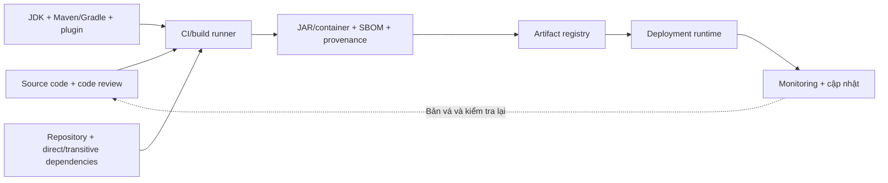
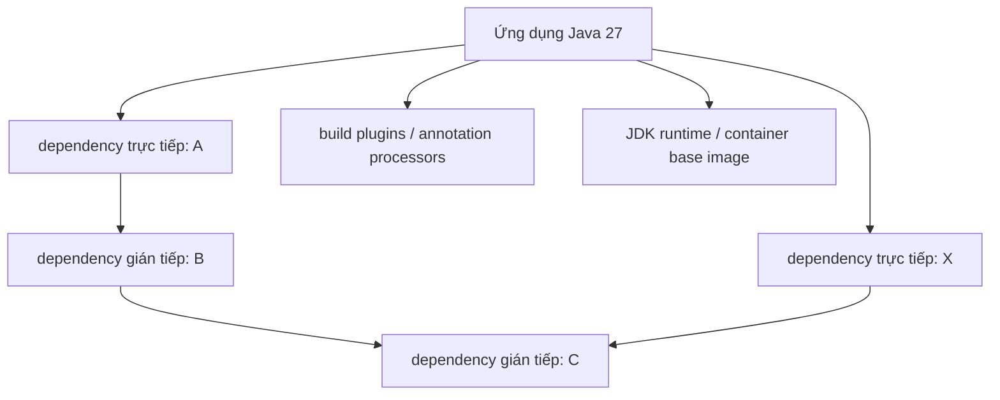
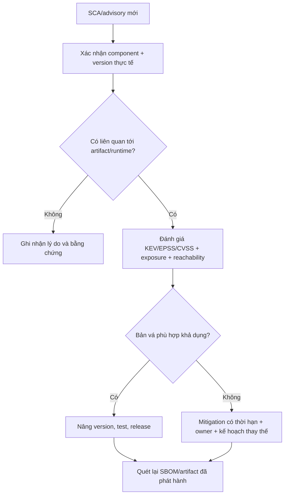
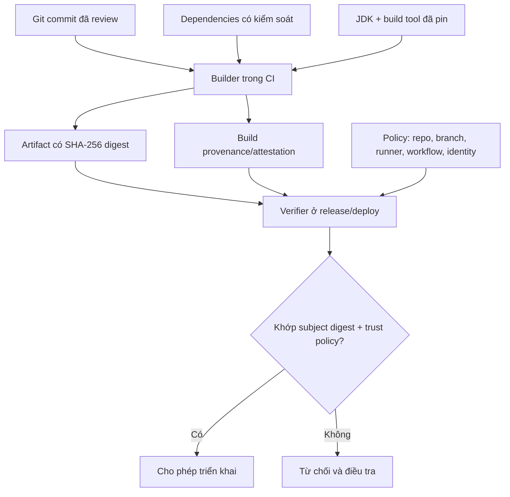

# Cập nhật JDK, kiểm tra phụ thuộc và bảo vệ chuỗi cung ứng

Một ứng dụng Java 27 có thể viết đúng logic, dùng TLS và kiểm soát quyền truy cập tốt nhưng vẫn bị xâm nhập nếu **runtime chưa được vá**, **thư viện gián tiếp có lỗ hổng** hoặc **artifact build bị thay thế bởi mã độc**. Vì vậy, bảo mật không kết thúc ở source code: cần kiểm soát toàn bộ chuỗi từ JDK/toolchain đến dependencies, build, registry và bản triển khai thực tế.

Bài học thuộc chương **Bảo mật ứng dụng Java**, trong phạm vi **Java 27 và các kiến thức liên quan**. Tất cả kỹ thuật được chọn theo yêu cầu chỉ sử dụng kiến thức vẫn còn áp dụng hiện nay, không dựa trên plugin/extensibility hoặc mô hình bảo mật JDK đã lỗi thời. Mục tiêu là xây dựng một quy trình có thể kiểm chứng, chứ không chỉ “chạy scanner rồi thấy màu xanh”.

Ba câu hỏi trung tâm:

1. **Ta đang chạy JDK nào, bản vá nào, do ai phát hành?** — quản lý toolchain và runtime.
2. **Ta đang mang những thành phần nào vào ứng dụng?** — inventory, dependency graph, Software Composition Analysis (**SCA**), Software Bill of Materials (**SBOM**).
3. **Có bằng chứng artifact được tạo đúng từ source và pipeline đã phê duyệt không?** — kiểm tra checksum/chữ ký, provenance, kiểm soát CI/CD và quyền phát hành.

## 1. Nhìn bảo mật chuỗi cung ứng theo các lớp

Một ứng dụng thường đi qua nhiều điểm tin cậy:



Mỗi mắt xích có dạng rủi ro khác nhau:

| Mắt xích | Rủi ro | Biện pháp cốt lõi |
|---|---|---|
| JDK và JRE/runtime | Chạy bản vá cũ, khác vendor hoặc sai architecture | Inventory, policy cập nhật, kiểm tra binary/runtime đang chạy |
| Thư viện trực tiếp | Phiên bản có lỗ hổng hoặc maintainer bị xâm nhập | Duyệt nguồn, version policy, SCA, thử bản nâng cấp |
| Thư viện gián tiếp | Thành phần nguy hiểm nằm sâu trong dependency graph | Phân tích **resolved** dependencies, SBOM, dependency management |
| Build plugin và build scripts | Mã tùy ý được thực thi trong lúc build | Pin plugin và wrapper, review build logic, giảm quyền runner |
| Repository/mirror | Typosquatting, dependency confusion, artifact bị thay thế | Repository allowlist, namespace policy, checksum/signature verification |
| CI/CD | Token lộ, workflow bị chỉnh sửa, runner mất tin cậy | Least privilege, branch protection, isolate untrusted PR, short-lived credentials |
| Phát hành | JAR/container không khớp source/release | Content digest, signing, provenance/attestations, verify ở nơi tiêu thụ |
| Production | Thành phần chưa được cập nhật, image cũ vẫn đang chạy | Runtime inventory, vulnerability monitoring, rollout/rollback |

Một **dependency có chữ ký hợp lệ** vẫn có thể chứa lỗ hổng; một **dependency không có CVE công khai** vẫn có thể bị cài mã độc. Cần nhiều tầng phòng vệ, không một chỉ báo duy nhất.

## 2. Trước hết phải biết đang chạy JDK nào

Đừng kết luận runtime production là Java 27 chỉ vì IDE, `pom.xml` hoặc `build.gradle.kts` chỉ định Java 27.

Kiểm tra JDK trên máy build và máy chạy:

```bash
java --version
javac --version
java -XshowSettings:properties -version
```

Kiểm tra tối thiểu:

- **Feature version**: 27, 25, 21...; xác định đặc tính ngôn ngữ/runtime.
- **Update và build**: ví dụ `27.0.1.1+4` khác `27+...`. Hai JVM đều Java 27 nhưng mức vá và các lỗi đã sửa có thể khác nhau.
- **Vendor/distribution**: Oracle, Eclipse Temurin, Amazon Corretto, Microsoft Build of OpenJDK...; cần xác định nguồn tải, kênh cập nhật, hỗ trợ và giấy phép của **đúng distribution**.
- **Hệ điều hành/kiến trúc**: Linux/Windows/macOS, x64/AArch64, glibc/musl, runtime trong container.
- **Runtime thực thi**: giá trị `JAVA_HOME` và JDK của CI **không chứng minh** image production đang dùng cùng binary.

### Ví dụ tự chứa: in thông tin Java runtime

Lưu thành `RuntimeInventoryDemo.java`:

```java
public class RuntimeInventoryDemo {
    public static void main(String[] args) {
        Runtime.Version version = Runtime.version();

        System.out.println("Feature: " + version.feature());
        System.out.println("Runtime version: "
                + System.getProperty("java.runtime.version"));
        System.out.println("Java version: "
                + System.getProperty("java.version"));
        System.out.println("Vendor: "
                + System.getProperty("java.vendor"));
        System.out.println("Runtime name: "
                + System.getProperty("java.runtime.name"));
        System.out.println("Java home: "
                + System.getProperty("java.home"));
        System.out.println("OS: "
                + System.getProperty("os.name") + " / "
                + System.getProperty("os.arch"));

        if (version.feature() != 27) {
            System.err.println(
                    "Cảnh báo: runtime không thuộc feature release Java 27");
        }
    }
}
```

Chạy trên JDK 27:

```bash
javac --release 27 RuntimeInventoryDemo.java
java RuntimeInventoryDemo
```

Kết quả thực tế phụ thuộc máy đang chạy. Không viết test đòi vendor, build number hoặc `java.home` trùng với ví dụ trong tài liệu. `Runtime.version().feature()` chỉ cho biết **major feature**, không chứng minh runtime đã nhận **bản vá bảo mật mới nhất**.

Chỉ ghi những thông tin cần thiết vào inventory/telemetry và bảo vệ hệ thống thu thập: đường dẫn máy, hostname hay cấu hình môi trường cũng có thể là dữ liệu nhạy cảm trong một số tổ chức.

## 3. Chu kỳ cập nhật JDK: feature release, bản vá và LTS

Java hiện đại có các **feature releases** định kỳ và các **update releases** giải quyết lỗi/bảo mật. Trong vận hành thực tế, cần theo dõi **nhánh JDK đang được nhà cung cấp hỗ trợ**, lịch cập nhật và thời hạn hỗ trợ phù hợp.

**Mốc thời gian minh họa đã kiểm tra ngày 27/11/2026:**

- Java 27 được phát hành ngày **15/09/2026**; đây là feature release.
- Trang download và consolidated release notes của Oracle ghi nhận **JDK 27.0.1.1**, phát hành **17/11/2026**, tại thời điểm kiểm tra.
- Oracle liệt kê **JDK 25** là nhánh **LTS** gần nhất tại thời điểm đó; Java 27 không phải bản LTS của Oracle.
- Tình trạng hỗ trợ, bản vá mới nhất và điều kiện cấp phép **có thể khác giữa các vendor và thay đổi theo thời gian**. Luôn tra lại trang chính thức của distribution mà doanh nghiệp sử dụng trước khi chọn binary.

Vì vậy **`javac --release 27` không đảm bảo đang chạy JDK 27.0.1.1** và càng không có nghĩa ứng dụng đã được vá. Cờ `--release` chủ yếu giới hạn API/ngôn ngữ/bytecode mục tiêu khi biên dịch; còn runtime sản xuất là một artifact độc lập phải được cập nhật và kiểm chứng.

### Chính sách vá hợp lý

1. Theo dõi security advisories, release notes và bản update của **vendor cụ thể** đang sử dụng.
2. Ghi rõ baseline đã phê duyệt: feature version, update/build, distribution, OS/arch, image digest.
3. Kiểm tra tính toàn vẹn nguồn tải, release artifact và chữ ký/checksum theo kênh tin cậy.
4. Chạy kiểm thử tương thích, regression, integration, hiệu năng và bảo mật trên bản cập nhật.
5. Rollout theo giai đoạn; hỗ trợ rollback **không quay về một bản dễ bị khai thác**.
6. Cập nhật **tất cả** môi trường liên quan: CI, máy dev, container/base image, runtime production, job batch, các image `jlink` đã đóng gói.
7. Ghi dấu vết deployment và xác minh phiên bản thực sự chạy sau rollout.

Với bản vá cấp bách có khai thác đang diễn ra, cần cơ chế triển khai khẩn cấp theo đánh giá rủi ro, không chờ hết một lịch nâng cấp tính năng dài hạn. Ngược lại, **không coi việc chuyển major JDK ngay lập tức là luôn cần thiết** nếu vendor đang cung cấp update bảo mật cho nhánh LTS phù hợp.

## 4. Chọn distribution JDK và kiểm tra binary

Các build OpenJDK từ nhà cung cấp khác nhau có thể cùng tuân thủ Java SE 27 nhưng khác về **hỗ trợ thương mại, chính sách phát hành update, bản vá backport, mức độ ổn định và điều kiện cấp phép**.

Khi phê duyệt distribution, cần có:

| Tiêu chí | Câu hỏi kiểm tra |
|---|---|
| Nguồn chính thức | Download từ kênh phát hành nào, domain và tổ chức nào sở hữu? |
| Signature/digest | Có SHA-256, chữ ký hoặc attestation do vendor công bố không? |
| Hỗ trợ | Nhánh này được cập nhật đến khi nào; SLA phản ứng advisory là gì? |
| Giấy phép | Có phù hợp vận hành thương mại/phân phối container không? |
| Nền tảng | Có build đúng OS/CPU, libc, kiến trúc và môi trường triển khai không? |
| Quy trình vá | Nhà cung cấp công bố bản vá và thay đổi bảo mật như thế nào? |
| Khả năng tái tạo | Có thể xác định lại chính xác binary được dùng cho một release không? |

**Không tin chỉ vì tên file chứa `jdk-27`.** Binary tải về phải được so sánh với checksum/chữ ký lấy từ kênh được xác thực; ghi lại cả **nguồn của giá trị checksum**. Một mã băm có trong cùng một trang hoặc kho đã bị xâm nhập có thể bị sửa cùng lúc với binary.

### Hash xác nhận nội dung, không xác nhận danh tính người phát hành

Ví dụ tính SHA-256 ở hệ điều hành có công cụ tương ứng:

```bash
# Linux hoặc môi trường có sha256sum
sha256sum jdk-archive.tar.gz
```

Trên Windows PowerShell:

```powershell
Get-FileHash -Algorithm SHA256 -LiteralPath .\jdk-archive.zip
```

So sánh kết quả với **giá trị kỳ vọng được xác thực từ vendor**. SHA-256 chỉ chứng minh tệp khớp digest kỳ vọng; **nếu digest kỳ vọng lấy từ nguồn không tin cậy thì việc so sánh không bảo đảm authenticity**. Khi vendor có cơ chế chữ ký, hãy xác minh danh tính key/certificate và chính sách trust tương ứng.

## 5. Khám phá phụ thuộc trực tiếp và phụ thuộc gián tiếp

Một `pom.xml` hoặc `build.gradle.kts` chỉ hiển thị một phần của những gì ứng dụng thực sự sử dụng. Một thư viện A có thể kéo theo B → C; plugin build cũng có dependency riêng; packaging có thể bổ sung runtime thành phần khác.



Đối với inventory bảo mật, cần xác định **resolved versions** được build thực sự lựa chọn, không chỉ version khai báo:

- Dependencies **compile/runtime/test** có thể khác nhau; quét đúng phần thực sự đưa vào artifact và cả những phần có khả năng thực thi trong CI.
- **Transitive** dependencies có thể chứa thành phần dễ bị khai thác dù ứng dụng không import nó trực tiếp.
- **Build plugins, annotation processors, Gradle init/settings scripts** có thể chạy code trong quá trình build — là một attack surface khác với JAR runtime.
- **Shaded/fat JAR**, nested JAR, native libraries, container layers và custom runtime images có thể làm inventory từ source khác với sản phẩm thực tế.

Kết quả quét một lần không thay thế việc theo dõi inventory của artifact đã phát hành. Giữ liên kết giữa **commit → build run → resolved dependencies → SBOM → artifact digest → deployment**.

## 6. Maven: nhìn vào dependency graph đã resolve

Trong Maven, danh sách `<dependency>` trực tiếp chưa nói đầy đủ **artifact nào được chọn** sau quá trình dependency mediation. `dependencyManagement`/BOM có thể kiểm soát version của nhiều thành phần, nhưng không biến mọi version thành an toàn.

Lệnh phổ biến (giả định dự án đã cấu hình và phê duyệt Maven Wrapper/phiên bản plugin):

```bash
./mvnw dependency:tree
./mvnw dependency:tree -Dscope=runtime
./mvnw help:effective-pom
```

Trên Windows, có thể dùng `mvnw.cmd` thay `./mvnw`. Các lệnh trên **là ví dụ hướng dẫn**, không được chạy trong bước biên soạn bài này.

Phân biệt:

- `dependency:tree` cho biết đồ thị phụ thuộc Maven xác định, hữu ích để truy ngược “thành phần C đến từ A hay B”.
- `help:effective-pom` giúp xem cấu hình sau inheritance/profiles/management, nhưng **không thay thế** đồ thị resolved runtime và inventory artifact đã đóng gói.
- Plugin, extension, annotation processor và những file được download bằng script riêng cũng cần inventory — chúng không nhất thiết xuất hiện đầy đủ trong báo cáo runtime.
- Một số dependency bị đánh dấu `provided`/`test` không được đóng gói vào ứng dụng nhưng **vẫn có thể chạy trong build/test**. Đừng bỏ qua rủi ro của build-time code.

### Dependency convergence và upper-bound rules

Maven Enforcer có những rule hiện hành như:

- `dependencyConvergence`: phát hiện cùng một artifact xuất hiện với **version khác nhau dọc các đường dependency**.
- `requireUpperBoundDeps`: yêu cầu version resolved không thấp hơn các yêu cầu phiên bản transitive tương ứng.
- `requirePluginVersions`: giúp kiểm soát việc không khai báo rõ version plugin.
- `requireReleaseDeps`: giúp ngăn đưa SNAPSHOT vào những build cần ổn định.

Các rule này giúp **khả năng dự đoán và tương thích**, không phải scanner CVE. `requireUpperBoundDeps` không có nghĩa chọn bản mới nhất trên Maven Central hoặc chứng minh không còn lỗi bảo mật.

Ví dụ về rủi ro transitive:

```text
app
+-- lib-a:2.0
|   \-- parser-core:1.7
\-- lib-b:3.1
    \-- parser-core:2.2

Phiên bản thực dùng = kết quả Maven dependency mediation/management,
không phải danh sách các yêu cầu ban đầu.
```

Nếu scanner cảnh báo `parser-core`, cần biết **version thực sự được chọn**, các đường kéo nó vào và những vùng chức năng sử dụng. Nâng cấp bằng cách áp đặt một version bất kỳ có thể phá binary compatibility; cần xem release notes, API và chạy test.

## 7. Gradle: dependency insight và lock trạng thái đã resolve

Gradle cung cấp công cụ kiểm tra các configuration cụ thể:

```bash
./gradlew dependencies --configuration runtimeClasspath
./gradlew dependencyInsight --dependency org.example:parser-core --configuration runtimeClasspath
```

`org.example:parser-core` là tọa độ minh họa; thay bằng `group:name` từ project. `dependencyInsight` trả lời “tại sao Gradle chọn version này?” và thường cho thấy dependency constraints/conflict resolution.

### Khóa phiên bản để tránh thay đổi bất ngờ

Ví dụ Kotlin DSL trong `build.gradle.kts`:

```kotlin
plugins {
    java
}

java {
    toolchain {
        languageVersion.set(JavaLanguageVersion.of(27))
    }
}

repositories {
    mavenCentral()
}

dependencyLocking {
    lockAllConfigurations()
}
```

Với Gradle version hỗ trợ các API trên, có thể tạo/cập nhật lock state khi các configuration được resolve:

```bash
./gradlew dependencies --write-locks
```

Commit những file lock được Gradle tạo ra (thường `gradle.lockfile` ở từng project). Trong CI, build thông thường có thể phát hiện việc resolution không còn khớp trạng thái đã lưu.

**Lưu ý quan trọng:**

- Locking ghim **version được chọn**, không xác minh byte của JAR, người phát hành hay tình trạng CVE.
- `dependencyLocking { lockAllConfigurations() }` áp dụng project configurations, **không tự khóa toàn bộ buildscript/plugin classpath**. Cần kiểm soát cả plugin versions, buildscript configurations và mọi included builds.
- Tránh `SNAPSHOT`/changing versions ở những build yêu cầu tính tái hiện: cùng tọa độ có thể trỏ tới byte khác dù version không đổi.
- `--write-locks` **cố ý thay đổi lock state**: chỉ sử dụng trong PR cập nhật được review; không tự chạy trong mỗi CI build bình thường.
- Nếu cần cập nhật một nhóm thành phần, dùng quy trình `--update-locks` theo hướng dẫn Gradle và review cả transitive changes.

**JDK toolchain `languageVersion=27` không ghim vendor/update build**. Với môi trường bảo mật chặt, cần khóa thêm nguồn JDK/provisioning image và xác nhận version runtime khi phát hành.

## 8. Kiểm tra tính toàn vẹn dependency: version lock khác checksum và signature

Hai bài toán có liên hệ nhưng khác nhau:

| Cơ chế | Giải quyết | Không giải quyết |
|---|---|---|
| Dependency version locking | Ngăn resolved module version đổi ngoài ý muốn | Artifact bị thay byte tại cùng version |
| SHA-256 checksum verification | Phát hiện artifact tải về khác bản có hash tin cậy | CVE trong bản gốc; danh tính nhà phát hành nếu hash không tin cậy |
| Signature verification | Kiểm tra artifact ký bởi một key/trust identity được chấp nhận | Nhà phát hành ký nhầm mã có lỗi hoặc key bị chiếm |
| SCA vulnerability scanning | Tìm **lỗ hổng đã biết** trong thành phần | Chứng minh artifact không bị thay thế/mã độc mới |
| SBOM | Liệt kê thành phần và mối quan hệ | Tự động chứng minh tính an toàn hoặc authenticity |
| Build provenance/attestation | Liên kết output với source, runner, quy trình build | Bảo đảm toàn bộ source/dependency không có lỗ hổng |

### Gradle dependency verification

Gradle có cơ chế kiểm tra **checksums và chữ ký** cho dependencies đã resolve, bao gồm artifact, metadata và plugin. Có thể tạo metadata ban đầu:

```bash
./gradlew --write-verification-metadata sha256
```

Gradle lưu kết quả vào `gradle/verification-metadata.xml`. Sau khi cấu hình đúng và có metadata phù hợp, Gradle có thể kiểm tra artifact mỗi lần build; chế độ `strict` là mặc định khi áp dụng verification.

**Bẫy khi bootstrap:** Lệnh trên ghi nhận hash của **những thứ vừa tải từ repository/cache hiện tại**. Nếu artifact đã bị đánh tráo trước đó, bạn có thể vô tình “khóa” đúng hash của file độc hại! Vì vậy:

1. Khởi tạo từ repository và môi trường được tin cậy.
2. Review diff của `verification-metadata.xml` khi thêm/nâng dependency.
3. Đối chiếu hash/key mới với nguồn độc lập được xác thực khi có thể.
4. Commit metadata đã duyệt vào version control.
5. Không tự chạy `--write-verification-metadata` rồi commit trong CI của mọi build.
6. Không tắt verification trên toàn project chỉ để bỏ một lỗi chưa điều tra.

Gradle cho phép xác minh signature và cấu hình trusted keys theo tài liệu chính thức. Nếu muốn cả hai:

```bash
./gradlew --write-verification-metadata pgp,sha256
```

Chữ ký chỉ có giá trị khi **đúng key identity được tin cậy**; việc tải một public key bất kỳ theo ID chưa đủ để chứng minh người ký là nhà phát hành dự kiến. Không dùng MD5/SHA-1 làm cơ sở kiểm tra integrity hiện đại khi có SHA-256/SHA-512.

### Giới hạn của cơ chế verification

Gradle xác minh những thành phần đi qua hệ thống dependency resolution của nó; không tự xác minh mọi file tải bằng `curl` trong script tự viết, mọi binary tool tải ngoài, mọi layer container hoặc mọi artifact được tạo nội bộ. Cần mở rộng chính sách integrity cho toàn bộ pipeline.

## 9. SCA: quét lỗ hổng đã biết một cách có hiểu biết

**Software Composition Analysis (SCA)** đối chiếu inventory dependency với advisory/vulnerability databases và điều kiện phiên bản bị ảnh hưởng. Một kết quả quét có thể bao gồm **CVE**, mức độ nghiêm trọng, affected ranges, đường phụ thuộc và fixed versions.

Nguồn/tín hiệu thường dùng:

- **Vendor advisory** và release notes của JDK/framework/thư viện.
- **OSV** hoặc cơ sở dữ liệu advisory theo ecosystem để đối chiếu package/version.
- **NVD/CVE** cho định danh và chi tiết lỗ hổng.
- **CISA Known Exploited Vulnerabilities (KEV)** để nhận biết lỗ hổng **đã bị khai thác thực tế**.
- **FIRST EPSS** để ước tính xác suất một CVE bị khai thác quan sát được trong **30 ngày tới**; EPSS không tự đo tác động lên ứng dụng cụ thể.

### Ví dụ: OWASP Dependency-Check

OWASP Dependency-Check cung cấp scanner cho Java/Maven/Gradle và các ecosystem khác. Với Maven, có thể tích hợp plugin vào lifecycle hoặc chạy goal `dependency-check:check` sau khi **pin version plugin đã được duyệt**.

Ví dụ lệnh khi plugin Maven đã được cấu hình đúng trong POM:

```bash
./mvnw dependency-check:check
```

Plugin này dùng dữ liệu vulnerability/advisory từ các nguồn bên ngoài (trong đó có NVD) và cần cơ chế cập nhật dữ liệu có kiểm soát. Trong CI production, cần:

1. **Pin version scanner**; theo dõi cập nhật của chính scanner.
2. Sử dụng nguồn dữ liệu vulnerability còn mới, có phương án mirror/cache thích hợp khi provider gián đoạn.
3. Xác định chính sách **fail build** rõ ràng; không mặc định scanner nào cũng tự fail theo CVSS nghiêm ngặt.
4. Review false positives/false negatives; xác minh tọa độ/phiên bản và môi trường.
5. Ghi suppression với **lý do, người chịu trách nhiệm và thời hạn**, không tắt mọi phát hiện.
6. Lưu báo cáo gắn với commit/build/SBOM để truy xuất lịch sử.

**Cảnh báo:** Dependency-Check cần nhận diện chính xác JAR/POM metadata. Nếu nguồn metadata/repository không khả dụng, báo cáo có thể có nhiều kết quả sai; một lượt quét “0 findings” khi dữ liệu vulnerability cũ **không chứng minh ứng dụng an toàn**.

### CVSS, KEV, EPSS không thay thế nhau

- **CVSS** mô tả mức nghiêm trọng kỹ thuật theo các điều kiện đánh giá, không phải xác suất khai thác trong mạng của bạn.
- **KEV** cho thấy bằng chứng một lỗ hổng đã bị khai thác trong thực tế; là tín hiệu ưu tiên quan trọng.
- **EPSS** là xác suất dự đoán khai thác quan sát được trong 30 ngày, không phải thang tác động hay kết luận môi trường chắc chắn bị ảnh hưởng.
- **Context ứng dụng** quyết định lỗ hổng có reachable/exploitable không, dữ liệu nào bị ảnh hưởng, có exposure Internet không và lớp giảm thiểu nào đang tồn tại.

Quyết định sửa lỗi phải tổng hợp các tín hiệu; không đưa ra quy tắc máy móc “chỉ sửa CVSS ≥ 9” rồi bỏ qua lỗ hổng thấp hơn nhưng đang bị khai thác và có đường vào trực tiếp.

## 10. Triage và sửa vulnerability theo thứ tự rủi ro

Một hàng nghìn cảnh báo không được phân loại sẽ nhanh chóng trở thành “nợ cảnh báo” không ai xử lý. Thiết kế quy trình:



Khi nhận một finding:

1. **Xác minh identity:** đúng `group:artifact:version`, hash, scope và package thực tế hay bị nhận diện nhầm?
2. **Xác minh ảnh hưởng:** JDK version/runtime hoặc thư viện có nằm trong bản deploy? Có shaded JAR, module/feature bị vô hiệu hoặc code path không reachable?
3. **Xác định exposure:** endpoint Internet-facing, input không tin cậy, quyền của tiến trình, secret/dữ liệu có thể lộ.
4. **Ưu tiên:** KEV/exploit activity, EPSS, CVSS, tác động nghiệp vụ, hệ thống nhạy cảm, controls hiện có.
5. **Chọn remediation:** cập nhật lên phiên bản có fix, áp backport từ vendor, loại bỏ dependency, đổi thư viện, cô lập tính năng hoặc mitigation tạm.
6. **Kiểm thử:** API/binary compatibility, regression, integration, security tests; so sánh dependency graph trước/sau.
7. **Phát hành:** tạo artifact mới từ pipeline tin cậy, kiểm tra digest và SBOM, rollout có quan sát.
8. **Xác nhận:** inventory các workload thực tế chạy bản mới, theo dõi lại finding; không chỉ đánh dấu ticket “đã cập nhật POM”.

Nếu không có bản vá, không để suppression vĩnh viễn thành giải pháp. Ghi **owner, quyết định chấp nhận rủi ro, expiration/review date và tiêu chí tái đánh giá**. Một mitigation như WAF hay feature flag có thể giảm rủi ro nhưng không làm biến mất thành phần dễ bị tấn công khỏi artifact.

## 11. SBOM: danh sách thành phần của **sản phẩm đã build**

**Software Bill of Materials (SBOM)** là một bản kê các thành phần phần mềm và quan hệ của chúng, giúp trả lời: “Bản phát hành X đang chứa những dependency nào?”. Các định dạng tiêu chuẩn phổ biến bao gồm **CycloneDX** và **SPDX**.

Một SBOM có thể chứa:

- Tên/phiên bản/component identity, ví dụ tọa độ Maven `group:artifact:version` hoặc package URL (`purl`).
- Các thành phần trực tiếp, gián tiếp và quan hệ dependency.
- Hash của thành phần/artifact nếu công cụ thu thập được.
- Thông tin nhà cung cấp, license và metadata liên quan.
- Danh tính, timestamp và phiên bản công cụ tạo BOM, phục vụ đánh giá độ tin cậy của thông tin.

**Đừng nhầm hai khái niệm đều có chữ “BOM”:**

| Loại BOM | Chức năng |
|---|---|
| **Maven BOM** | Một POM `dependencyManagement` để đồng bộ/chọn phiên bản phụ thuộc khi build |
| **Software Bill of Materials** | Inventory mô tả **những thành phần đã dùng** trong một sản phẩm/build cụ thể |

Import một Maven BOM **không tự tạo SBOM bảo mật**. Ngược lại, SBOM không tự thiết lập version constraint cho quá trình build.

### Gắn SBOM với artifact cụ thể

Một pipeline chuẩn có thể sản xuất các kết quả:

```text
release-2026-11/
  application.jar
  application.jar.sha256
  application.cdx.json
  provenance.intoto.jsonl
  release-manifest.json
```

Đây là **cây thư mục minh họa**, không phải file thật được tạo trong bài. Trong triển khai thực tế, manifest cần liên kết bằng **content digest** tới artifact và tài liệu đi kèm; timestamp/đường dẫn đơn thuần không đủ. SBOM nên được phát hành cùng hoặc gắn trực tiếp với artifact/version mà nó mô tả.

### Giới hạn của SBOM

- SBOM **không** chứng minh các package không có lỗ hổng.
- SBOM do một pipeline bị xâm nhập tạo ra có thể bị thiếu/sai; cần kiểm tra identity/provenance của quá trình tạo.
- Một SBOM chỉ dựa trên source resolution có thể bỏ sót JAR được shade, native binaries, tải động và phần mềm trong container/JDK image.
- Với các build đa module, multi-architecture hoặc nhiều profile, cần biết **SBOM ứng với biến thể artifact nào**.
- Thông tin license trong SBOM giúp quản trị compliance, nhưng compliance không đồng nghĩa security.

## 12. Tạo CycloneDX SBOM cho dự án Maven

CycloneDX có Maven plugin hỗ trợ sinh BOM cho từng module và **aggregate BOM** cho dự án nhiều module. Các goal hiện hành:

- `makeBom`: tạo SBOM cho một Maven module.
- `makeAggregateBom`: tạo SBOM tổng hợp ở reactor root với dependencies của các module.
- `makePackageBom`: phục vụ các gói `war`/`ear`.

Ví dụ cấu hình **minh họa** ở `pom.xml` cho dự án nhiều module:

```xml
<build>
  <plugins>
    <plugin>
      <groupId>org.cyclonedx</groupId>
      <artifactId>cyclonedx-maven-plugin</artifactId>
      <!-- Chọn và pin phiên bản release đã được phê duyệt -->
      <version>PINNED_PLUGIN_VERSION</version>
      <executions>
        <execution>
          <phase>package</phase>
          <goals>
            <goal>makeAggregateBom</goal>
          </goals>
        </execution>
      </executions>
    </plugin>
  </plugins>
</build>
```

**Trước khi sử dụng**, thay `PINNED_PLUGIN_VERSION` bằng **phiên bản stable đã được phê duyệt** và kiểm tra tương thích Maven/JDK. Snippet minh họa cấu trúc plugin, chưa phải POM hoàn chỉnh có thể dùng nguyên văn. Plugin chạy ở các giai đoạn build phù hợp khi được cấu hình đầy đủ. Xem tài liệu plugin để xác định đường dẫn output, định dạng và cấu hình trong build đa module.

Quy trình sau khi sinh SBOM:

1. Mở JSON/XML và kiểm tra các dependencies quan trọng, bao gồm transitive.
2. So khớp với artifact được đóng gói và dependency graph đã resolve.
3. Bổ sung inventory container/runtime nếu phần mềm được phân phối dưới dạng container hoặc custom JDK image.
4. Lưu SBOM cạnh artifact digest và bản provenance.
5. Dùng SBOM để theo dõi advisory sau phát hành, không chỉ scan tại thời điểm build.

Gradle cũng có các plugin CycloneDX/SBOM; chọn công cụ phù hợp dự án và **pin version plugin**, xác minh artifact của chính plugin. Đừng giả định một lệnh Gradle/Maven có cùng cấu hình hoặc output ở tất cả plugin versions.

## 13. Provenance và SLSA: biết artifact được build **ở đâu, như thế nào**

**Provenance** là bằng chứng có thể xác minh về nguồn gốc và quá trình tạo artifact — chẳng hạn source revision, builder identity, build invocation và subject digest. Nó trả lời câu hỏi: “File JAR/container này thực sự đến từ pipeline đã được phê duyệt hay không?”.



Theo **SLSA v1.2 Build Track**, các mức hỗ trợ tăng khả năng chống giả mạo/khả năng kiểm chứng:

| Mức Build | Trọng tâm theo đặc tả |
|---|---|
| L0 | Không có bảo đảm từ SLSA |
| L1 | Có provenance ghi nhận việc build |
| L2 | Provenance được ký, sinh từ hosted build platform |
| L3 | Build platform được làm cứng để tăng chống can thiệp trong lúc build |

SLSA cũng có **Source Track** riêng; không nên gọi các mức Build là chứng chỉ “toàn bộ source code hoàn toàn sạch”. Một mức SLSA không tự loại bỏ CVE, malicious dependency hoặc lỗ hổng logic.

### Verify provenance đúng cách

Khi xác minh attestation/provenance, kiểm tra cùng lúc:

1. **Subject digest** chính xác bằng digest của artifact định triển khai.
2. **Signer/issuer hoặc builder identity** nằm trong trust policy được tổ chức phê duyệt.
3. **Source repository + commit** có đúng source đã review và release tag chính thức không.
4. **Build workflow** có đúng định nghĩa/đường dẫn/phiên bản được phê duyệt không.
5. **Provenance có được tạo bởi môi trường đáng tin** và bảo vệ khỏi workflow PR không tin cậy hay không.
6. **Thời gian, input dependencies và invocation** phù hợp với yêu cầu audit nếu định dạng cung cấp.

**Không tin một file `provenance.json` chỉ vì nó nằm cạnh artifact.** Nếu một kẻ tấn công có thể thay cả JAR lẫn JSON tự khai, thông tin này không có giá trị chứng minh. Cần chữ ký hoặc attestation được xác minh theo identity/nguồn tin cậy độc lập.

Công cụ như Sigstore/cosign có thể được dùng để ký và verify artifacts/attestations theo quy trình cụ thể. Tuy nhiên, **lệnh verify phải gắn với expected identity/issuer và digest**, không chỉ kiểm tra “có chữ ký nào đó”.

## 14. Ví dụ Java 27: kiểm tra SHA-256 trước khi dùng artifact

JDK cung cấp `MessageDigest` và `HexFormat` để so sánh byte của artifact với **SHA-256 từ một kênh đáng tin cậy**. Ví dụ độc lập dưới đây không cần thư viện bên ngoài.

Lưu thành `VerifyArtifactDemo.java`:

```java
import java.io.InputStream;
import java.nio.file.Files;
import java.nio.file.Path;
import java.security.MessageDigest;
import java.util.HexFormat;

public class VerifyArtifactDemo {
    public static void main(String[] args) throws Exception {
        if (args.length != 2) {
            throw new IllegalArgumentException(
                    "Usage: java VerifyArtifactDemo <path> <trusted-sha256-hex>");
        }

        Path artifact = Path.of(args[0]);
        byte[] expected = HexFormat.of().parseHex(args[1]);

        if (expected.length != 32) {
            throw new IllegalArgumentException(
                    "SHA-256 phải có đúng 32 byte (64 ký tự hex)");
        }

        MessageDigest sha256 = MessageDigest.getInstance("SHA-256");

        try (InputStream input = Files.newInputStream(artifact)) {
            byte[] buffer = new byte[8_192];
            int count;
            while ((count = input.read(buffer)) != -1) {
                sha256.update(buffer, 0, count);
            }
        }

        byte[] actual = sha256.digest();
        if (!MessageDigest.isEqual(actual, expected)) {
            throw new SecurityException(
                    "Artifact không khớp SHA-256 đã phê duyệt");
        }

        System.out.println("SHA-256 khớp với digest tin cậy");
    }
}
```

Biên dịch bằng JDK 27:

```bash
javac --release 27 VerifyArtifactDemo.java
```

Muốn thực hành, tự tạo file thử nghiệm và lấy digest từ **nguồn được tin cậy độc lập**. Thay `<path>` và `<trusted-sha256-hex>` bằng giá trị thực khi chạy; đừng chạy nguyên các placeholder.

**Giới hạn bảo mật của ví dụ:** phép so sánh hash chỉ bảo vệ **integrity so với digest đã biết**. Nếu kẻ tấn công có thể thay đổi cả file lẫn chuỗi hash đưa vào chương trình, phép kiểm tra sẽ báo thành công cho file độc hại. Nó **không** xác minh nguồn gốc nhà phát hành hoặc chính sách build; muốn authenticity cần cơ chế chữ ký/provenance tin cậy.

## 15. JAR signing và artifact/container signing

JDK có công cụ `jarsigner` để kiểm tra chữ ký JAR:

```bash
jarsigner -verify -verbose -certs library.jar
```

Lệnh trên chỉ có giá trị bảo mật khi:

- JAR thực sự được ký và chữ ký hợp lệ theo thuật toán đang được phép.
- Chữ ký bao phủ các entry cần bảo vệ.
- Certificate/public key của người ký được đối chiếu với **trust identity đã phê duyệt**.
- Các cảnh báo về certificate chain, algorithm, timestamp, signer hoặc signature scope được xử lý.

Có thể dùng `-strict` để chuyển những cảnh báo nghiêm trọng thành lỗi theo hợp đồng công cụ, nhưng không coi việc “tool exit 0” là thay thế cho chính sách trust. **Một người ký bất kỳ ký JAR thành công không có nghĩa đó là người phát hành đúng.**

Đối với container image, chữ ký phải gắn với **digest của image cụ thể**, không chỉ tag có thể đổi. Xác minh signature/provenance trước khi cho deploy và chặn image từ registry/identity không được phê duyệt. Hash của JAR và digest của container là **hai artifact identity khác nhau**: JAR đúng nhưng base image chứa JDK chưa vá vẫn là sản phẩm có rủi ro.

## 16. Reproducible builds giúp phát hiện khác biệt, không tự chứng minh an toàn

**Reproducible build** hướng tới việc tạo **cùng byte output** khi dùng cùng source, toolchain và input trong điều kiện được kiểm soát. Điều này hỗ trợ audit và phát hiện khác biệt giữa artifact dự kiến với artifact do nhà phát hành cung cấp.

Những nguồn gây khác biệt:

- Timestamp và thứ tự entry trong JAR/ZIP.
- Thời gian build, build number hoặc thông tin máy được nhúng vào metadata.
- Dependency đổi byte tại cùng version, SNAPSHOT/changing modules.
- JDK/vendor/build tool/plugin version khác nhau.
- Locale, timezone, encoding và thứ tự duyệt file.
- Plugin sinh mã hoặc annotation processor có trạng thái không xác định.

Một build reproducible **không mặc nhiên là build an toàn**: nếu source đã bị cài backdoor, hai người build lại cùng backdoor có thể tạo digest giống nhau. Ngược lại, một build không tái hiện byte-for-byte **không tự chứng minh đã bị tấn công** — cần phân tích nguyên nhân biến động.

Khi cần kiểm chứng release:

1. Pin source commit, JDK distribution/update/build, Maven/Gradle/plugin version và dependency graph.
2. Hạn chế input không xác định và download ngoài hệ dependency management.
3. Dùng khả năng reproducible archive của toolchain tương thích khi được hỗ trợ.
4. Xây dựng ở môi trường sạch/được kiểm soát và so digest của output.
5. Điều tra mọi byte diff với chính sách release rõ ràng; giữ chứng cứ của build.

Kết hợp reproducibility với provenance và artifact signing đem lại bằng chứng mạnh hơn so với một mình bất kỳ cơ chế nào.

## 17. Bảo vệ nguồn tải: dependency confusion, typosquatting và repository shadowing

Không phải mọi cuộc tấn công chuỗi cung ứng đều cần tìm một CVE. Kẻ tấn công có thể cố đưa **một package mới có tên gây nhầm lẫn** vào dependency graph hoặc thay artifact qua cấu hình repository.

Ba tình huống điển hình:

| Rủi ro | Mô tả | Phòng vệ |
|---|---|---|
| **Typosquatting** | Dùng tọa độ giống một thư viện nổi tiếng, khác một vài ký tự | Review tọa độ chính xác, namespace và chủ sở hữu |
| **Dependency confusion** | Tên package nội bộ trùng tên package công khai; resolver có thể chọn nhầm nguồn công khai | Chính sách repository routing, kiểm soát namespace nội bộ |
| **Repository shadowing** | Một repository được ưu tiên cung cấp artifact cùng tọa độ với artifact mong muốn | Chỉ cho phép repository đã phê duyệt; checksum/signature/identity verification |

Ví dụ một tổ chức dùng tọa độ nội bộ `com.company.platform:auth-core`. Nếu một repository công khai có artifact trùng tọa độ, **thứ tự repository, cấu hình mirror và cơ chế resolution** có thể dẫn đến rủi ro tải nhầm. Đăng ký tên package giống nội bộ trên kho công khai không phải chiến lược phòng vệ toàn diện.

Biện pháp:

- Khai báo **repository allowlist**; hạn chế thêm repository mới trong module con hoặc script không review.
- Dùng internal repository manager/mirror với routing và quyền publish được kiểm soát.
- Áp dụng content filter, exclusive repository mapping hoặc chính sách namespace phù hợp với Maven/Gradle và công cụ tổ chức.
- Không cho một repository tùy ý “shadow” artifact nội bộ đã phê duyệt.
- Xác minh dependency hash/signature và review mọi artifact đổi nguồn.
- Giám sát các artifact mới mang tên gần giống package nội bộ hoặc package phổ biến.

Ngay cả khi dùng HTTPS tới Maven Central, bạn vẫn cần đánh giá **package nào** và **publisher identity nào** thực sự được phép. TLS bảo vệ đường truyền đến repository; nó không chứng minh mọi package trên repository đều đáng tin.

## 18. Bảo vệ Maven/Gradle Wrapper và build toolchain

Các wrapper thường được commit vào repository để thống nhất tool version. Vì wrapper có thể tải **bản phân phối build tool và/hoặc bootstrap code**, bản thân nó cũng là bề mặt tấn công.

### Maven Wrapper

Theo tài liệu Apache Maven Wrapper, `.mvn/wrapper/maven-wrapper.properties` có thể chứa các trường checksum:

```properties
distributionUrl=https://repo.example.com/maven/apache-maven.zip
distributionSha256Sum=PINNED_TRUSTED_SHA256_HEX
wrapperSha256Sum=PINNED_TRUSTED_WRAPPER_SHA256_HEX
```

Đây là ví dụ **minh họa cấu trúc thuộc tính**, không phải URL hoặc checksum có thật. Phải dùng distribution đúng version và digest được kiểm chứng của đúng nguồn đã duyệt. Trường `wrapperSha256Sum` có liên quan khi phương thức wrapper triển khai thực sự có/tải `maven-wrapper.jar`.

Không dùng một mirror nội bộ chưa xác thực để “tin” artifact mới chỉ vì URL nằm trong mạng công ty. Mirror, repository manager và tài khoản quản trị của chúng cũng phải được kiểm soát.

### Gradle Wrapper

Gradle Wrapper gồm scripts, thuộc tính phân phối và có thể có `gradle-wrapper.jar`. Trong quy trình review:

- Kiểm tra thay đổi `gradle/wrapper/gradle-wrapper.properties` và bootstrap JAR.
- Pin Gradle distribution và dùng checksum của distribution theo cơ chế wrapper hỗ trợ.
- Không tự động chấp nhận sửa wrapper trong PR không tin cậy.
- Cập nhật wrapper theo quy trình chính thức và review những file được tạo.
- Đảm bảo phiên bản Gradle được chọn tương thích với JDK 27; việc Java mới được phát hành không đồng nghĩa mọi phiên bản Gradle/Maven cũ đã hỗ trợ chạy trên nó.

Không có version lock nào đủ nếu **chính build tool bị thay đổi** hoặc một plugin có khả năng thực thi mã tùy ý bị chiếm quyền. Pin và xác minh cả tooling, không chỉ runtime libraries.

## 19. CI/CD: nơi dependency có thể trở thành mã thực thi

Build script, plugin, test runner và annotation processor được chạy với quyền của **build runner**. Vì vậy, một malicious dependency ở giai đoạn build có thể truy cập secret, thay output, hoặc phát hành artifact sai ngay cả khi runtime application chưa bao giờ nạp JAR đó.

Các biện pháp hiện hành:

1. **Least-privilege token:** quyền đọc source cho bước build thường; chỉ job phát hành được cấp quyền publish.
2. **Short-lived credentials:** ưu tiên identity federation/OIDC hoặc credential có vòng đời ngắn khi nền tảng hỗ trợ; không hardcode password/PAT vào repo.
3. **PR isolation:** mã từ fork/untrusted pull request không chạy với secret production hoặc quyền ghi vào release registry.
4. **Branch/tag protection:** release chỉ từ ref đã review, có approvals và chính sách change control.
5. **Pinned build actions/images:** tránh tag trôi nổi của các action nhạy cảm; xác minh nguồn/commit digest theo khả năng của CI.
6. **Ephemeral runner:** giảm lây nhiễm giữa các build; dùng cache có khóa/quyền và xác minh integrity.
7. **Repository policy:** chặn repository ngoài allowlist, scan mọi dependency mới.
8. **Separation of duties:** build và release/signing có ranh giới quyền, xác nhận artifact digest và provenance.
9. **Secure logs:** không xuất secret, auth token, private key hoặc nội dung file cấu hình nhạy cảm ra log/report.
10. **Response plan:** có thể thu hồi token, khóa workflow, dừng phát hành và tìm các release chịu ảnh hưởng khi runner hoặc dependency bị xâm nhập.

**Đừng ký artifact bằng cùng một private key lưu tĩnh trong runner có thể chạy mã PR không tin cậy.** Nếu signing service/KMS được dùng, chỉ những job đã được xác thực/phê duyệt mới được ký **đúng digest đã build**, và phải có audit trail.

## 20. Runtime cuối cùng: base image, `jlink` và môi trường sản xuất

Một ứng dụng Java 27 có thể có source và dependencies hoàn toàn phù hợp nhưng vẫn chạy trên **JDK build cũ trong container**. Chỉ cập nhật developer workstation hoặc CI toolchain là chưa đủ.

Các trường hợp cần kiểm kê riêng:

| Hình thức triển khai | Thành phần phải theo dõi |
|---|---|
| `java -jar app.jar` trên máy chủ | `java` thực tế trong `PATH`/service launcher, vendor, update, OS |
| Container có JDK/JRE | Digest của base image, JDK runtime bên trong, package hệ điều hành |
| Custom runtime image bằng `jlink` | JDK build đã dùng để link, modules/patches được đóng gói |
| Native executable hoặc native-image do toolchain ngoài JDK tạo | Runtime/stdlib/toolchain của sản phẩm cụ thể; quy trình vá riêng |
| Serverless/job chạy theo lịch | Runtime của platform hoặc image riêng, thời gian phiên bản được rollout |
| Ứng dụng Java trên máy người dùng | Trình cài đặt/bộ cập nhật và runtime đã đóng gói kèm sản phẩm |

### Custom runtime `jlink` không tự được vá

Nếu đã dùng `jlink` để đóng gói các module JDK cần thiết, image đó chứa thành phần runtime của **JDK tại thời điểm build**. Cập nhật JDK trên máy developer **không tự đổi byte trong image cũ**. Phải build lại image từ bản JDK đã vá, tạo artifact/digest/provenance mới, rồi triển khai lại.

```bash
# Đoạn minh họa công cụ kiểm kê module; không phải vulnerability scanner.
java --list-modules

# Phân tích một số dependency module của JAR ở mức bytecode.
jdeps --print-module-deps application.jar
```

`jdeps` giúp phân tích dependency tĩnh/module, **không kiểm tra CVE hoặc chứng minh an toàn**. Một ứng dụng có thư viện tải bằng reflection, plugin hoặc JNI vẫn có thể chứa dependency không hiện rõ trong phân tích tĩnh. Cần kết hợp SBOM và quan sát artifact cuối.

### Không dùng Security Manager như sandbox cho plugin

Từ **JDK 24**, Java Security Manager đã bị **vô hiệu hóa vĩnh viễn**. Trong Java 27, không thể dùng chính sách `java.security.policy` hay bật `SecurityManager` làm phương án sandbox tương đương. **JPMS `exports`/`opens` cũng không cô lập mã độc về quyền hệ điều hành.**

Nếu phải thực thi build plugin hoặc ứng dụng từ nguồn không tin cậy, dùng **cách ly cấp tiến trình/container/VM, quyền hệ điều hành tối thiểu, network egress controls và tài nguyên được giới hạn**, thay vì kỳ vọng một plugin chạy cùng JVM sẽ bị Java Security Manager chặn I/O.

## 21. Quy trình phát hành Java 27 có thể kiểm chứng

Một quy trình không cần hoàn hảo ngay từ đầu, nhưng phải xác định **chứng cứ ở mỗi bước** và điều kiện từ chối phát hành.

| Giai đoạn | Kiểm tra | Bằng chứng đầu ra |
|---|---|---|
| 1. Source review | Branch protection, người phê duyệt, secret scan, review build logic | Commit/PR đã phê duyệt |
| 2. Provision | JDK vendor/update/build; Maven/Gradle wrapper; runner image | Toolchain identity/digest |
| 3. Resolve | Repositories allowlist; transitive graph; lock & verification metadata | Dependency graph và lock state |
| 4. Build/test | Compile, unit/integration, regression, hardening, quality gates | Log và test report |
| 5. SCA | Scan với advisory data cập nhật, triage findings | Báo cáo và quyết định rủi ro |
| 6. SBOM | Sinh kê khai cho artifact/variant thực tế | SBOM JSON/XML gắn với digest |
| 7. Sign/provenance | Sinh từ identity/runner đã duyệt, ký/attest | Signature, provenance, source commit |
| 8. Publish | Upload theo digest, quyền publish hạn chế | Registry record/audit |
| 9. Deploy | Verify artifact digest, signer, provenance policy và release authorization | Deployment record |
| 10. Monitor | Inventory workload, theo dõi KEV/advisory, rollout vá | Trạng thái phiên bản đang chạy |

Một số **gates** cần định nghĩa rõ:

- Không build release nếu toolchain/JDK ngoài danh sách vendor hoặc bản vá được phép.
- Không chấp nhận dependency checksum/signature mismatch mà chưa điều tra.
- Không ký/phát hành từ PR không tin cậy hoặc job thiếu chính sách approvals.
- Không deploy artifact có digest/provenance không khớp release được duyệt.
- Với vulnerability đã biết: ưu tiên theo rủi ro, quy định mức phải chặn build và quy trình ngoại lệ có thời hạn.
- Nếu nguồn advisory không cập nhật được, cần báo rõ **scanner/data unavailable**, không ghi kết quả thành “0 CVE”.
- Giữ đủ dữ liệu để lần ngược một deployed binary về commit, toolchain, dependencies và pipeline đã tạo nó.

### Cần phân biệt “phát hành thành công” với “đã vá production”

PR nâng version Maven/Gradle được merge **chưa có nghĩa** mọi workload đã chạy thư viện mới. Release JAR mới được build **chưa có nghĩa** container image đã được tạo lại bằng JDK mới. Registry đã có image được ký **chưa có nghĩa** môi trường đang chạy đã thay image digest.

Chỉ đóng finding khi deployment inventory và kiểm tra tương ứng đã chứng minh hệ thống ở trạng thái mong muốn, hoặc khi có chấp nhận rủi ro còn hiệu lực.

## 22. Tình huống thực tế: dependency gián tiếp bị phát hiện có lỗ hổng

Giả sử một dịch vụ API viết bằng Java 27 sử dụng `report-core`. Báo cáo SCA mới báo một lỗ hổng ở `json-parser` do `report-core` kéo vào:

```text
order-service
  \-- report-core:4.2
        \-- json-parser:2.3   <-- phát hiện advisory mới

Mục tiêu: xác định phiên bản đã deploy, mức ảnh hưởng,
nâng cấp đúng cách và chứng minh bản vá thực sự tới production.
```

Quy trình xử lý:

**Bước 1 — Xác định đúng sản phẩm bị ảnh hưởng.** Tra mã build, artifact digest, SBOM và các instance thực chạy. Đừng chỉ tìm tên dependency trong source branch mới nhất.

**Bước 2 — Tìm nguồn transitive.** Dùng `mvn dependency:tree` hoặc `gradle dependencyInsight` trong đúng phiên bản source/configuration của build đang chạy. Kiểm tra có nhiều đường kéo `json-parser` vào hay có shaded copy không.

**Bước 3 — Xác minh advisory.** Đối chiếu affected version, fixed version, điều kiện kích hoạt và bằng chứng khai thác. Kiểm tra KEV/EPSS/exposure của dịch vụ; lưu kết quả kèm timestamp. Một finding do nhận diện nhầm cần xử lý bằng bằng chứng, không suppress bừa.

**Bước 4 — Lập phương án.** Ưu tiên cập nhật `report-core` lên bản tương thích đã giải quyết lỗ hổng. Nếu buộc override `json-parser`, thử nghiệm binary/API compatibility và xem release notes; không mặc định version càng cao càng an toàn hoặc tương thích.

**Bước 5 — Build và kiểm chứng.** Tạo lại resolved dependency graph, lock/verification metadata được review, chạy test, scan và sinh SBOM mới. Chỉ ký artifact mới ở pipeline tin cậy; giữ digest/provenance.

**Bước 6 — Rollout và xác nhận.** Triển khai image mới đến tất cả instance mục tiêu, theo dõi lỗi và kiểm tra chính xác image digest/thành phần runtime. Tránh rollback sang image có lỗ hổng nếu rủi ro chưa được chấp nhận.

**Bước 7 — Theo dõi sau vá.** Kiểm tra các hệ thống khác dùng cùng component, cập nhật asset inventory và cảnh báo tương lai. Lưu trace từ advisory → quyết định → patch → build → deployment.

Nếu upstream chưa có bản sửa, có thể phải loại bỏ tính năng dễ bị khai thác, dùng backport vendor hoặc cách ly tạm thời. Ghi rõ **owner, thời hạn đánh giá lại và giới hạn hiệu lực mitigation**.

## 23. Khi nghi ngờ chuỗi cung ứng đã bị xâm nhập

Khi phát hiện checksum mismatch, plugin mới bất thường, runner rò secret hoặc bản phát hành không khớp provenance, cần phản ứng như **một sự cố bảo mật**, không chỉ sửa nhanh `pom.xml` rồi build lại.

Các bước ưu tiên:

1. **Ngừng phát hành/triển khai** những artifact chưa được kiểm chứng; cô lập runner hoặc registry token đáng ngờ.
2. **Bảo toàn chứng cứ**: log CI, commit, workflow changes, dependency metadata, lockfile, binary hash, provenance, audit log và thời gian.
3. **Xác định phạm vi**: những build/artifact/deployments nào dùng cùng toolchain, plugin, cache hoặc credential đã bị ảnh hưởng?
4. **Thu hồi/luân chuyển credential** và khóa đường publish không tin cậy theo kế hoạch incident response.
5. **Xây dựng lại từ môi trường sạch**, toolchain/dependencies đã xác minh; phát hành digest và provenance mới.
6. **Kiểm tra runtime bị ảnh hưởng**: dấu hiệu truy cập bất thường, egress, secret access, artifact tải về và hành vi thực thi.
7. **Thông báo theo chính sách**, ghi hậu kiểm, bổ sung preventive controls và cập nhật monitor.

Đặc biệt, nếu một malicious build dependency đã được thực thi trong CI có quyền truy cập production secret, **nâng dependency version không tự làm secret đã lộ trở lại an toàn**. Cần xử lý phạm vi compromise và credential rotation tương ứng.

## 24. Những nhầm lẫn và lỗi quy trình phổ biến

### 24.1. “Chạy Java 27” nghĩa là đã vá đầy đủ

Sai: `feature=27` không xác định update/build/vendor đang chạy. Đọc version thực trong môi trường production và đối chiếu bản vá của distribution.

### 24.2. “Không có CVE” nghĩa là artifact an toàn

Sai: nguồn advisory có thể trễ hoặc thiếu, malicious package có thể chưa có CVE, scanner có thể nhận diện sai. Cần cả inventory, integrity, provenance và review.

### 24.3. “Có lockfile” nghĩa là JAR không thể bị thay thế

Sai: lockfile thường ghim version, không kiểm chứng byte. Dùng checksum/signature verification kèm nguồn tin cậy.

### 24.4. “Sinh hash trong CI” tự tạo bằng chứng integrity

Sai: nếu cùng pipeline bị chiếm quyền có thể thay cả artifact và hash, việc so sánh vô ích. Cần trust root và xác minh độc lập trước khi deploy.

### 24.5. “Có chữ ký” nghĩa là đúng publisher

Sai: cần kiểm tra signer identity, certificate/issuer, thuật toán, scope và policy. Một attacker có thể ký artifact bằng key của họ.

### 24.6. “Dùng Maven BOM” tức đã có SBOM

Sai: Maven BOM giúp quản lý phiên bản; SBOM mô tả thành phần của sản phẩm build. Cần generate/inventory sản phẩm thực tế.

### 24.7. “Update source” là “update sản phẩm đang chạy”

Sai: phải build, đóng gói, ký, triển khai và xác nhận deployed digest/runtime version.

### 24.8. Bỏ qua build plugin vì không đưa vào runtime

Build plugin có thể thực thi code và tiếp cận secret/runner. Kiểm soát toolchain, plugin, action, script và quyền CI.

### 24.9. Luôn chạy scanner offline với dữ liệu cũ

Quét không được cập nhật có thể bỏ qua advisory mới. Phải theo dõi freshness, lỗi update và cách xử lý khi scanner/data source không khả dụng.

### 24.10. Suppress cảnh báo không có thời hạn

Một suppress/exception vô thời hạn làm mất khả năng nhận biết rủi ro mới. Luôn ghi lý do, owner, evidence, expiration và định kỳ review.

### 24.11. Chạy build PR chưa tin cậy bằng token phát hành

Một dependency hay script trong PR có thể chạy trên runner và lấy credential. Tách quyền, cô lập PR, chỉ phát hành qua workflow được kiểm soát.

### 24.12. Dùng `SecurityManager` của các bài Java cũ để cô lập plugin

Cách này không còn hợp lệ trên Java 27 vì Security Manager đã bị vô hiệu hóa từ JDK 24. Dùng isolation ở cấp tiến trình/OS/container/VM phù hợp.

## 25. Ma trận kiểm thử pipeline bảo mật

Không chỉ kiểm tra “happy path”. Hãy thêm **negative tests** chứng minh hệ thống **từ chối** những trường hợp sai chính sách.

| Kịch bản | Cách mô phỏng ở môi trường thử nghiệm | Kết quả mong đợi |
|---|---|---|
| JDK sai feature | Chạy inventory bằng runtime không phải Java 27 | Phát hiện lệch baseline nếu policy yêu cầu 27 |
| JDK 27 nhưng patch cũ | Dùng image test có `java.runtime.version` thấp hơn baseline | Policy cảnh báo/chặn theo mốc đã phê duyệt |
| Dependency transitive đổi version | Thử sửa config để resolution khác lock state | Gradle lock/CI phát hiện thay đổi |
| Artifact bị sửa byte | Tạo bản sao JAR rồi thay byte trong **file thử nghiệm** | SHA-256 verification không khớp, từ chối |
| Digest “được tạo từ cùng file độc hại” | Dùng hash mới của file đã sửa | Cho thấy vì sao cần trusted expected digest độc lập |
| Dependency verification thiếu checksum mới | Thêm package test chưa có trong metadata đã duyệt | Build fail ở verification khi áp dụng strict policy |
| Scanner mất kết nối nguồn CVE | Cấu hình mirror thử không truy cập được | Ghi “scanner unavailable/stale”, không ghi “0 vulnerabilities” |
| SCA phát hiện false positive | Dùng advisory test có version/identity không khớp | Triage ghi evidence, suppression có owner/expiration |
| Có SBOM nhưng không khớp artifact | Ghép nhầm SBOM giữa hai build | Gate phát hiện mismatch ở manifest/subject binding |
| Provenance từ builder không tin cậy | Ký thử bằng identity không trong allowlist | Policy verify từ chối dù chữ ký hợp lệ về mặt toán học |
| Artifact digest khác attestation | Thay artifact test, giữ provenance cũ | Gate không cho deploy |
| PR không tin cậy | Chạy workflow test không có production secrets | Không được cấp quyền ký/publish |
| Thêm repository trái phép | Thêm repo ngoài allowlist trong branch thử | Review/build policy từ chối |
| Build với base image cũ | Chạy inventory trên image thử đã đánh dấu outdated | Cần rebuild/redeploy bằng image được duyệt |
| JAR runtime mới nhưng deployment cũ | Cố tình giữ canary/instance test ở digest cũ | Inventory xác định instance chưa cập nhật |

Không thử cố tình cài mã độc hoặc đọc credential thật trên runner production. Các bài kiểm thử supply-chain nên sử dụng **artifact vô hại, repository test và môi trường được cách ly**.

### Xác minh âm tính quan trọng hơn log “đã bật tính năng”

Một dòng log `"dependency verification enabled"` không đủ. Cần chứng minh thay một artifact được kiểm thử thành byte không khớp sẽ khiến quá trình build **thất bại**, và một provenance có signer/build identity không đúng sẽ khiến deployment **bị từ chối**.

Ngược lại, SCA phải có cơ chế phân biệt **finding thật** với **scanner bị lỗi**, tránh báo “không có vulnerability” chỉ vì dữ liệu advisory không tải được.

## 26. Bài tập thực hành

**Bài 1 — Inventory JDK.** Chạy `RuntimeInventoryDemo` trên hai môi trường development và container thử. So sánh `feature`, `java.runtime.version`, `java.vendor`, `java.home` và kiến trúc. Giải thích vì sao `javac --release 27` không kiểm soát runtime image.

**Bài 2 — Dependency graph.** Với một dự án Maven hoặc Gradle mẫu, xuất cây phụ thuộc `runtimeClasspath`/runtime scope. Chọn một thư viện transitive, truy ra direct dependency nào kéo nó vào và giải thích tại sao version thật có thể khác version khai báo gián tiếp.

**Bài 3 — Gradle locking.** Kích hoạt `dependencyLocking`, sinh lock state bằng `--write-locks`, commit vào một branch thử. Thay đổi một dependency rồi kiểm tra behavior khi build với lock cũ. Giải thích lúc nào cần cập nhật lock state một cách có review.

**Bài 4 — Integrity verification.** Tạo một file văn bản thử nghiệm, lưu SHA-256 đã xác nhận, chạy `VerifyArtifactDemo`. Thay nội dung file để quan sát lỗi. Sau đó tự tính hash mới và giải thích tại sao “hash mới khớp file mới” không chứng minh authenticity.

**Bài 5 — SCA và triage.** Chạy scanner dependency đã được cấu hình trên dự án thử. Chọn một finding, xác minh package/version, affected range, đường dependency, KEV/EPSS/exposure và phương án sửa. Viết quyết định rủi ro có owner và deadline, kể cả khi kết luận là false positive.

**Bài 6 — SBOM.** Tạo CycloneDX SBOM cho dự án nhiều module thử nghiệm. Kiểm tra các thành phần trực tiếp/gián tiếp và xem plugin/runtime dependency nào có thể không xuất hiện trong SBOM ứng dụng. Giải thích cách liên kết SBOM với artifact digest.

**Bài 7 — Provenance policy.** Thiết kế một gate yêu cầu artifact digest, source repository/commit, builder identity và release workflow khớp allowlist. Tạo hai dữ liệu attestation giả lập: một hợp lệ và một có source/build identity sai. Xác định điều kiện từ chối.

**Bài 8 — Base image/JDK patch.** Mô tả cách rebuild container hoặc custom runtime `jlink` sau khi vendor JDK phát hành bản update bảo mật. Xác định những bước xác nhận production đang chạy image digest mới.

**Bài 9 — Tình huống sự cố.** Giả sử một tài khoản publish plugin Maven/Gradle bị chiếm quyền và plugin độc hại từng chạy trong CI. Viết kế hoạch xác định build chịu ảnh hưởng, kiểm tra secret exposure, thu hồi credential, phát hành lại và lưu evidence.

**Bài 10 — Kiểm thử fail-closed.** Thiết kế một test khiến dependency checksum mismatch hoặc provenance signer mismatch trong môi trường giả lập. Xác nhận pipeline chặn phát hành thay vì chỉ hiển thị warning.

## 27. Checklist bảo mật chuỗi cung ứng Java 27

### Runtime và toolchain

- [ ] Đã inventory **runtime thực tế** (vendor, feature/update/build, OS/arch) cho tất cả workload chưa?
- [ ] Có theo dõi bản vá/advisory của distribution JDK đã chọn và thời hạn hỗ trợ không?
- [ ] Đã cập nhật cả container/base image, `jlink` image, batch job và CI runner?
- [ ] Có kiểm tra checksum/chữ ký binary JDK với nguồn tin cậy không?
- [ ] Maven/Gradle wrapper và plugin versions đã được pin, review và xác minh chưa?
- [ ] Có tránh cơ chế sandbox `SecurityManager` lỗi thời và thiết kế isolation phù hợp chưa?

### Dependencies và scanner

- [ ] Đã inventory cả **direct, transitive, runtime, build plugins và annotation processors**?
- [ ] Đã dùng repository allowlist/namespace policy để giảm dependency confusion?
- [ ] Dependency versions và artifacts có cơ chế locking/verification phù hợp?
- [ ] Có tránh floating/changing versions trong release build nếu thiếu chính sách?
- [ ] SCA có dữ liệu advisory cập nhật và cảnh báo rõ khi không truy cập được nguồn?
- [ ] Finding được ưu tiên theo KEV/EPSS/CVSS **và context ứng dụng**, không chỉ theo điểm?
- [ ] Suppression/exception có owner, lý do, evidence và thời hạn xem xét lại?
- [ ] Đã kiểm thử compatibility và quét lại sau khi cập nhật transitive dependency?

### Artifact, CI/CD và production

- [ ] Có SBOM cho **artifact/variant đã phát hành**, gồm thành phần trong image/container?
- [ ] SBOM, artifact digest và provenance được liên kết và lưu cùng release?
- [ ] Chữ ký/provenance được verify theo signer/builder identity, source và workflow đã duyệt?
- [ ] PR không tin cậy được cách ly khỏi secrets và quyền phát hành?
- [ ] Build runner/cache, registry, KMS/signing service có least privilege và audit log?
- [ ] Gate có fail khi digest/signature/provenance sai, không chỉ báo warning?
- [ ] Release có thể trace từ deployed image về build/source/JDK/dependencies?
- [ ] Có rollback/incident response nhưng không quay lại bản dễ bị khai thác không?
- [ ] Có theo dõi advisory **sau khi sản phẩm đã phát hành**, không chỉ lúc CI build?

## 28. Nguồn tham khảo chính thức và tài liệu tiếp tục học

### JDK và công cụ Java

- [Oracle — Java Downloads](https://www.oracle.com/java/technologies/downloads/): các distribution/bản JDK đang được Oracle phát hành; kiểm tra version, license và link download tại thời điểm sử dụng.
- [Oracle — Consolidated JDK 27 Release Notes](https://www.oracle.com/java/technologies/javase/27all-relnotes.html): cập nhật, bản vá và thông tin release cho JDK 27.
- [Java SE 27 — `Runtime.Version`](https://docs.oracle.com/en/java/javase/27/docs/api/java.base/java/lang/Runtime.Version.html): phiên bản Java runtime ở cấp API.
- [Java SE 27 — `MessageDigest`](https://docs.oracle.com/en/java/javase/27/docs/api/java.base/java/security/MessageDigest.html): tạo digest SHA-256 và so sánh byte.
- [Java SE 27 — `HexFormat`](https://docs.oracle.com/en/java/javase/27/docs/api/java.base/java/util/HexFormat.html): mã hóa/giải mã hex.
- [Java SE 27 — `jdeps`](https://docs.oracle.com/en/java/javase/27/docs/specs/man/jdeps.html): phân tích dependency tĩnh/module, không phải vulnerability scanner.
- [Java SE 27 Security Overview](https://docs.oracle.com/en/java/javase/27/security/java-security-overview1.html): các thành phần bảo mật và công cụ `jarsigner`/`keytool`.
- [JEP 486 — Permanently Disable the Security Manager](https://openjdk.org/jeps/486): giải thích vì sao không dùng Security Manager như sandbox trong Java 27.

### Dependencies, SBOM và supply chain

- [Apache Maven — Dependency Plugin](https://maven.apache.org/plugins/maven-dependency-plugin/): đọc dependency tree và phân tích phụ thuộc Maven.
- [Apache Maven — Enforcer Rules](https://maven.apache.org/enforcer/enforcer-rules/index.html): version/toolchain policies, dependency convergence và upper-bound rules.
- [Apache Maven — Maven Wrapper](https://maven.apache.org/tools/wrapper/): `distributionSha256Sum`, `wrapperSha256Sum` và kiểm soát distribution.
- [Gradle — Dependency Locking](https://docs.gradle.org/current/userguide/dependency_locking.html): khóa resolved versions và quy trình cập nhật lock state.
- [Gradle — Securing Dependencies](https://docs.gradle.org/current/userguide/dependency_verification.html): kiểm tra dependency checksums/signatures và giới hạn khi bootstrap metadata.
- [Gradle — Securing the Build Tool](https://docs.gradle.org/current/userguide/securing_build_tool.html): bảo vệ wrapper, cache, build logic và repository.
- [OWASP Dependency-Check](https://dependency-check.github.io/DependencyCheck/): rà soát thành phần có lỗ hổng đã biết và cập nhật dữ liệu.
- [OWASP Dependency-Check Maven Plugin](https://dependency-check.github.io/DependencyCheck/dependency-check-maven/index.html): cách tích hợp Maven và các lưu ý dữ liệu vulnerability.
- [CycloneDX Maven Plugin](https://cyclonedx.github.io/cyclonedx-maven-plugin/): tạo CycloneDX SBOM cho Maven.
- [SLSA v1.2 — Build Track Basics](https://slsa.dev/spec/v1.2/build-track-basics): mức bảo vệ của provenance và build platforms.
- [SLSA v1.2 — Provenance](https://slsa.dev/spec/v1.2/provenance): nguồn gốc của artifact và attestation.
- [CISA — Known Exploited Vulnerabilities](https://www.cisa.gov/known-exploited-vulnerabilities-catalog): các vulnerability đã được xác nhận có khai thác trong thực tế.
- [FIRST — EPSS](https://www.first.org/epss/): xác suất khai thác dự báo trong 30 ngày và giới hạn của chỉ số.
- [OSV](https://osv.dev/): tra cứu vulnerability theo package ecosystem và version.

**Kết luận:** Bảo vệ chuỗi cung ứng Java 27 là một **quy trình liên tục**. Cần biết đúng JDK đang chạy và vá kịp thời; kiểm tra cả dependency trực tiếp, gián tiếp và build-time; xác minh bytes/identity của những artifact được tải; và lưu SBOM, digest, provenance cho từng bản phát hành. Không cơ chế đơn lẻ nào đủ: **version lock không thay checksum**, **checksum không thay chữ ký/provenance**, **chữ ký không thay SCA**, còn **SCA không chứng minh ứng dụng không có lỗ hổng chưa công bố**. Một release chỉ thật sự được kiểm soát khi có thể nối liền **source đã duyệt → build tin cậy → artifact đã xác minh → runtime đã cập nhật → giám sát và phản ứng sau phát hành**.
