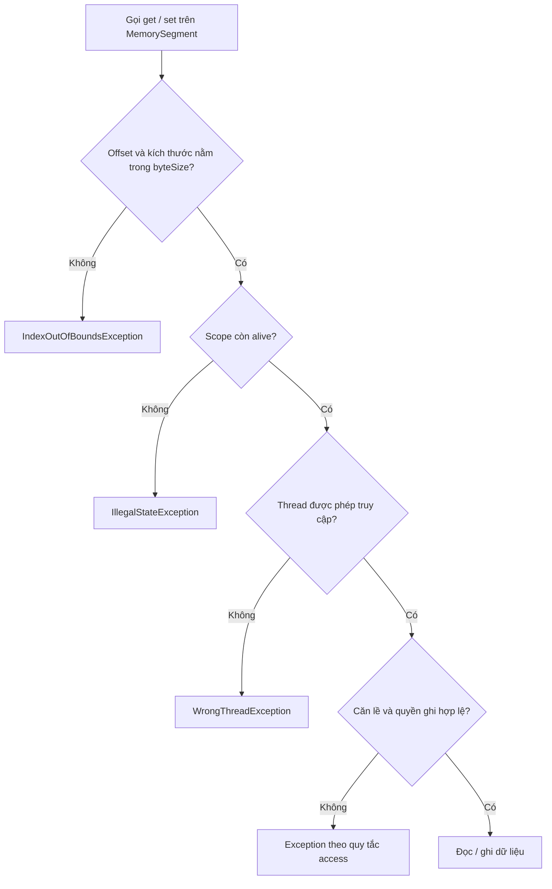

# Arena, MemorySegment và vòng đời vùng nhớ

Trong Java 27, ứng dụng có thể thao tác với bộ nhớ **nằm ngoài Java heap** (*off-heap/native memory*) thông qua **Foreign Function & Memory API (FFM API)** thuộc gói `java.lang.foreign`. Bộ API này được chính thức hóa trong **JDK 22 (JEP 454)** và vẫn được hỗ trợ trong Java 27.

Hai kiểu trọng tâm của bài học thuộc chương **Bộ nhớ ngoài heap và mã native** là:

- **`MemorySegment`**: một cách biểu diễn vùng bộ nhớ liên tục, có kích thước và phạm vi truy cập rõ ràng. Nó có thể biểu diễn bộ nhớ **on-heap** hoặc **off-heap**.
- **`Arena`**: bộ cấp phát và quản lý vòng đời của những vùng bộ nhớ native mà nó tạo ra; có thể tự đóng, chia sẻ giữa các thread hoặc được quản lý theo cơ chế tự động.

Lợi ích chính không đơn thuần là “thay `byte[]` bằng vùng nhớ nhanh hơn”. FFM cung cấp mô hình thể hiện rõ **ranh giới không gian** (không đọc/ghi ngoài vùng đã cấp), **ranh giới thời gian** (không truy cập sau khi scope đã bị đóng) và **quyền truy cập theo thread**. Những bảo đảm này đặc biệt quan trọng khi trao đổi dữ liệu với mã native, làm việc với file được memory-map, hoặc xử lý buffer lớn có vòng đời xác định.

Mục tiêu của bài:

1. Phân biệt Java heap, native memory, `MemorySegment` và `Arena`.
2. Chọn đúng `Arena.ofConfined()`, `ofShared()`, `ofAuto()` hoặc `global()`.
3. Cấp phát, đọc và ghi dữ liệu qua `ValueLayout`, xử lý offset, alignment và byte order.
4. Quản lý vùng nhớ bằng `try-with-resources` và hiểu lỗi sau khi đóng arena.
5. Làm việc với slice, read-only view, mảng Java và nhiều thread mà không dùng shared mutable state sai cách.
6. Nhận diện những giới hạn thực tế của FFM khi truyền con trỏ cho native code và khi giải phóng tài nguyên.

Các ví dụ chính sử dụng **API ổn định** của Java 27, không yêu cầu `--enable-preview`. Chúng cũng không cần bật native access vì chỉ sử dụng những thao tác cấp phát và đọc/ghi an toàn; một số thao tác FFM khác, đặc biệt như gọi hàm native qua linker hoặc diễn giải lại địa chỉ bộ nhớ không đáng tin, thuộc diện *restricted* và có điều kiện cấp quyền riêng.

## 1. Vì sao phải quan tâm đến bộ nhớ ngoài heap?

Đối tượng thông thường, `byte[]`, `int[]`, `String` và các record Java được quản lý bởi JVM trên Java heap. Garbage collector đảm nhiệm vòng đời của những đối tượng này khi chúng không còn được tham chiếu.

```java
byte[] bytes = new byte[1024];
int[] numbers = new int[256];
```

Nhưng một số bài toán cần thao tác với vùng nhớ có biểu diễn và vòng đời phù hợp hơn cho native code:

- Truyền một buffer hoặc một cấu trúc dữ liệu cho thư viện C qua FFM.
- Điều khiển rõ thời điểm giải phóng một vùng native memory lớn.
- Tổ chức dữ liệu dạng nhị phân với offset, kích thước và thứ tự byte xác định.
- Ánh xạ một file vào bộ nhớ để truy cập trực tiếp một phần nội dung.
- Tránh một số bước sao chép dữ liệu giữa các tầng khi hợp đồng của API cho phép.

Ví dụ, một thư viện native có thể đòi một con trỏ tới một vùng chứa các số nguyên 32-bit. Không nên tự biến địa chỉ bộ nhớ thành `long` rồi đọc/ghi tùy ý. Với FFM, ta có thể cấp phát một vùng native và truy cập qua `MemorySegment` có kiểm tra giới hạn.

### Off-heap không đồng nghĩa không có chi phí

Native memory vẫn là **bộ nhớ của tiến trình**, tiêu thụ RAM hoặc không gian địa chỉ và có thể gây cạn tài nguyên. Garbage collector không tự bảo đảm sẽ thu hồi **đúng lúc** một vùng native được cấp phát thủ công. Lập trình viên phải xác định rõ ai sở hữu arena, khi nào đóng và có còn tác vụ nào đang dùng vùng nhớ đó hay không.

Các thao tác trên `MemorySegment` cũng có chi phí kiểm tra và có thể liên quan đến native allocation. Không giả định off-heap luôn nhanh hơn heap; quyết định tối ưu cần được kiểm chứng bằng profiling và bài đo trên workload thực tế.

## 2. MemorySegment là gì?

`MemorySegment` là interface **sealed** của `java.lang.foreign`, biểu diễn một vùng bộ nhớ liên tục.

Mỗi segment có những thuộc tính quan trọng:

| Thuộc tính | API liên quan | Ý nghĩa |
|---|---|---|
| Kích thước | `byteSize()` | Số byte nằm trong vùng được phép truy cập |
| Địa chỉ | `address()` | Địa chỉ/vị trí của vùng nhớ; ý nghĩa khác nhau giữa heap và native |
| Vòng đời | `scope()` | Scope quyết định vùng nhớ còn hợp lệ hay không |
| Khả năng truy cập | `isAccessibleBy(Thread)` | Thread được phép truy cập segment hay không |
| Tính chỉ đọc | `isReadOnly()`, `asReadOnly()` | Cho phép cấm thao tác ghi qua một view |
| Phân vùng | `asSlice(...)` | Tạo view con với giới hạn không gian hẹp hơn |

Có hai loại vùng nhớ:

**Heap segment** được tạo từ mảng Java hoặc một buffer thích hợp. Ví dụ:

```java
import java.lang.foreign.MemorySegment;
import java.lang.foreign.ValueLayout;

byte[] input = {10, 20, 30};
MemorySegment heap = MemorySegment.ofArray(input);

System.out.println(heap.byteSize());                 // 3
System.out.println(heap.get(ValueLayout.JAVA_BYTE, 1)); // 20
```

Đây **không phải** off-heap: dữ liệu vẫn nằm trong mảng Java. Việc sửa dữ liệu qua segment sẽ ảnh hưởng tới mảng gốc.

**Native segment** có thể được cấp phát bởi `Arena`:

```java
import java.lang.foreign.Arena;
import java.lang.foreign.MemorySegment;

try (Arena arena = Arena.ofConfined()) {
    MemorySegment nativeBytes = arena.allocate(128);
    System.out.println(nativeBytes.byteSize()); // 128
}
```

Vùng 128 byte được cấp phát ngoài Java heap và gắn với vòng đời của `arena`. Khi khối `try` kết thúc bình thường hoặc do ngoại lệ, `arena.close()` được gọi tự động.

### Ba hàng rào an toàn



Sơ đồ chỉ mô tả **các điều kiện logic**, không cam kết thứ tự kiểm tra ngoại lệ bên trong JVM. Với một thao tác cụ thể, ngoại lệ có thể còn phụ thuộc loại layout, trạng thái read-only và alignment.

Các phép kiểm tra này cung cấp cơ chế truy cập có ranh giới chặt chẽ hơn việc tự thao tác trên con trỏ thô. Tuy nhiên, chúng **không bảo vệ mọi lỗi native code** nếu ứng dụng chủ động dùng API restricted để đưa địa chỉ hoặc kích thước sai vào chương trình.

## 3. Arena: chủ sở hữu vòng đời của vùng nhớ native

`Arena` là interface vừa mở rộng `SegmentAllocator`, vừa triển khai `AutoCloseable`. Arena cho phép tạo các segment native và quyết định **khi nào vùng nhớ có thể bị thu hồi**, cùng với chính sách truy cập giữa các thread.

```java
try (Arena arena = Arena.ofConfined()) {
    MemorySegment first = arena.allocate(64);
    MemorySegment second = arena.allocate(32);

    System.out.println(first.byteSize());  // 64
    System.out.println(second.byteSize()); // 32
}
// Cả hai vùng native đã cấp phát qua arena đều không còn hợp lệ.
```

Một arena có thể quản lý **nhiều segment**. Các segment chia sẻ cùng arena scope, nhưng những lần cấp phát khác nhau được yêu cầu không chồng lấp vùng nhớ. Arena không phải một segment; `arena.allocate(...)` mới trả về segment mô tả vùng nhớ được cấp.

### Bốn loại Arena hiện hành

| Loại | Tạo bằng | Thread có thể truy cập | Có gọi `close()` chủ động? | Vòng đời |
|---|---|---|---|---|
| **Confined** | `Arena.ofConfined()` | Chỉ owner thread | Có, bởi owner | Xác định rõ đến khi close |
| **Shared** | `Arena.ofShared()` | Bất kỳ thread | Có, từ thread bất kỳ | Xác định rõ đến khi close |
| **Automatic** | `Arena.ofAuto()` | Bất kỳ thread | Không | GC quản lý; thời điểm giải phóng không xác định |
| **Global** | `Arena.global()` | Bất kỳ thread | Không | Không giải phóng vùng đã cấp trong vòng đời JVM |

Đối với phần lớn thao tác ngắn hạn, một confined arena với `try-with-resources` là lựa chọn dễ kiểm soát. Với tác vụ thực sự cần chia sẻ **cùng một vùng native memory** giữa nhiều thread, cân nhắc shared arena. Hai loại còn lại có mục đích khác và không phải thay thế chung cho việc quản lý tài nguyên tường minh.

`Arena.global()` không phải “pool bộ nhớ thông minh”: vùng native được cấp qua nó **không bao giờ được giải phóng** theo hợp đồng của arena này. Vì vậy, không cấp phát liên tục bằng global arena trong một server dài hạn nếu chưa có lý do kiến trúc thật sự.

## 4. Cấp phát và thao tác với ValueLayout

Cách đọc/ghi dữ liệu có kiểu trên segment là dùng `ValueLayout`:

```java
import java.lang.foreign.Arena;
import java.lang.foreign.MemorySegment;
import java.lang.foreign.ValueLayout;

try (Arena arena = Arena.ofConfined()) {
    MemorySegment memory = arena.allocate(
        ValueLayout.JAVA_INT.byteSize(),
        ValueLayout.JAVA_INT.byteAlignment()
    );

    memory.set(ValueLayout.JAVA_INT, 0, 1234);

    int value = memory.get(ValueLayout.JAVA_INT, 0);
    System.out.println(value); // 1234
}
```

Các thành phần:

1. `JAVA_INT` mô tả một giá trị `int` Java: kích thước, alignment và byte order.
2. `arena.allocate(bytes, alignment)` cấp phát một vùng native có đủ byte và điều kiện căn lề.
3. `set(layout, offset, value)` ghi giá trị ở **offset tính theo byte**.
4. `get(layout, offset)` đọc giá trị cùng layout và offset đó.

Không nhầm **offset byte** với **index phần tử**. Muốn đọc phần tử thứ ba của dãy `int`, offset tương ứng là `2 × 4 = 8` byte khi mỗi `int` chiếm 4 byte.

### Dùng getAtIndex / setAtIndex cho dãy đồng nhất

```java
try (Arena arena = Arena.ofConfined()) {
    long count = 4;
    long bytes = Math.multiplyExact(
        count, ValueLayout.JAVA_INT.byteSize()
    );

    MemorySegment values = arena.allocate(
        bytes, ValueLayout.JAVA_INT.byteAlignment()
    );

    values.setAtIndex(ValueLayout.JAVA_INT, 0, 11);
    values.setAtIndex(ValueLayout.JAVA_INT, 1, 22);
    values.setAtIndex(ValueLayout.JAVA_INT, 2, 33);
    values.setAtIndex(ValueLayout.JAVA_INT, 3, 44);

    System.out.println(
        values.getAtIndex(ValueLayout.JAVA_INT, 2)
    ); // 33
}
```

`getAtIndex` và `setAtIndex` tính offset từ index và kích thước layout, rất phù hợp cho vùng nhớ như một mảng giá trị đồng nhất. Dù vậy, đây **không phải** mảng Java, và `MemorySegment` không tự quản lý số phần tử theo kiểu `List<Integer>`: bạn cần biết layout và số phần tử hợp lệ.

Đối với các phép tính kích thước từ input không tin cậy, tránh `count * elementSize` có thể tràn `long`; `Math.multiplyExact` cho phép phát hiện overflow. Phải giới hạn tối đa vùng nhớ được phép cấp phát theo ngân sách ứng dụng.

### Native memory được khởi tạo về zero

Các vùng native do những factory arena chuẩn cấp phát được **zero-initialized**:

```java
try (Arena arena = Arena.ofConfined()) {
    MemorySegment memory = arena.allocate(ValueLayout.JAVA_LONG);
    System.out.println(memory.get(ValueLayout.JAVA_LONG, 0)); // 0
}
```

Không nhầm việc khởi tạo zero với việc bảo đảm nội dung của vùng mapped file hoặc vùng có địa chỉ tùy ý từ bên ngoài: chúng có nguồn dữ liệu và hợp đồng khác.

## 5. Spatial bounds, alignment và byte order

### Giới hạn vùng nhớ

Nếu segment có 8 byte, không thể đọc một `long` 8 byte từ offset 1:

```java
try (Arena arena = Arena.ofConfined()) {
    MemorySegment memory = arena.allocate(8, 8);

    memory.set(ValueLayout.JAVA_LONG, 0, 123L);

    // Không hợp lệ: cần 8 byte kể từ offset 1, vượt byteSize.
    // long invalid = memory.get(ValueLayout.JAVA_LONG, 1);
}
```

Thao tác vượt ranh giới sẽ bị từ chối (thường bằng `IndexOutOfBoundsException`). Đây là khác biệt cốt lõi với việc thao tác trên địa chỉ thô không có kích thước.

### Alignment

`ValueLayout.JAVA_LONG` yêu cầu alignment tự nhiên 8 byte; `JAVA_INT` yêu cầu 4 byte. Nếu dữ liệu nằm tại offset không phù hợp với layout, thao tác có thể bị từ chối bởi kiểm tra alignment.

```java
try (Arena arena = Arena.ofConfined()) {
    MemorySegment bytes = arena.allocate(16, 8);

    bytes.set(ValueLayout.JAVA_LONG, 0, 100L); // offset phù hợp

    // Không dùng JAVA_LONG ở offset 1 với yêu cầu alignment 8.
    // bytes.set(ValueLayout.JAVA_LONG, 1, 200L);
}
```

Đối với định dạng dữ liệu thực sự cho phép dữ liệu *unaligned*, Java có các layout như `ValueLayout.JAVA_INT_UNALIGNED` hoặc `JAVA_LONG_UNALIGNED`. Chỉ dùng khi định dạng nguồn yêu cầu và đã kiểm tra hiệu năng/hỗ trợ phần cứng; **không** dùng layout unaligned để lờ đi một lỗi căn lề của ABI native.

### Byte order

Các hằng `ValueLayout.JAVA_INT`, `JAVA_LONG` sử dụng **native byte order** của nền tảng. Đối với tệp hoặc giao thức quy định **big-endian**, cần chỉ rõ thứ tự byte:

```java
import java.nio.ByteOrder;

var bigEndianInt = ValueLayout.JAVA_INT.withOrder(ByteOrder.BIG_ENDIAN);

try (Arena arena = Arena.ofConfined()) {
    MemorySegment buffer = arena.allocate(
        4, ValueLayout.JAVA_INT.byteAlignment()
    );

    buffer.set(bigEndianInt, 0, 0x01020304);

    System.out.printf(
        "%02X %02X %02X %02X%n",
        Byte.toUnsignedInt(buffer.get(ValueLayout.JAVA_BYTE, 0)),
        Byte.toUnsignedInt(buffer.get(ValueLayout.JAVA_BYTE, 1)),
        Byte.toUnsignedInt(buffer.get(ValueLayout.JAVA_BYTE, 2)),
        Byte.toUnsignedInt(buffer.get(ValueLayout.JAVA_BYTE, 3))
    );
    // 01 02 03 04
}
```

Đừng dùng byte order mặc định khi đang đọc một file hoặc giao thức có endian được đặc tả rõ. **Kiểu Java giống nhau chưa chắc cấu trúc byte giống nhau**.

## 6. Scope và lỗi truy cập sau khi close()

Mỗi `MemorySegment` liên kết với một `MemorySegment.Scope`. Scope là mô hình về **thời điểm vùng nhớ còn hợp lệ**; `segment.scope().isAlive()` cho biết trạng thái hiện tại.

```java
import java.lang.foreign.Arena;
import java.lang.foreign.MemorySegment;
import java.lang.foreign.ValueLayout;

MemorySegment escaped;

try (Arena arena = Arena.ofConfined()) {
    escaped = arena.allocate(ValueLayout.JAVA_INT);
    escaped.set(ValueLayout.JAVA_INT, 0, 99);

    System.out.println(escaped.scope().isAlive()); // true
    System.out.println(escaped.get(ValueLayout.JAVA_INT, 0)); // 99
}

System.out.println(escaped.scope().isAlive()); // false

try {
    escaped.get(ValueLayout.JAVA_INT, 0);
} catch (IllegalStateException exception) {
    System.out.println("Arena đã đóng; segment không còn truy cập được");
}
```

Biến Java `escaped` vẫn giữ một **đối tượng mô tả segment**, nhưng vùng native mà nó tham chiếu không còn hợp lệ sau khi đóng arena. `MemorySegment` không cho phép truy cập vùng đã hết vòng đời theo hợp đồng safe access.

### close là hành động có ý nghĩa sở hữu

Với confined/shared arena, `close()` không phải thao tác “có gọi nhiều lần cũng không sao”. API quy định **đóng arena đã đóng lần nữa sẽ ném `IllegalStateException`**.

```java
Arena arena = Arena.ofConfined();
arena.close();

// Không gọi tiếp:
// arena.close(); // IllegalStateException
```

Vì vậy, `try-with-resources` phù hợp khi một scope sở hữu arena từ đầu đến cuối. Không tự gọi `arena.close()` bên trong khối try rồi mặc định bước close tự động ở cuối sẽ không có tác động.

### isAlive không thay thế điều phối concurrency

```java
if (segment.scope().isAlive()) {
    // Với shared arena, thread khác có thể đóng arena sau bước kiểm tra.
    useSegment(segment);
}
```

`isAlive()` hữu ích để chẩn đoán, **không phải khóa đồng bộ** hoặc một bảo đảm việc truy cập tiếp theo sẽ thành công trong mọi trường hợp. Với shared arena, cần kiểm soát ai được đóng arena và bảo đảm không có tác vụ còn đang dùng dữ liệu tại thời điểm đóng.

Nếu một segment đang được truy cập cùng lúc từ thread khác, `Arena.close()` có thể ném `IllegalStateException` trong một số tình huống theo API. Không dựa vào việc luôn có thể đóng shared arena ngay giữa một thao tác native kéo dài.

## 7. Confined arena: chỉ owner thread được truy cập

`Arena.ofConfined()` tạo arena có một **owner thread**: thread đã tạo nó. Chỉ thread đó được phép cấp phát, truy cập segment gắn với arena và đóng arena theo hợp đồng.

```java
import java.lang.WrongThreadException;
import java.lang.foreign.Arena;
import java.lang.foreign.MemorySegment;
import java.lang.foreign.ValueLayout;

try (Arena arena = Arena.ofConfined()) {
    MemorySegment data = arena.allocate(ValueLayout.JAVA_INT);
    data.set(ValueLayout.JAVA_INT, 0, 42);

    Thread other = Thread.ofVirtual().start(() -> {
        try {
            data.get(ValueLayout.JAVA_INT, 0);
        } catch (WrongThreadException exception) {
            System.out.println("Không thuộc owner thread");
        }
    });

    other.join(); // Owner đợi để ví dụ kết thúc có kiểm soát.
}
```

`WrongThreadException` nằm trong `java.lang` và chỉ rõ vi phạm quy tắc thread confinement; nó không phải `SQLException` hoặc lỗi giao thức native tùy ý.

Lưu ý: **thread identity** quan trọng, không phải việc nó đang chạy trên CPU hoặc OS thread nào. Nếu một virtual thread tạo confined arena, các lần nó được JVM mount lại trên carrier khác vẫn là **cùng Java Thread**, vì vậy không tự động vi phạm quyền truy cập. Một virtual thread khác thì không phải owner.

### Khi nào confined arena phù hợp?

- Một phương thức ngắn cấp phát buffer, xử lý rồi trả về **giá trị Java độc lập**.
- Một lời gọi native đồng bộ thực hiện hoàn toàn trên thread hiện tại.
- Xử lý cấu trúc nhị phân không cần chia sẻ vùng nhớ giữa nhiều thread.
- Những trường hợp muốn giải phóng native memory ngay khi kết thúc một tác vụ.

Nếu cần trả kết quả ra khỏi phạm vi arena, hãy chuyển thành dữ liệu Java tự sở hữu như `byte[]`, `String`, `record` hoặc giá trị primitive **trước khi arena đóng**. Đừng trả trực tiếp segment native từ một phương thức đã đóng arena.

## 8. Shared arena: cho nhiều thread, nhưng dữ liệu không tự thread-safe

`Arena.ofShared()` cho phép các thread khác nhau truy cập segment và cũng cho phép một thread bất kỳ đóng arena. Đây là lựa chọn thích hợp khi vùng native thật sự cần được dùng qua nhiều task.

```java
import java.lang.foreign.Arena;
import java.lang.foreign.MemorySegment;
import java.lang.foreign.ValueLayout;
import java.util.concurrent.Executors;

try (Arena arena = Arena.ofShared();
     var executor = Executors.newVirtualThreadPerTaskExecutor()) {

    MemorySegment data = arena.allocate(
        4L * ValueLayout.JAVA_LONG.byteSize(),
        ValueLayout.JAVA_LONG.byteAlignment()
    );

    var first = executor.submit(() -> {
        data.setAtIndex(ValueLayout.JAVA_LONG, 0, 10L);
        data.setAtIndex(ValueLayout.JAVA_LONG, 1, 20L);
    });

    var second = executor.submit(() -> {
        data.setAtIndex(ValueLayout.JAVA_LONG, 2, 30L);
        data.setAtIndex(ValueLayout.JAVA_LONG, 3, 40L);
    });

    first.get();
    second.get();

    long sum = 0L;
    for (int i = 0; i < 4; i++) {
        sum += data.getAtIndex(ValueLayout.JAVA_LONG, i);
    }
    System.out.println(sum); // 100
}
```

Hai tác vụ ghi vào **những phần không chồng lấp**. `Future.get()` giúp caller đợi cả hai kết quả, qua đó tránh đóng arena trước khi tác vụ ghi kết thúc. Thứ tự khai báo tài nguyên trong ví dụ cũng khiến executor được đóng trước arena khi rời khối.

**Shared arena không có nghĩa mọi thao tác trên nội dung đều atomic hoặc synchronized.** Nếu hai thread cùng sửa một ô `int` hoặc `long` mà không có cơ chế đồng bộ, ta vẫn có thể gặp data race. Với truy cập đồng thời vào cùng vị trí, cần `VarHandle` có access mode phù hợp hoặc một cơ chế đồng bộ rõ ràng theo Java Memory Model.

Để giảm rủi ro, nên thiết kế **phân vùng không chồng lấp**, data ownership riêng cho từng tác vụ, hoặc biến dữ liệu thành chỉ đọc trước khi chia sẻ.

### Phạm vi sống phải bao trùm các tác vụ

Sai về kiến trúc:

```java
MemorySegment createAndReturn() {
    try (Arena arena = Arena.ofShared()) {
        return arena.allocate(1024);
    }
}
// Segment trả về đã hết vòng đời; caller không sử dụng được.
```

Đúng hơn là để **caller quản lý arena**:

```java
MemorySegment allocateBuffer(Arena arena) {
    return arena.allocate(1024);
}

try (Arena arena = Arena.ofShared()) {
    MemorySegment result = allocateBuffer(arena);
    // Sử dụng result và đợi các tác vụ con trước khi đóng arena.
}
```

Khi một API nhận `Arena` do caller sở hữu, nó không nên tự đóng arena trừ khi hợp đồng sở hữu được mô tả rõ. Quy tắc này giống quản lý transaction, connection hay file handle: **ai sở hữu resource thì chịu trách nhiệm đóng**.

## 9. Automatic arena: vòng đời do GC điều khiển

`Arena.ofAuto()` tạo arena mà vùng native liên quan được quản lý bằng cách theo dõi reachability.

```java
import java.lang.foreign.Arena;
import java.lang.foreign.MemorySegment;
import java.lang.foreign.ValueLayout;

MemorySegment data = Arena.ofAuto().allocate(ValueLayout.JAVA_INT);

data.set(ValueLayout.JAVA_INT, 0, 123);
System.out.println(data.get(ValueLayout.JAVA_INT, 0)); // 123
```

Trong ví dụ, Java giữ cho vùng native còn hợp lệ khi scope/segment cần thiết vẫn reachable theo hợp đồng. Khi arena và các segment liên quan không còn reachable, GC có thể thu hồi vùng nhớ **vào một thời điểm không xác định**.

Điểm phải phân biệt:

- Automatic arena **không hỗ trợ `close()`**: gọi `close` gây `UnsupportedOperationException`.
- Dù không yêu cầu try-with-resources, nó **không cho thời gian giải phóng deterministic**.
- Có thể truy cập từ nhiều thread, nhưng vẫn phải phối hợp dữ liệu chia sẻ đúng cách.
- Giữ tham chiếu sống quá lâu có thể khiến native memory tích tụ dù Java heap có vẻ nhỏ.

Đừng dùng `Arena.ofAuto()` để “giải quyết nhanh” vấn đề một thư viện yêu cầu native buffer phải được giải phóng ngay sau khi giao dịch kết thúc. Khi cần thời gian giải phóng xác định, `ofConfined` hoặc `ofShared` thường rõ nghĩa hơn.

## 10. Global arena: vòng đời không giới hạn

`Arena.global()` cung cấp arena với **global scope**:

```java
import java.lang.foreign.Arena;
import java.lang.foreign.MemorySegment;

MemorySegment globalData = Arena.global().allocate(64);
```

Segment có thể được truy cập từ mọi thread, nhưng bộ nhớ native được cấp phát như vậy **không được giải phóng** theo hợp đồng arena trong quá trình chạy ứng dụng.

Vì thế:

- Không sử dụng global arena cho buffer tạm được cấp phát theo mỗi request.
- Không đưa `Arena.global()` vào try-with-resources: `close()` sẽ ném `UnsupportedOperationException`.
- Chỉ cân nhắc khi vòng đời thực sự cần gắn với toàn bộ ứng dụng, kích thước cấp phát đã được kiểm soát chặt chẽ và nhóm phát triển chấp nhận chi phí đó.

**Global scope không phải giải pháp tránh lỗi “already closed”.** Nó bỏ giới hạn thời gian của arena, đổi lại bạn phải chấp nhận vùng được cấp không tự giải phóng. Nếu segment hết hạn quá sớm, cần sửa **mô hình ownership/lifetime**, không chuyển mọi cấp phát sang global.

## 11. Slice: chia vùng nhớ mà không tạo bản sao

Một `MemorySegment` có thể tạo **view con** bằng `asSlice(offset, byteSize)`.

```java
try (Arena arena = Arena.ofConfined()) {
    MemorySegment block = arena.allocate(16, 4);
    MemorySegment secondInt = block.asSlice(4, 4);

    secondInt.set(ValueLayout.JAVA_INT, 0, 77);

    System.out.println(
        block.get(ValueLayout.JAVA_INT, 4)
    ); // 77
}
```

`secondInt` và `block` trỏ tới **cùng một vùng backing memory** ở khoảng byte tương ứng. Thay đổi qua slice được phản ánh qua segment gốc và ngược lại.

```text
block:       [ byte 0..3 ][ byte 4..7 ][ byte 8..11 ][ byte 12..15 ]
                          ^----------^
secondInt:                [ byte 0..3 ]
```

Một slice:

- Có `byteSize` và offset riêng; không được đọc ra ngoài ranh giới slice.
- Kế thừa **scope và giới hạn thời gian** của segment gốc.
- Không tự giữ vùng native sống được sau khi arena sở hữu đã đóng.
- Không tự sao chép dữ liệu hoặc tách biệt thread ownership.

```java
MemorySegment slice;
try (Arena arena = Arena.ofConfined()) {
    MemorySegment original = arena.allocate(16);
    slice = original.asSlice(4, 4);
}

// slice.get(ValueLayout.JAVA_BYTE, 0);
// IllegalStateException: vùng nhớ sở hữu đã hết vòng đời.
```

Nếu cần một bản sao độc lập, hãy cấp phát vùng đích ở arena khác với vòng đời phù hợp rồi sao chép dữ liệu sang đó, hoặc chép vào một mảng Java.

## 12. Read-only view và sao chép dữ liệu

### asReadOnly không tạo bản sao

```java
try (Arena arena = Arena.ofConfined()) {
    MemorySegment writable = arena.allocate(ValueLayout.JAVA_INT);
    writable.set(ValueLayout.JAVA_INT, 0, 50);

    MemorySegment view = writable.asReadOnly();

    System.out.println(view.get(ValueLayout.JAVA_INT, 0)); // 50
    System.out.println(view.isReadOnly());                 // true

    // view.set(ValueLayout.JAVA_INT, 0, 60);
    // IllegalArgumentException: view chỉ đọc.
}
```

Một read-only view vẫn gắn với **cùng vùng nhớ**. Nếu còn một view khác có quyền ghi, dữ liệu phía dưới vẫn có thể đổi. Vì vậy, read-only view **không** tương đương immutable snapshot của nội dung.

### Copy vào vùng native có vòng đời khác

```java
MemorySegment copy;

try (Arena longerLived = Arena.ofShared()) {
    copy = longerLived.allocate(8);

    try (Arena shortLived = Arena.ofConfined()) {
        MemorySegment source = shortLived.allocate(8);
        source.set(ValueLayout.JAVA_LONG, 0, 123L);

        copy.copyFrom(source);
    }

    System.out.println(copy.get(ValueLayout.JAVA_LONG, 0)); // 123
}
```

Ở đây vùng đích được cấp trong arena còn sống khi source đã hết hạn. `copyFrom` chép **byte**; không chuyển đổi byte order, không tự biết cấu trúc native, và yêu cầu vùng đích đủ lớn. Trong trường hợp cần sao chép từng phần, API `MemorySegment.copy(src, srcOffset, dst, dstOffset, bytes)` hỗ trợ chỉ định rõ khoảng byte.

Với dữ liệu chứa **địa chỉ/pointer**, sao chép byte không khiến vùng nhớ mà con trỏ trỏ tới tự được kéo dài vòng đời. Đây là vấn đề ownership riêng của native interop; cần kiểm soát lifetime của **cả đối tượng chứa con trỏ lẫn dữ liệu được trỏ tới**.

## 13. Từ mảng Java và ByteBuffer đến MemorySegment

### Dùng MemorySegment.ofArray

```java
int[] values = {3, 5, 7};

MemorySegment heap = MemorySegment.ofArray(values);
heap.setAtIndex(ValueLayout.JAVA_INT, 1, 99);

System.out.println(values[1]); // 99
```

Segment này **là heap segment**, backing memory vẫn nằm trong mảng `values`. Nó khác với `arena.allocate(...)` tạo native memory. Phân biệt này quan trọng khi native function yêu cầu **địa chỉ bộ nhớ native** và không thể trực tiếp nhận một con trỏ trừu tượng tới mảng heap của JVM.

### asByteBuffer cho API dùng NIO

```java
import java.nio.ByteBuffer;

try (Arena arena = Arena.ofConfined()) {
    MemorySegment nativeBytes = arena.allocate(8);
    ByteBuffer buffer = nativeBytes.asByteBuffer();

    buffer.put(0, (byte) 0x2A);

    System.out.println(
        nativeBytes.get(ValueLayout.JAVA_BYTE, 0)
    ); // 42
}
```

`asByteBuffer()` cho phép dùng vùng memory thông qua API `ByteBuffer`. Nó không tự sao chép toàn bộ nội dung và vẫn phải tôn trọng **scope** của segment gốc; truy cập buffer sau khi arena đóng có thể gặp lỗi truy cập.

Các `ByteBuffer` có hạn chế kích thước theo `int`, trong khi `MemorySegment.byteSize()` là `long`. Đừng chuyển đổi một vùng cực lớn sang ByteBuffer mà không kiểm tra giới hạn kích thước.

Dùng `MemorySegment.ofBuffer(buffer)` khi cần bao bọc một buffer sẵn có; cần hiểu buffer đó là heap hay direct và ai sở hữu bộ nhớ của nó. Tránh tạo nhiều lớp view nhưng không còn biết resource nào quyết định lifetime.

## 14. C String và nội dung ký tự nằm ngoài heap

Nhiều hàm native nhận một chuỗi kiểu C: các byte mã hóa theo charset cụ thể và có **ký tự zero terminator**.

Java 27 cung cấp `SegmentAllocator.allocateFrom(String)`, mặc định mã hóa UTF-8 và tạo C string kết thúc bằng zero byte:

```java
import java.lang.foreign.Arena;
import java.lang.foreign.MemorySegment;

try (Arena arena = Arena.ofConfined()) {
    MemorySegment cString = arena.allocateFrom("Xin chào");

    String decoded = cString.getString(0);
    System.out.println(decoded); // Xin chào
}
```

Không tính kích thước C string bằng `javaString.length() + 1`: `String.length()` đếm **UTF-16 code units**, còn UTF-8 có thể cần nhiều byte cho một ký tự Unicode. Số byte phụ thuộc encoding và terminator.

Nếu thư viện C đòi một charset khác hoặc chiều dài dữ liệu được truyền riêng, dùng overload thích hợp như `allocateFrom(String, Charset)` hoặc codec nhị phân có hợp đồng rõ. Không đưa tùy tiện dữ liệu có zero byte vào API C string null-terminated rồi kỳ vọng dữ liệu sau zero byte được giữ khi đọc như chuỗi C.

Với một payload **nhị phân**, không dùng `getString` làm bộ giải mã tổng quát; hãy đọc/ghi bytes với độ dài xác định, hoặc sử dụng API `getString(offset, charset, byteLength)` khi đó thực sự là dữ liệu ký tự với encoding xác định.

## 15. MemoryLayout và cấu trúc dữ liệu

Khi vùng nhớ biểu diễn không chỉ một số mà còn một **dãy** hoặc **cấu trúc nhiều trường**, `MemoryLayout` mô tả shape dữ liệu.

### SequenceLayout

```java
import java.lang.foreign.Arena;
import java.lang.foreign.MemoryLayout;
import java.lang.foreign.MemorySegment;
import java.lang.foreign.ValueLayout;

try (Arena arena = Arena.ofConfined()) {
    var layout = MemoryLayout.sequenceLayout(
        3, ValueLayout.JAVA_INT
    );

    MemorySegment data = arena.allocate(layout);

    data.setAtIndex(ValueLayout.JAVA_INT, 0, 10);
    data.setAtIndex(ValueLayout.JAVA_INT, 1, 20);
    data.setAtIndex(ValueLayout.JAVA_INT, 2, 30);

    System.out.println(data.byteSize()); // 12
}
```

`SequenceLayout` lưu số phần tử và layout mỗi phần tử. Khi muốn thao tác với nhiều trường, có thể dùng `MemoryLayout.structLayout(...)`, đặt tên từng field và tạo `VarHandle` từ layout path.

### Với C struct, cần tuân thủ ABI native

Trong ví dụ thuần Java, các `ValueLayout.JAVA_*` dùng kích thước kiểu Java. Nhưng một **C struct thực sự** còn phụ thuộc ABI nền tảng: padding, alignment, kích thước `long` C, cách biểu diễn pointer, endian, đặc tính của compiler native.

Không giả định `ValueLayout.JAVA_LONG` luôn tương đương `long` của C trên mọi OS/kiến trúc. Khi tích hợp FFM với một thư viện native, cần xác định layout từ **ABI và header thực tế**; có thể tham khảo `Linker.nativeLinker().canonicalLayouts()` hoặc công cụ tạo binding từ header thích hợp.

Bài này tập trung vào **vòng đời vùng nhớ**. Việc định nghĩa layout phức tạp và downcall/upcall tới thư viện C cần một bài riêng với kiểm thử trên từng nền tảng.

## 16. File memory mapping cũng chịu vòng đời Arena

Memory segment không chỉ đến từ `arena.allocate`. Java 27 hỗ trợ mapping một phần file thành `MemorySegment` bằng overload `FileChannel.map(..., Arena)`:

```java
import java.io.IOException;
import java.lang.foreign.Arena;
import java.lang.foreign.MemorySegment;
import java.lang.foreign.ValueLayout;
import java.nio.channels.FileChannel;
import java.nio.file.Path;
import java.nio.file.StandardOpenOption;

static void printFirstByte(Path file) throws IOException {
    try (var channel = FileChannel.open(file, StandardOpenOption.READ);
         var arena = Arena.ofConfined()) {

        long length = channel.size();

        if (length == 0) {
            return;
        }

        MemorySegment mapped = channel.map(
            FileChannel.MapMode.READ_ONLY,
            0,
            length,
            arena
        );

        System.out.println(
            Byte.toUnsignedInt(mapped.get(ValueLayout.JAVA_BYTE, 0))
        );
    }
}
```

Mẫu mã chỉ **đọc một byte**, không tự tạo file hay thay đổi dữ liệu. `mapped` là native/mapped segment mà vòng đời gắn với arena. Khi arena được đóng thành công, vùng mapping được giải phóng theo hợp đồng.

Cần phân biệt:

- `FileChannel.close()` đóng kênh file, nhưng **vòng đời memory mapping** do arena được truyền vào kiểm soát.
- Với `READ_ONLY`, mapped segment không cho phép ghi.
- File có thể bị thay đổi hoặc cắt ngắn bởi tiến trình khác, khiến truy cập memory-mapped region có lỗi dù offset ban đầu nằm trong phạm vi.
- Mapping một file không bảo đảm toàn bộ file đã được tải vào RAM, cũng không bảo đảm dữ liệu được snapshot tách khỏi hệ điều hành.

Đây là kiến thức áp dụng trong Java 27, không cần dựa vào các mẹo unmapping không được hỗ trợ của API cũ. Với dữ liệu nhạy cảm hoặc file có thể bị thay đổi ngoài dự kiến, cần chọn thêm chính sách đồng bộ và bảo vệ file thích hợp.

## 17. Liên hệ với gọi hàm native: giới hạn của ranh giới an toàn

FFM bao gồm cả **foreign functions** thông qua `Linker`, `SymbolLookup` và `FunctionDescriptor`. Khi truyền `MemorySegment` làm vùng dữ liệu cho một hàm native, cần phân biệt rõ các lớp trách nhiệm:

```text
Java code
   |
   | MemorySegment: byteSize + scope + thread access
   v
FFM downcall
   |
   | C ABI, pointer, native library behavior
   v
Native function
```

FFM có thể kiểm tra **liveness** và những điều kiện an toàn của segment phía Java; điều đó **không thể chứng minh** rằng một hàm C tùy ý sẽ:

- Không giữ pointer sau khi Java đã đóng arena.
- Không đọc nhiều byte hơn vùng mà bạn đã cấp.
- Không sửa dữ liệu mà phía Java nghĩ là read-only.
- Không cấp phát hoặc giải phóng vùng nhớ do bên khác sở hữu.
- Không gọi lại callback Java sau khi callback liên quan đã hết vòng đời.

Nếu API C giữ pointer cho việc sử dụng **bất đồng bộ**, tuyệt đối không cấp buffer từ confined arena có thời gian sống chỉ trong một lời gọi rồi đóng ngay sau downcall. Bạn cần một mô hình sở hữu vùng nhớ kéo dài cho tới khi native code xác nhận không dùng pointer nữa.

### Native access permission

Các thao tác FFM *restricted* (chẳng hạn một số hình thức downcall/linker hoặc `MemorySegment.reinterpret`) yêu cầu quyền native access của module gọi. Ứng dụng trên classpath có thể sử dụng cờ như:

```shell
java --enable-native-access=ALL-UNNAMED -cp app.jar demo.NativeApp
```

Đây **chỉ là ví dụ bật quyền** cho một ứng dụng native đã được thẩm định; nó không phải lệnh yêu cầu cho chương trình cấp phát/đọc/ghi MemorySegment cơ bản của bài này. Với ứng dụng modular, có thể bật quyền cho những **named module cụ thể** thay vì toàn bộ unnamed modules.

Không sử dụng `--enable-native-access` như cơ chế tự động “sửa” lỗi thao tác segment sau `close` hoặc sai owner thread. Native access permission không loại bỏ hợp đồng về lifetime và quyền truy cập.

## 18. Ví dụ hoàn chỉnh: cấp phát, slice, đóng và chia sẻ đúng cách

Chương trình `ArenaMemoryDemo` sau minh họa hai giai đoạn:

1. **Confined arena**: tạo dãy bốn số nguyên, dùng slice để sửa một phần, tính tổng; sau đó kiểm tra segment không thể dùng tiếp khi arena đã đóng.
2. **Shared arena**: hai virtual thread ghi vào **hai vùng chỉ số riêng**, chờ kết quả qua `Future` trước khi đóng arena.

Ví dụ không gọi C, không dùng `reinterpret`, không yêu cầu quyền native access đặc biệt.

Lưu vào file `ArenaMemoryDemo.java`:

```java
import java.lang.foreign.Arena;
import java.lang.foreign.MemorySegment;
import java.lang.foreign.ValueLayout;
import java.util.concurrent.Executors;

public class ArenaMemoryDemo {

    private static final ValueLayout.OfInt INT = ValueLayout.JAVA_INT;
    private static final ValueLayout.OfLong LONG = ValueLayout.JAVA_LONG;

    private static int sumInts(MemorySegment segment, int count) {
        int result = 0;
        for (int i = 0; i < count; i++) {
            result = Math.addExact(
                result, segment.getAtIndex(INT, i)
            );
        }
        return result;
    }

    public static void main(String[] args) throws Exception {
        MemorySegment expired;

        try (Arena confined = Arena.ofConfined()) {
            long byteCount = Math.multiplyExact(4L, INT.byteSize());
            MemorySegment data = confined.allocate(
                byteCount, INT.byteAlignment()
            );

            for (int index = 0; index < 4; index++) {
                data.setAtIndex(INT, index, (index + 1) * 10);
            }

            // Hai phần tử cuối; slice không cấp phát và không copy dữ liệu.
            MemorySegment tail = data.asSlice(
                2L * INT.byteSize(),
                2L * INT.byteSize()
            );
            tail.setAtIndex(INT, 0, 99);

            System.out.println("Bytes: " + data.byteSize());
            System.out.println("Phần tử thứ ba: "
                + data.getAtIndex(INT, 2));
            System.out.println("Tổng: " + sumInts(data, 4));

            expired = data;
            System.out.println(
                "Scope còn sống: " + expired.scope().isAlive()
            );
        }

        System.out.println(
            "Scope sau close: " + expired.scope().isAlive()
        );
        try {
            expired.getAtIndex(INT, 0);
        } catch (IllegalStateException exception) {
            System.out.println("Đã chặn truy cập vùng nhớ hết hạn");
        }

        try (Arena shared = Arena.ofShared();
             var executor = Executors.newVirtualThreadPerTaskExecutor()) {

            MemorySegment data = shared.allocate(
                4L * LONG.byteSize(),
                LONG.byteAlignment()
            );

            var first = executor.submit(() -> {
                data.setAtIndex(LONG, 0, 100L);
                data.setAtIndex(LONG, 1, 200L);
            });

            var second = executor.submit(() -> {
                data.setAtIndex(LONG, 2, 300L);
                data.setAtIndex(LONG, 3, 400L);
            });

            first.get();
            second.get();

            long sum = 0;
            for (int index = 0; index < 4; index++) {
                sum = Math.addExact(
                    sum, data.getAtIndex(LONG, index)
                );
            }

            System.out.println("Tổng shared: " + sum);
        }
    }
}
```

Biên dịch và chạy bằng JDK 27:

```shell
javac --release 27 ArenaMemoryDemo.java
java ArenaMemoryDemo
```

Kết quả dự kiến:

```text
Bytes: 16
Phần tử thứ ba: 99
Tổng: 169
Scope còn sống: true
Scope sau close: false
Đã chặn truy cập vùng nhớ hết hạn
Tổng shared: 1000
```

**Giải thích kết quả:** trong confined arena, các giá trị đầu tiên là `[10, 20, 30, 40]`; slice đổi phần tử thứ ba thành `99`, nên tổng thành `169`. Khi `try` kết thúc, scope không còn alive và `getAtIndex` bị từ chối. Trong shared arena, hai task ghi vào các index `[0,1]` và `[2,3]` không chồng lấp, sau đó caller chờ cả hai task hoàn tất mới đọc tổng.

**Điều chưa được ví dụ kiểm thử:** tương tác với thư viện C, ABI khác nhau, driver native ngoài JVM, access permission cho restricted methods, và hiệu năng thực. Đó là các yêu cầu cần bài kiểm thử riêng khi ứng dụng tích hợp native code thực sự.

## 19. Chọn mô hình sở hữu vùng nhớ theo nhiệm vụ

Một thiết kế dễ bảo trì không bắt đầu bằng việc chọn arena “nhanh nhất” mà bằng câu hỏi: **ai sở hữu dữ liệu này và nó phải tồn tại tới lúc nào?**

| Tình huống | Arena thường phù hợp | Vì sao |
|---|---|---|
| Tạo buffer cho một phương thức đồng bộ, xử lý rồi bỏ | `ofConfined()` | Lifetime cục bộ, giải phóng xác định |
| Một task riêng, không chia sẻ memory với task khác | `ofConfined()` trong đúng task đó | Dễ kiểm soát owner thread |
| Nhiều thread cùng đọc một vùng dữ liệu | `ofShared()` | Truy cập đa luồng và close tường minh |
| Nhiều thread ghi các vùng disjoint của buffer | `ofShared()` | Hỗ trợ thread khác, vẫn cần phối hợp đóng |
| Dữ liệu lưu tới khi không còn reachable, không cần thời điểm thu hồi cố định | `ofAuto()` | Automatic lifetime theo GC |
| Cấu trúc thật sự có vòng đời toàn ứng dụng và ngân sách nhỏ có kiểm soát | `global()` | Chấp nhận không giải phóng đến khi JVM kết thúc |
| Thư viện native giữ pointer sau lời gọi hiện tại | Arena được sở hữu ở phạm vi phù hợp với contract native | Không đóng trước khi native hết sử dụng |
| File mapping theo một phiên xử lý | `ofConfined()` hoặc `ofShared()` | Kiểm soát thời điểm unmap |

### Cách biểu diễn quyền sở hữu trong API

**Cách 1 — Caller cung cấp arena:**

```java
MemorySegment prepare(Arena arena) {
    MemorySegment segment = arena.allocate(ValueLayout.JAVA_INT);
    segment.set(ValueLayout.JAVA_INT, 0, 42);
    return segment;
}
```

Hợp đồng nên nói rõ: caller **phải giữ arena còn sống** trong lúc sử dụng segment. Hàm `prepare` không tự đóng arena.

**Cách 2 — Hàm nhận task, tự quản lý arena:**

```java
int compute() {
    try (Arena arena = Arena.ofConfined()) {
        MemorySegment memory = arena.allocate(ValueLayout.JAVA_INT);
        memory.set(ValueLayout.JAVA_INT, 0, 42);
        return memory.get(ValueLayout.JAVA_INT, 0);
    }
}
```

Hàm chỉ trả về một `int` độc lập, nên caller không cần biết tới vòng đời native memory.

**Cách 3 — Resource object quản lý arena:**

Nếu một đối tượng nghiệp vụ thực sự sở hữu vùng native qua nhiều phương thức, có thể thiết kế một wrapper triển khai `AutoCloseable`, lưu `Arena` và `MemorySegment`, rồi cung cấp `close()` theo hợp đồng. Lúc này cần xác định rõ: có cho đóng nhiều lần không, có chống gọi sau khi đóng không, có thread nào đang dùng dữ liệu không, và làm sao không để segment thoát ra ngoài wrapper.

## 20. Các lỗi thường gặp

| Lỗi | Hậu quả | Cách xử lý |
|---|---|---|
| Trả về segment từ một hàm đã đóng arena | `IllegalStateException` khi caller truy cập | Trả giá trị Java độc lập hoặc chuyển ownership rõ ràng |
| Dùng `Arena.global()` cho mọi request | Native memory tích lũy không được giải phóng | Dùng closeable arena theo request/task |
| Chọn `ofAuto()` nhưng cần thu hồi ngay | Không kiểm soát thời điểm GC giải phóng | Chọn confined/shared arena và close |
| Truy cập confined segment từ thread khác | `WrongThreadException` | Giữ cùng owner hoặc dùng shared arena |
| Dùng shared arena rồi coi việc ghi là thread-safe | Data race và kết quả sai | Phân vùng disjoint hoặc đồng bộ |
| Đóng arena khi còn tác vụ xử lý | Segment hết hạn, lỗi access/close | Chờ mọi task hoàn tất trước close |
| Gọi `close()` lần hai | `IllegalStateException` | Dùng try-with-resources, quản lý ownership |
| Gọi `close()` của auto/global arena | `UnsupportedOperationException` | Không đóng loại arena này |
| Tưởng `asSlice` tự copy | View mới vẫn cùng vùng nhớ | Cấp phát và copy nếu cần snapshot |
| Dùng read-only view rồi coi backing memory bất biến | View khác vẫn có thể ghi | Thiết kế ownership và bảo vệ tất cả writable aliases |
| Nhầm index với byte offset | Đọc sai vị trí hoặc out-of-bounds | Dùng `getAtIndex` cho dãy đồng nhất |
| Không kiểm tra alignment/endianness | Lỗi access hoặc nội dung nhị phân sai | Khai báo layout đúng định dạng |
| Cấp phát size tính từ input không giới hạn | Hết bộ nhớ native hoặc overflow | Kiểm tra ngân sách, dùng `Math.multiplyExact` |
| Gửi C pointer cho native code mà đóng arena quá sớm | Use-after-free phía native, có thể crash | Giữ vùng nhớ sống theo hợp đồng native |
| Dùng `reinterpret` để bỏ qua bounds check | Có thể làm hỏng bộ nhớ hoặc crash JVM | Chỉ dùng restricted API khi thật sự cần và đã kiểm chứng |
| Coi off-heap luôn nhanh hơn | Tối ưu sai, tăng chi phí | Profiling và benchmark trên workload thật |

### Cần cảnh giác với raw pointer và reinterpret

`MemorySegment.ofAddress(long)` tạo một segment từ địa chỉ nhưng **không tự chứng minh** địa chỉ đó trỏ tới vùng nhớ hợp lệ. Các thao tác `reinterpret` có thể thiết lập kích thước mới cho segment native, và được phân loại restricted vì nếu áp dụng sai có thể đọc/ghi vùng nhớ không thực sự thuộc quyền sở hữu.

Không dùng các thao tác này như cách “vá” lỗi `IndexOutOfBoundsException` hoặc `IllegalStateException`. Khi giao tiếp với native library, phải biết rõ chính xác nguồn gốc, kích thước, alignment và lifetime của pointer.

## 21. Checklist trước khi đưa native memory vào sản phẩm

1. **Có thực sự cần off-heap?** `byte[]`, `ByteBuffer` hoặc mô hình Java đơn giản có đủ không?
2. **Vùng nhớ thuộc ai?** API nào cấp phát, API nào được phép đóng?
3. **Lifetime có rõ không?** Chỉ trong phương thức, trong request, trong phiên xử lý hay suốt vòng đời ứng dụng?
4. **Có cần nhiều thread truy cập không?** Confined hay shared? Có dữ liệu nào bị ghi đồng thời?
5. **Có task bất đồng bộ giữ pointer không?** Khi nào native đã thực sự dùng xong?
6. **Đã tính kích thước theo byte và kiểm tra overflow chưa?**
7. **Layout có đúng không?** Kích thước, alignment, byte order và C ABI.
8. **Có slice/view alias không?** Đã hiểu chúng không tạo bản sao chưa?
9. **Có thao tác restricted không?** Cần native-access permission và đánh giá rủi ro crash/memory corruption.
10. **Có ngân sách native memory không?** Heap metrics không phản ánh hết mọi native allocation.
11. **Có dọn dẹp khi lỗi không?** `try-with-resources` cho closeable arena và cơ chế cleanup của bên native.
12. **Đã kiểm thử lỗi vòng đời chưa?** Truy cập sau close, truy cập sai thread, invalid offset, cross-thread close, trường hợp input cực lớn.
13. **Đã đánh giá mmap chưa?** File có thể bị chỉnh sửa hoặc truncate trong lúc mapping tồn tại không?
14. **Có integration tests theo OS/architecture không?** Native ABI có thể khác theo nền tảng.
15. **Đã đo hiệu năng thật chưa?** Không suy đoán chỉ từ nhãn off-heap.

## 22. Bài tập thực hành

### Bài 1 — Cấp phát một số nguyên

Tạo confined arena, cấp một segment đủ cho một `JAVA_LONG`, ghi giá trị `2027L` và đọc lại. Khi ra khỏi khối try, điều gì xảy ra với vùng nhớ?

### Bài 2 — Mảng số nguyên off-heap

Tạo một native segment chứa 6 giá trị `int` với `getAtIndex` và `setAtIndex`: `[2, 4, 6, 8, 10, 12]`. Tính tổng và kiểm tra `byteSize()`. Vì sao không thể dùng `getAtIndex(JAVA_INT, 6)`?

### Bài 3 — Slice và alias

Tạo một segment chứa bốn số `[1, 2, 3, 4]`. Lấy slice gồm hai số ở giữa. Khi ghi `99` vào phần tử đầu tiên của slice, điều gì xảy ra với segment gốc? Slice có còn dùng được sau khi arena bị đóng không?

### Bài 4 — Confined và virtual thread

Một virtual thread thứ nhất tạo `Arena.ofConfined()`, sau đó gửi `MemorySegment` cho virtual thread thứ hai. Thread thứ hai gọi `get`. Ngoại lệ nào có thể xuất hiện? Có thể sửa bằng cách nào mà vẫn giữ đúng ownership?

### Bài 5 — Shared arena

Hai task cần đọc một vùng chung, nhưng không có task nào ghi. Hãy chọn loại arena phù hợp và giải thích cách bảo đảm không đóng arena trước khi cả hai task hoàn thành.

### Bài 6 — Automatic arena

Vì sao `Arena.ofAuto()` không phù hợp với yêu cầu “giải phóng ngay 100 MB native memory sau khi xử lý xong file”? Khi nào automatic arena vẫn có thể có ích?

### Bài 7 — Byte order

Một định dạng file ghi số nguyên 32-bit ở **big-endian**. Hãy dùng `ValueLayout.JAVA_INT.withOrder(ByteOrder.BIG_ENDIAN)` để đọc đúng giá trị từ segment và giải thích vì sao không nên dùng `JAVA_INT` mặc định khi dữ liệu trao đổi xuyên nền tảng.

### Bài 8 — Memory mapped file

Viết phương thức mở file ở chế độ READ, map file bằng `FileChannel.map(READ_ONLY, 0, size, arena)`, đọc byte đầu tiên khi file không rỗng, rồi giải phóng mapping theo vòng đời arena.

### Bài 9 — Native pointer giữ sau khi gọi

Thư viện C nhận một pointer và lưu lại để ghi dữ liệu sau 5 giây. Vì sao việc truyền segment từ confined arena rồi đóng ngay sau lời gọi là không an toàn? Phải thay đổi mô hình lifetime như thế nào?

### Bài 10 — Xác định lỗi

Cho:

```java
MemorySegment memory;
try (Arena arena = Arena.ofConfined()) {
    memory = arena.allocate(4);
    memory.set(ValueLayout.JAVA_INT, 0, 123);
}
System.out.println(memory.get(ValueLayout.JAVA_INT, 0));
```

Dự đoán điều gì xảy ra và viết lại chương trình để in `123` mà không truy cập vùng nhớ đã hết hạn.

### Đáp án gợi ý

```java
import java.lang.foreign.Arena;
import java.lang.foreign.MemorySegment;
import java.lang.foreign.ValueLayout;
import java.nio.ByteOrder;

// Bài 1.
try (Arena arena = Arena.ofConfined()) {
    MemorySegment data = arena.allocate(ValueLayout.JAVA_LONG);
    data.set(ValueLayout.JAVA_LONG, 0, 2027L);
    System.out.println(data.get(ValueLayout.JAVA_LONG, 0)); // 2027
}

// Bài 2.
try (Arena arena = Arena.ofConfined()) {
    MemorySegment array = arena.allocate(
        6L * ValueLayout.JAVA_INT.byteSize(),
        ValueLayout.JAVA_INT.byteAlignment()
    );

    int sum = 0;
    for (int i = 0; i < 6; i++) {
        int value = (i + 1) * 2;
        array.setAtIndex(ValueLayout.JAVA_INT, i, value);
        sum += array.getAtIndex(ValueLayout.JAVA_INT, i);
    }

    System.out.println(sum);              // 42
    System.out.println(array.byteSize()); // 24
}

// Bài 7.
var beInt = ValueLayout.JAVA_INT.withOrder(ByteOrder.BIG_ENDIAN);
try (Arena arena = Arena.ofConfined()) {
    MemorySegment data = arena.allocate(4, 4);
    data.set(beInt, 0, 0x01020304);
    System.out.println(data.get(beInt, 0)); // 16909060
}

// Bài 10: đọc trước khi arena đóng.
try (Arena arena = Arena.ofConfined()) {
    MemorySegment memory = arena.allocate(ValueLayout.JAVA_INT);
    memory.set(ValueLayout.JAVA_INT, 0, 123);
    System.out.println(memory.get(ValueLayout.JAVA_INT, 0)); // 123
}
```

**Đáp án bài 3:** slice chia sẻ memory với segment gốc; sửa slice thì vùng tương ứng của gốc cũng đổi. Khi arena đóng, cả hai đều hết hạn.

**Đáp án bài 4:** `WrongThreadException`; có thể giữ thao tác trên owner thread rồi trả dữ liệu Java độc lập, hoặc thiết kế shared arena khi thật sự cần cross-thread access.

**Đáp án bài 5:** `Arena.ofShared()`, đợi `Future.get()` hoặc cơ chế phối hợp task trước khi close; nếu chỉ đọc thì không có xung đột ghi nhưng vẫn cần kiểm soát lifetime.

**Đáp án bài 6:** automatic arena không hỗ trợ explicit close; thu hồi tùy reachability/GC. Confined/shared arena phù hợp hơn cho cleanup deterministic.

**Đáp án bài 8:** dùng cùng mẫu `printFirstByte(Path)` ở mục 16 và giữ mapping trong phạm vi arena còn sống.

**Đáp án bài 9:** native code có thể giữ pointer tới vùng đã bị giải phóng, gây lỗi nghiêm trọng. Arena phải tồn tại tới khi native xác nhận không còn dùng pointer; cần giao thức hoàn tất và ownership rõ.

## 23. Tổng kết

Trong Java 27, `MemorySegment` và `Arena` là hai nền tảng của FFM API để làm việc với bộ nhớ on-heap/off-heap theo mô hình có ranh giới rõ ràng. Segment mô tả một vùng byte, cung cấp các thao tác truy cập có kiểm tra size, scope, thread confinement và alignment. Arena cung cấp khả năng cấp phát và quyết định vòng đời của những vùng native do nó sở hữu.

Điểm cần nhớ nhất là: **vùng nhớ native phải tồn tại trong suốt thời gian mọi Java task và native code còn có thể truy cập nó**. Với tác vụ cục bộ, hãy ưu tiên confined arena trong `try-with-resources`. Với dữ liệu chia sẻ nhiều thread, dùng shared arena và đồng bộ thích hợp. Automatic arena có thời gian giải phóng không xác định; global arena không giải phóng vùng đã cấp. Slice, read-only view và ByteBuffer view không tự tách bản sao hoặc kéo dài lifetime.

FFM là API hiện đại, ổn định trong Java 27, nhưng lập trình với native memory vẫn đòi hỏi phân tích ownership, ABI, cancellation, luồng xử lý bất đồng bộ và ngân sách tài nguyên. Hãy kiểm thử cả điều kiện hợp lệ lẫn **truy cập sai thread, sai offset và sau khi đóng**.

## Tài liệu tham khảo

- [Java SE 27 API — Arena](https://docs.oracle.com/en/java/javase/27/docs/api/java.base/java/lang/foreign/Arena.html): các loại arena, cấp phát, close và thread confinement.
- [Java SE 27 API — MemorySegment](https://docs.oracle.com/en/java/javase/27/docs/api/java.base/java/lang/foreign/MemorySegment.html): heap/native segment, byteSize, access, slice, read-only view, copy và liveness.
- [Java SE 27 API — MemorySegment.Scope](https://docs.oracle.com/en/java/javase/27/docs/api/java.base/java/lang/foreign/MemorySegment.Scope.html): isAlive và các kiểu scope.
- [Java SE 27 API — SegmentAllocator](https://docs.oracle.com/en/java/javase/27/docs/api/java.base/java/lang/foreign/SegmentAllocator.html): allocate và allocateFrom cho dữ liệu primitive, chuỗi và mảng.
- [Java SE 27 API — ValueLayout](https://docs.oracle.com/en/java/javase/27/docs/api/java.base/java/lang/foreign/ValueLayout.html): size, alignment, endian và các layout primitive.
- [Java SE 27 API — MemoryLayout](https://docs.oracle.com/en/java/javase/27/docs/api/java.base/java/lang/foreign/MemoryLayout.html): sequence, struct và layout path.
- [Java SE 27 API — WrongThreadException](https://docs.oracle.com/en/java/javase/27/docs/api/java.base/java/lang/WrongThreadException.html): lỗi truy cập từ thread không được phép.
- [Java SE 27 API — FileChannel](https://docs.oracle.com/en/java/javase/27/docs/api/java.base/java/nio/channels/FileChannel.html): overload map trả MemorySegment với Arena.
- [Oracle Java SE 27 — Memory Segments and Arenas](https://docs.oracle.com/en/java/javase/27/core/memory-segments-and-arenas.html): hướng dẫn chính thức về cấp phát, đọc/ghi và giải phóng.
- [JEP 454 — Foreign Function & Memory API](https://openjdk.org/jeps/454): chính thức hóa FFM API trong JDK 22 và mục tiêu an toàn/hiệu năng của API.
