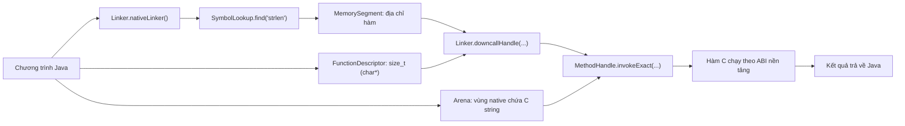
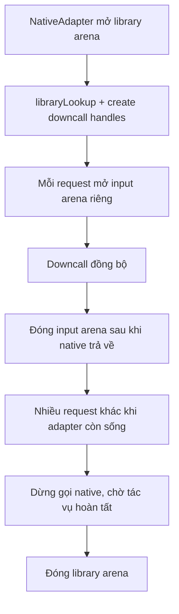

# Linker, SymbolLookup và gọi hàm native

Khi ứng dụng Java cần gọi thư viện C để xử lý hình ảnh, giao tiếp phần cứng, dùng SDK chuyên ngành hoặc tích hợp một hàm hệ điều hành, có thể sử dụng **Foreign Function & Memory API (FFM API)**. Trong Java 27, API chính thức ở package `java.lang.foreign` cho phép Java **tìm địa chỉ một hàm native**, **mô tả chữ ký C**, **tạo một `MethodHandle`** và gọi hàm đó với dữ liệu nằm trong vùng bộ nhớ phù hợp.

Ba thành phần trung tâm:

- **`SymbolLookup`:** tìm một symbol (tên hàm hoặc biến toàn cục) trong thư viện và trả về địa chỉ dưới dạng `MemorySegment`.
- **`FunctionDescriptor`:** mô tả cách tham số và kết quả native được biểu diễn trong bộ nhớ theo ABI của nền tảng.
- **`Linker`:** biến địa chỉ và chữ ký native thành `MethodHandle` để Java gọi hàm (downcall), hoặc tạo hàm callback cho native gọi ngược vào Java (upcall).

Bài thuộc chương **Bộ nhớ ngoài heap và mã native**, module **JAVA_VERSION_JAVA27 — Java 27 và các kiến thức liên quan**. FFM API đã chính thức từ **JDK 22 (JEP 454)** và tiếp tục được hỗ trợ trong Java 27. Các ví dụ không cần preview; tuy nhiên, những thao tác FFM có khả năng chạy mã native phải được **cấp quyền native access** theo cơ chế hiện hành. Nội dung tránh dựa vào các API incubator/preview đời cũ hoặc cách thao tác địa chỉ bộ nhớ thiếu kiểm soát.

## 1. Khi nào thực sự cần gọi native?

Trước khi dùng FFM, hãy kiểm tra Java đã có API phù hợp hay chưa:

| Nhu cầu | Ưu tiên khi đã có Java API | Lúc nào cân nhắc FFM? |
|---|---|---|
| Xử lý chuỗi hoặc tính độ dài | `String.length()`, `codePointCount`, UTF-8 API | Thư viện C bắt buộc cung cấp API `char*` |
| Tệp, thư mục, networking | `java.nio.file`, `java.net` | Cần chức năng nền tảng chưa có trong Java |
| Hash, ký số, mã hóa | JCA/JCE | Phải tích hợp thư viện mật mã chuyên dụng đã được kiểm chứng |
| Thư viện C/C++ từ nhà cung cấp | Không có wrapper Java thích hợp | Native SDK là giao diện chính thức |
| Tính toán chuyên sâu qua C ABI | Java API hoặc thư viện Java có sẵn | Có lợi ích rõ ràng và đo được từ native library |

FFM giúp tránh phải viết lớp cầu nối JNI bằng C cho **một số** kịch bản, nhưng **không làm mã native trở nên an toàn như mã Java thuần**. Hàm C có thể đọc/ghi sai địa chỉ, dùng con trỏ đã hết hiệu lực hoặc gây crash JVM nếu descriptor, quyền sở hữu bộ nhớ hoặc API contract bị khai báo sai.

## 2. Luồng gọi từ Java đến hàm C

Xét khai báo C:

```c
size_t strlen(const char *s);
```

Hàm `strlen` đọc các byte liên tiếp cho tới byte NUL đầu tiên (`0x00`) và trả về số byte trước NUL. Java không thể gọi hàm này trực tiếp bằng một biến `String` như cách gọi phương thức Java.

Quy trình:



Quy trình này gọi là **downcall** (Java gọi native). Chiều ngược lại, native gọi Java qua function pointer do `Linker.upcallStub(...)` tạo, gọi là **upcall**.

Không đồng nhất **tìm thấy tên symbol** với **đảm bảo chữ ký đúng**: địa chỉ symbol thông thường không kèm thông tin đủ để `Linker` xác minh số tham số, kiểu trả về và calling convention của hàm C.

## 3. `Linker.nativeLinker()` và khái niệm ABI

`Linker.nativeLinker()` trả về linker cho **OS và kiến trúc CPU hiện tại**:

```java
import java.lang.foreign.Linker;

Linker linker = Linker.nativeLinker();
System.out.println(linker.canonicalLayouts().keySet());
```

**ABI (Application Binary Interface)** xác định các quy tắc như:

- Cách truyền đối số qua thanh ghi và stack.
- Cách trả kết quả, căn chỉnh và bố trí giá trị/struct trong bộ nhớ.
- Kích thước và cách ánh xạ các kiểu C như `int`, `long`, `size_t`, `void*`.
- Calling convention và cách biểu diễn hàm có tham số biến thiên.

Ví dụ rất quan trọng:

| Kiểu C | Có phải lúc nào cũng khớp một kiểu Java? | Lưu ý |
|---|---|---|
| `int` | Thường ánh xạ sang `ValueLayout.JAVA_INT` trên ABI thông dụng | Kiểm tra hợp đồng ABI đích |
| `size_t` | **Không** | Thường 64 bit ở nền tảng 64 bit, 32 bit ở nền tảng 32 bit |
| `long` | **Không** | Có thể 32 bit trên Windows 64 bit, 64 bit trên Linux 64 bit |
| `double` | Thường dùng `ValueLayout.JAVA_DOUBLE` | Vẫn cần ABI/calling convention phù hợp |
| `void*` / `char*` | `ValueLayout.ADDRESS` | Java carrier tương ứng là `MemorySegment` |

`linker.canonicalLayouts()` cung cấp các layout chính tắc của những kiểu C do linker hỗ trợ. **Tập tên và mapping có thể khác theo nền tảng**; đừng giả định mọi linker đều xuất cùng một danh sách tên hoặc ép mọi kiểu C thành `JAVA_LONG`.

Một ứng dụng sản xuất phải ràng buộc với **header/ABI thực tế của thư viện đích**, không suy kiểu từ tên symbol hay từ suy đoán trên máy phát triển.

## 4. Quyền native access trong Java 27

Tạo `Linker` hoặc dùng `SymbolLookup.find(...)` để tìm symbol không phải mọi lúc đều là thao tác restricted. Tuy nhiên, các thao tác có thể đưa JVM tới mã native không đáng tin — điển hình:

- `Linker.downcallHandle(...)`.
- `Linker.upcallStub(...)`.
- `SymbolLookup.libraryLookup(...)`.
- Một số thao tác bộ nhớ nguy hiểm như `MemorySegment.reinterpret(...)`.

Những phương thức trên được đánh dấu **restricted**. Khi chạy mã native từ **class path/unnamed module**, cấp quyền tường minh:

```bash
java --enable-native-access=ALL-UNNAMED NativeStrlenDemo.java
```

Nếu mã gọi restricted method nằm trong **named module** `com.example.nativebridge`:

```bash
java --enable-native-access=com.example.nativebridge \
     --module-path mods \
     --module com.example.nativebridge/com.example.nativebridge.Main
```

Lệnh nhiều dòng phía trên minh họa cú pháp shell Unix; trong PowerShell có thể viết trên **một dòng** để tránh khác biệt ký tự nối dòng.

**Điểm quan trọng của JDK 27:** theo tài liệu Oracle, khi chưa bật quyền, chế độ mặc định `--illegal-native-access=warn` **vẫn cho phép lời gọi đi tiếp nhưng phát cảnh báo**. Có thể dùng `--illegal-native-access=deny` để từ chối bằng `IllegalCallerException`; Oracle dự kiến sẽ dùng chế độ từ chối làm mặc định ở một phiên bản tương lai. Vì vậy, **luôn cấp quyền tường minh cho mã FFM cần gọi native**, không dựa vào việc cảnh báo hiện tại vẫn cho phép chạy.

`--enable-native-access=ALL-UNNAMED` cấp quyền cho **mọi mã trong unnamed modules**. Khi triển khai ứng dụng có module riêng, nên cấp quyền hẹp cho đúng module thực hiện downcall. Đây là chính sách **quyền chạy mã native**, không phải giải pháp ngăn native library gây crash hoặc tự kiểm tra thư viện có độc hại hay không.

## 5. `SymbolLookup`: tìm symbol ở đâu?

`SymbolLookup` là một functional interface có phương thức chính `find(String)`:

```java
import java.lang.foreign.Linker;
import java.lang.foreign.MemorySegment;
import java.lang.foreign.SymbolLookup;
import java.util.Optional;

Linker linker = Linker.nativeLinker();
SymbolLookup lookup = linker.defaultLookup();

Optional<MemorySegment> address = lookup.find("strlen");
System.out.println(address.isPresent());
```

`find` trả về `Optional<MemorySegment>`. Nếu biết chắc symbol phải tồn tại và muốn thất bại ngay với thông báo rõ ràng, có thể dùng `findOrThrow("strlen")`, nhưng không biến điều đó thành lời hứa symbol tồn tại trên mọi hệ điều hành.

**Địa chỉ function symbol** được biểu diễn dưới dạng **native `MemorySegment` có kích thước 0**. Đó là **địa chỉ để truyền vào linker**, không phải một vùng dữ liệu kích thước tùy ý để `getString()` hoặc đọc byte trực tiếp.

### 5.1. Ba nguồn symbol chính

| API | Tìm ở đâu? | Vòng đời / đặc điểm |
|---|---|---|
| `linker.defaultLookup()` | Các thư viện phổ biến được linker cung cấp, thường có C runtime | Phụ thuộc OS/CPU, không hứa mọi symbol |
| `SymbolLookup.libraryLookup(nameOrPath, arena)` | Thư viện native được nạp theo tên/đường dẫn | Thư viện và symbol liên quan tới **scope của arena**; restricted |
| `SymbolLookup.loaderLookup()` | Các thư viện được nạp bằng JNI `System.load`/`loadLibrary` cho caller's class loader | Không tự thấy thư viện chỉ được nạp qua `libraryLookup` |

Ví dụ **riêng cho nhiều hệ Linux dùng glibc** (không phải tên thư viện portable):

```java
import java.lang.foreign.Arena;
import java.lang.foreign.SymbolLookup;

try (Arena libraryArena = Arena.ofConfined()) {
    SymbolLookup libc = SymbolLookup.libraryLookup(
            "libc.so.6", libraryArena);
    var strlenAddress = libc.findOrThrow("strlen");
    // Chỉ sử dụng strlenAddress và các handle gắn với
    // thư viện này khi libraryArena còn sống.
}
```

Trên macOS hoặc Windows, tên, đường dẫn và cách nạp C runtime **khác**. Không hard-code `libc.so.6` trong một thư viện tuyên bố hỗ trợ đa nền tảng. Việc nạp DLL/shared library còn có thể chạy mã khởi tạo native; chỉ nạp thư viện từ vị trí và nhà phát hành đáng tin, kiểm soát đường dẫn tìm kiếm để tránh **DLL/shared-library hijacking**.

### 5.2. Ghép lookup theo thứ tự ưu tiên

`SymbolLookup.or(other)` tìm ở lookup bên trái trước, rồi thử lookup còn lại:

```java
SymbolLookup primary = linker.defaultLookup();
SymbolLookup fallback = SymbolLookup.loaderLookup();
SymbolLookup combined = primary.or(fallback);

var function = combined.find("some_function");
```

Nếu hai nguồn có cùng tên symbol, **nguồn đầu tiên được ưu tiên**. Hãy có chính sách rõ ràng: việc ghép mọi lookup tùy tiện dễ lấy nhầm hàm của thư viện khác, nhất là khi nhiều phiên bản native library cùng tồn tại.

## 6. `FunctionDescriptor`: chuyển chữ ký C thành layout

Khai báo C:

```c
size_t strlen(const char *s);
```

Trên **Linux/x64 hoặc ABI 64 bit phù hợp** mà `size_t` là 64 bit, có thể mô tả:

```java
import java.lang.foreign.FunctionDescriptor;
import java.lang.foreign.ValueLayout;

FunctionDescriptor strlenDescriptor = FunctionDescriptor.of(
        ValueLayout.JAVA_LONG,  // size_t trả về 64 bit trên ABI này.
        ValueLayout.ADDRESS     // const char *s.
);
```

Tham số **đầu tiên** của `FunctionDescriptor.of(returnLayout, args...)` là layout **trả về**. Các tham số tiếp theo lần lượt mô tả đối số của hàm native. Nếu hàm trả về `void`, dùng `FunctionDescriptor.ofVoid(...)`.

Ví dụ một hàm C khác:

```c
void consume_data(const void *data, int count);
```

Descriptor minh họa:

```java
FunctionDescriptor desc = FunctionDescriptor.ofVoid(
        ValueLayout.ADDRESS, ValueLayout.JAVA_INT
);
```

Đây **chỉ là descriptor**, không chứa địa chỉ hàm hay tự gọi một thư viện bất kỳ. `Linker` phải được dùng để liên kết descriptor với **địa chỉ thật**.

**Cảnh báo cao nhất:** descriptor sai không giống mismatch kiểu của một method Java thông thường. Nó có thể khiến native đọc sai thanh ghi/stack, truy cập vùng nhớ sai, làm hỏng dữ liệu hoặc crash JVM. Trước khi gọi:

1. Đọc header C chính thức cùng phiên bản thư viện đang nạp.
2. Xác định ABI, kích thước kiểu, alignment và calling convention.
3. Kiểm tra pointer, constness, hợp đồng buffer, độ dài và người sở hữu bộ nhớ.
4. Xác minh quy tắc trả lỗi và lifetime của kết quả.

## 7. `Linker.downcallHandle(...)` và `MethodHandle`

Sau khi có symbol address và descriptor:

```java
import java.lang.foreign.*;
import java.lang.invoke.MethodHandle;

Linker linker = Linker.nativeLinker();
MemorySegment strlenAddress =
        linker.defaultLookup().findOrThrow("strlen");

MethodHandle strlen = linker.downcallHandle(
        strlenAddress,
        FunctionDescriptor.of(ValueLayout.JAVA_LONG,
                              ValueLayout.ADDRESS));
```

Tạo `downcallHandle` là **restricted operation**, không phải một phép kiểm tra mã C đã an toàn. Khi liên kết thành công, method handle đã **gắn địa chỉ hàm** và có chữ ký Java tương ứng với layout đã khai báo.

Đối với `size_t strlen(char*)` trên ABI ví dụ:

```text
C:     size_t strlen(const char *);
Java:  (MemorySegment)long
```

Gọi với `invokeExact`:

```java
try (Arena arena = Arena.ofConfined()) {
    MemorySegment cString = arena.allocateFrom("Hello");
    long count = (long) strlen.invokeExact(cString);
    System.out.println(count); // 5
}
```

`MethodHandle.invokeExact` kiểm tra **chính xác** kiểu đối số và kiểu trả về tại call site: ở đây phải truyền `MemorySegment` và nhận `long`. Nếu sai kiểu, có thể gặp `WrongMethodTypeException` hoặc lỗi liên quan tới chữ ký method handle. Việc đúng kiểu ở phía Java **không** chứng minh descriptor ABI phía C đúng.

`invokeExact` có khai báo `throws Throwable`, vì vậy phương thức bao ngoài phải xử lý hoặc khai báo phù hợp. Đừng nuốt mọi `Throwable` như thể chỉ là lỗi nghiệp vụ bình thường; một số lỗi là dấu hiệu integration sai nghiêm trọng.

## 8. Ví dụ hoàn chỉnh: gọi `strlen` trên JDK 27

Tạo tệp `NativeStrlenDemo.java` (một tệp độc lập):

```java
import java.lang.foreign.Arena;
import java.lang.foreign.FunctionDescriptor;
import java.lang.foreign.Linker;
import java.lang.foreign.MemorySegment;
import java.lang.foreign.SymbolLookup;
import java.lang.foreign.ValueLayout;
import java.lang.invoke.MethodHandle;
import java.nio.charset.StandardCharsets;

public class NativeStrlenDemo {

    // Demo giả định C size_t có độ rộng 64 bit.
    // Phải đối chiếu ABI và symbol availability của nền tảng chạy.
    static MethodHandle createStrlenHandle() {
        Linker linker = Linker.nativeLinker();
        SymbolLookup symbols = linker.defaultLookup();
        MemorySegment address = symbols.findOrThrow("strlen");

        FunctionDescriptor signature = FunctionDescriptor.of(
                ValueLayout.JAVA_LONG,
                ValueLayout.ADDRESS
        );
        return linker.downcallHandle(address, signature);
    }

    static long nativeByteLength(MethodHandle strlen, String input)
            throws Throwable {
        try (Arena arena = Arena.ofConfined()) {
            MemorySegment cString = arena.allocateFrom(input);
            return (long) strlen.invokeExact(cString);
        }
    }

    public static void main(String[] args) throws Throwable {
        MethodHandle strlen = createStrlenHandle();

        String ascii = "Hello";
        String unicode = "Café";

        System.out.println("C strlen(Hello): "
                + nativeByteLength(strlen, ascii));
        System.out.println("C strlen(Café): "
                + nativeByteLength(strlen, unicode));
        System.out.println("Java String.length(Café): "
                + unicode.length());
        System.out.println("UTF-8 bytes(Café): "
                + unicode.getBytes(StandardCharsets.UTF_8).length);
    }
}
```

Chạy trên hệ **64 bit** có C runtime mà `defaultLookup()` công khai `strlen` và `size_t` có layout 64 bit (ví dụ Linux/x64 phổ biến):

```bash
java --version
java --enable-native-access=ALL-UNNAMED NativeStrlenDemo.java
```

Kết quả dự kiến:

```text
C strlen(Hello): 5
C strlen(Café): 5
Java String.length(Café): 4
UTF-8 bytes(Café): 5
```

Kết quả thể hiện `strlen` đếm **byte trước NUL**, trong khi `String.length()` đếm **UTF-16 code units**. Với `Café`, ký tự `é` là 2 byte trong UTF-8 nên C trả về 5, Java `String.length()` trả về 4.

**Phạm vi ví dụ:** không tuyên bố chạy nguyên xi trên 32-bit ABI hoặc mọi hệ thống không xuất `strlen` qua default lookup. Nếu `size_t` 32 bit, descriptor trả về phải thích hợp với kích thước và carrier của kiểu đó; dùng `linker.canonicalLayouts()` cùng tài liệu ABI trước khi sửa. Nếu symbol không có, `findOrThrow` sẽ báo không tìm thấy; không cố gọi một địa chỉ `NULL`.

Không cần `--enable-preview` cho FFM API chính thức. Nếu ứng dụng chạy trong **named module**, thay `ALL-UNNAMED` bằng đúng tên module được cấp quyền.

## 9. Dữ liệu C string và các bẫy encoding

`arena.allocateFrom(String)` cấp phát native memory, mã hóa Java `String` thành **UTF-8** và thêm **NUL terminator** theo hợp đồng API.

```java
try (Arena arena = Arena.ofConfined()) {
    MemorySegment text = arena.allocateFrom("Hi");
    System.out.println(text.byteSize());  // 3: 'H', 'i', 0.
}
```

Một số chú ý:

- C string kết thúc ở **byte NUL đầu tiên**. Nếu Java string chứa `'\0'` giữa chuỗi, `strlen` kết thúc tại đó chứ không đếm hết chuỗi Java.
- Không phải thư viện C nào cũng nhận UTF-8. Một hàm có thể yêu cầu ASCII, UTF-16 trên Windows hoặc encoding riêng. Phải tuân theo API native, không đoán.
- Không truyền `String` Java thẳng vào `ADDRESS`; hãy cấp phát/copy ra vùng native khi hàm yêu cầu con trỏ C.
- Không dùng `strlen` để đo kích thước một **binary buffer** có thể chứa `0x00`; cần giao thức truyền **địa chỉ + độ dài**.
- Nếu hàm C giữ lại con trỏ sau khi lời gọi kết thúc, không được đóng arena cấp phát dữ liệu trong khi thư viện vẫn sử dụng nó.

`MemorySegment` còn có `getString(offset)` để đọc một C string từ vùng nhớ hợp lệ, nhưng **không gọi `getString` trên một function symbol segment kích thước 0** hoặc một con trỏ chưa được xác nhận vùng nhớ và thời gian sống. Nếu nhận một pointer từ C, cần hiểu hợp đồng ownership và giới hạn dữ liệu trước khi dereference.

## 10. Vòng đời bộ nhớ: `Arena` và con trỏ native

`Arena` kiểm soát **lifetime** và **quyền truy cập theo thread** của native memory segment do nó cấp phát:

| Arena | Có đóng thủ công? | Truy cập nhiều thread? | Trường hợp phù hợp |
|---|---|---|---|
| `Arena.ofConfined()` | Có, đúng owner thread | Không | Buffer ngắn hạn của một tác vụ |
| `Arena.ofShared()` | Có, phối hợp nhiều thread | Có | Shared native memory với quản lý đồng bộ |
| `Arena.ofAuto()` | Không; GC quyết định giải phóng | Có | Khi không cần thời điểm cleanup xác định |
| `Arena.global()` | Không; bộ nhớ tồn tại lâu dài | Có | Vùng cố ý sống tới hết tiến trình |

Với `Arena.ofConfined()`:

```java
MemorySegment expired;
try (Arena arena = Arena.ofConfined()) {
    expired = arena.allocate(16);
    expired.set(ValueLayout.JAVA_INT, 0, 42);
    System.out.println(expired.get(ValueLayout.JAVA_INT, 0)); // 42.
}

// Ở đây arena đã đóng, việc truy cập vùng expired sẽ ném
// IllegalStateException trong thao tác MemorySegment được kiểm tra:
// expired.get(ValueLayout.JAVA_INT, 0);
```

Java API kiểm tra lifetime/bounds khi **Java truy cập segment theo hợp đồng MemorySegment**. Nhưng nếu một hàm native nhận con trỏ rồi tiếp tục sử dụng sau khi arena đã đóng, JVM không thể tự biết mọi truy cập của mã C. Đây là lỗi **use-after-free** phía native và có thể dẫn đến crash/memory corruption.

Khi `SymbolLookup.libraryLookup(name, arena)` nạp một thư viện gắn với arena, symbol và downcall handle sử dụng mã trong thư viện đó cũng phải tôn trọng **vòng đời thư viện**. Không lưu một handle vào cache sống dài hơn arena giữ thư viện.

### 10.1. Shared arena không tự tạo thread safety

`Arena.ofShared()` cho phép nhiều thread truy cập segment, nhưng **không** làm các thao tác đọc–sửa–ghi cùng địa chỉ tự nguyên tử, cũng không làm native library trở thành thread-safe. Nếu hai thread cùng gọi một thư viện C có global mutable state, cần tuân thủ tài liệu thread-safety của chính thư viện.

Khi native code và Java cùng sửa một vùng nhớ, cần mô hình đồng bộ phù hợp với giao thức và nền tảng; không giả định chỉ dùng `volatile` Java là đủ để áp dụng mọi bảo đảm JMM cho memory do C quản lý.

## 11. Truyền con trỏ: `MemorySegment` không phải vùng nhớ vô hạn

Trong FFM:

- Một tham số `ValueLayout.ADDRESS` thường được biểu diễn bằng `MemorySegment`.
- Địa chỉ native trả về từ lookup chỉ mang thông tin **symbol address**, không cấp sẵn quyền đọc dữ liệu tại đó.
- Một con trỏ C trả về từ hàm native có thể được mô hình hóa thành **segment kích thước 0**, bởi Java không tự biết số byte và lifetime của vùng được trỏ tới.
- `MemorySegment.NULL` biểu diễn con trỏ null; phải kiểm tra theo hợp đồng hàm.

Ví dụ **không an toàn** cần tránh:

```java
// Không được coi pointer trả về là buffer 1 GiB:
// MemorySegment pointer = (MemorySegment) someHandle.invokeExact(...);
// MemorySegment unsafe = pointer.reinterpret(1_000_000_000L);
// unsafe.get(ValueLayout.JAVA_BYTE, 0);
```

`reinterpret(...)` là **restricted** vì cho phép thay đổi bounds/lifetime của segment theo khai báo của người gọi, trong khi JVM không có bằng chứng vùng native thật sự có kích thước ấy.

Với API native trả về pointer, phải biết rõ:

1. Ai cấp phát vùng nhớ và ai phải gọi hàm giải phóng?
2. Buffer dài bao nhiêu byte; có chứa NUL hay có một trường length riêng?
3. Pointer còn sống tới khi nào?
4. Có được phép sửa dữ liệu không?
5. Buffer có thể bị thread khác hoặc callback thay đổi trong lúc đọc không?

Chỉ dùng `reinterpret` khi có contract native đáng tin và xử lý đúng ownership/cleanup. Nếu Java có thể tự cấp phát bằng `Arena` rồi chuyển pointer cho C xử lý **đồng bộ trong một lời gọi**, cách này thường dễ quản lý hơn.

## 12. Downcall có địa chỉ gắn sẵn và downcall không gắn địa chỉ

`Linker` có hai dạng cơ bản:

```java
// 1. Handle gắn sẵn địa chỉ một hàm cụ thể:
MethodHandle fixed = linker.downcallHandle(
        address,
        FunctionDescriptor.of(ValueLayout.JAVA_LONG, ValueLayout.ADDRESS));

// 2. Handle chưa gắn địa chỉ, nhận địa chỉ như tham số đầu khi gọi:
MethodHandle unbound = linker.downcallHandle(
        FunctionDescriptor.of(ValueLayout.JAVA_LONG, ValueLayout.ADDRESS));
```

Với ví dụ `strlen` trên ABI 64 bit:

```java
try (Arena arena = Arena.ofConfined()) {
    MemorySegment str = arena.allocateFrom("Hello");
    long count1 = (long) fixed.invokeExact(str);
    long count2 = (long) unbound.invokeExact(address, str);
    System.out.println(count1 == count2); // true.
}
```

Hai overload `downcallHandle` đều là **restricted methods**. Với handle không gắn sẵn địa chỉ, **người gọi chịu trách nhiệm** bảo đảm địa chỉ hàm đúng và còn sống tại thời điểm invoke; truyền pointer tùy ý là rủi ro crash JVM.

Trong ứng dụng thông thường, nếu thư viện có tập hàm cố định, tạo và tái sử dụng các `MethodHandle` đã gắn địa chỉ theo lifecycle thư viện thường dễ kiểm soát hơn.

## 13. Native library cụ thể: `libraryLookup` và thời gian sống

Trong hệ thống thực tế, symbol có thể không có trong `defaultLookup()` mà nằm trong một **shared library riêng** của vendor. Khi đó:

```java
import java.lang.foreign.*;
import java.lang.invoke.MethodHandle;

// Ví dụ chỉ dành cho Linux dùng glibc.
try (Arena libraryArena = Arena.ofConfined()) {
    SymbolLookup libc =
            SymbolLookup.libraryLookup("libc.so.6", libraryArena);

    Linker linker = Linker.nativeLinker();
    MethodHandle strlen = linker.downcallHandle(
            libc.findOrThrow("strlen"),
            FunctionDescriptor.of(ValueLayout.JAVA_LONG,
                                  ValueLayout.ADDRESS));

    // Arena cấp phát input được lồng phía trong lifetime thư viện.
    try (Arena inputArena = Arena.ofConfined()) {
        MemorySegment cString = inputArena.allocateFrom("Hello");
        long count = (long) strlen.invokeExact(cString);
        System.out.println(count);
    }
} // Không dùng handle trỏ vào thư viện này sau khi libraryArena đóng.
```

Trong ví dụ, mã được đặt bên trong phương thức khai báo `throws Throwable` vì lời gọi `invokeExact` có thể ném `Throwable`.

Để tránh lỗi lifetime, hãy thiết kế **module native adapter** giữ quyền sở hữu:



Nếu thư viện lưu callback/function pointer để gọi về sau, hoặc spawn thread native chạy nền, việc đóng library arena đòi hỏi thêm bước **unregister callback/stop worker**. Không coi `close()` là giải pháp tự động cho mọi đối tượng native được thư viện quản lý.

## 14. Gọi ngược từ C về Java: `upcallStub`

Ngoài downcall, `Linker.upcallStub(target, descriptor, arena)` cho phép tạo một địa chỉ function pointer native trỏ tới mã Java được biểu diễn bằng `MethodHandle`. Ví dụ một thư viện C yêu cầu callback so sánh hai phần tử khi sắp xếp.

Trình tự khái quát:

1. Viết phương thức Java tương ứng với chữ ký callback C.
2. Tạo `MethodHandle` bằng `MethodHandles.lookup().findStatic(...)` hoặc phương thức tương đương.
3. Tạo `FunctionDescriptor` đúng ABI callback.
4. Gọi `linker.upcallStub(...)` để nhận `MemorySegment` chỉ function pointer.
5. Truyền pointer đó vào một downcall hoặc hàm đăng ký callback.
6. Bảo đảm **arena chứa upcall stub còn sống** cho tới khi mã native không thể gọi callback nữa.

`upcallStub` cũng là **restricted operation**. Callback chạy từ native có các rủi ro về exception, thread, reentrancy và lifetime; không để một exception Java tùy ý vượt qua ranh giới native mà chưa có chính sách xử lý rõ ràng. Khi cần callback, ưu tiên tài liệu và binding generator phù hợp với SDK đang sử dụng.

## 15. Các trường hợp ABI phức tạp: `struct`, variadic và native errors

### 15.1. C struct và alignment

Không phải một C struct với `int` và `long` luôn được mô tả đơn giản bằng tổng kích thước của hai kiểu. ABI có thể chèn **padding** để căn chỉnh.

```c
struct Sample {
    int id;
    double value;
};
```

Trong FFM, `MemoryLayout.structLayout(...)` và `MemoryLayout.paddingLayout(...)` giúp mô tả layout khi cần, nhưng phải đối chiếu compiler/ABI của thư viện native. Không giả định layout giống nhau trên Linux/x64, Windows/x64 và ARM chỉ vì khai báo C trông tương tự.

### 15.2. Hàm variadic

Hàm kiểu `printf(const char *fmt, ...)` cần descriptor cho **dạng chuyên biệt** và `Linker.Option.firstVariadicArg(index)` chỉ ra tham số biến thiên đầu tiên. Chỉ đưa các layout vào descriptor mà không khai báo vị trí variadic có thể sai ABI.

Đối với tích hợp sản phẩm, nên ưu tiên native API có **chữ ký cố định** và rõ ràng thay vì buộc Java gọi trực tiếp các hàm variadic có quy tắc ABI phức tạp.

### 15.3. Native errors không tự thành Java exception

Hàm C có thể trả mã lỗi, trả `NULL` hoặc thiết lập `errno`. Một lời gọi native hoàn thành bình thường ở mức `MethodHandle` **không** có nghĩa chức năng C thành công.

FFM cung cấp `Linker.Option.captureCallState("errno")` cùng layout captured-state thích hợp để đọc `errno` của lời gọi native cần theo dõi. Cần kiểm tra contract riêng của hàm — nhiều hàm **không** dùng `errno` hoặc chỉ đặt nó trong một số tình huống lỗi.

Nếu dùng `captureCallState(...)`, chữ ký Java của downcall handle có thêm đối số vùng nhớ lưu captured state theo tài liệu API. Không tự lấy `errno` từ thread khác hoặc một lời gọi khác rồi giả định đó là lỗi của thao tác vừa thực hiện.

## 16. Bảo mật, quyền và giới hạn FFM

FFM cho phép thao tác mạnh bên ngoài heap, vì vậy cần xác định **ranh giới tin cậy**:

| Nguy cơ | Biểu hiện | Phòng vệ |
|---|---|---|
| **Sai ABI/signature** | Stack/register bị đọc sai, crash JVM | Đối chiếu C header, ABI, version library |
| **Load nhầm native library** | Mã độc chạy lúc load thư viện | Nguồn/đường dẫn tin cậy, kiểm tra artifact, quy trình cung ứng |
| **Buffer overflow từ native** | Native ghi ngoài giới hạn đã cấp phát | Kiểm tra hợp đồng pointer + length; fuzz/native tests |
| **Use-after-free** | Native giữ pointer sau khi arena đóng | Thiết kế lifetime, ownership, unregister |
| **Tùy tiện reinterpret** | Java tin vào bounds không có thật | Chỉ dùng khi nắm kích thước/lifetime được bảo đảm |
| **Data race ngoài heap** | Nhiều thread đọc/ghi native state không đồng bộ | Đồng bộ theo cả Java lẫn native contract |
| **Đọc thông tin nhạy cảm** | Dữ liệu secret còn ở native buffer | Chính sách dọn/xóa dữ liệu phù hợp, quản lý quyền truy cập |
| **Quyền quá rộng** | Toàn bộ classpath được phép gọi restricted native API | Dùng named module và cấp native access hẹp hơn |
| **Lỗi cấp phát ngoài heap** | Hết native memory dù heap còn trống | Quota, giới hạn size, metrics, xử lý lỗi |

**MemorySegment có kiểm tra bounds/lifetime cho thao tác Java**, nhưng không thể áp đặt kiểm tra đó lên **mọi thao tác con trỏ tự do do C thực hiện**. Native code vẫn có thể làm hỏng tiến trình JVM.

Không nạp thư viện native không tin cậy chỉ để “đọc dữ liệu” bằng FFM. Nếu phải chạy mã của bên thứ ba có rủi ro, cân nhắc cô lập trong một **process** riêng với quyền OS/sandbox thích hợp.

## 17. Hiệu năng và thiết kế tích hợp

FFM tránh một số lớp glue code của JNI, nhưng **không có bảo đảm mọi downcall đều nhanh hơn Java thuần**. Chi phí có thể bao gồm:

- Lookup/linkage ban đầu và việc tạo `MethodHandle`.
- Marshalling/unmarshalling giữa giá trị Java và C layouts.
- Cấp phát/copy dữ liệu từ `String`, `byte[]` sang native memory.
- Ranh giới chuyển từ Java sang C ở mỗi lần gọi.
- Đồng bộ, lifetime và callback nếu thư viện yêu cầu.

Các hướng tối ưu có chủ đích:

1. Tạo `Linker`, lookup và `MethodHandle` một lần **theo vòng đời thư viện**, tái sử dụng khi hợp lệ.
2. Cấp phát buffer trong arena có phạm vi phù hợp; không đưa `Arena.global()` vào mọi lời gọi dẫn đến giữ bộ nhớ không giới hạn.
3. Với dữ liệu lớn, tránh lặp lại copy qua ranh giới một cách vô ích; xem xét API native có thể xử lý theo chunk hoặc một batch.
4. Đừng tối ưu nhờ `Linker.Option.critical(...)` khi chưa hiểu rõ giới hạn thời gian thực thi và callback — các native call dài/chặn có thể ảnh hưởng JVM.
5. Dùng benchmark nghiêm túc và theo dõi **native memory, crashes, throughput, GC và độ trễ đầu-cuối**.

FFM phù hợp khi thư viện native có giá trị thực sự hoặc khi ABI cần tích hợp. Để tính độ dài một `String` Java thông thường, không nên gọi C `strlen`; ví dụ ở mục 8 chỉ nhằm minh họa kiến trúc FFM.

## 18. Những lỗi thường gặp

| Lỗi | Kết quả có thể xảy ra | Cách xử lý |
|---|---|---|
| Dùng API FFM preview/incubator cũ thay cho `java.lang.foreign` hiện hành | API không còn khớp Java 27 | Dùng FFM chính thức từ JDK 22 trở đi |
| Không cấp `--enable-native-access` và coi warning là vô hại mãi mãi | Tùy cấu hình có warning hoặc `IllegalCallerException` | Cấp quyền native access tường minh, đúng module |
| Gọi `strlen` với descriptor trả `JAVA_LONG` trên ABI có `size_t` 32 bit | Sai ABI, có thể lỗi nghiêm trọng | Kiểm tra `canonicalLayouts` và header |
| Nghĩ `findOrThrow` xác minh kiểu của hàm | Symbol có tên đúng nhưng signature sai | Tự xác minh descriptor từ contract C |
| Dùng `getString` trên symbol address (0 byte) | Không có vùng nhớ dữ liệu hợp lệ | Chỉ truyền symbol cho linker |
| Dùng `String.length()` để dự đoán độ dài `strlen` của UTF-8 | Sai với Unicode đa byte hoặc NUL | Phân biệt UTF-16 code unit, UTF-8 byte, NUL |
| Dùng `MemorySegment.ofArray(bytes)` làm C pointer cho mọi downcall | Heap segment không mặc nhiên chấp nhận như native pointer | Cấp phát native memory và copy phù hợp |
| Đóng arena trước khi native xử lý xong | Native dùng con trỏ hết hạn | Thiết kế ownership và lifetime, chờ task hoàn tất |
| Giữ handle từ `libraryLookup` sau khi library arena đóng | Function pointer tới mã có thể không còn hợp lệ | Bảo đảm lifetime của handle không vượt lifetime thư viện |
| Nghĩ `Arena.ofShared()` làm native library thread-safe | Data race/native crash vẫn có thể xảy ra | Đồng bộ theo native contract |
| Bỏ qua mã lỗi/`errno` hoặc pointer NULL | Dùng dữ liệu không hợp lệ | Kiểm tra lỗi theo contract |
| Đo performance bằng một lần gọi native | Kết luận nhiễu hoặc bỏ qua copy/marshalling | Benchmark workload thực tế |

## 19. Bài tập và kiểm tra hiểu bài

**Bài 1 — Phân tích ABI.** Viết C prototype của `strlen`, cho biết vì sao `size_t` không mặc nhiên là Java `long` trên mọi nền tảng. Trình bày cách dùng `Linker.canonicalLayouts()` và tài liệu ABI để chọn descriptor phù hợp.

**Bài 2 — Lookup.** Viết chương trình tìm `strlen` bằng `linker.defaultLookup().find(...)` và xử lý trường hợp `Optional.empty()` bằng thông báo rõ ràng. Vì sao không được lấy một địa chỉ khác không liên quan làm fallback?

**Bài 3 — Unicode và NUL.** Dự đoán kết quả `strlen("Café")` khi dùng `arena.allocateFrom(...)` trên UTF-8, so sánh với `String.length()`. Sau đó thử chuỗi có NUL ở giữa: tại sao `strlen` chỉ đếm tới byte NUL đầu tiên?

**Bài 4 — Lifetime.** Một thư viện C lưu pointer nhận được từ Java để xử lý ở background thread. Điều gì xảy ra nếu Java tạo buffer bằng `Arena.ofConfined()` rồi đóng arena ngay sau downcall? Đề xuất cách đảm bảo native hoàn tất trước khi đóng hoặc tách ownership được quản lý rõ ràng.

**Bài 5 — Native access.** Nêu lệnh chạy một chương trình FFM thuộc unnamed module và một lệnh khác cấp quyền cho named module `com.example.nativebridge`. Giải thích vì sao bật quyền không làm việc nạp thư viện tùy ý trở nên an toàn.

**Bài 6 — Refactor adapter.** Tạo một adapter có một phương thức public Java nhận `String` và trả `long`; bên trong adapter chịu trách nhiệm về lookup, descriptor, arena và lỗi khi symbol không tồn tại. Code bên ngoài không được thấy `MemorySegment` hay chi tiết ABI.

### Ma trận kiểm thử gợi ý

| Tình huống | Kỳ vọng |
|---|---|
| `strlen("Hello")` trên ABI được hỗ trợ | Trả 5 |
| `strlen("Café")` với UTF-8 | Trả số byte, không phải số ký tự |
| Symbol không tồn tại | Lookup trả empty hoặc báo thiếu symbol |
| Tắt native access với chế độ deny | Restricted method bị từ chối |
| Arena đã đóng, Java truy cập segment của nó | Bị từ chối theo kiểm tra lifetime |
| Thread khác dùng segment confined | Bị từ chối do thread confinement |
| Native code muốn giữ pointer qua scope | Phải thay đổi thiết kế ownership trước khi gọi |
| Thay phiên bản shared library | Kiểm tra lại ABI và symbol availability |
| C library trả mã lỗi hoặc NULL | Adapter chuyển thành kết quả/lỗi Java rõ ràng |
| Thực thi song song | Tuân thủ cả thread safety của arena lẫn native library |

## 20. Checklist thiết kế lớp gọi native cho Java 27

1. Có thật sự cần native code, hay Java API tương đương đã đáp ứng mục tiêu?
2. Thư viện có **C ABI** phù hợp và phiên bản/header đáng tin cậy không?
3. Đã xác định rõ tên symbol, source lookup, OS/CPU và khả năng tìm symbol?
4. `FunctionDescriptor` có đúng **kích thước, alignment, return type, các arguments, variadic rules**?
5. Có sử dụng `--enable-native-access` cho đúng module, không dựa vào warning mặc định?
6. Có giới hạn nguồn và đường dẫn nạp native library để tránh library hijacking?
7. Native input có đúng encoding, NUL termination, buffer size và alignment?
8. Ai sở hữu memory segment/pointer? Arena nào được đóng, khi nào và bởi thread nào?
9. Có callback hoặc background native task giữ pointer/handle sau khi lời gọi kết thúc không?
10. Khi nhận pointer từ native, có kiểm tra null, size và lifetime trước mọi thao tác đọc không?
11. Có xử lý mã lỗi và quy ước `errno`/return code của thư viện không?
12. Có kiểm thử với các ABI nền tảng mục tiêu, kể cả lỗi và dữ liệu biên?
13. Có giám sát native memory, latency, lỗi thư viện và quy trình graceful shutdown?
14. Adapter có che được chi tiết native để phần còn lại của ứng dụng tiếp tục dùng API Java rõ ràng không?

**Kết luận:** `SymbolLookup` tìm **địa chỉ symbol**, `FunctionDescriptor` mô tả **chữ ký native theo ABI**, và `Linker` tạo **MethodHandle** để gọi C từ Java hoặc upcall từ C vào Java. Trong Java 27, đây là hướng tích hợp native chính thức và còn phù hợp, nhưng trách nhiệm chính vẫn thuộc về người thiết kế adapter: **đúng ABI, đúng byte layout, đúng lifetime, quyền native access được kiểm soát và thư viện được tin cậy**. API giúp làm rõ ranh giới, không thể loại bỏ mọi nguy cơ từ mã native.

## 21. Tài liệu tham khảo chính thức

- [Java SE 27 — Foreign Function & Memory API](https://docs.oracle.com/en/java/javase/27/core/foreign-function-and-memory-api.html): tổng quan FFM và các thành phần stable.
- [Java SE 27 — Linker API](https://docs.oracle.com/en/java/javase/27/docs/api/java.base/java/lang/foreign/Linker.html): `nativeLinker`, `defaultLookup`, `downcallHandle`, `upcallStub`, canonical layouts và ABI.
- [Java SE 27 — SymbolLookup API](https://docs.oracle.com/en/java/javase/27/docs/api/java.base/java/lang/foreign/SymbolLookup.html): `find`, `findOrThrow`, `libraryLookup`, `loaderLookup` và `or`.
- [Java SE 27 — FunctionDescriptor API](https://docs.oracle.com/en/java/javase/27/docs/api/java.base/java/lang/foreign/FunctionDescriptor.html): `of`, `ofVoid`, argument/return layouts và Java method types.
- [Java SE 27 — Arena API](https://docs.oracle.com/en/java/javase/27/docs/api/java.base/java/lang/foreign/Arena.html): memory scopes, confined/shared/auto/global arenas và vòng đời.
- [Java SE 27 — MemorySegment API](https://docs.oracle.com/en/java/javase/27/docs/api/java.base/java/lang/foreign/MemorySegment.html): native pointers, bounds, lifetime và restricted reinterpret.
- [Java SE 27 — Gọi hàm C bằng FFM](https://docs.oracle.com/en/java/javase/27/core/calling-c-library-function-foreign-function-and-memory-api.html): ví dụ `strlen` chính thức từ Oracle.
- [Java SE 27 — Restricted Methods và native access](https://docs.oracle.com/en/java/javase/27/core/restricted-methods.html): danh sách restricted calls, launcher flags, chính sách warn/deny.
- [Java SE 27 — Memory Segments and Arenas](https://docs.oracle.com/en/java/javase/27/core/memory-segments-and-arenas.html): quản lý tài nguyên ngoài heap.
- [Java SE 27 — Checking Native Errors Using errno](https://docs.oracle.com/en/java/javase/27/core/checking-native-errors-using-errno.html): `Linker.Option.captureCallState` và cách báo lỗi C.
- [JEP 454 — Foreign Function & Memory API](https://openjdk.org/jeps/454): bối cảnh chuẩn hóa FFM ở JDK 22.
