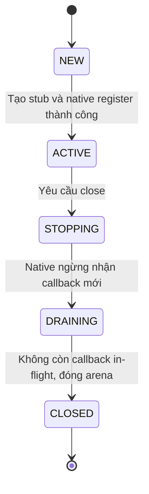

# Upcall, callback và quản lý vòng đời con trỏ hàm trong Java 27

Một thư viện native không chỉ được **Java gọi sang C**. Nhiều API native còn muốn **gọi ngược mã ứng dụng** bằng cách nhận một *function pointer* làm tham số, lưu nó để gọi khi có sự kiện, hoặc dùng nó để so sánh các phần tử trong thuật toán như `qsort`.

Với **Foreign Function & Memory API (FFM)** đã được chuẩn hóa, Java có thể chuyển một `MethodHandle` đại diện cho phương thức Java thành **upcall stub** — một điểm vào native có địa chỉ giống con trỏ hàm C — thông qua `Linker.upcallStub(...)`. Điểm khó không nằm ở vài dòng tạo stub, mà ở **hợp đồng ABI, quyền truy cập native, vòng đời `Arena`, callback chạy trên thread nào và thời điểm nào native thực sự ngừng sử dụng con trỏ**.

Bài thuộc chương **Bộ nhớ ngoài heap và mã native**, trong module **Java 27 và các kiến thức liên quan**. Nội dung chỉ sử dụng API hiện hành của `java.lang.foreign`, `java.lang.invoke` và những cơ chế C/ABI cần thiết để hiểu tương tác; không dùng các API nội bộ hoặc biến thể preview đã lỗi thời. Mọi ví dụ truy cập native chỉ nên chạy trong môi trường tin cậy vì một sai sót về con trỏ có thể làm tiến trình JVM gặp sự cố.

## 1. Kết quả học tập

Sau bài này, bạn có thể:

1. Phân biệt **downcall**, **upcall**, callback và function pointer.
2. Diễn giải một kiểu hàm C thành `FunctionDescriptor` và `MethodHandle` tương thích.
3. Tạo upcall stub bằng `Linker.upcallStub(target, descriptor, arena)`.
4. Cấp quyền native access tường minh cho mã dùng API FFM bị hạn chế.
5. Phân biệt callback **được gọi ngay** trong một downcall với callback **được native lưu giữ** để gọi sau.
6. Chọn `Arena.ofConfined()` hoặc `Arena.ofShared()` theo vòng đời và thread gọi callback.
7. Thiết kế trình tự **unregister → đợi callback đang chạy hoàn tất → close arena**.
8. Không để Java exception thoát khỏi callback vào native.
9. Nhận diện pointer có kích thước 0, ABI mismatch, callback có trạng thái và rủi ro use-after-free.
10. Tự xây và chạy một ví dụ Java–C hoàn chỉnh, kiểm tra lỗi và đề xuất biện pháp an toàn cho production.

## 2. Bức tranh tổng thể: Java gọi native và native gọi lại Java

```text
                  DOWNCALL
Java application  --------------------> C / native library
    |                                      |
    |                                      | Gọi tham số kiểu
    |                                      | int (*cb)(int)
    |              UPCALL                  |
Java callback     <-------------------- upcall stub
    ^                                      ^
    |                                      |
MethodHandle <--- Linker.upcallStub() ---> MemorySegment
                   (function pointer)
```

- **Downcall**: Java gọi một hàm native thông qua `MethodHandle` được tạo từ `Linker.downcallHandle(...)`.
- **Callback**: hàm mà native gọi khi cần kết quả hoặc khi một sự kiện xảy ra.
- **Upcall**: chiều native gọi vào một target method handle Java thông qua mã cầu nối do linker tạo.
- **Upcall stub**: vùng mã/cầu nối có địa chỉ native; API Java biểu diễn nó bằng `MemorySegment`.
- **Arena**: chủ sở hữu vòng đời các allocation liên quan, bao gồm upcall stub.

Một upcall stub **không phải** đối tượng `Runnable` hay `Consumer` được chuyển trực tiếp sang C. Native nhìn thấy **địa chỉ con trỏ hàm** theo ABI, còn JVM chịu trách nhiệm điều phối từ địa chỉ đó đến Java method handle tương ứng.

## 3. Hai kiểu callback: synchronous và retained

| Mẫu | Native làm gì với callback? | Yêu cầu vòng đời |
|---|---|---|
| **Synchronous callback** | Gọi một hoặc nhiều lần trước khi hàm native hiện tại trả về; không lưu lại | Stub phải sống ít nhất cho đến khi downcall kết thúc |
| **Retained callback** | Lưu con trỏ hàm trong registry, object hoặc thư viện; có thể gọi lại về sau | Stub, trạng thái Java và thư viện phải sống đến khi unregister và các callback đang chạy kết thúc |
| **Asynchronous callback** | Gọi từ thread khác, sau một sự kiện hoặc ở thời điểm chưa biết | Ngoài lifetime còn cần giải quyết thread affinity, đồng bộ hóa, shutdown và reentrancy |

Một native API có thể **synchronous về lời gọi đăng ký** nhưng **asynchronous về việc gọi callback**. Ví dụ `register_listener(cb)` trả về ngay **không chứng minh** `cb` đã hết được sử dụng.

Đọc đặc tả của thư viện native để trả lời trước khi tạo stub:

- Native chỉ dùng pointer trong lời gọi hiện tại hay giữ lại?
- Ai phát lệnh unregister?
- Unregister có đợi những callback đang thực thi không?
- Callback có thể được gọi từ nhiều thread không?
- Native có được gọi callback sau khi bắt đầu shutdown không?
- Ai sở hữu bộ nhớ đối số và kết quả callback?

## 4. Kiểu hàm C là hợp đồng ABI, không chỉ kiểu Java

Xét khai báo C:

```c
typedef int (*int_callback)(int);

int apply_twice(int_callback callback, int value);
```

`int_callback` là con trỏ tới hàm **nhận một `int` và trả một `int`**. Hàm `apply_twice` lại nhận **một function pointer và một `int`**, trả `int`.

Với ABI phổ biến có C `int` 32-bit, mô hình FFM:

| C | Mô tả FFM | Carrier Java |
|---|---|---|
| `int` | `ValueLayout.JAVA_INT` | `int` |
| `int (*)(int)` | `ValueLayout.ADDRESS` khi truyền con trỏ | `MemorySegment` |
| `void` | `FunctionDescriptor.ofVoid(...)` khi mô tả hàm | `void` |
| `int_callback` | `FunctionDescriptor.of(JAVA_INT, JAVA_INT)` khi mô tả chữ ký callback | `(int)int` |
| `apply_twice` | `FunctionDescriptor.of(JAVA_INT, ADDRESS, JAVA_INT)` | `(MemorySegment, int)int` |

Chú ý: **`ADDRESS` biểu diễn con trỏ được truyền vào hàm**, còn **descriptor của callback** mô tả chính hàm mà con trỏ trỏ tới. Nếu chỉ khai báo `ADDRESS` mà không biết chữ ký hàm thật, bạn chưa có một giao thức an toàn.

### 4.1. Không đồng nhất C long với Java long

Mapping C ABI phụ thuộc OS/kiến trúc. Trên một số nền tảng 64-bit, C `long` dài 64-bit; trên Windows x64, C `long` thường là 32-bit. Kiểu `size_t` cũng tùy kiến trúc.

Khi binding thật:

- Xem header và calling convention của thư viện.
- Đối chiếu `Linker.nativeLinker().canonicalLayouts()` cho những kiểu C tiêu chuẩn như `int`, `long`, `size_t`.
- Dùng layout phù hợp với ABI và kích cỡ/độ căn chỉnh thực tế.
- Không tự đổi function descriptor vì lỗi compiler Java rồi hy vọng bên native tự hiểu.

Các ví dụ C/Java chính dùng `int` (32-bit trên các ABI phổ biến được ví dụ). Một mục riêng sẽ mô tả `qsort` với giả định Linux x64.

## 5. Bốn thành phần FFM cần biết

```java
import java.lang.foreign.Arena;
import java.lang.foreign.FunctionDescriptor;
import java.lang.foreign.Linker;
import java.lang.foreign.MemorySegment;
import java.lang.foreign.SymbolLookup;
import java.lang.foreign.ValueLayout;
import java.lang.invoke.MethodHandle;
import java.lang.invoke.MethodHandles;
import java.lang.invoke.MethodType;
```

| API | Trách nhiệm |
|---|---|
| `Linker.nativeLinker()` | Tạo linker theo ABI của nền tảng đang chạy |
| `SymbolLookup.libraryLookup(path, arena)` | Tải/tìm symbol trong thư viện native theo vòng đời arena |
| `Linker.downcallHandle(address, descriptor)` | Tạo `MethodHandle` để Java gọi hàm C |
| `MethodHandles.lookup().findStatic(...)` | Lấy target `MethodHandle` của phương thức Java |
| `FunctionDescriptor` | Mô tả loại tham số và kết quả theo FFM layout |
| `Linker.upcallStub(target, descriptor, arena)` | Tạo một con trỏ hàm để native gọi Java |
| `MemorySegment` | Đại diện bộ nhớ/con trỏ native cùng các thuộc tính scope, size |
| `Arena.ofConfined()` / `Arena.ofShared()` | Xác định thread access và thời điểm giải phóng |

### 5.1. Chữ ký upcall phải tương thích chính xác

Với C callback `int callback(int value)`, target Java có thể là:

```java
private static int addOne(int value) {
    return value + 1;
}
```

`MethodHandle`:

```java
MethodHandle target = MethodHandles.lookup().findStatic(
        MyClass.class,
        "addOne",
        MethodType.methodType(int.class, int.class)
);

FunctionDescriptor callbackDescriptor =
        FunctionDescriptor.of(
                ValueLayout.JAVA_INT,
                ValueLayout.JAVA_INT
        );
```

`MyClass` đại diện cho class chứa phương thức `addOne`; đoạn trên là minh họa đặt trong class thích hợp.

`target.type()` phải tương thích với method type do `callbackDescriptor` suy ra. Không được đưa `FunctionDescriptor.ofVoid(...)` cho một callback C thực sự trả `int`. Việc mismatch có thể gây `IllegalArgumentException` khi liên kết hoặc nguy cơ hành vi không xác định ở native nếu chữ ký khai báo sai nhưng linker không phát hiện được.

## 6. Quyền native access trong Java hiện hành

Một số method của FFM là **restricted methods**, trong đó có:

- `Linker.upcallStub(...)`.
- `Linker.downcallHandle(...)`.
- `SymbolLookup.libraryLookup(...)`.
- Một số dạng `MemorySegment.reinterpret(...)` và phép thao tác địa chỉ có quyền đặc biệt.

Các method này có thể làm JVM crash hoặc gây memory corruption nếu được sử dụng sai, nên ứng dụng cần **cho phép native access theo module**.

Nếu class chạy trên class path:

```bash
java --enable-native-access=ALL-UNNAMED MyMain
```

Nếu mã dùng FFM nằm trong named module `com.example.nativebridge`:

```bash
java --enable-native-access=com.example.nativebridge --module-path mods --module com.example.nativebridge/com.example.nativebridge.Main
```

Trên Java 27, cơ chế `--illegal-native-access` cho phép kiểm tra phản ứng khi chưa cấp quyền. Ví dụ:

```bash
java --illegal-native-access=deny --enable-native-access=ALL-UNNAMED MyMain
```

Không nên phụ thuộc vào chính sách **cảnh báo nhưng vẫn cho chạy** của các bản JDK như một bảo đảm lâu dài. Đối với ứng dụng triển khai, cần cấp native access rõ ràng. `--enable-preview` **không cần** cho FFM API đã chuẩn hóa.

**An toàn hơn cho production:** chỉ bật native access cho những named module thực sự cần, thay vì toàn bộ `ALL-UNNAMED`, nếu kiến trúc module của ứng dụng hỗ trợ.

## 7. Native library mẫu cho hai dạng callback

Để học trọn luồng, tạo tệp nguồn C tên `callback_bridge.c`. Đây là mã native **dùng để học**, chỉ giả định một thread thao tác với biến đăng ký toàn cục và **không cung cấp đồng bộ cho callback từ nhiều native threads**.

```c
#if defined(_WIN32)
    #define EXPORT __declspec(dllexport)
#else
    #define EXPORT __attribute__((visibility("default")))
#endif

typedef int (*int_callback)(int);

/* Chỉ gọi callback trong thời gian apply_twice chạy. */
EXPORT int apply_twice(int_callback callback, int value) {
    if (callback == 0) {
        return -1;
    }

    int intermediate = callback(value);
    return callback(intermediate);
}

/* Demo đăng ký: dùng một thread duy nhất, không thread-safe. */
static int_callback saved_callback = 0;

/* Native giữ lại con trỏ sau khi register_callback trả về. */
EXPORT void register_callback(int_callback callback) {
    saved_callback = callback;
}

/* Giả lập sự kiện dùng callback đã đăng ký. */
EXPORT int dispatch_callback(int value) {
    if (saved_callback == 0) {
        return -1;
    }
    return saved_callback(value);
}

/* Native ngừng giữ con trỏ; bản demo không có callback in-flight. */
EXPORT void unregister_callback(void) {
    saved_callback = 0;
}
```

### 7.1. Sự khác nhau giữa hai API C

`apply_twice` **không giữ** function pointer sau khi nó trả về. Do đó Java có thể tạo một arena sống trong lời gọi downcall, rồi đóng sau khi downcall kết thúc.

`register_callback` lưu pointer vào `saved_callback`. Sau khi method đăng ký trả về, con trỏ **vẫn còn trong native**. Nếu Java đóng arena ngay lúc này, những lần gọi `dispatch_callback` sau đó có thể đi vào một địa chỉ đã bị giải phóng.

### 7.2. Tại sao ví dụ native không thread-safe?

Các phép ghi/đọc `saved_callback` không có khóa hay atomic theo mô hình bộ nhớ C. Nếu một thread unregister trong khi thread khác dispatch, có thể tồn tại data race, đọc pointer cũ và lỗi vòng đời.

**Không dùng ví dụ C này để minh họa callback đa luồng an toàn.** Các phần sau nêu quy trình đăng ký, ngắt nhận sự kiện và đợi callback đang chạy hoàn tất trong một API native được thiết kế đúng.

## 8. Biên dịch thư viện C cho nền tảng của bạn

Cần bộ biên dịch C phù hợp với OS, kiến trúc và ABI của JVM. Ví dụ:

### Linux với GCC hoặc Clang

```bash
cc -std=c11 -O2 -fPIC -shared callback_bridge.c -o libcallback_bridge.so
```

### macOS với Clang

```bash
cc -std=c11 -O2 -dynamiclib callback_bridge.c -o libcallback_bridge.dylib
```

### Windows với MSVC Developer Command Prompt

```bat
cl /LD /W4 callback_bridge.c /Fecallback_bridge.dll
```

Sau khi build, file có thể là:

- Linux: `libcallback_bridge.so`.
- macOS: `libcallback_bridge.dylib`.
- Windows: `callback_bridge.dll`.

Không đưa một DLL Windows vào JVM Linux hoặc một binary khác kiến trúc. Những câu lệnh trên chỉ mô tả cách người học build **thư viện mẫu**; bài viết không tự chạy chúng trên workspace.

## 9. Ví dụ Java hoàn chỉnh: callback synchronous

Tạo file `SynchronousUpcallDemo.java`:

```java
import java.lang.foreign.Arena;
import java.lang.foreign.FunctionDescriptor;
import java.lang.foreign.Linker;
import java.lang.foreign.MemorySegment;
import java.lang.foreign.SymbolLookup;
import java.lang.foreign.ValueLayout;
import java.lang.invoke.MethodHandle;
import java.lang.invoke.MethodHandles;
import java.lang.invoke.MethodType;
import java.nio.file.Path;

public class SynchronousUpcallDemo {

    private static int addOne(int value) {
        // Số học int có thể wrap; method không ném exception.
        return value + 1;
    }

    public static void main(String[] args) throws Throwable {
        if (args.length != 1) {
            System.err.println(
                    "Usage: java SynchronousUpcallDemo <native-library-path>"
            );
            return;
        }

        Linker linker = Linker.nativeLinker();

        try (Arena arena = Arena.ofConfined()) {
            SymbolLookup library = SymbolLookup.libraryLookup(
                    Path.of(args[0]).toAbsolutePath(),
                    arena
            );

            MethodHandle applyTwice = linker.downcallHandle(
                    library.findOrThrow("apply_twice"),
                    FunctionDescriptor.of(
                            ValueLayout.JAVA_INT,
                            ValueLayout.ADDRESS,
                            ValueLayout.JAVA_INT
                    )
            );

            MethodHandle javaCallback =
                    MethodHandles.lookup().findStatic(
                            SynchronousUpcallDemo.class,
                            "addOne",
                            MethodType.methodType(int.class, int.class)
                    );

            MemorySegment callbackPointer = linker.upcallStub(
                    javaCallback,
                    FunctionDescriptor.of(
                            ValueLayout.JAVA_INT,
                            ValueLayout.JAVA_INT
                    ),
                    arena
            );

            int result = (int) applyTwice.invokeExact(
                    callbackPointer,
                    40
            );

            System.out.println("Result: " + result);
        }
    }
}
```

Biên dịch:

```bash
javac SynchronousUpcallDemo.java
```

Ví dụ chạy Linux (đường dẫn tùy thư mục đặt thư viện):

```bash
java --enable-native-access=ALL-UNNAMED SynchronousUpcallDemo ./libcallback_bridge.so
```

Với macOS thay đường dẫn bằng `./libcallback_bridge.dylib`, Windows dùng đường dẫn tới `callback_bridge.dll` tương ứng.

Kết quả mong đợi:

```text
Result: 42
```

### 9.1. Đọc từng bước của lệnh gọi

1. `Linker.nativeLinker()` chọn ABI của nền tảng.
2. `SymbolLookup.libraryLookup(..., arena)` nạp/tìm `apply_twice` trong thư viện native.
3. `downcallHandle` tạo entry Java → C cho chữ ký `int apply_twice(int (*)(int), int)`.
4. `findStatic` tìm Java target `addOne(int) -> int`.
5. `upcallStub` tạo địa chỉ con trỏ hàm native theo descriptor `(int) -> int`.
6. `applyTwice.invokeExact(callbackPointer, 40)` gọi C.
7. C gọi callback với 40; Java trả 41. C gọi lần nữa với 41; Java trả 42.
8. C trả 42 về Java.
9. Lời gọi đã kết thúc, sau đó `arena.close()` giải phóng stub và tài nguyên liên quan.

### 9.2. Vì sao dùng ofConfined ở đây?

Thư viện C mẫu chạy callback **ngay trong lời gọi trên thread hiện tại** và không giữ lại pointer. Thời gian sống của arena trùm toàn bộ downcall.

`Arena.ofConfined()` phù hợp trong kịch bản đó; tuy nhiên **không tự suy ra callback nào cũng chạy trên chính thread Java gọi native**. Nếu thư viện C chuyển việc gọi callback sang một native worker khác, cần xét lại thread confinement và chọn arena tương ứng.

## 10. Vòng đời upcall stub gắn với Arena

`Linker.upcallStub(...)` trả một `MemorySegment` có địa chỉ của function pointer. Segment này thường có **kích thước bằng 0**: nó đại diện địa chỉ code native, không phải vùng dữ liệu mà chương trình được đọc/ghi tùy ý.

```java
MemorySegment pointer = linker.upcallStub(
        target,
        callbackDescriptor,
        arena
);

// pointer.address() có thể cung cấp địa chỉ dưới dạng long,
// nhưng không được dùng địa chỉ sau khi arena hết vòng đời.
```

**Điều kiện an toàn quan trọng:**

> Mọi lời gọi native tới function pointer phải kết thúc **trước khi** arena sở hữu stub bị đóng.

Đóng `Arena` giúp runtime quản lý vùng do FFM cấp phát, nhưng **không kiểm soát được một thư viện C đã lén lưu địa chỉ đó trong biến global hoặc một cấu trúc native khác**.

### 10.1. Điều gì xảy ra nếu native gọi pointer sau close?

Đó là lỗi **use-after-free** ở ranh giới native. Không nên kỳ vọng một Java exception an toàn sẽ được ném: native có thể nhảy vào vùng code đã được giải phóng, dẫn đến crash hoặc hành vi không xác định.

### 10.2. Giữ lại giá trị address() không cứu được pointer

`long address = pointer.address()` chỉ là một số nguyên địa chỉ, không kéo dài vòng đời stub. Biến `long` vẫn có thể chứa giá trị cũ sau khi arena bị đóng, nhưng dùng nó như function pointer thì không an toàn.

### 10.3. Vòng đời của native library cũng quan trọng

`SymbolLookup.libraryLookup(path, arena)` gắn việc tra cứu/thư viện native với arena. Nếu thư viện bị unload trong khi downcall hoặc callback liên quan còn sử dụng code của nó, hậu quả cũng có thể nghiêm trọng.

Một session đúng nên đảm bảo:

```text
Tải native library
   -> tạo downcall handles
   -> tạo upcall stub
   -> gửi pointer sang native
   -> thực hiện callback
   -> native dừng mọi lần gọi tương lai
   -> giải phóng stub / thư viện khi an toàn
```

## 11. Bốn loại Arena và hệ quả đối với callback

| Arena | Có đóng chủ động? | Thread access | Dùng cho callback |
|---|---|---|---|
| `Arena.ofConfined()` | Có, do owner thread | Chỉ owner thread | Callback ngắn đồng bộ, có bảo đảm thread phù hợp |
| `Arena.ofShared()` | Có | Nhiều thread | Callback có thể được native gọi từ thread khác, có cơ chế unregister/drain rõ |
| `Arena.ofAuto()` | Không đóng thủ công | Nhiều thread | Vòng đời phụ thuộc khả năng reachability/GC; khó kiểm soát đăng ký retained |
| `Arena.global()` | Không đóng thủ công | Nhiều thread | Dữ liệu/stub có vòng đời gắn với tiến trình; không phù hợp nếu cần release định kỳ |

### 11.1. Arena shared không làm callback tự thread-safe

`Arena.ofShared()` cho phép access segment từ nhiều thread, nhưng không khiến các field mutable Java, listener, trạng thái native registry hoặc hàm callback tự được đồng bộ hóa.

### 11.2. ofAuto không thay thế giao thức unregister

Nếu native giữ một **địa chỉ raw** mà không còn strong reference Java thích hợp tới session/arena, garbage collector không hiểu đó là cam kết sử dụng callback của bên native. Với retained callback, ưu tiên arena có **lifetime do ứng dụng quyết định** và một registration object giữ tham chiếu cần thiết.

### 11.3. ofGlobal dễ che lỗi tài nguyên

Giữ callback bằng `Arena.global()` có thể làm pointer tồn tại rất lâu, nhưng giải pháp đó không tự giải quyết callback đang chạy, vấn đề shutdown, state Java và memory footprint. Không dùng global chỉ để tránh phải thiết kế `close()`.

## 12. Retained callback: native lưu con trỏ sau khi đăng ký

Trở lại thư viện C mẫu:

```c
static int_callback saved_callback = 0;

EXPORT void register_callback(int_callback callback) {
    saved_callback = callback;
}

EXPORT int dispatch_callback(int value) {
    if (saved_callback == 0) {
        return -1;
    }
    return saved_callback(value);
}

EXPORT void unregister_callback(void) {
    saved_callback = 0;
}
```

Native không gọi callback khi `register_callback` chạy; nó **lưu lại con trỏ**. Java có trách nhiệm giữ stub còn sống cho đến khi native ngừng lưu/sử dụng.

Một chuỗi không an toàn:

```java
// KHÔNG LÀM:
// try (Arena arena = Arena.ofConfined()) {
//     MemorySegment callback = linker.upcallStub(target, desc, arena);
//     register.invokeExact(callback);
// } // Arena đã đóng, nhưng native vẫn giữ callback!
// fire.invokeExact(10); // Native có thể gọi pointer đã hết hiệu lực.
```

Khi callback có thể tồn tại sau một lời gọi đăng ký, hãy tạo **vòng đời registration tường minh**, thay vì gắn arena vào khối quá hẹp.

## 13. Ví dụ Java hoàn chỉnh: đăng ký, gọi, hủy đăng ký và đóng

Tạo file `RetainedUpcallDemo.java`. Ví dụ sử dụng cùng `callback_bridge.c` và chỉ chạy trên **một luồng điều phối** đúng như contract của native library mẫu. `Arena.ofShared()` được dùng để minh họa cách chọn arena cho session có thể mở rộng sang callback đa luồng; bản thân C demo vẫn **không thread-safe**.

```java
import java.lang.foreign.Arena;
import java.lang.foreign.FunctionDescriptor;
import java.lang.foreign.Linker;
import java.lang.foreign.MemorySegment;
import java.lang.foreign.SymbolLookup;
import java.lang.foreign.ValueLayout;
import java.lang.invoke.MethodHandle;
import java.lang.invoke.MethodHandles;
import java.lang.invoke.MethodType;
import java.nio.file.Path;

public class RetainedUpcallDemo {

    private static int addTen(int value) {
        return value + 10;
    }

    public static void main(String[] args) throws Throwable {
        if (args.length != 1) {
            System.err.println(
                    "Usage: java RetainedUpcallDemo <native-library-path>"
            );
            return;
        }

        Linker linker = Linker.nativeLinker();

        try (Arena arena = Arena.ofShared()) {
            SymbolLookup library = SymbolLookup.libraryLookup(
                    Path.of(args[0]).toAbsolutePath(),
                    arena
            );

            MethodHandle register = linker.downcallHandle(
                    library.findOrThrow("register_callback"),
                    FunctionDescriptor.ofVoid(ValueLayout.ADDRESS)
            );

            MethodHandle dispatch = linker.downcallHandle(
                    library.findOrThrow("dispatch_callback"),
                    FunctionDescriptor.of(
                            ValueLayout.JAVA_INT,
                            ValueLayout.JAVA_INT
                    )
            );

            MethodHandle unregister = linker.downcallHandle(
                    library.findOrThrow("unregister_callback"),
                    FunctionDescriptor.ofVoid()
            );

            MethodHandle target = MethodHandles.lookup().findStatic(
                    RetainedUpcallDemo.class,
                    "addTen",
                    MethodType.methodType(int.class, int.class)
            );

            MemorySegment stub = linker.upcallStub(
                    target,
                    FunctionDescriptor.of(
                            ValueLayout.JAVA_INT,
                            ValueLayout.JAVA_INT
                    ),
                    arena
            );

            register.invokeExact(stub);

            try {
                int result = (int) dispatch.invokeExact(32);
                System.out.println("Registered callback: " + result);
            } finally {
                // Hợp đồng C demo: chỉ một thread, không callback in-flight.
                unregister.invokeExact();
            }

            // Arena chỉ đóng sau khi native không giữ stub nữa.
        }
    }
}
```

Biên dịch và chạy:

```bash
javac RetainedUpcallDemo.java
java --enable-native-access=ALL-UNNAMED RetainedUpcallDemo ./libcallback_bridge.so
```

Ở macOS hoặc Windows, thay đường dẫn thư viện tương ứng. Kết quả dự kiến:

```text
Registered callback: 42
```

### 13.1. Ý nghĩa của finally

Nếu `dispatch.invokeExact` ném `Throwable`, code vẫn **thử unregister** trước khi arena đóng. Trong native API demo, `unregister_callback` xóa biến toàn cục, nên sau đó native không còn pointer được đăng ký.

Tuy nhiên `finally` **không tự giải quyết race từ thread khác**. Thư viện C demo không có callback đang chạy ở thread song song; đối với thư viện đa luồng thực, cần thêm cơ chế ngừng phát và đợi những callback đang thực thi hoàn tất.

### 13.2. Đừng xem close arena là unregister

`arena.close()` không thể gọi `unregister_callback` thay cho bạn. Đó là **hai hệ thống sở hữu tài nguyên khác nhau**:

- Arena/JVM quản lý bộ nhớ của upcall stub.
- Native registry quản lý việc còn giữ function pointer.
- Ứng dụng kết nối chúng bằng một quy trình teardown có thứ tự.

## 14. State machine đề xuất cho registration thật

Đối với retained callback trong ứng dụng production, nên mô tả vòng đời bằng trạng thái:



Một bản mô tả tối thiểu:

| Trạng thái | Có thể native gọi callback? | Có được đóng arena? |
|---|---|---|
| NEW | Chưa đăng ký | Chỉ khi chưa trao pointer cho native |
| ACTIVE | Có | Không |
| STOPPING | Có thể còn lời gọi đã lên lịch | Không |
| DRAINING | Không nhận lời gọi mới, nhưng có thể còn in-flight | Không |
| CLOSED | Không | Đã đóng |

### 14.1. Trình tự teardown an toàn

1. **Đánh dấu đóng** ở phía Java, không nhận yêu cầu registration hoặc dispatch mới.
2. **Yêu cầu native unregister** và ngừng phát callback mới.
3. **Đợi acknowledgment / drain** rằng mọi callback đã bắt đầu đều kết thúc.
4. **Đóng arena sở hữu stub** và những native resources liên quan.
5. **Giải phóng Java state** gắn với registration.

Nếu API native không có bất kỳ cách nào đảm bảo bước 2–3, không thể chứng minh việc giải phóng pointer sớm là an toàn. Cần sửa contract native, thay đổi mô hình vòng đời hoặc chấp nhận giữ tài nguyên tới lúc tiến trình kết thúc theo thiết kế có kiểm soát.

### 14.2. Idempotent close ở tầng wrapper

`Arena.close()` trên arena đã đóng không mặc định idempotent. Một Java wrapper implementing `AutoCloseable` nên quản lý trạng thái để người dùng không vô tình unregister/close hai lần:

```java
// Pseudocode ở mức giao thức, chưa phải implementation đa luồng:
if (!closed) {
    closed = true;
    nativeUnregister();
    awaitNativeCallbacksDrained();
    arena.close();
}
```

Nếu nhiều thread được phép gọi `close()` đồng thời, cờ đơn giản không đủ; cần cơ chế đồng bộ/cancellation để bảo đảm chỉ một đường teardown và không race với callback.

## 15. Trình tự bắt đầu/đóng callback ở native đa luồng

Một native implementation production có thể cần:

- Mutex hoặc cơ chế atomic để bảo vệ registry pointer.
- Counter số callback **in-flight**.
- Một cờ "stopping" để từ chối callback mới.
- Condition variable hoặc tín hiệu tương đương để `unregister_and_wait` chỉ trả khi in-flight bằng 0.
- Quy tắc không giữ mutex qua lời gọi vào Java, trừ khi đã chứng minh không thể deadlock/reentrancy.
- Quy tắc tham chiếu tới session/state không bị giải phóng trước khi callback hoàn tất.

Ví dụ **luồng logic**, không phải mã C đa luồng hoàn chỉnh:

```text
Native dispatch:
  lock registry
  if stopping or no callback -> unlock, return
  increment in_flight
  copy callback pointer
  unlock registry

  invoke callback

  lock registry
  decrement in_flight
  if stopping and in_flight == 0 -> signal
  unlock registry

Native unregister_and_wait:
  lock registry
  stopping = true
  clear callback for new dispatches
  wait until in_flight == 0
  unlock registry
  return
```

Đó mới là nền tảng để Java có thể đóng arena sau `unregister_and_wait` mà không bỏ sót một callback đang thực hiện. **Chỉ gán C pointer bằng null là chưa đủ** nếu thread khác đã đọc pointer cũ trước thời điểm unregister.

### 15.1. Không tự tạo deadlock khi teardown

Nếu một Java callback tự gọi `close()` và `close()` chờ "mọi callback đã hoàn tất", nó có thể **tự chờ chính mình**. Phải xác định API đóng có được gọi từ callback thread không; nhiều thiết kế nên chỉ phát tín hiệu shutdown trong callback, còn thread điều phối khác thực hiện unregister-and-wait.

## 16. Xử lý ngoại lệ: callback không được throw sang native

Theo contract của `Linker.upcallStub`, target method handle **không được để exception thoát ra ngoài**. Nếu target ném exception không được xử lý trong khi native đang gọi stub, **JVM có thể kết thúc đột ngột**.

Đây là ranh giới nguy hiểm hơn một `Future` hoàn tất với exception bình thường.

**Không nên**:

```java
static int unsafeCallback(int value) {
    if (value < 0) {
        throw new IllegalArgumentException("Negative value");
    }

    return Math.addExact(value, 1);
}
```

Nếu method này được native gọi qua upcall stub và exception thoát ra, bạn không thể trông đợi nó quay về C như một giá trị lỗi hợp lệ hoặc được caller Java bắt ở lời gọi downcall ngoài.

### 16.1. Bọc exception và đổi thành mã lỗi theo contract C

Ví dụ một target Java **không ném exception ra ranh giới callback**:

```java
import java.util.concurrent.atomic.AtomicReference;

static int safeAddOne(
        AtomicReference<Throwable> callbackFailure,
        int value
) {
    try {
        if (value < 0) {
            throw new IllegalArgumentException("Negative input");
        }

        return Math.addExact(value, 1);
    } catch (Throwable unexpected) {
        callbackFailure.compareAndSet(null, unexpected);

        // Sentinel được dành riêng trong giao thức ví dụ.
        return Integer.MIN_VALUE;
    }
}
```

Để tạo handle có chữ ký `(int)int`, bind trước trạng thái tham chiếu:

```java
AtomicReference<Throwable> failure = new AtomicReference<>();

MethodHandle target = MethodHandles.lookup().findStatic(
        CallbackOwner.class,
        "safeAddOne",
        MethodType.methodType(
                int.class,
                AtomicReference.class,
                int.class
        )
).bindTo(failure);

// target.type() giờ là (int)int.
```

`CallbackOwner` là tên class chứa static method `safeAddOne`. Đoạn này là snippet có thể đặt trong một class phù hợp, không phải file chạy độc lập.

Sau khi một downcall **đồng bộ** trả về, Java có thể kiểm tra:

```java
Throwable error = failure.get();

if (error != null) {
    throw new IllegalStateException(
            "Native callback reported an error",
            error
    );
}
```

### 16.2. Không dùng sentinel tùy ý nếu native tiếp tục gọi callback

Ví dụ C `apply_twice` gọi callback hai lần. Nếu lần đầu trả `Integer.MIN_VALUE`, native **vẫn gọi lần hai** với sentinel. Như vậy việc chuyển exception thành mã lỗi chỉ thực sự an toàn khi **hợp đồng C định nghĩa cách nhận lỗi và dừng/lan truyền lỗi**.

Trong production, tốt hơn thiết kế:

- Callback trả status code riêng.
- Native kiểm tra status trước khi xử lý tiếp.
- Kết quả thực tế được ghi qua out parameter có kích thước và quyền sở hữu rõ.
- Phía Java lưu thông tin lỗi và giải quyết ở ranh giới thích hợp.

### 16.3. Vì sao catch Throwable ở ranh giới này?

Ở một callback native, một exception không được xử lý có thể làm JVM kết thúc, nên wrapper bảo vệ ranh giới có lý do để bắt `Throwable`. Tuy nhiên **không nên coi mọi `Error` là có thể phục hồi**: sau khi ghi nhận lỗi nghiêm trọng, cần áp dụng chính sách dừng/khôi phục phù hợp thay vì âm thầm tiếp tục trạng thái không đáng tin.

Không thực hiện logging phức tạp có thể tự ném exception trong khối catch mà không có biện pháp bảo vệ ranh giới.

## 17. Callback có trạng thái: bind receiver và giữ ownership

Callback Java thường cần cập nhật một object listener:

```java
final class EventCounter {
    private final java.util.concurrent.atomic.AtomicInteger total =
            new java.util.concurrent.atomic.AtomicInteger();

    int onEvent(int value) {
        total.incrementAndGet();
        return value + 1;
    }

    int count() {
        return total.get();
    }
}
```

Một `MethodHandle` cho instance method có thể bind receiver:

```java
EventCounter listener = new EventCounter();

MethodHandle callback = MethodHandles.lookup().findVirtual(
        EventCounter.class,
        "onEvent",
        MethodType.methodType(int.class, int.class)
).bindTo(listener);

// Sau bindTo(listener), callback.type() là (int)int.
```

Tuy nhiên khi đưa vào native:

- Cần session/registration Java sở hữu tham chiếu tới `listener` và arena.
- Nếu listener được sửa từ nhiều thread, nó phải thread-safe hoặc có cơ chế điều phối.
- Đừng trông đợi `ThreadLocal` từ thread đăng ký xuất hiện trong callback do native thread khác gọi.
- Tránh giữ các object nghiệp vụ lớn vô hạn chỉ vì một registration chưa được unregister.

Đối với một listener cần teardown tường minh, có thể bao nó bằng một `AutoCloseable` registration object giữ strong references cho đến khi native xác nhận không còn sử dụng.

## 18. Callback chạy trên thread nào?

Có ba trường hợp cần phân biệt:

1. **Same-thread synchronous**: native gọi lại Java trong lúc thực thi downcall trên thread Java hiện tại.
2. **Other-thread synchronous**: native tạo/điều phối một thread khác, gọi callback rồi chờ nó xong.
3. **Asynchronous native event**: một thread native gọi callback sau thời điểm đăng ký.

FFM làm cầu nối để một native thread có thể đi vào Java theo contract. Nhưng điều đó **không có nghĩa** callback được chạy trên UI/event thread hoặc executor do ứng dụng muốn.

### 18.1. Khi có thể gọi từ nhiều thread, dùng shared arena

Một stub được cấp phát trong `Arena.ofConfined()` đi kèm ràng buộc quyền truy cập thread. Đối với callback native có thể thực thi từ nhiều thread hoặc không kiểm soát thread owner, **`Arena.ofShared()` là lựa chọn thông thường hơn**.

Tuy vậy, lựa chọn shared **không** giải quyết:

- Race condition ở biến callback registry trong C.
- Race giữa `close` và callback in-flight.
- Shared mutable state trong Java listener.
- Deadlock khi callback gọi lại một hàm native đang giữ mutex.
- Thời gian dừng khi shutdown.

### 18.2. Không tạo thread mới chỉ để "an toàn hơn"

Trong nhiều API native, callback cần trả kết quả ngay để native tiếp tục. Nếu Java chỉ gửi việc vào executor rồi trả một kết quả chưa sẵn sàng, bạn đã **đổi contract** của callback.

Có thể enqueue công việc sang Java executor nếu native API cho phép callback fire-and-forget hoặc có cơ chế trả kết quả bất đồng bộ riêng. Không áp dụng điều này một cách cơ học cho comparator hay validation callback cần trả `int` ngay.

## 19. Reentrancy, callback lồng nhau và deadlock

**Reentrancy** xảy ra khi callback đi vào một thành phần có thể đang được sử dụng bởi chính downcall/native call chưa kết thúc.

Ví dụ nguy hiểm:

```text
Java -> native.do_work()
          native giữ mutex M
          native gọi Java callback
                  Java callback gọi native.other_work()
                  native.other_work() đòi mutex M
          callback không trả được
      do_work() không nhả mutex M
```

Nếu mutex native không cho phép reentrant acquire, tiến trình có thể deadlock.

Biện pháp:

- Native ưu tiên **không giữ lock qua upcall** khi có thể.
- Thiết kế rõ callback có được phép gọi lại native API nào.
- Tránh gọi `close()` hoặc `unregister_and_wait()` ngay từ callback đang in-flight nếu có thể tự chờ.
- Không gọi `Future.join()` hoặc chờ task cần cùng native resource theo chu trình.
- Định nghĩa hành vi nếu callback được gọi đệ quy: bảo vệ recursion depth hoặc dùng state machine phù hợp.

## 20. Callback nhận con trỏ dữ liệu: zero-length segment

Một callback native có thể nhận `void*` hoặc `int*`. FFM biểu diễn đối số pointer qua `MemorySegment`, nhưng **địa chỉ và kích thước vùng đích không tự được suy ra một cách an toàn**.

Theo contract `upcallStub`, đối số kiểu address layout thường được biểu diễn bằng segment có **kích thước 0** thuộc global scope. Không được giả định `MemorySegment` đó có sẵn kích thước đủ để gọi `get` ở offset mong muốn.

### 20.1. Dùng target layout khi biết kích thước tĩnh

Ví dụ C comparator:

```c
int compare(const void *left, const void *right);
```

Với hai con trỏ thực sự trỏ tới các C `int` hợp lệ, có thể mô tả:

```java
FunctionDescriptor comparatorDescriptor = FunctionDescriptor.of(
        ValueLayout.JAVA_INT,
        ValueLayout.ADDRESS.withTargetLayout(ValueLayout.JAVA_INT),
        ValueLayout.ADDRESS.withTargetLayout(ValueLayout.JAVA_INT)
);
```

Nhờ target layout, segment đối số có kích thước tương ứng khi callback được gọi, cho phép đọc một `int`:

```java
static int compareInts(MemorySegment left, MemorySegment right) {
    int a = left.get(ValueLayout.JAVA_INT, 0);
    int b = right.get(ValueLayout.JAVA_INT, 0);
    return Integer.compare(a, b);
}
```

### 20.2. Cảnh báo: target layout cũng là trách nhiệm native

Việc khai báo target layout **không xác minh được** con trỏ native có hợp lệ, còn sống và trỏ tới bộ nhớ đủ dài. Nếu thư viện native truyền địa chỉ sai hoặc dangling pointer, Java vẫn có thể crash hoặc đọc dữ liệu không đáng tin cậy.

Các phương thức liên quan đến reinterpret/bind target layout là restricted khi chúng cho phép truy cập ngoài phạm vi an toàn mà JVM có thể xác minh. Không tự mở rộng segment tùy ý chỉ để loại bỏ lỗi bounds checking.

### 20.3. Không giữ pointer dữ liệu qua callback khi không có contract

Nếu native cung cấp pointer tới buffer tạm và tuyên bố chỉ hợp lệ trong thời gian callback, Java không được lưu `MemorySegment` hoặc `address()` rồi dùng sau callback. Nếu cần giữ nội dung, **copy dữ liệu** sang bộ nhớ do Java sở hữu trong phạm vi còn hợp lệ, với độ dài được kiểm tra.

## 21. Ví dụ ngắn: comparator upcall cho qsort

C standard library thường có hàm:

```c
void qsort(
    void *base,
    size_t nmemb,
    size_t size,
    int (*compar)(const void *, const void *)
);
```

Bên dưới là ví dụ **dành cho Linux x64 theo ABI thông dụng**: C `size_t` được biểu diễn bằng `JAVA_LONG`, `int` bằng `JAVA_INT`, symbol `qsort` có trong default symbol lookup của nền tảng. **Không coi những layout này là đa nền tảng**.

Tệp `QsortUpcallDemo.java`:

```java
import java.lang.foreign.Arena;
import java.lang.foreign.FunctionDescriptor;
import java.lang.foreign.Linker;
import java.lang.foreign.MemorySegment;
import java.lang.foreign.ValueLayout;
import java.lang.invoke.MethodHandle;
import java.lang.invoke.MethodHandles;
import java.lang.invoke.MethodType;
import java.util.Arrays;

public class QsortUpcallDemo {

    private static int compare(
            MemorySegment left,
            MemorySegment right
    ) {
        int a = left.get(ValueLayout.JAVA_INT, 0);
        int b = right.get(ValueLayout.JAVA_INT, 0);
        return Integer.compare(a, b);
    }

    public static void main(String[] args) throws Throwable {
        Linker linker = Linker.nativeLinker();

        try (Arena arena = Arena.ofConfined()) {
            MemorySegment numbers = arena.allocateFrom(
                    ValueLayout.JAVA_INT,
                    9, 1, 4, 2, 7
            );

            FunctionDescriptor comparatorDescriptor =
                    FunctionDescriptor.of(
                            ValueLayout.JAVA_INT,
                            ValueLayout.ADDRESS.withTargetLayout(
                                    ValueLayout.JAVA_INT
                            ),
                            ValueLayout.ADDRESS.withTargetLayout(
                                    ValueLayout.JAVA_INT
                            )
                    );

            MethodHandle javaComparator =
                    MethodHandles.lookup().findStatic(
                            QsortUpcallDemo.class,
                            "compare",
                            MethodType.methodType(
                                    int.class,
                                    MemorySegment.class,
                                    MemorySegment.class
                            )
                    );

            MemorySegment comparatorStub = linker.upcallStub(
                    javaComparator,
                    comparatorDescriptor,
                    arena
            );

            MethodHandle qsort = linker.downcallHandle(
                    linker.defaultLookup().findOrThrow("qsort"),
                    FunctionDescriptor.ofVoid(
                            ValueLayout.ADDRESS,
                            ValueLayout.JAVA_LONG,
                            ValueLayout.JAVA_LONG,
                            ValueLayout.ADDRESS
                    )
            );

            qsort.invokeExact(numbers, 5L, 4L, comparatorStub);

            System.out.println(
                    Arrays.toString(
                            numbers.toArray(ValueLayout.JAVA_INT)
                    )
            );
        }
    }
}
```

Chạy trên môi trường Linux x64 đáp ứng giả định:

```bash
javac QsortUpcallDemo.java
java --enable-native-access=ALL-UNNAMED QsortUpcallDemo
```

Kết quả mong đợi:

```text
[1, 2, 4, 7, 9]
```

### 21.1. Vì sao comparator trả int?

C `qsort` cần một giá trị:

- Nhỏ hơn 0 nếu `left < right`.
- Bằng 0 nếu hai giá trị được xem là bằng nhau.
- Lớn hơn 0 nếu `left > right`.

`Integer.compare` cung cấp kết quả đúng mà không có nguy cơ tràn do tự lấy `a - b`.

### 21.2. Vì sao upcall không giữ lại sau qsort?

Hàm `qsort` thông thường chỉ gọi comparator trong lúc sắp xếp, và không giữ function pointer sau khi kết thúc. Do đó arena có vòng đời của lời gọi đủ để giữ stub hợp lệ.

Nếu C API tương tự **lưu** comparator cho lần gọi sau, phải chuyển sang mô hình retained registration ở mục 12–15.

## 22. Bốn vòng đời thường cần đồng bộ cùng lúc

Một native callback an toàn phụ thuộc không chỉ một arena:

| Thành phần | Ai quản lý? | Điều kiện giải phóng |
|---|---|---|
| **Upcall stub** | Arena / Java FFM | Native không còn gọi hoặc giữ pointer |
| **Native library** | Symbol lookup/loader và OS | Không còn downcall/callback sử dụng mã hoặc data của thư viện |
| **Java listener/context** | Registration object / garbage collector | Không còn callback hoặc task cần tham chiếu tới object |
| **Native user data/buffer** | Native API hoặc arena được chỉ định | Không còn lời gọi nào sử dụng vùng dữ liệu |

Ví dụ một native callback nhận `void* user_data` thì **không** nên giả định địa chỉ Java heap object có thể được đưa trực tiếp cho C như một pointer ổn định. Phải dùng cơ chế dữ liệu native/handle ID phù hợp, cùng quy tắc giữ object Java sống và giải phóng handle khi unregister.

### 22.1. Lifetime của function pointer khác lifetime của handle Java

Một `MethodHandle` Java có thể vẫn tồn tại dù stub đã bị giải phóng. Ngược lại, pointer trong C có thể vẫn chứa địa chỉ dù Java wrapper không còn dùng nó.

Bởi vậy, **GC reachability không thay cho giao thức ownership** khi native đã giữ con trỏ raw.

## 23. Thiết kế API wrapper: registration là AutoCloseable

Khi cung cấp thư viện Java cho các module ứng dụng khác, nên ẩn `MemorySegment` và `MethodHandle` khỏi API nghiệp vụ nếu không cần thiết.

Hợp đồng mong muốn:

```java
interface CallbackRegistration extends AutoCloseable {
    @Override
    void close();
}
```

Caller sử dụng:

```java
// Mẫu ý tưởng; nativeBridge là service do ứng dụng cung cấp.
//
// try (CallbackRegistration registration =
//         nativeBridge.registerListener(listener)) {
//     // Các event native được xử lý trong phạm vi session.
// }
```

Một implementation tốt cần đảm bảo:

1. **Ownership rõ ràng**: registration giữ arena và callback target còn sống.
2. **Registration thành công mới ACTIVE**: nếu native register lỗi, cleanup phần đã cấp phát.
3. **Thread safety**: callbacks/close tuân theo một protocol xác định.
4. **Idempotency**: gọi `close()` nhiều lần không tạo double-unregister/double-close.
5. **Quiescence**: chỉ đóng arena sau khi native cam kết không còn callback in-flight.
6. **Error propagation**: callback error được chuyển qua status/result queue, không throw vào C.
7. **Visibility**: callback thread khác phải thấy trạng thái stop và dữ liệu liên quan theo Java Memory Model.

Đây là **hợp đồng thiết kế**, không phải tự nhiên được `AutoCloseable` cung cấp. `AutoCloseable` chỉ chuẩn hóa điểm gọi `close()`; bạn phải thực hiện phần còn lại.

## 24. Tài nguyên và hiệu năng

### 24.1. Chi phí qua biên Java/native

Mỗi callback có chi phí cầu nối ABI, thiết lập ngữ cảnh và kiểm tra thích hợp. Một callback cho mỗi số nguyên trong vòng lặp hàng tỷ phần tử có thể rất tốn so với xử lý theo khối.

Nếu native API cho phép, cân nhắc:

- **Batching**: gọi callback theo batch thay vì từng phần tử.
- Truyền buffer có kích thước rõ, không truyền địa chỉ trần không có length.
- Tránh allocation/format log trong callback nóng.
- Không giữ lock Java/native quá lâu.
- Đo trên OS/JVM/CPU thực tế; không kết luận FFM luôn nhanh hơn mọi JNI hoặc pure Java approach.

### 24.2. Không đưa công việc blocking dài vào native callback

Nếu callback cần kết quả ngay mà lại gọi HTTP/database hoặc `Future.join()`, bạn có thể giữ native thread và lock lâu, gây deadlock hoặc nghẽn luồng event.

Nếu cần kết quả chậm, nên xem API native có cơ chế **asynchronous completion** riêng hay không. Không gửi callback vào executor rồi trả về một giá trị tùy ý trái hợp đồng.

### 24.3. Memory leak và registration leak

Native listener không unregister có thể giữ pointer, arena và Java context vô thời hạn. Nếu ứng dụng register lại nhiều lần mà quên close, lượng native stubs và object liên quan có thể tăng.

Cần metrics: số registration đang active, callback in-flight, số lần unregister, lỗi callback, thời gian drain và số session còn sống.

## 25. Cảnh báo bảo mật và tính ổn định

FFM cho phép Java tương tác native hiệu quả hơn, nhưng **không biến mã C thành memory-safe**. Những rủi ro chính:

- Gọi nhầm function pointer hoặc sử dụng sai calling convention.
- Truyền sai kích cỡ C type, struct layout hoặc alignment.
- Native giữ pointer đã bị deallocate.
- MemorySegment được suy kích thước quá lớn so với vùng dữ liệu thực.
- Callback ném exception không được bắt.
- Native data race trong registry hoặc Java listener không thread-safe.
- Native library chứa mã không đáng tin cậy có thể thực thi ngay khi load.
- Callback gọi vào API chưa cho phép reentrant.

Nên xem FFM boundary giống một **trust boundary**: kiểm tra input, pin rõ phiên bản thư viện, kiểm soát binary architecture, quản lý native access có chọn lọc, xác định ownership và có khả năng khôi phục khi native library thất bại.

Với thư viện không đáng tin cậy hoặc có rủi ro crash cao, **tách thành process riêng** có IPC và cơ chế giám sát có thể phù hợp hơn việc tải trực tiếp vào cùng JVM.

## 26. So sánh ngắn với JNI và Java-only callback

| Phương án | Khi phù hợp | Điều phải lưu ý |
|---|---|---|
| Java `Consumer`/`Function` | Cả bên gọi và callback đều là Java | Không cần function pointer native |
| FFM `Linker.upcallStub` | Native C ABI nhận function pointer, Java cung cấp callback | ABI, Arena lifetime, native access, exception boundary |
| JNI | Thư viện đã có contract JNI riêng hoặc cần cơ chế JNI đặc thù | Phải quản lý reference/thread/exception theo JNI |
| IPC tới process native | Muốn cách ly rủi ro crash, ngôn ngữ/ABI phức tạp | Chi phí serialization, giám sát process và protocol |

FFM là API chuẩn hiện hành từ Java 22 trở đi; không cần quay lại các API nội bộ đã lỗi thời để tạo function pointer. Nhưng JNI vẫn có các trường hợp sử dụng hợp lệ: bài này không khẳng định JNI đã bị xóa hoặc mọi thư viện đều nên đổi ngay sang FFM.

## 27. Bảng xử lý sự cố

| Triệu chứng | Nguyên nhân có thể | Cách kiểm tra |
|---|---|---|
| `IllegalCallerException` khi tạo stub/lookup | Chưa cấp native access với chế độ deny hoặc chính sách tương ứng | `--enable-native-access` đúng module |
| `UnsatisfiedLinkError` hoặc không tìm symbol | Path thư viện sai, binary sai OS/arch, symbol không export | Kiểm tra file native và tên symbol |
| `IllegalArgumentException` ở `upcallStub` | Descriptor/method type không tương thích | In `target.type()` và `descriptor.toMethodType()` |
| `WrongMethodTypeException` ở `invokeExact` | Carrier/return type hoặc call-site signature sai | Kiểm tra `downcall.type()`; cast return rõ |
| `WrongThreadException` | Arena confined được dùng ngoài owner thread | Kiểm tra contract callback/thread; cân nhắc shared |
| JVM crash sau khi đóng arena | Native còn giữ/call pointer đã hết hiệu lực | Unregister, drain, sau đó mới close |
| JVM kết thúc đột ngột khi callback lỗi | Exception thoát khỏi Java target | Bọc callback boundary trong try/catch |
| Kết quả callback sai | Nhầm ABI, calling convention, layout hoặc overflow | So sánh header C và descriptor; test đơn vị |
| Callback không chạy | Chưa register, native chưa phát event hoặc đã unregister | Tracing sự kiện và registration state |
| Callback chạy sau `close()` | Race với native in-flight callback | Thiết kế native unregister-and-wait |
| Deadlock khi callback gọi native | Native giữ lock khi upcall, callback lại đòi lock | Thiết kế lại reentrancy/lock order |
| Phình bộ nhớ native | Quên unregister/close arena; registration leak | Metrics tài nguyên, ownership review |

### 27.1. Vì sao lỗi native khó khôi phục hơn lỗi Java?

Đối với nhiều lỗi Java, bạn có thể bắt exception. Nhưng **ABI mismatch hoặc use-after-free ở C** có thể làm tiến trình crash trước khi Java có cơ hội catch. Do đó ưu tiên **thiết kế phòng lỗi trước khi chạy**, không dựa hoàn toàn vào exception handling.

## 28. Checklist trước khi đưa callback vào production

### 28.1. Kiểm tra chữ ký và ABI

- Header C xác định chính xác callback type, return type và calling convention chưa?
- `FunctionDescriptor` có đúng thứ tự tham số và layout?
- `MethodHandle.type()` có tương thích với `descriptor.toMethodType()`?
- Những con trỏ dữ liệu có length và ownership rõ ràng không?
- Native library có cùng OS/architecture và export đúng symbol không?

### 28.2. Kiểm tra vòng đời

- Native gọi callback trong downcall hay giữ pointer?
- Nếu native giữ pointer, có API unregister và xác nhận hết callback in-flight không?
- Arena sống lâu hơn mọi lần native có thể gọi pointer không?
- Native library và Java target context còn sống đến khi teardown hoàn tất không?
- Có thể unregister thất bại không, và nếu thất bại thì có được close arena không?
- `close()` có idempotent và thread-safe ở wrapper không?

### 28.3. Kiểm tra hành vi runtime

- Callback có bắt mọi exception ở boundary và trả lỗi theo contract không?
- Callback có thể chạy từ native thread khác không?
- Listener Java có thread-safe hay cần serialization không?
- Có thể xảy ra reentrancy hoặc self-deadlock khi shutdown không?
- Có giới hạn thời gian callback và cơ chế xử lý khi nó treo không?
- Application có cấp native access đúng module, và không phụ thuộc warning-mode không?

## 29. Bài tập thực hành

### Bài 1. Nhận diện downcall/upcall

Với hàm C `int apply_twice(int (*cb)(int), int value)`, xác định chính xác phần nào là downcall, phần nào là upcall, và Java truyền những kiểu carrier nào khi gọi qua FFM.

### Bài 2. Tự viết callback nhân đôi

Sửa `SynchronousUpcallDemo` để callback `multiplyByTwo(int)` trả `value * 2`. Gọi `apply_twice` với input 3 và dự đoán kết quả 12. Giải thích xử lý overflow khi không muốn phép nhân kiểu `int` tự wrap.

### Bài 3. So sánh descriptor

Tạo một descriptor sai (ví dụ callback trả `void` trong khi C kỳ vọng `int`) rồi phân tích loại lỗi có thể xuất hiện ở liên kết và nguy cơ nếu native gọi một pointer có ABI sai. Không chạy thử các mismatch có thể làm JVM crash trên máy quan trọng.

### Bài 4. Confined và shared

Giả sử native gọi callback từ thread do C tự tạo. Vì sao arena confined từ main có thể không phù hợp? `Arena.ofShared()` giải quyết vấn đề gì, và những race nào nó vẫn không giải quyết?

### Bài 5. Retained callback

Dùng `RetainedUpcallDemo`, vẽ timeline đăng ký, dispatch, unregister và close. Giải thích vì sao đóng arena ngay sau register là sai. **Không cố ý gọi pointer sau close để quan sát crash.**

### Bài 6. Native unregister-and-wait

Thiết kế C API dạng `register_callback`/`unregister_and_wait`, dùng cờ stopping và in-flight counter trong pseudocode. Chỉ ra thời điểm Java được phép close arena.

### Bài 7. Callback lỗi

Viết một callback có thể ném `ArithmeticException` ở phép tính. Tạo wrapper bắt exception, lưu lỗi vào `AtomicReference` và trả error code. Tại sao phải thiết kế C caller dừng sau khi nhận error code?

### Bài 8. Callback có receiver

Tạo `EventCounter` với method `onEvent(int)`, dùng `findVirtual` và `bindTo` để tạo handle `(int)int`. Giải thích object nào giữ listener sống khi native giữ pointer.

### Bài 9. qsort và pointer data

Trên Linux x64, hoàn thành `QsortUpcallDemo`, giải thích vì sao cần `ADDRESS.withTargetLayout(JAVA_INT)` để đọc đối số comparator. Không tự ý giữ pointer đó sau khi comparator trả về.

### Bài 10. Reentrancy

Một native callback được gọi khi thư viện C đang giữ mutex, và callback Java lại gọi xuống C để thay đổi đăng ký. Hãy mô tả đường deadlock và đề xuất một giao thức không giữ mutex trong khi gọi Java.

### Bài 11. Tối ưu callback

Một thư viện native muốn callback 10 triệu lần để truyền từng `int`. So sánh chiến lược callback mỗi phần tử với truyền một batch buffer có length; liệt kê các kiểm soát về ownership và độ dài cần có khi batch.

### Bài 12. Thiết kế API hoàn chỉnh

Đề xuất một wrapper `NativeSubscription implements AutoCloseable` có các trạng thái NEW, ACTIVE, STOPPING, DRAINING, CLOSED, strong reference tới listener, shared arena và lỗi callback. Mô tả cách xử lý đồng thời `close()` và callback in-flight, cách ngăn double close và điều kiện cuối cùng để giải phóng stub.

## 30. Tóm tắt

**Upcall** là chiều **native gọi ngược Java**, được thực hiện trong FFM bằng `Linker.upcallStub(MethodHandle, FunctionDescriptor, Arena)`. Stub tạo ra một **function pointer native**, được biểu diễn như `MemorySegment`, để truyền qua downcall tới thư viện C.

Ba ràng buộc quan trọng nhất:

1. **ABI đúng:** descriptor phải khớp hàm C và target `MethodHandle`, cả ở parameter/return type và calling convention.
2. **Lifetime đúng:** native phải ngừng dùng pointer **trước khi arena bị đóng**. Với callback được lưu giữ, thứ tự phải là unregister, chờ hết callback in-flight, rồi mới close.
3. **Exception boundary đúng:** **không để Java exception thoát từ callback sang native**, vì JVM có thể kết thúc đột ngột; cần error protocol tường minh.

`Arena.ofConfined()` có thể phù hợp với callback đồng bộ trên owner thread, còn `Arena.ofShared()` thường phù hợp hơn cho callback đến từ nhiều thread. Nhưng shared arena không sửa được race ở C registry, lỗi reentrancy hay callback đang chạy trong lúc close.

Với Java 27, hãy sử dụng FFM API ổn định và cấp native access có chủ đích; không dựa vào API legacy hoặc warning-mode của restricted access. Khi thiết kế upcall an toàn, **vòng đời con trỏ và giao thức hủy đăng ký quan trọng ngang với đoạn code tạo stub**.

## Tài liệu tham khảo

- [Java SE 27 API — Linker](https://docs.oracle.com/en/java/javase/27/docs/api/java.base/java/lang/foreign/Linker.html)
- [Java SE 27 API — Arena](https://docs.oracle.com/en/java/javase/27/docs/api/java.base/java/lang/foreign/Arena.html)
- [Java SE 27 API — FunctionDescriptor](https://docs.oracle.com/en/java/javase/27/docs/api/java.base/java/lang/foreign/FunctionDescriptor.html)
- [Java SE 27 API — MemorySegment](https://docs.oracle.com/en/java/javase/27/docs/api/java.base/java/lang/foreign/MemorySegment.html)
- [Java SE 27 API — ValueLayout](https://docs.oracle.com/en/java/javase/27/docs/api/java.base/java/lang/foreign/ValueLayout.html)
- [Java SE 27 API — SymbolLookup](https://docs.oracle.com/en/java/javase/27/docs/api/java.base/java/lang/foreign/SymbolLookup.html)
- [Java SE 27 API — java.lang.invoke.MethodHandle](https://docs.oracle.com/en/java/javase/27/docs/api/java.base/java/lang/invoke/MethodHandle.html)
- [Java SE 27 Guide — Restricted Methods and Native Access](https://docs.oracle.com/en/java/javase/27/core/restricted-methods.html)
- [Java 27 java launcher — Native Access Options](https://docs.oracle.com/en/java/javase/27/docs/specs/man/java.html)
- [Dev.java — How to Handle a Call from Native Code Back to Java Code](https://dev.java/learn/api/io/ffm/upcall/)
- [JEP 454 — Foreign Function & Memory API, finalized in JDK 22](https://openjdk.org/jeps/454)
