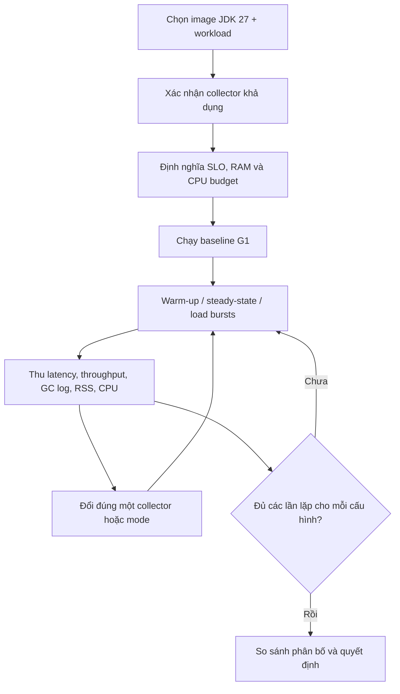

# Đánh giá ZGC, Shenandoah và collector có trong bản JDK được chọn

**Garbage collector (GC)** quyết định cách JVM tìm và thu hồi những đối tượng Java không còn được sử dụng. Lựa chọn GC ảnh hưởng trực tiếp đến **độ trễ**, **thông lượng**, **CPU** và **dung lượng bộ nhớ** của ứng dụng. Không có một collector luôn tốt nhất cho mọi hệ thống: một dịch vụ giao dịch nhạy cảm với độ trễ khác xa một batch job chạy hết CPU, và một JVM trong container nhỏ khác với máy chủ có hàng chục GB heap.

Trong **Java 27**, nếu đang sử dụng **HotSpot VM**, những lựa chọn quan trọng cần đánh giá gồm **G1**, **ZGC**, **Shenandoah** (nếu bản JDK có tích hợp), **Parallel GC** và **Serial GC**. Một số bản dựng còn cung cấp **Epsilon GC** dùng cho mục đích thử nghiệm chuyên biệt, nhưng Epsilon không thu gom rác và không phải lựa chọn bình thường cho dịch vụ dài hạn.

Đặc biệt, bài này cập nhật ba thay đổi có ảnh hưởng thực tế:

1. **JDK 27 — JEP 523:** HotSpot chọn **G1 GC mặc định ở mọi môi trường**, kể cả môi trường tài nguyên hạn chế, khi không có collector khác được chỉ định.
2. **JDK 24 — JEP 490:** ZGC chỉ còn **chế độ generational**; không dùng những tùy chọn lựa chọn non-generational ZGC từ các hướng dẫn cũ.
3. **JDK 25 — JEP 521:** Generational Shenandoah trở thành tính năng product. Nhưng ở **JDK 27**, mặc định khi chọn Shenandoah vẫn là chế độ **`satb` một thế hệ**; nếu muốn dùng generational Shenandoah thì phải chọn rõ `-XX:ShenandoahGCMode=generational` trên bản JDK có hỗ trợ.

Đối với bài học thuộc chương **JVM, bộ nhớ và thu gom rác** của Java 27, nguyên tắc thực hành xuyên suốt là: **kiểm tra đúng binary JDK đang chạy, bắt đầu với cấu hình đơn giản, đo trên workload đại diện rồi mới thay collector hoặc tuning**. Không suy đoán availability chỉ dựa trên một bài viết về “Java 27” nói chung.

## 1. Vì sao không thể chọn GC chỉ theo tên thuật toán?

Chọn collector là một bài toán cân bằng nhiều mục tiêu:

| Mục tiêu | Định nghĩa | Ví dụ câu hỏi |
|---|---|---|
| **Latency** | Thời gian một yêu cầu/tác vụ hoàn thành | p99/p99.9 của API có vượt SLO không? |
| **GC pause** | Thời gian ứng dụng phải tạm dừng do một pha GC hoặc safepoint | Có các pause dài bất thường không? |
| **Throughput** | Công việc hoàn thành trong một đơn vị thời gian | Bao nhiêu request/s hoặc bản ghi/s? |
| **CPU overhead** | CPU dành cho GC và các barrier của collector | GC cạnh tranh CPU với logic ứng dụng ra sao? |
| **Memory footprint** | Java heap, native memory và RAM thực tế | RSS/container memory có vượt giới hạn không? |
| **Headroom** | Phần bộ nhớ còn trống để hấp thụ allocation burst | Heap có đủ chỗ khi concurrent GC đang chạy? |
| **Ổn định** | Độ biến thiên khi chạy lâu và dưới tải đột biến | Có Full GC, allocation stall, OOM hoặc timeout không? |

Một GC có pause rất ngắn **vẫn có thể** làm throughput giảm nếu phải thực hiện nhiều công việc concurrent hoặc tốn thêm CPU/barrier. Một GC có throughput cao **vẫn có thể** không đạt SLO khi có các pause dài. Heap lớn có thể giảm số lần thu gom rác nhưng làm tăng footprint và gây áp lực cho container hoặc các tiến trình khác.

Vì vậy, câu hỏi đúng không phải là “GC nào hiện đại nhất?” mà là:

> Với cùng phiên bản JDK, cùng giới hạn tài nguyên và cùng tải nghiệp vụ, collector nào đáp ứng các SLO quan trọng nhất với chi phí chấp nhận được?

## 2. Phân biệt stop-the-world, concurrent và generational

### Stop-the-world (STW)

Trong một **STW pause**, các Java application thread liên quan tạm ngừng để JVM thực hiện một công việc nhất định. Đây là một trong các nguồn làm tăng thời gian phản hồi.

- **Serial GC** chủ yếu thực hiện GC theo kiểu STW với một GC worker.
- **Parallel GC** thực hiện các pha thu gom chủ yếu theo kiểu STW nhưng sử dụng nhiều GC worker.
- **G1** có các pha STW và các pha concurrent.
- **ZGC** và **Shenandoah** được thiết kế để phần lớn công việc tốn kém diễn ra **đồng thời với ứng dụng**, nhằm giữ pause thấp.

“Concurrent” **không đồng nghĩa không bao giờ có STW**. Mọi collector vẫn phải phối hợp với JVM và có các pha hay tình huống cần tạm dừng. Các cơ chế thu hồi dự phòng khi thiếu bộ nhớ hoặc quá tải cũng có thể khác với đường xử lý thông thường.

### Generational GC

Nhiều đối tượng Java có vòng đời ngắn. Một **generational collector** tận dụng quy luật này bằng cách phân biệt nhóm đối tượng trẻ và các đối tượng sống lâu:

```text
Ứng dụng tạo object
       |
       v
Young generation  -- còn sống qua nhiều vòng --> Old generation
       |                                           |
       +--- phần lớn object chết sớm               +--- sống lâu hơn
```

Sơ đồ chỉ mô tả tư tưởng; cách tổ chức vùng nhớ, đánh dấu, di chuyển và cập nhật tham chiếu khác nhau giữa từng GC.

Trong Java 27:

- **G1** là generational collector.
- **ZGC** là **generational-only**.
- **Shenandoah** có chế độ `satb` một thế hệ và chế độ `generational` do người dùng chọn khi bản dựng hỗ trợ.
- **Serial** và **Parallel** sử dụng cơ chế phân thế hệ truyền thống.

Không kết luận “generational luôn nhanh hơn”: kết quả còn phụ thuộc tỷ lệ object sống lâu, allocation rate, kích thước heap, write barriers và CPU.

## 3. Bảng so sánh collector cần đánh giá trên Java 27

| Collector | Mục tiêu điển hình | Kiểu thực thi nổi bật | Cờ chọn trên HotSpot | Điểm cần cân nhắc |
|---|---|---|---|---|
| **G1** | Cân bằng latency và throughput | Generational, mostly concurrent, có STW evacuation | `-XX:+UseG1GC` | Mặc định JDK 27; nên là baseline |
| **ZGC** | Latency rất thấp | Generational, phần lớn công việc concurrent | `-XX:+UseZGC` | Cần CPU và headroom phù hợp; theo dõi allocation stalls |
| **Shenandoah** | Low-pause/concurrent GC | Concurrent evacuation; `satb` hoặc `generational` | `-XX:+UseShenandoahGC` | Phải xác nhận collector được build vào JDK và chọn mode rõ ràng |
| **Parallel** | Thông lượng cao với STW chấp nhận được | Parallel stop-the-world | `-XX:+UseParallelGC` | Pause có thể dài hơn; thích hợp batch |
| **Serial** | Đơn giản, ít GC worker | Serial stop-the-world | `-XX:+UseSerialGC` | Có thể phù hợp workload nhỏ; không còn là mặc định trong môi trường nhỏ của JDK 27 |
| **Epsilon** | Thử nghiệm về allocation/GC overhead | Không thu gom rác | `-XX:+UseEpsilonGC` cùng điều kiện experimental nếu hỗ trợ | **Không** dùng như GC sản xuất thông thường |

Các cờ trên là **những lựa chọn cần thử**, không có nghĩa mọi nhà cung cấp JDK/OS/kiến trúc đều cung cấp tất cả. Đặc biệt, bản dựng HotSpot có thể không đóng gói Shenandoah hay Epsilon. Hãy xác nhận trên **đúng runtime** được triển khai.

Bảng cũng không hứa hẹn một khoảng pause tuyệt đối cho bất kỳ collector nào. Tính chất kỹ thuật và mục tiêu tối ưu chỉ là điểm khởi đầu; số liệu ứng dụng mới quyết định lựa chọn.

## 4. G1: baseline mặc định của HotSpot JDK 27

**Garbage-First (G1)** quản lý heap thành nhiều **region**, ưu tiên thu hồi những region mang lại hiệu quả thu hồi tốt, kết hợp GC theo thế hệ với các pha concurrent. G1 tìm cách cân bằng thông lượng và pause time, phù hợp làm lựa chọn khởi đầu cho phần lớn ứng dụng.

### Thay đổi riêng của JDK 27: JEP 523

Trước JDK 27, trong một số môi trường bị hạn chế tài nguyên (ví dụ máy chỉ có một CPU hoặc ít RAM), HotSpot có thể chọn Serial thay vì G1 theo cơ chế ergonomic selection. Từ **JDK 27, HotSpot mặc định chọn G1 ở mọi môi trường có G1 được tích hợp**.

Hệ quả khi nâng cấp:

- **Không cần thêm `-XX:+UseG1GC`** chỉ để dùng G1 trên bản HotSpot JDK 27 thông thường.
- Một dịch vụ container rất nhỏ vốn trước đó chạy Serial do JVM tự chọn có thể **chuyển sang G1** khi nâng JDK mà không đổi command line.
- **Serial vẫn tồn tại** và có thể được chọn tường minh nếu benchmark cho thấy phù hợp.
- Nếu image JDK tùy biến không tích hợp G1 hoặc một JVM khác HotSpot, phải kiểm tra hành vi thực tế thay vì áp dụng kết luận mù quáng.

JEP 523 thay đổi **collector mặc định**, không làm G1 biến thành lựa chọn tốt nhất tuyệt đối.

### Cấu hình baseline

```shell
java -Xms256m -Xmx1g -Xlog:gc -jar app.jar
```

Ví dụ chỉ mang tính minh họa; hãy chọn `-Xmx` theo live set, giới hạn bộ nhớ tiến trình/container và tài nguyên còn lại. Nếu không chỉ định cờ GC, HotSpot JDK 27 sẽ chọn G1 theo mặc định.

Có thể chọn tường minh:

```shell
java -XX:+UseG1GC -Xms256m -Xmx1g -Xlog:gc -jar app.jar
```

### MaxGCPauseMillis là **mục tiêu**, không phải cam kết

```shell
java -XX:+UseG1GC -XX:MaxGCPauseMillis=100 -Xmx1g -jar app.jar
```

`MaxGCPauseMillis` cung cấp **mục tiêu** thời gian pause để G1 điều chỉnh các quyết định GC; nó không tạo giới hạn thời gian thực cứng (*hard real-time deadline*). Nếu live set, tốc độ cấp phát, heap hoặc các pha thu gom không cho phép đạt mục tiêu, pause vẫn có thể dài hơn.

Tài liệu G1 khuyến nghị trước tiên để các thông số GC ở mức mặc định, chỉ điều chỉnh mục tiêu pause và heap size khi có số liệu. Đừng cố định young generation bằng các cờ riêng ngay từ đầu vì điều đó có thể cản trở cơ chế điều chỉnh pause của G1.

## 5. ZGC trên JDK 27: chỉ còn chế độ generational

**ZGC** được thiết kế cho ứng dụng có yêu cầu **low latency**. Phần lớn công việc tốn kém của ZGC được thực hiện concurrent với application threads, thay vì gom toàn bộ việc thu hồi vào các STW pause dài.

Theo **Java SE 27 GC Tuning Guide**, ZGC nhắm tới các pause ngắn, phần lớn không tỷ lệ với kích thước heap, và điều chỉnh hành vi dựa trên workload. Nhưng “nhắm tới dưới một mili-giây” trong tài liệu **không phải SLA** rằng mọi request luôn phản hồi dưới một mili-giây hoặc hệ thống không thể có stall.

### Cấu hình tối thiểu

```shell
java -XX:+UseZGC -Xms256m -Xmx1g -Xlog:gc -jar app.jar
```

**Quan trọng với Java 27:** từ JDK 24, ZGC chỉ còn **generational mode**. Bạn **không cần và không nên** sao chép cờ `-XX:+ZGenerational` hoặc lựa chọn non-generational ZGC từ các bài hướng dẫn cho JDK đời trước. Tùy chọn đó đã bị loại khỏi cấu hình ZGC hiện hành.

### Headroom quan trọng hơn nhiều tinh chỉnh phụ

Vì ZGC thu hồi rác trong khi ứng dụng vẫn cấp phát object, heap cần đủ dung lượng cho:

- **Live set**: các object vẫn còn được tham chiếu.
- **Dữ liệu được cấp phát mới** trong lúc GC đang chạy.
- **Biến động tăng đột ngột** của allocation rate.
- **Không gian cần cho relocation và các hoạt động GC**.

Nếu `-Xmx` quá thấp so với live set và tốc độ cấp phát, ZGC có thể bị **allocation stall** hoặc không thu hồi kịp. Cách xử lý không phải lúc nào cũng là giảm pause target; trước tiên hãy quan sát allocation rate, mức heap còn lại, CPU cho concurrent GC và khối lượng object còn sống.

### SoftMaxHeapSize không thay thế Xmx

```shell
java -XX:+UseZGC \
  -Xms256m -Xmx1g \
  -XX:SoftMaxHeapSize=768m \
  -Xlog:gc -jar app.jar
```

`SoftMaxHeapSize` cho ZGC một **ngưỡng mềm** để heuristic cố gắng duy trì heap ở mức thấp hơn nếu tải cho phép. JVM vẫn có thể vượt ngưỡng mềm và sử dụng tới giới hạn `-Xmx` khi cần tránh allocation stall.

Đừng hiểu `SoftMaxHeapSize=768m` là ràng buộc bộ nhớ thực tế tối đa 768 MB. Nếu container chỉ có đúng 768 MB cho toàn bộ tiến trình, còn phải tính native memory, thread stack, code cache, metaspace và các thành phần khác.

### Trả lại bộ nhớ không dùng

ZGC có cơ chế **uncommit** một phần heap đã commit mà không còn cần dùng, tùy cấu hình và workload. Tính năng này giúp giảm mức sử dụng bộ nhớ trong những giai đoạn ít tải nhưng có thể làm phát sinh chi phí commit/uncommit khi tải quay lại.

Nếu đặt `-Xms` bằng `-Xmx`, ZGC thường không còn vùng để uncommit xuống dưới mức heap tối thiểu. Đó có thể là lựa chọn khi ưu tiên độ ổn định latency, nhưng cần đánh đổi footprint và phải đo trong môi trường triển khai thật.

## 6. Shenandoah trên JDK 27: xác nhận bản dựng và **chế độ GC**

**Shenandoah** là collector hướng tới **pause thấp**, thực hiện phần đáng kể công việc đánh dấu và di chuyển object concurrent với application threads. Tuy nhiên, khác với việc chỉ đọc tên “Java 27”, cần kiểm tra **bản JDK thực tế có Shenandoah không**.

Một số bản dựng có thể không bao gồm Shenandoah do lựa chọn đóng gói, nền tảng hoặc cấu hình build. Nếu `-XX:+UseShenandoahGC` bị từ chối, đó là kết quả kiểm tra availability — không nên tự động tìm một cờ “mở khóa” không được tài liệu phiên bản đó hướng dẫn.

### Hai chế độ liên quan trong JDK 27

| Chế độ | Cấu hình | Mục đích |
|---|---|---|
| **`satb`** | `-XX:+UseShenandoahGC` (mặc định mode trên JDK 27) | Concurrent GC một thế hệ, snapshot-at-the-beginning |
| **`generational`** | `-XX:+UseShenandoahGC -XX:ShenandoahGCMode=generational` | Concurrent GC phân thế hệ, phù hợp để đánh giá workload nhiều object ngắn hạn |

Ví dụ chọn Shenandoah mặc định:

```shell
java -XX:+UseShenandoahGC \
  -Xms256m -Xmx1g \
  -Xlog:gc -jar app.jar
```

Ví dụ chọn **Generational Shenandoah**:

```shell
java -XX:+UseShenandoahGC \
  -XX:ShenandoahGCMode=generational \
  -Xms256m -Xmx1g \
  -Xlog:gc -jar app.jar
```

Ở Java 27, `ShenandoahGCMode=generational` **không còn là tính năng experimental cần bật theo hướng dẫn cũ**: Generational Shenandoah được đưa thành product feature trong **JDK 25 (JEP 521)**. Tuy vậy, chế độ mặc định khi chỉ chọn Shenandoah **vẫn là `satb` trong JDK 27**. Đừng nhầm với thay đổi dành cho JDK 28.

### Khác biệt thực tế với ZGC

Cả ZGC lẫn Shenandoah đều hướng tới low latency, nhưng **không phải cùng một thuật toán**. Chúng khác về barrier, cách tổ chức heap, relocation, chiến lược scheduling và mức overhead. Generational Shenandoah cũng không phải bản sao của generational ZGC.

Khi đánh giá Shenandoah, hãy theo dõi thêm:

- **Concurrent cycle** có hoàn tất kịp tốc độ cấp phát hay không.
- Có xuất hiện **Degenerated GC** hoặc **Full GC** khi không còn đủ chỗ để hoàn tất concurrent collection không.
- CPU overhead và số byte object được tạo/move.
- Mức ổn định khi load tăng đột ngột và live set lớn.
- Chế độ `satb` và `generational` có tạo khác biệt trên cùng workload không.

Không có cơ sở để khẳng định Shenandoah luôn nhanh hơn hay luôn chậm hơn ZGC. Đo thực tế với **cùng bản JDK nếu cả hai collector đều được hỗ trợ**.

## 7. Serial và Parallel GC: vẫn là lựa chọn hiện hành

### Serial GC

```shell
java -XX:+UseSerialGC -Xms128m -Xmx512m -jar app.jar
```

Serial GC dùng ít GC worker, thực hiện các pha thu gom chủ yếu theo kiểu STW. Nó vẫn có thể phù hợp với:

- Ứng dụng nhỏ, khối lượng làm việc ít.
- Một số workload trong môi trường có CPU hạn chế.
- Job ngắn hoặc tác vụ mà thời gian pause không phải chỉ tiêu quan trọng.

Tuy nhiên, **JDK 27 không còn tự chọn Serial** chỉ vì phát hiện cấu hình nhỏ nếu G1 được tích hợp và không có cờ chọn collector khác. Nếu muốn giữ hành vi Serial sau khi nâng JDK, phải chọn nó tường minh và đo lại.

### Parallel GC

```shell
java -XX:+UseParallelGC -Xms256m -Xmx1g -jar app.jar
```

Parallel GC thường phù hợp khi mục tiêu là **thông lượng và thời gian hoàn tất batch**, còn các STW pause dài hơn có thể chấp nhận được. Nó tận dụng nhiều GC worker để thu gom nhanh trong các pha dừng ứng dụng.

Một chương trình xử lý hàng triệu bản ghi trong batch có thể ưu tiên tổng thời gian chạy, trong khi một API giao dịch quan tâm p99.9 latency có thể chọn G1/ZGC/Shenandoah. Không thể lấy benchmark batch để kết luận cho dịch vụ API hoặc ngược lại.

### Epsilon không phải GC thu hồi rác thông thường

**Epsilon GC** là collector *no-op* dành cho thử nghiệm: cấp phát bộ nhớ nhưng **không thu hồi object**. Nếu chương trình tiếp tục cấp phát tới giới hạn heap, nó có thể hết bộ nhớ và dừng.

Một số bản OpenJDK cung cấp Epsilon với cấu hình experimental:

```shell
java -XX:+UnlockExperimentalVMOptions \
  -XX:+UseEpsilonGC \
  -Xmx256m -jar short-lived-test.jar
```

Không dùng Epsilon như phương án thay thế cho G1, ZGC hoặc Shenandoah trong server dài hạn. Nó chỉ hữu ích khi **chủ đích kiểm tra chi phí GC, hành vi allocation hoặc một tác vụ sống cực ngắn** và đã hiểu rằng không có reclamation.

## 8. Kiểm tra collector **đang thực sự có** trong bản JDK

Đây là bước bắt buộc của đề bài “collector có trong bản JDK được chọn”.

### 8.1. Xác định binary và nhà cung cấp

```shell
java -version
```

Ghi lại:

- **Version**: đúng Java 27 và patch level hiện hành.
- **Vendor/distribution**: Oracle JDK, Temurin, Corretto, Red Hat, một bản OpenJDK tùy biến...
- **JVM**: HotSpot hay implementation khác.
- **OS/architecture**: Linux/macOS/Windows; x86-64/AArch64...
- **Runtime image thực tế** trong container hoặc môi trường triển khai.

Nếu terminal của người phát triển dùng một `java` khác với service/container đang chạy, kết luận availability có thể sai. Khi kiểm tra CI/CD, hãy chạy lệnh **trong đúng runtime image** của ứng dụng.

### 8.2. Xem collector mặc định

```shell
java -Xlog:gc -version
```

Log khởi tạo GC của HotSpot thường có dòng dạng:

```text
[info][gc] Using G1
```

Đây là **ví dụ hình thức log**, không phải kết quả kiểm tra bản JDK trong máy người học. Với HotSpot JDK 27 thông thường, G1 là mặc định nếu không có option chọn collector khác.

Có thể xem thêm cấu hình VM:

```shell
java -XX:+PrintCommandLineFlags -version
java -XX:+PrintFlagsFinal -version
```

`PrintFlagsFinal` xuất rất nhiều flag. Dùng để chẩn đoán giá trị sau khi JVM lựa chọn; không coi mọi flag nội bộ trong đó là giao diện cấu hình ổn định phải tinh chỉnh.

### 8.3. Thử từng collector bằng một JVM ngắn hạn

Mỗi lệnh là **một lần chạy JVM riêng biệt**:

```shell
java -XX:+UseG1GC -Xlog:gc -version
java -XX:+UseZGC -Xlog:gc -version
java -XX:+UseShenandoahGC -Xlog:gc -version
java -XX:+UseParallelGC -Xlog:gc -version
java -XX:+UseSerialGC -Xlog:gc -version
```

Để kiểm tra Generational Shenandoah riêng:

```shell
java -XX:+UseShenandoahGC \
  -XX:ShenandoahGCMode=generational \
  -Xlog:gc -version
```

Nếu cờ bị từ chối, JVM thông thường in lỗi và kết thúc với mã thoát khác 0. Không âm thầm chuyển sang collector khác trong benchmark mà vẫn gắn nhãn kết quả theo collector đã yêu cầu.

**Không ghép nhiều cờ `-XX:+Use...GC` trong cùng một lần chạy** rồi hy vọng JVM tự chọn cái tốt nhất. Mỗi trial phải có một cấu hình không mâu thuẫn, được lưu cùng kết quả đo.

### 8.4. Phân biệt “hỗ trợ API” và “có thuật toán trong binary”

Việc tài liệu lệnh `java` mô tả `-XX:+UseShenandoahGC` không có nghĩa **mọi** binary của JDK 27 đều phải build collector này. JVM, kiến trúc, cấu hình biên dịch và nhà cung cấp đều có thể ảnh hưởng availability.

Do đó, kết quả đánh giá cần ghi:

```text
JDK version: ...
Vendor + VM: ...
OS/arch: ...
Runtime image/hash: ...
G1: AVAILABLE/UNAVAILABLE
ZGC: AVAILABLE/UNAVAILABLE
Shenandoah satb: AVAILABLE/UNAVAILABLE
Shenandoah generational: AVAILABLE/UNAVAILABLE
Parallel: AVAILABLE/UNAVAILABLE
Serial: AVAILABLE/UNAVAILABLE
Collector selected for test: ...
```

Chỉ so sánh collector mà **binary và môi trường thử nghiệm thực sự hỗ trợ**.

## 9. Xác định tiêu chí thành công trước khi benchmark

Bắt đầu bằng **SLO và ngân sách tài nguyên**. Ví dụ một dịch vụ thanh toán có thể đặt các điều kiện thử nghiệm:

- p99 latency của HTTP request không vượt ngưỡng SLO đã được đội vận hành thống nhất.
- Không có timeout hay `OutOfMemoryError` dưới tải mục tiêu.
- Throughput không giảm quá mức cho phép so với baseline.
- Tổng RAM của JVM phải dưới giới hạn container, gồm **heap lẫn native memory**.
- CPU tiêu thụ phải nằm trong CPU quota thực tế.
- GC không được gây pause bất thường ảnh hưởng tới yêu cầu quan trọng.

Đừng lấy **GC pause p99** làm đại diện duy nhất cho **request latency p99**. Request latency còn phụ thuộc mạng, lock, database, queue, CPU scheduling và các nguồn tạm dừng JVM khác. Hai số cần được thu thập **cùng thời gian** để xác định mối tương quan.

### Chỉ số nên ghi

| Nhóm | Chỉ số cần ghi | Vì sao quan trọng |
|---|---|---|
| Nghiệp vụ | Request/s, jobs/s, thời gian batch | Đo tác động người dùng nhận được |
| Độ trễ | p50, p95, p99, p99.9 và timeout | Đo chất lượng ở phần đuôi phân bố |
| GC | Số lần/cycle, thời gian pause, pause lớn nhất | Phát hiện gián đoạn ứng dụng |
| Heap | Used/committed/max; occupancy sau GC | Đánh giá live set và headroom |
| Allocation | Bytes/s, object churn, promotions | Đo áp lực tạo object |
| CPU | CPU process, CPU GC, mức throttling | Concurrent GC cũng dùng CPU |
| Bộ nhớ tiến trình | RSS/working set, native memory, metaspace | Tránh OOM do container dù heap chưa đầy |
| Bất thường | Full GC, allocation stall, degenerated cycle | Dấu hiệu GC không theo kịp tải |
| Môi trường | CPU quota, RAM limit, image, OS, JVM build | Bảo đảm các lần chạy có thể so sánh |

Số liệu JFR hoặc `GarbageCollectorMXBean` có thể khác giữa các collector. Một collector có nhiều bean/cycle riêng (ví dụ vùng trẻ và già), trong khi collector khác báo số lần/thời gian theo cấu trúc khác; **không** so sánh máy móc số `collectionCount` giữa các thuật toán.

## 10. Cấu hình heap và bộ nhớ tiến trình để phép so sánh công bằng

### Xmx không phải giới hạn tổng RAM

```shell
java -Xms256m -Xmx1g -jar app.jar
```

`-Xmx1g` giới hạn **Java heap**, không giới hạn toàn bộ RSS. Ngoài heap còn có:

- Metaspace và vùng metadata liên quan đến class.
- Code cache/JIT.
- Thread stack, kể cả các platform thread/carrier.
- Direct buffers và vùng native/off-heap, FFM allocations.
- Bộ nhớ của collector, JVM và thư viện native.
- Một phần vùng mapped memory hoặc tài nguyên hệ điều hành liên quan.

Ví dụ, container có giới hạn RAM gần bằng `-Xmx` có thể bị OOM kill trước khi Java ném `OutOfMemoryError: Java heap space`.

### Đặt ngân sách theo mục tiêu

Để benchmark hai collector tương đối công bằng, hãy:

1. Đặt cùng **ngưỡng heap tối đa** khi mục tiêu là so sánh latency/throughput trong cùng ngân sách heap.
2. Giữ cùng CPU quota, memory limit, workload và kích thước live set.
3. Ghi **RSS/native memory** vì các collector có chi phí native khác nhau.
4. Nếu một collector thường xuyên stall do thiếu headroom, ghi nhận thất bại dưới ngân sách này trước khi thử heap lớn hơn.
5. Có thể thực hiện **vòng thử thứ hai** cho phép mỗi collector dùng kích thước heap tối ưu trong một ngân sách **RAM tổng** cố định, để đánh giá triển khai thực tế.

Không nhất thiết mọi collector đều tối ưu ở đúng một giá trị `-Xmx`. Vì thế báo cáo cần phân biệt:

- **Equal-heap trial:** cùng `-Xmx`, nhìn rõ sự đánh đổi tại một mức heap.
- **Equal-budget trial:** cùng giới hạn RAM tổng/container, cho phép các cấu hình dùng heap tối ưu khác nhau.

### Tránh tối ưu sớm bằng quá nhiều flag

Khởi đầu bằng collector + heap size + log. Chỉ khi đã có log và vấn đề cụ thể mới thử thay đổi các flag sâu hơn. Ví dụ với G1, tài liệu khuyên không cố định young generation tùy tiện vì điều đó ảnh hưởng khả năng đáp ứng mục tiêu pause.

Đặc biệt, không sao chép hàng loạt flag của một JDK cũ vào Java 27 mà chưa kiểm tra xem chúng đã đổi tên, bỏ hoặc thay đổi ngữ nghĩa chưa.

## 11. Ghi log GC bằng Unified Logging

HotSpot JDK 27 dùng **Unified Logging**. Ví dụ tối thiểu:

```shell
java -XX:+UseG1GC -Xmx1g -Xlog:gc -jar app.jar
```

Ví dụ thu thập thông tin chi tiết hơn và xoay vòng file:

```shell
java -XX:+UseG1GC -Xmx1g \
  '-Xlog:gc*,safepoint:file=gc-%p.log:time,uptime,level,tags:filecount=5,filesize=20M' \
  -jar app.jar
```

Cách quote ở trên dành cho shell Unix-like. Trong Windows PowerShell hoặc cấu hình container, phải truyền **một JVM argument** hoàn chỉnh theo cú pháp shell tương ứng. File `gc-%p.log` được tạo trong working directory của tiến trình nếu không có đường dẫn khác.

Những yếu tố quan trọng:

- `gc*`: thu thập thông tin GC cùng nhóm tag liên quan.
- `safepoint`: giúp phân biệt một số JVM safepoint event ngoài GC.
- `time,uptime,level,tags`: thêm thông tin hỗ trợ đối chiếu sự kiện.
- `filecount=5,filesize=20M`: chính sách xoay vòng log; mức giới hạn là gần đúng.
- `-Xlog:help`: hiển thị cú pháp và tag thực sự được binary hỗ trợ.

Bật logging quá chi tiết có chi phí CPU, I/O và dung lượng lưu trữ. Với benchmark, hãy dùng mức log tương đương trên mọi collector và không log ở mức `trace` vô hạn trong môi trường production.

### Đọc log theo triệu chứng, không theo tên dòng đơn lẻ

| Dấu hiệu | Cách đọc |
|---|---|
| Nhiều `Pause Young` ngắn | Có thể bình thường khi allocation rate cao |
| `Pause Full` kéo dài | Cần điều tra live set, promotion, heap headroom hoặc lý do fallback |
| ZGC `Allocation Stall` | Concurrent reclamation không theo kịp allocation tại headroom hiện có |
| Shenandoah `Degenerated GC` / `Full GC` | Có thể là đường khôi phục khi concurrent collection không đủ tiến độ |
| Heap occupancy sau mỗi GC tăng lâu dài | Cần phân biệt cache hợp lệ, retention tăng và memory leak |
| GC CPU tăng mạnh | Có thể do allocation churn, live set lớn hoặc GC concurrency/barrier overhead |

Không phải mọi collector dùng **cùng nhãn log**. Khi diễn giải, hãy lưu cả tên collector, JDK build và sample log; đừng chỉ grep từ khóa rồi kết luận.

## 12. JFR, jcmd và các công cụ quan sát

**Java Flight Recorder (JFR)** giúp thu thập thời gian CPU, allocation, GC events, thread activity và các dấu hiệu liên quan đến latency, tùy cấu hình sự kiện.

Ví dụ đối với một JVM đang chạy (thay `12345` bằng PID thực):

```shell
jcmd 12345 VM.version
jcmd 12345 VM.flags
jcmd 12345 GC.heap_info
jcmd 12345 JFR.start name=gc-eval settings=profile duration=2m filename=gc-eval.jfr
```

Có thể xem báo cáo qua Java Mission Control hoặc công cụ `jfr` tương thích. Việc gắn công cụ với tiến trình đang chạy phụ thuộc quyền hệ điều hành, cấu hình container và khả năng truy cập PID.

**Không** chạy các diagnostic command gây GC/heap dump lớn trên production chỉ để lấy một biểu đồ nếu chưa đánh giá chi phí. Heap dump có thể chứa dữ liệu nhạy cảm và tạo pause/dung lượng lưu trữ lớn.

### Native Memory Tracking (NMT)

Nếu RSS tăng nhưng heap không tăng tương ứng, xem xét **native memory**. Có thể khởi động JVM với:

```shell
java -XX:NativeMemoryTracking=summary -Xmx1g -jar app.jar
```

Sau đó:

```shell
jcmd 12345 VM.native_memory summary
```

NMT có overhead và giới hạn phạm vi quan sát; không thể tự động quy mọi byte RSS của thư viện ngoài JVM cho một hạng mục JVM cụ thể. Chỉ bật khi cần để điều tra và nhớ giữ cấu hình đo nhất quán giữa các trial.

**Lưu ý JDK 27:** nếu dùng Generational ZGC, sự kiện JFR `jdk.OldObjectSample` được tắt trong JDK 27 do overhead của implementation tương ứng. Không dựa vào việc “không thấy old object samples” để kết luận không có object retention hoặc memory leak; dùng các phương pháp phù hợp khác khi điều tra.

## 13. Quy trình A/B benchmark có thể tái lập

Một thử nghiệm so sánh collector nên được thiết kế như thí nghiệm kỹ thuật, không phải một cuộc chạy duy nhất.



### Checklist thử nghiệm

1. **Cùng JDK 27 build** và cùng bản ứng dụng, thư viện, tham số workload.
2. **Cùng hardware/CPU quota**, memory/container limit và chính sách hệ điều hành.
3. **Cùng data set** và tỷ lệ đọc/ghi, object allocation, response size, kết nối DB.
4. **Warm-up đủ lâu** để JVM JIT và ứng dụng vào trạng thái đại diện, thay vì so sánh phút đầu với phút sau.
5. **Steady-state** và **load burst** phải được đo tách biệt.
6. **Chạy nhiều lần** và ghi phân bố/độ biến thiên, không dựa vào một số trung bình đẹp.
7. **Không thay đồng thời** GC, số lượng thread, connection pool, heap, version JDK và caching rồi quy toàn bộ chênh lệch cho GC.
8. **Ghi thất bại** như timeout, OOM, JVM startup rejection hoặc latency SLO violation; không bỏ qua trial thất bại.
9. **Theo dõi bộ nhớ tiến trình**, không chỉ mức heap đã sử dụng.
10. **Không chọn collector chỉ bằng synthetic allocation benchmark**; luôn xác nhận trên workload nghiệp vụ.

### Bảng kết quả đề xuất

| Cấu hình | Collector khả dụng? | p99 HTTP (ms) | p99.9 HTTP (ms) | Throughput (req/s) | GC pause max (ms) | RSS peak (MiB) | CPU (%) | SLO đạt? |
|---|---|---|---|---|---|---|---|---|
| Baseline G1 | Điền thực tế | — | — | — | — | — | — | — |
| ZGC generational | Điền thực tế | — | — | — | — | — | — | — |
| Shenandoah satb | Điền thực tế | — | — | — | — | — | — | — |
| Shenandoah generational | Điền thực tế | — | — | — | — | — | — | — |
| Parallel | Điền thực tế | — | — | — | — | — | — | — |
| Serial | Điền thực tế | — | — | — | — | — | — | — |

**Dấu `—` là ô chưa có số liệu, không phải số 0.** Không tự điền kết quả theo cảm nhận rằng ZGC “phải” có GC pause thấp hơn trong mọi điều kiện hoặc Parallel “phải” có throughput cao nhất.

## 14. Ví dụ thực hành Java 27: tạo áp lực cấp phát có kiểm soát

Ví dụ sau tạo một số lượng lớn `byte[]` ngắn hạn, đồng thời giữ một nhóm mảng sống qua nhiều vòng. Nó giúp quan sát **cách GC hoạt động và cách lấy GC metrics**, nhưng **không đại diện hoàn toàn cho một ứng dụng server**.

Lưu thành `GcComparisonDemo.java`:

```java
import java.lang.management.GarbageCollectorMXBean;
import java.lang.management.ManagementFactory;
import java.lang.management.MemoryUsage;

public final class GcComparisonDemo {

    // Giữ nhóm object còn được tham chiếu tới cuối chương trình.
    private static volatile Object retained;

    public static void main(String[] args) {
        int rounds = Integer.parseInt(
            System.getProperty("demo.rounds", "60000")
        );
        int keep = Integer.parseInt(
            System.getProperty("demo.keep", "128")
        );

        if (rounds < 1 || rounds > 1_000_000
                || keep < 1 || keep > 4096) {
            throw new IllegalArgumentException(
                "demo.rounds phải thuộc [1, 1000000], "
                + "demo.keep phải thuộc [1, 4096]"
            );
        }

        byte[][] survivors = new byte[keep][];
        long checksum = 0L;

        for (int i = 0; i < rounds; i++) {
            byte[] data = new byte[8192 + (i % 4) * 1024];

            data[0] = (byte) i;
            data[data.length - 1] = (byte) (i >>> 8);

            // Thay thế một vị trí, khiến nhiều mảng cũ có thể trở thành rác.
            survivors[i % keep] = data;
            checksum += Byte.toUnsignedInt(data[0]);
        }

        retained = survivors;

        MemoryUsage heap = ManagementFactory.getMemoryMXBean()
            .getHeapMemoryUsage();

        System.out.println("Checksum: " + checksum);
        System.out.println("Heap used (bytes): " + heap.getUsed());
        System.out.println("Heap committed (bytes): " + heap.getCommitted());

        for (GarbageCollectorMXBean bean :
                ManagementFactory.getGarbageCollectorMXBeans()) {
            System.out.println(
                "GC bean: " + bean.getName()
                + ", collections=" + bean.getCollectionCount()
                + ", collectionTimeMs=" + bean.getCollectionTime()
            );
        }

        // Giữ tham chiếu qua bước in metrics.
        if (retained == null) {
            throw new AssertionError("Không có dữ liệu");
        }
    }
}
```

Biên dịch:

```shell
javac --release 27 GcComparisonDemo.java
```

Chạy từng collector trong **một JVM riêng**:

```shell
java -XX:+UseG1GC -Xms64m -Xmx256m -Xlog:gc GcComparisonDemo
java -XX:+UseZGC -Xms64m -Xmx256m -Xlog:gc GcComparisonDemo
java -XX:+UseParallelGC -Xms64m -Xmx256m -Xlog:gc GcComparisonDemo
java -XX:+UseSerialGC -Xms64m -Xmx256m -Xlog:gc GcComparisonDemo
```

Nếu bản JDK hỗ trợ Shenandoah:

```shell
java -XX:+UseShenandoahGC \
  -Xms64m -Xmx256m -Xlog:gc GcComparisonDemo

java -XX:+UseShenandoahGC \
  -XX:ShenandoahGCMode=generational \
  -Xms64m -Xmx256m -Xlog:gc GcComparisonDemo
```

**Cần hiểu giới hạn của bài thực hành:**

- JVM **không bảo đảm** số GC cycle hoặc GC time cố định trong từng lần chạy. Kết quả phụ thuộc JIT, kiến trúc, môi trường và heuristic GC.
- `GarbageCollectorMXBean` có thể hiển thị các tên bean khác nhau theo collector; `getCollectionCount()` hoặc `getCollectionTime()` còn có thể trả `-1` nếu không hỗ trợ thông tin tương ứng.
- Các số trong `GcComparisonDemo` **không phải request latency**. Muốn chọn GC cho hệ thống thực tế phải đo workload với giao dịch/response time.
- Benchmark ngắn này không thể hiện đầy đủ JIT warm-up, CPU cạnh tranh, nhiều connection hay load burst ngoài thực tế.
- Nếu một cấu hình không khởi động vì collector không được hỗ trợ, đánh dấu **UNAVAILABLE**, không tự sửa cờ rồi giữ nguyên nhãn trial.

Ví dụ cố ý không gọi `System.gc()` trong loop, vì ép GC thủ công làm sai bức tranh về hành vi của collector dưới allocation tự nhiên.

## 15. Kịch bản chọn collector

### Kịch bản A — Dịch vụ HTTP thông thường

Đặc điểm: nhiều request, mức tải trung bình, cần cân bằng throughput và latency; chưa có dấu hiệu pause bất thường.

**Lựa chọn xuất phát:** G1 mặc định của JDK 27, đặt heap phù hợp và theo dõi log/JFR. Nếu đạt SLO, không cần đổi GC chỉ để “nâng cấp thuật toán”.

### Kịch bản B — API rất nhạy cảm với độ trễ đuôi

Đặc điểm: p99.9 bị ảnh hưởng rõ bởi GC pause; có đủ RAM headroom và CPU để dành cho concurrent GC.

**Ứng viên:** ZGC. Shenandoah cũng cần được đưa vào so sánh nếu bản JDK hỗ trợ. Đánh giá cả latency, throughput, CPU, RSS, allocation stalls và các trường hợp fallback; không kết luận chỉ qua GC pause trung bình.

### Kịch bản C — Batch job ưu tiên thời gian hoàn tất

Đặc điểm: toàn bộ job mất vài phút, từng pause trong quá trình xử lý ít ảnh hưởng trực tiếp tới người dùng.

**Ứng viên:** Parallel GC; so với G1 baseline. Tập trung vào wall-clock duration, throughput, CPU và memory. Nếu batch đòi tail latency cho bước xử lý riêng thì vẫn phải đo yếu tố đó.

### Kịch bản D — Dịch vụ nhỏ trong container hạn chế tài nguyên

Đặc điểm: 1 CPU, RAM hạn chế, ít request đồng thời.

**Ứng viên:** G1 mặc định JDK 27 và Serial được chọn tường minh; xem collector nào phù hợp với footprint và độ trễ. **Không** mặc định rằng Serial đã được JVM tự chọn như trong một số bản JDK cũ.

### Kịch bản E — Nhiều object sống ngắn, live set biến động mạnh

Đặc điểm: allocation churn cao, có burst, các object long-lived chiếm tỷ lệ không lớn.

**Ứng viên:** G1 baseline; ZGC generational; Shenandoah generational nếu bản dựng hỗ trợ. Đo allocation stalls, concurrent CPU, promotion và mức heap headroom cần thiết. Không giả định mọi thuật toán phân thế hệ đều cho kết quả giống nhau.

## 16. Playbook xử lý triệu chứng trước khi đổi GC

| Triệu chứng | Điều cần kiểm tra trước | Hướng xử lý |
|---|---|---|
| Request p99 tăng nhưng GC pause thấp | DB, network, lock contention, CPU throttling, queue | Chẩn đoán toàn pipeline trước |
| G1 có nhiều Full GC dài | Live set, heap headroom, humongous objects, allocation/promotion rate | Điều chỉnh workload, heap hoặc GC có căn cứ |
| ZGC gặp allocation stalls | `-Xmx`, live set, tốc độ cấp phát, concurrent GC CPU | Tăng headroom, giảm allocation hoặc đánh giá tải |
| Shenandoah có Degenerated/Full GC | CPU/headroom, allocation burst, mode đã chọn | Đo lại với ngân sách đúng; thử mode phù hợp |
| Throughput thấp, CPU GC cao | Allocation churn, barriers, quá nhiều concurrent work | Giảm cấp phát, thử Parallel/G1 hoặc điều chỉnh có kiểm chứng |
| Heap used không cao nhưng container OOM | RSS, direct buffer, native memory, metaspace, stacks | Điều tra ngoài heap; không chỉ tăng `-Xmx` |
| Bộ nhớ sau mỗi GC tăng lâu dài | Cache/retention, leak, thay đổi tải, classloader | Phân tích object graph/heap, không chỉ đổi collector |
| Collector không khởi động | Vendor, OS/arch, build flags, mode/cờ không hỗ trợ | Xác nhận runtime; không benchmark cấu hình không tồn tại |

Một collector khác có thể cải thiện triệu chứng, nhưng **không sửa được** object leak hay một truy vấn SQL chậm. Khi thấy heap tăng sau GC, cần phân biệt việc ứng dụng đang giữ đối tượng có chủ đích với retention không mong muốn.

### Khi nào nên thử tăng heap?

Nếu hệ thống liên tục bị áp lực thiếu headroom, tăng heap **trong ngân sách RAM cho phép** có thể giúp concurrent GC chạy ổn định hơn. Nhưng tăng heap không phải giải pháp cho mọi trường hợp: có thể nâng RSS, làm footprint vượt container hoặc che một leak cho tới khi nó tái diễn ở quy mô lớn hơn.

### Khi nào nên giảm allocation?

Nếu log/JFR cho thấy GC phải xử lý lượng object ngắn hạn rất lớn, tối ưu cách cấp phát ở code có thể mang lại lợi ích **với mọi collector**. Ví dụ tránh tạo bản sao danh sách lớn không cần thiết, đọc dữ liệu theo lô hợp lý, không giữ các object tạm quá lâu, và tối ưu cấu trúc dữ liệu dựa trên profile thực.

Không tạo custom object pool cho mọi object Java như một tối ưu mặc định. Pool sai cách có thể làm tăng retention, contention và code complexity.

## 17. Những hiểu lầm cần tránh

**“JDK 27 mặc định dùng ZGC vì ZGC có pause thấp nhất.”**

Sai. Với HotSpot JDK 27, **G1 là mặc định** khi không chọn GC khác (JEP 523).

**“Shenandoah trên JDK 27 mặc định chạy generational mode.”**

Sai theo cấu hình `java` của JDK 27: mặc định mode là `satb`. Cần chọn `-XX:ShenandoahGCMode=generational` nếu muốn thử mode phân thế hệ.

**“Cờ `ZGenerational` vẫn cần để bật generational ZGC.”**

Không còn phù hợp. Từ JDK 24 chỉ có generational ZGC; Java 27 không dùng cờ chọn mode cũ.

**“Collector concurrent sẽ không bao giờ pause.”**

Sai. Concurrent GC vẫn có pha STW, sự kiện safepoint và khả năng stall/fallback khi tải vượt năng lực thu hồi.

**“GC pause p99 thấp đồng nghĩa request p99 thấp.”**

Sai. Request còn phụ thuộc database, I/O, scheduling, lock, queue và runtime khác.

**“Tăng `-Xmx` luôn giúp giảm RAM dùng.”**

Sai. `-Xmx` tăng giới hạn heap tối đa; RSS và tổng RAM tiến trình còn chịu nhiều thành phần khác.

**“Chỉ nhìn một lần chạy có GC nhanh nhất là đủ.”**

Sai. Kết quả phải được đo nhiều lần, có warm-up, tải đại diện và cùng ngân sách tài nguyên.

**“Mọi bản JDK 27 đều tích hợp Shenandoah.”**

Không có bảo đảm đó. Cần kiểm tra trên bản JDK thực tế bằng cờ startup và log.

## 18. Bài tập thực hành

### Bài 1 — Collector mặc định

Một container có một CPU và 1 GB RAM, không có cờ chọn GC. Nếu chạy HotSpot JDK 27 tiêu chuẩn có G1, collector nào được chọn mặc định? Nó khác điều gì so với một số môi trường ở JDK trước đó?

### Bài 2 — Chọn ZGC đúng cách

Viết JVM command line để chạy ứng dụng `service.jar` với ZGC, heap tối đa 2 GB và GC log. Có cần cờ riêng bật generational ZGC trên Java 27 không?

### Bài 3 — Hai chế độ Shenandoah

Viết hai lệnh khởi động `app.jar`: một lệnh dùng Shenandoah mode mặc định của Java 27 và một lệnh dùng Generational Shenandoah. Điều kiện nào khiến cả hai lệnh không sử dụng được trên một bản JDK nhất định?

### Bài 4 — Heap và RSS

Một JVM chạy với `-Xmx2g` trong container giới hạn 2 GB. Vì sao container vẫn có thể bị OOM kill khi heap mới dùng 1.6 GB? Hãy kể ít nhất ba thành phần ngoài heap.

### Bài 5 — GC pause và request latency

Một đợt tải cho thấy GC pause p99 thấp nhưng HTTP p99 cao. Vì sao chưa nên đổi collector ngay? Hãy nêu những dữ liệu cần thu thập thêm.

### Bài 6 — Allocation stalls

ZGC báo allocation stall khi peak load. Hãy liệt kê các giả thuyết ưu tiên kiểm tra và một kế hoạch đo để phân biệt nguyên nhân.

### Bài 7 — Batch job

Cần chạy batch tính toán xử lý nhiều đối tượng, không có SLO pause ngặt nghèo. Bạn sẽ đặt Parallel cạnh collector nào trong thử nghiệm đầu tiên, và so sánh các chỉ số gì?

### Bài 8 — Tính tái lập

Hai báo cáo benchmark khác nhau: lần A chạy Java 27 trên 4 CPU/1 GB heap, lần B chạy Java 26 trên 8 CPU/4 GB heap. Có thể quy chênh lệch throughput cho collector không? Tại sao?

### Bài 9 — Đánh giá availability

Một lệnh `java -XX:+UseShenandoahGC -Xlog:gc -version` báo lỗi “not supported”. Cần ghi gì trong báo cáo và nên làm gì tiếp theo?

### Bài 10 — Lập bảng quyết định

Tạo bảng kết quả có hàng G1, ZGC, Shenandoah `satb`, Shenandoah `generational`, Parallel và Serial. Với mỗi cấu hình, ghi trạng thái availability, `-Xmx`, p99.9 latency, throughput, RSS peak, CPU và số lỗi. Không dùng giá trị giả định chưa đo.

### Đáp án gợi ý

1. **G1** theo JEP 523; JDK 27 không còn tự động fallback sang Serial chỉ vì môi trường tài nguyên hạn chế khi có G1 và không có lựa chọn tường minh khác.
2. `java -XX:+UseZGC -Xmx2g -Xlog:gc -jar service.jar`. Không thêm `ZGenerational` trên Java 27.
3. Mặc định: `-XX:+UseShenandoahGC`; generational: thêm `-XX:ShenandoahGCMode=generational`. Phải xác nhận binary hỗ trợ Shenandoah và mode tương ứng.
4. Do metaspace, code cache, direct/native buffers, thread stacks, collector metadata, FFM allocations... đều tiêu thụ bộ nhớ ngoài heap.
5. Cần theo dõi database/network, lock, CPU throttling, request queue và tương quan thời gian giữa pause và latency.
6. Kiểm tra live set, `-Xmx` headroom, allocation burst, GC CPU, mức concurrent progress; so sánh thử nghiệm với heap/ngân sách được điều chỉnh.
7. So **Parallel** với **G1 baseline**; tập trung wall-clock, throughput, CPU, RSS, các pause và số lỗi.
8. Không. Nhiều biến cùng thay đổi: version JDK, số CPU, heap và có thể cấu hình collector khác.
9. Ghi **UNAVAILABLE** cho build hiện tại; đối chiếu vendor, OS/arch và bản dựng. Không tự ghi kết quả giả dưới nhãn Shenandoah.
10. Để trống số chưa đo và dùng một quy trình tải/đo thống nhất; chỉ kết luận sau khi dữ liệu đạt độ tin cậy đủ dùng.

## 19. Tổng kết

Trong **Java 27**, việc đánh giá GC nên bắt đầu từ **G1 mặc định của HotSpot**. ZGC là ứng viên quan trọng khi độ trễ đuôi của ứng dụng thật sự bị ảnh hưởng bởi GC. Shenandoah là một lựa chọn low-pause cần kiểm tra **có trong bản JDK hay không** và xác định **`satb` hay `generational`**; tại JDK 27, generational mode được hỗ trợ khi có collector nhưng **không phải mode mặc định**. Parallel và Serial vẫn là những lựa chọn hợp lệ cho workload tương ứng.

Không chọn GC theo lời quảng bá “zero pause” hoặc bảng số liệu của một hệ thống không liên quan. Hãy xác định SLO, kiểm tra availability của runtime, giữ ngân sách heap/RAM/CPU nhất quán, ghi GC logs và JFR, đo p99/p99.9 response time lẫn throughput/RSS, rồi đánh giá các trial có thể tái lập.

Bản chất của tuning GC là **tối ưu hệ thống dưới ràng buộc thực tế**, không phải sử dụng càng nhiều JVM flag càng tốt. Và khi vấn đề đến từ allocation churn, object retention, native memory hoặc downstream latency, đôi khi cách xử lý đúng nằm ở ứng dụng hoặc kiến trúc thay vì việc đổi collector.

## Tài liệu tham khảo

- [Oracle Java SE 27 — HotSpot VM Garbage Collection Tuning Guide](https://docs.oracle.com/en/java/javase/27/gctuning/): hướng dẫn chính thức theo phiên bản Java 27.
- [Oracle Java SE 27 — Available Collectors](https://docs.oracle.com/en/java/javase/27/gctuning/available-collectors.html): G1, Serial, Parallel, ZGC và điểm khởi đầu để chọn GC.
- [Oracle Java SE 27 — G1 GC](https://docs.oracle.com/en/java/javase/27/gctuning/garbage-first-g1-garbage-collector.html): thiết kế, region, generational, pause goal và mặc định.
- [Oracle Java SE 27 — G1 GC Tuning](https://docs.oracle.com/en/java/javase/27/gctuning/garbage-first-garbage-collector-tuning.html): khuyến nghị bắt đầu với mặc định và đo trước khi tuning.
- [Oracle Java SE 27 — ZGC](https://docs.oracle.com/en/java/javase/27/gctuning/z-garbage-collector.html): chỉ còn generational từ JDK 24, heap headroom, SoftMaxHeapSize và uncommit.
- [Oracle Java SE 27 — The java Command](https://docs.oracle.com/en/java/javase/27/docs/specs/man/java.html): cờ UseG1GC, UseZGC, UseShenandoahGC, UseParallelGC, UseSerialGC, ShenandoahGCMode, unified logging.
- [Oracle Java SE 27 — Diagnostic Tools](https://docs.oracle.com/en/java/javase/27/troubleshoot/diagnostic-tools.html): jcmd, GC.heap_info, JFR và native memory diagnostics.
- [Oracle Java SE 27 — Release Notes](https://www.oracle.com/java/technologies/javase/27-relnote-issues.html): các thay đổi thực tế trên JDK 27, bao gồm JFR và flag GC.
- [JEP 523 — Make G1 the Default Garbage Collector in All Environments](https://openjdk.org/jeps/523): G1 mặc định trong JDK 27 trên HotSpot.
- [JEP 490 — ZGC: Remove the Non-Generational Mode](https://openjdk.org/jeps/490): loại chế độ non-generational ZGC trong JDK 24.
- [JEP 521 — Generational Shenandoah](https://openjdk.org/jeps/521): đưa Generational Shenandoah thành product feature trong JDK 25.
- [JEP 318 — Epsilon: A No-Op Garbage Collector](https://openjdk.org/jeps/318): collector chuyên dụng không thực hiện thu hồi rác.
- [Inside Java — JDK 27: Default G1 in All Environments](https://inside.java/2026/07/20/quality-heads-up/): giải thích các tác động lên môi trường tài nguyên hạn chế.
