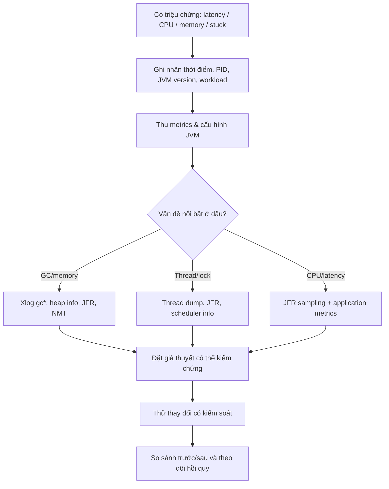

# Unified logging và thu thập thông tin runtime

Khi ứng dụng Java có độ trễ tăng đột ngột, CPU cao, bộ nhớ tiếp tục tăng hoặc hàng nghìn tác vụ chờ mãi, một câu hỏi quan trọng là: **đang có chuyện gì bên trong JVM tại thời điểm xảy ra sự cố?** Java 27 cung cấp nhiều lớp quan sát khác nhau, trong đó **JVM Unified Logging** qua tùy chọn `-Xlog` ghi các sự kiện nội bộ, còn các công cụ **`jcmd`**, **Java Flight Recorder (JFR)** và **management MXBeans** giúp thu thập trạng thái runtime và dữ liệu chẩn đoán.

Các công cụ này bổ sung cho nhau. Unified Logging phù hợp theo dõi những sự kiện có **tag/level** như garbage collection, safepoint hoặc nạp lớp; MXBeans cho biết **trạng thái và số liệu tổng hợp**; thread dump phản ánh **trạng thái thread tại một thời điểm**; JFR thu thập **chuỗi sự kiện hiệu năng theo thời gian**.

Bài học thuộc chương **Chẩn đoán và hiệu năng**, module **JAVA_VERSION_JAVA27 — Java 27 và các kiến thức liên quan**. Nội dung chọn các API và công cụ còn được hỗ trợ trong Java 27. Đặc biệt, dùng `-Xlog` và `jcmd` hiện hành thay vì hướng dẫn dựa trên các cờ GC/runtime logging cũ không còn được công nhận.

## 1. Phân biệt đúng loại dữ liệu cần thu thập

| Câu hỏi chẩn đoán | Công cụ ưu tiên | Dữ liệu nhận được |
|---|---|---|
| GC diễn ra khi nào, ở mức nào? | `-Xlog:gc*` | Các sự kiện JVM logging liên quan GC |
| JVM bị dừng ở safepoint thường xuyên không? | `-Xlog:safepoint`, JFR | Log sự kiện và timeline liên quan safepoint |
| JVM đang dùng những cấu hình nào? | `jcmd PID VM.flags`, `VM.command_line` | Tham số/flags JVM đã khởi động |
| Heap hiện có quy mô bao nhiêu? | `jcmd PID GC.heap_info`, `MemoryMXBean` | Thông tin bộ nhớ heap tại thời điểm đo |
| Thread nào đang chờ, bị khóa, blocked? | `Thread.dump_to_file`, `Thread.print` | Stack traces và trạng thái thread |
| Tác vụ nào tạo CPU/GC pressure theo thời gian? | JFR, JDK Mission Control | Sampling/event timeline |
| Native memory trong JVM tăng? | Native Memory Tracking (NMT) | Phân loại bộ nhớ native mà NMT theo dõi |
| Cần metric liên tục từ chính ứng dụng? | `ManagementFactory` và hệ thống metrics | Uptime, heap, GC, platform-thread count... |

Một sự kiện `-Xlog` **không tự chứng minh nguyên nhân**. Ví dụ nhiều GC đi cùng latency cao có thể là nguyên nhân, hậu quả của tốc độ cấp phát lớn, hoặc chỉ là hiện tượng xuất hiện gần nhau. Nên đối chiếu log với **tải thực tế, metrics ứng dụng, CPU, JFR và bối cảnh triển khai** trước khi kết luận.

## 2. JVM Unified Logging là gì?

Unified Logging là hạ tầng ghi log **nội bộ JVM/HotSpot**, được cấu hình chủ yếu bằng `-Xlog`. Mỗi thông điệp có:

- **Tag set:** một hoặc nhiều tag mô tả thành phần, như `gc`, `safepoint`, `class+load`.
- **Level:** mức chi tiết như `info`, `debug`, `trace`.
- **Decorators:** thông tin đi kèm, như uptime, thời điểm, PID, TID, level, tags.
- **Output:** `stdout`, `stderr` hoặc một tệp có hỗ trợ rotation.

Ví dụ một dòng GC log **mang tính minh họa**, tùy collector và JVM thực tế:

```text
[2.345s][info][gc] GC(0) Pause Young (...) 20M->8M(128M) 2.3ms
```

Ở đây `[2.345s]` là uptime từ khi JVM bắt đầu, `[info]` là level và `[gc]` là tag. Chuỗi thông điệp phía sau **không phải định dạng giao thức cố định** cho mọi collector/phiên bản. Không viết parser phụ thuộc cứng vào ví dụ này mà không xét chính xác loại log của môi trường đích.

**Ranh giới quan trọng:** `-Xlog` **không tự cấu hình log nghiệp vụ** tạo bằng `System.Logger`, `java.util.logging` hoặc framework như SLF4J/Logback. Những hệ thống log ứng dụng có cấu hình riêng. Một yêu cầu bị chậm có thể cần cả **application log** (request ID, endpoint, lỗi) và **JVM log** (GC/safepoint/class loading) để phân tích.

## 3. Cú pháp `-Xlog` trong Java 27

Theo tài liệu launcher Java 27, cấu trúc chung:

```text
-Xlog[:[what][:[output][:[decorators][:output-options]]]]
```

| Thành phần | Chức năng | Ví dụ |
|---|---|---|
| `what` | Lựa chọn tag set và level | `gc*=debug,safepoint=info` |
| `output` | Nơi ghi log | `stdout`, `stderr`, `file=logs/jvm.log` |
| `decorators` | Metadata kèm mỗi dòng | `time,uptime,pid,level,tags` |
| `output-options` | Rotation và tùy chọn output | `filecount=5,filesize=10M` |

Lệnh quan trọng nhất để bắt đầu khám phá:

```bash
java -Xlog:help
```

Nó hiển thị **các tag, level, decorator, cú pháp và ví dụ** thực sự có trong JVM đang sử dụng. Không chép một tag lạ từ blog khác phiên bản rồi giả định HotSpot Java 27 luôn hỗ trợ.

Khi chỉ bật:

```bash
java -Xlog:gc -version
```

JVM bật các log có tag set **chính xác** là `gc` ở mức `info` (và các level quan trọng hơn), trong khi các log warning/error khác vẫn có cấu hình mặc định. Vì lệnh `-version` chạy rất ngắn, **không nhất thiết có GC event** để hiển thị; không thấy dòng GC không có nghĩa `-Xlog` lỗi.

## 4. Levels, tag sets và dấu `*`

Các level của Unified Logging, từ chi tiết nhất đến nghiêm trọng hơn:

```text
trace → debug → info → warning → error
off = tắt lựa chọn tương ứng
```

Khi chọn `gc=debug`, JVM có thể ghi các thông điệp mức `debug` **và các mức ít chi tiết/nghiêm trọng hơn theo ngưỡng đó**. Không cần khai báo riêng `gc=info` chỉ để giữ các log info.

### 4.1. Khác biệt giữa exact tag set và wildcard

```bash
java -Xlog:gc=info -version
java -Xlog:gc*=info -version
java -Xlog:gc+heap=debug -version
```

Ý nghĩa:

- `gc=info`: khớp **đúng tag set** `gc`.
- `gc*=info`: khớp mọi tag set **có ít nhất tag `gc`**, ví dụ `gc`, `gc+heap` hoặc `gc+ergo`.
- `gc+heap=debug`: khớp **chính xác** bộ tag `gc` và `heap`; không mặc nhiên bao gồm các tag khác.

Chính dấu `*` là khác biệt lớn giữa “chỉ log của tag đó” và “mọi log có chứa tag đó”. Muốn xem nhiều nhóm khác nhau, có thể dùng dấu phẩy:

```bash
java -Xlog:gc*=info,safepoint=info -version
```

Đừng đặt `all=trace` trong thời gian dài chỉ để “xem mọi thứ”: số lượng sự kiện rất lớn có thể làm đầy đĩa và thay đổi hiệu năng ứng dụng.

### 4.2. Những nhóm tag thường có ích

| Mục tiêu | Lựa chọn thường dùng | Ý nghĩa |
|---|---|---|
| GC ở mức tổng quan | `gc=info` | Các thông điệp GC cơ bản |
| GC và tag con | `gc*=info` | Nhiều loại thông tin GC hơn |
| Chi tiết vùng heap khi GC | `gc+heap=debug` | Dữ liệu chi tiết hơn, phụ thuộc collector |
| Safepoint | `safepoint=info` | Thông tin về các safepoint |
| Nạp lớp | `class+load=info` | Các class-loading events |
| Khởi tạo lớp | `class+init=info` | Theo dõi class initialization |
| Code cache | `codecache=debug` | Hỗ trợ phân tích compiler/code cache |
| Container | Chọn tag phù hợp từ `-Xlog:help` | Theo dõi nhận diện tài nguyên container khi có |

Không phải mọi tag luôn sinh event: điều đó còn tùy hành vi chương trình, loại GC, build JVM và mức log. Tag selection là **bộ lọc các sự kiện đã được JVM phát ra**, không phải lệnh ép GC hoặc class loading xảy ra.

## 5. Decorators để tương quan sự kiện với thời gian

Các decorator thông dụng:

| Decorator | Nội dung |
|---|---|
| `time` | Thời điểm theo đồng hồ, dạng ISO-8601 |
| `utctime` | Thời điểm UTC |
| `uptime` | Thời gian từ lúc JVM bắt đầu |
| `pid` | Process ID |
| `tid` | Thread ID được JVM sử dụng trong log |
| `level` | Mức log |
| `tags` | Bộ tag của thông điệp |
| `none` | Không có decorator |

Ví dụ:

```bash
java -Xlog:gc*=info:stdout:time,uptime,pid,level,tags MyApp
```

Lệnh giả định đã có lớp `MyApp` để chạy. `time` hữu ích khi ghép với log của hệ thống khác; `uptime` hữu ích khi xem các pha khởi động JVM. `pid` giúp phân biệt nhiều process cùng ghi vào hệ thống quan sát.

Nếu không chỉ định decorators, JVM dùng cấu hình mặc định là **`uptime,level,tags`**. Không nên bỏ hết decorators để tiết kiệm vài byte nếu sau đó không thể xác định sự kiện xảy ra lúc nào.

**Đồng hồ:** khi tương quan log từ nhiều host, bảo đảm các máy có đồng bộ thời gian và quy ước timezone rõ ràng. Uptime giữa hai JVM khác nhau không thể so sánh trực tiếp như thời gian tuyệt đối.

## 6. Ghi log ra tệp và rotation

Một cấu hình phù hợp để thu GC và safepoint events trong quá trình điều tra:

```bash
java -Xlog:gc*=info,safepoint=info:file=logs/jvm-%p-%t.log:time,uptime,pid,level,tags:filecount=5,filesize=10M -jar app.jar
```

Lệnh trên **giả định** đã tồn tại `app.jar` và thư mục `logs/`. Trong đường dẫn file log:

- `%p` được mở rộng thành **PID** của JVM.
- `%t` được mở rộng thành **thời điểm khởi động**.
- `filecount=5` và `filesize=10M` yêu cầu rotation với số file/số byte mục tiêu; kích thước thực tế có thể dao động quanh ngưỡng.
- Chọn `filecount`, `filesize` và chính sách lưu trữ cho **dung lượng đĩa tối đa chấp nhận được**, không chỉ số lượng file đang nhìn thấy.

Nếu cần mức debug tạm thời:

```bash
java -Xlog:gc*=debug:file=logs/gc-%p.log:uptime,level,tags:filecount=3,filesize=5M -jar app.jar
```

Không sử dụng debug/trace trên production vô thời hạn. Một số thông điệp có thể rất lớn, đĩa chậm có thể ảnh hưởng latency, và rotation chỉ quản lý đầu ra của logger JVM đó — **không** tự giới hạn heap dump, JFR, application logs hay toàn bộ thư mục log.

**Lưu ý:** tệp đã tồn tại có khả năng bị ghi đè/rotate theo cấu hình; cần dùng tên tệp có PID/timestamp và quy trình thu thập thích hợp để tránh mất bằng chứng sự cố cũ.

## 7. Thay đổi cấu hình logging khi JVM vẫn chạy với `jcmd VM.log`

Trong nhiều sự cố, không thể restart production chỉ để tăng mức `-Xlog`. JVM HotSpot cho phép điều chỉnh cấu hình **đang chạy** qua diagnostic command `VM.log`.

Từ **máy đang chạy JVM**, xác định PID:

```bash
jcmd -l
jcmd 12345 help
jcmd 12345 VM.log list
```

Số `12345` là **PID ví dụ**, phải thay bằng PID ứng dụng đích. Lệnh `help` và `VM.log list` giúp xem các command thực sự được JVM hỗ trợ và cấu hình hiện tại.

Để mở logging GC chi tiết ra tệp mới:

```bash
jcmd 12345 VM.log output=file=gc-triage.log what=gc*=debug decorators=uptime,level,tags output_options=filecount=2,filesize=5M
```

Sau đó:

```bash
jcmd 12345 VM.log list
```

Điểm quan trọng:

- `VM.log` có các option như `output`, `what`, `decorators`, `output_options`, `list` và `rotate`.
- Việc chọn `output=file=...` trong `jcmd` khác với cú pháp dấu hai chấm của `-Xlog` lúc khởi động.
- Đường dẫn tệp được xử lý trong **môi trường của JVM đích**, không phải nhất thiết trong thư mục của terminal gọi `jcmd`.
- Thay đổi cấu hình runtime có thể ghi thêm rất nhiều log; phải xác định thời hạn điều tra và **khôi phục cấu hình có chủ đích**.
- Tránh gọi `VM.log disable` tùy tiện: đây là tùy chọn **tắt toàn bộ JVM Unified Logging**, có thể làm mất các warning/error cần thiết.

`jcmd` thường phải chạy **cùng máy** với JVM, với quyền người dùng phù hợp, và attach mechanism phải khả dụng. Trong container, PID namespace và vị trí JVM có thể khác; `jcmd -l` không bảo đảm thấy mọi JVM ở namespace khác. Không bật attach hoặc cấp đặc quyền rộng hơn chỉ để tiện thao tác.

## 8. Logging đồng bộ và bất đồng bộ

Java 27 hỗ trợ cấu hình asynchronous Unified Logging:

```bash
java -Xlog:async:drop -Xlog:gc*=info -jar app.jar
```

`-Xlog:async` sử dụng bộ đệm trung gian có giới hạn để thread ghi log không nhất thiết phải chờ thao tác I/O ra file/console ở mỗi event. Hai chính sách khi bộ đệm đầy:

- `async:drop`: **bỏ bớt sự kiện log** khi không đủ chỗ; tránh chặn thread đang ghi log.
- `async:stall`: **chặn/stall thread ghi log** cho đến khi có chỗ, có thể tạo độ trễ.

Theo tài liệu JVM Java 27, nếu chỉ dùng `-Xlog:async` mà không chỉ rõ mode thì mặc định là `drop`. Dung lượng bộ đệm liên quan `-XX:AsyncLogBufferSize`.

**Thỏa hiệp:** async logging không tự “nhanh hơn mà không mất gì”. Nếu đang điều tra một sự kiện hiếm mà **không được mất log**, chính sách drop có thể làm thiếu chính những dòng quan trọng. Nếu chọn stall, cần xét ảnh hưởng lên latency. Không dùng JVM Unified Logging thay cho hệ thống audit phải bảo đảm nhận đủ sự kiện nghiệp vụ.

## 9. `jcmd`: điểm vào để chẩn đoán JVM đang chạy

`jcmd` nằm trong bộ công cụ JDK và gửi diagnostic commands tới một JVM đang hoạt động. Nó giúp thu thập thông tin **không phải sửa mã ứng dụng**, nhưng mỗi lệnh có mức ảnh hưởng khác nhau.

```bash
jcmd -l
jcmd 12345 help
jcmd 12345 VM.version
jcmd 12345 VM.uptime
jcmd 12345 VM.flags
jcmd 12345 VM.command_line
jcmd 12345 GC.heap_info
```

| Lệnh | Ý nghĩa | Lưu ý vận hành |
|---|---|---|
| `VM.version` | Phiên bản JVM chạy thực tế | Đối chiếu JDK đang dùng |
| `VM.uptime` | Uptime của process JVM | So sánh với thời gian lỗi |
| `VM.flags` | Các tùy chọn JVM đang áp dụng | Khác với suy đoán từ script khởi động |
| `VM.command_line` | Thông tin lệnh khởi động | **Có thể chứa thông tin nhạy cảm** nếu đặt secret vào arguments |
| `VM.system_properties` | Java system properties | **Có thể chứa bí mật, token, path nội bộ**; không thu/phát tán tràn lan |
| `GC.heap_info` | Thông tin heap tổng quan | Snapshot, không phải timeline |
| `VM.log list` | Cấu hình JVM logging hiện tại | Hữu ích trước/sau thay đổi runtime |

Mỗi JVM có thể có các diagnostic command khác nhau. Hãy dùng:

```bash
jcmd 12345 help VM.log
jcmd 12345 help Thread.dump_to_file
jcmd 12345 help JFR.start
```

Đừng xem `jcmd` là lệnh “không có rủi ro”: các lệnh có thể kéo theo safepoint, dừng tác vụ hoặc tạo tệp lớn. Sử dụng đúng lệnh tối thiểu giải quyết câu hỏi đang điều tra.

## 10. Thu thập thread dump, kể cả virtual threads

Thread dump giúp biết code đang chạy hoặc chờ ở đâu, có monitor/lock nào, nhiều thread cùng bị blocked tại vị trí nào.

Một snapshot cho các platform threads và **virtual threads đang mounted**:

```bash
jcmd 12345 Thread.print -l
```

**Giới hạn của `Thread.print` trong Java 27:** theo tài liệu `jcmd` hiện hành, lệnh này in platform threads và những virtual threads đang mounted, **không nhất thiết bao gồm tất cả virtual threads**.

Để ghi thread dump ra file, dùng:

```bash
jcmd 12345 Thread.dump_to_file -format=json threads-12345.json
```

Lệnh này được tài liệu mô tả là dump **toàn bộ threads** vào file dạng `json` hoặc `plain`, phù hợp hơn khi muốn phân tích nhiều virtual threads. Tham số filename là **đối số đường dẫn**, còn `-format=json` là option; không viết `filename=...` cho command này.

Các điểm phân tích:

- Thread ở trạng thái `BLOCKED` có thể chờ monitor; cần nhìn **owner và stack** khi thông tin có sẵn.
- Thread `WAITING` hoặc `TIMED_WAITING` **không tự là bug**: nhiều thread chờ queue, I/O hoặc điều kiện hợp lệ.
- Cần một vài thread dumps ở các thời điểm khác nhau khi phân tích deadlock, starvation hoặc stuck task; một snapshot đơn lẻ khó cho biết xu hướng.
- Thread dump và JFR có thể chứa tên thread, stack, đường dẫn hoặc dữ liệu vận hành nhạy cảm; quản lý tệp như thông tin nội bộ.

Với virtual threads, `ThreadMXBean` cổ điển chỉ quản lý **platform threads**; không dùng `getThreadCount()` như số lượng tất cả virtual threads của ứng dụng.

## 11. Java Flight Recorder: nhìn sự kiện theo thời gian

**JFR** là công cụ thu thập sự kiện hiệu năng có cấu trúc: GC, CPU sampling, allocation, thread activity và nhiều nhóm sự kiện khác tùy cấu hình. Unified Logging hữu ích cho các dòng thông báo JVM có tag/level, còn JFR phù hợp khi cần **timeline và quan hệ thời gian giữa nhiều loại event**.

### 11.1. Bắt đầu recording khi ứng dụng đã chạy

```bash
jcmd 12345 JFR.start name=triage settings=profile duration=60s filename=triage.jfr
jcmd 12345 JFR.check
```

Sau khi recording có nội dung và tệp được ghi xong:

```bash
jfr summary triage.jfr
jfr print --events jdk.GarbageCollection triage.jfr
```

`profile` thu nhiều event hơn cấu hình `default` nên có chi phí cao hơn. Nó thích hợp cho **đợt profiling có mục đích**; `default.jfc` thường phù hợp với recording liên tục có overhead thấp. Không có một mức overhead cố định cho mọi workload; chọn settings và thời lượng theo yêu cầu thực tế.

### 11.2. Bắt đầu JFR khi khởi động JVM

```bash
java -XX:StartFlightRecording=filename=startup.jfr,settings=default,dumponexit=true -jar app.jar
```

Lệnh giả định một `app.jar` hiện có và JVM có quyền ghi tại đường dẫn tệp output. `dumponexit=true` yêu cầu xuất recording khi JVM kết thúc. Có thể đọc recording bằng lệnh `jfr` hoặc JDK Mission Control (JMC); xem mục `-XX:StartFlightRecording` trong tài liệu launcher JDK 27 khi cần điều chỉnh các tham số khác.

### 11.3. Ghi snapshot từ recording đang chạy

```bash
jcmd 12345 JFR.dump name=triage filename=triage-snapshot.jfr
```

Theo tài liệu Java 27, `JFR.dump` ghi dữ liệu recording ra tệp **nhưng recording vẫn tiếp tục chạy**. `JFR.stop` là lệnh kết thúc recording; nếu không muốn mất dữ liệu, chọn tham số ghi file theo hướng dẫn JVM.

JFR và GC logs có thể cùng được bật khi điều tra, nhưng cần tính overhead và dung lượng của **cả hai**.

## 12. Native Memory Tracking: khi RSS tăng nhưng heap không tăng

Nếu hệ điều hành báo process Java có mức sử dụng bộ nhớ lớn trong khi `MemoryMXBean.getHeapMemoryUsage()` không tăng tương ứng, cần xét thêm:

- Metaspace và vùng class metadata.
- Native allocations của runtime.
- Code cache/JIT, cấu trúc GC và thread stacks.
- Direct/native buffers, memory mapping, thư viện JNI/FFM và các vùng bộ nhớ ngoài heap khác.

**Native Memory Tracking (NMT)** giúp xem phần native memory mà HotSpot theo dõi. NMT cần được **bật từ lúc JVM khởi động**:

```bash
java -XX:NativeMemoryTracking=summary -jar app.jar
```

Sau khi có PID:

```bash
jcmd 12345 VM.native_memory summary
jcmd 12345 VM.native_memory baseline
# Sau khi workload chạy hoặc khi sự cố xuất hiện:
jcmd 12345 VM.native_memory summary.diff
```

Ý nghĩa:

- `summary`: bộ nhớ **reserved** và **committed** theo nhóm.
- `baseline`: lưu mốc để so sánh trong JVM.
- `summary.diff`: xem chênh lệch so với baseline.
- `detail`/`detail.diff`: thông tin sâu hơn khi đã bật mức NMT tương ứng, với chi phí theo dõi lớn hơn.

**Giới hạn:** NMT không phải bản đo hoàn chỉnh mọi byte RSS của tiến trình. Nó chủ yếu theo dõi cấp phát native do JVM quản lý, không bảo đảm bao trùm tất cả thư viện native bên thứ ba. `reserved` không đồng nghĩa `committed`, và cả hai không luôn bằng chỉ số resident memory do OS/container báo.

NMT có overhead CPU/bộ nhớ; quyết định bật `summary` hoặc `detail` trước khi tái hiện sự cố, không mặc định bật chi tiết cao trên mọi process production vô thời hạn. Nếu JVM chạy mà NMT chưa bật, không thể kỳ vọng `jcmd ... VM.native_memory summary` tự dựng lại lịch sử cấp phát đã bỏ qua.

## 13. Thu thập thông tin runtime ngay trong Java bằng MXBeans

Các management API ổn định thuộc module **`java.management`**:

| API | Thông tin hữu ích |
|---|---|
| `ManagementFactory.getRuntimeMXBean()` | JVM name, version, uptime, start time, input arguments |
| `ManagementFactory.getMemoryMXBean()` | Heap và non-heap memory usage |
| `ManagementFactory.getMemoryPoolMXBeans()` | Các memory pools theo JVM/collector |
| `ManagementFactory.getGarbageCollectorMXBeans()` | Bộ đếm/thời gian GC theo collector |
| `ManagementFactory.getThreadMXBean()` | Số lượng và trạng thái **platform threads** |
| `ManagementFactory.getClassLoadingMXBean()` | Số class đang load và tổng class đã load/unload |
| `ProcessHandle.current().pid()` | PID của Java process hiện tại |
| `Runtime.getRuntime().availableProcessors()` | Số CPU processor JVM cho là khả dụng |

Khi tạo named module có mã đọc các MXBeans này, thêm:

```java
module com.example.diagnostics {
    requires java.management;
}
```

Với ứng dụng chạy trên **class path** theo cách thông thường, module hệ thống `java.management` được JDK phân giải qua cơ chế tương ứng, không cần khai báo `module-info.java` cho một tệp Java chạy độc lập.

### 13.1. Heap, committed và max có ý nghĩa khác nhau

`MemoryUsage` trả về các giá trị tính theo **byte**:

- `used`: lượng bộ nhớ đang được sử dụng.
- `committed`: lượng bộ nhớ JVM đã cam kết có sẵn để sử dụng.
- `max`: giới hạn tối đa nếu được xác định; có thể là `-1` khi không xác định.
- `init`: giá trị ban đầu nếu có thông tin.

Một đồ thị “heap committed lớn” **không tự chứng minh memory leak**. Cần nhìn **used sau GC, xu hướng tăng theo thời gian, allocation rate, số lượng đối tượng còn sống, workload và cấu hình collector**.

Giá trị GC count/time từ `GarbageCollectorMXBean` là số liệu tổng hợp mà JVM hỗ trợ; có thể trả `-1` nếu không có dữ liệu. Chúng không thay thế JFR khi cần phân tích từng pause cụ thể.

## 14. Ví dụ đầy đủ: ứng dụng tự in snapshot runtime

Tạo tệp `RuntimeDiagnosticsDemo.java`. Chương trình dùng **chỉ API ổn định Java 27**, in version, PID, uptime, heap/non-heap usage, số platform threads và thông tin GC. Sau đó giữ JVM chạy trong một khoảng ngắn để có thể dùng `jcmd` từ terminal khác.

```java
import java.lang.management.GarbageCollectorMXBean;
import java.lang.management.ManagementFactory;
import java.lang.management.MemoryMXBean;
import java.lang.management.MemoryUsage;
import java.lang.management.RuntimeMXBean;
import java.lang.management.ThreadMXBean;
import java.util.Locale;

public class RuntimeDiagnosticsDemo {
    static long toMiB(long bytes) {
        return bytes < 0 ? -1 : bytes / (1024L * 1024L);
    }

    static void printMemory(String label, MemoryUsage usage) {
        System.out.printf(Locale.ROOT,
                "%s: used=%d MiB, committed=%d MiB, max=%d MiB%n",
                label,
                toMiB(usage.getUsed()),
                toMiB(usage.getCommitted()),
                toMiB(usage.getMax()));
    }

    static void printSnapshot() {
        RuntimeMXBean runtime = ManagementFactory.getRuntimeMXBean();
        MemoryMXBean memory = ManagementFactory.getMemoryMXBean();
        ThreadMXBean threads = ManagementFactory.getThreadMXBean();

        System.out.println("Java: " + Runtime.version());
        System.out.println("JVM: " + runtime.getVmName()
                + " / " + runtime.getVmVersion());
        System.out.println("PID: " + ProcessHandle.current().pid());
        System.out.println("Uptime (ms): " + runtime.getUptime());
        System.out.println("Processors: "
                + Runtime.getRuntime().availableProcessors());

        printMemory("Heap", memory.getHeapMemoryUsage());
        printMemory("Non-heap", memory.getNonHeapMemoryUsage());
        System.out.println("Platform threads: " + threads.getThreadCount());

        for (GarbageCollectorMXBean gc :
                ManagementFactory.getGarbageCollectorMXBeans()) {
            System.out.printf(Locale.ROOT,
                    "GC %s: count=%d, time=%d ms%n",
                    gc.getName(),
                    gc.getCollectionCount(),
                    gc.getCollectionTime());
        }
    }

    public static void main(String[] args) throws InterruptedException {
        int seconds = args.length == 0
                ? 30 : Integer.parseInt(args[0]);
        if (seconds < 1 || seconds > 300) {
            throw new IllegalArgumentException(
                    "Số giây phải trong khoảng 1..300");
        }

        printSnapshot();
        System.out.println("Quan sát trong " + seconds + " giây...");
        Thread.sleep(seconds * 1_000L);
        System.out.println("--- Snapshot cuối ---");
        printSnapshot();
    }
}
```

Chạy trong terminal thứ nhất:

```bash
java --version
java -Xlog:gc*=info,safepoint=info:stdout:uptime,level,tags RuntimeDiagnosticsDemo.java 60
```

Trong **terminal thứ hai** khi chương trình còn chạy, lấy PID được chương trình in ra rồi thay vào những lệnh dưới:

```bash
jcmd -l
jcmd 12345 VM.version
jcmd 12345 VM.uptime
jcmd 12345 VM.log list
jcmd 12345 GC.heap_info
jcmd 12345 Thread.dump_to_file -format=json runtime-threads.json
```

Đây là ví dụ đọc/ghi dữ liệu chẩn đoán **trên máy của người học** khi tự chạy, không phải thao tác đã được thực hiện trong quá trình viết bài. Đầu ra số liệu **thay đổi theo JVM, hệ điều hành và workload**; không nên gán một con số heap hoặc số GC cố định làm đáp án.

Chương trình `sleep` để còn thời gian attach, không chủ động cấp phát lượng lớn đối tượng. Vì thế **không bắt buộc xuất hiện bất kỳ GC event nào** trong thời gian demo; điều đó bình thường.

Nếu build dưới **named module**, nhớ `requires java.management;` và đặt đúng entry point/module path theo dự án. Các lệnh trên dùng Java source-file launcher để đơn giản hóa bài thực hành.

## 15. Quy trình điều tra bằng dữ liệu thực, không đoán

Một chuỗi hợp lý từ triệu chứng đến giả thuyết:



Quy trình thực hiện:

1. **Ghi bối cảnh:** PID, instance/container, phiên bản Java, collector, flags, thời gian sự cố, traffic và thay đổi deploy gần nhất.
2. **Thu dữ liệu ít ảnh hưởng trước:** metrics, `VM.uptime`, `VM.flags`, `GC.heap_info` và log đang có.
3. **Khoanh thời gian:** lấy log/JFR trong lúc tái hiện được sự cố, không chỉ sau khi nó biến mất.
4. **Tăng độ sâu có chủ đích:** `gc*=debug`, JFR profile, thread dump, NMT nếu cần — ghi nhận chi phí.
5. **Đối chiếu nhiều nguồn:** ví dụ latency tăng trùng GC pause hay trùng lock contention? Có thay đổi request rate không?
6. **Kiểm chứng:** chỉnh một yếu tố một lần, đo lại với workload tương đương, theo dõi các regression khác.

Không thay đổi hàng loạt GC flags rồi kết luận “đã tối ưu” nếu không có số đo về throughput, latency tail (p95/p99), RSS, CPU, số lỗi và chi phí vận hành.

## 16. Tình huống cụ thể: GC nhiều và p99 latency tăng

Giả định latency p99 tăng từ mức thường thấy vào những khoảng nhất định. Các bước:

**Bước 1 — Quan sát:**

```bash
jcmd 12345 VM.flags
jcmd 12345 GC.heap_info
jcmd 12345 VM.log list
```

**Bước 2 — Bật log trong một khoảng điều tra ngắn nếu cần:**

```bash
jcmd 12345 VM.log output=file=gc-investigation.log what=gc*=debug decorators=time,uptime,level,tags output_options=filecount=3,filesize=10M
```

**Bước 3 — Thu JFR ngắn:**

```bash
jcmd 12345 JFR.start name=gc-case settings=profile duration=60s filename=gc-case.jfr
```

**Bước 4 — Phân tích:**

- Xem **pause time thực tế**, tần suất GC và lượng heap còn lại sau GC; đừng suy mức ảnh hưởng từ một dòng “GC occurred”.
- So sánh cùng khoảng thời gian với log request của ứng dụng và metric p99.
- Xem event allocation/CPU trong JFR để tìm nơi tạo nhiều đối tượng hoặc đợi chặn.
- Kiểm tra kích thước heap, giới hạn container và dạng traffic; một GC event đôi khi là **hậu quả** của tốc độ cấp phát, không phải nguyên nhân gốc.

Nếu p99 cao nhưng GC pause thấp và ít, hãy chuyển hướng sang I/O chậm, CPU scheduling, khóa hoặc downstream service thay vì tiếp tục thay GC flags.

## 17. Tình huống cụ thể: process memory tăng nhưng heap có vẻ ổn

Đầu tiên phân biệt:

```text
OS/container process RSS
    ├── Java heap
    ├── Metaspace / class data / code cache
    ├── Thread stacks và VM native allocations
    ├── Direct buffers, mapped files, JNI/FFM native memory
    └── Các phần bộ nhớ và shared mappings khác
```

Không lấy `Runtime.maxMemory()` hoặc `-Xmx` làm giới hạn tuyệt đối của **toàn bộ process RSS**. `-Xmx` chủ yếu giới hạn Java heap; native memory còn nhiều thành phần khác.

Nếu NMT đã bật từ lúc khởi động, lấy baseline rồi diff:

```bash
jcmd 12345 VM.native_memory baseline
# Chờ một khoảng có workload tương đương:
jcmd 12345 VM.native_memory summary.diff
```

Nếu **heap used sau GC** không tăng nhưng RSS tiếp tục tăng, cần xem native memory và chỉ số OS/container; nếu NMT không phản ánh đầy đủ tăng trưởng, kiểm tra thư viện native bên thứ ba, mapped files và allocator theo nền tảng.

Chỉ tạo **heap dump** khi thực sự cần phân tích những object được giữ lại và đã chuẩn bị dung lượng/đường truyền/quyền truy cập. `GC.heap_dump` có **impact cao**, có thể gây pause/chi phí đáng kể và chứa dữ liệu nhạy cảm.

## 18. Bảo mật và quyền riêng tư của dữ liệu chẩn đoán

Thông tin runtime có thể phơi lộ:

- System properties và JVM command line chứa token/password nếu ứng dụng đã truyền secret theo cách không an toàn.
- Heap dump chứa dữ liệu đối tượng trong bộ nhớ: thông tin người dùng, access token hoặc các giá trị nhạy cảm khác.
- Thread dump chứa stack, đường dẫn mã, tên thread và bối cảnh vận hành nội bộ.
- JFR ghi event, stack traces, tên thread, thông tin file/network tùy cấu hình.
- GC/runtime log cho biết cơ chế và thời điểm hoạt động, PID, hostname hoặc cấu hình môi trường.

Nguyên tắc:

1. **Least privilege:** chỉ người/hệ thống được phép mới có quyền attach JVM hoặc đọc tệp chẩn đoán.
2. **Không thu tràn lan:** tránh `VM.system_properties` hoặc heap dump khi những số liệu ít nhạy cảm hơn đã đủ trả lời câu hỏi.
3. **Chỉ lưu khi cần:** tệp log/JFR/dump phải có giới hạn lưu trữ, phân quyền, chính sách mã hóa và quy trình xóa.
4. **Kiểm soát nơi ghi:** xác định thư mục output, dung lượng đĩa và người sở hữu tệp; tệp do process JVM tạo có thể ở path khác với shell `jcmd`.
5. **Đừng xuất bản thô:** làm sạch/redact những trường nhạy cảm trước khi chia sẻ nội bộ rộng rãi hoặc đưa lên hệ thống hỗ trợ.
6. **Giới hạn thời gian đo chi tiết:** giảm mức debug/trace và tắt recording khi kết thúc điều tra.

Không bật remote JMX không xác thực hoặc công khai cổng quản trị trực tiếp ra Internet. Hệ thống metrics/JMX cần kiểm soát mạng, xác thực và quyền truy cập theo chính sách tổ chức.

## 19. Sai lầm thường gặp

| Sai lầm | Hậu quả | Cách làm đúng |
|---|---|---|
| Nghĩ `-Xlog` cấu hình trực tiếp log SLF4J/Logback | Không thấy log nghiệp vụ thay đổi | Phân biệt JVM Unified Logging và application logging |
| Dùng `-Xlog:gc` rồi nghĩ nó bao gồm tất cả `gc+...` | Bỏ sót event có nhiều tag | Dùng `gc*` nếu muốn match tag-set chứa `gc` |
| Bật `all=trace` lâu dài | Log khổng lồ, IO overhead, đầy đĩa | Chọn đúng tag/level và thời hạn |
| Không đặt PID/timestamp trong tên log khi nhiều JVM cùng ghi | Khó phân biệt nguồn, có thể ghi đè | Dùng `%p`, `%t` và rotation |
| Xem một dòng GC log là bằng chứng GC gây p99 cao | Nhầm tương quan thành nhân quả | Ghép log với thời điểm request, pause và JFR |
| Gọi `VM.log disable` mà không xét tác động | Tắt cả warning/error JVM logging | Xem cấu hình và chỉnh đúng output/selector |
| Dùng `Thread.print` để đếm mọi virtual thread | Bỏ sót virtual threads unmounted | Dùng `Thread.dump_to_file` phù hợp; hiểu giới hạn |
| Gọi `ThreadMXBean.getThreadCount()` là tổng virtual + platform threads | Metric sai khi dùng virtual threads | Đặt nhãn **platform threads** |
| Xem heap committed cao là leak | Nhầm reserved/committed/used | Theo dõi trend used, GC và object retention |
| Nghĩ `-Xmx` giới hạn toàn bộ RSS | Bỏ qua native memory, stacks, code cache | Kết hợp OS/container metrics, NMT, JFR |
| Dùng `VM.native_memory summary` nhưng NMT chưa bật | Không có dữ liệu cần thiết | Bật `-XX:NativeMemoryTracking=summary` trước khi khởi động |
| Tưởng NMT bao phủ toàn bộ JNI/native allocations | Sót phần cấp phát không do JVM theo dõi | Bổ sung profiler/OS tools phù hợp |
| Chạy `GC.heap_dump` trong giờ cao điểm mà không đánh giá | Pause, disk pressure, lộ dữ liệu | Ưu tiên phép đo nhẹ; lên kế hoạch trước |
| Bật `-Xlog:async:drop` mà kỳ vọng log không bao giờ mất | Có thể bỏ sự kiện khi buffer đầy | Chọn chính sách drop/stall theo yêu cầu |
| Phát tán `VM.system_properties`/heap dump lên nơi công khai | Lộ secret và dữ liệu người dùng | Giới hạn thu thập, redact, kiểm soát quyền |

## 20. Bài tập thực hành và tình huống

**Bài 1 — Chọn tag:** giải thích sự khác biệt giữa `-Xlog:gc=debug`, `-Xlog:gc*=debug` và `-Xlog:gc+heap=debug`. Với mục tiêu “mọi log liên quan GC ở mức info trở lên”, chọn cấu hình nào?

**Bài 2 — Rotation:** soạn lệnh chạy `app.jar` ghi `gc*` và `safepoint` tới `logs/jvm-%p-%t.log`, với `time,uptime,pid,level,tags` và rotation `filecount=4,filesize=20M`. Thư mục nào cần tồn tại trước? Chính sách xử lý tệp cũ là gì?

**Bài 3 — Runtime attach:** chạy `RuntimeDiagnosticsDemo.java 60`, lấy PID và dùng `jcmd PID VM.uptime`, `VM.flags` và `VM.log list`. Vì sao không dùng `VM.system_properties` làm bước đầu tiên khi chưa biết tệp output có thể được ai đọc?

**Bài 4 — Virtual threads:** một ứng dụng tạo nhiều virtual threads trong khi `ThreadMXBean.getThreadCount()` tăng rất ít. Giải thích hiện tượng và đề xuất lệnh thu thập snapshot thread phù hợp.

**Bài 5 — Heap vs RSS:** heap used tương đối ổn nhưng process RSS tăng. Phân tích điểm khác nhau giữa heap, non-heap, NMT và OS/container metrics. Nếu NMT chưa bật, bạn có thể dùng một lệnh `jcmd` để tái tạo mọi native allocation từ trước không?

**Bài 6 — JFR:** nêu lệnh tạo profile recording 60 giây cho PID giả định, xem `JFR.check`, rồi đọc tệp bằng `jfr summary`. Tại sao việc xem JFR nhiều sự kiện lại bổ sung cho GC log?

**Bài 7 — Điều tra p99:** bạn thấy nhiều GC events nhưng pause cực ngắn. Hãy nêu ba giả thuyết khác có thể làm p99 cao và dữ liệu cần lấy để kiểm chứng từng giả thuyết.

## 21. Checklist vận hành Unified Logging và runtime diagnostics

1. Có **triệu chứng cụ thể** và mốc thời gian để đặt câu hỏi điều tra chưa?
2. Đã xác định đúng JVM/PID, phiên bản Java, flags, GC collector và container chưa?
3. Có biết khác biệt giữa **log ứng dụng** và **Unified Logging của JVM**?
4. Các tag/level đã được kiểm tra bằng `java -Xlog:help` chưa?
5. Có dùng `*` khi cần match các tag-set chứa một tag không?
6. File output đã có thư mục, quyền, PID/timestamp và giới hạn rotation phù hợp?
7. Có tránh dùng `all=trace` hoặc `VM.log disable` một cách tùy tiện?
8. Khi attach, có xem `jcmd PID help` và đánh giá impact của command?
9. Nếu dùng virtual threads, đã chọn đúng cách thu thread dump và không diễn giải sai `ThreadMXBean`?
10. Với GC/memory, đã phân biệt heap **used/committed/max**, RSS và native memory?
11. Nếu dùng NMT, đã bật từ lúc JVM khởi động và xem giới hạn coverage?
12. Nếu dùng JFR, đã chọn `default` hay `profile` theo mức chi tiết cần thiết và hạn chế thời lượng?
13. Có tránh thu thập/phát tán JVM arguments, system properties, heap dump hay JFR khi có thể chứa secret?
14. Có kết hợp runtime evidence với application metrics và workload để kiểm chứng thay vì đoán nguyên nhân?
15. Sau điều tra, đã đưa logging về cấu hình phù hợp và lưu lại phát hiện, quyết định thay đổi, kết quả đo lại?

**Kết luận:** `-Xlog` cho phép quan sát **sự kiện nội bộ JVM** theo tag/level và output được kiểm soát; `jcmd` giúp xem và thay đổi cấu hình trên JVM đang chạy; JFR cung cấp **timeline hiệu năng**, NMT hỗ trợ phân tích một phần **native memory**, còn các MXBeans giúp ứng dụng tự cung cấp số liệu runtime. Trong Java 27, cách làm hiệu quả là **thu đúng dữ liệu, đúng thời gian, với tác động và rủi ro thông tin thấp nhất**, rồi kiểm chứng giả thuyết trước khi tối ưu.

## 22. Tài liệu tham khảo chính thức

- [Java SE 27 — Lệnh `java`, phần Unified Logging và `-Xlog`](https://docs.oracle.com/en/java/javase/27/docs/specs/man/java.html): cú pháp, tags, levels, decorators, output rotation, async logging và runtime configuration.
- [Java SE 27 — Lệnh `jcmd`](https://docs.oracle.com/en/java/javase/27/docs/specs/man/jcmd.html): `VM.log`, `VM.flags`, `VM.native_memory`, `Thread.dump_to_file` và `JFR.start`.
- [Java SE 27 — Diagnostic Tools](https://docs.oracle.com/en/java/javase/27/troubleshoot/diagnostic-tools.html): cách chọn công cụ JVM và ảnh hưởng các phép chẩn đoán.
- [Java SE 27 — Lệnh `jfr`](https://docs.oracle.com/en/java/javase/27/docs/specs/man/jfr.html): `jfr summary`, `print`, `view` và phân tích recording.
- [Java SE 27 — Flight Recorder Configurations](https://docs.oracle.com/en/java/javase/27/jfapi/flight-recorder-configurations.html): khác biệt giữa `default.jfc` và `profile.jfc`.
- [Java SE 27 — ManagementFactory](https://docs.oracle.com/en/java/javase/27/docs/api/java.management/java/lang/management/ManagementFactory.html): các MXBeans dành cho runtime, heap, GC, classloading và thread.
- [Java SE 27 — RuntimeMXBean](https://docs.oracle.com/en/java/javase/27/docs/api/java.management/java/lang/management/RuntimeMXBean.html): uptime, JVM version, start time và input arguments.
- [Java SE 27 — MemoryMXBean](https://docs.oracle.com/en/java/javase/27/docs/api/java.management/java/lang/management/MemoryMXBean.html): heap/non-heap usage.
- [Java SE 27 — ThreadMXBean](https://docs.oracle.com/en/java/javase/27/docs/api/java.management/java/lang/management/ThreadMXBean.html): chỉ hỗ trợ quản lý/giám sát platform threads.
- [Java SE 27 — GarbageCollectorMXBean](https://docs.oracle.com/en/java/javase/27/docs/api/java.management/java/lang/management/GarbageCollectorMXBean.html): count/time của các bộ thu gom.
- [OpenJDK JEP 158 — Unified JVM Logging](https://openjdk.org/jeps/158): mục tiêu thiết kế và mô hình log có tags/levels của JVM.
