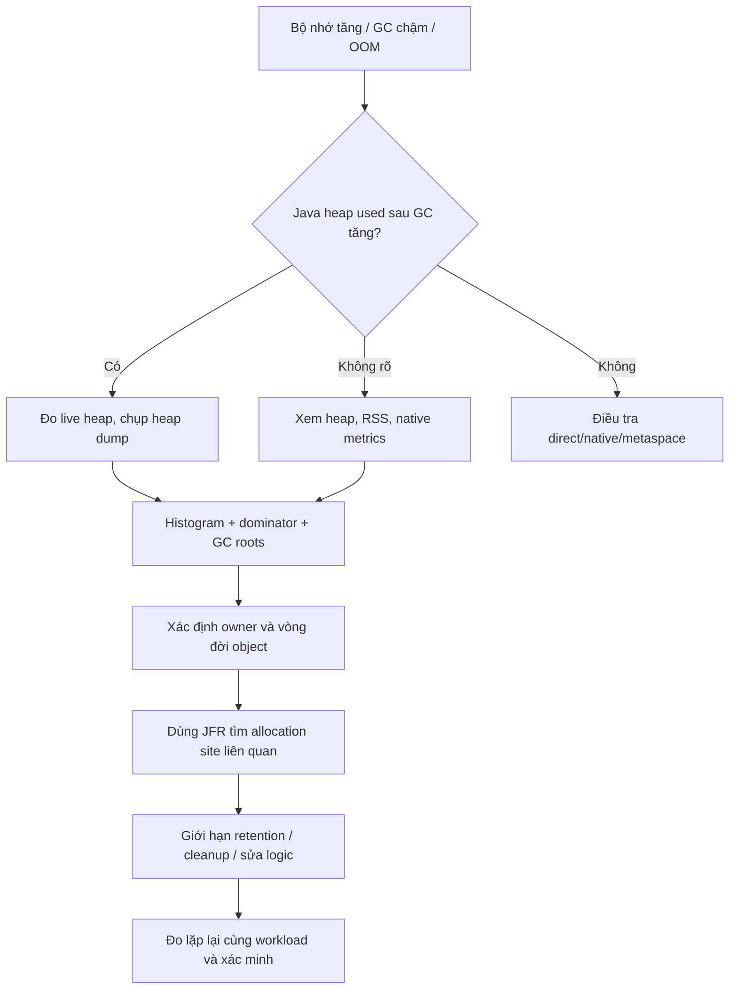

# Heap dump, allocation profiling và tìm memory leak trong Java 27

Một tiến trình Java có thể tăng bộ nhớ sau nhiều giờ hoạt động, GC chạy thường xuyên hơn, độ trễ tăng hoặc kết thúc với `OutOfMemoryError`. Tuy nhiên, **bộ nhớ tăng chưa chắc là memory leak**: JVM có thể đang mở rộng heap, ứng dụng có thể đang xử lý tải lớn, cache có thể hoạt động theo thiết kế hoặc bộ nhớ tăng nằm ngoài Java heap.

Muốn chẩn đoán đúng, cần trả lời ba câu hỏi **khác nhau**:

1. **Bộ nhớ nào tăng?** Java heap, metaspace, direct/native memory hay toàn bộ resident memory của tiến trình?
2. **Đối tượng nào còn được giữ?** Heap dump, GC roots và retained heap giúp xác định đối tượng hoặc cấu trúc giữ dữ liệu sống lâu.
3. **Đối tượng nào được tạo nhiều?** Allocation profiling, đặc biệt qua Java Flight Recorder (JFR), giúp tìm vị trí mã tạo object và chi phí cấp phát.

Bài thuộc chương **Chẩn đoán và hiệu năng** của module **Java 27 và các kiến thức liên quan** (`JAVA_VERSION_JAVA27`). Nội dung chỉ sử dụng những công cụ và API Java hiện hành, chẳng hạn `jcmd`, `jfr`, Java Flight Recorder, `java.lang.management`, Eclipse Memory Analyzer (MAT) và Java Mission Control (JMC). Những công cụ từng phổ biến trong lịch sử nhưng không còn là lựa chọn ưu tiên không được dùng làm quy trình chính.

> **An toàn dữ liệu:** Heap dump và JFR có thể chứa thông tin người dùng, chuỗi xác thực, dữ liệu nghiệp vụ và đường dẫn nội bộ. Chỉ ghi/đọc những tệp này trong môi trường được phép, áp dụng phân quyền, thời hạn lưu và quy trình xóa thích hợp.

## 1. Mục tiêu học tập

Sau bài này, bạn có thể:

- Phân biệt **heap usage**, **committed heap**, **RSS**, **native memory**, **metaspace** và **direct buffers**.
- Giải thích memory leak trong ứng dụng có garbage collector.
- Phân biệt **allocation rate** với **object retention**; không kết luận "cấp phát nhiều là rò rỉ".
- Dùng `jcmd` để kiểm tra heap và tạo HPROF heap dump.
- Cấu hình heap dump khi gặp `OutOfMemoryError`, biết giới hạn của cơ chế này.
- Ghi JFR và phân tích mẫu allocation theo loại object, stack trace và thời gian.
- Dùng histogram, dominator tree, retained heap và đường tham chiếu tới GC roots trong MAT.
- Nhận diện leak thường gặp ở static collections, cache, listener, ThreadLocal, task queue và class loader.
- Viết ví dụ Java an toàn để so sánh dữ liệu được giữ ngoài ý muốn với dữ liệu có giới hạn.
- Thiết kế quy trình xác minh bản sửa bằng số liệu lặp lại được, tránh đoán từ một lần chụp.

## 2. Sơ đồ bộ nhớ JVM: điều gì có thể tăng?

```text
                       JVM process
┌───────────────────────────────────────────────────────┐
│ Java Heap                                             │
│   Objects, arrays, Strings, collections, user data    │
├───────────────────────────────────────────────────────┤
│ Non-heap / native / other process memory              │
│   Metaspace / class metadata                          │
│   Thread stacks / runtime structures                  │
│   Direct buffers / mapped memory                      │
│   JIT code cache / GC bookkeeping                     │
│   JNI/FFM/native allocations (depending on owner)     │
│   Native libraries and other OS mappings              │
└───────────────────────────────────────────────────────┘
                         │
                         ▼
          Process RSS / memory observed by OS
```

Bảng phân biệt:

| Khái niệm | Ý nghĩa | Công cụ quan sát phù hợp |
|---|---|---|
| **Heap used** | Phần Java heap đang dùng theo thước đo JVM | JMX/`MemoryMXBean`, GC logs, `jcmd` |
| **Heap committed** | Phần heap JVM đã cam kết với hệ điều hành | JVM metrics, JMX |
| **Heap max** | Giới hạn heap theo cấu hình/ergonomics | `MemoryMXBean`, JVM flags |
| **RSS** | Các trang bộ nhớ resident của tiến trình do OS đo | OS/container metrics |
| **Metaspace** | Bộ nhớ native quản lý metadata class | JVM pool metrics, Native Memory Tracking |
| **Direct buffer memory** | Bộ nhớ ngoài heap gắn với một số NIO buffer | `BufferPoolMXBean`, native metrics |
| **Other native memory** | Thread stacks, JNI/FFM, C library, runtime | NMT khi phù hợp, OS/native profiler |

**RSS không bằng heap used.** Một JVM có heap used tương đối ổn định nhưng RSS vẫn tăng vì native memory, metadata, thread stacks, memory mappings hoặc đặc tính cấp phát/trả bộ nhớ của OS.

### 2.1. Đừng nhầm used với committed

JVM có thể commit một lượng heap để sử dụng về sau. Sau khi GC thu hồi nhiều object, số byte **used** có thể giảm trong khi **committed** vẫn giữ ở mức cao. Đây không nhất thiết là leak.

Ví dụ một service khởi động với `-Xms512m -Xmx2g` có thể giữ một vùng heap committed lớn tùy chính sách GC; chỉ nhìn RSS hoặc committed mà không xem live objects sẽ gây hiểu lầm.

### 2.2. OOM cũng có nhiều nguyên nhân

| Tình huống | Hướng nghi vấn |
|---|---|
| `OutOfMemoryError: Java heap space` | Heap không đủ cho các object đang/đã được giữ |
| `OutOfMemoryError: Metaspace` | Metadata class/class loader, giới hạn metaspace |
| `OutOfMemoryError: Direct buffer memory` | Bộ nhớ direct buffer hoặc giới hạn liên quan |
| Không tạo được native thread | Thread stacks/tài nguyên OS, giới hạn tiến trình |
| Tiến trình bị container/OOM killer kết thúc | Tổng bộ nhớ vượt giới hạn; có thể không kịp tạo Java heap dump |
| RSS tăng nhưng heap used sau GC tương đối ổn định | Cần điều tra native/mapped memory trước khi quy leak vào heap |

Thông báo lỗi là **manh mối**, không thay thế việc kiểm tra metrics và sự kiện thực tế. Một OOM do tải vượt thiết kế khác với leak khi lưu giữ đối tượng không còn cần thiết.

## 3. Memory leak trong ứng dụng có garbage collector là gì?

Java garbage collector (GC) có thể thu hồi những object **không còn reachable** từ GC roots. Memory leak ở Java heap thường xảy ra khi object **vẫn reachable nhưng nghiệp vụ đã không cần đến chúng**.

Ví dụ:

```java
final class RequestArchive {
    private static final java.util.List<byte[]> SAVED =
            new java.util.ArrayList<>();

    static void handleRequest(byte[] payload) {
        SAVED.add(payload); // Giữ payload mãi nếu không có chính sách xóa.
    }
}
```

GC không thể đoán rằng lịch sử request trong `SAVED` đã hết giá trị. Vì static field còn trỏ tới danh sách, các phần tử vẫn reachable và được coi là sống.

### 3.1. Leak không nhất thiết là "bộ nhớ không được free" ở C

Trong Java, leak thường là **giữ tham chiếu ngoài dự kiến**, không phải quên gọi `free()` trên heap Java. Vì thế cách khắc phục điển hình là **chỉnh ownership, giới hạn, vòng đời và cleanup**, không phải gọi `System.gc()`.

### 3.2. Ba loại tăng bộ nhớ nên phân biệt

1. **Expected growth:** dữ liệu hợp lệ tăng theo lưu lượng hay kích thước input, ví dụ cache 1000 mục rồi ổn định.
2. **High allocation churn:** object ngắn hạn được tạo nhiều nhưng nhanh chóng chết, gây áp lực GC.
3. **Unintended retention:** số object sống tăng mãi hoặc vượt giới hạn thiết kế dù workload đã trở về trạng thái ổn định.

Một ứng dụng có thể đồng thời có cả allocation churn lẫn retention leak. Cần bằng chứng riêng cho mỗi giả thuyết.

## 4. GC roots và tính reachable

GC roots là các điểm bắt đầu để collector xác định những object còn reachable, chẳng hạn những tham chiếu từ Java stack, static fields, JNI references hoặc cấu trúc runtime khác.

```text
GC Root
   │
   ▼
Static registry
   │
   ▼
ConcurrentHashMap
   │
   ├───── key-1 → Session A → Large byte[]
   ├───── key-2 → Session B → Large byte[]
   └───── key-3 → Session C → Large byte[]
```

Nếu registry có vòng đời toàn ứng dụng và không xóa session đã hết hạn, toàn bộ chuỗi tham chiếu có thể khiến các byte array tiếp tục sống.

### 4.1. Java GC xử lý được chu trình tham chiếu

```text
Object A → Object B
   ▲          │
   └──────────┘
```

Một chu trình A↔B **không phải leak chỉ vì có chu trình**. Nếu chu trình không reachable từ GC roots, GC vẫn có thể thu hồi. Leak xảy ra khi còn một đường tham chiếu hợp lệ từ root tới object không còn cần thiết.

### 4.2. Đường tới root không tự chứng minh lỗi

Một class loader, executor hoặc singleton có thể giữ object **có chủ đích**. Bạn phải so sánh đường tham chiếu với **vòng đời nghiệp vụ mong muốn** trước khi kết luận đó là rò rỉ.

## 5. Shallow heap, retained heap và dominator tree

Đây là những khái niệm trọng tâm khi xem heap dump bằng Memory Analyzer:

| Khái niệm | Diễn giải |
|---|---|
| **Shallow heap** | Bộ nhớ chiếm bởi chính một object, không cộng kích thước object nó tham chiếu tới |
| **Retained heap** | Ước lượng phần bộ nhớ có thể được giải phóng nếu một object hoặc nhóm object không còn giữ những object bị nó chi phối |
| **Dominator** | Object A dominates B nếu mọi đường từ GC roots tới B đều đi qua A (theo đồ thị phân tích) |
| **Dominator tree** | Cấu trúc giúp tìm những điểm giữ lượng lớn object gián tiếp |
| **Path to GC roots** | Một hoặc nhiều đường tham chiếu giải thích vì sao object vẫn reachable |

Ví dụ:

```text
GC root → static List → Object[] backing array
                         ├→ byte[65536]
                         ├→ byte[65536]
                         └→ byte[65536]
```

`List` có thể có shallow heap rất nhỏ nhưng lại **gián tiếp giữ nhiều megabyte**. Xem histogram theo object count mà không xem retained heap dễ bỏ sót vấn đề này.

### 5.1. Đừng cộng retained heap một cách tùy ý

Retained heap dựa trên quan hệ chi phối trong **đồ thị tham chiếu** và cách công cụ mô hình hóa đối tượng. Hai object có thể cùng tham chiếu một vùng dữ liệu; không thể cứ cộng mọi retained size rồi khẳng định đó là tổng bộ nhớ đang bị giữ ngoài ý muốn.

### 5.2. Ý nghĩa nghiệp vụ quan trọng hơn tên class

Nếu dominator top là một `HashMap` hoặc `ArrayList`, câu hỏi tiếp theo không phải "HashMap có lỗi không?" mà là:

- Ai tạo collection?
- Vì sao nó sống lâu?
- Ai thêm phần tử?
- Khi nào phần tử cần được xóa?
- Giới hạn kích thước được định nghĩa ở đâu?

## 6. Allocation profiling giải quyết câu hỏi khác

**Allocation profiling** tìm những vị trí mã **tạo object**:

```text
RequestHandler.handle()
  → JsonParser.parse()
    → StringBuilder.toString()
      → new String(...)
```

Nếu phương thức này tạo 100 MB/giây nhưng object chết ngay sau mỗi request, đó có thể là **allocation pressure**, không phải memory leak.

Ngược lại, một leak đáng kể có thể chỉ tạo object tương đối chậm, nhưng cứ giữ lại 1 MB mỗi phút trong hàng tuần. Allocation profiler có thể không xếp vị trí đó ở đầu danh sách.

### 6.1. Ghép hai góc nhìn

- **JFR allocation:** object được tạo *ở đâu*, bao nhiêu mẫu, call stack ra sao?
- **Heap dump:** object vẫn sống *vì đâu*, ai giữ nó?
- **Metrics theo thời gian:** tình trạng có tăng sau những chu kỳ workload tương đương không?

Kết luận tốt thường được củng cố bởi **cả ba** thay vì chỉ một phép đo.

## 7. Quy trình điều tra tổng quát



Thứ tự có thể đổi tùy triệu chứng. Chẳng hạn nếu RSS tăng nhưng Java heap used không tăng, đừng chụp hàng chục heap dump trước khi kiểm tra native memory.

## 8. Bằng chứng ban đầu: đừng chụp dump ngay theo phản xạ

Trước khi tạo heap dump nặng, ghi lại:

1. **Triệu chứng:** OOM, RSS tăng, heap used sau GC tăng, GC pause, throughput giảm?
2. **Thời gian và tải:** tăng theo số request, số session, số job hay thời gian uptime?
3. **Giới hạn:** `-Xmx`, container limit, native/direct memory constraints.
4. **GC:** heap used trước/sau GC, thời gian GC, mức committed.
5. **Thread/class loading:** số thread, số class loader, pool/queue/cache sizes.
6. **Điểm đổi:** bản deploy, feature flag, sự kiện tải hoặc thư viện mới.

Ví dụ bảng theo dõi:

| Thời điểm | Tải tương đương? | Heap used sau GC | RSS | Nhận xét |
|---|---|---|---|---|
| T0 | Có | 380 MiB | 820 MiB | Sau warm-up |
| T1 | Có | 520 MiB | 960 MiB | Sau 1 vòng xử lý |
| T2 | Có | 690 MiB | 1.13 GiB | Sau 2 vòng xử lý |
| T3 | Có | 840 MiB | 1.28 GiB | Sau 3 vòng xử lý |

Đây là **dữ liệu minh họa**, không phải số đo thật của hệ thống. Một xu hướng live heap tăng qua những chu kỳ tương tự đáng điều tra, nhưng phải xét thêm cache warm-up, request in-flight, GC timing và cấu hình heap.

## 9. Các công cụ hiện hành và vai trò

| Công cụ | Tác dụng chính | Điểm cần nhớ |
|---|---|---|
| **`jcmd`** | Gửi lệnh chẩn đoán tới JVM đang chạy | Một số lệnh như heap dump có tác động cao |
| **JFR** | Thu thập sự kiện theo thời gian, gồm allocation sample, GC, thread, CPU | Lựa chọn recording settings hợp lý |
| **`jfr` CLI** | Xem summary hoặc in các event trong tệp `.jfr` | Không thay thế phân tích heap graph |
| **Java Mission Control (JMC)** | Phân tích bản ghi JFR trực quan | Xem hot allocation sites/stacks, GC |
| **Eclipse Memory Analyzer (MAT)** | Phân tích HPROF: histogram, dominator, GC roots | Công cụ phù hợp để tìm retained objects |
| **JMX / `MemoryMXBean`** | Theo dõi sử dụng heap và non-heap | Dùng để so sánh trước/sau |
| **Native Memory Tracking (NMT)** | Tổng hợp các vùng native do HotSpot quản lý | Không bao phủ toàn bộ `malloc` từ thư viện ngoài |
| **OS/container metrics** | RSS, giới hạn bộ nhớ và tình trạng kill process | Cần kết hợp với dữ liệu JVM |

### 9.1. Không tìm "một công cụ làm mọi việc"

Một HPROF có thể cho biết vì sao một cache giữ object nhưng **không nhất thiết lưu stack trace tại nơi mọi object đã được cấp phát**. JFR allocation profiling giúp tìm stack tạo object nhưng không chứng minh chúng vẫn đang sống.

## 10. Cảnh báo khi thu thập dữ liệu từ production

### 10.1. Heap dump có thể dừng ứng dụng

Tạo heap dump thường là thao tác **high impact**; có thể gây pause dài và sử dụng nhiều CPU/I/O và dung lượng đĩa. Tùy lệnh/tùy chọn, JVM có thể yêu cầu full GC trước khi xuất dump.

Trước khi chụp dump:

- Chọn thời điểm/instance phù hợp với khả năng chấp nhận pause.
- Kiểm tra dung lượng đĩa trống và quyền ghi.
- Không ghi dump vào filesystem có nguy cơ làm đầy volume dữ liệu quan trọng.
- Có kế hoạch bảo mật vì HPROF có thể chứa PII, token, mật khẩu và dữ liệu nghiệp vụ.
- Ghi lại PID, thời điểm, phiên bản JDK, cấu hình JVM và mức tải.
- Giới hạn số dump cần thu; không làm định kỳ dày đặc mà chưa đánh giá tác động.

### 10.2. JFR ít xâm lấn hơn trong nhiều tình huống, nhưng không miễn phí

JFR được thiết kế để có chi phí tương đối thấp ở cấu hình phù hợp. Tuy vậy, bật các event chi tiết hoặc stack traces với tần suất lớn vẫn có overhead. Hãy chọn sự kiện phù hợp, thời gian ghi và nơi lưu recording.

### 10.3. Không đưa heap dump lên dịch vụ phân tích công khai tùy tiện

Trong môi trường tổ chức, heap dump thường có mức nhạy cảm gần với bản sao dữ liệu đang xử lý. Chỉ dùng công cụ và máy phân tích được phê duyệt; áp dụng mã hóa, least privilege và xóa dữ liệu sau điều tra.

## 11. Xác định JVM cần chẩn đoán

`jcmd` là công cụ thuộc JDK, nên chạy từ môi trường có quyền tương thích để attach tới JVM đích.

Liệt kê tiến trình Java có thể attach:

```bash
jcmd -l
```

Ví dụ kết quả minh họa:

```text
12345 com.example.Main
23456 jdk.jcmd/sun.tools.jcmd.JCmd -l
```

Ở các ví dụ tiếp theo, **12345 chỉ là PID giả định**. Thay bằng PID thực tế từ môi trường được phép; không gõ dấu ngoặc nhọn `<pid>` trong shell vì chúng có thể được hiểu là ký hiệu chuyển hướng.

### 11.1. Giới hạn của attach

Attach có thể không hoạt động nếu:

- PID thuộc user hoặc container namespace khác.
- JVM không cho phép attach trong cấu hình hiện tại.
- Ứng dụng chạy với quyền/điều kiện bảo mật hạn chế.
- Công cụ JDK/JVM đích có phiên bản hoặc kiến trúc không tương thích.
- JVM đang trong tình trạng treo hoặc thiếu tài nguyên nghiêm trọng.

Không tự động kết luận "không tìm thấy PID" nghĩa tiến trình Java không còn chạy; xác minh theo process/container metrics và quyền truy cập.

## 12. Dùng jcmd kiểm tra heap trước khi dump

Các lệnh minh họa cho JVM PID 12345:

```bash
jcmd 12345 GC.heap_info
jcmd 12345 GC.class_histogram
```

**`GC.heap_info`** cung cấp thông tin vùng heap tùy GC. **`GC.class_histogram`** thống kê số instance và tổng shallow bytes theo class trong heap tại thời điểm quan sát.

Ví dụ bảng histogram rút gọn:

```text
#instances       #bytes     Class
  120000         786432000  [B
  240000          11520000  java.lang.String
   40000           1920000  java.util.HashMap$Node
```

Đây là số liệu **minh họa**, không phải format cố định cho mọi JDK. `[B` là tên descriptor của mảng `byte[]`.

### 12.1. Histogram không cho biết ai giữ object

Histogram có thể nói "có nhiều `byte[]`", nhưng không tự xác định:

- Mảng nào thuộc cache?
- Ai giữ mảng?
- Có bao nhiêu mảng còn sống vì request đang xử lý?
- Có phải những mảng đó đã hết hữu ích?

Để xác định owner, cần **heap dump + reference graph**.

### 12.2. Histogram cũng có chi phí

`GC.class_histogram` có thể yêu cầu quét heap và tùy chọn liên quan có thể tác động tới GC/pause. Không xem đây là lệnh đo "miễn phí" có thể gọi liên tục trên production.

## 13. Tạo HPROF heap dump bằng jcmd

Với JVM PID 12345:

```bash
jcmd 12345 GC.heap_dump /secure/dumps/heap-t1.hprof
```

Chuẩn bị **thư mục đích tồn tại, đủ dung lượng và chỉ user được phép đọc** trước khi chạy. Đường dẫn phải là đường mà **tiến trình JVM đích có thể ghi**; với container, đường dẫn nhìn từ host không nhất thiết giống đường dẫn trong container.

### 13.1. Full GC và tùy chọn -all

Mặc định, `GC.heap_dump` thường yêu cầu full GC trước khi dump, nên dump tập trung vào dữ liệu còn sống sau khi collector có cơ hội thu hồi object không còn reachable. Tùy chọn `-all` yêu cầu đưa cả object không còn reachable vào dump và tránh yêu cầu full GC trước khi tạo dump theo contract hiện hành của công cụ:

```bash
jcmd 12345 GC.heap_dump -all /secure/dumps/heap-all.hprof
```

**Hai cách thu thập trả lời những câu hỏi khác nhau**:

| Dump mặc định | Dump dùng `-all` |
|---|---|
| Có thể kích hoạt full GC trước khi dump | Bao gồm cả object không còn reachable |
| Thường phù hợp khi phân tích live retention | Hữu ích cho một số phân tích object trước GC |
| Có pause/chi phí GC và I/O | Vẫn có chi phí lớn; nhiều object không còn sống có thể gây nhiễu |
| Không phải ảnh chụp "chưa từng có GC" | Không nên xem mọi object trong dump là leak |

Khi điều tra đối tượng **bị giữ lâu**, dump sau GC thường dễ diễn giải hơn, nhưng tác động của full GC cần được cân nhắc.

### 13.2. HPROF không phải định dạng text

Heap dump là tệp nhị phân, có thể rất lớn. Không mở bằng editor rồi tự suy object graph. Dùng MAT hoặc công cụ heap viewer tương thích với định dạng dump và JDK.

### 13.3. Dump không nhất thiết bằng -Xmx

Kích thước tệp HPROF phụ thuộc lượng object, thông tin dump và định dạng/khả năng nén của công cụ. Không suy rằng `-Xmx2g` thì tệp dump luôn đúng 2 GiB. Phải kiểm tra disk space theo trường hợp xấu có dự phòng.

## 14. Tự động ghi heap dump khi Java heap OOM

Thêm vào **JVM startup options** khi triển khai ứng dụng:

```bash
-XX:+HeapDumpOnOutOfMemoryError
-XX:HeapDumpPath=/secure/dumps
```

Ví dụ lệnh chạy một ứng dụng minh họa:

```bash
java -Xmx256m -XX:+HeapDumpOnOutOfMemoryError -XX:HeapDumpPath=/secure/dumps -jar my-app.jar
```

`my-app.jar` chỉ là tên minh họa. Thư mục `/secure/dumps` cần tồn tại và có quyền ghi.

### 14.1. Vì sao không chỉ bật flag này là đủ?

- JVM có thể bị OS/container OOM killer chấm dứt trước khi ghi dump.
- Đĩa có thể không đủ chỗ.
- Một số lỗi native/resource không cho phép thu được Java heap dump hữu ích.
- Dump tạo đúng lúc OOM có thể chứa nhiều object từ trạng thái bất thường, cần so sánh với tình huống bình thường.
- Dump có thể tiết lộ dữ liệu nhạy cảm và phải được quản lý.

Với sự cố có thể tái hiện trong môi trường thử nghiệm, đôi khi tốt hơn là thu một dump **trước khi OOM** và một dump sau vài vòng workload để xác định xu hướng.

## 15. Quy trình hai hoặc ba snapshot để tìm retained growth

Một ảnh chụp tại T1 giúp biết object graph lúc đó, nhưng **không tự chứng minh tăng trưởng theo thời gian**.

Quy trình tốt:

1. **T0 — sau warm-up:** ứng dụng đã qua khởi tạo và bắt đầu ở trạng thái ổn định. Thu metrics và nếu được phép, dump baseline.
2. **T1 — sau một vòng workload chuẩn:** chạy cùng loại request/batch, chờ tác vụ in-flight kết thúc, thu metrics và dump.
3. **T2 — sau nhiều vòng tương đương:** lặp workload, thu metrics/dump lần nữa.
4. So sánh số instance, shallow/retained size của các object liên quan và **đường giữ từ GC roots**.
5. Đối chiếu biến động với số session/job hợp lệ còn đang hoạt động.

### 15.1. Đảm bảo điều kiện so sánh

So sánh dễ sai khi:

- T0 còn trong warm-up, T2 đã load toàn bộ cache.
- T0 có 10 request/s, T2 có 1000 request/s.
- T1 còn nhiều request đang chạy, T2 đã idle.
- Một dump được thực hiện sau full GC, dump kia dùng `-all`.
- Ứng dụng vừa deploy phiên bản khác hoặc thay đổi `-Xmx`/GC.
- Dữ liệu nghiệp vụ hợp lệ thực sự tăng.

Các bản ghi nên đi kèm **cùng thông số tải, trạng thái và cấu hình**. Nếu không thể tạo điều kiện tương đương, báo rõ giới hạn của kết luận.

### 15.2. Đừng gọi System.gc() như một cách sửa leak

`System.gc()` là yêu cầu GC, không phải bảo đảm thu hồi một object còn reachable. Gọi nó định kỳ có thể ảnh hưởng latency và che giấu vấn đề thực.

Trong môi trường thử nghiệm, GC có chủ đích đôi khi giúp so sánh live heap, nhưng cần hiểu chính sách JVM và không áp dụng đại trà ở production.

## 16. Phân tích HPROF trong Eclipse Memory Analyzer

Sau khi lấy HPROF, quy trình thường dùng trong **Eclipse MAT**:

1. Mở tệp dump trong môi trường phân tích được phép.
2. Đọc phần tổng quan (heap overview).
3. Xem **Histogram** để xác định các class có instance count/shallow heap cao.
4. Xem **Dominator Tree** để tìm owner giữ retained heap lớn.
5. Chọn object/collection nghi vấn và xem **Path to GC Roots**.
6. Nếu hữu ích, loại những loại reference không phải strong trong một phép phân tích phù hợp để xem giữ thực tế.
7. So sánh với dump baseline hoặc cùng workload ở thời điểm khác.
8. Truy ngược owner tới code chịu trách nhiệm giữ/xóa dữ liệu.

Tên menu cụ thể có thể thay đổi theo phiên bản MAT; cốt lõi là **Histogram → Dominator → GC roots → ownership**.

### 16.1. Ví dụ từ kết quả điều tra

Giả sử MAT cho thấy:

```text
Class                                  Shallow Heap   Retained Heap
com.example.RequestArchive                  16 B           85 MiB
java.util.ArrayList                          24 B           85 MiB
byte[65536] x 1300                         ~85 MiB          ...
```

Những số trên chỉ minh họa. Nếu path to GC roots là:

```text
System ClassLoader
   -> RequestArchive.class
   -> static SAVED
   -> ArrayList.elementData
   -> byte[] payload
```

thì giả thuyết hợp lý là một **static collection giữ payload lâu hơn vòng đời request**. Bước tiếp theo là kiểm tra yêu cầu nghiệp vụ và chính sách eviction, không phải sửa `ArrayList`.

### 16.2. Leak Suspects là manh mối, không phải kết luận

MAT có thể đưa ra các nghi vấn tự động. Hãy xác minh:

- Có phải cache/chương trình cố ý giữ object?
- Có giới hạn hoặc TTL không?
- Object lẽ ra sống đến lúc nào?
- Retained size có tăng sau workload lặp lại?
- Có root path tương ứng với logic lưu giữ ngoài dự kiến không?

Một cache hợp lệ cũng có thể đứng đầu dominator tree.

## 17. Các kiểu leak thường gặp: static collection và cache không giới hạn

Anti-pattern:

```java
final class Cache {
    private static final java.util.Map<String, byte[]> DATA =
            new java.util.concurrent.ConcurrentHashMap<>();

    static void put(String key, byte[] payload) {
        DATA.put(key, payload);
    }
}
```

`ConcurrentHashMap` thread-safe cho các thao tác nó hỗ trợ, nhưng **không có giới hạn tự động**. Nếu key mới được thêm mãi mà không xóa, số phần tử và memory retention có thể tăng vô hạn.

Cách sửa tùy nghiệp vụ:

- Giới hạn số entry và/hoặc tổng trọng lượng byte.
- TTL, idle expiry hoặc eviction policy.
- Quy tắc invalidation trên sự kiện dữ liệu thay đổi.
- Đặt cache theo vòng đời component phù hợp.
- Đo cache hit rate, số phần tử và trọng lượng.
- Dùng thư viện cache có cơ chế giới hạn được kiểm chứng nếu ứng dụng cần chính sách phức tạp.

**Không phải cứ dùng WeakReference là sửa được mọi cache leak.** Weak/soft references có ngữ nghĩa GC riêng, không thay thế chính sách kích thước, tính nhất quán và vòng đời nghiệp vụ.

## 18. Runnable demo: object bị giữ ngoài dự kiến và biến thể có giới hạn

Tạo file `HeapRetentionDemo.java`. Chương trình **cố ý giữ một lượng bộ nhớ có giới hạn nhỏ** để minh họa khác biệt giữa trạng thái tích lũy và trạng thái được thay thế theo từng lượt. Nó **không cố tạo OutOfMemoryError**.

```java
import java.lang.management.ManagementFactory;
import java.util.ArrayList;
import java.util.List;

public final class HeapRetentionDemo {

    private static final List<byte[]> RETAINED = new ArrayList<>();

    private static final int ROUNDS = 12;
    private static final int BLOCKS_PER_ROUND = 48;
    private static final int BLOCK_SIZE = 64 * 1024;

    public static void main(String[] args) throws InterruptedException {
        if (args.length != 1
                || (!"retained".equals(args[0])
                        && !"bounded".equals(args[0]))) {

            System.err.println(
                    "Usage: java HeapRetentionDemo retained|bounded"
            );
            return;
        }

        boolean bounded = "bounded".equals(args[0]);

        System.out.println("PID: " + ProcessHandle.current().pid());
        System.out.println("Mode: " + args[0]);

        for (int round = 1; round <= ROUNDS; round++) {
            if (bounded) {
                // Không giữ payload của vòng workload trước.
                RETAINED.clear();
            }

            for (int i = 0; i < BLOCKS_PER_ROUND; i++) {
                byte[] block = new byte[BLOCK_SIZE];

                // Ghi thử để dữ liệu có thật trong workload mô phỏng.
                block[0] = (byte) round;
                RETAINED.add(block);
            }

            long used = ManagementFactory.getMemoryMXBean()
                    .getHeapMemoryUsage()
                    .getUsed();

            System.out.printf(
                    "round=%02d entries=%d usedHeap=%d KiB%n",
                    round,
                    RETAINED.size(),
                    used / 1024
            );

            // Khoảng dừng để người học quan sát/chụp snapshot.
            Thread.sleep(2_000L);
        }

        System.out.println("Demo complete");
    }
}
```

Biên dịch:

```bash
javac HeapRetentionDemo.java
```

Chạy chế độ giữ toàn bộ payload:

```bash
java -Xms128m -Xmx128m HeapRetentionDemo retained
```

Chạy chế độ có giới hạn theo từng lượt:

```bash
java -Xms128m -Xmx128m HeapRetentionDemo bounded
```

**Hai lệnh là hai lần chạy riêng biệt.** Chương trình in PID để có thể dùng `jcmd` từ phiên terminal khác trên cùng môi trường được phép.

### 18.1. Kỳ vọng đối với chế độ retained

Sau 12 vòng, danh sách chứa `12 × 48 = 576` mảng, mỗi mảng khoảng 64 KiB payload. Tổng dung lượng payload xấp xỉ **36 MiB** chưa kể overhead đối tượng/mảng.

`RETAINED` là static root giữ danh sách, vì vậy những mảng này không thể được thu hồi khi chương trình đang chạy.

### 18.2. Kỳ vọng đối với chế độ bounded

Mỗi vòng gọi `RETAINED.clear()` trước khi thêm 48 mảng mới. Danh sách chỉ giữ khoảng **3 MiB** payload ở cuối mỗi vòng; mảng của vòng trước trở nên eligible for GC nếu không còn đường tham chiếu nào khác.

### 18.3. Vì sao usedHeap không luôn giảm ngay?

`getHeapMemoryUsage().getUsed()` đo heap used tại thời điểm gọi, **không yêu cầu GC chạy ngay**. Ở chế độ bounded, các object không còn reachable vẫn có thể chiếm vùng heap chưa được GC dọn. Do đó log usedHeap có thể tăng và sau GC mới giảm.

Đó là lý do phải đối chiếu **live retention**, GC timing và heap dump thay vì kết luận chỉ từ một chuỗi usedHeap tức thời.

### 18.4. Giới hạn của mô phỏng

Đây là workload có giới hạn, không phải memory leak production. Trong ứng dụng thật, hệ thống có thể giữ dữ liệu hợp lệ lâu hơn hoặc có cách quản lý cache khác. Ví dụ chỉ cho thấy **cơ chế retention qua static root** và cách giải phóng tham chiếu làm dữ liệu đủ điều kiện được GC thu hồi.

## 19. Chụp heap dump và phân tích demo

Khi demo đang chạy, ghi lại PID thực. Giả sử chương trình in `PID: 12345`.

Ở terminal thứ hai:

```bash
jcmd 12345 GC.heap_info
jcmd 12345 GC.class_histogram
```

Nếu được phép và có đường dẫn trống phù hợp:

```bash
jcmd 12345 GC.heap_dump /secure/dumps/demo-retained.hprof
```

Thay `/secure/dumps` bằng một thư mục thực sự tồn tại và có quyền ghi; đường dẫn chỉ là minh họa.

### 19.1. Những điều cần tìm trong MAT

- Có bao nhiêu `byte[]`?
- Tổng shallow heap của `byte[]` là bao nhiêu?
- Có object `HeapRetentionDemo.RETAINED` hoặc backing array của `ArrayList` giữ mảng không?
- Đường từ static field đến những mảng lớn có hợp lý không?
- Sự khác nhau giữa `retained` và `bounded` khi tiến hành những vòng workload tương đương là gì?

### 19.2. Không cần cố ý làm JVM crash để học

Không tăng vòng lặp tới vô hạn hay giảm `-Xmx` quá thấp chỉ để tạo OOM. Mục tiêu là quan sát **ownership/retention** với lượng dữ liệu kiểm soát được.

## 20. Bản sửa minh họa: một cache giới hạn số entry

Một chiến lược đơn giản cho dữ liệu nhỏ là cache LRU bằng `LinkedHashMap` có giới hạn phần tử. Tạo file `BoundedCacheDemo.java`:

```java
import java.util.Collections;
import java.util.LinkedHashMap;
import java.util.Map;

public final class BoundedCacheDemo {

    private static final int MAX_ENTRIES = 100;

    private final Map<String, byte[]> cache =
            Collections.synchronizedMap(
                    new LinkedHashMap<String, byte[]>(
                            128,
                            0.75f,
                            true
                    ) {
                        @Override
                        protected boolean removeEldestEntry(
                                Map.Entry<String, byte[]> eldest
                        ) {
                            return size() > MAX_ENTRIES;
                        }
                    }
            );

    public void store(String key, byte[] payload) {
        cache.put(key, payload);
    }

    public int size() {
        return cache.size();
    }

    public static void main(String[] args) {
        BoundedCacheDemo demo = new BoundedCacheDemo();

        for (int i = 0; i < 500; i++) {
            demo.store("request-" + i, new byte[1024]);
        }

        System.out.println("Cache entries: " + demo.size());
    }
}
```

Chạy:

```bash
javac BoundedCacheDemo.java
java BoundedCacheDemo
```

Kết quả:

```text
Cache entries: 100
```

### 20.1. Giới hạn theo count chưa phải giới hạn bytes

Nếu mỗi entry có dung lượng khác nhau, `MAX_ENTRIES=100` vẫn có thể giữ hàng gigabyte dữ liệu. Một cache production có thể cần giới hạn **weight theo byte**, TTL, eviction metrics và xử lý giá trị lớn. `LinkedHashMap` trong ví dụ là giải pháp minh họa, không phải thay thế mọi chức năng của cache chuyên dụng.

### 20.2. Lưu ý về tính đồng thời

`LinkedHashMap` không tự thread-safe. Ví dụ bọc trong `Collections.synchronizedMap` để các thao tác đơn giản như `put` và `size` được đồng bộ qua wrapper. Khi duyệt collection views hoặc thực hiện nhiều thao tác liên quan, vẫn cần theo hợp đồng đồng bộ của wrapper.

## 21. Leak do listener/callback không hủy đăng ký

Một registry có thể giữ toàn bộ listener và những object được listener capture:

```java
final class EventBus {
    private final java.util.List<Runnable> listeners =
            new java.util.ArrayList<>();

    void subscribe(Runnable listener) {
        listeners.add(listener);
    }

    void unsubscribe(Runnable listener) {
        listeners.remove(listener);
    }
}
```

Nếu component ngắn hạn đăng ký listener tới event bus sống toàn ứng dụng mà không unsubscribe, listener có thể kéo theo:

- Component, view hoặc request context.
- Dữ liệu trong lambda capture.
- Kết nối tới những object khác trong graph.

Mẫu thiết kế tốt hơn là subscription có `close()`:

```java
interface Subscription extends AutoCloseable {
    @Override
    void close();
}
```

Lưu lại subscription, đóng khi component không còn dùng. Nếu nhiều thread cùng đăng ký/phát sự kiện/hủy đăng ký, registry cần thread-safety và ngữ nghĩa đồng bộ phù hợp.

## 22. Leak do ThreadLocal và long-lived worker

`ThreadLocal` gắn dữ liệu theo thread, không theo request. Với platform-thread pool, worker có thể sống rất lâu.

Ví dụ nguy hiểm:

```java
private static final ThreadLocal<byte[]> SCRATCH =
        new ThreadLocal<>();

static void process() {
    SCRATCH.set(new byte[1024 * 1024]);

    // Nếu không remove, dữ liệu có thể còn gắn với worker
    // sau khi request đã xong.
}
```

Nếu dữ liệu chỉ cần trong phạm vi xử lý:

```java
static void processSafely() {
    SCRATCH.set(new byte[1024 * 1024]);

    try {
        // Xử lý request bằng scratch buffer.
    } finally {
        SCRATCH.remove();
    }
}
```

**Chú ý:** `ThreadLocal.remove()` giải phóng binding của current thread; GC vẫn phụ thuộc các tham chiếu khác. Không mặc định mọi object trong ThreadLocal đều là leak; vấn đề nằm ở **vòng đời không phù hợp**.

Virtual threads hiện hành cũng có ThreadLocal, nhưng mô hình thread-per-task thường làm vòng đời thread ngắn hơn. Điều đó không thay thế việc tránh giữ dữ liệu lớn hoặc secret trong ThreadLocal khi không cần.

## 23. Leak do task queue và CompletableFuture graph

Một executor hữu hạn có thể bị quá tải vì producer gửi nhanh hơn worker xử lý:

```java
java.util.concurrent.ExecutorService executor =
        java.util.concurrent.Executors.newFixedThreadPool(4);

// Nếu cứ submit nhanh mà không có backpressure, hàng đợi
// của fixed thread pool có thể tăng rất lớn.
```

Mỗi task bị xếp hàng có thể capture:

- Payload lớn.
- Request context.
- References tới domain object.
- Chuỗi `CompletableFuture` chưa hoàn tất.
- Exception hoặc kết quả của các stage.

Trong heap dump, dominator có thể là **work queue** hoặc một future chain, không phải cache.

Hướng xử lý:

- Hạn chế admission/task queue.
- Dùng bounded executor/queue hoặc semaphore khi phù hợp.
- Không capture cả request nếu task chỉ cần một ID.
- Hủy/hoàn tất task đúng vòng đời, không để future pending vô hạn.
- Xử lý timeout và cleanup tài nguyên ngoài.

Không phải mọi `CompletableFuture` chain đều leak. Cần xác định ai đang giữ future chưa dùng và vì sao completion không xảy ra.

## 24. Class loader leak và metaspace

Một server hỗ trợ redeploy/plugin có thể tạo nhiều class loader. Nếu class loader cũ vẫn được giữ bởi:

- Static registry ở vùng sống lâu.
- Thread còn chạy.
- ThreadLocal trên worker thuộc loader khác.
- Listener hoặc callback không unregister.
- JMX MBean hoặc resource chưa cleanup.

... thì các class và object liên quan có thể không được giải phóng đúng kỳ vọng.

Triệu chứng có thể gồm:

- Nhiều class loader tương tự còn sống qua các lần redeploy.
- Metaspace tăng.
- Heap dump có graph từ root tới class loader cũ.

Đừng kết luận class loader leak chỉ từ `Metaspace committed` tăng; cần xem số class loaders/classes còn sống, GC/unloading activity và root paths.

Với class loader leak, giải pháp thường là **dừng worker, xóa registry/ThreadLocal, đóng tài nguyên hoặc sửa ownership của plugin**, không tăng `-XX:MaxMetaspaceSize` một cách máy móc.

## 25. JFR: ghi allocation profiling theo thời gian

**Java Flight Recorder (JFR)** thu thập sự kiện từ JVM và ứng dụng. Đối với memory investigation, JFR có thể cung cấp:

- Allocation samples và các stack trace liên quan.
- GC activity, heap statistics và pause timeline.
- Thread events, CPU và những dấu hiệu workload khác.
- Trong một số cấu hình, thông tin old object/retention sampling.

JFR **không giống HPROF**: recording là các event theo thời gian, không phải một bản sao hoàn chỉnh của đồ thị heap.

### 25.1. Khởi chạy recording trên JVM đang chạy

Ví dụ với JVM PID 12345 và thư mục recording được phép:

```bash
jcmd 12345 JFR.start name=memory-check settings=profile
jcmd 12345 JFR.check
```

Sau một khoảng hoạt động đại diện, lấy bản ghi:

```bash
jcmd 12345 JFR.dump name=memory-check filename=/secure/recordings/memory-check.jfr
jcmd 12345 JFR.stop name=memory-check
```

Trong đó:

- `JFR.start` khởi tạo recording có tên.
- `settings=profile` yêu cầu cấu hình profile, thường thu thập dữ liệu chi tiết hơn cấu hình default.
- `JFR.check` giúp xác minh recording hiện có.
- `JFR.dump` ghi dữ liệu ra file tại thời điểm gọi.
- `JFR.stop` kết thúc recording được chỉ định.

**Không mặc định rằng mọi event allocation cần thiết đều bật trong `profile` ở mọi JDK/cấu hình.** Xác minh nội dung tệp, sampling rate và recording settings trước khi diễn giải.

### 25.2. Khởi động JVM với recording

Có thể cấu hình recording từ đầu phiên chạy:

```bash
java -XX:StartFlightRecording=name=memory-check,settings=profile,filename=/secure/recordings/startup.jfr,duration=5m -jar my-app.jar
```

Đường dẫn và tên JAR là ví dụ. Chọn dung lượng ghi, giới hạn retention và storage dựa trên môi trường thực tế. Không ghi toàn bộ dữ liệu profiling liên tục vào volume có giới hạn mà không có cơ chế quản lý.

## 26. Phân tích JFR với jfr CLI và JMC

JDK cung cấp CLI `jfr` để kiểm tra một recording:

```bash
jfr summary /secure/recordings/memory-check.jfr
```

Nếu recording có sự kiện `jdk.ObjectAllocationSample`, có thể in chúng:

```bash
jfr print --events jdk.ObjectAllocationSample /secure/recordings/memory-check.jfr
```

Lệnh in event có thể tạo rất nhiều output. Trong thực tế, **JMC** thuận tiện hơn khi cần tổng hợp stack và so sánh allocation sites.

### 26.1. Các trường thông tin cần chú ý

| Trường thông tin | Ý nghĩa khi điều tra |
|---|---|
| Object class | Loại object được sample |
| Allocation stack trace | Đường gọi tạo object |
| Allocation weight/size | Ước lượng lượng cấp phát liên quan mẫu |
| Event timestamp | Thời điểm allocation xảy ra |
| Thread | Ngữ cảnh đang cấp phát |
| GC/heap timeline | Ứng dụng có đang thu hồi object hiệu quả không |

**Allocation sampling là phép lấy mẫu, không phải bộ đếm mọi lần `new`.** Không suy total number of allocations chính xác chỉ từ số event.

### 26.2. Event có thể khác theo cấu hình

Các event liên quan có thể gồm:

- `jdk.ObjectAllocationSample`: mẫu allocation có stack.
- `jdk.ObjectAllocationInNewTLAB` và `jdk.ObjectAllocationOutsideTLAB`: nhóm sự kiện allocation theo TLAB khi được bật/cấu hình.
- `jdk.GarbageCollection` và các sự kiện GC/heap liên quan.
- `jdk.OldObjectSample` khi được cấu hình và có điều kiện thu mẫu thích hợp.

Đừng bật tất cả event chi tiết ở mức tối đa trên production mà chưa đo overhead. Với một custom `.jfc`, hãy kiểm tra đúng event name và event settings bằng JDK/JMC đang dùng.

## 27. Allocation hot spot khác retained leak

Giả sử JMC hiển thị:

```text
Allocation site                           Estimated allocation
JsonDecoder.parseArray()                  2.3 GiB
StringBuilder.toString()                   1.1 GiB
RequestArchive.handle()                    90 MiB
```

Đây là ví dụ giả định. `JsonDecoder` có thể đứng đầu vì tạo rất nhiều object tạm, nhưng sau GC chúng không còn sống. `RequestArchive` có thể tạo ít hơn nhiều, nhưng tất cả byte[] vẫn được giữ trong static registry.

Cách điều tra:

1. Dùng JFR xem stack nào tạo object nhiều.
2. Chọn class đáng ngờ từ heap dump và xem retained size.
3. Tìm owner từ GC roots.
4. Đối chiếu với tuổi đời mong muốn của object và xu hướng qua các snapshot.

Không tối ưu `StringBuilder` chỉ vì nó đứng đầu allocation profile nếu bài toán thực sự là một registry giữ session.

## 28. Old object sampling: hỗ trợ nhưng không thay heap dump

JFR có cơ chế thu thập thông tin về một số object tồn tại lâu, thường được gọi là **old object sampling**. Khi được bật phù hợp, dữ liệu có thể giúp nối một object lâu sống với thông tin về allocation và đường tới roots trong một số tình huống.

Điểm cần lưu ý:

- Đây là **lấy mẫu**, không phải danh sách toàn bộ object còn sống.
- Việc thu đường tới GC roots có thể có chi phí đáng kể; cần chọn thời điểm/cấu hình phù hợp.
- Một object được sample không tự là memory leak.
- Không dùng thiếu event trong JFR làm bằng chứng không có leak.
- Khi cần phân tích toàn bộ object graph và retained heap, vẫn ưu tiên HPROF + MAT.

Hãy tham khảo tài liệu `jcmd JFR.dump`, `jfr` và JMC của đúng JDK đang dùng khi bật tùy chọn root path, vì chi tiết recording/settings có thể khác theo phiên bản.

## 29. Không phải heap leak: direct buffer và native memory

Nếu **RSS tăng** nhưng heap used sau GC tương đối ổn định, thử kiểm tra direct buffers, metaspace, thread stacks hoặc native allocations.

### 29.1. BufferPoolMXBean

Java cung cấp API đo một số buffer pools:

```java
import java.lang.management.BufferPoolMXBean;
import java.lang.management.ManagementFactory;

public class BufferPoolStatsDemo {

    public static void main(String[] args) {
        for (BufferPoolMXBean pool :
                ManagementFactory.getPlatformMXBeans(
                        BufferPoolMXBean.class)) {

            System.out.printf(
                    "%s: count=%d memoryUsed=%d bytes totalCapacity=%d%n",
                    pool.getName(),
                    pool.getCount(),
                    pool.getMemoryUsed(),
                    pool.getTotalCapacity()
            );
        }
    }
}
```

Biên dịch/chạy:

```bash
javac BufferPoolStatsDemo.java
java BufferPoolStatsDemo
```

Các pool như `direct` hoặc `mapped` có thể xuất hiện tùy runtime. API này **không đo mọi loại native memory**, nhất là vùng cấp phát bởi thư viện C/JNI không đi qua buffer pool của JDK.

### 29.2. HPROF chỉ phản ánh một phần vấn đề ngoài heap

Heap dump có thể cho thấy Java object `DirectByteBuffer` hoặc những reference đang giữ direct buffer, nhưng **không chụp toàn bộ byte của vùng native được cấp phát**. Khi nghi vấn nằm ở native memory, phải dùng thêm công cụ khác.

## 30. Native Memory Tracking (NMT)

HotSpot Native Memory Tracking có thể cung cấp thông tin các nhóm cấp phát native **do HotSpot theo dõi**.

Thường cần bật NMT khi JVM khởi động:

```bash
java -XX:NativeMemoryTracking=summary -jar my-app.jar
```

Sau khi biết PID:

```bash
jcmd 12345 VM.native_memory summary
```

Để theo dõi chênh lệch sau baseline:

```bash
jcmd 12345 VM.native_memory baseline
jcmd 12345 VM.native_memory summary.diff
```

`summary.diff` cần được đọc sau một khoảng workload đại diện. Có thể dùng mức chi tiết hơn nếu startup đã cấu hình phù hợp và chi phí chấp nhận được.

### 30.1. Hạn chế cần ghi nhớ

- NMT phải được bật ở startup để có dữ liệu phù hợp.
- NMT có overhead; mức `detail` thường tốn hơn `summary`.
- NMT **không theo dõi mọi `malloc` của thư viện native bên thứ ba**.
- Một số vùng OS mappings/resident behavior cần công cụ hệ điều hành bổ sung.
- NMT tăng ở một nhóm không tự chứng minh bug; đối chiếu với hoạt động hợp lệ.

### 30.2. Hướng phân biệt nhanh

| Dấu hiệu | Hướng tiếp cận |
|---|---|
| Live heap tăng, histogram cho thấy `byte[]` nhiều | HPROF/MAT tìm owner |
| Allocation rate cao, live heap ổn định | JFR allocation + GC tuning/code allocation |
| Direct pool memory tăng | BufferPoolMXBean, lifecycle direct/mapped resources |
| Metaspace tăng theo redeploy | ClassLoader roots, class unloading, NMT |
| RSS tăng mạnh, các metric trên ít đổi | NMT + OS/container/native profiler |
| OOM killer chấm dứt JVM, không có HPROF | Theo dõi container RSS/cgroup/event trước |

## 31. Đọc kết quả mà không gây nhầm lẫn về GC

### 31.1. Sawtooth là hiện tượng thường gặp

Heap used thường có dạng tăng rồi giảm:

```text
Heap used
    │      /\      /\      /\
    │     /  \    /  \    /  \
    │____/    \__/    \__/    \___ Time
               GC       GC
```

Đây có thể là hành vi bình thường: object được cấp phát, sau đó GC thu hồi.

### 31.2. Leak có thể làm đáy của sawtooth tăng

```text
Heap used
    │               /\        /\
    │        /\    /  \      /  \
    │   /\  /  \__/    \____/    \_
    │__/  \/________________________ Time
         after-GC baseline ↑
```

Nếu lượng live data **sau GC** tăng liên tục với cùng workload và không có tăng trưởng dữ liệu hợp lệ tương ứng, đó là dấu hiệu nghi vấn retention leak.

### 31.3. Nhưng không dùng một chỉ số duy nhất

Tỷ lệ GC, pause time, after-GC live bytes, allocation rate, số object, cache size và RSS cần được đặt cùng bối cảnh. Đặc biệt, JVM có thể thay đổi vùng heap/GC policy khiến đồ thị không giống ví dụ lý tưởng.

## 32. Vòng khắc phục: từ bằng chứng tới thay đổi code

Một workflow kỹ thuật:

1. **Tái hiện** tình trạng bằng workload có thể lặp lại.
2. **Định vị** object retention qua MAT hoặc allocation pressure qua JFR.
3. **Chỉ ra owner** trong code và vòng đời mong muốn.
4. **Tạo thay đổi nhỏ**: giới hạn cache, hủy listener, remove ThreadLocal, giảm capture, làm bounded queue.
5. **Viết test về invariant**, ví dụ cache không vượt trọng lượng/số phần tử, subscription được đóng, queue không tăng vô hạn.
6. **Chạy lại workload giống nhau** và so sánh after-GC live heap, histogram hoặc retained graph.
7. **Quan sát độ trễ và throughput**: bản sửa memory không được khiến hệ thống chậm bất hợp lý.
8. **Giữ monitoring** để phát hiện regression khi triển khai.

Đừng coi "OOM không xuất hiện trong 5 phút" là bằng chứng đã giải quyết một leak vốn chỉ biểu hiện sau nhiều giờ hoặc khi số session lớn.

### 32.1. Xác minh trạng thái ổn định

Một cache có giới hạn sẽ tăng tới vùng kích thước thiết kế rồi **ổn định**. Không nhất thiết live heap quay về đúng mức lúc khởi động. Tiêu chí là tăng trưởng có giới hạn và phù hợp với workload/retention policy.

## 33. Sai lầm và hiểu lầm thường gặp

| Hiểu lầm | Vấn đề | Cách xử lý |
|---|---|---|
| RSS tăng tức là Java heap leak | RSS còn bao gồm native/mapped memory | So heap used, NMT, OS metrics |
| Heap committed cao là leak | Committed không bằng live object bytes | Theo dõi used và sau GC |
| Một histogram đủ chứng minh leak | Không cho biết owner/lifetime | Domination và GC roots |
| Object có shallow size lớn nhất là thủ phạm | Owner nhỏ có thể giữ nhiều object | Xem retained heap |
| Top allocation site là leak | Có thể cấp phát ngắn hạn | So JFR với live retention |
| Một object có path tới root là lỗi | Nhiều reference là hợp lệ | Đối chiếu nghiệp vụ |
| Chu trình reference luôn leak | GC xử lý chu trình unreachable | Xem reachable từ roots |
| Gọi `System.gc()` sẽ sửa leak | Object còn reachable vẫn sống | Xóa reference/đúng lifecycle |
| `WeakReference` giải quyết mọi cache leak | Không thay thế eviction policy | Giới hạn size/weight/TTL |
| ConcurrentHashMap không thể leak | Thread-safety không giới hạn entries | Bounded cache/invalidation |
| Heap dump miễn phí | Có thể gây pause và I/O lớn | Chọn thời điểm và quyền |
| HPROF không chứa dữ liệu nhạy cảm | Dump có thể chứa secrets/PII | Hạn chế truy cập/lưu giữ |
| `-all` chỉ lấy live objects | Bao gồm object không còn reachable | Chọn mục đích dump |
| JFR ghi mọi allocation chính xác | Allocation events thường sampling | Đọc event settings/weight |
| Không có JFR sample nghĩa không có leak | Sample có thể bỏ sót nguồn hiếm | Heap dump và timeline |
| Cứ OOM sẽ tạo được HPROF | OS kill/disk/nguồn lỗi khác có thể ngăn | Kết hợp monitoring |
| NMT đo mọi memory native | Không bao phủ mọi thư viện C ngoài JVM | OS/native tools |
| ThreadLocal tồn tại thì luôn leak | Phụ thuộc scope/vòng đời | Remove khi scope kết thúc |
| Nhiều virtual threads không gây vấn đề memory | Task/context vẫn có thể giữ dữ liệu | Admission control và cleanup |
| Sau sửa, heap used phải về 0 | Runtime/cache hợp lệ vẫn dùng heap | So steady-state và SLO |

## 34. Checklist điều tra thực tế

### 34.1. Phân loại triệu chứng

- Tăng là Java heap used, committed, RSS hay direct/metaspace?
- Có đồ thị sau GC qua nhiều chu kỳ không?
- Mức tải và dữ liệu nghiệp vụ hợp lệ có tăng tương ứng không?
- Có phiên bản deploy hoặc thay đổi cấu hình mới không?
- Có giới hạn container, `-Xmx` và dung lượng đĩa phù hợp không?

### 34.2. Thu thập dữ liệu an toàn

- Có quyền attach JVM và thu dump không?
- Có chấp nhận pause do `GC.heap_dump` hoặc `class_histogram` không?
- Có thư mục dump đủ dung lượng với quyền truy cập hạn chế không?
- Có ghi timestamp/PID/workload/GC mode cho từng artifact không?
- Có chính sách xóa/retention của HPROF/JFR không?
- JFR đã ghi những allocation events cần thiết chưa?

### 34.3. Phân tích và xác minh

- Histogram class nào tăng đáng kể giữa các snapshot?
- Dominator nào giữ retained heap lớn?
- GC root path cho thấy owner nào?
- Object sống lâu có hợp lý theo vòng đời nghiệp vụ không?
- Allocation site tương ứng nằm ở đâu?
- Bản sửa có giới hạn owner, cleanup hoặc load phù hợp không?
- Chạy lại dưới workload tương đương đã chứng minh xu hướng ổn định chưa?

## 35. Bài tập thực hành

### Bài 1. Phân loại bộ nhớ

Một JVM có heap used sau GC ổn định ở 600 MiB, heap committed 1.5 GiB nhưng RSS tăng từ 1.8 GiB tới 3 GiB. Nêu các hướng kiểm tra và giải thích vì sao chưa nên kết luận có Java heap leak.

### Bài 2. Tạo heap dump

Dùng một ứng dụng thử nghiệm được phép, chạy `jcmd -l` để tìm PID, thực hiện `GC.heap_info` và `GC.heap_dump` vào thư mục an toàn. Nêu tác động hiệu năng và nguy cơ dữ liệu nhạy cảm.

### Bài 3. So sánh -all

Giải thích sự khác nhau giữa `jcmd PID GC.heap_dump file.hprof` và `GC.heap_dump -all file.hprof`. Dump nào phù hợp hơn nếu muốn xem **retained objects** sau khi collector có cơ hội thu hồi object chết? Đưa ra điều kiện về pause.

### Bài 4. Phân tích static retention

Chạy `HeapRetentionDemo retained` và `bounded` ở hai phiên riêng. Quan sát entries, heap used và hai bản dump thu tại những thời điểm tương đương. Dùng MAT tìm đường từ static field `RETAINED` tới các `byte[]`.

### Bài 5. Dominator và shallow heap

Một `ArrayList` chỉ chiếm vài chục byte nhưng retained heap 400 MiB. Giải thích sự khác nhau và nêu tối thiểu ba bước để xác định liệu đây là leak hay cache hợp lệ.

### Bài 6. Allocation pressure hay leak?

Một JFR recording cho thấy `StringBuilder.toString` cấp phát 2 GiB trong 10 phút, nhưng after-GC heap ổn định. Bạn sẽ kết luận gì, và cần thêm số liệu nào nếu latency GC vẫn cao?

### Bài 7. JFR allocation profiling

Ghi JFR trong một khoảng workload đại diện. Dùng `jfr summary` và JMC xác định ít nhất hai allocation sites. So sánh allocation samples với object histogram trong HPROF; giải thích vì sao hai top-list có thể khác nhau.

### Bài 8. ThreadLocal leak

Một server dùng platform thread pool 40 worker, mỗi request đặt byte array 2 MiB vào `ThreadLocal` nhưng không remove. Phân tích retained heap và cách sửa bằng `try/finally`. Mở rộng thảo luận về việc giữ dữ liệu nhạy cảm trên thread lâu sống.

### Bài 9. Listener leak

Một component tạo 10.000 listener, registry sống toàn ứng dụng và không có unsubscribe. Thiết kế `Subscription implements AutoCloseable` để cleanup; nêu cách xác minh object component cũ không còn reachable qua registry.

### Bài 10. Task queue retention

Một executor chỉ xử lý 100 task/s nhưng producer gửi 500 task/s, mỗi task capture payload 100 KiB. Phân tích nguy cơ memory growth và đề xuất queue limit, backpressure và bỏ capture không cần thiết.

### Bài 11. Native memory

RSS tăng nhưng HPROF không thấy live heap tăng. Viết kế hoạch dùng `BufferPoolMXBean`, `VM.native_memory summary` và OS metrics. Nêu rõ giới hạn NMT đối với thư viện native bên thứ ba.

### Bài 12. Xác minh bản sửa

Bạn đã thêm giới hạn 1000 entry và TTL cho cache. Thiết kế bài stress test so sánh T0/T1/T2, gồm load, after-GC heap, MAT dominator, cache size, GC pause và throughput. Xác định điều kiện nào đủ để tin rằng bộ nhớ đã ổn định và còn những rủi ro nào.

## 36. Tóm tắt

Trong Java 27, điều tra bộ nhớ hiệu quả bắt đầu từ **phân loại vấn đề**:

- **Heap dump** trả lời "object nào còn được giữ và **ai đang giữ nó**?".
- **Allocation profiling bằng JFR** trả lời "object được tạo **ở đâu** và với nhịp độ nào?".
- **Heap/GC/RSS/NMT metrics** giúp xác định tăng trưởng là Java heap, native memory hay hoạt động hợp lệ của JVM.

Với **HPROF**, hãy dùng histogram để tìm class đáng chú ý, dominator tree để tìm owner chi phối retained heap, rồi path to GC roots để giải thích vòng đời tham chiếu. Với **JFR**, tập trung vào stack trace allocation và không đồng nhất allocation hot spot với leak.

Một leak Java heap thường bắt nguồn từ **tham chiếu còn sống lâu hơn nhu cầu nghiệp vụ**: static cache không giới hạn, listener chưa hủy đăng ký, ThreadLocal trên worker lâu sống, queue tích lũy task, class loader cũ hoặc future chưa được cleanup. GC không thể thu hồi những object vẫn reachable, cho dù application không còn dùng chúng.

Cuối cùng, **một snapshot đơn lẻ hiếm khi đủ chứng minh rò rỉ**. Thu thập ở thời điểm tương đương, kiểm soát overhead và bảo mật, sửa ownership/giới hạn, rồi lặp workload để xác minh live heap ổn định. Mục tiêu là hiểu nguyên nhân và chứng minh bản sửa, không phải chỉ tăng `-Xmx` hoặc ép GC để che giấu triệu chứng.

## Tài liệu tham khảo

- [JDK 27 — jcmd command reference](https://docs.oracle.com/en/java/javase/27/docs/specs/man/jcmd.html)
- [JDK 27 — jfr command reference](https://docs.oracle.com/en/java/javase/27/docs/specs/man/jfr.html)
- [JDK 27 — java launcher options](https://docs.oracle.com/en/java/javase/27/docs/specs/man/java.html)
- [Java SE 27 — MemoryMXBean API](https://docs.oracle.com/en/java/javase/27/docs/api/java.management/java/lang/management/MemoryMXBean.html)
- [Java SE 27 — BufferPoolMXBean API](https://docs.oracle.com/en/java/javase/27/docs/api/java.management/java/lang/management/BufferPoolMXBean.html)
- [Java SE 27 — ManagementFactory API](https://docs.oracle.com/en/java/javase/27/docs/api/java.management/java/lang/management/ManagementFactory.html)
- [Java SE 27 — ThreadLocal API](https://docs.oracle.com/en/java/javase/27/docs/api/java.base/java/lang/ThreadLocal.html)
- [Java SE 27 — FlightRecorder API](https://docs.oracle.com/en/java/javase/27/docs/api/jdk.jfr/jdk/jfr/FlightRecorder.html)
- [Eclipse Memory Analyzer (MAT)](https://eclipse.dev/mat/)
- [Java Mission Control](https://www.oracle.com/java/technologies/jdk-mission-control.html)
- [OpenJDK JEP 331 — Low-Overhead Heap Profiling](https://openjdk.org/jeps/331)
