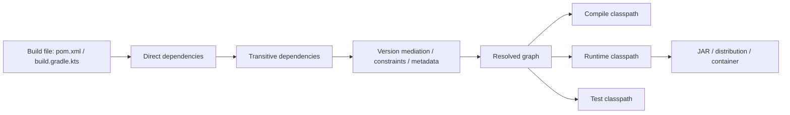
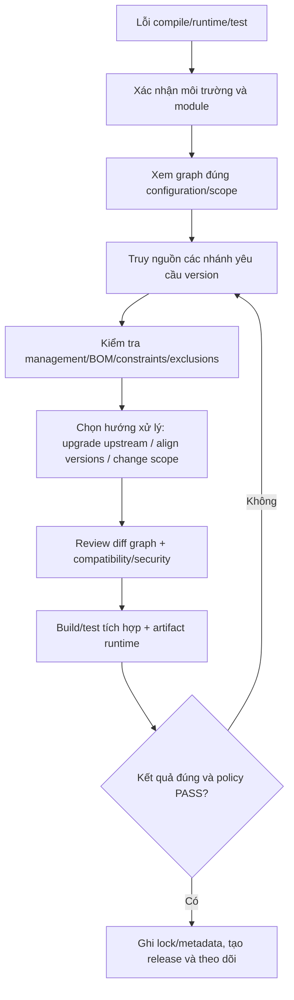
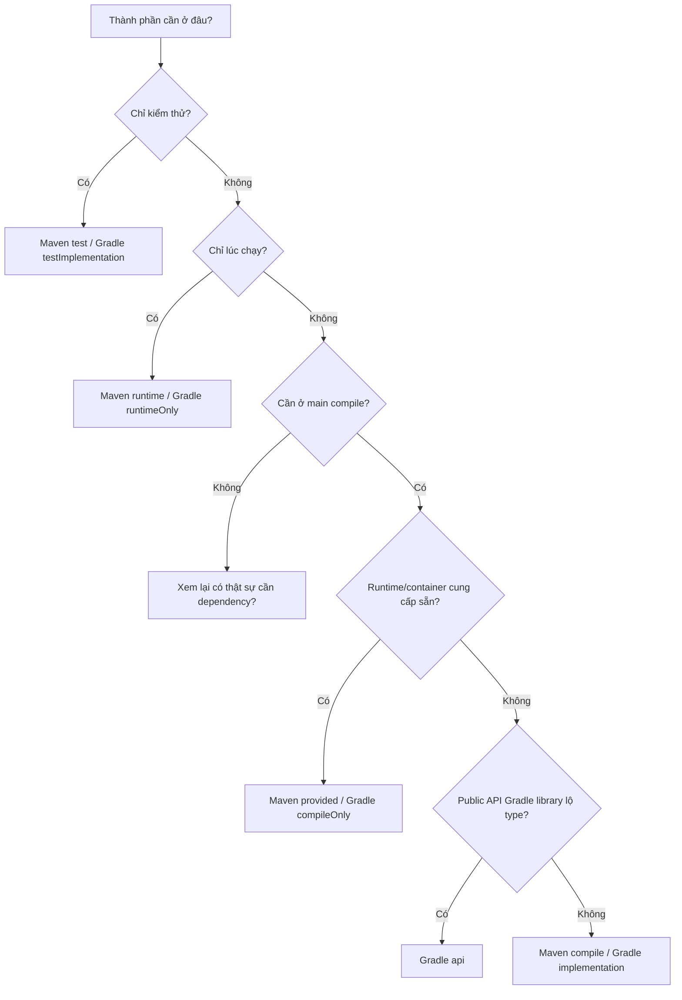

# Dependency scope, dependency graph và xử lý xung đột phiên bản

Một ứng dụng **Java 27** có thể biên dịch thành công nhưng không chạy được khi triển khai nếu thiếu thư viện ở runtime, có nhiều phiên bản của cùng thư viện hoặc một dependency gián tiếp đã thay đổi API. Vì vậy, việc khai báo “ứng dụng cần thư viện X” chưa đủ: cần biết **X nằm trên classpath nào**, **X kéo theo những gì** và **trình quản lý phụ thuộc thật sự chọn phiên bản nào**.

Bài này thuộc chương **Build và quản lý phụ thuộc** của module **Java 27 và các kiến thức liên quan**. Nội dung tập trung vào mô hình hiện hành của **Apache Maven** và **Gradle**, không hướng dẫn các cấu hình Gradle `compile`/`testCompile` đã lỗi thời hoặc sử dụng một tùy chọn ép phiên bản chỉ để che lỗi. Mã và tình huống được diễn giải theo Java 27 nhưng các quy tắc quản lý phụ thuộc còn áp dụng cho nhiều phiên bản Java hiện đại khác.

Sau bài học, bạn cần có khả năng:

- Phân biệt dependency cho **biên dịch**, **chạy**, **kiểm thử** và **API công khai**.
- Đọc đồ thị phụ thuộc trực tiếp/gián tiếp và xác định **version đã resolve** thay vì đoán từ file khai báo.
- Giải thích sự khác biệt giữa Maven **nearest definition** và Gradle **conflict resolution**.
- Dùng `dependencyManagement`, Maven BOM, Gradle `api`/`implementation`, constraints và platforms đúng mục đích.
- Chẩn đoán xung đột phiên bản, thiếu dependency ở runtime, trùng class và các lỗi binary compatibility.
- Thiết lập quy trình review, khóa phiên bản, kiểm tra artifact và xác minh bản đã đóng gói.

## 1. Mental model: từ khai báo tới classpath thực tế

Hãy coi dependency management là quá trình biến một tập **yêu cầu** thành một tập **artifact được lựa chọn** cho từng mục đích.



Các khái niệm cần tách bạch:

| Khái niệm | Ý nghĩa |
|---|---|
| **Dependency declaration** | Mong muốn sử dụng một module/artifact, có thể kèm version/scope |
| **Direct dependency** | Được dự án khai báo trực tiếp |
| **Transitive dependency** | Do một dependency khác yêu cầu; có thể sâu nhiều cấp |
| **Dependency graph** | Đồ thị các yêu cầu và cạnh quan hệ phụ thuộc |
| **Resolution** | Xử lý metadata, scope, variant, conflict, constraint để chọn artifact thực tế |
| **Classpath** | Tập class/module phục vụ biên dịch, chạy hay test; không phải mọi tập đều giống nhau |
| **Resolved version** | Phiên bản cuối được công cụ build chọn cho một dependency trong cấu hình nhất định |
| **Artifact** | File JAR/POM hoặc một thành phần tải được từ repository hay được tạo bởi project |
| **Lock state** | Trạng thái resolution ghi lại để kiểm soát thay đổi bất ngờ |
| **Dependency verification** | Xác minh byte/chữ ký artifact theo thông tin được tin cậy, khác với khóa version |

Một file build có thể khai báo `library-a:2.0`, nhưng runtime thực tế sử dụng `library-c:3.1` do `library-a` và một nhánh khác của đồ thị cùng yêu cầu `library-c` với nhiều phiên bản. Đọc đúng dependency graph quan trọng hơn nhìn từng dòng `dependencies` riêng lẻ.

### Tách dependency management khỏi hỗ trợ Java 27

`javac --release 27` hoặc Gradle Java toolchain `languageVersion=27` chọn ngôn ngữ/API/bytecode mục tiêu; chúng **không** kiểm soát việc thư viện có được chọn đúng phiên bản hay có mặt ở runtime. Ngược lại, một JAR đã được resolve cũng có thể biên dịch với bytecode yêu cầu JDK cao hơn phiên bản ứng dụng sử dụng.

Với **Gradle**, bản công cụ có thể **chạy trên** một JDK khác với JDK dùng để **compile**. Tại ngày 27/11/2026, Gradle Compatibility Matrix liệt kê **Gradle 9.8.0 trở lên** hỗ trợ chạy bằng Java 27. Khi chọn wrapper/toolchain cho dự án thực tế, cần tra bảng tương thích của đúng Gradle version đang sử dụng, không suy từ số `27` trong build file.

## 2. “Scope” trả lời hai câu hỏi khác nhau

Khi thêm một thư viện, hãy hỏi:

1. **Thư viện được cần ở giai đoạn nào?** Compile source, thực thi chương trình, compile test hay chạy test?
2. **Thư viện có nằm trong API công khai của thư viện mình xuất bản không?** Một type xuất hiện trong signature public có thể là dependency cần thiết để consumer biên dịch; implementation nội bộ không nhất thiết phải xuất hiện trên compile classpath của consumer.

Ví dụ:

```java
package com.example.catalog;

public interface CatalogService {
    java.util.List<String> findTitles();
}
```

Nếu chữ ký public **chỉ dùng các type của JDK**, các thư viện JSON/HTTP riêng mà `CatalogServiceImpl` dùng để thực hiện có thể là **implementation dependency**.

Ngược lại:

```java
package com.example.catalog;

import com.example.contract.ResultPage;

public interface CatalogService {
    ResultPage<String> findTitles();
}
```

Nếu `ResultPage` thuộc artifact `com.example:catalog-contract`, các dự án tiêu thụ `CatalogService` cần type đó để compile. Trong **Gradle `java-library`**, dependency này thường thuộc `api` thay vì `implementation`. Maven không có cùng cơ chế `api`/`implementation` theo nghĩa Gradle; cần hiểu cách scope và metadata của thư viện Maven được truyền cho consumer.

### Không nhầm source set, artifact và classpath

- `src/main/java` thường là source production; `src/test/java` là source test.
- **Compile classpath** cho main khác **test compile classpath**.
- **Runtime classpath** cho main có thể chứa thêm logging provider, JDBC driver và dependency runtime-only.
- **Published metadata** có thể khiến người tiêu thụ thư viện nhận một tập dependency khác với người chạy ứng dụng.
- **JAR thường** không tự nhét mọi dependency vào bên trong. Fat JAR, shaded JAR, Spring Boot executable JAR hoặc container image có cơ chế đóng gói riêng.

## 3. Maven dependency scopes vẫn hiện hành

Maven quản lý `scope` trên từng dependency trong `pom.xml`. Bốn scope thường sử dụng trong ứng dụng Java mới:

| Maven scope | Main compile classpath | Main runtime classpath | Test compile/runtime | Ý nghĩa |
|---|---|---|---|---|
| `compile` (mặc định) | Có | Có | Có | Dependency cần để compile và chạy |
| `provided` | Có | Không | Có | Runtime/container dự kiến cung cấp sẵn |
| `runtime` | Không | Có | Có | Chỉ cần khi chạy, không cần để compile source main |
| `test` | Không | Không | Có | Chỉ dùng cho test |

**Lưu ý về transitivity:** `compile` và `runtime` có thể ảnh hưởng dependency của project tiêu thụ; `provided` và `test` trong Maven không truyền đi như các dependency compile thông thường. Scope thực tế của dependency gián tiếp còn phụ thuộc scope trên từng cạnh, không chỉ scope ở root.

Hai scope khác cần biết **để đọc dự án**, nhưng không nên là lựa chọn mới mặc định:

- `system`: chỉ tới JAR ở đường dẫn local bằng `systemPath`. Đây là cách làm giảm tính di động, không tận dụng repository và quản lý transitive tốt; ưu tiên công bố artifact vào repository đã quản trị.
- `import`: **chỉ hợp lệ** với dependency loại `pom` bên trong `<dependencyManagement>`, dùng để nhập danh sách version do BOM quản lý. Nó **không** phải scope classpath thông thường.

### `provided` có nghĩa là một cam kết về runtime

Ví dụ API do application server cung cấp, như Jakarta Servlet API, có thể được khai báo `provided` khi **đúng môi trường triển khai thật sự cung cấp implementation/API tương ứng**. Nếu ứng dụng chạy bằng `java -jar` độc lập mà không có các class đó, khai báo `provided` sẽ dẫn tới lỗi runtime.

`provided` không có nghĩa thư viện “miễn phí” hay “không cần kiểm tra lỗ hổng”. Bạn vẫn phải kiểm kê phiên bản mà container hoặc runtime thực sự cung cấp.

### `runtime` không phải giải pháp cho code đang import type lúc compile

Nếu `src/main/java` import trực tiếp một type của thư viện, thư viện đó thường phải có mặt trên **compile classpath**. Scope `runtime` chỉ đúng nếu source main biên dịch không cần các type đó, ví dụ một implementation được nạp gián tiếp qua `ServiceLoader` hoặc provider logging/JDBC phù hợp với hợp đồng ứng dụng.

## 4. Ví dụ Maven với compile, runtime và test

Đoạn `pom.xml` sau là **mẫu tối thiểu về scope**, sử dụng những tọa độ thư viện có thật. Các version ở đây là **dữ liệu thực hành minh họa**, không phải tuyên bố về phiên bản mới nhất hay bản vá an toàn nhất ở ngày bạn đọc; dự án production cần chọn phiên bản đã kiểm tra theo chính sách bảo mật.

```xml
<project xmlns="http://maven.apache.org/POM/4.0.0"
         xmlns:xsi="http://www.w3.org/2001/XMLSchema-instance"
         xsi:schemaLocation="http://maven.apache.org/POM/4.0.0
           https://maven.apache.org/xsd/maven-4.0.0.xsd">
  <modelVersion>4.0.0</modelVersion>

  <groupId>com.example</groupId>
  <artifactId>catalog-app</artifactId>
  <version>1.0.0</version>

  <properties>
    <maven.compiler.release>27</maven.compiler.release>
    <project.build.sourceEncoding>UTF-8</project.build.sourceEncoding>
    <slf4j.version>2.0.17</slf4j.version>
  </properties>

  <dependencies>
    <!-- API dùng trong main source: compile + runtime -->
    <dependency>
      <groupId>org.slf4j</groupId>
      <artifactId>slf4j-api</artifactId>
      <version>${slf4j.version}</version>
    </dependency>

    <!-- Provider logging chỉ cần khi chạy -->
    <dependency>
      <groupId>org.slf4j</groupId>
      <artifactId>slf4j-simple</artifactId>
      <version>${slf4j.version}</version>
      <scope>runtime</scope>
    </dependency>

    <!-- Phụ thuộc chỉ cho test: version cần chọn theo policy dự án -->
    <dependency>
      <groupId>org.junit.jupiter</groupId>
      <artifactId>junit-jupiter</artifactId>
      <version>5.12.2</version>
      <scope>test</scope>
    </dependency>
  </dependencies>
</project>
```

Trong ví dụ, `org.slf4j:slf4j-api` nằm trên main compile/runtime; `slf4j-simple` cung cấp implementation ở runtime nhưng không cần main compile; `junit-jupiter` chỉ dành cho test.

**Để chạy test JUnit 5/JUnit Platform**, dự án còn cần phiên bản Maven Surefire/Failsafe tương thích và cấu hình test theo mục tiêu. Không nên coi POM giản lược ở đây là mô hình build production đầy đủ; nó nhằm minh họa scope. Việc `maven.compiler.release=27` cũng đòi `javac` của JDK thích hợp và phiên bản compiler plugin hỗ trợ tham số `--release`.

Các lệnh quan sát khi project và Maven Wrapper đã được chuẩn bị:

```bash
./mvnw dependency:tree
./mvnw dependency:tree -Dscope=runtime
./mvnw dependency:tree -Dscope=test
```

Trong PowerShell/Windows dùng `mvnw.cmd` thay cho `./mvnw`. Cần hiểu `-Dscope=...` lọc dependency graph do plugin báo cáo; muốn biết chính xác tập classpath cho từng nhiệm vụ có thể kết hợp với cấu hình plugin/packaging của dự án.

## 5. Transitive dependencies: cạnh trong graph không chỉ là dòng trong POM

Giả sử:

```text
app
├── report-core:2.0
│   └── parser-core:1.4
└── analytics-core:3.0
    └── parser-core:2.2
```

Đây là **đồ thị giả lập**, không yêu cầu các tọa độ trên tồn tại ở Maven Central. Một project có thể không khai báo `parser-core`, nhưng vẫn cần một phiên bản của nó vì hai thư viện trực tiếp cùng sử dụng.

Những câu hỏi cần trả lời:

1. Có bao nhiêu đường dẫn từ ứng dụng tới `parser-core`?
2. Những version được **yêu cầu** là bao nhiêu?
3. Một project đang dùng Maven hay Gradle, và **quy tắc resolve** là gì?
4. Có `dependencyManagement`/constraint/BOM/force/exclusion nào can thiệp không?
5. Sau resolution, **classpath đang chạy** chứa JAR nào?
6. Phiên bản được chọn có tương thích về API/binary với cả `report-core` và `analytics-core` không?

Graph khai báo là các **yêu cầu**; graph đã resolve là kết quả áp dụng các quy tắc của công cụ build. Cả hai đều đáng kiểm tra, nhất là khi một nhánh bị bỏ qua hoặc một version bị thay bằng version khác.

### Cẩn thận với scope ở dependency gián tiếp

Maven không đơn giản sao chép nguyên `scope` ở POM của tất cả dependency cấp dưới lên root. Ví dụ:

- Nếu app phụ thuộc A `compile` và A phụ thuộc B `runtime`, B thường xuất hiện trong runtime classpath của app.
- Nếu A phụ thuộc B `test`, B **không tự xuất hiện** trong runtime graph của app.
- Một dependency B `provided` của A không mặc nhiên truyền sang consumer, vì A đã cam kết B được môi trường chạy của A cung cấp.

Gradle cũng có metadata/variants quyết định dependency nào đi vào `compileClasspath` hoặc `runtimeClasspath`. Do đó câu hỏi “thư viện này có ở runtime không?” phải được trả lời bằng **runtime graph đã resolve**, không chỉ bằng một dòng declaration.

## 6. Maven conflict mediation: “nearest definition”, không phải tự chọn mới nhất

Maven mặc định giải quyết xung đột phiên bản của một artifact bằng quy tắc **nearest definition**: định nghĩa gần project root nhất trong dependency tree được ưu tiên.

```text
app
├── A:1.0
│   └── core:1.4  (depth = 2)
└── B:2.0
    └── core:2.2  (depth = 2)
```

Nếu hai yêu cầu `core` nằm **cùng độ sâu**, nhánh được khai báo **trước** trong thứ tự phụ thuộc hiệu lực sẽ thắng theo quy tắc Maven. Vì vậy ở đồ thị giả lập trên, nếu A được khai báo trước B và không có quản lý phiên bản can thiệp, có thể chọn `core:1.4` — **không phải `2.2`**.

Nếu thêm dependency trực tiếp vào root:

```text
app
├── core:2.2  (depth = 1)  <-- gần root hơn
├── A:1.0
│   └── core:1.4
└── B:2.0
    └── core:2.2
```

thì dependency trực tiếp ở depth 1 thường là khai báo gần nhất. Tuy nhiên, cần kiểm tra **effective POM**, dependency management và các exclusions trước khi dự đoán kết quả cuối.

### Các hệ quả thực tế

- Đổi thứ tự direct dependencies trong một số POM có thể đổi kết quả khi conflict **cùng độ sâu**. Đây không phải cách quản lý phiên bản chủ động đáng tin cậy.
- Thêm hoặc thay một dependency trực tiếp có thể đổi graph ngầm, dù không chỉnh version của thư viện xung đột.
- Một release mới của A có thể thêm/bỏ dependency C, thay đường đi ngắn nhất tới C.
- Nếu có `<dependencyManagement>` quản lý C, version được quản lý có thể chi phối version transitive, không thể chỉ dùng “gần nhất” để kết luận.

**Không nên coi việc Maven tự hòa giải conflict là kiểm chứng binary compatibility.** Nếu A được biên dịch với một API chỉ có trong C:2.2 nhưng Maven chọn C:1.4, chương trình có thể ném `NoSuchMethodError` sau khi compile thành công.

## 7. Maven `dependencyManagement`: đặt quy tắc version tập trung

`<dependencyManagement>` khai báo **thông tin phiên bản và cấu hình mặc định có quản lý** cho các dependency được sử dụng; nó **không tự thêm mọi artifact vào classpath**.

Ví dụ POM ở root hoặc parent có:

```xml
<dependencyManagement>
  <dependencies>
    <dependency>
      <groupId>com.example</groupId>
      <artifactId>parser-core</artifactId>
      <version>2.2</version>
    </dependency>
  </dependencies>
</dependencyManagement>
```

Nếu root/module có dependency trực tiếp:

```xml
<dependencies>
  <dependency>
    <groupId>com.example</groupId>
    <artifactId>parser-core</artifactId>
    <!-- version lấy từ dependencyManagement -->
  </dependency>
</dependencies>
```

thì version `2.2` được dùng theo khai báo management. Đồng thời Maven có thể dùng version đã quản lý cho **transitive dependency** tương ứng thay vì version được yêu cầu bởi A hoặc B.

Những điểm cần phân biệt:

- Nếu không có dependency nào thực sự yêu cầu `parser-core`, một entry `dependencyManagement` **không tự tạo dependency mới**.
- Một direct dependency **khai báo version tường minh** trong `<dependencies>` giữ quyền chủ động của declaration đó; không giả định management luôn ghi đè nó.
- Khi dùng parent POM, module con kế thừa dependency management theo quy tắc Maven.
- Version management không đảm bảo C:2.2 tương thích với các dependency khác. Cần kiểm thử và xem release notes.

### Maven BOM với `scope=import`

Một **Bill of Materials (BOM)** trong Maven là một POM chứa tập dependency management được tác giả BOM đề xuất/điều phối.

```xml
<dependencyManagement>
  <dependencies>
    <dependency>
      <groupId>com.example.platform</groupId>
      <artifactId>product-bom</artifactId>
      <version>1.5.0</version>
      <type>pom</type>
      <scope>import</scope>
    </dependency>
  </dependencies>
</dependencyManagement>
```

`com.example.platform:product-bom:1.5.0` trong ví dụ là tọa độ **giả lập**, để minh họa cú pháp. Sau import, dự án có thể khai báo những dependency được BOM quản lý **mà không viết version** ở từng module con.

**Quan trọng:** import BOM chỉ nhập các version/dependency management phù hợp; **không tải và đưa mọi artifact trong BOM vào classpath**. Đây cũng **không phải SBOM** dùng để kiểm kê thành phần bảo mật của sản phẩm.

Khi dự án import nhiều BOM có entries trùng nhau, kết quả còn phụ thuộc thứ tự và các quy tắc ưu tiên của Maven. Không để hành vi này “tình cờ” quyết định version quan trọng: hãy kiểm tra effective POM và đặt quản lý version rõ ràng ở chỗ có chủ đích.

## 8. Maven exclusions và optional dependencies: cắt đúng nhánh

Thỉnh thoảng một thư viện khai báo dependency không phù hợp môi trường, có một alternative provider hoặc kéo theo library đã bị thay thế. Maven hỗ trợ `<exclusions>` để chặn một transitive dependency trên **cạnh cụ thể**:

```xml
<dependency>
  <groupId>com.example</groupId>
  <artifactId>report-core</artifactId>
  <version>2.0</version>
  <exclusions>
    <exclusion>
      <groupId>com.example</groupId>
      <artifactId>old-xml-parser</artifactId>
    </exclusion>
  </exclusions>
</dependency>
```

Đây là tọa độ minh họa. Exclusion trên cạnh `app → report-core` **không tự cấm** `old-xml-parser` nếu một dependency khác vẫn kéo nó vào. Cần xem graph đã resolve để xác nhận.

**Chỉ loại dependency khi đã hiểu lý do**: nếu `report-core` thật sự gọi class từ `old-xml-parser` mà bạn loại đi, kết quả có thể là `NoClassDefFoundError` hoặc tính năng bị lỗi. Nếu muốn thay bằng version đã sửa, nên nâng dependency upstream hoặc quản lý version rõ ràng thay vì dùng exclusion như “công cụ vá” tùy tiện.

### Maven `optional=true` là hợp đồng dành cho consumer

Một thư viện có thể khai báo:

```xml
<dependency>
  <groupId>com.example</groupId>
  <artifactId>optional-image-codec</artifactId>
  <version>1.0</version>
  <optional>true</optional>
</dependency>
```

`optional` có nghĩa dependency đó **không tự truyền sang project tiêu thụ** qua quan hệ phụ thuộc vào thư viện; consumer nào cần tính năng liên quan phải tự khai báo module đó.

Đây là kỹ thuật vẫn được Maven hỗ trợ, nhưng không nên coi optional dependency là một tính năng được bảo đảm **có sẵn** ở runtime. Thư viện cần kiểm tra capability/đưa ra thông báo rõ khi thiếu implementation tùy chọn.

## 9. Công cụ Maven để đọc graph và giải thích version

Trong dự án có Maven Wrapper và plugin đã được quản trị, dùng các lệnh:

```bash
# Các dependency được resolve, bao gồm transitive.
./mvnw dependency:tree

# Chỉ tập dependency phù hợp runtime khi chẩn đoán deployment.
./mvnw dependency:tree -Dscope=runtime

# Lọc một module cụ thể, thay groupId/artifactId theo thực tế.
./mvnw dependency:tree -Dincludes=com.example:parser-core

# Xem POM sau inheritance/profiles/management.
./mvnw help:effective-pom
```

Nếu dự án nhiều Maven modules, có thể chọn module cụ thể bằng `-pl` rồi chẩn đoán trong đúng module. Tập dependency ở scope test và runtime có thể khác nhau; việc chạy `dependency:tree` trong module sai dễ dẫn đến kết luận nhầm.

Một bản báo cáo dạng cây có thể biểu thị:

```text
[INFO] com.example:catalog-app:jar:1.0.0
[INFO] +- com.example:report-core:jar:2.0:compile
[INFO] |  \- com.example:parser-core:jar:1.4:compile
[INFO] \- com.example:analytics-core:jar:3.0:compile
```

Đây là **output mô phỏng**, không phải kết quả chạy build của bài. Không nhất thiết mọi nhánh bị xung đột đều được hiển thị như một artifact đã chọn. Muốn giải thích chính xác “vì sao version bị loại/được chọn”, kết hợp thông tin plugin, dependency management/effective POM và các tiêu chí mediation.

### Maven Enforcer: phát hiện thay vì im lặng chịu conflict

Có thể cấu hình Maven Enforcer để dùng các rule:

- `dependencyConvergence`: tìm trường hợp các nhánh yêu cầu cùng một dependency với version không thống nhất.
- `requireUpperBoundDeps`: so version được resolve với yêu cầu phiên bản ở graph và báo khi bản được chọn thấp hơn những yêu cầu liên quan theo luật của rule.
- `requirePluginVersions`: tránh plugin build bị lấy phiên bản không được khai báo rõ.

**`dependencyConvergence` không giống `requireUpperBoundDeps`.** Ví dụ hai nhánh cần C:1.4 và C:2.2 có thể bị `dependencyConvergence` cảnh báo dù kết quả resolve là C:2.2. `requireUpperBoundDeps` tập trung vào việc selected version đủ cao theo các yêu cầu đã quan sát; nó không thay thế kiểm thử tương thích thực tế.

Rule của Enforcer cần được bật và cấu hình trong build lifecycle, với **version plugin đã pin**. Một lệnh `mvn verify` đơn thuần không bảo đảm bạn đang chạy các rule nếu POM chưa cấu hình.

## 10. Dependency graph cần được nhìn theo **ngữ cảnh**

Cùng một artifact có thể được chọn trong `runtimeClasspath` nhưng không ở `compileClasspath`, hoặc một test dependency làm graph test thay đổi:

```text
main compile graph
  app -> formatter-api:2.0

main runtime graph
  app -> formatter-api:2.0
      -> formatter-provider:2.0

test runtime graph
  app -> formatter-api:2.0
      -> formatter-provider:2.0
      -> test-engine:1.0
```

Sơ đồ trên chỉ là ví dụ kiến trúc. Trong build thực tế, loại cạnh/đường graph cụ thể do Maven scopes hoặc Gradle configurations và metadata quyết định, không phải cứ API sẽ tự kéo provider theo đúng mũi tên trong sơ đồ.

Khi gặp lỗi **chỉ xảy ra ở production**:

1. Kiểm tra `runtime` graph, không chỉ compile graph.
2. Xác nhận artifact đang triển khai thực sự chứa/tham chiếu JAR đó.
3. Kiểm tra application server/container có tự cung cấp version khác không.
4. Kiểm tra JPMS module path và service providers nếu ứng dụng chạy modular.
5. Nếu dùng fat JAR/shading, kiểm tra các class trùng hoặc bản sao dependency đã được biến đổi.

Ngược lại, lỗi chỉ trong test có thể do test framework kéo thêm transitive library, dependency test scope hoặc cấu hình classloader khác với ứng dụng.

## 11. Gradle: dùng configuration thay cho Maven scope

Gradle không áp dụng trực tiếp mô hình `<scope>` của Maven. Mỗi dependency được đặt trong một **configuration** do plugin và build model cung cấp; Gradle phân biệt **khai báo** dependency, **resolve** artifact và **công bố variant cho consumer**.

Khi áp dụng `java-library`, các configuration phổ biến là:

| Gradle configuration | Dùng tại project hiện tại | Ảnh hưởng khi xuất bản thư viện |
|---|---|---|
| `api` | Main compile/runtime | Được đưa vào compile/runtime graph của consumer |
| `implementation` | Main compile/runtime | Chi tiết triển khai: không nằm trong **compile** API graph của consumer, nhưng cần có ở runtime |
| `compileOnly` | Chỉ main compile | Không tự đi vào runtime của project hoặc metadata runtime cho consumer |
| `compileOnlyApi` | Main compile | Được công bố cho consumer ở **compile** API, không phải runtime |
| `runtimeOnly` | Main runtime | Được công bố cho consumer ở runtime, không phải compile API |
| `testImplementation` | Test compile/runtime | Không đưa vào production runtime của consumer |
| `testCompileOnly` | Test compile | Không đưa vào production runtime |
| `testRuntimeOnly` | Test runtime | Không đưa vào production runtime |

**`api` và `compileOnlyApi` chỉ xuất hiện khi dùng `java-library`**, không phải mọi project chỉ áp dụng `java` đều có chúng.

### Phân biệt ba loại configuration

Trong Gradle hiện đại, một configuration có thể có vai trò:

1. **Declarable** (*dependency scope/bucket*): nơi khai báo `api`, `implementation`, `compileOnly`, `runtimeOnly`...
2. **Resolvable**: nơi Gradle thực sự giải quyết graph thành file/classpath, như `compileClasspath`, `runtimeClasspath`, `testCompileClasspath`, `testRuntimeClasspath`.
3. **Consumable**: nơi project công bố variant/metadata cho project khác, như `apiElements` và `runtimeElements`.

`implementation` là chỗ **khai báo**; `runtimeClasspath` là chỗ **quan sát dependency được resolve**. Đừng cố thay đổi version conflict bằng cách khai báo thêm dependency trực tiếp vào một configuration vốn được plugin dành cho resolution.

Các configuration khác có thể được plugin Android/Kotlin, annotation processor hoặc custom plugins tạo thêm; chỉ đối chiếu trong phạm vi ứng dụng Java/Gradle `java` và `java-library` đang học.

## 12. Ví dụ Gradle Kotlin DSL cho thư viện Java 27

File `build.gradle.kts` ví dụ:

```kotlin
plugins {
    `java-library`
}

java {
    toolchain {
        languageVersion.set(JavaLanguageVersion.of(27))
    }
}

repositories {
    mavenCentral()
}

dependencies {
    // Chỉ dùng api khi public API lộ type thuộc thư viện này.
    api("org.slf4j:slf4j-api:2.0.17")

    // Dùng trong nội bộ triển khai.
    implementation("com.fasterxml.jackson.core:jackson-databind:2.18.4")

    // Logging provider, chỉ cần lúc chạy.
    runtimeOnly("org.slf4j:slf4j-simple:2.0.17")

    // BOM của test chỉ căn chỉnh version JUnit.
    testImplementation(platform("org.junit:junit-bom:5.12.2"))
    testImplementation("org.junit.jupiter:junit-jupiter")
    testRuntimeOnly("org.junit.platform:junit-platform-launcher")
}

tasks.test {
    useJUnitPlatform()
}
```

Các version thư viện nêu trên là **giá trị minh họa có cấu trúc hợp lệ**, không có ý nghĩa “đây là version mới nhất hoặc an toàn nhất”. Các mục plugin/wrapper/toolchain thực tế phải tương thích với JDK 27, và repository cần được tổ chức phê duyệt.

Nếu package public của thư viện **không** lộ type của SLF4J, `implementation("org.slf4j:slf4j-api:...")` có thể phù hợp hơn `api`; ví dụ dùng `api` để làm rõ semantics khi consumer biên dịch.

### `api` khác `implementation` ở **consumer compile graph**

Giả sử thư viện `catalog-lib` có class public:

```java
package com.example.catalog;

import org.slf4j.Logger;

public interface LoggerAwareCatalog {
    Logger logger();
}
```

Nếu kiểu trả về `Logger` là một phần API, consumer cần `org.slf4j:slf4j-api` khi compile. Với `java-library`, việc khai báo `api` giúp công bố dependency phù hợp với API.

Ngược lại, nếu SLF4J chỉ được class `CatalogImpl` import và không xuất hiện ở bất cứ public API cần thiết nào, giữ nó trong `implementation` tránh làm compile graph của consumer rộng lên không cần thiết.

**`implementation` không có nghĩa dependency không bao giờ đến consumer.** Nó thường vẫn được đưa vào **runtime graph** khi consumer chạy thư viện. Điều được che chủ yếu là **compile API dependency**.

## 13. Gradle mặc định xử lý version conflict thế nào?

Gradle có mô hình resolution khác Maven. Với yêu cầu thông thường và không có constraint đặc biệt, Gradle xét các version được yêu cầu cho **cùng một module** và thường **chọn version cao nhất** có thể chấp nhận.

```text
:app
├── lib-a:1.0 ──► core:1.4
└── lib-b:2.0 ──► core:2.2

Gradle (version requirements thông thường):
core:1.4  ──► core:2.2
Chọn core:2.2 cho graph phù hợp.
```

Điều này khác Maven, nơi nhánh gần nhất/tie-break theo khai báo có thể chọn `core:1.4`. **Không phải lúc nào Gradle chọn “mới nhất trên repository”**: nó chọn dựa trên các **yêu cầu phiên bản đã có**, metadata, version ranges, constraints, selection rules và những điều kiện khác.

### Các ngoại lệ quan trọng

- `strictly` có thể buộc version nằm trong tập cho phép hoặc làm resolution thất bại.
- `reject` loại những version bị cấm.
- `platform` và `enforcedPlatform` có thể đưa constraints vào graph.
- `resolutionStrategy`, capability rules hoặc component metadata có thể thay kết quả.
- Một yêu cầu version range/dynamic version có thể khiến Gradle hỏi repository về thêm phiên bản, khác với dependency có version cụ thể.
- **Variant/capability conflict** có thể khiến resolution thất bại dù không có hai version của cùng tọa độ.

Vì vậy, câu mô tả chính xác là: **mặc định Gradle chọn version cao hơn khi nhiều yêu cầu thông thường đối với cùng một module xung đột**, chứ không phải “Gradle luôn lấy bản mới nhất”.

### Maven so với Gradle trong cùng một tình huống

| Điều kiện | Maven (mặc định) | Gradle (mặc định) |
|---|---|---|
| A cần C:1.4; B cần C:2.2 ở cùng độ sâu | Nhánh khai báo trước có thể thắng | Thường chọn C:2.2 |
| C:2.2 được khai báo trực tiếp ở root | Direct dependency gần hơn thường thắng | C:2.2 tham gia resolution; thường thắng yêu cầu thấp hơn |
| C được quản lý bằng BOM/constraint | Quản lý version Maven ảnh hưởng lựa chọn | Gradle platform/constraint ảnh hưởng lựa chọn |
| Hai version có API không tương thích | Maven không tự phát hiện mọi lỗi Java binary compatibility | Gradle không tự phát hiện mọi lỗi Java binary compatibility |
| Muốn giải thích selected version | `dependency:tree` + effective POM + management | `dependencies` + `dependencyInsight` |

Cả hai công cụ giúp chọn **một phiên bản theo graph**, không tự viết lại bytecode của thư viện để khắc phục việc gọi API không còn tồn tại.

## 14. Gradle `dependencyInsight`: “vì sao version này được chọn?”

Trong project Gradle có wrapper:

```bash
# Xem toàn bộ dependency graph runtime.
./gradlew dependencies --configuration runtimeClasspath

# Xem compile graph của main.
./gradlew dependencies --configuration compileClasspath

# Truy ra lý do chọn một module ở runtime.
./gradlew dependencyInsight --dependency com.example:core --configuration runtimeClasspath

# Xem graph test khi lỗi chỉ xảy ra trong test.
./gradlew dependencies --configuration testRuntimeClasspath
```

Trong multi-project build, chọn đúng subproject, ví dụ:

```bash
./gradlew :app:dependencyInsight --dependency com.example:core --configuration runtimeClasspath
```

`dependencyInsight` thường cung cấp **selection reasons** như:

- `By conflict resolution`: có nhiều phiên bản được yêu cầu.
- `By constraint`: một constraint/platform tham gia quyết định.
- `Forced`: một quy tắc `force` hoặc enforced platform ép kết quả.
- `Selected by rule`: component selection/dependency resolve rule can thiệp.
- `Was requested` hoặc các reason liên quan rich versions/`reject`.

Trong báo cáo `dependencies`, ký hiệu như `1.4 -> 2.2` biểu diễn version yêu cầu đã bị thay bằng version được chọn. Ký hiệu `(*)` hoặc `(c)` có ý nghĩa riêng trong report; cần đọc chú giải của Gradle thay vì coi mọi dòng là một JAR tải thêm.

**Không chạy `dependencyInsight` chỉ trên `compileClasspath` rồi kết luận production sẽ dùng cùng phiên bản.** Cần so sánh với `runtimeClasspath` và artifact đã đóng gói.

## 15. Gradle dependency constraints: ghi rõ yêu cầu phiên bản

Một **constraint** cho Gradle biết phiên bản cần chấp nhận/ưu tiên cho module khi module đó xuất hiện trong graph. Đây là cách bày tỏ ý định rõ hơn so với việc thêm “dummy dependency” chỉ để đẩy version.

Ví dụ trong `build.gradle.kts` của project đã áp dụng plugin Java:

```kotlin
dependencies {
    implementation("com.example:report-core:2.0")

    constraints {
        implementation("com.example:parser-core:2.2") {
            because("Đã xác minh tính tương thích với parser-core 2.2")
        }
    }
}
```

Các tọa độ `com.example` trong đoạn này là **minh họa**. Một constraint **không thêm module nếu module đó không được yêu cầu** ở một đường graph tương ứng. Ở đây nó có tác dụng khi `report-core` hoặc dependency khác kéo `parser-core` vào configuration cần resolve.

Nếu cần chặn bản ngoài một phạm vi:

```kotlin
dependencies {
    constraints {
        implementation("com.example:parser-core") {
            version {
                strictly("[2.2, 3.0[")
                prefer("2.2")
            }
            because("Chỉ hỗ trợ API parser-core nhánh 2.x đã kiểm thử")
        }
    }
}
```

Gradle có mô hình rich versions:

| Thuộc tính | Mục đích |
|---|---|
| `require` | Khai báo phiên bản tối thiểu được chấp nhận theo ngữ nghĩa Gradle, vẫn có thể được nâng bởi conflict resolution |
| `strictly` | Ràng buộc tập phiên bản được phép; ngoài khoảng cho phép thì resolution có thể thất bại |
| `prefer` | Gợi ý mềm khi không có yêu cầu mạnh hơn |
| `reject` | Từ chối các version bị nêu rõ |

`strictly` không phải phương pháp chữa mọi xung đột. Với một thư viện dùng chung, constraint quá chặt có thể làm consumer không resolve được graph. Khi cần thay một version có CVE, ưu tiên cập nhật upstream/constraint phù hợp và kiểm thử binary compatibility trước khi ép một bản cũ hơn.

### `force` là lựa chọn cuối, không phải mặc định

Gradle vẫn hỗ trợ `resolutionStrategy.force`, nhưng nó có thể can thiệp mạnh vào kết quả và làm khó việc giải thích metadata/rich versions. Khi có thể, hãy diễn đạt version policy bằng constraints, platforms hoặc metadata rule có lý do và kiểm thử.

Đặc biệt tránh `force("core:1.4")` chỉ vì app biên dịch được, trong khi một dependency khác thật sự yêu cầu method chỉ có ở `core:2.2`.

## 16. BOM, platform và version catalog trong Gradle

Cùng mang ý tưởng “tập trung hóa phiên bản”, nhưng ba cơ chế có vai trò khác nhau:

| Cơ chế | Trả lời câu hỏi | Có tham gia resolution? |
|---|---|---|
| Maven BOM nhập vào Gradle bằng `platform(...)` | Bộ version constraints thống nhất cho một họ thư viện | **Có**, thông qua dependency constraints |
| Gradle `java-platform` project | Những constraints nào được công bố/áp dụng giữa nhiều project? | **Có** |
| Gradle Version Catalog (`libs.versions.toml`) | Dependency được đặt alias nào và khai báo version nào? | Catalog **không tự khóa** selected version; các declaration của nó vẫn tham gia graph |

Ví dụ import BOM JUnit cho test:

```kotlin
dependencies {
    testImplementation(platform("org.junit:junit-bom:5.12.2"))
    testImplementation("org.junit.jupiter:junit-jupiter")
    testRuntimeOnly("org.junit.platform:junit-platform-launcher")
}
```

Version `5.12.2` mang tính minh họa. BOM cung cấp version constraints cho các module tương ứng, không tự đưa tất cả module JUnit vào test classpath. Nếu dependency không được yêu cầu, một BOM không “tự tải hết thư viện”.

### `enforcedPlatform` cần thận trọng

`enforcedPlatform` có thể áp những version cưỡng chế mạnh hơn `platform` thông thường. Khi **thư viện** xuất bản constraint cưỡng chế, nó có thể gây xung đột hoặc truyền chính sách quá mạnh sang consumer. Vì thế, Gradle khuyến nghị **thận trọng khi dùng enforced platform trong library**; nếu chỉ cần alignment, ưu tiên platform/constraints phù hợp.

### Version Catalog không phải lockfile

Một alias `libs.parserCore` trỏ tới version `2.2` không đảm bảo selected version luôn là `2.2`: transitive dependencies, platforms hoặc rich versions có thể làm kết quả thay đổi. **Catalog giúp tập trung khai báo; dependency locking ghi lại kết quả resolution.**

## 17. Gradle: fail fast khi conflict không được chấp nhận

Nếu tổ chức muốn phát hiện mọi conflict thay vì tự chọn một version theo mặc định, có thể bật rule:

```kotlin
configurations.configureEach {
    resolutionStrategy {
        failOnVersionConflict()
    }
}
```

Khi cùng module được yêu cầu bằng nhiều version trong configuration đang resolve, Gradle có thể từ chối build và buộc bạn giải quyết có chủ đích.

Đây là **quyết định chính sách**, không nên bật chỉ vì tưởng nó tương đương việc nâng bản vá. Nhiều project lớn có conflicts hợp lệ do tương thích ngược; việc cấm mọi conflict có thể cần exceptions và quy trình cập nhật được giám sát.

Ngoài ra Gradle còn các tùy chọn phát hiện resolution không tái hiện được, dynamic versions hoặc changing versions theo tài liệu. Dùng chúng đúng mục đích khi muốn build release ổn định, nhưng không thay thế SCA hoặc kiểm thử.

## 18. Không phải mọi “dependency conflict” đều là conflict version

Khi nói một ứng dụng có lỗi dependency, cần phân biệt **đúng loại xung đột** trước khi sửa:

| Vấn đề | Ví dụ | Dấu hiệu |
|---|---|---|
| **Version conflict cùng module** | A yêu cầu `parser-core:1.4`, B yêu cầu `parser-core:2.2` | Công cụ chọn một version hoặc từ chối resolve |
| **Binary compatibility conflict** | App biên dịch với method chỉ có ở 2.2, runtime tải 1.4 | `NoSuchMethodError`, `NoSuchFieldError`, `AbstractMethodError`... |
| **Thiếu runtime dependency** | App compile với API nhưng driver/provider không được đóng gói/cung cấp | `ClassNotFoundException`, `NoClassDefFoundError`, service lookup rỗng |
| **Duplicate classes ở artifact khác nhau** | Hai JAR mang cùng class `com.example.Util` nhưng khác tọa độ | Thứ tự nạp class/đóng gói có thể quyết định implementation được dùng |
| **Capability/provider conflict** | Nhiều module cung cấp cùng một capability hoặc logging binding không phù hợp | Gradle có thể từ chối graph; runtime có thể báo nhiều provider |
| **JPMS module/package conflict** | Hai named modules chứa cùng package xuất ra consumer | Lỗi compile/module resolution hoặc accessibility theo quy tắc JPMS |
| **Incompatible bytecode level** | JAR được biên dịch cho feature Java mới hơn JDK đang chạy | `UnsupportedClassVersionError` |
| **Dependency metadata sai** | POM thiếu transitive dependency, Gradle Module Metadata lệch | Graph trông hợp lệ nhưng runtime thiếu class hoặc chọn variant không đúng |

**Không dùng cùng một cách chữa cho mọi trường hợp.** Nâng một version không sửa được ngay lỗi thiếu runtime provider; dùng `exclude` không giải quyết được hai JAR khác tọa độ cùng định nghĩa class; đổi `requires` trong `module-info.java` không giúp một API đã bị xóa quay trở lại.

### Dấu hiệu lỗi Java cần đọc đúng

- `NoClassDefFoundError`: JVM không tìm được định nghĩa class cần thiết trong lúc linking/execution, hoặc không thể khởi tạo class theo bối cảnh.
- `ClassNotFoundException`: thao tác tải class được yêu cầu, thường qua API như `Class.forName`, không tìm được class.
- `NoSuchMethodError`: bytecode tham chiếu method không có trên class được liên kết ở runtime.
- `NoSuchFieldError`: tương tự nhưng với field.
- `UnsupportedClassVersionError`: format/class file yêu cầu runtime không hỗ trợ.

Những lỗi này có thể xuất hiện **sau khi build thành công** và thường phụ thuộc đúng classpath/module path của môi trường chạy.

## 19. Thí nghiệm Java 27: `NoSuchMethodError` do lệch version

Phần này **cố tình tạo lỗi trên dữ liệu mẫu**, không dùng thư viện độc hại hay đụng tới hệ thống thực. Nó cho thấy Maven/Gradle version resolution có thể dẫn tới hậu quả gì nếu app chạy với bản API quá cũ.

Tạo ba file nguồn độc lập:

```text
v1/demo/lib/Formatter.java
v2/demo/lib/Formatter.java
app/demo/app/Main.java
```

File `v1/demo/lib/Formatter.java`, bản cũ:

```java
package demo.lib;

public final class Formatter {
    private Formatter() {
    }

    public static String format() {
        return "Formatter v1";
    }
}
```

File `v2/demo/lib/Formatter.java`, bản mới có method nhận tham số:

```java
package demo.lib;

public final class Formatter {
    private Formatter() {
    }

    public static String format() {
        return "Formatter v2";
    }

    public static String format(String text) {
        return "v2: " + text;
    }
}
```

File `app/demo/app/Main.java`:

```java
package demo.app;

import demo.lib.Formatter;

public class Main {
    public static void main(String[] args) {
        System.out.println(Formatter.format("Java 27"));
    }
}
```

### Biên dịch với v2, chạy với v1

Ví dụ lệnh trong shell có `mkdir -p` (Linux/macOS/Git Bash):

```bash
mkdir -p out/v1 out/v2 out/app

javac --release 27 -d out/v1 v1/demo/lib/Formatter.java
jar --create --file out/lib-v1.jar -C out/v1 .

javac --release 27 -d out/v2 v2/demo/lib/Formatter.java
jar --create --file out/lib-v2.jar -C out/v2 .

javac --release 27 -cp out/lib-v2.jar -d out/app app/demo/app/Main.java

# Đúng phiên bản lúc chạy:
java -cp "out/app:out/lib-v2.jar" demo.app.Main

# Cố tình thay bằng bản cũ ở runtime:
java -cp "out/app:out/lib-v1.jar" demo.app.Main
```

Dòng chạy đầu tiên in:

```text
v2: Java 27
```

Dòng chạy thứ hai **dự kiến** ném `java.lang.NoSuchMethodError` vì v1 không có method `Formatter.format(String)` mà bytecode của Main đã tham chiếu.

Trong **Windows PowerShell**, tạo các thư mục bằng `New-Item -ItemType Directory -Force` tương ứng; khi chạy `java -cp`, **dùng dấu chấm phẩy `;`** phân tách các entry classpath:

```powershell
java -cp "out/app;out/lib-v1.jar" demo.app.Main
```

Đây là một ví dụ **có thể biên dịch/chạy độc lập** nếu tạo đúng các file theo đường dẫn. Trong bước viết bài này **không chạy lệnh**, và lỗi `NoSuchMethodError` là kết quả chủ đích của thí nghiệm.

### Bài học rút ra

Khi một thư viện A được biên dịch với parser API v2 nhưng graph runtime chọn parser v1, build của **ứng dụng** vẫn có thể thành công do bytecode của A đã được tạo từ trước. JVM chỉ phát hiện thiếu method trong quá trình linking/execution ở đường code tương ứng.

Muốn sửa, không chỉ “thêm một JAR mới” vào cuối classpath: hãy chỉnh graph/metadata/packaging để runtime dùng **đúng một tập API tương thích**, rồi chạy kiểm thử tích hợp mô phỏng classpath thật.

## 20. Scope, packaging và JPMS là các lớp trách nhiệm khác nhau

Một build Java 27 có thể dùng Maven/Gradle để resolve thư viện rồi chạy trên **classpath** hoặc **module path**. Cần tách ba câu hỏi:

1. **Dependency được resolve?** — Maven/Gradle quyết định version, variant, scope/configuration.
2. **Dependency được đóng gói/cung cấp lúc chạy?** — JAR thường, application distribution, fat JAR, container, runtime image hoặc container/server platform.
3. **JVM có quyền truy cập type/module không?** — classloader, classpath, `module-info.java`, `requires`/`exports` và module resolution.

Ví dụ một named module khai báo:

```java
module com.example.catalog {
    requires com.fasterxml.jackson.databind;
}
```

Đoạn mã này chỉ mang tính minh họa và giả định tên module đúng với artifact ở runtime. Một `requires` trong `module-info.java` **không tự tải artifact từ Maven Central**, cũng không tự pin version transitive. Ngược lại, khai báo `implementation("...")` trong Gradle **không tự viết `requires`** vào module descriptor.

### Chú ý về tên automatic module

Không phải mọi JAR đều có `module-info.class`. Khi đặt JAR không modular trên module path, nó có thể được xem là **automatic module** với tên được suy hoặc từ metadata. Tên module cần kiểm tra theo JAR cụ thể, không tự đoán từ `groupId:artifactId`.

Các lỗi JPMS có thể giống “thiếu dependency”, nhưng nguyên nhân là module không được resolve/không đọc được type/không được export, khác với conflict về phiên bản. Dùng module resolution diagnostics và thông tin từ `jar --describe-module`, `jdeps` khi cần.

## 21. Phụ thuộc cho annotation processing, tests và runtime providers

Một số thư viện chỉ tham gia vào **build-time** hoặc **service discovery**, nên scope cần được chỉ định có chủ đích:

| Thành phần | Maven | Gradle (Java) | Lý do |
|---|---|---|---|
| API dùng trong source main | `compile` | `implementation` hoặc `api` | Cần compile và chạy; `api` nếu type lộ ở public API |
| Servlet API do container cấp | `provided` khi đúng runtime | `compileOnly`, cân nhắc contract/public API | Tránh đưa bản riêng xung đột với container |
| Logging provider | `runtime` | `runtimeOnly` | Không cần compile source main |
| JUnit/test frameworks | `test` | `testImplementation` và `testRuntimeOnly` phù hợp | Không vào main runtime |
| Annotation processor | Cấu hình processor path của Maven Compiler Plugin | `annotationProcessor` | Processor chạy trong compiler, không mặc định là runtime library |
| Annotation types cần source compile | Có thể cần dependency compile/provided phù hợp | `compileOnly` hoặc `implementation` tùy runtime | Không đồng nhất với processor implementation |

Trong Gradle Java plugin, annotation processor dependency được tách riêng bằng `annotationProcessor` (và `testAnnotationProcessor` cho test). **Không nhét processor JAR vào `implementation` chỉ để compiler tình cờ tìm thấy nó**, vì điều đó có thể đưa code build-time không cần thiết vào runtime.

Maven Compiler Plugin cũng có cơ chế cấu hình annotation processor/processor path tùy phiên bản plugin và bản JDK; với Java hiện đại cần khai báo rõ processor theo chính sách build, không dựa vào classpath scanning vô điều kiện.

### Logging là ví dụ điển hình của lỗi scope/runtime

Ứng dụng compile với `slf4j-api` nhưng quên một logging provider ở runtime có thể chỉ còn logging thay thế hoặc cảnh báo tùy phiên bản SLF4J; nếu mang nhiều provider không tương thích, có thể tạo chẩn đoán khó hiểu. Tập provider đúng ở runtime phải dựa trên cấu hình đã thử nghiệm và yêu cầu production.

Tương tự với JDBC, code compile với `java.sql` của JDK không nhất thiết yêu cầu tham chiếu trực tiếp driver class, nhưng **driver provider tương ứng vẫn phải tồn tại lúc chạy**. Một API được JDK cung cấp không tự mang theo mọi implementation của bên thứ ba.

## 22. Loại trừ transitive dependency: một quyết định về tính đúng đắn

Vì graph có nhiều nhánh, exclusion hoặc `transitive = false` có thể làm dependency “biến mất” khỏi report, nhưng điều đó không đồng nghĩa ứng dụng được sửa.

Ví dụ Gradle Kotlin DSL:

```kotlin
dependencies {
    implementation("com.example:report-core:2.0") {
        exclude(group = "com.example", module = "old-xml-parser")
    }
}
```

Đây là tọa độ giả lập. Exclusion này áp dụng cho **đường dependency đã chỉ định**; nếu một nhánh khác kéo `old-xml-parser` vào, nó vẫn có thể xuất hiện.

Nếu thư viện chỉ tương thích với phiên bản mới của parser, hướng tốt hơn thường là:

1. Nâng `report-core` lên bản upstream đã cập nhật parser.
2. Hoặc đặt **constraint/version management** minh bạch cho parser.
3. Chạy test nơi code thật sự dùng parser.
4. Dùng exclusion **chỉ khi** thư viện phụ không cần thiết hoặc đã có replacement tương thích.
5. Quan sát runtime graph và artifact cuối để xác nhận không có bản copy khác.

Không tùy tiện đặt `transitive = false` trên tất cả dependency của dự án. Làm vậy khiến việc quản lý mọi dependency gián tiếp chuyển hết sang ứng dụng, dễ phát sinh `ClassNotFoundException` hoặc mất security fixes.

## 23. Dependency locking: ổn định **kết quả**, không chỉ khai báo

Một dự án có thể dùng version range hoặc một dependency thay đổi graph theo thời gian. Nếu muốn có thể tái tạo một bản release, cần kiểm soát **resolved graph**.

### Gradle dependency locking

Gradle hỗ trợ dependency locking và ghi lock state để lần build tiếp theo kiểm tra kết quả resolution phù hợp với trạng thái đã duyệt. Ví dụ trong `build.gradle.kts`:

```kotlin
plugins {
    java
}

dependencyLocking {
    lockAllConfigurations()
}
```

Sau khi cấu hình, trong môi trường được kiểm soát có thể tạo/cập nhật lock state:

```bash
./gradlew dependencies --write-locks
```

Gradle có thể tạo `gradle.lockfile` cho project cùng dữ liệu liên quan. Hãy **review diff và commit lockfile** để CI dùng kết quả đã được phê duyệt. Khi thay đổi dependency có chủ đích, dùng quy trình `--update-locks` hoặc `--write-locks` theo phạm vi tài liệu Gradle, không tự tạo lockfile mới ở mỗi build CI.

Các lưu ý:

- `lockAllConfigurations()` dùng cho các configurations thuộc project phù hợp; **không tự khóa toàn bộ buildscript, settings plugins, included builds và mọi tool tải bằng script riêng**.
- Lock chỉ ghi **phiên bản đã resolve**, không xác minh bytes artifact hay bảo đảm version không có CVE.
- Dynamic/changing versions (ví dụ `1.+` hoặc `SNAPSHOT`) làm tăng rủi ro kết quả thay đổi. Release build cần chính sách hạn chế, kể cả khi đã lock.
- Một build có thể có nhiều configurations và **các tập dependency khác nhau**; phải lock/kiểm tra những graph thực sự tham gia build và runtime.

### Maven không có một lockfile chuẩn tương đương Gradle

Maven thường quản lý version bằng explicit dependencies, parent POM, BOM, `dependencyManagement`, Maven Enforcer và repository policies. Đừng giả định Maven mặc định có `gradle.lockfile` tương đương chỉ vì cả hai là công cụ quản lý dependency.

Một tổ chức có thể dùng plugin hoặc tooling bổ sung để tạo dependency inventory và pin version cho Maven; cần đánh giá mức độ hỗ trợ, khả năng tái hiện và chính sách cập nhật của công cụ cụ thể.

## 24. Khóa version khác xác minh integrity và kiểm tra lỗ hổng

Ba việc thường bị nhầm:

| Cơ chế | Câu hỏi trả lời | Chưa trả lời |
|---|---|---|
| Version management/locking | Khi resolve, sử dụng **phiên bản nào**? | Byte tải về có bị thay đổi? |
| Checksum/signature verification | File JAR/POM có khớp **digest/key tin cậy** không? | Phiên bản gốc có CVE? |
| Software Composition Analysis (SCA) | Component có lỗ hổng **đã biết** trong dữ liệu advisory không? | Có mã độc chưa công bố hoặc binary bị thay? |

Gradle có **dependency verification** bằng checksums/chữ ký. Ví dụ lệnh bootstrap metadata trong dự án đã được phê duyệt:

```bash
./gradlew --write-verification-metadata sha256
```

Nó có thể tạo `gradle/verification-metadata.xml`. Đây là **thao tác tạo metadata tin cậy ban đầu**, không nên chạy rồi tự động chấp nhận mọi hash từ một repository hoặc cache chưa được kiểm tra. Review key/checksum, commit metadata đã phê duyệt, và để CI xác minh những thay đổi thực tế.

Với Maven, có thể dùng quy trình kiểm tra repository/artifact integrity, signature và công cụ supply-chain phù hợp. Maven `dependency:tree` **không phải** công cụ kiểm tra CVE; Enforcer `dependencyConvergence` cũng không chứng minh artifact an toàn.

### Vì sao “mới nhất” chưa chắc an toàn hoặc tương thích?

- Bản mới có thể đổi tên package, thay signatures hoặc tăng yêu cầu phiên bản Java.
- Bản cũ có thể chứa lỗi đã được vá trong bản mới.
- Bản mới của một nhánh có thể xung đột với một thư viện khác.
- Một version hoàn toàn mới trên repository chưa chắc đã được review/provenance xác thực.
- Đôi khi cần backport/security patch trong cùng nhánh thay vì nhảy major.

Quyết định xử lý conflict phải dựa trên **compatibility, security advisory, release notes, test thực tế và artifact identity**, không chỉ so sánh số version.

## 25. Quy trình xử lý conflict có thể tái hiện và review

Khi build Java 27 gặp lỗi “tại sao lại dùng `core:1.4`?”, quy trình sau giúp điều tra mà không tự ý áp version mới:



**Bước 1 — Xác định lỗi ở pha nào.** Compile, test, startup hay chỉ một endpoint mới phát sinh lỗi? Ghi lại stack trace đầy đủ, JDK runtime version và class/module liên quan.

**Bước 2 — Chọn graph tương ứng.** Với Maven xem `dependency:tree` trong module/scope phù hợp; với Gradle xem `compileClasspath`, `runtimeClasspath` hoặc test configurations.

**Bước 3 — Truy từng nhánh.** Ai yêu cầu `parser-core:1.4` và ai yêu cầu `2.2`? Có dependency trực tiếp, parent BOM, Maven management, Gradle platform, constraint hoặc resolution rule nào tham gia?

**Bước 4 — Xác minh artifact thực sự chạy.** Fat JAR có nested JAR nào? Container/app server cung cấp module khác? Có duplicate class ở classpath? JPMS có resolve module đúng không?

**Bước 5 — Đọc release notes và advisory.** Tìm bản tương thích với cả các thư viện phụ thuộc và chính sách JDK 27. Kiểm tra API/binary changes, CVE và trạng thái hỗ trợ.

**Bước 6 — Chọn thay đổi nhỏ, rõ lý do.** Ưu tiên nâng upstream library, đồng bộ version bằng BOM/constraint/dependencyManagement; chỉ exclude khi dependency không cần hoặc có replacement phù hợp.

**Bước 7 — Kiểm thử ở đúng nơi lỗi xảy ra.** Test main compile chưa đủ nếu lỗi là `NoSuchMethodError` ở runtime; cần integration test với runtime classpath thật và các code path sử dụng method liên quan.

**Bước 8 — Lưu bằng chứng.** Diff của dependency graph/lockfile, kết quả test, scanner, checksum và manifest/deployed artifact. Nếu conflict chưa thể giải quyết ngay, ghi quyết định rủi ro có owner và thời hạn.

### Lựa chọn xử lý theo nguyên nhân

| Nguyên nhân | Thay đổi nên cân nhắc trước | Không nên làm vội |
|---|---|---|
| Maven chọn bản cũ do nearest definition | Nâng trực tiếp hoặc `dependencyManagement` có review | Đổi thứ tự khai báo để “may mắn” chọn bản đúng |
| Gradle nâng bản ngoài mong muốn | Kiểm tra `dependencyInsight`, constraint/compatibility | `force` hạ version mù quáng |
| Một container tự cung cấp API | Chọn `provided`/`compileOnly` theo runtime thật | Đóng gói hai bản API xung đột |
| Thiếu provider lúc chạy | Thêm `runtime`/`runtimeOnly` hoặc điều chỉnh packaging | Đẩy cả provider vào `api` không cần thiết |
| Duplicate classes trong hai JAR | Tìm nguồn, version/capability/module conflict | Chỉ xóa một JAR khỏi local cache |
| Lỗi `NoSuchMethodError` | Đồng bộ runtime version với API đã compile và dependencies khác | Bắt exception để bỏ qua hoặc tự “đổi jar” bằng tay |
| Dependency bị CVE | Nâng bản đã sửa, test, SCA và verify artifact | Exclude bừa toàn bộ transitive graph |
| Test chỉ fail ở CI | Kiểm tra test runtime graph, JDK/toolchain, cache/repository | Tắt test hoặc đổi profile tùy tiện |

## 26. Ma trận kiểm thử graph và scope

| Kịch bản | Thiết lập kiểm thử | Điều cần xác minh |
|---|---|---|
| Maven `compile` | Main source import type trong dependency | Biên dịch và chạy có type |
| Maven `runtime` | Runtime provider không được source import trực tiếp | Main compile không cần provider; runtime cần provider |
| Maven `test` | Thêm JUnit trong test source | Main runtime không bị kéo thêm test engine |
| Maven `provided` | Test trong container có API được cấp sẵn | Không thiếu class ở môi trường đích |
| Maven conflict cùng độ sâu | A cần C:1.4, B cần C:2.2 | Kết quả theo thứ tự tie-break khi không có management |
| Maven dependency management | Ghim version C ở parent/BOM | Effective POM/runtime graph phản ánh quản lý mong muốn |
| Gradle `api` vs `implementation` | Library public signature tham chiếu type của A | Consumer compile graph có A khi cần, không lộ implementation nội bộ |
| Gradle `runtimeOnly` | Provider/logging implementation | Có mặt khi chạy nhưng không phải compile API |
| Gradle conflict | Hai nhánh cùng cần module version khác nhau | Kết quả `dependencyInsight` và lý do chọn |
| Gradle `strictly` | Đặt giới hạn incompatibility có chủ đích | Resolve đúng version cho phép hoặc fail rõ |
| Gradle locking | Thay version ngoài lock state | CI fail/policy phát hiện thay đổi khi lock được áp dụng |
| Maven/Gradle exclusions | Loại một transitive cạnh | Kiểm tra không thiếu class và không còn nhánh khác kéo module |
| Binary mismatch | Demo `Formatter` v2 compile/v1 runtime | `NoSuchMethodError` có thể xuất hiện dù compile PASS |
| Runtime artifact | Đóng gói fat JAR/container | Xác nhận đúng những JAR/version thực sự được ship |
| Security verification | Thay byte một artifact thử | Checksum/signature verification từ chối |

Trong các bài kiểm thử conflict, dùng **repository và artifact thử nghiệm**. Đừng thay đổi JAR trong local cache production hoặc sửa một shared dependency repository chỉ để xem hiệu ứng; cách đó có thể ảnh hưởng nhiều developer và làm hỏng khả năng truy xuất.

## 27. Bài tập thực hành

**Bài 1 — Classpath Maven.** Với một project có `slf4j-api`, `slf4j-simple` và JUnit, khai báo lần lượt `compile`, `runtime` và `test`. Dùng `dependency:tree` với các scope khác nhau để giải thích tại sao source production có thể import `org.slf4j.Logger` nhưng không cần biết class của provider tại compile time.

**Bài 2 — Maven nearest definition.** Tạo một đồ thị giả lập trong đó A → C:1.4 và B → C:2.2. Khi A/B có cùng depth, dự đoán ảnh hưởng của thứ tự khai báo. Thêm C:2.2 trực tiếp và một entry `dependencyManagement`; giải thích sự khác biệt giữa hai cách.

**Bài 3 — Maven BOM.** Tạo BOM giả lập quản lý version C và D, import trong `dependencyManagement`. Khai báo chỉ C trong `dependencies`. Giải thích tại sao D không tự động xuất hiện trên classpath.

**Bài 4 — Maven exclusion.** Giả sử A và B đều kéo dependency X. Exclude X ở cạnh A, rồi vẽ lại graph. X còn xuất hiện không? Hãy chỉ ra vì sao loại tất cả transitive dependencies không phải là phương án an toàn mặc định.

**Bài 5 — Gradle `api` vs `implementation`.** Tạo hai project `:catalog-lib` và `:app` với `java-library`. Công khai type `ResultPage` trong public API của thư viện, sau đó chuyển dependency chứa `ResultPage` giữa `implementation` và `api`. Quan sát `compileClasspath` của `:app` và giải thích sự khác biệt.

**Bài 6 — Gradle `dependencyInsight`.** Tạo yêu cầu giả lập A → C:1.4 và B → C:2.2, xem `runtimeClasspath` và `dependencyInsight --dependency C`. Ghi lại selected version, requested versions và selection reason. So sánh với thuật toán Maven.

**Bài 7 — Constraints/rich versions.** Viết một constraint `strictly("[2.2, 3.0[")` cho C. Giải thích chuyện gì xảy ra nếu một dependency yêu cầu C:3.1 và metadata/constraints không thể đồng thời thỏa mãn. Không dùng `force` trước khi hiểu nguyên nhân.

**Bài 8 — Version Catalog vs lockfile.** Tạo alias cho C:2.2 trong `libs.versions.toml`; thêm dependency khác yêu cầu C:2.3. Quan sát version thật. Bật locking rồi phân tích lý do catalog và lockfile không thay thế nhau.

**Bài 9 — Lỗi binary compatibility.** Tạo ba file `Formatter` v1, `Formatter` v2 và `Main` theo phần 19. Biên dịch Main với v2, chạy với v1. Giải thích `NoSuchMethodError` và cách sửa dependency graph/runtime packaging thay vì bắt lỗi ở application code.

**Bài 10 — Dependency scope và JPMS.** Lấy một thư viện có `module-info.java`, phân biệt `requires` với Maven `compile`/Gradle `implementation`. Mô tả trường hợp build resolve JAR thành công nhưng module chưa được đưa vào graph khi chạy.

**Bài 11 — Supply-chain safety.** Cho một resolved graph không đổi version nhưng artifact checksum thay đổi. Xác định công cụ cần báo lỗi và giải thích tại sao dependency locking, checksum verification và SCA là ba cơ chế khác nhau.

**Bài 12 — Review PR nâng phiên bản.** Viết checklist cho một PR chỉ đổi C:2.2 → C:2.3: kiểm tra transitive graph, classpath, khả năng tương thích, release notes, vulnerability report, lockfile, runtime image và integration tests.

## 28. Checklist code review và quyết định nhanh

### Scope và API

- [ ] Đã phân loại compile/runtime/test cho mỗi direct dependency chưa?
- [ ] Maven `provided` có đúng container/runtime thực sự cung cấp class không?
- [ ] Gradle `api` chỉ dùng khi public API cần type của dependency đó?
- [ ] `implementation` có thực sự che compile dependency của consumer mà vẫn giữ runtime khi cần?
- [ ] Dependency chỉ dành cho test/annotation processing có nằm đúng configuration?
- [ ] Có tránh các cấu hình Gradle `compile`/`testCompile` đã bị loại bỏ không?
- [ ] Có hiểu JAR thường và JPMS `requires` không tự động nhét/tải mọi dependency không?

### Graph và conflict

- [ ] Đã xem **resolved graph** ở đúng module và đúng runtime/test configuration?
- [ ] Đã biết tất cả các nhánh yêu cầu module bị conflict?
- [ ] Có hiểu Maven nearest definition/tie-break và Gradle default conflict resolution?
- [ ] `dependencyManagement`, BOM, constraints, platforms hoặc rules có được review?
- [ ] Khi có `strictly`/`force`, lý do tương thích được ghi rõ và có test?
- [ ] Nếu exclude một transitive dependency, đã xác minh không còn code cần nó?
- [ ] Có phân biệt conflict version với duplicate class, thiếu provider, JPMS hoặc lỗi bytecode?
- [ ] Đã kiểm thử `NoSuchMethodError`/`NoClassDefFoundError` ở runtime classpath đúng sản phẩm?

### Tính tái hiện và an toàn

- [ ] Version và build tool/JDK 27 compatibility được xác nhận trên môi trường thực tế?
- [ ] Có dùng lock state hoặc management phù hợp để tránh resolution thay đổi không kiểm soát?
- [ ] Checksum/signature có được xác minh từ nguồn tin cậy, không chỉ tự ghi hash mới?
- [ ] Scanner/advisory có cập nhật và finding được phân loại theo ảnh hưởng ứng dụng?
- [ ] Artifact cuối/manifest/runtime image có đúng version đã kiểm tra?
- [ ] Có lưu diff dependency graph, test results và quyết định nâng/loại dependency?
- [ ] Không tắt test hoặc disable transitive resolution chỉ để “làm xanh” build?

### Câu hỏi giúp chọn scope nhanh



Sơ đồ là hướng dẫn quyết định **bước đầu**. Các trường hợp đặc biệt như `compileOnlyApi`, annotation processing, JPMS, conditional plugin hoặc runtime environment phức tạp cần được đánh giá theo hợp đồng thực tế thay vì áp máy móc.

## 29. Tài liệu tham khảo chính thức

### Apache Maven

- [Maven — Introduction to the Dependency Mechanism](https://maven.apache.org/guides/introduction/introduction-to-dependency-mechanism.html): scopes, transitive dependencies, nearest definition, dependency management và BOM import.
- [Maven Dependency Plugin — dependency:tree](https://maven.apache.org/plugins/maven-dependency-plugin/tree-mojo.html): hiển thị resolved dependency graph và tùy chọn lọc.
- [Maven Help Plugin — effective-pom](https://maven.apache.org/plugins/maven-help-plugin/effective-pom-mojo.html): xem effective POM.
- [Maven Enforcer — dependencyConvergence](https://maven.apache.org/enforcer/enforcer-rules/dependencyConvergence.html): cảnh báo xung đột version trong dependency tree.
- [Maven Enforcer — requireUpperBoundDeps](https://maven.apache.org/enforcer/enforcer-rules/requireUpperBoundDeps.html): kiểm tra selected version so với yêu cầu transitive.
- [Maven Compiler Plugin — compile](https://maven.apache.org/plugins/maven-compiler-plugin/compile-mojo.html): biên dịch Java và cấu hình `--release`/compiler options.

### Gradle

- [Gradle — Dependency Configurations](https://docs.gradle.org/current/userguide/dependency_configurations.html): `api`, `implementation`, `compileOnly`, `runtimeOnly` và test configurations.
- [Gradle — Creating Dependency Configurations](https://docs.gradle.org/current/userguide/declaring_configurations.html): declarable, resolvable và consumable configurations.
- [Gradle — Dependency Constraints and Conflict Resolution](https://docs.gradle.org/current/userguide/dependency_constraints_conflicts.html): default version/capability conflict và constraints.
- [Gradle — Declaring Versions and Ranges](https://docs.gradle.org/current/userguide/dependency_versions.html): `strictly`, `require`, `prefer`, `reject` và version selection.
- [Gradle — Viewing and Debugging Dependencies](https://docs.gradle.org/current/userguide/viewing_debugging_dependencies.html): `dependencies` và `dependencyInsight`.
- [Gradle — Platforms](https://docs.gradle.org/current/userguide/platforms.html): BOM, `platform`, `java-platform` và `enforcedPlatform`.
- [Gradle — Version Catalogs](https://docs.gradle.org/current/userguide/version_catalogs.html): aliases và tập trung declarations.
- [Gradle — Dependency Locking](https://docs.gradle.org/current/userguide/dependency_locking.html): lưu trạng thái resolved graph.
- [Gradle — Dependency Verification](https://docs.gradle.org/current/userguide/dependency_verification.html): checksum/chữ ký artifacts.
- [Gradle — Java Compatibility Matrix](https://docs.gradle.org/current/userguide/compatibility.html): kiểm tra phiên bản Gradle dùng được với Java 27 và toolchains.

### Java SE

- [Java SE 27 — `NoSuchMethodError`](https://docs.oracle.com/en/java/javase/27/docs/api/java.base/java/lang/NoSuchMethodError.html): lỗi khi bytecode tham chiếu method không tồn tại ở runtime.
- [Java SE 27 — `NoClassDefFoundError`](https://docs.oracle.com/en/java/javase/27/docs/api/java.base/java/lang/NoClassDefFoundError.html): lỗi định nghĩa class trong linking/execution.
- [Java SE 27 — `UnsupportedClassVersionError`](https://docs.oracle.com/en/java/javase/27/docs/api/java.base/java/lang/UnsupportedClassVersionError.html): bytecode/class file không được runtime hỗ trợ.
- [Java SE 27 — `Module`](https://docs.oracle.com/en/java/javase/27/docs/api/java.base/java/lang/Module.html): quan hệ readability giữa named modules.

**Kết luận:** Dependency management trong Java 27 không chỉ là ghi version trong build file. **Scope/configuration quyết định classpath**, **dependency graph cho thấy các yêu cầu gián tiếp**, còn **resolution quyết định artifact cuối được chọn**. Maven thường ưu tiên định nghĩa gần root; Gradle mặc định thường ưu tiên version cao hơn trong conflict thông thường. Cả hai vẫn cần management/constraints/BOM có chủ đích, kiểm tra runtime graph và integration tests để tránh sai lệch API/binary. Với release quan trọng, hãy kết hợp **quản lý version**, **dependency locking**, **artifact verification** và **kiểm tra lỗ hổng** để bản build có thể giải thích, tái hiện và vận hành an toàn.
