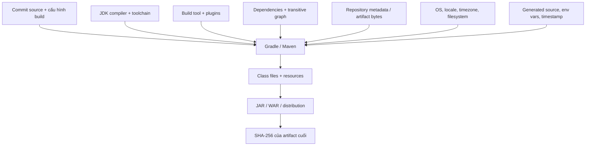
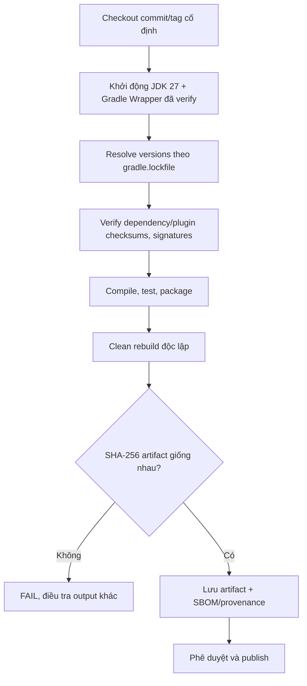

# Khóa phiên bản, xác minh artifact và tạo build tái lập

Trong một dự án **Java 27**, cùng một commit mã nguồn đôi khi lại tạo ra hai JAR khác nhau: máy của người phát triển dùng thư viện mới hơn máy CI, một dependency gián tiếp (*transitive dependency*) thay đổi, plugin tự nâng version, hoặc file JAR chứa thời gian đóng gói khác nhau. Khi đó khó tái hiện lỗi, khó xác nhận artifact phát hành thực sự được tạo từ source đã duyệt, và khó điều tra sự cố chuỗi cung ứng (*software supply chain*).

Ba biện pháp nền tảng cần kết hợp là:

1. **Khóa phiên bản** (*version pinning/locking*): xác định chính xác phiên bản công cụ và các dependency được giải quyết.
2. **Xác minh artifact** (*artifact verification*): kiểm tra byte của JAR, plugin hoặc bản phân phối công cụ khớp với checksum/chữ ký đã được tin cậy.
3. **Build tái lập** (*reproducible build*): với cùng source, môi trường và chỉ dẫn build đã xác định, tạo ra artifact có **byte giống nhau**, không chỉ chạy được như nhau.

Trong Java 27, cả **Gradle** và **Maven** đều cung cấp cơ chế để tiếp cận mục tiêu này, nhưng chúng **không có cùng mô hình lockfile và verification**. Bài học thuộc chương **Build và quản lý phụ thuộc** tập trung vào cấu hình hiện hành, quy trình nâng phiên bản có kiểm soát và kiểm chứng bằng kết quả thực tế. Không dựa trên những cách làm đã lỗi thời như chọn “latest” khi release hoặc lưu trữ artifact có cùng version nhưng thay đổi nội dung.

## 1. Phân biệt ba lớp bảo đảm

Giả sử mã nguồn khai báo thư viện `example:codec:1.4.0`.

- **Pin version:** yêu cầu một release `1.4.0` thay vì `1.+`.
- **Lock dependency graph:** ghi lại rằng khi giải quyết phụ thuộc, `codec` sử dụng thêm `example:core:2.1.7` và các phiên bản cụ thể khác.
- **Verify checksum:** kiểm tra file `codec-1.4.0.jar` được tải có SHA-256 bằng giá trị đã phê duyệt.
- **Reproducible output:** hai môi trường độc lập tạo ra `app.jar` có cùng byte khi dùng cùng source và các đầu vào đã cố định.

| Câu hỏi | Pin/lock version | Verify artifact | Reproducible output |
|---|---|---|---|
| Hôm nay và tuần sau chọn cùng module version? | Có, nếu áp dụng đầy đủ | Không phải mục đích chính | Cần như một tiền đề |
| Cùng version nhưng JAR bị thay đổi byte có bị phát hiện? | **Không nhất thiết** | Có, nếu checksum/chữ ký được tin cậy và bao phủ artifact | Có thể phát hiện đầu ra khác, nhưng chưa chỉ rõ nguyên nhân |
| Build có nhúng timestamp hiện tại thì sao? | Không xử lý | Vẫn có thể verify các dependency | Có thể không tái lập |
| Plugin và bản JDK khác nhau thì sao? | Cần khóa **cả toolchain/plugin** | Có thể xác minh plugin/distribution | Đầu ra có thể thay đổi |
| Hai JAR giống nhau có chứng minh mã an toàn? | Không | Không | **Không** |

**Khóa tên phiên bản không khóa byte.** Repository có thể phục vụ nội dung khác với cùng tọa độ `group:artifact:version` nếu có artifact bị ghi đè hoặc hạ tầng phân phối bị xâm nhập.

**Checksum không tự chứng minh nguồn gốc.** Một hash SHA-256 lấy từ cùng máy chủ bị kiểm soát với JAR chỉ chứng minh hai giá trị do máy chủ đó đưa ra khớp nhau. Hash kỳ vọng cần đến từ **nguồn tin cậy độc lập**, hoặc đã được kiểm duyệt và lưu trong repository nội bộ.

**Bit-for-bit reproducibility không tự chứng minh an toàn.** Nó giúp người khác tái tạo và đối chiếu kết quả, nhưng mã nguồn độc hại cũng có thể tạo đầu ra tái lập.

## 2. Những nguồn làm build thay đổi theo thời gian

Một bản build thực tế nhận nhiều đầu vào hơn source:



Ví dụ những đầu vào gây thay đổi:

| Nguồn | Vấn đề thường gặp | Biện pháp |
|---|---|---|
| Phiên bản JDK | Compiler/runtime khác nhau | Pin toolchain JDK 27 và distribution được chấp nhận |
| Phiên bản Gradle/Maven | Plugin lifecycle và cách đóng gói khác nhau | Dùng Wrapper với version cụ thể |
| Dependency trực tiếp | `latest.release`, `1.+` hoặc version range động | Version cố định và/hoặc dependency locking |
| Dependency gián tiếp | Xung đột hoặc phiên bản mới được chọn | Lock graph; Maven quản lý phiên bản/BOM và kiểm tra tree |
| Plugin | Version plugin không khai báo | Pin version của plugin hoặc parent build được kiểm soát |
| Artifact | Tọa độ giữ nguyên nhưng byte đổi | SHA-256/chữ ký và repository bất biến |
| Archive entries | Timestamp, thứ tự file, quyền truy cập | Reproducible archives |
| Sinh mã | Timestamp, UUID ngẫu nhiên, thứ tự hash map | Đầu vào có kiểm soát; sinh deterministic |
| Môi trường | Locale, timezone, đường dẫn máy, encoding | Chuẩn hóa hoặc loại bỏ khỏi output |
| CI | Pipeline tải script/thư viện mới tại build time | Pin action/tool/image/digest; giảm network inputs |

Nên xem việc tái lập build như một **hợp đồng giữa source, build tool, dependency graph, byte của đầu vào và môi trường tạo output**.

## 3. Dynamic version, changing module và dependency gián tiếp

### Dynamic version

Ví dụ Gradle:

```kotlin
dependencies {
    // Không nên dùng trong release build thiếu cơ chế lock:
    implementation("org.example:client:2.+")
    implementation("org.example:codec:latest.release")
}
```

Mỗi lần Gradle giải quyết dependency, kết quả có thể thay đổi nếu repository có release mới. Một version range trong Maven cũng có thể để resolver chọn phiên bản khác theo thời gian.

### Changing module: cùng tọa độ, nội dung thay đổi

Ví dụ:

```text
org.example:client:2.0-SNAPSHOT
```

Maven SNAPSHOT là một ví dụ phổ biến của **changing dependency**. Hôm nay và ngày mai cùng tọa độ nhưng artifact có thể được publish lại. **Gradle dependency locking không giải quyết vấn đề thay byte**: Gradle cũng cảnh báo không nên dùng locking như một giải pháp cho SNAPSHOT/changing modules.

Với release build, ưu tiên dependency có phiên bản phát hành bất biến và quá trình promotion được quản lý.

### Transitive dependency

```text
app
 ├── library-A:1.0
 │    └── core:2.1
 └── library-B:3.0
      └── core:2.2
```

Ứng dụng chỉ khai báo A và B nhưng runtime classpath còn phụ thuộc cách Maven/Gradle chọn phiên bản của `core`.

- Gradle có cơ chế *conflict resolution* và version constraints.
- Maven dùng dependency mediation, thường ưu tiên **nearest definition** và xử lý đồng cấp theo thứ tự khai báo.
- BOM hoặc dependency management giúp quản lý một bộ phiên bản nhưng cần hiểu cơ chế áp dụng.
- Một `gradle.lockfile` ghi lại các phiên bản **đã được giải quyết** cho các configuration được khóa.

Không kết luận `implementation("group:lib:1.0")` đã cố định toàn bộ cây dependency chỉ vì nó chứa một version cụ thể.

## 4. Khóa cả JDK 27 và công cụ build

Java 27 vừa là **mục tiêu biên dịch**, vừa có thể là **JDK chạy build tool**. Hai vai trò này khác nhau:

- **JDK chạy Gradle/Maven:** JVM khởi động quá trình build và các plugin.
- **JDK compiler/toolchain:** `javac` thực tế dùng để tạo class file.
- **Release target:** `--release 27` cho biết source/API/class-file target là Java 27.

Với Gradle, nên dùng **Java Toolchains**:

```kotlin
plugins {
    java
}

java {
    toolchain {
        languageVersion.set(JavaLanguageVersion.of(27))
    }
}

tasks.withType<JavaCompile>().configureEach {
    options.release.set(27)
    options.encoding = "UTF-8"
}
```

Đây là đoạn `build.gradle.kts` cho project dùng Java plugin; `JavaCompile` là task type của Gradle. Toolchain cho Gradle chọn JDK phù hợp; `options.release` khiến compiler nhắm tới API/class-file level của Java 27.

**Điều kiện phiên bản:** theo bảng tương thích hiện hành của Gradle, **Gradle 9.8.0 trở lên** hỗ trợ Java 27 khi chạy Gradle; vì vậy hãy pin một bản Gradle mới phù hợp (ví dụ trong nhánh 9.8+), không lấy một Gradle cũ chỉ vì máy đã cài JDK 27.

Java toolchain **không tự đảm bảo cùng vendor, patch level và file binary** trên mọi máy. Nếu yêu cầu byte-for-byte nghiêm ngặt, nên kiểm soát cả nguồn phân phối JDK, patch build, kiến trúc, image digest và compiler flags; có thể xác định vendor/implementation bằng toolchain configuration khi phù hợp.

Trong Maven 3, thường khai báo:

```xml
<properties>
  <maven.compiler.release>27</maven.compiler.release>
  <project.build.sourceEncoding>UTF-8</project.build.sourceEncoding>
</properties>
```

Maven phải gọi một compiler hỗ trợ target `27` hoặc có toolchain được cấu hình tương ứng. `--release 27` không thể làm một `javac` cũ tự hiểu các tính năng của JDK 27.

## 5. Pin Gradle Wrapper và xác minh bản phân phối

**Gradle Wrapper** gồm các script `gradlew`/`gradlew.bat`, `gradle/wrapper/gradle-wrapper.jar` và `gradle/wrapper/gradle-wrapper.properties`. Đưa chúng vào version control để local/CI dùng cùng Gradle distribution.

Ví dụ `gradle/wrapper/gradle-wrapper.properties`:

```properties
distributionUrl=https\://services.gradle.org/distributions/gradle-9.8.0-bin.zip
distributionSha256Sum=REPLACE_WITH_OFFICIAL_SHA256_OF_EXACT_ZIP
```

**Đây là mẫu cấu hình:** giá trị `REPLACE_WITH_OFFICIAL_SHA256_OF_EXACT_ZIP` bắt buộc phải thay bằng **64 ký tự hex thật** lấy từ trang checksum chính thức hoặc nguồn tin cậy. Không copy placeholder vào một build thật. Nếu dùng một phiên bản Gradle khác, cả URL lẫn checksum phải thay cùng nhau.

Các lưu ý quan trọng:

1. Dùng **version cố định**, không dùng `latest`, `nightly` hoặc alias trôi nổi trong build release.
2. `distributionSha256Sum` kiểm tra **ZIP distribution** do wrapper tải; cơ chế này chủ yếu có tác dụng khi distribution chưa được tải/kiểm tra vào cache.
3. **Wrapper JAR bản thân cũng là executable bootstrap code**. Cần kiểm tra checksum của `gradle-wrapper.jar` khi nâng cấp wrapper, không chỉ kiểm tra ZIP mà nó tải.
4. Kiểm tra thay đổi của `distributionUrl`, URL mirror, scripts và wrapper JAR trong code review.
5. Dùng nguồn checksum tin cậy **độc lập với artifact vừa tải**.

Ví dụ khởi động build từ wrapper:

```shell
./gradlew --version
./gradlew clean build
```

Trên Windows PowerShell, thường gọi `.\gradlew.bat --version` và `.\gradlew.bat clean build`.

**Chỉ pin URL chưa phải verify.** Nếu hạ tầng tải trả về ZIP bị thay đổi cùng URL, kiểm tra SHA-256 sẽ phát hiện khi hash kỳ vọng đã được xác lập đúng.

## 6. Gradle dependency locking: khóa cả transitive graph

Gradle cung cấp **dependency locking** hiện hành. Trong `build.gradle.kts`:

```kotlin
dependencyLocking {
    lockAllConfigurations()
}
```

Sau đó, từ project dùng Gradle Wrapper:

```shell
./gradlew dependencies --write-locks
```

Khi các **resolvable configurations** được giải quyết, Gradle ghi lại phiên bản đã chọn vào `gradle.lockfile` tương ứng với project. File này cần được **commit vào version control** cùng với build script.

Ví dụ minh họa một phần cấu trúc lockfile (không phải file đủ để dùng cho project):

```text
# Generated lock state, ví dụ minh họa.
org.slf4j:slf4j-api:2.0.17=compileClasspath,runtimeClasspath
empty=annotationProcessor
```

Từ thời điểm đó, Gradle kiểm tra trạng thái resolution của các configuration được khóa, thay vì tự chấp nhận một dependency graph mới mà không cập nhật lock state.

### Lock chỉ bao phủ những configuration thực sự được resolve

Lệnh `./gradlew dependencies --write-locks` chạy từ root của multi-project build có thể chỉ resolve các configuration thuộc project được chọn. Nó **không tự đảm bảo** mọi configuration trong tất cả subproject, task plugin, build logic và included builds đã được khóa.

Với multi-module project, cần kiểm tra đủ các configuration được dùng khi `compileJava`, `compileTestJava`, runtime và annotation processing; có thể chạy task build liên quan cùng `--write-locks` hoặc task resolve được thiết kế theo tài liệu Gradle.

`lockAllConfigurations()` là cấu hình cấp project. Nó **không đồng nghĩa** mọi plugin classpath hoặc buildscript classpath đã được khóa: khi cần, cấu hình riêng các classpath đó theo khả năng Gradle hỗ trợ. **Dependency verification** trong phần sau còn bao phủ artifact của plugin do hệ thống resolution quản lý.

### Strict lock mode cho CI

Sau khi tạo và review lockfile, có thể chọn:

```kotlin
dependencyLocking {
    lockAllConfigurations()
    lockMode = LockMode.STRICT
}
```

`LockMode.STRICT` khiến build thất bại nếu một configuration đã bật locking **không có lock state**, giúp phát hiện cấu hình mới chưa được ghi nhận. Khi khởi tạo lần đầu, sử dụng quá trình `--write-locks` chủ động trước khi yêu cầu CI xác nhận khóa đầy đủ.

### Cập nhật có chủ đích

```shell
# Cập nhật và ghi lại các lock state được resolve trong lần chạy.
./gradlew dependencies --write-locks

# Cho phép cập nhật một số module được chọn:
./gradlew dependencies --update-locks org.slf4j:slf4j-api
```

`--update-locks` có thể làm thay đổi thêm một số module do quy tắc giải quyết dependency, vì vậy **phải review toàn bộ diff** của lockfile. Đừng tự động chấp nhận mọi version mới mà không chạy test hoặc xem cảnh báo bảo mật.

**Lockfile không phải checksum file.** Nếu artifact ở tọa độ đã khóa thay đổi byte, phải dùng cơ chế **dependency verification** để kiểm soát tính toàn vẹn.

## 7. Version catalog khác dependency lockfile

Gradle cho phép tập trung các version qua `gradle/libs.versions.toml`:

```toml
[versions]
slf4j = "2.0.17"

[libraries]
slf4j-api = { module = "org.slf4j:slf4j-api", version.ref = "slf4j" }
```

Trong `build.gradle.kts`:

```kotlin
dependencies {
    implementation(libs.slf4j.api)
}
```

Version catalog cải thiện **khả năng đọc và tái sử dụng khai báo version**, nhưng không phải một cơ chế cưỡng chế version tuyệt đối. Gradle vẫn có thể chọn version khác do conflict resolution hoặc constraints.

Bảng phân biệt:

| Cơ chế Gradle | Vai trò |
|---|---|
| `libs.versions.toml` | Khai báo version tham chiếu và alias tập trung |
| `version { strictly("...") }` | Ràng buộc phiên bản chính xác hoặc khoảng chặt |
| `dependencyLocking` + `gradle.lockfile` | Ghi/kiểm tra version đã được resolve của graph |
| `gradle/verification-metadata.xml` | Kiểm tra checksum/chữ ký byte của artifact |
| Gradle Wrapper + checksum | Pin và kiểm tra ZIP của công cụ Gradle |
| Java toolchain | Chọn compiler/JDK phù hợp |

Không xem `version catalog` là giải pháp thay thế lockfile, và cũng không xem lockfile là giải pháp thay thế verification metadata.

## 8. Gradle dependency verification: SHA-256 và chữ ký PGP

Gradle hỗ trợ **dependency verification** qua file `gradle/verification-metadata.xml`. Cơ chế này có thể kiểm tra checksum và chữ ký cho dependency và plugin artifact mà Gradle giải quyết.

Khởi tạo metadata kiểm tra SHA-256, từ một môi trường có dependency được tin cậy và có thể review:

```shell
./gradlew --write-verification-metadata sha256 build
```

Hoặc tạo dữ liệu checksum **và** PGP signature khi có signature phù hợp:

```shell
./gradlew --write-verification-metadata sha256,pgp build
```

Metadata được tạo nằm tại:

```text
gradle/verification-metadata.xml
```

**Không cần tự phát minh checksum.** Gradle có thể lấy artifact và tính hash khi bootstrap, nhưng giá trị sinh ra khi đó chỉ phản ánh **byte đã tải**. Cần xem artifact đến từ nguồn nào, kiểm tra release, chữ ký/khóa đáng tin và review diff trước khi commit.

Khi verification metadata tồn tại, Gradle kiểm tra artifact trong các lần build tiếp theo. Ở chế độ **strict** (mặc định), việc không khớp checksum hoặc thiếu metadata phù hợp sẽ khiến build bị từ chối.

### Ví dụ cấu trúc XML — không phải hash thật

```xml
<verification-metadata
    xmlns="https://schema.gradle.org/dependency-verification">
  <configuration>
    <verify-metadata>true</verify-metadata>
    <verify-signatures>false</verify-signatures>
  </configuration>
  <components>
    <component group="org.example" name="codec" version="1.4.0">
      <artifact name="codec-1.4.0.jar">
        <!-- Giá trị thực tế phải là 64 ký tự hex đã được xác minh. -->
        <sha256 value="REPLACE_WITH_TRUSTED_64_HEX_CHECKSUM"/>
      </artifact>
    </component>
  </components>
</verification-metadata>
```

Đây là **mẫu giải thích cấu trúc**, không phải file có thể dùng nguyên xi. Hãy để Gradle tạo file metadata hợp lệ rồi review, không dán placeholder dưới dạng checksum thật.

### Checksum và PGP giải quyết hai câu hỏi khác nhau

- **SHA-256**: “Byte tải về có khớp một hash đã phê duyệt không?”
- **PGP signature**: “Artifact có chữ ký hợp lệ của một **khóa đã được tin cậy** không?”

Chữ ký không có ý nghĩa tin cậy nếu chỉ tải bất kỳ public key nào từ cùng nguồn không kiểm chứng rồi tin ngay. Cần xác nhận key fingerprint và nguồn khóa theo chính sách tổ chức.

Khi dependency không có signature, checksum được xác minh từ nguồn tin cậy vẫn hữu ích. Khi có cả signature và checksum, Gradle có thể sử dụng cả hai theo cấu hình nhưng việc tin cậy **đúng key** vẫn là quyết định quan trọng của người duyệt.

### Đừng tắt verification để “sửa CI”

```shell
# Ví dụ lệnh KHÔNG nên dùng làm giải pháp release lâu dài:
./gradlew build --dependency-verification=off
```

Nếu verification thất bại, trước tiên xác định nguyên nhân: dependency mới chưa được cập nhật metadata, repository phục vụ artifact khác, ký tự hash sai, phiên bản plugin mới, hoặc có sự cố supply chain. Chỉ cập nhật metadata sau khi **kiểm tra nguồn artifact** và được review.

`SNAPSHOT` và các changing dependency có thể thay nội dung theo thời gian, khiến checksum fail ngay cả khi version không đổi. Điều đó không làm verification “sai”: nó bộc lộ việc release đầu vào không bất biến. Release build nên tránh thay byte dưới cùng một tọa độ.

## 9. Mẫu Gradle Kotlin DSL cho dự án Java 27

Giả sử một project nhỏ có một dependency phát hành ổn định. Đây là cấu hình minh họa có thể dùng làm điểm khởi đầu khi đã cài Gradle Wrapper 9.8+ và JDK 27.

File `settings.gradle.kts`:

```kotlin
import org.gradle.api.initialization.resolve.RepositoriesMode

rootProject.name = "java27-reproducible-demo"

dependencyResolutionManagement {
    repositoriesMode = RepositoriesMode.FAIL_ON_PROJECT_REPOS
    repositories {
        mavenCentral()
    }
}
```

File `build.gradle.kts`:

```kotlin
plugins {
    java
}

group = "demo"
version = "1.0.0"

java {
    toolchain {
        languageVersion.set(JavaLanguageVersion.of(27))
    }
}

dependencies {
    implementation("org.slf4j:slf4j-api:2.0.17")
}

dependencyLocking {
    lockAllConfigurations()
}

tasks.withType<JavaCompile>().configureEach {
    options.release.set(27)
    options.encoding = "UTF-8"
}
```

Phiên bản `2.0.17` chỉ là một ví dụ **pin một release cụ thể**, không phải khuyến nghị về bản SLF4J mới nhất hoặc quy tắc cập nhật bảo mật. Trước khi triển khai thật, phải chọn version phù hợp dự án và kiểm tra advisories hiện hành.

Trong Gradle **9 trở lên**, các archive task chuẩn như JAR/ZIP/TAR **tái lập theo mặc định** về thứ tự file và timestamp trong archive. Nếu muốn thể hiện rõ chủ đích trong build logic hoặc hỗ trợ một Gradle phù hợp đã chọn, có thể cấu hình:

```kotlin
tasks.withType<org.gradle.api.tasks.bundling.AbstractArchiveTask>()
    .configureEach {
        isPreserveFileTimestamps = false
        isReproducibleFileOrder = true
    }
```

Các cờ trên không xóa mọi nguồn phi xác định: nếu một generated source nhúng `Instant.now()`, hai bản build vẫn có thể khác nhau. Ngoài ra, Gradle 9 có quy tắc cố định quyền file trong archive; khi phát hành trên nhiều hệ điều hành, cần kiểm tra các task packaging tùy chỉnh và metadata riêng.

Quy trình thiết lập lần đầu:

```shell
# 1. Xác minh Gradle/JDK thực tế (bằng Wrapper).
./gradlew --version

# 2. Tạo lock state của các cấu hình được resolve.
./gradlew build --write-locks

# 3. Khởi tạo verification metadata sau khi thẩm định nguồn.
./gradlew --write-verification-metadata sha256 build

# 4. Review rồi commit: build scripts, Wrapper, lockfile, verification XML.
# 5. Các lần CI bình thường không dùng --write-locks.
./gradlew clean build
```

Nếu project có subproject, test configurations hoặc plugin-specific configurations không được resolve ở bước 2/3, cần bổ sung bước bao phủ chúng. Không gọi quy trình hoàn chỉnh chỉ dựa trên một lệnh build nhỏ nếu thực tế còn các task release khác.

## 10. Maven: dependencyManagement, BOM và plugin versions

Maven xây dependency graph từ POM, parent POM, BOM, transitive dependencies và thuật toán mediation. Để giảm biến động:

- Khai báo **version cụ thể** cho dependency release, tránh version range động khi muốn reproducibility.
- Quản lý tập version qua **`dependencyManagement`** hoặc một BOM được pin version.
- Khóa **plugin versions** qua `build/plugins` hoặc `pluginManagement` của parent POM, không dựa vào giá trị mặc định có thể thay đổi theo phiên bản Maven.
- Dùng Maven Wrapper để cố định bản Maven mà local/CI khởi chạy.
- Kiểm tra resolved dependency tree và những phiên bản xung đột.

### dependencyManagement không tự thêm dependency

```xml
<dependencyManagement>
  <dependencies>
    <dependency>
      <groupId>org.slf4j</groupId>
      <artifactId>slf4j-api</artifactId>
      <version>2.0.17</version>
    </dependency>
  </dependencies>
</dependencyManagement>

<dependencies>
  <dependency>
    <groupId>org.slf4j</groupId>
    <artifactId>slf4j-api</artifactId>
  </dependency>
</dependencies>
```

`dependencyManagement` đưa ra phiên bản được quản lý nếu dependency có mặt trong graph. Nó **không tự tạo phụ thuộc** nếu không có khai báo/đường dẫn transitive đưa dependency vào graph.

### BOM

Một BOM là POM công bố một tập dependency versions có thể import:

```xml
<dependencyManagement>
  <dependencies>
    <dependency>
      <groupId>org.example</groupId>
      <artifactId>example-bom</artifactId>
      <version>4.2.0</version>
      <type>pom</type>
      <scope>import</scope>
    </dependency>
  </dependencies>
</dependencyManagement>
```

Các tọa độ `org.example:example-bom:4.2.0` **chỉ là placeholder kiến trúc**, không có cam kết artifact này tồn tại. Trong dự án thật, dùng BOM đã phát hành và được kiểm tra.

Maven BOM/version management **không tự là một lockfile chứa toàn bộ các phiên bản đã resolve** như `gradle.lockfile`. Khi cần snapshot của toàn bộ resolved graph trong quy trình release Maven, phải thêm bước kiểm tra/lưu dependency tree hoặc một giải pháp locking được tổ chức cho phép; không tự suy ra rằng import BOM đã đóng băng mọi dependency và plugin.

## 11. Ví dụ Maven 3 POM: pin compiler, plugin và output timestamp

Ví dụ dưới đây dành cho **Maven 3 hiện hành** với compiler từ JDK 27. Nó tập trung vào các plugin cần thiết và một dependency đơn giản, không khẳng định đã liệt kê **mọi** plugin lifecycle trong một dự án lớn.

```xml
<project xmlns="http://maven.apache.org/POM/4.0.0"
         xmlns:xsi="http://www.w3.org/2001/XMLSchema-instance"
         xsi:schemaLocation="
           http://maven.apache.org/POM/4.0.0
           https://maven.apache.org/xsd/maven-4.0.0.xsd">

  <modelVersion>4.0.0</modelVersion>
  <groupId>demo</groupId>
  <artifactId>java27-reproducible-demo</artifactId>
  <version>1.0.0</version>

  <properties>
    <maven.compiler.release>27</maven.compiler.release>
    <project.build.sourceEncoding>UTF-8</project.build.sourceEncoding>
    <project.reporting.outputEncoding>UTF-8</project.reporting.outputEncoding>

    <!-- Timestamp cố định; thay bằng giá trị đã thống nhất cho release. -->
    <project.build.outputTimestamp>2026-11-27T00:00:00Z</project.build.outputTimestamp>
  </properties>

  <dependencies>
    <dependency>
      <groupId>org.slf4j</groupId>
      <artifactId>slf4j-api</artifactId>
      <version>2.0.17</version>
    </dependency>
  </dependencies>

  <build>
    <plugins>
      <plugin>
        <groupId>org.apache.maven.plugins</groupId>
        <artifactId>maven-compiler-plugin</artifactId>
        <version>3.15.0</version>
      </plugin>
      <plugin>
        <groupId>org.apache.maven.plugins</groupId>
        <artifactId>maven-resources-plugin</artifactId>
        <version>3.5.0</version>
      </plugin>
      <plugin>
        <groupId>org.apache.maven.plugins</groupId>
        <artifactId>maven-jar-plugin</artifactId>
        <version>3.5.0</version>
      </plugin>
    </plugins>
  </build>
</project>
```

Các phiên bản plugin trong ví dụ là **phiên bản phát hành cụ thể được tài liệu Maven ghi nhận**; khi áp dụng cần kiểm tra compatibility với bản Maven dự án đang sử dụng. Một POM cho thư viện production còn phải xem các plugin test, source/javadoc, clean/install/deploy, assembly/shade và profile; phiên bản của chúng cũng là **đầu vào build**.

Cần lưu ý thêm một thay đổi hiện hành: theo hướng dẫn Maven, từ **Maven 3.10.0** và **Maven 4.0.0-beta-5**, chế độ reproducible build được bật mặc định ở mức Maven/plugin hỗ trợ. Dù vậy, khai báo `project.build.outputTimestamp` vẫn có ích khi muốn chốt **một timestamp release cụ thể**, và plugin không hỗ trợ reproducible output vẫn có thể làm JAR khác nhau.

Đối với một Maven 4 project sử dụng Compiler Plugin 4.x, mô hình cấu hình nguồn/target version có những thay đổi so với Maven 3/plugin 3.x. Không sao chép cấu hình của Maven 3 sang mọi Maven 4 project mà không kiểm tra documentation của phiên bản plugin và POM model đang dùng.

## 12. Maven Enforcer: chặn SNAPSHOT và version plugin trôi nổi

**Maven Enforcer Plugin** cho phép áp dụng các quy tắc build consistency, ví dụ:

- `requireReleaseDeps`: từ chối dependency SNAPSHOT trong phạm vi cấu hình.
- `requirePluginVersions`: yêu cầu plugin version được khai báo, với các option kiểm tra lifecycle plugin.
- `dependencyConvergence`: phát hiện nhiều đường phụ thuộc yêu cầu các version khác nhau của cùng module.
- `requireJavaVersion` và `requireMavenVersion`: kiểm tra toolchain/runtime theo chính sách dự án.

Ví dụ cấu hình một execution thực thi trong pha `validate`:

```xml
<plugin>
  <groupId>org.apache.maven.plugins</groupId>
  <artifactId>maven-enforcer-plugin</artifactId>
  <version>3.6.3</version>
  <executions>
    <execution>
      <id>dependency-policy</id>
      <goals>
        <goal>enforce</goal>
      </goals>
      <configuration>
        <rules>
          <requireReleaseDeps>
            <onlyWhenRelease>true</onlyWhenRelease>
          </requireReleaseDeps>
          <dependencyConvergence/>
        </rules>
      </configuration>
    </execution>
  </executions>
</plugin>
```

Đoạn trên là **plugin fragment**, đặt trong `build/plugins` của POM thích hợp. `onlyWhenRelease=true` nghĩa là rule SNAPSHOT chỉ được kiểm tra khi project đang có version release không kết thúc bằng `-SNAPSHOT`; nếu yêu cầu không dùng snapshot ở **mọi** build, chọn policy khác.

Muốn nghiêm ngặt với version plugin, thêm `requirePluginVersions` và pin các plugin lifecycle theo yêu cầu rule. Nếu bật rule nhưng thiếu version của `clean`, `test`, `deploy`, `site` hoặc plugin khác mà lifecycle đang dùng, build có thể **thất bại có chủ đích**. Đó là cơ hội để hoàn thiện version management, không phải lý do tắt rule không kiểm soát.

**Quan trọng:** `dependencyConvergence` kiểm tra **sự hội tụ version theo dependency graph**, không xác minh SHA-256 hay chứng minh không có lỗ hổng bảo mật. Dependency tree chỉ có một selected version không đồng nghĩa mọi thư viện đều tương thích về mặt hành vi.

## 13. Maven Wrapper và kiểm tra bản Maven được tải

Maven Wrapper cung cấp các script `mvnw` và `mvnw.cmd` để sử dụng một Maven distribution đã chọn, thay vì phụ thuộc vào lệnh `mvn` cài sẵn trên máy.

File `.mvn/wrapper/maven-wrapper.properties` có thể chứa:

```properties
distributionUrl=https://repo.maven.apache.org/maven2/org/apache/maven/apache-maven/3.10.2/apache-maven-3.10.2-bin.zip
distributionSha256Sum=REPLACE_WITH_TRUSTED_MAVEN_DISTRIBUTION_SHA256
```

URL và version ở trên **minh họa cấu hình pin**, cần kiểm tra sự tồn tại/nguồn tải của bản Maven được chọn trước khi sử dụng. Giá trị `distributionSha256Sum` là placeholder, phải thay bằng hash thật được kiểm tra độc lập.

Tùy loại wrapper sử dụng, có thể có `maven-wrapper.jar`. Maven Wrapper hỗ trợ thêm thuộc tính `wrapperSha256Sum` để kiểm tra JAR bootstrap này khi cơ chế wrapper có sử dụng nó. Những bản wrapper kiểu `only-script` không dùng `maven-wrapper.jar`; không nên thêm cấu hình JAR vào project nếu loại wrapper đó không có JAR.

Kiểm tra phiên bản thực tế bằng:

```shell
./mvnw -version
./mvnw -B -ntp clean verify
```

Trên Windows dùng `mvnw.cmd` tương ứng.

Vẫn phải xác nhận Java trong output `./mvnw -version`: **Maven Wrapper pin Maven, không tự pin chính xác bản JDK**. Java version và JDK compiler cần được kiểm soát bằng image/toolchain/quy trình CI.

## 14. Kiểm tra cây dependency Maven sau khi resolve

Trong Maven, xem graph thực tế:

```shell
./mvnw dependency:tree
```

Nếu cần bản ghi máy đọc được, Maven Dependency Plugin hiện hành có thể xuất JSON:

```shell
./mvnw org.apache.maven.plugins:maven-dependency-plugin:3.11.0:tree \
  -DoutputType=json \
  -DoutputFile=target/dependency-tree.json
```

Lệnh trên dùng **goal được chỉ định version cụ thể** để tránh phụ thuộc vào việc Maven tự chọn version plugin cho prefix `dependency:tree`.

Một bản dependency tree cần được đọc ở cả **compile**, **runtime** và **test** phù hợp; khi xây nhiều module, các graph của từng module có thể khác nhau. Không giả định việc `pom.xml` chỉ liệt kê 5 dependency nghĩa là runtime chỉ dùng đúng 5 JAR.

### Ví dụ conflict

```text
app
 ├── payment-client:1.2
 │    └── core-utils:2.1
 └── report-client:3.0
      └── core-utils:2.3
```

Maven có thể chọn một version theo dependency mediation; Enforcer `dependencyConvergence` giúp báo graph không hội tụ, ngay cả nếu build vẫn có thể tạo class file.

Hướng sửa không phải tùy tiện thêm `exclusions` cho “hết đỏ”; cần xác định version được cả hai thư viện chấp nhận, ưu tiên dependencyManagement/BOM hoặc nâng phiên bản các dependency và chạy integration tests.

### Kiểm tra effective POM

```shell
./mvnw help:effective-pom
```

Effective POM phản ánh các giá trị sau inheritance, pluginManagement, profile được kích hoạt và một phần cấu hình Maven. Khi điều tra “tại sao máy CI chọn plugin/version này”, effective POM có ích nhưng không thay thế dependency tree của các artifact đã được resolve.

## 15. Reproducible archive: timestamp, thứ tự và quyền file

Một JAR là một archive ZIP. Ngay cả khi `.class` giống nhau, JAR vẫn có thể khác hash vì:

- Timestamp của từng entry.
- Thứ tự entry trong ZIP.
- Quyền file/metadata từ hệ điều hành.
- Nội dung `MANIFEST.MF`.
- Build timestamp chèn vào `build-info.properties`.
- Tài nguyên sinh có thời gian hiện tại hoặc UUID ngẫu nhiên.
- Source JAR/Javadoc JAR được sinh với plugin khác nhau.

### Gradle 9+

Theo tài liệu Gradle hiện hành, các `AbstractArchiveTask` như `Jar` và `Zip` tạo archive có thứ tự ổn định, timestamp cố định và quyền file chuẩn **theo mặc định từ Gradle 9**. Với custom archive task, cần bảo đảm không bật lại hành vi lấy timestamp/thứ tự/permission từ filesystem.

Nếu có nguồn thời gian chính thức cho release, có thể sử dụng `SOURCE_DATE_EPOCH` như một **đầu vào đã được ghi nhận** thay vì đọc clock tại build time; việc áp dụng cho từng task phải tương thích phiên bản Gradle và định dạng archive.

### Maven

Maven có chế độ reproducible output theo khả năng của từng plugin. Với plugin hỗ trợ, property sau thường là một đầu vào quan trọng:

```xml
<properties>
  <project.build.outputTimestamp>2026-11-27T00:00:00Z</project.build.outputTimestamp>
</properties>
```

Không dùng:

```java
String buildStamp = java.time.Instant.now().toString();
```

để sinh nội dung file đóng gói mỗi lần build nếu mục tiêu là byte-for-byte reproducibility. Khi cần phiên bản build, hãy dùng giá trị xác định từ commit/release metadata đã được pin, hoặc tách dữ liệu runtime khỏi artifact.

### Khác biệt giữa tái lập và caching

**Build cache** giúp tái sử dụng output đã tính từ các task inputs được cache nhận diện. **Reproducibility** yêu cầu hai lần build độc lập cho cùng đầu vào tạo **cùng byte**. Một cache hit không chứng minh generator có tính deterministic; nó có thể chỉ trả lại một output cũ. Khi kiểm chứng reproducibility, nên thực hiện hai **clean builds thực sự**, kiểm soát/loại bỏ ảnh hưởng cache theo phương pháp đã chọn.

## 16. Artifact integrity và trust: checksum, chữ ký, provenance

### SHA-256

SHA-256 chuyển nội dung file thành chuỗi hash 256-bit. Nếu byte của file thay đổi, gần như chắc chắn hash sẽ khác.

Ví dụ trên Linux/macOS:

```shell
sha256sum build/libs/app.jar
```

Trên Windows PowerShell:

```powershell
Get-FileHash -Algorithm SHA256 -Path .\build\libs\app.jar
```

Hai bản build có cùng hash khi được tính từ toàn bộ byte của đúng file. Nhưng hãy phân biệt:

- **So sánh hai artifact:** kiểm tra tái lập/khác biệt.
- **So với hash kỳ vọng được phê duyệt:** kiểm tra tính toàn vẹn theo một nguồn tin cậy.
- **Xác nhận ai phát hành:** cần cơ chế chữ ký/xuất xứ đáng tin, không chỉ hash.

### Chữ ký số

Nếu một maintainer ký artifact bằng khóa riêng, người dùng có thể xác minh chữ ký bằng public key tin cậy. Nhưng phải có quá trình **xác minh fingerprint/nguồn khóa**, quy tắc thu hồi và quản trị thay khóa. Tin một khóa chưa được xác thực cũng có thể làm giảm ý nghĩa của việc xác minh.

### Provenance và SBOM

- **Provenance / attestation:** mô tả artifact được tạo bởi build system nào, từ source commit nào, với policy và input nào; khi có chữ ký/identity đúng cách, giúp tăng khả năng kiểm toán.
- **SBOM** (ví dụ SPDX hoặc CycloneDX): liệt kê các thành phần phần mềm/dependency được công bố, hữu ích cho phân tích lỗ hổng và giấy phép.

SBOM không phải dependency lockfile, và một SBOM đầy đủ cũng không bảo đảm các JAR chưa bị sửa byte. Cần kết hợp các lớp bảo vệ theo yêu cầu chuỗi cung ứng của tổ chức.

## 17. Ví dụ Java 27: xác minh một JAR bằng SHA-256

Đây là chương trình Java dùng **API chuẩn** để đọc từng khối byte của artifact và so sánh SHA-256 với hash đã được phê duyệt từ nguồn tin cậy. Nó **không thay thế** Gradle/Maven dependency verification, nhưng giúp hiểu chính xác “xác minh artifact” làm gì.

Lưu thành `ArtifactSha256Verifier.java`:

```java
import java.io.IOException;
import java.io.InputStream;
import java.nio.file.Files;
import java.nio.file.Path;
import java.security.MessageDigest;
import java.security.NoSuchAlgorithmException;
import java.util.HexFormat;
import java.util.Locale;

public final class ArtifactSha256Verifier {

    private ArtifactSha256Verifier() {}

    static byte[] sha256(Path file)
            throws IOException, NoSuchAlgorithmException {

        MessageDigest digest = MessageDigest.getInstance("SHA-256");

        try (InputStream input = Files.newInputStream(file)) {
            byte[] buffer = new byte[8192];
            int count;

            while ((count = input.read(buffer)) != -1) {
                if (count > 0) {
                    digest.update(buffer, 0, count);
                }
            }
        }

        return digest.digest();
    }

    public static void main(String[] args) throws Exception {
        if (args.length != 2) {
            throw new IllegalArgumentException(
                "Cách dùng: java ArtifactSha256Verifier "
                    + "<artifact-path> <trusted-sha256-hex>"
            );
        }

        Path artifact = Path.of(args[0]);
        String expectedHex = args[1].toLowerCase(Locale.ROOT);

        if (!expectedHex.matches("[0-9a-f]{64}")) {
            throw new IllegalArgumentException(
                "SHA-256 phải gồm đúng 64 ký tự hex"
            );
        }

        byte[] actualDigest = sha256(artifact);
        byte[] expectedDigest = HexFormat.of().parseHex(expectedHex);

        if (!MessageDigest.isEqual(actualDigest, expectedDigest)) {
            System.err.println(
                "FAIL: SHA-256 không khớp cho " + artifact
            );
            System.err.println(
                "Actual: " + HexFormat.of().formatHex(actualDigest)
            );
            System.exit(2);
        }

        System.out.println("PASS: artifact khớp SHA-256 đã phê duyệt");
    }
}
```

Biên dịch và chạy:

```shell
javac --release 27 ArtifactSha256Verifier.java

# TRUSTED_SHA256_HEX là hash 64 ký tự từ nguồn độc lập đã duyệt.
java ArtifactSha256Verifier path/to/library.jar TRUSTED_SHA256_HEX
```

Cần thay `TRUSTED_SHA256_HEX` bằng hash thật; nếu giữ nguyên placeholder, chương trình sẽ từ chối vì định dạng sai. Không đưa một hash giả vào tài liệu như thể đã xác minh thành công một artifact có thật.

Ví dụ sử dụng `Files.newInputStream` để xử lý dữ liệu theo luồng, `MessageDigest` để tính SHA-256, `HexFormat` để chuyển đổi chuỗi hex và `MessageDigest.isEqual` để so sánh digest. Trên môi trường CI, một lần verify fail phải làm **job thất bại**, không chỉ in cảnh báo rồi tiếp tục publish.

## 18. Quy trình CI/CD đề xuất: Gradle

Một pipeline Gradle phục vụ Java 27 có thể đi theo các bước:



### Lúc cập nhật dependencies

1. Tạo nhánh/PR riêng cho nâng phiên bản.
2. Cập nhật khai báo dependency, plugin hoặc Gradle Wrapper **có chủ đích**.
3. Chạy `--update-locks`/`--write-locks` để tạo lock state mới.
4. Sinh/điều chỉnh `verification-metadata.xml` sau khi **thẩm định artifact mới**.
5. Review diff của version catalog, lockfile, verification metadata và wrapper.
6. Chạy tests, kiểm thử tương thích, kiểm tra lỗ hổng/giấy phép theo policy.
7. Merge khi có phê duyệt, rồi release bằng CI từ commit xác định.

### Lúc build phát hành bình thường

```shell
./gradlew --version
./gradlew clean build
```

**Không** gọi `--write-locks` hoặc `--write-verification-metadata` trong đường CI release bình thường. Các cờ ghi này nhằm **chủ động cập nhật trạng thái kiểm soát**, không phải làm sao để mọi build luôn vượt qua verification.

Để kiểm tra tính tái lập nghiêm ngặt, chạy **hai bản build sạch** trong môi trường đã ghi nhận và không để một build tự dùng lại đầu ra của build kia, sau đó so sánh hash. Muốn kiểm chứng giữa hai bên độc lập, cần thêm một môi trường/builder khác nhưng có cùng input/toolchain.

## 19. Quy trình CI/CD đề xuất: Maven

Với Maven:

1. Pin Maven Wrapper, JDK 27 và tất cả plugin release quan trọng.
2. Quản lý dependency versions trong POM/BOM, tránh SNAPSHOT/changing artifact khi phát hành.
3. Kiểm tra dependency tree thực tế và quy tắc Enforcer.
4. Dùng plugin đóng gói hỗ trợ reproducible output; cấu hình timestamp xác định.
5. Build/test; kiểm tra output JAR và các artifact phụ.
6. So sánh các build độc lập; lưu hash và thông tin môi trường.
7. Chỉ phát hành artifact qua kênh được phê duyệt sau khi tất cả bước PASS.

Các lệnh minh họa:

```shell
./mvnw -version
./mvnw -B -ntp clean verify
./mvnw -B -ntp dependency:tree
```

Theo tài liệu Maven Reproducible Builds, để kiểm tra local nhanh có thể:

```shell
./mvnw clean install
./mvnw clean verify \
  org.apache.maven.plugins:maven-artifact-plugin:3.7.0:compare
```

Đây là **smoke test** so sánh với artifact đã được install ở môi trường hiện tại; nó **chưa chứng minh** một bên thứ ba có thể tạo artifact giống hệt trên máy khác. Đối với một release cần bằng chứng mạnh, nên kiểm chứng bằng builder độc lập và toolchain/source được pin.

Lưu ý: nếu chọn một Maven Compiler Plugin hay Maven Artifact Plugin version khác, phải xác minh version đó tồn tại và tương thích với Maven/JDK của môi trường. Trong bản build chính thức, nên đưa các plugin được dùng nhiều lần vào phần `pluginManagement` hoặc cấu hình đã pin để cả local và CI dùng cùng version.

## 20. Xử lý tình huống thực tế

### Tình huống A — Cùng version nhưng dependency checksum khác

Thông báo verification báo:

```text
Expected SHA-256 != actual SHA-256
```

Không nên tự cập nhật XML cho khớp “để build xanh”. Hãy kiểm tra:

- Đang tải đúng artifact, classifier và repository không?
- Repository có bị ghi đè artifact hoặc mirror trả byte khác không?
- Version có phải SNAPSHOT/changing không?
- Hash kỳ vọng có thực sự được thẩm định từ nguồn tin cậy không?
- Có sự kiện bảo mật, republish hoặc sai lệch cache không?

Nếu không giải thích và xác minh được khác biệt, **không release** artifact đó.

### Tình huống B — Lockfile bị thay đổi sau khi cập nhật một thư viện

Có thể có các phiên bản transitive thay đổi do conflict resolution. Review **toàn bộ diff**, chạy kiểm thử và kiểm tra giấy phép/lỗ hổng; không chỉ nhìn tên dependency trực tiếp vừa nâng.

### Tình huống C — JAR khác hash nhưng bytecode giống nhau

Kiểm tra ZIP entry timestamps, thứ tự file, permissions, manifest và generated resources. Dùng công cụ diff archive hoặc `diffoscope` nếu cần. Có thể cấu hình deterministic archive và nguồn timestamp cố định, nhưng phải xác minh bằng rebuild.

### Tình huống D — Local PASS, CI FAIL do compiler

Kiểm tra `java -version`, `./gradlew --version` hoặc `./mvnw -version`, toolchain JDK được chọn, repository và environment. `--release 27` không tự cài JDK 27 hay sửa plugin không hỗ trợ release đó.

### Tình huống E — Test thất bại ngẫu nhiên nhưng JAR khớp hash

Artifact reproducibility không đồng nghĩa tests deterministic. Điều tra race conditions, thời gian hệ thống, môi trường mạng, dữ liệu test, random seed và thứ tự chạy test. Cần ổn định pipeline **cả kiểm thử lẫn packaging**.

### Tình huống F — Wrapper bị thay đổi trong PR

Xem `gradle-wrapper.jar`, scripts, distribution URL, checksum, hoặc `.mvn/wrapper` theo loại wrapper. Đây là **mã bootstrap có khả năng thực thi trước khi dependency verification của dự án chạy**, nên cần review như một thay đổi nhạy cảm về supply chain.

## 21. Checklist cho một release build đáng tin cậy

| Hạng mục | Điều kiện nên có |
|---|---|
| Source | Tag/commit xác định; không lấy mã từ nhánh trôi nổi trong release job |
| Java | JDK 27 được kiểm soát version, vendor/build khi cần |
| Build tool | Gradle/Maven Wrapper với distribution version cố định |
| Wrapper trust | Checksum ZIP/Wrapper JAR được xác minh theo cơ chế phù hợp |
| Plugin | Plugin versions đã pin, không `latest` hay plugin snapshot ngoài chính sách |
| Direct dependencies | Release versions cụ thể và đã được review |
| Transitive dependencies | Lock state/graph review; BOM/constraints/Enforcer phù hợp |
| Artifact bytes | SHA-256/chữ ký được kiểm tra từ nguồn tin cậy |
| Repository | URL/mirror có kiểm soát, artifact release không bị ghi đè |
| Generated code | Không nhúng dữ liệu thời gian/ngẫu nhiên/đường dẫn máy không kiểm soát |
| Archive | Thứ tự, timestamp, permissions và manifest ổn định |
| Encoding/locale | UTF-8 và môi trường được cố định hoặc loại khỏi đầu ra |
| Tests | Tự động, có giới hạn thời gian, dữ liệu thử nghiệm kiểm soát |
| CI | Clean build từ commit cố định; không cập nhật lock/verification tự động |
| Reproducibility | So sánh hash qua các build độc lập và giữ log |
| Release evidence | Lưu source revision, JDK, tool version, lockfile, checksums, SBOM/provenance khi cần |
| Review | Phê duyệt mọi thay đổi đến dependency/plugin/Wrapper |

Checklist là điểm khởi đầu. Một ứng dụng chạy ở môi trường quản trị chặt chẽ có thể cần thêm policy về dependency vulnerability, code signing, provenance đã ký, image digest và quyền phát hành.

## 22. Bài tập thực hành

### Bài 1 — Lock vs verification

Giải thích tại sao `gradle.lockfile` ghi `example:codec:1.4.0` không đủ để phát hiện một JAR bị thay byte. Cần thêm cơ chế gì?

### Bài 2 — Version catalog

Project dùng `libs.versions.toml` với `slf4j = "2.0.17"`. Có thể kết luận Gradle chắc chắn sẽ resolve `slf4j-api:2.0.17` trong mọi configuration không? Vì sao?

### Bài 3 — Gradle CI

Viết các bước tạo `gradle.lockfile` và `gradle/verification-metadata.xml` lúc khởi tạo. Trong CI release bình thường nên chạy với hay không với `--write-locks`?

### Bài 4 — Maven BOM

Một `dependencyManagement` khai báo `core:3.2.0` nhưng không có dependency nào tham chiếu tới `core`. `core` có tự được tải vào ứng dụng không? BOM có đồng nghĩa lock tất cả transitive versions không?

### Bài 5 — Wrapper

Wrapper cấu hình Gradle version cố định nhưng không có `distributionSha256Sum`. Rủi ro nào còn tồn tại? Checksum phải được lấy từ đâu?

### Bài 6 — Reproducibility

Cùng commit/JDK/dependencies nhưng hash JAR khác nhau mỗi lần build; bên trong file có `build.properties` ghi `builtAt=Instant.now()`. Cần thay đổi thế nào?

### Bài 7 — Java toolchain

Một bản Gradle cũ không hỗ trợ chạy trên Java 27. Chỉ thêm `options.release = 27` có đủ không? Cần kiểm tra những lớp phiên bản nào?

### Bài 8 — Maven Enforcer

Phân biệt `requireReleaseDeps`, `requirePluginVersions`, `dependencyConvergence`. Quy tắc nào kiểm tra cryptographic SHA-256 của JAR?

### Bài 9 — Hai bản build

Hai builder tạo `app.jar` cùng SHA-256. Điều này chứng minh gì? Những kết luận nào **chưa** thể rút ra?

### Bài 10 — Triaging CI

Sau khi nâng một dependency, dependency verification báo checksum mismatch. Đội phát triển đề nghị dùng `--dependency-verification=off` trong release. Hãy mô tả một hướng xử lý an toàn hơn.

### Đáp án gợi ý

1. Lock giữ **module version được resolve**, không giữ byte. Dùng Gradle verification metadata với SHA-256/chữ ký hoặc cơ chế tương đương.
2. Không. Catalog khai báo version yêu cầu, conflict resolution/constraints có thể chọn version khác; cần strict constraint hoặc lock state phù hợp.
3. Tạo lock qua `--write-locks`; sinh verification metadata qua `--write-verification-metadata sha256` sau kiểm tra nguồn; commit và review. CI release bình thường **không** ghi lại lock/verification.
4. Không. `dependencyManagement` quản lý version khi dependency xuất hiện; BOM không tự tạo artifact và không phải lockfile toàn graph.
5. ZIP tải về có thể bị thay byte dù URL giữ nguyên. Hash kỳ vọng phải được xác minh qua nguồn chính thức/tin cậy độc lập.
6. Bỏ clock khỏi output hoặc thay bằng timestamp release/commit **cố định**; sau đó clean rebuild và so sánh byte.
7. Không. Phải kiểm tra Gradle Wrapper, JDK chạy Gradle, compiler toolchain và plugin compatibility; Java 27 yêu cầu phiên bản Gradle hỗ trợ.
8. SNAPSHOT, plugin version và conflict graph tương ứng. **Không** quy tắc nào trong ba quy tắc đó thay thế checksum/signature verification.
9. Chứng minh byte của hai artifact được so sánh giống nhau (trong giả định hash đáng tin và đúng file). Không tự chứng minh mã an toàn, source đáng tin hoặc bản phát hành đã được ký đúng người.
10. Dừng việc release, kiểm tra artifact source, version, mirror và hash/chữ ký; review thay đổi trong verification metadata nếu nâng cấp hợp lệ; không tắt bảo vệ để qua pipeline.

## 23. Tổng kết

Một **build Java 27 đáng tin** phải kiểm soát **version**, **byte đầu vào** và **cách tạo byte đầu ra**. Gradle có dependency locking và dependency verification; Maven dùng pin version, `dependencyManagement`/BOM, plugin management, Enforcer và các cơ chế reproducible build tương ứng. Cả hai nên dùng Wrapper đã được kiểm tra và compiler JDK 27 được quản lý.

Quy tắc dễ nhớ:

- **Pin/lock version** giúp build dùng một dependency graph dự kiến.
- **Verify checksum/chữ ký** giúp phát hiện artifact bị thay đổi hoặc không phù hợp chính sách trust.
- **Reproducible packaging** giúp tạo binary có thể đối chiếu độc lập từ source.
- **CI và review** bảo đảm quy trình không tự cập nhật lại đầu vào đã được phê duyệt mỗi lần chạy.
- **Số liệu và kiểm chứng thực tế** là điều kiện để khẳng định một bản phát hành có thể tái lập, không chỉ vì POM hoặc Gradle script trông đúng.

Đừng chọn một trong ba biện pháp rồi coi như đã đủ. Khi chúng được thiết kế cùng nhau, đội phát triển có thể điều tra build khác biệt, nâng cấp dependency có kiểm soát và tăng tính minh bạch của chuỗi cung ứng phần mềm.

## Tài liệu tham khảo

- [Gradle — Compatibility Matrix](https://docs.gradle.org/current/userguide/compatibility.html): hỗ trợ Java 27 từ Gradle 9.8.0.
- [Gradle — Locking Versions](https://docs.gradle.org/current/userguide/dependency_locking.html): `lockAllConfigurations`, `gradle.lockfile`, `--write-locks`, `--update-locks`, strict mode.
- [Gradle — Securing Dependencies / Dependency Verification](https://docs.gradle.org/current/userguide/dependency_verification.html): SHA-256, PGP, verification metadata, bootstrap và trust.
- [Gradle — Gradle Wrapper](https://docs.gradle.org/current/userguide/gradle_wrapper.html): pin Gradle distribution và `distributionSha256Sum`.
- [Gradle — Security Best Practices](https://docs.gradle.org/current/userguide/best_practices_security.html): review Wrapper JAR, distribution checksum và bảo vệ build.
- [Gradle — Working With Files / Reproducible Archives](https://docs.gradle.org/current/userguide/working_with_files.html#sec:reproducible_archives): archive deterministic theo mặc định từ Gradle 9.
- [Gradle — Version Catalogs](https://docs.gradle.org/current/userguide/version_catalogs.html): version catalog không phải lockfile.
- [Gradle — Declaring Versions](https://docs.gradle.org/current/userguide/dependency_versions.html): `strictly`, `require`, `prefer` và dynamic versions.
- [Maven — Configuring for Reproducible Builds](https://maven.apache.org/guides/mini/guide-reproducible-builds.html): `project.build.outputTimestamp`, so sánh artifact và hướng dẫn plugin.
- [Maven — Introduction to Dependency Mechanism](https://maven.apache.org/guides/introduction/introduction-to-dependency-mechanism.html): transitive dependencies, mediation, dependencyManagement và BOM.
- [Maven — Enforcer / Require Release Dependencies](https://maven.apache.org/enforcer/enforcer-rules/requireReleaseDeps.html): phát hiện snapshot dependencies.
- [Maven — Enforcer / Require Plugin Versions](https://maven.apache.org/enforcer/enforcer-rules/requirePluginVersions.html): yêu cầu pin version plugin.
- [Maven — Enforcer / Dependency Convergence](https://maven.apache.org/enforcer/enforcer-rules/dependencyConvergence.html): phát hiện dependency graph có nhiều version đối nghịch.
- [Maven — Maven Wrapper](https://maven.apache.org/tools/wrapper/): kiểm soát Maven distribution, `distributionSha256Sum` và `wrapperSha256Sum`.
- [Maven — Dependency Plugin / dependency:tree](https://maven.apache.org/plugins/maven-dependency-plugin/tree-mojo.html): resolved graph và các dạng output.
- [Maven Compiler Plugin — Setting --release](https://maven.apache.org/plugins/maven-compiler-plugin-4.x/examples/set-compiler-release.html): khác biệt Maven 3/4 về target release.
- [Reproducible Builds](https://reproducible-builds.org/): định nghĩa, nguyên tắc và kỹ thuật tái lập binary.
