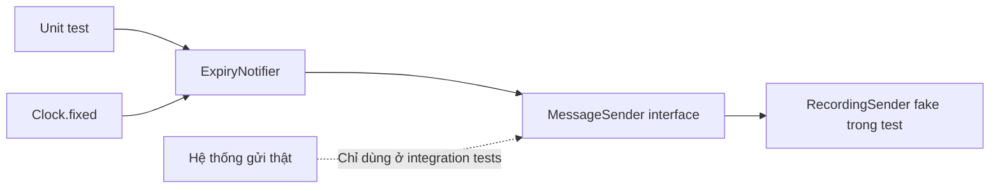

# Thiết kế unit test cho hợp đồng và hành vi quan sát được

Một unit test tốt không cố chứng minh rằng mã nguồn có đúng số lượng vòng lặp, gọi chính xác một helper private hay sử dụng một cấu trúc dữ liệu cụ thể. Thay vào đó, nó kiểm tra: **khi đưa vào điều kiện đầu vào đã xác định, đơn vị được kiểm thử có thực hiện đúng hợp đồng mà người sử dụng có thể quan sát hay không?**

Trong Java 27, cách tiếp cận này giúp bạn tự tin sửa thuật toán, thay cấu trúc nội bộ, tối ưu hiệu năng hoặc tách lớp mà không phải viết lại toàn bộ test khi **hành vi công khai vẫn giữ nguyên**. Bài học thuộc chương **Kiểm thử và chất lượng**, module **JAVA_VERSION_JAVA27 — Java 27 và các kiến thức liên quan**. Nội dung tập trung vào ngôn ngữ và API Java hiện hành, sử dụng **JUnit Jupiter** làm framework minh họa. Tại thời điểm biên soạn, **JUnit 6.1.3** là bản ổn định đã phát hành; JUnit là thư viện kiểm thử bổ sung, **không phải một phần của JDK 27**. Các ví dụ không phụ thuộc API Java preview, JUnit Vintage hay các kỹ thuật kiểm thử đã lỗi thời.

Sau bài học, bạn có thể:

- Diễn đạt hợp đồng bằng **đầu vào, kết quả, lỗi, trạng thái và tác dụng phụ có thể quan sát**.
- Chia miền đầu vào thành lớp tương đương, giá trị biên và trường hợp không hợp lệ.
- Viết unit test rõ ràng với `@Test`, `@ParameterizedTest`, `assertEquals`, `assertThrows` và các assertions phù hợp.
- Phân biệt kiểm thử **hợp đồng công khai** với kiểm thử **chi tiết cài đặt** dễ vỡ.
- Thiết kế dependency injection, fake/stub và thời gian cố định để test nhanh, độc lập, lặp lại được.
- Đánh giá test bằng khả năng bắt lỗi thực tế, không chỉ dựa vào tỷ lệ coverage hoặc số lượng assertions.

## 1. Hợp đồng của một đơn vị là gì?

Một **hợp đồng hành vi** mô tả điều mà code gọi đơn vị được phép dựa vào. Nó bao gồm nhiều hơn kiểu trả về trong chữ ký Java.

| Thành phần hợp đồng | Câu hỏi cần trả lời | Ví dụ |
|---|---|---|
| **Điều kiện đầu vào** | Input nào hợp lệ, input nào bị từ chối? | Trọng lượng phải từ 1 đến 20.000 gram |
| **Kết quả** | Đầu ra được tính như thế nào? | Phí trong đơn vị đồng Việt Nam |
| **Giá trị biên** | Ranh giới tính phí hoặc trạng thái nằm ở đâu? | 1.000 g và 1.001 g có mức phí khác |
| **Ngoại lệ** | Khi sai đầu vào, lỗi thuộc loại nào? | `IllegalArgumentException` |
| **Tác dụng phụ** | Có gửi thông điệp, ghi tệp, thay đổi trạng thái không? | Không gửi email nếu chưa đến hạn |
| **Bất biến** | Tính chất nào phải đúng với mọi đầu vào hợp lệ? | Phí không giảm khi trọng lượng tăng |
| **Thời gian và thứ tự** | Điều kiện nào phải xảy ra trước/sau? | Chỉ gửi sau khi xác nhận đã đến hạn |

**Hành vi quan sát được** có thể là giá trị trả về, ngoại lệ, trạng thái của đối tượng sau lời gọi, một thông điệp được gửi qua cổng giao tiếp hoặc nội dung tệp được tạo ra. Nó **không nhất thiết chỉ là một return value**.

Ngược lại, những điều thường **không nên** trở thành hợp đồng nếu người dùng API không cần phụ thuộc vào chúng:

- Tên hoặc số lần gọi một phương thức `private`.
- Chọn `for` hay `Stream` để tính tổng.
- Thứ tự các bước nội bộ không có ảnh hưởng bên ngoài.
- Việc dùng `HashMap` hay `ArrayList` khi hợp đồng không quy định kiểu/cách sắp thứ tự.
- Cấu trúc class nội bộ sau một lần refactor.

Một test quá gắn với các chi tiết này sẽ bị vỡ khi code đổi cách triển khai, dù sản phẩm vẫn hoạt động đúng.

## 2. Unit test, component test và integration test

Ranh giới giữa các loại test phụ thuộc cách tổ chức hệ thống, nhưng mục đích phải rõ.

| Loại kiểm thử | Ranh giới thường thấy | Nguồn phụ thuộc |
|---|---|---|
| **Unit test** | Một hàm/lớp hoặc một nhóm rất nhỏ cộng tác chặt chẽ | Dependency được kiểm soát; tránh mạng, DB và đồng hồ thật |
| **Component test** | Một thành phần với vài lớp cộng tác thật | Có thể dùng storage in-memory hoặc cấu hình thành phần riêng |
| **Integration test** | Ranh giới với DB, tệp, mạng, messaging, framework hoặc service thật | Có tài nguyên bên ngoài hoặc hạ tầng test |
| **Consumer/provider contract test** | Hợp đồng giao tiếp giữa những hệ thống độc lập | Mẫu request/response, schema, protocol |
| **End-to-end test** | Một luồng nghiệp vụ từ đầu đến cuối | Nhiều thành phần thật, chi phí và tính bất định lớn hơn |

Một unit test có thể kiểm tra **hợp đồng của class Java**, nhưng không nên nhầm nó với một *contract test* giữa hai microservices. Hai kỹ thuật đều tập trung vào lời hứa với phía sử dụng nhưng hoạt động ở **hai ranh giới khác nhau**.

Không cần ép mọi bài toán thành unit test. Ví dụ, kiểm tra SQL transaction thật hoặc mapping ORM của nhà cung cấp cần integration test thích hợp. Unit test chỉ xác minh logic bạn đã tách khỏi hạ tầng.

## 3. Thiết kế test bắt đầu từ đặc tả, không phải từ mã nguồn

Trước khi viết production code, hãy viết **bảng hành vi mong đợi**. Ví dụ: một dịch vụ tính phí vận chuyển.

**Hợp đồng nghiệp vụ của ví dụ trong bài:**

1. Trọng lượng `weightGrams` phải thuộc đoạn **1–20.000 gram**, tính cả hai đầu mút.
2. Phí cơ bản cho 1–1.000 g là **25.000 VND**.
3. Mỗi **1.000 g tiếp theo hoặc phần lẻ của nó** cộng thêm **8.000 VND**. Vì vậy 1.001 g và 2.000 g cùng một bậc phí.
4. Nếu giao tới khu vực xa (`remote == true`), cộng thêm **10.000 VND**.
5. Giá trị trả về là `long`, tính bằng **VND**, không có phần thập phân.
6. Trọng lượng ngoài giới hạn phải ném `IllegalArgumentException`, **không** trả mức phí mặc định.
7. Hàm không gửi request mạng, không ghi trạng thái dùng chung và không phụ thuộc vào thời điểm gọi.

Bảng test lấy trực tiếp từ hợp đồng:

| Input: gram | Vùng xa? | Kết quả mong đợi | Lý do |
|---:|:---:|---:|---|
| 1 | Không | 25.000 | Nhỏ nhất hợp lệ |
| 999 | Không | 25.000 | Trong bậc đầu |
| 1.000 | Không | 25.000 | Ngay tại ranh giới |
| 1.001 | Không | 33.000 | Vượt ranh giới 1 gram |
| 2.000 | Không | 33.000 | Cuối bậc thứ hai |
| 2.001 | Không | 41.000 | Bắt đầu bậc thứ ba |
| 20.000 | Không | 177.000 | Lớn nhất hợp lệ |
| 1.000 | Có | 35.000 | Phụ phí vùng xa |
| 1.001 | Có | 43.000 | Bậc thứ hai + vùng xa |
| 0; -1; 20.001 | Bất kỳ | `IllegalArgumentException` | Input không hợp lệ |

**Test oracle** là nguồn xác định điều gì đúng. Trong ví dụ, nguồn đó là **quy tắc phí và các số đã tính độc lập**, không phải chép lại công thức triển khai rồi so sánh với chính nó. Một test lặp lại nguyên thuật toán production có thể cùng mắc một lỗi tính bậc và vẫn xanh.

## 4. Phân lớp tương đương và kiểm thử giá trị biên

Không cần liệt kê vô hạn input để có một tập test hữu ích. Hãy chia input thành các **equivalence classes** và chọn đại diện, đặc biệt là gần điểm đổi hành vi.


Với mỗi ranh giới `b`, thử tối thiểu **`b - 1`, `b` và `b + 1`** khi các giá trị đó nằm trong miền hợp lệ. Những bộ như `999, 1000, 1001` rất dễ tìm lỗi **off-by-one** hơn là chỉ thử các số đẹp như `1000` và `2000`.

Đừng chỉ xét miền giá trị thông thường. Với đầu vào `int`, thử `Integer.MIN_VALUE` và `Integer.MAX_VALUE` khi cần bảo đảm mã từ chối rõ ràng, không xảy ra overflow trước bước validation.

Với kiểu tham chiếu, cần quy định `null`: từ chối bằng `NullPointerException`/`IllegalArgumentException`, hay biểu diễn một trạng thái không có giá trị? Quyết định phải đến từ **hợp đồng**, không phải sở thích ngẫu nhiên của test.

## 5. Công cụ minh họa: JUnit Jupiter 6.1.3 với Java 27

**JUnit Jupiter** là API và engine kiểm thử hiện đại của JUnit. Với Java 27, có thể sử dụng bản JUnit ổn định 6.1.3 (yêu cầu Java 17 trở lên). JUnit Vintage dành cho tương thích/migration mã JUnit 4 cũ; **không cần** đưa vào dự án mới.

Một cấu hình **Gradle Kotlin DSL** minh họa cho dự án Java thông thường:

```kotlin
// build.gradle.kts
plugins {
    java
}

repositories {
    mavenCentral()
}

java {
    toolchain {
        languageVersion.set(JavaLanguageVersion.of(27))
    }
}

dependencies {
    testImplementation(platform("org.junit:junit-bom:6.1.3"))
    testImplementation("org.junit.jupiter:junit-jupiter")
    testRuntimeOnly("org.junit.platform:junit-platform-launcher")
}

tasks.test {
    useJUnitPlatform()
}
```

Chỉ áp dụng cấu hình này khi Gradle hiện có của dự án hỗ trợ **Java 27 toolchain**; với các dự án được quản lý bằng framework/BOM riêng, phải tuân theo chính sách dependency của chúng. Tài liệu JUnit khuyến nghị dùng **JUnit BOM** để đồng bộ phiên bản Platform/Jupiter/Launcher.

Cấu trúc thư mục cho ví dụ:

```text
src/
  main/
    java/example/shipping/ShippingFeeCalculator.java
  test/
    java/example/shipping/ShippingFeeCalculatorTest.java
build.gradle.kts
```

Khi đã có cấu hình và JDK phù hợp, lệnh chạy test ở máy người học là:

```bash
./gradlew test
```

Trên Windows, có thể chạy `gradlew.bat test`. **Bài học này chỉ cung cấp mã và lệnh tham khảo; không thực thi build, test hoặc Gradle trên dự án đang được biên soạn.**

## 6. Production code: đơn vị tính phí có hợp đồng rõ ràng

Tệp `src/main/java/example/shipping/ShippingFeeCalculator.java`:

```java
package example.shipping;

/**
 * Phí vận chuyển trong VND.
 * Trọng lượng hợp lệ: 1..20_000 g (bao gồm hai đầu).
 */
public final class ShippingFeeCalculator {
    public static final int MAX_GRAMS = 20_000;

    public long quote(int weightGrams, boolean remote) {
        if (weightGrams < 1 || weightGrams > MAX_GRAMS) {
            throw new IllegalArgumentException(
                    "weightGrams must be in 1..20000");
        }

        // 1..1000 g: không phụ phí khối lượng.
        // 1001..2000 g: 1 bậc thêm, v.v.
        int extraKilograms = (weightGrams - 1) / 1_000;
        long total = 25_000L + extraKilograms * 8_000L;

        return remote ? total + 10_000L : total;
    }
}
```

Vì hàm dùng `int` đã được kiểm tra trong đoạn 1–20.000, phép tính trên không tràn `long`. Nó thuần túy với input, không giữ trạng thái và không phụ thuộc vào đồng hồ hoặc hệ thống bên ngoài.

**Quan trọng:** test không được khẳng định rằng phương thức buộc phải dùng `extraKilograms`, phép chia nguyên hoặc toán tử điều kiện. Một implementation khác tính cùng phí, ví dụ dùng bảng bậc, **vẫn phải vượt qua đúng bộ test**.

## 7. Bộ unit test hoàn chỉnh với `@Test` và `@ParameterizedTest`

Tệp `src/test/java/example/shipping/ShippingFeeCalculatorTest.java`:

```java
package example.shipping;

import org.junit.jupiter.api.Test;
import org.junit.jupiter.params.ParameterizedTest;
import org.junit.jupiter.params.provider.CsvSource;
import org.junit.jupiter.params.provider.ValueSource;

import static org.junit.jupiter.api.Assertions.assertEquals;
import static org.junit.jupiter.api.Assertions.assertThrows;
import static org.junit.jupiter.api.Assertions.assertTrue;

class ShippingFeeCalculatorTest {
    private final ShippingFeeCalculator calculator =
            new ShippingFeeCalculator();

    @ParameterizedTest(name = "{0} g, remote={1} -> {2} VND")
    @CsvSource({
            "1, false, 25000",
            "999, false, 25000",
            "1000, false, 25000",
            "1001, false, 33000",
            "2000, false, 33000",
            "2001, false, 41000",
            "20000, false, 177000",
            "1000, true, 35000",
            "1001, true, 43000",
            "20000, true, 187000"
    })
    void quotesExpectedFee(int grams, boolean remote, long expectedVnd) {
        long actualVnd = calculator.quote(grams, remote);
        assertEquals(expectedVnd, actualVnd);
    }

    @ParameterizedTest
    @ValueSource(ints = {
            Integer.MIN_VALUE, -1, 0, 20_001, Integer.MAX_VALUE
    })
    void rejectsWeightOutsideContract(int invalidGrams) {
        assertThrows(IllegalArgumentException.class,
                () -> calculator.quote(invalidGrams, false));
    }

    @Test
    void remoteFeeAddsExactlyTenThousandVnd() {
        long local = calculator.quote(1_001, false);
        long remote = calculator.quote(1_001, true);

        assertEquals(10_000L, remote - local);
    }

    @Test
    void feeNeverDecreasesAsWeightIncreases() {
        long previous = calculator.quote(1, false);

        for (int grams = 2; grams <= ShippingFeeCalculator.MAX_GRAMS;
                grams++) {
            long current = calculator.quote(grams, false);
            assertTrue(current >= previous,
                    "Phí giảm tại trọng lượng " + grams);
            previous = current;
        }
    }
}
```

Đây là những test **hành vi công khai**:

- `@CsvSource` kiểm tra các điểm ranh giới và phụ phí với các giá trị **đã tính từ đặc tả**.
- `@ValueSource` kiểm tra nhóm input ngoài miền hợp lệ.
- Test về vùng xa xác minh **mối quan hệ giữa hai đầu ra**, không chỉ một con số cố định.
- Test monotonicity kiểm tra một **bất biến** trên toàn miền 1–20.000 g cho thiết kế ví dụ; test này không đụng tới biến private hay thuật toán chia bậc.

Không suy luận bộ test có nhiều assertions thì tất yếu không có bug. Ví dụ, nếu đặc tả đổi sang “trọng lượng tối đa 30.000 g”, chính **hợp đồng** và test oracle phải được cập nhật trước khi sửa production code.

## 8. Arrange – Act – Assert: một cấu trúc dễ đọc

Test nên kể một câu chuyện ngắn:

```java
@Test
void quoteForWeightJustOverOneKilogramAddsOneStep() {
    // Arrange: đầu vào và kết quả mong đợi từ quy tắc nghiệp vụ.
    ShippingFeeCalculator calculator = new ShippingFeeCalculator();

    // Act: chỉ thực hiện hành vi cần kiểm tra.
    long fee = calculator.quote(1_001, false);

    // Assert: kiểm tra đầu ra có thể quan sát.
    assertEquals(33_000L, fee);
}
```

Tên test nên trả lời **khi nào** và **điều gì xảy ra**, chẳng hạn `rejectsWeightOutsideContract` hoặc `doesNotSendReminderBeforeExpiry`, thay vì `test1`, `testCalculator` hay `testPrivateHelper`.

Một test có thể chứa nhiều assertion nếu chúng thuộc **cùng một hành vi thống nhất**. Ngược lại, nếu một test kiểm tra mười chức năng không liên quan, lỗi đầu tiên có thể che khuất những lỗi phía sau. Ưu tiên một **ý định hành vi rõ ràng** cho mỗi test, không đặt luật cứng “mỗi test chỉ được có một assert”.

### 8.1. `assertAll` dùng khi muốn thấy nhiều vi phạm của cùng một kết quả

```java
import static org.junit.jupiter.api.Assertions.assertAll;
import static org.junit.jupiter.api.Assertions.assertEquals;

@Test
void localAndRemoteQuotesFollowSameContract() {
    ShippingFeeCalculator calculator = new ShippingFeeCalculator();
    long local = calculator.quote(1_001, false);
    long remote = calculator.quote(1_001, true);

    assertAll("Bảng phí cho 1001 g",
            () -> assertEquals(33_000L, local),
            () -> assertEquals(43_000L, remote),
            () -> assertEquals(10_000L, remote - local));
}
```

`assertAll` chạy các executable assertions và có thể báo nhiều thất bại trong cùng nhóm. Không dùng nó để bỏ qua việc tổ chức test hợp lý.

## 9. Kiểm tra ngoại lệ theo hợp đồng

Một ngoại lệ cũng là **đầu ra quan sát được**. Nếu API hứa từ chối giá trị không hợp lệ, phải có test:

```java
@Test
void negativeWeightIsRejected() {
    ShippingFeeCalculator calculator = new ShippingFeeCalculator();

    assertThrows(IllegalArgumentException.class,
            () -> calculator.quote(-1, false));
}
```

`assertThrows(Expected.class, executable)` chấp nhận ngoại lệ thuộc **đúng lớp hoặc lớp con** của kiểu mong đợi. Nếu hợp đồng yêu cầu **chính xác kiểu** ngoại lệ, có thể dùng `assertThrowsExactly`:

```java
assertThrowsExactly(IllegalArgumentException.class,
        () -> new ShippingFeeCalculator().quote(0, true));
```

Chỉ kiểm tra **message** nếu message là một phần hợp đồng ổn định mà phía gọi dựa vào. Thông điệp như `"weightGrams must be in 1..20000"` thường phù hợp để chẩn đoán; test ghim toàn bộ nội dung này có thể bị vỡ khi cải thiện wording hoặc bản địa hóa mà hành vi lỗi vẫn đúng.

**Tránh lỗi:** `assertThrows(IllegalArgumentException.class, () -> {...})` không nên bọc quá nhiều lời gọi không liên quan trong lambda; nếu một lời gọi đầu khác ném cùng ngoại lệ, test có thể xanh dù lời gọi cần kiểm tra không được thực hiện.

## 10. Assert đúng ý nghĩa kiểu dữ liệu

| Kiểu kết quả | Cách assert thường phù hợp | Điều cần tránh |
|---|---|---|
| Primitive `int`, `long`, `boolean` | `assertEquals`, `assertTrue`, `assertFalse` | Dựa vào chuỗi `toString()` nếu không cần |
| Record/DTO có hợp đồng equality | `assertEquals(expectedRecord, actualRecord)` | So sánh object identity bằng `assertSame` nếu không yêu cầu |
| Mảng | `assertArrayEquals` | Dùng `assertEquals` rồi vô tình so tham chiếu |
| Collection có yêu cầu thứ tự | `assertIterableEquals` hoặc `assertEquals(List, List)` | Bỏ qua thứ tự trong khi hợp đồng có yêu cầu |
| Collection không quy định thứ tự | So tập phần tử hoặc matcher phù hợp | Ghim iteration order của `HashSet`/`HashMap` |
| `BigDecimal` | Xác định hợp đồng là **giá trị** hay **giá trị và scale** | Quên rằng `equals` khác `compareTo` |
| Số thực `double` | Sai số/ULP thích hợp hoặc so theo quy tắc số học được định nghĩa | `==` khi kết quả chịu sai số tính toán |
| `Optional<T>` | Kiểm tra empty/present và value | Gọi `get()` không kiểm tra và chỉ nhìn exception |

### 10.1. `BigDecimal.equals` và `compareTo`

```java
import java.math.BigDecimal;

BigDecimal a = new BigDecimal("2.0");
BigDecimal b = new BigDecimal("2.00");

System.out.println(a.equals(b));          // false: scale khác.
System.out.println(a.compareTo(b) == 0);  // true: số học bằng nhau.
```

Nếu hợp đồng là **tiền với scale đúng hai chữ số**, test có thể cần kiểm tra `equals(new BigDecimal("2.00"))`. Nếu chỉ hứa **giá trị số học**, hãy assert bằng `compareTo(...) == 0` hoặc một matcher tương ứng. Không thay đổi assertion chỉ để làm test xanh khi chưa quyết định ý nghĩa của scale.

### 10.2. Không lấy giá trị bất định làm oracle

Nếu API không cam kết iteration order, thread scheduling order hoặc định dạng ngày mặc định, test không được phụ thuộc vào một thứ tự xuất hiện do môi trường. Dùng `Locale.ROOT`, `ZoneOffset.UTC`, charset rõ ràng hoặc so kết quả theo quan hệ tập hợp **khi hợp đồng yêu cầu**.

## 11. Kiểm thử quan hệ và bất biến thay vì chỉ một bảng ví dụ

Test ví dụ rất quan trọng nhưng không thể liệt kê mọi input. Các **property** có thể bắt lỗi rộng hơn:

- **Monotonicity:** trọng lượng tăng, phí không giảm.
- **Ràng buộc cận:** mọi input hợp lệ trả phí dương.
- **Độc lập thứ tự gọi:** gọi `quote(1000, false)` trước hay sau lời gọi khác vẫn trả 25.000.
- **Quan hệ biến đổi (metamorphic relation):** với cùng trọng lượng, vùng xa tăng đúng 10.000 VND.
- **Idempotency (nếu được đặc tả):** xử lý lại cùng ID không gây tác dụng phụ lần hai. Không được tự gán thuộc tính này cho một service chưa hứa nó.

Một ví dụ property test về phí vùng xa:

```java
@Test
void remoteSurchargeIsIndependentOfWeight() {
    ShippingFeeCalculator calculator = new ShippingFeeCalculator();

    for (int grams = 1; grams <= 20_000; grams++) {
        long local = calculator.quote(grams, false);
        long remote = calculator.quote(grams, true);
        assertEquals(10_000L, remote - local,
                "Sai phụ phí ở " + grams + " g");
    }
}
```

Đây là kiểm tra **hữu hạn trên toàn bộ 20.000 giá trị** của ví dụ, không phải chứng minh toán học cho mọi số nguyên hoặc mọi phiên bản quy tắc phí. Trong domain lớn hơn có thể dùng property-based testing với dữ liệu ngẫu nhiên **có seed được ghi lại** và cơ chế *shrinking* đáng tin cậy; khi tìm ra bug, bổ sung một regression test cho input nhỏ nhất dễ hiểu.

**Chú ý test oracle:** property về phụ phí phải đến từ đặc tả “cộng đúng 10.000 VND”, không suy ra từ code. Một property quá chung chung như “phí luôn không âm” có thể xanh với implementation luôn trả `0`, dù sai gần hết nghiệp vụ.

## 12. Hành vi quan sát được gồm cả tác dụng phụ

Hàm thuần dễ test vì chỉ có input → output. Nhưng service thường gửi email, phát sự kiện hoặc ghi repository; những tác dụng phụ này **cũng thuộc hợp đồng bên ngoài**.

Ví dụ một dịch vụ gửi nhắc nhở khi thời hạn đã tới:

- Nếu `expiresAt` còn sau thời điểm hiện tại: trả `false` và **không gửi**.
- Nếu `expiresAt` bằng hoặc trước thời điểm hiện tại: gửi **một** thông điệp với nội dung `"EXPIRED"`, rồi trả `true`.
- Nếu email rỗng hoặc ngày hết hạn không hợp lệ theo quy tắc input: từ chối **trước** khi gửi.
- Clock và cổng gửi thông điệp là dependency cần kiểm soát được trong unit test.

Ranh giới:



Đừng test method private “đã gọi hay chưa”. Test có thể quan sát **thông điệp đã được yêu cầu gửi qua cổng** và kết quả mà method public trả về.

## 13. Production code dễ kiểm thử nhờ dependency injection

Tệp `src/main/java/example/reminders/ExpiryNotifier.java`:

```java
package example.reminders;

import java.time.Clock;
import java.time.Instant;
import java.util.Objects;

public final class ExpiryNotifier {
    public interface MessageSender {
        void send(String recipient, String text);
    }

    private final Clock clock;
    private final MessageSender sender;

    public ExpiryNotifier(Clock clock, MessageSender sender) {
        this.clock = Objects.requireNonNull(clock, "clock");
        this.sender = Objects.requireNonNull(sender, "sender");
    }

    public boolean notifyIfExpired(String recipient, Instant expiresAt) {
        Objects.requireNonNull(recipient, "recipient");
        Objects.requireNonNull(expiresAt, "expiresAt");
        if (recipient.isBlank()) {
            throw new IllegalArgumentException("recipient must not be blank");
        }

        // Không dùng Instant.now() trực tiếp: lấy thời gian từ dependency.
        if (expiresAt.isAfter(clock.instant())) {
            return false;
        }

        sender.send(recipient, "EXPIRED");
        return true;
    }
}
```

`Clock` là API ổn định thuộc `java.time`. Inject `Clock` cho phép production dùng `Clock.systemUTC()`, còn test dùng `Clock.fixed(...)` để xác định thời điểm chính xác.

Phương thức không biết email hay message queue cụ thể: nó chỉ biết **`MessageSender`**, tức cổng giao tiếp của ứng dụng. Đây là ranh giới phù hợp để kiểm thử **ý định gửi**, trong khi việc giao hàng thật (SMTP, HTTP, queue, timeout, retry) thuộc bài kiểm thử tích hợp riêng.

## 14. Unit test dùng fake để xác minh sự kiện gửi

Tệp `src/test/java/example/reminders/ExpiryNotifierTest.java`:

```java
package example.reminders;

import java.time.Clock;
import java.time.Instant;
import java.time.ZoneOffset;
import java.util.ArrayList;
import java.util.List;

import org.junit.jupiter.api.Test;

import static org.junit.jupiter.api.Assertions.assertEquals;
import static org.junit.jupiter.api.Assertions.assertFalse;
import static org.junit.jupiter.api.Assertions.assertThrows;
import static org.junit.jupiter.api.Assertions.assertTrue;

class ExpiryNotifierTest {
    private static final Instant NOW =
            Instant.parse("2030-01-01T00:00:00Z");

    record Sent(String recipient, String text) {}

    static final class RecordingSender
            implements ExpiryNotifier.MessageSender {
        final List<Sent> messages = new ArrayList<>();

        @Override
        public void send(String recipient, String text) {
            messages.add(new Sent(recipient, text));
        }
    }

    private final RecordingSender sender = new RecordingSender();
    private final ExpiryNotifier notifier = new ExpiryNotifier(
            Clock.fixed(NOW, ZoneOffset.UTC), sender);

    @Test
    void doesNotSendBeforeExpiry() {
        boolean sent = notifier.notifyIfExpired(
                "user@example.test", NOW.plusSeconds(1));

        assertFalse(sent);
        assertTrue(sender.messages.isEmpty());
    }

    @Test
    void sendsExactlyAtExpiryBoundary() {
        boolean sent = notifier.notifyIfExpired("user@example.test", NOW);

        assertTrue(sent);
        assertEquals(List.of(
                new Sent("user@example.test", "EXPIRED")),
                sender.messages);
    }

    @Test
    void sendsAfterExpiry() {
        boolean sent = notifier.notifyIfExpired(
                "user@example.test", NOW.minusSeconds(1));

        assertTrue(sent);
        assertEquals(1, sender.messages.size());
    }

    @Test
    void rejectsBlankRecipientWithoutSending() {
        assertThrows(IllegalArgumentException.class,
                () -> notifier.notifyIfExpired("  ", NOW));
        assertTrue(sender.messages.isEmpty());
    }

    @Test
    void rejectsNullExpiryWithoutSending() {
        assertThrows(NullPointerException.class,
                () -> notifier.notifyIfExpired("user@example.test", null));
        assertTrue(sender.messages.isEmpty());
    }
}
```

Test không gửi dữ liệu qua mạng thật, không đọc đồng hồ hệ thống và không chờ `Thread.sleep(...)`. Nó quan sát những sự kiện đã phát vào `RecordingSender`.

Lưu ý: service này **chưa có hợp đồng idempotency**. Nếu hai lần gọi đến hạn, nó sẽ gửi hai lần. Đừng thêm test “chỉ gửi duy nhất một lần cho mỗi người” mà chưa thiết kế idempotency store, bởi đó là **hợp đồng nghiệp vụ mới**, không phải tính chất đã có.

## 15. Fake, stub, spy và mock: chọn theo câu hỏi kiểm thử

Test double là thành phần thay thế một dependency thật trong lúc test.

| Loại double | Vai trò | Ví dụ |
|---|---|---|
| **Stub** | Trả về dữ liệu đã thiết lập | Gateway giả trả trạng thái “còn hàng” |
| **Fake** | Có triển khai đơn giản, thường in-memory | Repository bằng `Map` cho unit/component test |
| **Spy / recording fake** | Ghi nhận tương tác hoặc sự kiện để test quan sát | `RecordingSender.messages` |
| **Mock** | Có kỳ vọng tương tác được framework hoặc code test kiểm tra | Xác nhận một event đã được publish với payload cụ thể |

Sử dụng test double tại **ranh giới ra bên ngoài** (gửi message, gọi cổng lưu trữ, tính giờ...), không mock toàn bộ class phụ thuộc của hệ thống chỉ vì có thể.

**Test dễ vỡ do mock quá chi tiết:**

```text
verify(helper).normalize();
verify(helper).validate();
verify(helper).calculateFee();
verify(helper).buildReceipt();
```

Nếu cả bốn lời gọi đều là **chi tiết nội bộ**, thay một thuật toán bằng thuật toán khác sẽ làm test vỡ dù kết quả trả về và các tác dụng phụ đúng. Thay vào đó, hãy kiểm tra **receipt được tạo với nội dung nào, có bị gửi sai hay không, và lỗi nào được trả về**.

Tuy nhiên, có những **tương tác thật sự thuộc hợp đồng**: không được gửi email trước khi đến hạn, chỉ gọi cổng thanh toán sau khi input đã hợp lệ, hoặc chỉ ghi một event sau khi transaction hoàn tất. Khi đó test interaction ở đúng ranh giới là hợp lý.

## 16. Tách môi trường bất định để unit test lặp lại được

| Phụ thuộc | Vì sao gây flakiness | Cách kiểm soát |
|---|---|---|
| Đồng hồ thật `Instant.now()` | Test gần nửa đêm/ranh giới có thể sai theo thời gian | Inject `Clock.fixed` |
| Randomness | Không thể biết kết quả chính xác | Inject nguồn random có seed khi **thích hợp** hoặc assert thuộc tính thay vì byte cụ thể |
| Network/HTTP | Timeout, DNS, firewall, rate limit | Fake HTTP client hoặc test adapter bằng integration test riêng |
| DB thật dùng chung | Dữ liệu thay đổi, thứ tự chạy ảnh hưởng | Repository fake cho unit; DB riêng cho integration |
| File path cố định | Đụng trạng thái từ test trước hoặc máy khác | Temp directory, cleanup có kiểm soát |
| Locale/timezone mặc định | Parse/format khác theo môi trường | Truyền `Locale`, `ZoneId` rõ ràng |
| Thread scheduling | Một lần ngủ không bảo đảm tác vụ hoàn thành | `Future.get`, latch, timeout có giới hạn |
| Shared mutable static state | Test chạy riêng xanh, chạy cả suite đỏ | Không chia sẻ hoặc reset tường minh và an toàn |

Với bảo mật, **không** thay `SecureRandom` của production bằng generator dễ đoán chỉ vì test tiện hơn. Tách phần tạo token thành dependency được test bằng hợp đồng định dạng/độ dài/quyền truy cập; test logic nghiệp vụ bằng fake thích hợp, còn tính an toàn cryptographic do API đáng tin và kiểm thử chuyên biệt đảm nhiệm.

Đừng chỉnh `user.timezone` hoặc `Locale.setDefault(...)` trên toàn process trong một unit test chạy song song nếu code khác cũng đọc global setting. Ưu tiên explicit inputs.

## 17. Khi unit test cần đối tượng mutable hoặc state machine

Không phải mọi đối tượng chỉ có một lần gọi. Với **stateful object**, hợp đồng có thể mô tả một **chuỗi thao tác**:

```text
Mới tạo → Có thể thêm hàng → Đã chốt → Không được sửa nữa
```

Các trường hợp cần kiểm tra:

- Sau khi tạo, state công khai ban đầu có đúng không?
- Thêm hàng làm tổng tăng thế nào?
- Chốt thành công có làm chuyển trạng thái không?
- Thử sửa khi đã chốt có bị từ chối không?
- Hai thao tác liên tiếp có giữ bất biến (số lượng không âm, tổng nhất quán) không?

Một unit test có thể chạy nhiều bước **cần thiết để tạo trạng thái**, nhưng assertions phải tập trung vào hành vi được hứa:

```java
// Pseudocode minh họa một API giỏ hàng khác, không thuộc demo ShippingFee:
Cart cart = new Cart();
cart.add("SKU-1", 2);
cart.checkout();

assertEquals(CartStatus.CHECKED_OUT, cart.status());
assertThrows(IllegalStateException.class,
        () -> cart.add("SKU-2", 1));
```

Đây là **pseudocode**, vì `Cart`/`CartStatus` được giả định là API nghiệp vụ của hệ thống khác. Không sao chép đoạn này như một chương trình chạy độc lập nếu chưa định nghĩa các class.

**Không nhất thiết kiểm tra** số lần một setter nội bộ được gọi. Hãy kiểm tra state mà API công khai cho phép quan sát hoặc một event mà đơn vị được yêu cầu phát ra.

## 18. Tệp, mạng và database: biết khi nào cần nâng cấp lên integration test

Test ghi tệp thực, chạy database hoặc gọi HTTP thật có thể rất giá trị, nhưng nó không còn là **unit test hoàn toàn cô lập**.

Với tệp, JUnit Jupiter hỗ trợ `@TempDir` để tạo thư mục tạm cho mỗi test hoặc lifecycle phù hợp:

```java
import org.junit.jupiter.api.Test;
import org.junit.jupiter.api.io.TempDir;
import java.nio.file.Path;
import java.nio.file.Files;
import java.nio.charset.StandardCharsets;

import static org.junit.jupiter.api.Assertions.assertEquals;

@Test
void writesReportInTemporaryDirectory(@TempDir Path tempDir)
        throws Exception {
    // ReceiptFileWriter là adapter thật cần được định nghĩa trong dự án.
    Path result = new ReceiptFileWriter()
            .write(tempDir, "OK");

    assertEquals(tempDir.resolve("receipt.txt"), result);
    assertEquals("OK",
            Files.readString(result, StandardCharsets.UTF_8));
}
```

Đây là **ví dụ component/integration test minh họa** cho một adapter `ReceiptFileWriter` giả định, không phải đoạn mã độc lập chạy cùng demo tính phí. Khi kiểm thử adapter tệp thật, không viết đường dẫn tuyệt đối vào source và không sửa/xóa tệp người dùng.

Với database, unit test của service có thể dùng một repository fake; cần **integration test riêng** kiểm tra transaction, unique constraint, SQL mapping và behavior của driver. Với HTTP, unit test có thể fake một client interface, nhưng vẫn cần integration/contract test xác minh schema và status codes với endpoint phù hợp.

Mục tiêu không phải “mọi test phải chạy trong 1 ms”, mà là **mỗi test biết rõ ranh giới của mình**, có mức cô lập và chi phí tương ứng.

## 19. Test chạy song song và vấn đề chia sẻ trạng thái

JUnit Jupiter mặc định sử dụng **một instance test class cho mỗi test method** theo lifecycle thông thường, nhưng điều này không cứu được dữ liệu **static mutable** hoặc tài nguyên ngoài process. Khi bật parallel execution, các test dùng chung biến global, port cố định hoặc cùng file path có thể gây lỗi không ổn định.

Các nguyên tắc:

1. Ưu tiên tạo mới fixture bên trong mỗi test hoặc trong `@BeforeEach`.
2. Tránh test phụ thuộc một test khác chạy trước.
3. Không ghim giá trị PID, port, thời gian hiện tại hoặc thứ tự lặp của `HashMap` nếu hợp đồng không yêu cầu.
4. Không dùng `Thread.sleep(100)` để hy vọng một worker đã hoàn tất.
5. Với nhiệm vụ đồng thời, dùng `CountDownLatch` hoặc `Future.get(timeout)` để phối hợp có thời hạn; phân biệt timeout với kết quả hoàn tất.
6. Nếu một test thật sự đụng global resource khó cô lập, đánh dấu và cấu hình chạy phù hợp, nhưng cần cân nhắc sửa thiết kế thay vì khóa toàn bộ test suite.

Ví dụ có giới hạn thời gian chờ:

```java
import java.util.concurrent.*;

try (ExecutorService executor =
        Executors.newVirtualThreadPerTaskExecutor()) {
    Future<Integer> answer = executor.submit(() -> 40 + 2);
    int value = answer.get(5, TimeUnit.SECONDS);
    assertEquals(42, value);
}
```

Đoạn trên minh họa **cách chờ kết quả**, không phải bằng chứng đúng đắn của một thuật toán đồng thời khó. Virtual threads không tự giải quyết data race. Timeout phải tính tới môi trường CI; nếu `get(...)` ném `TimeoutException`, test phải **thất bại hoặc hủy theo chính sách**, không coi như thành công.

### 19.1. Tránh test dựa trên thời gian tuyệt đối

`assertTimeout(...)` và `@Timeout` có ích để ngăn test treo hoặc kiểm soát độ trễ ở mức phù hợp. Nhưng **đừng gắn test tính đúng nghiệp vụ** vào một ngưỡng 1 ms trên CI đang chịu tải. Performance benchmark hoặc latency SLO cần môi trường và phương pháp đo riêng.

Với timeout **preemptive**, test có thể chạy ở thread khác và ảnh hưởng tới ngữ cảnh theo thread, transaction hoặc cleanup; chỉ dùng khi hiểu hệ quả và có nhu cầu thật sự.

## 20. Coverage, mutation testing và chất lượng test

**Line coverage** cho biết phần mã đã được chạy; **branch coverage** cho biết những nhánh nào đã được thực thi. Chúng có ích để phát hiện lỗ hổng lớn, nhưng không trả lời trực tiếp “test đã xác minh đúng hành vi chưa?”.

Ví dụ rất kém:

```java
@Test
void methodDoesNotCrash() {
    new ShippingFeeCalculator().quote(1_000, false);
}
```

Test này có thể làm dòng tính phí được đánh dấu covered, nhưng nếu hàm trả `999_999` thay vì `25_000`, nó vẫn xanh. Cần assertion kiểm tra **đầu ra mong đợi**.

### 20.1. Mutation testing hỏi câu hỏi mạnh hơn

Một công cụ mutation testing có thể cố ý thay đổi mã như:

- `weightGrams < 1` thành `weightGrams <= 1`.
- `(weightGrams - 1) / 1000` thành `weightGrams / 1000`.
- `remote ? total + 10_000L : total` thành `remote ? total : total`.

Bộ test tốt nên **fail** khi những thay đổi này vi phạm hợp đồng. Các mutation *equivalent* (đổi code nhưng hành vi không đổi trong miền hợp lệ) cần được đánh giá riêng; mutation score cũng không phải thước đo tuyệt đối.

Các công cụ như JaCoCo cho coverage và PIT cho mutation testing có thể bổ sung vào build khi dự án cần, nhưng **mục tiêu là phát hiện lỗi quan trọng**. Không đặt KPI chỉ về phần trăm khiến team viết test vô nghĩa để đạt số.

## 21. Khi yêu cầu thay đổi, test nên phản ứng thế nào?

Nếu sửa code nhưng **hợp đồng không đổi**, unit test hành vi nên tiếp tục xanh. Ví dụ thay công thức tính bậc phí bằng bảng lookup nhưng vẫn trả đúng các số trong mục 3.

Nếu **hợp đồng đổi**, test phải được cập nhật có chủ đích. Ví dụ:

- Chính sách tăng trọng lượng tối đa từ 20.000 lên 25.000 g.
- Phụ phí vùng xa đổi từ 10.000 lên 12.000 VND.
- Điều kiện hết hạn đổi từ `expiresAt <= now` sang `expiresAt < now`.

Quy trình hợp lý:

1. Xác nhận thay đổi nghiệp vụ được chấp thuận; cập nhật đặc tả và ví dụ hành vi.
2. Viết hoặc cập nhật test để thể hiện **hợp đồng mới**; thấy test đỏ là dự kiến nếu production chưa đổi.
3. Sửa implementation; chạy test liên quan và test hồi quy.
4. Xem xét adapter, integration và contract tests bị ảnh hưởng.
5. Review xem thay đổi test có thực sự phản ánh yêu cầu, hay chỉ “nới assertion” để che bug.

Đây là nền tảng của **regression testing** và có thể dùng trong vòng **red → green → refactor** của test-driven development (TDD). TDD là một cách tổ chức công việc, không phải điều kiện bắt buộc để có unit test tốt. Điều cốt lõi là test được rút ra từ **điều được hứa**, không chỉ từ behavior tình cờ của phiên bản code hiện tại.

## 22. Những lỗi thường gặp khi thiết kế unit test

| Sai lầm | Hệ quả | Cách làm phù hợp |
|---|---|---|
| Test gọi method nhưng không assert | Coverage tăng mà kết quả sai vẫn xanh | Assert giá trị, ngoại lệ hoặc tác dụng phụ thực |
| Copy nguyên công thức production vào expected | Code và test có thể cùng một lỗi | Tính expected từ rule/bảng ví dụ độc lập |
| Test private method qua reflection | Refactor đổi cấu trúc làm test vỡ | Test public contract; tách domain logic nếu cần |
| Mock mọi đối tượng, kể cả value object | Test kiểm tra cách code chạy thay vì hành vi | Dùng object thật cho logic thuần và fake ở boundary |
| Ghim số lần gọi helper nội bộ | Thay thuật toán làm test vỡ dù kết quả đúng | Chỉ xác minh tương tác là một phần hợp đồng |
| Không thử giá trị sát ranh giới | Bỏ sót off-by-one | Dùng b−1, b, b+1 và invalid cases |
| Gọi `Instant.now()` trong assert của test | Flaky khi qua ranh giới thời gian | `Clock.fixed` và expected time rõ ràng |
| Dựa vào locale/timezone mặc định | Test khác nhau theo máy | Dùng locale, zone và charset tường minh |
| Dùng một database/tệp thật dùng chung cho mọi unit test | Test phụ thuộc thứ tự và môi trường | Fake cho unit; tài nguyên cô lập cho integration |
| Bắt exception chung rồi bỏ qua | Lỗi xảy ra ở lời gọi khác vẫn xanh | `assertThrows` quanh đúng operation |
| So sánh số thực/BigDecimal sai semantics | Test fail vô nghĩa hoặc bỏ sót bug | Chọn assertion theo hợp đồng giá trị và scale |
| Giả định thứ tự collection không được hứa | Flaky khi thay Java version/implementation | Chỉ assert ordering khi hợp đồng quy định |
| Tự retry test thất bại nhiều lần rồi coi xanh | Che giấu race/flaky defects | Điều tra nguyên nhân; kiểm soát dependency |
| Chỉ nhìn tỷ lệ line coverage | Không biết test có bắt lỗi hay không | Review oracle, boundaries, mutation và rủi ro |
| Dùng `Thread.sleep` để đợi hệ thống | Không có bảo đảm đồng bộ | Dùng latch/future/clock và timeout phù hợp |
| Không tách unit với integration | Suite chậm và khó biết vì sao thất bại | Phân tầng, đặt tên, cấu hình thực thi riêng |

## 23. Bài tập tự luyện

**Bài 1 — Viết test từ contract.** Có hàm tính chiết khấu: đơn dưới 1.000.000 VND không giảm; từ 1.000.000 VND trở lên giảm 5%, làm tròn theo chính sách được định nghĩa. Trước khi viết code, hãy tạo bảng đầu vào gồm 999.999, 1.000.000 và 1.000.001 VND; xác định rõ kiểu số tiền, rounding và exception cho giá trị âm.

**Bài 2 — Tìm test phụ thuộc implementation.** Một test kiểm tra lớp `OrderService` gọi `privateCalculator.compute()` đúng ba lần. Nếu thay cách tính bằng một phép tổng hợp duy nhất, test đỏ dù tổng tiền đúng. Hãy viết lại test để xác minh kết quả tiền và event công khai thay vì số lần gọi helper.

**Bài 3 — Thêm contract cases.** Với `ShippingFeeCalculator`, viết thêm test cho 19.000, 19.001 và 20.000 g ở cả hai vùng. Tính expected từ quy tắc biểu phí trước khi chạy.

**Bài 4 — Thay môi trường bằng dependency.** Một method dùng `LocalDate.now()` và gửi email khi đến hạn. Hãy refactor nhận `Clock`, inject `Clock.fixed` và dùng recording fake như `ExpiryNotifierTest` để test trước hạn, đúng hạn và sau hạn.

**Bài 5 — Chọn test boundary.** Một repository JDBC thực thi SQL, còn service chỉ quyết định có gọi `save` khi dữ liệu hợp lệ không. Đề xuất unit test cho service bằng fake, và integration test riêng để xác minh mapping SQL/transaction trên database test.

**Bài 6 — Viết invariant.** Với một giỏ hàng, xác định ba bất biến thật sự thuộc API: tổng không âm, không được sửa sau khi chốt, và số lượng mặt hàng bằng tổng chi tiết. Thiết kế test không phụ thuộc vào cách lưu giỏ hàng trong `Map` hay `List`.

**Bài 7 — Mutation review.** Nếu ai đó vô tình đổi `(weightGrams - 1) / 1_000` thành `weightGrams / 1_000`, test nào trong bộ hiện tại phát hiện lỗi? Tạo một trường hợp biên mới nếu bộ test chưa đủ.

## 24. Checklist review unit test trước khi merge

1. Test đang xác minh **hành vi nào của hợp đồng**? Có thể mô tả bằng một câu từ góc nhìn người gọi không?
2. Expected value xuất phát từ **đặc tả/ví dụ độc lập**, hay chỉ lặp lại logic implementation?
3. Đã thử happy path, invalid input, giá trị biên và hành vi không được phép chưa?
4. Ngoại lệ được kiểm tra đúng operation và đúng loại theo hợp đồng chưa?
5. Có tác dụng phụ nào phải kiểm tra (gửi, ghi, thay đổi state), kể cả **không được thực hiện** khi đầu vào không hợp lệ?
6. Test có dùng clock/randomness/network/DB/file cố định khiến kết quả phụ thuộc môi trường không?
7. Test double có đặt ở **boundary** cần thay thế hay chỉ đang mock chi tiết nội bộ?
8. Có dependency nào dùng chung giữa các test khiến thứ tự chạy ảnh hưởng kết quả không?
9. Assertions đã phù hợp với `BigDecimal`, `double`, collection order, optional và equality semantics chưa?
10. Test có chịu được **refactor không đổi hợp đồng** không?
11. Nếu đổi contract, có test hồi quy nào chứng minh chính xác yêu cầu mới không?
12. Có phân biệt unit, component, integration và consumer/provider contract tests?
13. Test suite có chạy tin cậy trong CI với phiên bản JDK/JUnit và dependency đã được kiểm soát không?
14. Khi một assertion fail, tên test và thông báo có đủ giúp tìm điều kiện nghiệp vụ bị vi phạm không?
15. Coverage và mutation results có được dùng để **chỉ ra lỗ hổng** chứ không phải mục tiêu hình thức?

**Kết luận:** unit test có giá trị khi nó biến **hợp đồng quan sát được** thành một tập ví dụ, trường hợp biên và bất biến có thể kiểm chứng tự động. Với Java 27, dùng JUnit Jupiter, các giá trị bất biến, dependency injection, `Clock.fixed` và fake ở ranh giới giúp test nhanh, ổn định và dễ đọc. Một bộ test tốt cho phép đội ngũ **thay đổi cách thực hiện mà không sợ phá lời hứa với người dùng API**, đồng thời báo đỏ rõ ràng khi chính lời hứa ấy bị vi phạm.

## 25. Tài liệu tham khảo chính thức

- [JUnit 6.1.3 — User Guide](https://docs.junit.org/6.1.3/overview.html): JUnit Platform/Jupiter, yêu cầu Java 17+ và định hướng viết test hiện hành.
- [JUnit 6.1.3 — Writing Tests](https://docs.junit.org/6.1.3/writing-tests/intro.html): tổ chức `@Test`, assertions và các tính năng Jupiter.
- [JUnit 6.1.3 — Assertions](https://docs.junit.org/6.1.3/writing-tests/assertions.html): `assertEquals`, `assertAll`, `assertThrows`, `assertThrowsExactly` và các kiểu assertion.
- [JUnit 6.1.3 — Parameterized Tests](https://docs.junit.org/6.1.3/writing-tests/parameterized-tests.html): `@ParameterizedTest`, `@CsvSource`, `@ValueSource` và các nguồn test data.
- [JUnit 6.1.3 — Build Support](https://docs.junit.org/6.1.3/running-tests/build-support.html): Gradle, Maven, JUnit BOM và launcher/engine.
- [Java SE 27 — Clock](https://docs.oracle.com/en/java/javase/27/docs/api/java.base/java/time/Clock.html): `Clock.fixed` và việc thay thế thời gian hệ thống trong test.
- [Java SE 27 — BigDecimal](https://docs.oracle.com/en/java/javase/27/docs/api/java.base/java/math/BigDecimal.html): khác biệt giữa `equals`, `compareTo` và scale.
- [Java SE 27 — Objects](https://docs.oracle.com/en/java/javase/27/docs/api/java.base/java/util/Objects.html): validation, `requireNonNull` và các phương thức utility.
- [Java SE 27 — Files](https://docs.oracle.com/en/java/javase/27/docs/api/java.base/java/nio/file/Files.html): thao tác tệp khi viết integration test với thư mục tạm.
- [Java SE 27 — ExecutorService](https://docs.oracle.com/en/java/javase/27/docs/api/java.base/java/util/concurrent/ExecutorService.html): cách quản lý vòng đời task và chờ completion khi kiểm thử đồng thời.
