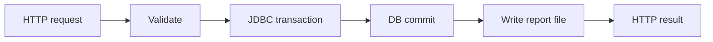

# Integration test cho HTTP, cơ sở dữ liệu và hệ thống tệp trong Java 27

Một phương thức Java có thể vượt qua unit test nhưng thất bại khi giao tiếp với HTTP server, JDBC driver, database hoặc filesystem thực. **Integration test (kiểm thử tích hợp)** tập trung vào những ranh giới đó: giao thức, serialization, status code, transaction, SQL constraint, charset, đường dẫn, quyền truy cập và vòng đời tài nguyên.

Bài thuộc chương **Kiểm thử và chất lượng**, trong module **JAVA_VERSION_JAVA27 — Java 27 và các kiến thức liên quan**. Các ví dụ dùng API JDK hiện hành như `java.net.http.HttpClient`, `com.sun.net.httpserver.HttpServer`, JDBC (`java.sql` và `DataSource`), NIO.2 (`java.nio.file`) và **JUnit Jupiter**. Những thư viện ngoài JDK như JUnit, H2 hay Testcontainers được dùng với vai trò rõ ràng; không hướng dẫn kiểu API legacy hay dựa vào hệ thống production để tạo dữ liệu test.

> **Nguyên tắc:** một test chỉ chứng minh hành vi của **ranh giới mà nó thực sự thực thi**. HTTP client gọi server giả lập không chứng minh provider production; H2 không có cùng semantics với mọi PostgreSQL/MySQL; `@TempDir` dùng filesystem thật nhưng không chứng minh tất cả quy tắc của mọi OS.

## 1. Mục tiêu

Sau bài, bạn có thể:

1. Phân biệt unit, component, integration, contract và end-to-end test.
2. Test `HttpClient` thật với HTTP server loopback trên cổng động, kiểm tra status, body, charset và lỗi.
3. Test repository qua JDBC với database cô lập cho từng test, kiểm tra commit/rollback, constraint và cập nhật cạnh tranh.
4. Nhận diện giới hạn của H2 và biết khi nào phải chạy DBMS thật bằng container/CI.
5. Test thao tác file với `@TempDir`, UTF-8, `CREATE_NEW`, lỗi file đã tồn tại và tên file không hợp lệ.
6. Quản lý `@BeforeEach`, `@AfterEach`, connection, server, HTTP client và file handles.
7. Tránh flaky test bằng dữ liệu riêng, port 0, deadline, assertion đúng contract, không đoán thứ tự thread.
8. Xây kế hoạch test có fault injection, cleanup, bảo mật và khả năng chạy độc lập trên CI.

## 2. Integration test thực sự kiểm chứng điều gì?

Ba ranh giới chính:

```text
Java HTTP client ──(TCP/HTTP)──> HTTP server
Java repository  ──(JDBC/SQL)──> Database engine
Java file store  ──(NIO.2)────> Filesystem
```

| Loại test | Thành phần thật | Bằng chứng có được | Chưa bảo đảm |
|---|---|---|---|
| Unit | Logic riêng, dependency giả lập | Nhánh, phép tính, validation | Socket, SQL, filesystem |
| HTTP client integration | `HttpClient` + HTTP server thử nghiệm | Method/path/status/response qua HTTP thực | Provider thật tuân thủ contract |
| Repository integration | JDBC driver + DB thử nghiệm | SQL, constraint, transaction của DB đó | Mọi đặc tính DBMS khác |
| Filesystem integration | `Files` + thư mục test | Byte, text, path, lỗi I/O trên môi trường chạy | Mọi filesystem/OS khác |
| Contract | Schema/quy tắc đã thỏa thuận | Tương thích ở cấp thông điệp | Mọi workflow production |
| End-to-end | Nhiều service đã chạy | Hành trình thực tế của người dùng | Toàn bộ tình huống và invariant |

Một test mock `PreparedStatement.executeUpdate()` rồi assert 1 hàng không biết SQL thật có hợp lệ không. Test mock `HttpClient.send` không đi qua HTTP transport. Các test này vẫn hữu ích ở mức **unit**, nhưng không nên được dùng thay integration test.

## 3. Đặc tính của một integration test có chất lượng

| Tính chất | Hành động cụ thể |
|---|---|
| **Deterministic** | Dữ liệu đầu vào và assertion rõ ràng; không dựa vào ngẫu nhiên về thứ tự thực thi |
| **Isolated** | Database riêng, thư mục riêng, cổng do OS chọn |
| **Repeatable** | Có thể chạy từng test hoặc cả suite, nhiều lần liên tiếp |
| **Time bounded** | Request/await có deadline; không treo CI vô hạn |
| **Observable** | Kiểm tra trạng thái sau commit/rollback, file thực tế, response thực |
| **Owned resources** | Đóng HTTP server/client, connection, stream, executor |
| **Representative** | Chạy đúng SQL/serialization/code path cần chứng minh |
| **Safe** | Không dùng dữ liệu hay credential production, không xóa file ngoài sandbox |

Một test có thể ngắn nhưng vẫn là integration test tốt nếu nó thực thi một ranh giới thật, có fixture độc lập và kiểm tra hậu điều kiện mạnh.

## 4. Thiết kế bộ test mẫu

Ta viết ba lớp production và ba lớp test:

```text
integration-example/
├── pom.xml
└── src/
    ├── main/java/com/example/integration/
    │   ├── ItemClient.java
    │   ├── AccountRepository.java
    │   └── ReportStore.java
    └── test/java/com/example/integration/
        ├── HttpIntegrationTest.java
        ├── DatabaseIntegrationTest.java
        └── FilesystemIntegrationTest.java
```

- **HTTP:** server thử nghiệm chạy thật trên `127.0.0.1`; handler trả kết quả có kiểm soát.
- **Database:** H2 in-memory chạy các câu SQL và transaction thật; mỗi test tạo một DB riêng.
- **File:** `@TempDir` cấp thư mục thật; mã production dùng `Files`.

Mọi Java file có dòng `package com.example.integration;` để project có thể được build thống nhất.

## 5. Các thư viện và API ổn định

| API/thư viện | Vai trò |
|---|---|
| `java.net.http` | HTTP client chuẩn JDK |
| `jdk.httpserver` | HTTP server đơn giản cho development/test; không phải framework production |
| `java.sql`, `javax.sql.DataSource` | JDBC API chuẩn |
| `java.nio.file` | File, thư mục, stream và open options |
| JUnit Jupiter | `@Test`, `@BeforeEach`, `@AfterEach`, `@TempDir`, assertions |
| Maven Surefire | Chạy JUnit tests, xuất báo cáo |
| H2 | Engine database in-memory để test SQL cơ bản |
| Testcontainers hoặc DB CI riêng | Chạy PostgreSQL/MySQL thật khi cần kiểm tra dialect/locking |

Ví dụ Maven dùng **JUnit Jupiter 6.0.0**, **H2 2.3.232** cùng các Maven plugin tương ứng. Đây là **phiên bản minh họa**, không khẳng định mới nhất; chọn bản đã được tổ chức phê duyệt và kiểm tra cập nhật bảo mật trước khi áp dụng production.

## 6. Maven POM cho JDK 27

Tạo `pom.xml`:

```xml
<project xmlns="http://maven.apache.org/POM/4.0.0"
         xmlns:xsi="http://www.w3.org/2001/XMLSchema-instance"
         xsi:schemaLocation="http://maven.apache.org/POM/4.0.0 https://maven.apache.org/xsd/maven-4.0.0.xsd">
    <modelVersion>4.0.0</modelVersion>

    <groupId>com.example</groupId>
    <artifactId>integration-example</artifactId>
    <version>1.0-SNAPSHOT</version>

    <properties>
        <maven.compiler.release>27</maven.compiler.release>
        <project.build.sourceEncoding>UTF-8</project.build.sourceEncoding>
    </properties>

    <dependencies>
        <dependency>
            <groupId>org.junit.jupiter</groupId>
            <artifactId>junit-jupiter</artifactId>
            <version>6.0.0</version>
            <scope>test</scope>
        </dependency>
        <dependency>
            <groupId>com.h2database</groupId>
            <artifactId>h2</artifactId>
            <version>2.3.232</version>
            <scope>test</scope>
        </dependency>
    </dependencies>

    <build>
        <plugins>
            <plugin>
                <groupId>org.apache.maven.plugins</groupId>
                <artifactId>maven-compiler-plugin</artifactId>
                <version>3.14.1</version>
            </plugin>
            <plugin>
                <groupId>org.apache.maven.plugins</groupId>
                <artifactId>maven-surefire-plugin</artifactId>
                <version>3.5.4</version>
                <configuration>
                    <argLine>--add-modules jdk.httpserver</argLine>
                </configuration>
            </plugin>
        </plugins>
    </build>
</project>
```

Maven cần dùng **JDK 27** thật để compiler hiểu `--release 27`. Module `jdk.httpserver` được bật tại test JVM; trong named module project riêng cần quản lý `requires jdk.httpserver` theo cấu trúc module.

Chạy từ thư mục project:

```bash
java -version
mvn -version
mvn test
```

Không cần Internet trong lúc **thực thi test**; Maven có thể cần mạng lần đầu để lấy dependency nếu chưa có trong repository local.

## 7. HTTP integration: tại sao cần server thật trên loopback?

Test client HTTP không nên mock toàn bộ `HttpClient.send` nếu mục tiêu là kiểm chứng request/response qua giao thức. Một server local có thể:

- Nhận method và path do client tạo thật.
- Kiểm tra `Accept`, `Content-Type` và body.
- Trả 200, 404, 429, 503 hoặc JSON không hợp lệ có chủ đích.
- Trả UTF-8, kiểm tra round-trip.
- Bị dừng sau mỗi test, không phụ thuộc Internet/DNS.

**Dùng port 0** để hệ điều hành chọn cổng còn trống. Tránh cố định 8080 vì CI worker hoặc chương trình khác có thể đã sử dụng.

## 8. Code production: ItemClient.java

Tệp `src/main/java/com/example/integration/ItemClient.java`:

```java
package com.example.integration;

import java.io.IOException;
import java.net.URI;
import java.net.http.HttpClient;
import java.net.http.HttpRequest;
import java.net.http.HttpResponse;
import java.nio.charset.StandardCharsets;
import java.time.Duration;
import java.util.Objects;

public final class ItemClient {
    private final HttpClient http;
    private final URI baseUri;

    public ItemClient(HttpClient http, URI baseUri) {
        this.http = Objects.requireNonNull(http);
        this.baseUri = Objects.requireNonNull(baseUri);

        if (!baseUri.toString().endsWith("/")) {
            throw new IllegalArgumentException(
                    "Base URI must end with '/'");
        }
    }

    public String fetch(String id)
            throws IOException, InterruptedException {

        if (id == null || !id.matches("[A-Za-z0-9_-]+")) {
            throw new IllegalArgumentException("Invalid item ID");
        }

        HttpRequest request = HttpRequest.newBuilder(
                        baseUri.resolve("items/" + id))
                .GET()
                .header("Accept", "application/json")
                .timeout(Duration.ofSeconds(3))
                .build();

        HttpResponse<String> response = http.send(
                request,
                HttpResponse.BodyHandlers.ofString(
                        StandardCharsets.UTF_8)
        );

        if (response.statusCode() != 200) {
            throw new IOException(
                    "Unexpected HTTP status: " + response.statusCode());
        }

        return response.body();
    }
}
```

Thiết kế **inject `HttpClient`** cho phép test và application owner quản lý lifecycle/TLS/proxy mà không phải thay đổi code nghiệp vụ. `ItemClient` chỉ xử lý một protocol đơn giản; nếu có JSON parser thật, nên thêm test parse và validation schema.

### 8.1. Timeout

`HttpRequest.timeout` là thời hạn cho request; `HttpClient.Builder.connectTimeout` là timeout kết nối. Không nhầm timeout này với deadline của toàn workflow hoặc việc hủy chắc chắn tác vụ đang chạy tại server.

### 8.2. Đường dẫn an toàn

Ví dụ chỉ cho phép ID gồm chữ, số, dấu gạch nối hoặc gạch dưới; vì vậy `../other` bị từ chối trước khi tạo request. Nếu ứng dụng cho phép Unicode/đường dẫn phức tạp, cần URI encoding theo contract thay vì ghép chuỗi không được kiểm soát.

## 9. Test HTTP hoàn chỉnh: HttpIntegrationTest.java

Tệp `src/test/java/com/example/integration/HttpIntegrationTest.java`:

```java
package com.example.integration;

import com.sun.net.httpserver.HttpExchange;
import com.sun.net.httpserver.HttpServer;
import org.junit.jupiter.api.AfterEach;
import org.junit.jupiter.api.BeforeEach;
import org.junit.jupiter.api.Test;

import java.io.IOException;
import java.io.OutputStream;
import java.net.InetSocketAddress;
import java.net.URI;
import java.net.http.HttpClient;
import java.nio.charset.StandardCharsets;
import java.time.Duration;

import static org.junit.jupiter.api.Assertions.*;

class HttpIntegrationTest {
    private HttpServer server;
    private HttpClient http;
    private ItemClient client;

    @BeforeEach
    void startServer() throws IOException {
        server = HttpServer.create(
                new InetSocketAddress("127.0.0.1", 0), 0);

        server.createContext("/items/", exchange -> {
            try {
                if (!"GET".equals(exchange.getRequestMethod())) {
                    reply(exchange, 405, "{\"error\":\"method\"}");
                    return;
                }

                String path = exchange.getRequestURI().getPath();

                if ("/items/42".equals(path)) {
                    reply(exchange, 200, "{\"id\":\"42\"}");
                } else {
                    reply(exchange, 404, "{\"error\":\"missing\"}");
                }
            } finally {
                exchange.close();
            }
        });

        server.start();

        URI base = URI.create(
                "http://127.0.0.1:"
                        + server.getAddress().getPort() + "/");

        http = HttpClient.newBuilder()
                .connectTimeout(Duration.ofSeconds(2))
                .build();

        client = new ItemClient(http, base);
    }

    private static void reply(
            HttpExchange exchange, int status, String body)
            throws IOException {

        byte[] bytes = body.getBytes(StandardCharsets.UTF_8);

        exchange.getResponseHeaders().set(
                "Content-Type", "application/json; charset=utf-8");

        exchange.sendResponseHeaders(status, bytes.length);

        try (OutputStream output = exchange.getResponseBody()) {
            output.write(bytes);
        }
    }

    @AfterEach
    void stopServer() {
        if (http != null) {
            http.close();
        }
        if (server != null) {
            server.stop(0);
        }
    }

    @Test
    void fetchesRealHttpResponse() throws Exception {
        assertEquals("{\"id\":\"42\"}", client.fetch("42"));
    }

    @Test
    void translatesHttp404IntoIOException() {
        IOException error = assertThrows(
                IOException.class,
                () -> client.fetch("unknown")
        );

        assertTrue(error.getMessage().contains("404"));
    }

    @Test
    void rejectsUnsafePathBeforeSendingRequest() {
        assertThrows(
                IllegalArgumentException.class,
                () -> client.fetch("../secret")
        );
    }
}
```

### 9.1. Boundary được kiểm chứng

Bài test dùng `HttpClient` thật và `HttpServer` thật. Socket/HTTP response, charset, request path đều đi qua stack mạng; không chỉ là gọi trực tiếp một method giả lập.

Server handler hiện tại là một **test stub** chứ không phải provider production. Vì vậy test xác minh đúng **consumer-to-HTTP boundary**, chưa chứng minh provider bên ngoài có schema/semantics như stub.

### 9.2. Vì sao @AfterEach?

Sau mỗi test, đóng `HttpClient` và dừng server. Nếu một assertion fail, lifecycle JUnit vẫn cho cleanup cơ hội chạy. Không dựa vào GC để đóng socket, executor hoặc response stream. Nếu setup fail giữa chừng, cần cấu trúc cleanup riêng phù hợp.

## 10. HTTP test cases nên có ngoài đường thành công

| Trường hợp | Assertion cần có |
|---|---|
| 200 + JSON hợp lệ | Trả/parse dữ liệu đúng |
| 400/404 | Xử lý lỗi đúng contract |
| 401/403 | Không retry vô hạn bằng credential cũ |
| 429/503 | Retry/backoff **chỉ nếu** thao tác idempotent/cho phép |
| 200 + JSON sai schema | Parse/validation thất bại rõ |
| Body có tiếng Việt | Đọc UTF-8 đúng |
| Server không trả response | Request có deadline |
| Connection refused | Lỗi kết nối được phân loại |
| Nhiều request liên tiếp | Không reuse response/connection sai |
| TLS test | Kiểm tra trust store/hostname verification thực |

**Không** tắt certificate validation hoặc chấp nhận mọi TLS certificate chỉ để test HTTPS pass. Khi kiểm thử TLS, dùng certificate test và trust store hợp lệ.

### 10.1. Không dùng sleep như readiness check

`Thread.sleep(500)` không chứng minh server đã sẵn sàng. Dùng readiness signal, port được cấp sau `start` hoặc polling điều kiện có giới hạn thời gian. Với `HttpServer` của ví dụ, server đã được `start()` trước khi tạo request.

## 11. Cơ sở dữ liệu: mock JDBC chưa đủ

Đối với repository, integration test nên thực thi thật:

- `INSERT`, `SELECT`, `UPDATE` và tham số `PreparedStatement`.
- Constraint `PRIMARY KEY`, `CHECK`, `NOT NULL`.
- Số hàng bị ảnh hưởng của `executeUpdate()`.
- Transaction `commit` và `rollback`.
- Điều kiện cập nhật dưới cạnh tranh nếu có concurrency.

Nếu production dùng PostgreSQL, DB test bằng H2 chỉ xác minh các hành vi SQL chung **trong H2**, không thể dùng làm bằng chứng cho `SELECT FOR UPDATE`, `SERIALIZABLE`, JSONB, stored procedure hay dialect riêng.

## 12. Code production: AccountRepository.java

Tệp `src/main/java/com/example/integration/AccountRepository.java`:

```java
package com.example.integration;

import javax.sql.DataSource;
import java.sql.Connection;
import java.sql.PreparedStatement;
import java.sql.ResultSet;
import java.sql.SQLException;
import java.sql.Statement;
import java.util.Objects;

public final class AccountRepository {
    private final DataSource dataSource;

    public AccountRepository(DataSource dataSource) {
        this.dataSource = Objects.requireNonNull(dataSource);
    }

    public void createSchema() throws SQLException {
        String sql = """
                CREATE TABLE IF NOT EXISTS accounts (
                    id BIGINT PRIMARY KEY,
                    balance BIGINT NOT NULL CHECK (balance >= 0)
                )
                """;

        try (Connection connection = dataSource.getConnection();
             Statement statement = connection.createStatement()) {
            statement.execute(sql);
        }
    }

    public void insert(long id, long balance) throws SQLException {
        String sql = """
                INSERT INTO accounts(id, balance) VALUES (?, ?)
                """;

        try (Connection connection = dataSource.getConnection();
             PreparedStatement statement =
                     connection.prepareStatement(sql)) {

            statement.setLong(1, id);
            statement.setLong(2, balance);
            statement.executeUpdate();
        }
    }

    public long balance(long id) throws SQLException {
        String sql = "SELECT balance FROM accounts WHERE id = ?";

        try (Connection connection = dataSource.getConnection();
             PreparedStatement statement =
                     connection.prepareStatement(sql)) {

            statement.setLong(1, id);

            try (ResultSet result = statement.executeQuery()) {
                if (!result.next()) {
                    throw new IllegalArgumentException(
                            "Unknown account: " + id);
                }
                return result.getLong("balance");
            }
        }
    }

    public boolean withdraw(long id, long amount)
            throws SQLException {

        if (amount <= 0) {
            throw new IllegalArgumentException(
                    "Amount must be positive");
        }

        String sql = """
                UPDATE accounts
                SET balance = balance - ?
                WHERE id = ? AND balance >= ?
                """;

        try (Connection connection = dataSource.getConnection();
             PreparedStatement statement =
                     connection.prepareStatement(sql)) {

            statement.setLong(1, amount);
            statement.setLong(2, id);
            statement.setLong(3, amount);

            return statement.executeUpdate() == 1;
        }
    }

    public void transfer(long fromId, long toId, long amount)
            throws SQLException {

        if (fromId == toId || amount <= 0) {
            throw new IllegalArgumentException(
                    "Invalid transfer request");
        }

        try (Connection connection = dataSource.getConnection()) {
            connection.setAutoCommit(false);

            try {
                String debit = """
                        UPDATE accounts
                        SET balance = balance - ?
                        WHERE id = ? AND balance >= ?
                        """;

                try (PreparedStatement statement =
                             connection.prepareStatement(debit)) {

                    statement.setLong(1, amount);
                    statement.setLong(2, fromId);
                    statement.setLong(3, amount);

                    if (statement.executeUpdate() != 1) {
                        throw new IllegalStateException(
                                "Cannot debit sender");
                    }
                }

                String credit = """
                        UPDATE accounts
                        SET balance = balance + ?
                        WHERE id = ?
                        """;

                try (PreparedStatement statement =
                             connection.prepareStatement(credit)) {

                    statement.setLong(1, amount);
                    statement.setLong(2, toId);

                    if (statement.executeUpdate() != 1) {
                        throw new IllegalStateException(
                                "Receiver not found");
                    }
                }

                connection.commit();

            } catch (SQLException | RuntimeException failure) {
                try {
                    connection.rollback();
                } catch (SQLException rollbackFailure) {
                    failure.addSuppressed(rollbackFailure);
                }
                throw failure;
            }
        }
    }
}
```

### 12.1. Các invariant trong ví dụ

- Số dư không âm nhờ `CHECK (balance >= 0)` và điều kiện SQL.
- `withdraw` là một statement cập nhật với điều kiện, tránh kiểu `SELECT` ở Java rồi ghi literal mới dựa trên snapshot cũ.
- `transfer` dùng **một connection, một transaction**. Nếu không có người nhận, sender phải được rollback.

Đây là demo phục vụ test, không phải hệ thống thanh toán đầy đủ: chưa có idempotency key, audit, kiểm soát số học overflow, giới hạn retry/lock ordering hoặc xử lý outcome không xác định sau mất kết nối khi commit.

## 13. Fixture database in-memory theo từng test

`JdbcDataSource` là class thuộc **H2**, được dùng trong test chứ không đưa vào production source.

```java
JdbcDataSource ds = new JdbcDataSource();
ds.setURL("jdbc:h2:mem:it_" +
        java.util.UUID.randomUUID().toString().replace("-", ""));
ds.setUser("sa");

Connection anchor = ds.getConnection();
```

**Vì sao giữ `anchor`?** H2 database in-memory theo URL mặc định có thể bị đóng khi connection cuối cùng đóng. Repository của ví dụ lấy connection riêng mỗi lời gọi; nếu không giữ một connection mở đến cuối test, schema có thể biến mất giữa các lời gọi.

Tránh mặc định thêm `DB_CLOSE_DELAY=-1` cho mọi test: khi đó database có thể tồn tại đến hết JVM, khiến fixture không được giải phóng như kỳ vọng. Mỗi test dùng tên riêng và đóng `anchor` tại teardown.

## 14. Test DB hoàn chỉnh: DatabaseIntegrationTest.java

Tệp `src/test/java/com/example/integration/DatabaseIntegrationTest.java`:

```java
package com.example.integration;

import org.h2.jdbcx.JdbcDataSource;
import org.junit.jupiter.api.AfterEach;
import org.junit.jupiter.api.BeforeEach;
import org.junit.jupiter.api.Test;

import java.sql.Connection;
import java.sql.SQLException;
import java.util.UUID;
import java.util.concurrent.Callable;
import java.util.concurrent.CountDownLatch;
import java.util.concurrent.Executors;
import java.util.concurrent.TimeUnit;

import static org.junit.jupiter.api.Assertions.*;

class DatabaseIntegrationTest {
    private JdbcDataSource dataSource;
    private Connection anchor;
    private AccountRepository repository;

    @BeforeEach
    void openDatabase() throws SQLException {
        dataSource = new JdbcDataSource();

        String name = "it_" +
                UUID.randomUUID().toString().replace("-", "");

        dataSource.setURL("jdbc:h2:mem:" + name);
        dataSource.setUser("sa");

        anchor = dataSource.getConnection();

        repository = new AccountRepository(dataSource);
        repository.createSchema();
        repository.insert(1L, 100L);
        repository.insert(2L, 50L);
    }

    @AfterEach
    void closeDatabase() throws SQLException {
        if (anchor != null) {
            anchor.close();
        }
    }

    @Test
    void conditionalWithdrawPreventsNegativeBalance()
            throws SQLException {

        assertTrue(repository.withdraw(1L, 80L));
        assertFalse(repository.withdraw(1L, 80L));

        assertEquals(20L, repository.balance(1L));
    }

    @Test
    void transferRollsBackWhenReceiverIsMissing()
            throws SQLException {

        assertThrows(
                IllegalStateException.class,
                () -> repository.transfer(1L, 999L, 30L)
        );

        assertEquals(100L, repository.balance(1L));
        assertEquals(50L, repository.balance(2L));
    }

    @Test
    void concurrentWithdrawalDoesNotLoseBalance()
            throws Exception {

        CountDownLatch start = new CountDownLatch(1);

        Callable<Boolean> attempt = () -> {
            start.await();
            return repository.withdraw(1L, 80L);
        };

        try (var executor = Executors.newFixedThreadPool(2)) {
            var first = executor.submit(attempt);
            var second = executor.submit(attempt);

            start.countDown();

            int successful =
                    (first.get(10, TimeUnit.SECONDS) ? 1 : 0)
                    + (second.get(10, TimeUnit.SECONDS) ? 1 : 0);

            assertEquals(1, successful);
            assertEquals(20L, repository.balance(1L));
        }
    }
}
```

### 14.1. Bằng chứng từ transaction rollback

`transfer(1,999,30)` giảm số dư người gửi trước khi phát hiện người nhận không có. Test không chỉ assert exception, mà còn assert `balance(1) == 100`. Điều đó xác nhận **tác dụng phụ ở bước đầu đã rollback**.

Nếu test chỉ kiểm tra exception, một implementation sai có thể ném lỗi sau khi đã commit bước trừ tiền.

### 14.2. Bằng chứng từ cập nhật đồng thời

Hai thread đều muốn rút 80 từ số dư ban đầu 100; chỉ một giao dịch được phép thành công. Thứ tự thread nào thắng **không xác định**, nhưng invariant được kiểm tra là:

- Đúng một lần rút thành công.
- Số dư cuối bằng 20.
- Không có âm số dư hoặc mất cập nhật.

`CountDownLatch` giúp hai task bắt đầu gần nhau hơn, nhưng không buộc một lịch CPU cụ thể. Kết quả một lần chạy không chứng minh mọi khả năng xen kẽ; kết hợp thêm stress test/reasoning khi invariant đồng thời quan trọng.

### 14.3. Giới hạn timeout và cleanup

`Future.get(10, TimeUnit.SECONDS)` giới hạn thời gian chờ kết quả ở test caller. Với test có nguy cơ treo thực sự, cần kế hoạch `shutdownNow()`/interruption và bảo vệ thread chờ. `ExecutorService.close()` có thể đợi task hoàn tất; không dùng task vô hạn trong suite CI.

## 15. Test database schema, constraint và negative paths

Test dữ liệu hợp lệ chưa đủ. Cần ít nhất những trường hợp sau:

| Điều kiện | Assertion |
|---|---|
| Insert thành công | `SELECT` trả đúng bản ghi |
| Trùng primary key | Database trả `SQLException` |
| Balance âm | `CHECK (balance >= 0)` từ chối |
| Cột bắt buộc null | `NOT NULL` từ chối |
| Không đủ số dư | `withdraw` trả false, số dư giữ nguyên |
| Người nhận không tồn tại | `transfer` rollback người gửi |
| Cập nhật đồng thời | Invariant tài khoản còn đúng |
| Kết nối bị lỗi | Không giả vờ transaction đã commit |
| Deadlock/serialization failure | Phân loại và retry **toàn transaction** khi phù hợp |

Ví dụ assert constraint:

```java
@Test
void refusesNegativeBalance() {
    assertThrows(
            SQLException.class,
            () -> repository.insert(3L, -1L)
    );
}
```

Đặt test trên trong `DatabaseIntegrationTest`, nó dùng cùng fixture từ `@BeforeEach`. Không cần mock SQL error vì H2 thực thi constraint thật.

### 15.1. Cùng tên isolation không có nghĩa cùng semantics

Một test dùng H2 ở isolation mặc định không chứng minh ứng dụng sẽ có đúng hành vi ở PostgreSQL `READ COMMITTED`/`REPEATABLE READ`. DBMS có thể khác về MVCC, predicate locking, deadlock detection, collation, index và SQL dialect.

### 15.2. Đừng retry mọi SQLException

SQL syntax, password sai hoặc business constraint thường không phải lỗi transient. Với lost connection ngay sau `commit()`, trạng thái commit có thể không chắc chắn; retry nghiệp vụ có side effect phải có idempotency/reconciliation phù hợp.

## 16. Khi nào dùng PostgreSQL/MySQL thật cho integration test?

Khi production sử dụng DBMS cụ thể, các chức năng sau nên được kiểm tra trên chính engine đó:

- `SELECT ... FOR UPDATE`, `NOWAIT`, `SKIP LOCKED`.
- Isolation, MVCC, deadlock và serialization failure.
- JSONB, arrays, `ON CONFLICT`, `RETURNING` hoặc stored procedures.
- Transaction DDL, triggers, collations và timezone.
- Schema migrations thật, indexing và constraint riêng.
- SQLState và hành vi timeout của driver/DBMS.

Có thể dùng **Testcontainers** hoặc môi trường database tạm do CI quản lý. Quy trình:

```text
Start disposable DB container
    -> wait until database is ready
    -> obtain JDBC URL and credentials
    -> apply production migrations
    -> insert known test fixtures
    -> run repository tests
    -> assert persisted state and transaction boundaries
    -> stop container and clean resources
```

Để dùng Testcontainers, phải thêm đúng dependency cho phiên bản được dự án chọn và có Docker/container runtime tương thích. Đoạn trên là **quy trình**, không giả định thư viện Testcontainers nằm trong JDK.

### 16.1. Không đưa H2 schema riêng vào suite PostgreSQL thật

Một schema test copy/paste có thể khác migration production một cách tinh vi. Với DBMS thật, **chạy migration của ứng dụng** rồi seed dữ liệu thử nghiệm. Nếu logic production dùng transaction từ framework, cần test chính transaction boundary đó chứ không tạo một transaction giả bao quanh toàn bộ test.

## 17. Isolation và vòng đời dữ liệu của DB test

Bốn lựa chọn:

| Chiến lược | Khi phù hợp | Rủi ro |
|---|---|---|
| DB mới mỗi test | Test nhỏ, tối đa isolation | Startup có thể chậm |
| Schema riêng mỗi test | Dùng chung một DB service | Cần cleanup schema |
| Transaction rollback sau test | Code sử dụng cùng transaction | Code khác connection/thread có thể thoát rollback |
| Cleanup bảng theo fixture | Suite có DB dùng chung | Va chạm khi chạy song song |

Ví dụ dùng tên DB in-memory riêng nên các test không có dữ liệu chung. `@AfterEach` đóng anchor để database hết vòng đời khi connection cuối đóng.

**Không coi rollback do test framework tạo là bảo đảm cho các transaction do ứng dụng mở trên connection khác.** Với luồng bất đồng bộ hoặc nhiều service, cần database/schema/namespace riêng đủ mạnh.

## 18. Kiểm thử filesystem thật với @TempDir

File integration test không nên ghi vào thư mục hiện tại, `user.home`, `C:\temp` hay một đường dẫn hệ thống cố định. JUnit Jupiter hỗ trợ `@TempDir`:

```java
import org.junit.jupiter.api.io.TempDir;
import java.nio.file.Path;

class ExampleTest {
    @TempDir
    Path sandbox;
}
```

Từ `sandbox`, test tạo và kiểm tra file thật qua NIO. JUnit quản lý lifecycle thư mục tạm; nếu test mở stream/channel, code vẫn phải đóng để JUnit dọn được, đặc biệt trên Windows.

### 18.1. Vì sao không chỉ mock Files.writeString?

Mock `Files` có thể test nhánh xử lý lỗi được giả lập, nhưng không kiểm chứng UTF-8, open option, file already exists, permission hoặc dữ liệu thực sự tồn tại trên filesystem.

## 19. Code production: ReportStore.java

Tệp `src/main/java/com/example/integration/ReportStore.java`:

```java
package com.example.integration;

import java.io.IOException;
import java.nio.charset.StandardCharsets;
import java.nio.file.Files;
import java.nio.file.Path;
import java.nio.file.StandardOpenOption;
import java.util.Objects;

public final class ReportStore {
    private final Path directory;

    public ReportStore(Path directory) {
        this.directory = Objects.requireNonNull(directory);
    }

    public Path save(String name, String content) throws IOException {
        Path file = fileFor(name);

        Files.createDirectories(directory);

        return Files.writeString(
                file,
                Objects.requireNonNull(content),
                StandardCharsets.UTF_8,
                StandardOpenOption.CREATE_NEW,
                StandardOpenOption.WRITE
        );
    }

    public String read(String name) throws IOException {
        return Files.readString(
                fileFor(name),
                StandardCharsets.UTF_8
        );
    }

    private Path fileFor(String name) {
        if (name == null
                || !name.matches("[A-Za-z0-9_-]+\\.txt")) {
            throw new IllegalArgumentException(
                    "Only simple .txt names are supported");
        }

        return directory.resolve(name);
    }
}
```

### 19.1. UTF-8 là phần của contract

`Files.writeString` và `Files.readString` được gọi với `StandardCharsets.UTF_8` tường minh. Test với chữ tiếng Việt giúp bắt lỗi chuyển đổi charset hoặc thay đổi mặc định theo môi trường.

### 19.2. CREATE_NEW không phải overwrite

`StandardOpenOption.CREATE_NEW` yêu cầu tạo mới; nếu đường dẫn đã tồn tại, thao tác thất bại thay vì ghi đè. Điều đó thể hiện contract "tên report duy nhất".

### 19.3. Path validation chưa phải sandbox bảo mật hoàn chỉnh

Regex ngăn `../`, absolute path và separator, nhưng khi thư mục gốc do attacker kiểm soát vẫn có thể có symlink/TOCTOU. Với môi trường không đáng tin cậy cần kiểm soát ownership, symbolic links và path resolution sâu hơn, không chỉ `normalize()`.

## 20. Test filesystem hoàn chỉnh: FilesystemIntegrationTest.java

Tệp `src/test/java/com/example/integration/FilesystemIntegrationTest.java`:

```java
package com.example.integration;

import org.junit.jupiter.api.Test;
import org.junit.jupiter.api.io.TempDir;

import java.io.IOException;
import java.nio.charset.StandardCharsets;
import java.nio.file.FileAlreadyExistsException;
import java.nio.file.Files;
import java.nio.file.Path;

import static org.junit.jupiter.api.Assertions.*;

class FilesystemIntegrationTest {

    @TempDir
    Path sandbox;

    @Test
    void writesAndReadsUtf8Text() throws IOException {
        ReportStore store = new ReportStore(sandbox);
        String content = "Báo cáo: tiếng Việt có dấu\n";

        Path path = store.save("report.txt", content);

        assertTrue(Files.exists(path));
        assertEquals(content, store.read("report.txt"));
        assertEquals(
                content,
                Files.readString(path, StandardCharsets.UTF_8)
        );
    }

    @Test
    void rejectsDuplicateInsteadOfOverwriting()
            throws IOException {

        ReportStore store = new ReportStore(sandbox);

        store.save("report.txt", "first");

        assertThrows(
                FileAlreadyExistsException.class,
                () -> store.save("report.txt", "second")
        );

        assertEquals("first", store.read("report.txt"));
    }

    @Test
    void rejectsParentTraversal() throws IOException {
        ReportStore store = new ReportStore(sandbox);

        assertThrows(
                IllegalArgumentException.class,
                () -> store.save("../secret.txt", "bad")
        );

        try (var files = Files.list(sandbox)) {
            assertEquals(0L, files.count());
        }
    }
}
```

### 20.1. Vì sao test cả nội dung sau khi lỗi?

Nếu ghi lần thứ hai bị từ chối nhưng implementation đã cắt ngắn file trước khi ném exception, chỉ assert exception sẽ không phát hiện lỗi. `assertEquals("first", store.read(...))` kiểm tra hậu điều kiện thực sự.

### 20.2. @TempDir không giả lập filesystem

`@TempDir` tạo thư mục ở hệ điều hành/file system thật; hành vi `FileAlreadyExistsException`, file handles và byte encoding được kiểm tra thật. Dù vậy, test trên Linux không chứng minh file lock hoặc case-sensitivity trên Windows có cùng behavior.

## 21. Ghi đè an toàn, atomic move và durability

Nếu hợp đồng là **cập nhật report hiện có**, có thể tạo file tạm cùng thư mục rồi đổi tên:

```java
Path temporary = Files.createTempFile(
        directory, ".report-", ".tmp");

try {
    Files.writeString(
            temporary,
            newContent,
            StandardCharsets.UTF_8
    );

    Files.move(
            temporary,
            target,
            java.nio.file.StandardCopyOption.ATOMIC_MOVE,
            java.nio.file.StandardCopyOption.REPLACE_EXISTING
    );

} finally {
    Files.deleteIfExists(temporary);
}
```

Đây là **snippet minh họa**: `directory`, `newContent` và `target` phải được khai báo. `ATOMIC_MOVE` không được bảo đảm trên mọi filesystem, có thể ném `AtomicMoveNotSupportedException`. Nếu fallback sang non-atomic move, phải ghi rõ rằng bảo đảm nguyên tử đã thay đổi.

### 21.1. Các test cần có

- File đích không bị ghi nửa chừng khi quá trình ghi file tạm lỗi.
- File đích được thay đúng trong trường hợp thành công.
- File tạm được cleanup khi thất bại.
- Code xử lý trường hợp atomic move unsupported theo chính sách đã chọn.

**Atomic replacement không đồng nghĩa dữ liệu đã được flush bền vững ra thiết bị lưu trữ**. Nếu nghiệp vụ yêu cầu crash durability, phải xem xét `FileChannel.force`, filesystem và OS contract.

## 22. Khác biệt filesystem giữa môi trường CI và production

| Trường hợp | Điều nên kiểm thử |
|---|---|
| Linux vs Windows | File đang mở, cách xử lý rename/delete |
| Case-sensitive vs insensitive | Tên file viết hoa/thường |
| Unicode normalization | Tên file/chữ có dấu |
| Permission | Quyền user thật; root có thể vượt qua một số lỗi dự kiến |
| Symlink | Đường dẫn có thể thoát khỏi thư mục dù đã normalize |
| Atomic move | Hệ thống tập tin có hỗ trợ không |
| File lock | Chỉ có thể xác minh chắc trên môi trường có semantics tương ứng |
| Disk full | Cần fault injection hoặc sandbox kiểm soát, không làm đầy ổ đĩa CI |

Không làm bài test "disk full" bằng cách ghi vô hạn vào ổ chứa source hoặc volume chung; đó là hành vi nguy hiểm cho toàn bộ pipeline.

## 23. HTTP + DB + file trong một workflow



Vấn đề khó nhất ở đây là **partial failure**.

- JDBC transaction chỉ quản lý những câu SQL trong transaction.
- `Files.writeString` thao tác trên filesystem, không thuộc transaction JDBC.
- Nếu DB commit thành công rồi ghi file lỗi, DB không tự rollback.
- Nếu file đã tạo nhưng DB rollback, file không tự biến mất.

### 23.1. Chọn contract trước khi viết test

Một hệ thống có thể:

1. Trả lỗi và rollback trước khi commit (nếu tất cả thay đổi vẫn ở trong transaction).
2. Ghi trạng thái `PENDING_EXPORT` và worker xử lý file sau commit.
3. Ghi outbox record trong cùng DB transaction rồi retry file write idempotently.
4. Áp dụng compensation theo workflow có thể đảo ngược.

Không có một đáp án phù hợp mọi nghiệp vụ. Test phải assert **trạng thái cuối theo hợp đồng đã chọn**, không tự giả định file/DB là một transaction phân tán.

## 24. Test bất đồng bộ và eventual consistency

Nếu tác vụ xuất file chạy background, assert `Files.exists` ngay sau HTTP 202 có thể fail vì worker chưa chạy. Thay vì `Thread.sleep(3000)` cố định, hãy **chờ điều kiện tới deadline**:

```java
long deadline = System.nanoTime()
        + java.time.Duration.ofSeconds(5).toNanos();

boolean completed = false;

while (System.nanoTime() < deadline) {
    if (Files.exists(expectedReport)) {
        completed = true;
        break;
    }

    Thread.sleep(20);
}

org.junit.jupiter.api.Assertions.assertTrue(
        completed,
        "Report was not created before deadline"
);
```

Đây là **đoạn minh họa**; `expectedReport` là Path do test tạo. Polling phải có giới hạn, xử lý interruption, và tránh đọc trạng thái chưa hoàn tất như một trạng thái thành công.

Trong cùng process, có thể điều phối bằng `CountDownLatch`/`CompletableFuture` thay vì polling file. Với hệ thống nhiều process, phải quan sát điều kiện qua HTTP/DB/file thực tế.

## 25. Fault injection theo ranh giới

| Ranh giới | Lỗi cần tạo | Cách có kiểm soát |
|---|---|---|
| HTTP | 404, 429, 503 | Handler của test server |
| HTTP | Body sai schema/charset | Response fixture |
| HTTP | Timeout, broken connection | Server có điều phối và deadline |
| DB | Duplicate primary key, CHECK violation | Database thử nghiệm |
| DB | Rollback sau một update | Transaction integration test |
| DB | Deadlock hoặc lock wait | DBMS thật trong suite chuyên biệt |
| File | Tên file đã tồn tại | `CREATE_NEW` trong `@TempDir` |
| File | Path invalid | Input validation |
| File | Permission denied | Sandbox với quyền được cấu hình |
| Workflow | File write lỗi sau DB commit | Stub/fault injector tại filesystem boundary và assert trạng thái nghiệp vụ |

Không gọi một test "failure injection" nếu nó chỉ mock một exception rồi bỏ qua mọi hậu điều kiện. Hãy xác minh **điều gì được commit, điều gì được rollback và trạng thái nào phải được khôi phục**.

## 26. Determinism: nguồn flaky test phổ biến

Một số lỗi:

- Port cố định 8080 bị service khác chiếm.
- Database tên `test` dùng chung trong nhiều CI worker.
- Test phụ thuộc thứ tự test method.
- Bỏ cleanup server/file handles.
- Dùng `Thread.sleep` làm đồng bộ chính.
- So SQL rows không có `ORDER BY`.
- So JSON dựa vào thứ tự key khi contract không yêu cầu.
- Dùng `Instant.now()` và timezone mặc định cho assertion chính xác tuyệt đối.
- Giả định thread A luôn hoàn thành trước thread B.
- Hardcode path `C:\temp` hoặc `/tmp`.

### 26.1. Inject Clock thay vì đoán thời gian

```java
import java.time.Clock;
import java.time.Instant;

final class ExpiryPolicy {
    private final Clock clock;

    ExpiryPolicy(Clock clock) {
        this.clock = clock;
    }

    boolean expired(Instant deadline) {
        return !Instant.now(clock).isBefore(deadline);
    }
}
```

Test có thể dùng `Clock.fixed(...)` cho dữ liệu hết hạn, không phụ thuộc thời điểm CI chạy.

## 27. Test lifecycle và cleanup

Quyền sở hữu tài nguyên cần rõ:

| Tài nguyên | Khi tạo | Khi dọn |
|---|---|---|
| HTTP server | `@BeforeEach` hoặc test fixture | `@AfterEach`, stop server |
| HTTP client | Test/app owner | `close()` khi không còn request |
| JDBC connection | Mỗi thao tác/transaction | `try-with-resources` |
| H2 anchor connection | `@BeforeEach` | `@AfterEach` |
| Temp directory | JUnit `@TempDir` | JUnit extension theo lifecycle |
| `Files.list` stream | Trong test | `try-with-resources` |
| Executor | Test owner | Shutdown và wait theo contract |
| DB container | Test suite/CI fixture | Teardown sau suite |

Không tự động shutdown pool hoặc DataSource được **tiêm từ bên ngoài** khi một method kết thúc, trừ khi component thực sự sở hữu nó.

## 28. Vận hành bộ test trong CI

Chạy suite:

```bash
mvn test
```

Chạy riêng một lớp:

```bash
mvn -Dtest=HttpIntegrationTest test
mvn -Dtest=DatabaseIntegrationTest test
mvn -Dtest=FilesystemIntegrationTest test
```

Surefire thường ghi kết quả vào `target/surefire-reports/`.

Kiểm tra cả:

- Chạy độc lập một class.
- Chạy mọi class nhiều lần.
- Chạy trên CI dùng JDK 27, cấu hình OS/container thật.
- Khi bật chạy song song, port/database/file không va chạm.
- Test thất bại có assertion/stack trace dễ truy nguyên.
- Không có credential, secret hoặc dữ liệu production trong logs.

Với test DB container chậm, có thể dùng Maven Failsafe, profile hoặc tag để chia giai đoạn unit/local integration/DBMS integration; đó là lựa chọn pipeline, không có nghĩa mọi test phải khởi động container.

## 29. Bảo mật và môi trường thử nghiệm

### 29.1. Không gọi nhầm production

Config test phải trỏ tới URL/DB riêng, với account có quyền hạn nhỏ nhất. Không lấy `DATABASE_URL` production từ môi trường CI chung rồi dùng nó để chạy `DROP TABLE`/migration.

### 29.2. HTTP server bind loopback

Với stub không có authentication, bind `127.0.0.1` thay vì `0.0.0.0` để không công khai endpoint test ra mạng.

### 29.3. Không tắt TLS verification

HTTPS test dùng test certificate/trust store phù hợp; không thiết lập "trust all" như cách sửa nhanh SSL error.

### 29.4. Không xóa file ngoài sandbox

Chỉ cleanup đúng tài nguyên test đã tạo. Không xóa toàn bộ `java.io.tmpdir` hoặc đường dẫn xây từ input chưa kiểm tra.

### 29.5. Bảo vệ test artifacts

Báo cáo test, database dumps, HTTP logs và file output có thể chứa dữ liệu nhạy cảm. Áp dụng giới hạn quyền truy cập, retention và cơ chế xóa của CI.

## 30. Những hiểu lầm thường gặp

| Hiểu lầm | Điều đúng |
|---|---|
| Mock mọi dependency là integration test | Chưa đi qua HTTP/DB/file thật |
| Có HttpClient là tự động test provider thật | Handler test có thể chỉ là stub |
| H2 có cùng isolation với PostgreSQL | Phải test engine production cho semantics đặc thù |
| Một test có rollback sẽ rollback mọi connection | Không đúng khi code mở connection mới/thread khác |
| Cổng 8080 luôn trống | Nên dùng bind port 0 |
| `Thread.sleep(500)` bảo đảm readiness | Chỉ là một khoảng chờ đoán |
| Assert không ném exception là đủ | Phải assert response và hậu điều kiện |
| `@TempDir` là fake filesystem | Là filesystem thật được JUnit quản lý |
| `CREATE_NEW` ghi đè file cũ | Từ chối khi file tồn tại |
| `Files.move(ATOMIC_MOVE)` được hỗ trợ mọi nơi | Có thể không được hỗ trợ |
| File write rollback theo JDBC rollback | Hai resource manager khác nhau |
| Database test luôn phải chạy production | Tuyệt đối không dùng production dữ liệu thật |
| Một concurrency test pass là không còn race | Chỉ một số lịch chạy đã được kiểm chứng |
| Timeout HTTP nghĩa server ngừng xử lý | Không bảo đảm |
| Test càng nhiều hệ thống ngoài càng tốt | Thường tăng độ chậm/flaky nếu không cô lập |
| Test chạy cả suite pass là đủ | Cần chạy độc lập, tránh order dependency |

## 31. Checklist review integration test

**HTTP:** request method/path, status/headers/body, UTF-8, timeout, port động, lifecycle, có phải stub hay provider thật?

**Database:** SQL qua driver thật, schema/migration phù hợp, transaction/rollback, constraint, data isolation, test concurrent, khác biệt H2/production?

**Filesystem:** `@TempDir`, UTF-8, open options, duplicate/missing file, path traversal, cleanup streams, hành vi OS-specific?

**Toàn bộ:** chạy lặp lại, không phụ thuộc thứ tự, deadline, không gọi Internet ngoài ý muốn, không rò secrets, failure injection có hậu điều kiện, tài nguyên đều có owner?

## 32. Bài tập thực hành

### Bài 1. Phân loại cấp kiểm thử

Cho năm test: mock `HttpClient.send`, dùng `HttpServer` local, H2 in-memory, PostgreSQL container, và một hành trình staging end-to-end. Hãy phân loại và nêu ranh giới từng test kiểm chứng.

### Bài 2. Test HTTP header

Sửa test server trả 406 nếu request thiếu `Accept: application/json`. Test `ItemClient` gửi đúng header và phân biệt HTTP 406 với lỗi mạng.

### Bài 3. UTF-8 qua HTTP

Cho server trả `{"name":"Cà phê Việt"}` dưới UTF-8; assert client nhận chuỗi đúng. Nếu dùng JSON parser, so giá trị field thay vì thứ tự key.

### Bài 4. HTTP timeout

Tạo handler chờ một latch có deadline; dùng request timeout và assert lỗi phù hợp. Cleanup server/handler ngay cả khi test thất bại.

### Bài 5. Database constraint

Ghi `balance < 0` và duplicate `id` vào H2. Assert `SQLException`, xác minh dữ liệu sai không được lưu.

### Bài 6. Rollback

Làm `transfer` thất bại ở bước credit; test số dư sender không đổi sau lỗi. Giải thích vì sao chỉ assert exception là chưa đủ.

### Bài 7. Concurrent withdraw

Hai thread cùng rút 80 từ số dư 100. Chỉ một phép rút được thành công. Giải thích vì sao `UPDATE ... WHERE balance >= ?` tốt hơn `SELECT` rồi `UPDATE balance=?` không bảo vệ.

### Bài 8. PostgreSQL thật

Tạo database/container PostgreSQL, chạy migration production, test `SELECT FOR UPDATE` và SQLState serialization/deadlock. Liệt kê những giả định H2 không kiểm chứng được.

### Bài 9. Test file UTF-8

Dùng `@TempDir` lưu `Xin chào\n`, đọc lại byte/text, assert đúng nội dung và chiều dài phù hợp.

### Bài 10. File duplicate và path traversal

Test `CREATE_NEW` với tên tồn tại, `../other.txt` và tên có dấu phân cách. Giải thích giới hạn regex trước symlink và race.

### Bài 11. Eventual consistency

Một job tạo report chạy background; viết test dùng latch/polling có deadline thay cho sleep cố định. Assert trạng thái cuối và xử lý timeout hợp lý.

### Bài 12. Workflow HTTP + DB + file

Thiết kế test cho HTTP request tạo record DB và report file. Kích hoạt file write failure sau DB commit, định nghĩa trạng thái đúng (pending job/compensation/retry), rồi assert không trả "hoàn tất" khi report chưa tồn tại.

## 33. Tóm tắt

**Integration test** chứng minh các thành phần Java giao tiếp đúng qua ranh giới thật, không chỉ chứng minh một method hoạt động khi các dependency đều được giả lập.

- Với **HTTP**, dùng `HttpClient` thật cùng server loopback có port động hoặc provider thật tùy mục tiêu. Assert status, body, charset và lỗi, đồng thời nhận diện giới hạn của server stub.
- Với **cơ sở dữ liệu**, dùng JDBC thật và database test cô lập để kiểm tra SQL/constraint/transaction. H2 phù hợp test cơ bản; hành vi của PostgreSQL/MySQL cần DBMS thật.
- Với **hệ thống tệp**, dùng `Files` trên `@TempDir` để kiểm tra hành vi lưu/đọc UTF-8, ghi trùng, path validation và cleanup mà không làm hỏng dữ liệu bên ngoài test.

Một suite đáng tin phải **tự lập, có thời hạn, kiểm tra hậu điều kiện, kiểm soát tài nguyên và chạy lại được trên CI**. Khi tích hợp nhiều hệ thống, xác định phạm vi commit/rollback và xử lý partial failure rõ ràng. Chọn đúng ranh giới cần kiểm thử quan trọng hơn việc mock nhiều hay dựng thật nhiều service không cần thiết.

## Tài liệu tham khảo

- [Java SE 27 API — HttpClient](https://docs.oracle.com/en/java/javase/27/docs/api/java.net.http/java/net/http/HttpClient.html)
- [Java SE 27 API — HttpRequest](https://docs.oracle.com/en/java/javase/27/docs/api/java.net.http/java/net/http/HttpRequest.html)
- [Java SE 27 API — HttpServer](https://docs.oracle.com/en/java/javase/27/docs/api/jdk.httpserver/com/sun/net/httpserver/HttpServer.html)
- [Java SE 27 API — Connection](https://docs.oracle.com/en/java/javase/27/docs/api/java.sql/java/sql/Connection.html)
- [Java SE 27 API — PreparedStatement](https://docs.oracle.com/en/java/javase/27/docs/api/java.sql/java/sql/PreparedStatement.html)
- [Java SE 27 API — DataSource](https://docs.oracle.com/en/java/javase/27/docs/api/java.sql/javax/sql/DataSource.html)
- [Java SE 27 API — Files](https://docs.oracle.com/en/java/javase/27/docs/api/java.base/java/nio/file/Files.html)
- [Java SE 27 API — Path](https://docs.oracle.com/en/java/javase/27/docs/api/java.base/java/nio/file/Path.html)
- [JUnit Jupiter 6 — User Guide](https://docs.junit.org/6.0.0/user-guide/)
- [JUnit 6 API — TempDir](https://docs.junit.org/6.0.0/api/org.junit.jupiter.api/org/junit/jupiter/api/io/TempDir.html)
- [Maven Surefire Plugin](https://maven.apache.org/surefire/maven-surefire-plugin/)
- [H2 Database](https://h2database.com/html/main.html)
- [Testcontainers for Java](https://java.testcontainers.org/)
