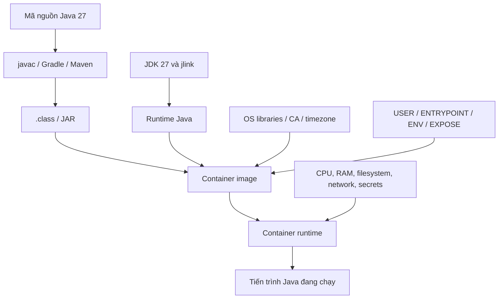
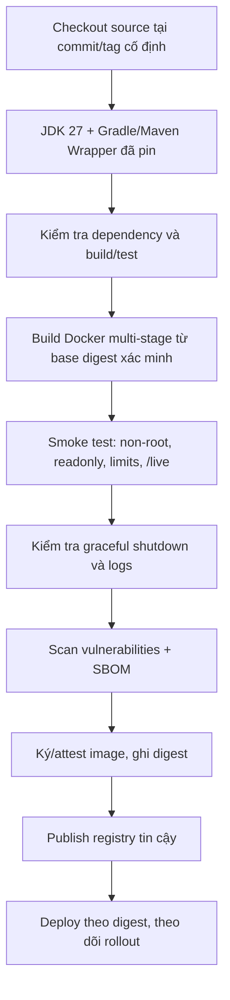

# Xây dựng container image với runtime và quyền chạy phù hợp

Đóng gói một chương trình Java 27 vào container không đơn giản là `COPY app.jar` rồi gọi `java -jar`. Một image phát hành cần **runtime đúng phiên bản**, **các dependency và thư viện native phù hợp**, **quyền chạy tối thiểu**, **giới hạn tài nguyên** và **vòng đời tiến trình rõ ràng**. Nếu chỉ kiểm tra “container start được”, dịch vụ vẫn có thể lỗi khi gặp `SIGTERM`, khởi động bằng UID không phải root, truy cập TLS, ghi file tạm hoặc chạy trong container có RAM hạn chế.

Trong chương **Đóng gói và triển khai**, bài này dùng API và công cụ hiện hành của **Java 27**: `javac`, `jdeps`, `jlink`, `java`, Docker multi-stage và cấu hình bảo mật Linux containers. Không dùng các giải pháp cũ chỉ dựa vào JVM flag không còn được hỗ trợ, cũng không giả định image nhỏ nhất đồng nghĩa image tốt nhất.

Sau bài học, bạn có thể:

- Phân biệt JAR, JDK, JRE, `jlink` runtime và container image.
- Tạo một Dockerfile hai stage: builder dùng JDK 27, runtime chỉ chứa Java runtime và ứng dụng.
- Chạy tiến trình Java bằng UID/GID non-root, với filesystem chỉ đọc và vùng ghi tạm được kiểm soát.
- Phân biệt `EXPOSE` với publish port, `ENTRYPOINT` dạng exec với shell form, liveness với readiness.
- Thiết lập ngân sách RAM/CPU mà không nhầm giới hạn heap `-Xmx` với toàn bộ bộ nhớ tiến trình.
- Kiểm tra khả năng tương thích native libraries, CA, JNI, multi-architecture, image digest và quy trình triển khai.

> Phạm vi ví dụ là **Linux containers**. Windows containers dùng runtime, tài khoản và mô hình permission khác. Những lệnh trong bài là mẫu thực hành, không phải kết quả đã chạy trên hạ tầng của người học.

## 1. Các thành phần trong một container Java



**JAR** lưu bytecode và tài nguyên ứng dụng, không nhất thiết chứa JVM. **Java runtime** chứa lệnh `java` cùng những module/thư viện cần thiết. **Container image** bao gồm nhiều lớp filesystem và metadata. **Container** là một instance đang chạy, với tiến trình, namespace, cgroups, network và các mount do runtime cấu hình.

Container Linux **chia sẻ kernel của host**, không tự mang một kernel riêng. Vì vậy, dù bytecode Java thường có tính di động, `libjvm.so`, JNI libraries và runtime do `jlink` tạo ra vẫn chịu ràng buộc về OS, libc và CPU architecture.

| Thành phần | Vai trò | Điều cần cố định/kiểm tra |
|---|---|---|
| Source và ứng dụng | Logic và bytecode | Commit, dependencies, Java target |
| Builder JDK | Biên dịch và đóng gói | JDK 27 vendor/patch, Gradle/Maven version |
| Java runtime | Chạy chương trình | Module, native libs, certificate store |
| OS base | Userland Linux | Distro, libc, patch, architecture |
| Image | Artifact để triển khai | Tag, image digest, SBOM |
| Security context | Quyền tiến trình | UID/GID, capabilities, seccomp |
| Runtime limits | Tài nguyên hệ thống | Heap + native memory, CPU, PID, volumes |
| Orchestrator | Triển khai/giám sát | Health probes, graceful shutdown, network |

## 2. Chọn JDK image, JRE image hay custom runtime

Một ứng dụng Java 27 có thể triển khai theo ba cách phổ biến:

| Lựa chọn | Ưu điểm | Đánh đổi |
|---|---|---|
| Full JDK 27 | Dễ chạy công cụ như `jcmd`, `jfr`, debug | Nhiều tool không cần thiết trong image production |
| Vendor JRE 27 | Dễ dùng, có sẵn nhiều module, ít công cấu hình hơn | Có thể mang module mà app không dùng |
| Runtime tạo bằng `jlink` | Chỉ đóng các module được chọn; kiểm soát footprint | Phải kiểm thử module nạp động, service providers, CA và native deps |

**Gợi ý quy trình:** dùng **JDK 27 trong builder stage**, sau đó chọn **JRE 27 hoặc runtime `jlink` trong final stage**. Không đưa source, test reports, compiler, Gradle/Maven cache hoặc credentials từ builder vào image chạy.

Với framework nhiều dependency như Spring Boot, một **vendor JRE** thường là lựa chọn khởi đầu dễ bảo trì; custom `jlink` runtime phù hợp hơn khi đã kiểm soát được module graph và kiểm thử integration đầy đủ. Không tối ưu image bằng cách loại module ngẫu nhiên vì mục tiêu số MB nhỏ.

## 3. Docker multi-stage và ranh giới trust

Dockerfile có thể chứa nhiều câu lệnh `FROM`. Mỗi stage có filesystem riêng. Stage cuối chỉ nhận các file được copy qua `COPY --from=...` cùng với nội dung vốn có của runtime base.

```text
STAGE build:
  JDK 27 + source + javac/jlink + build caches
                   |
                   | COPY các output cần thiết
                   v
STAGE runtime:
  OS base + custom Java runtime + compiled classes
  USER non-root + ENTRYPOINT Java
```

Lợi ích:

1. Không mang build tool và source vào lớp cuối.
2. Tách lớp build có nhiều quyền/tài nguyên khỏi lớp runtime.
3. Cho phép kiểm tra rõ một image cuối chứa những file nào.
4. Hỗ trợ tối ưu cache build mà không biến cache thành phần của runtime image.

**Multi-stage không tự cung cấp quyền tối thiểu.** Nếu stage cuối vẫn `USER root`, copy file chứa secrets hoặc nhận một image base bị thay đổi không được thẩm định, quy trình chưa đạt yêu cầu.

## 4. Ứng dụng mẫu Java 27 có endpoint /live

Để ví dụ tự chứa, ta tạo một HTTP server nhỏ bằng **module `jdk.httpserver`** của JDK, không cần tải dependency bên ngoài. Server nghe `0.0.0.0:8080` và trả văn bản `alive` qua `GET /live`.

Cấu trúc project:

```text
container-demo/
├── Dockerfile
├── .dockerignore
└── src/
    └── demo/
        └── App.java
```

Nội dung `src/demo/App.java`:

```java
package demo;

import com.sun.net.httpserver.HttpExchange;
import com.sun.net.httpserver.HttpServer;
import java.io.IOException;
import java.net.InetSocketAddress;
import java.nio.charset.StandardCharsets;
import java.util.concurrent.Executors;

public final class App {

    private App() {}

    private static void handleHealth(HttpExchange exchange)
            throws IOException {
        try (exchange) {
            if (!"GET".equals(exchange.getRequestMethod())) {
                exchange.getResponseHeaders().set("Allow", "GET");
                exchange.sendResponseHeaders(405, -1);
                return;
            }

            byte[] body = "alive\n".getBytes(StandardCharsets.UTF_8);
            exchange.getResponseHeaders().set(
                "Content-Type", "text/plain; charset=utf-8"
            );
            exchange.sendResponseHeaders(200, body.length);

            try (var output = exchange.getResponseBody()) {
                output.write(body);
            }
        }
    }

    public static void main(String[] args) throws Exception {
        int port = Integer.parseInt(
            System.getenv().getOrDefault("PORT", "8080")
        );
        if (port < 1 || port > 65535) {
            throw new IllegalArgumentException("PORT không hợp lệ");
        }

        var server = HttpServer.create(
            new InetSocketAddress("0.0.0.0", port), 0
        );
        server.createContext("/live", App::handleHealth);

        var executor = Executors.newVirtualThreadPerTaskExecutor();
        server.setExecutor(executor);

        Runtime.getRuntime().addShutdownHook(new Thread(() -> {
            System.out.println("Đã nhận tín hiệu dừng");
            server.stop(2);
            executor.close();
        }, "shutdown"));

        server.start();
        System.out.println("HTTP server đang nghe cổng " + port);
    }
}
```

Trong Java SE 27, `HttpExchange` triển khai `AutoCloseable` nên `try (exchange)` có thể đóng tài nguyên request/response. Module `jdk.httpserver` là API chính thức của JDK; `com.sun.net.httpserver` **không phải** API nội bộ yêu cầu `--add-exports`.

Đoạn chương trình chỉ phù hợp để học đóng gói và lifecycle. Một HTTP server production cần thêm TLS termination, authentication, routing, rate limiting, metrics, timeout và quản lý lỗi. `server.stop(2)` ngừng nhận yêu cầu và cho các exchange hiện có thời gian xử lý; với handler I/O có thể treo, cần shutdown có deadline, cancellation và chính sách draining riêng.

## 5. Dockerfile hoàn chỉnh: jlink runtime + non-root

File `Dockerfile`:

```dockerfile
# syntax=docker/dockerfile:1

# Stage 1: công cụ biên dịch Java 27.
FROM eclipse-temurin:27-jdk-resolute AS build

WORKDIR /src
COPY src/demo/App.java ./src/demo/App.java

RUN set -eu; \
    mkdir -p /out/classes; \
    javac --release 27 \
      --add-modules jdk.httpserver \
      -d /out/classes /src/src/demo/App.java; \
    jlink \
      --add-modules jdk.httpserver \
      --no-header-files \
      --no-man-pages \
      --compress=zip-6 \
      --output /out/java

# Stage 2: Linux userland tương thích ABI với builder.
FROM ubuntu:26.04 AS runtime

ENV JAVA_HOME=/opt/java
ENV HOME=/tmp
ENV PORT=8080

WORKDIR /opt/app

COPY --from=build /out/java /opt/java
COPY --from=build /out/classes /opt/app/classes

USER 10001:10001

EXPOSE 8080
STOPSIGNAL SIGTERM
ENTRYPOINT ["/opt/java/bin/java", "-XX:MaxRAMPercentage=60.0", \
            "-cp", "/opt/app/classes", "demo.App"]
```

Các lựa chọn chính:

- `eclipse-temurin:27-jdk-resolute`: builder có JDK 27 trên Ubuntu Resolute. Tag này được dùng cho **ví dụ**, khi phát hành cần pin digest thật sau khi thẩm định.
- `javac --release 27`: biên dịch source theo Java 27.
- `jlink --add-modules jdk.httpserver`: tạo runtime riêng, tự kéo vào các dependency module cần thiết (bao gồm `java.base`).
- `--compress=zip-6`: cú pháp jlink hiện hành trong Java SE 27. Cách viết số cũ `--compress=2` đã được đánh dấu deprecated; không tiếp tục dùng trong ví dụ mới.
- `ubuntu:26.04`: runtime OS cùng họ Ubuntu 26.04 với builder, giảm rủi ro bất tương thích glibc. Vẫn phải kiểm tra native libraries và target architecture trong thực tế.
- `USER 10001:10001`: chạy Java bằng numeric UID/GID không phải root, không yêu cầu tên user có trong `/etc/passwd`. Ứng dụng cần home directory theo username lookup phải được kiểm tra riêng.
- `ENTRYPOINT` dạng exec: chạy thẳng JVM làm tiến trình chính thay vì đặt JVM dưới `/bin/sh -c`.
- `EXPOSE 8080`: chỉ mô tả cổng, không tự publish cổng ra host.
- `-XX:MaxRAMPercentage=60.0`: minh họa giới hạn tỷ lệ heap, **không phải** ngưỡng bộ nhớ tổng hoặc công thức tối ưu cho mọi workload.

**Cần lưu ý:** Trong release thực, cả **builder base** và **runtime base** cần digest đã kiểm chứng. Các tag ở trên có thể cập nhật theo thời gian. Ví dụ cũng chưa bao gồm các cấu hình TLS/CA doanh nghiệp, JNI provider, SBOM và observability đầy đủ.

## 6. Trường hợp dùng vendor JRE thay cho jlink

Nếu project đã có executable JAR đã build và kiểm thử, đôi khi không cần tự link runtime:

```dockerfile
# Mẫu dùng khi app.jar đã được build theo format java -jar hỗ trợ.
FROM eclipse-temurin:27-jre-resolute

WORKDIR /opt/app
COPY app.jar /opt/app/app.jar

USER 10001:10001
EXPOSE 8080
STOPSIGNAL SIGTERM
ENTRYPOINT ["java", "-jar", "/opt/app/app.jar"]
```

Mẫu này **chỉ chạy được khi** `app.jar` có `Main-Class`/entrypoint phù hợp và chứa hoặc tham chiếu đúng các dependency của ứng dụng. Một JAR thư viện bình thường không tự trở thành executable; JAR thiếu dependency có thể ném `ClassNotFoundException`.

Nếu đóng gói bằng Maven hoặc Gradle, cần pin phiên bản plugin, khóa dependency graph, kiểm tra classpath, loại bỏ những file chỉ dành cho test và dùng artifact đã kiểm tra. Với framework executable JAR có layout riêng, tuân theo cách chạy của framework.

## 7. Dockerignore và an toàn build context

Dùng `.dockerignore` để không gửi file thừa và dữ liệu nhạy cảm tới builder:

```dockerignore
.git
.gradle
build
target
.idea
.vscode
*.log
*.pem
*.key
*.p12
.env
.env.*
**/node_modules
**/.DS_Store
```

Cần điều chỉnh pattern theo project. Ví dụ trên không phù hợp nếu một file `.p12` được tạo từ nguồn công khai cần thiết tại build (cần thiết kế cách cấp an toàn), hoặc nếu bạn thật sự muốn copy artifact từ `build/` ở một quy trình khác.

`.gitignore` **không thay thế** `.dockerignore`. Tránh `COPY . .` trước khi kiểm soát build context; cách tốt nhất là chỉ copy file cần thiết vào từng stage. Không nhúng private key, password, token, `.env` hay toàn bộ `.git` vào image production.

## 8. Build, chạy và kiểm tra image mẫu

Các lệnh dành cho Docker CLI/shell Unix-like, giả định project đã chứa các file trên:

```shell
docker build -t java27-health:dev .

# Kiểm tra Java trong runtime cuối, không cần cài shell.
docker run --rm --entrypoint /opt/java/bin/java \
  java27-health:dev -version

docker run --rm --entrypoint /opt/java/bin/java \
  java27-health:dev --list-modules

# Chạy với quyền hạn chế.
docker run --rm --name java27-health \
  --read-only \
  --tmpfs /tmp:rw,nosuid,nodev,size=64m,mode=1777 \
  --cap-drop=ALL \
  --security-opt no-new-privileges=true \
  --memory=512m --cpus=1 \
  -p 127.0.0.1:8080:8080 \
  java27-health:dev
```

Tại terminal khác:

```shell
curl --fail --show-error http://127.0.0.1:8080/live
```

Kết quả kỳ vọng:

```text
alive
```

Lệnh `curl` chạy **trên host**; image tối giản không cần chứa curl. Trên Windows PowerShell, chọn HTTP client phù hợp, và các lệnh xuống dòng của shell cần chuyển đổi.

| Cờ/thiết lập | Ý nghĩa |
|---|---|
| `--read-only` | Root filesystem của container là chỉ đọc |
| `--tmpfs /tmp:...` | Chỉ cho ghi tạm vào vùng RAM có giới hạn |
| `--cap-drop=ALL` | Loại bỏ Linux capabilities không cần thiết |
| `no-new-privileges=true` | Ngăn tăng quyền qua cơ chế OS tương ứng |
| `--memory=512m` | Giới hạn RAM của container |
| `--cpus=1` | Giới hạn CPU quota |
| `-p 127.0.0.1:8080:8080` | Chỉ công bố dịch vụ trên loopback của host |
| `--rm` | Xóa container sau khi dừng |

Nếu cần quan sát metadata UID:

```shell
docker image inspect java27-health:dev \
  --format '{{.Config.User}}'
```

Kết quả kỳ vọng là `10001:10001`. Nhưng runtime có thể ghi đè user bằng `docker run --user` hoặc Kubernetes `securityContext`, nên cần xác minh trên instance đã triển khai khi cần.

**Không dùng `--privileged` để làm mẫu kiểm thử.** Quyền hạn rộng có thể che các lỗi permission mà production cần phát hiện sớm.

## 9. Quyền chạy: non-root, file ownership và port

Chạy `USER root` trong container không đồng nghĩa root host trong mọi cấu hình, nhưng làm tăng quyền của tiến trình trong container và có thể tăng tác động khi mount tài nguyên host hoặc khi tồn tại lỗ hổng runtime.

Khuyến nghị:

- Chạy bằng **UID/GID cố định không phải 0**.
- Giữ mã, class files và runtime Java **chỉ đọc** đối với app user.
- Chỉ cấp quyền ghi cho một hoặc vài thư mục cần thiết; ưu tiên mount hoặc tmpfs có giới hạn.
- Không dùng `chmod -R 777 /`, không chuyển toàn bộ `/opt/java` thành writable và không dùng `sudo` trong runtime.
- Dùng cổng không đặc quyền như `8080` bên trong container, rồi ánh xạ ra `80`/`443` bằng hạ tầng mạng.

Ví dụ phân quyền:

```text
/opt/java/         root-owned, executable/readable
/opt/app/classes/  root-owned, readable
/tmp/              writable, ephemeral, có giới hạn
/data/             chỉ tạo khi nghiệp vụ thực sự cần
/run/secrets/      read-only, chính sách quyền riêng
```

Non-root **không bắt buộc mọi file phải do app user sở hữu**. Nếu chỉ cần đọc/thực thi, root-owned file với mode phù hợp giúp hạn chế việc tiến trình bị xâm nhập có thể tự sửa binary.

**Port:** `EXPOSE 8080` là metadata của image; không tự mở cổng host. Ứng dụng phải bind `0.0.0.0` hoặc interface mạng container phù hợp và runtime cần publish port bằng `-p`/Service. Nếu Java chỉ bind `127.0.0.1` **bên trong container**, một cổng được publish từ host thường không truy cập được như mong đợi.

## 10. Read-only filesystem và vùng ghi tạm

`--read-only` là một lớp hardening hiệu quả: nó không cho tiến trình sửa filesystem root của container. Nhưng điều này không có nghĩa container hoàn toàn không có vùng ghi: volume, bind mount, tmpfs hoặc các mount do orchestrator cấp vẫn có thể ghi.

Ứng dụng Java có thể cần chỗ để:

- Tạo file tạm theo `java.io.tmpdir` (thường là `/tmp`).
- Giải nén native/JNI library hoặc xử lý upload.
- Lưu cache có giới hạn và dữ liệu tạm có thể tạo lại.
- Ghi trạng thái nghiệp vụ cần được quản lý riêng.

Hãy xác định **loại dữ liệu**:

| Dữ liệu | Cách lưu phù hợp |
|---|---|
| File tạm có thể bỏ | `/tmp` trên tmpfs có giới hạn |
| Log ứng dụng | stdout/stderr hoặc log sink được quản trị |
| Secret | Secret store hoặc mount riêng, chỉ đọc |
| Dữ liệu nghiệp vụ bền vững | Database/object storage/volume có hợp đồng sao lưu |
| Cấu hình chỉ đọc | Config/Secret mount theo nền tảng |
| Cache có thể tái tạo | Cache service/volume hoặc tmpfs giới hạn |

Ví dụ:

```shell
docker run --rm \
  --read-only \
  --tmpfs /tmp:rw,nosuid,nodev,size=64m,mode=1777 \
  java27-health:dev
```

Nếu dùng `noexec` cho `/tmp`, một số thư viện có cơ chế trích xuất native libraries vào thư mục tạm có thể thất bại khi thực thi. Không mở rộng quyền tùy tiện; kiểm tra chính xác thư viện nào cần file executable và thiết kế một mount khác với quyền hạn hẹp nếu thật sự cần.

**Không dựa vào writable layer của container để lưu dữ liệu cần tồn tại sau restart.** Một container bị thay thế hoặc bị xóa có thể mất toàn bộ nội dung chỉ tồn tại trong layer đó.

## 11. Capabilities, seccomp và không leo thang đặc quyền

Một user không phải root là nền tảng, nhưng chưa đủ. Linux containers còn có các cấu hình giới hạn quyền hệ điều hành:

| Cơ chế | Mục đích | Điểm cần kiểm tra |
|---|---|---|
| `--cap-drop=ALL` | Bỏ Linux capabilities không dùng | Chỉ cấp lại capability đã được chứng minh cần |
| `no-new-privileges` | Ngăn một số cách nâng quyền của tiến trình | Không thay cho non-root và seccomp |
| seccomp | Lọc system calls | Profile quá chặt có thể làm JVM/JIT hoặc tạo thread thất bại |
| AppArmor/SELinux | Mandatory access control | Phụ thuộc host/runtime |
| Rootless Docker/user namespace | Giảm đặc quyền daemon hoặc remap user | Không tự thay thế `USER` của image |
| Network policy | Giới hạn đường kết nối | Cần hạ tầng điều phối phù hợp |

Không dùng:

```shell
docker run --privileged java27-health:dev
```

như một “cách sửa nhanh” khi có lỗi permission. Nếu tiến trình không ghi được `/data`, hãy kiểm tra UID, owner/mode và mount; nếu không mở được cổng 80, hãy dùng cổng 8080 và ánh xạ ngoài container; nếu TLS thất bại, hãy kiểm tra CA, không cấp quyền kernel rộng hơn.

Bật chế độ debug/trace và công cụ JVM có thể yêu cầu một số đặc quyền hoặc gói hỗ trợ; với production, dùng môi trường debug được cấp phép riêng thay vì nâng quyền mọi container dịch vụ.

## 12. PID 1, SIGTERM và graceful shutdown

Container runtime gửi tín hiệu để yêu cầu dừng tiến trình. Docker mặc định dùng `SIGTERM` trước, sau thời gian chờ có thể dùng `SIGKILL`. Một orchestrator như Kubernetes cũng có termination grace period.

So sánh:

```dockerfile
# Nên dùng: Java trực tiếp là tiến trình container.
ENTRYPOINT ["/opt/java/bin/java", "-cp", "/opt/app/classes", "demo.App"]

# Nên tránh nếu không có lý do: tạo shell cha.
ENTRYPOINT java -cp /opt/app/classes demo.App
```

Dạng shell tương đương chạy qua `/bin/sh -c`, có thể khiến tín hiệu không đến Java như dự tính. Nếu thực sự cần shell script xử lý biến môi trường trước khi chạy, script nên kết thúc bằng `exec java ...` để shell nhường vị trí tiến trình chính cho JVM.

Shutdown hook:

```java
Runtime.getRuntime().addShutdownHook(new Thread(() -> {
    // 1. Ngừng nhận yêu cầu mới.
    // 2. Cho tác vụ đang chạy cơ hội hoàn tất.
    // 3. Đóng DB/network/telemetry có thời hạn.
    // 4. Thoát.
}));
```

Một dịch vụ cần đặt deadline cho việc draining. Nếu một request bị treo vô hạn, shutdown hook đợi mãi có thể khiến container runtime buộc gửi `SIGKILL`. `SIGKILL` không thể được ứng dụng xử lý và shutdown hook không được bảo đảm chạy trong mọi tình huống (ví dụ bị kill cưỡng bức hoặc crash nghiêm trọng).

### Không nhầm quy trình dừng với exception handling

`try-with-resources` giúp đóng tài nguyên trong một phương thức Java; shutdown hook phụ trách vòng đời toàn tiến trình. Cả hai cần phối hợp khi ứng dụng có long-running server, executor, JDBC pool hoặc native libraries.

Ví dụ HTTP server ở mục 4 chủ động gọi `server.stop(2)` và `executor.close()`, đủ minh họa nguyên lý. Với API thực thi giao dịch dài, cần dừng nhận request, chờ các request trong giới hạn, hủy các task bị timeout và kiểm tra idempotency trước khi thoát.

## 13. Liveness, readiness và startup probes

Các probe không cùng mục đích:

| Probe | Câu hỏi | Khi thất bại |
|---|---|---|
| **Startup** | Ứng dụng đã khởi tạo xong chưa? | Có thể trì hoãn liveness/readiness cho tới khi startup hoàn tất |
| **Readiness** | Instance có thể nhận request mới không? | Orchestrator ngừng chuyển traffic mới vào instance |
| **Liveness** | Tiến trình có cần được restart không? | Orchestrator có thể khởi động lại |

Một liveness endpoint **không nên thường xuyên phụ thuộc database hoặc upstream HTTP service**, vì sự cố tạm thời của downstream có thể gây restart hàng loạt. Readiness có thể kiểm tra tình trạng phục vụ cần thiết của ứng dụng, nhưng cũng phải tránh probe quá đắt.

Ví dụ mẫu chỉ có `/live`. Nếu cần readiness thật, nên viết `/ready` dựa trên trạng thái khởi tạo và khả năng phục vụ. Đừng chỉ sao chép `/live` rồi tuyên bố đã đo readiness nghiệp vụ.

### Không đưa curl vào image tối giản chỉ vì healthcheck

Một Dockerfile có thể hỗ trợ:

```dockerfile
# Chỉ là mẫu cú pháp khi image ĐÃ chứa curl.
HEALTHCHECK --interval=30s --timeout=3s \
  CMD ["curl", "--fail", "http://127.0.0.1:8080/live"]
```

**Không đưa đoạn HEALTHCHECK này vào Dockerfile `jlink` của bài**, vì image không có `curl`. Nếu thêm, healthcheck sẽ thất bại vì thiếu executable, không phải vì Java server chết.

Trong Kubernetes, probe HTTP do kubelet thực hiện và không cần cài curl vào container. Với Docker thuần, có thể dùng binary probe được đóng gói có chủ đích hoặc hệ thống giám sát bên ngoài.

`EXPOSE` chỉ là metadata, còn `HEALTHCHECK` không phải cơ chế authentication. Không lộ endpoint chỉ dành cho quản trị/diagnostics ra Internet nếu không cần thiết.

## 14. Java 27 nhận biết cgroup: heap không phải tổng RAM

JVM HotSpot trên Linux hỗ trợ tự nhận diện container CPU và memory limits bằng `-XX:+UseContainerSupport`, được bật mặc định. Các cgroup và cấu hình runtime thực tế quyết định những giới hạn JVM nhìn thấy.

Điều phải phân biệt:

```text
Giới hạn RAM container
  ├── Java heap (-Xmx / MaxRAMPercentage)
  ├── Metaspace
  ├── Code cache / JIT
  ├── Platform thread stacks, carrier threads
  ├── Direct ByteBuffer và FFM native allocations
  ├── GC/JVM native metadata
  └── JNI/native library memory
```

`-Xmx` chỉ giới hạn **heap**. Nếu đặt `-Xmx512m` trong container giới hạn 512 MiB thì container có thể bị OOM kill dù Java heap chưa đầy, vì tổng RAM còn gồm nhiều thành phần khác.

Trong Dockerfile của bài:

```text
-XX:MaxRAMPercentage=60.0
```

được dùng làm ví dụ: JVM đặt heap tối đa theo tỷ lệ của bộ nhớ nhận diện được, trong điều kiện các flag khác không ghi đè và ergonomics phù hợp. **Đừng tính máy móc rằng sẽ luôn đúng 307,2 MiB trong container 512 MiB**; kích thước thực tế phải được quan sát.

Kiểm tra JVM hiểu container ra sao:

```shell
docker run --rm --memory=512m --cpus=1 \
  --entrypoint /opt/java/bin/java java27-health:dev \
  -XX:MaxRAMPercentage=60.0 -XshowSettings:system -version
```

Có thể xem thêm `-XshowSettings:vm` và logging container của HotSpot (`-Xlog:os+container=info` hoặc mức trace khi chẩn đoán). Không tắt `UseContainerSupport` chỉ dựa trên lời khuyên tối ưu dành cho JDK cũ.

### GC và RAM ở JDK 27

HotSpot JDK 27 dùng **G1 theo mặc định** khi collector này có trong bản dựng (JEP 523). Trong container nhỏ, vẫn cần đo GC pause, CPU, native memory và heap live set; không giả định một GC mới sẽ giải quyết mọi OOM. Khi thử ZGC/collector khác, phải kiểm tra runtime thực sự hỗ trợ rồi benchmark dưới tải đại diện.

## 15. CPU quota, thread pool và virtual threads

`--cpus=1` giới hạn lượng CPU có thể dùng; virtual threads không biến một CPU thành nhiều CPU. JVM có thể dùng cgroup CPU quota/cpuset trong các quyết định về GC worker và thread pools.

Trong những môi trường cần điều chỉnh thủ công, HotSpot hỗ trợ:

```text
-XX:ActiveProcessorCount=2
```

Cờ này ghi đè số processor mà JVM dùng cho một số heuristic. Không thêm cờ một cách máy móc: đặt cao hơn CPU quota có thể dẫn đến cạnh tranh hoặc throttling; đặt quá thấp có thể làm giảm throughput.

Với service nhiều request, ngoài CPU quota cần theo dõi:

- Số request đang xử lý và giới hạn admission.
- Pool kết nối database hoặc HTTP downstream.
- Tốc độ tạo object/GC.
- Blocking native calls, Java thread stacks.
- Cách cấu hình executor, virtual threads và cancellation.

**Giới hạn số thread, giới hạn tài nguyên downstream và giới hạn CPU là ba bài toán khác nhau.** Chúng có thể cùng tồn tại trong một hệ thống.

## 16. Xác định module runtime với jdeps và jlink

`jlink` lắp ghép các module và dependency module để tạo Java runtime tối giản. Trong ví dụ, root module `jdk.httpserver` kéo thêm các phụ thuộc cần thiết.

```shell
jlink \
  --add-modules jdk.httpserver \
  --no-header-files --no-man-pages \
  --compress=zip-6 \
  --output out/java
```

Kiểm tra runtime:

```shell
out/java/bin/java -version
out/java/bin/java --list-modules
```

`jdeps` phân tích phụ thuộc tĩnh của bytecode. Ví dụ với một JAR và các JAR thư viện được giải nén riêng:

```shell
jdeps --multi-release 27 \
  --print-module-deps \
  --class-path 'lib/*' \
  app.jar
```

Kết quả gồm tên module phân cách bằng dấu phẩy, có thể dùng làm danh sách đầu vào của `jlink --add-modules`.

**Đừng coi `jdeps` là máy phát hiện mọi dependency động.** Nó không nhất thiết nhìn thấy:

- `Class.forName` và reflection.
- `ServiceLoader` hoặc provider được chọn lúc chạy.
- Driver JDBC hoặc crypto provider nạp động.
- Framework có custom classloader/nested fat JAR.
- Native library/JNI.
- Các đường code chỉ chạy ở production như email, TLS, locale và database.

Khi có service providers quan trọng, kiểm tra mô-đun provider và cân nhắc `jlink --bind-services` trong trường hợp hợp đồng yêu cầu; phải đánh giá lại kích thước và thành phần runtime. Tối ưu module graph cần integration tests với **đúng phiên bản runtime** đã đóng gói, không chỉ dựa vào kết quả phân tích tĩnh.

### Cú pháp jlink Java 27

Theo tài liệu `jlink` Java 27, dùng `--compress=zip-6` hoặc dải `zip-0` đến `zip-9`. Các giá trị số `0`, `1`, `2` là cú pháp cũ **deprecated**; không nên đưa `--compress=2` vào ví dụ build mới.

## 17. Classpath, fat JAR và framework

Với một ứng dụng có nhiều thư viện, cách chạy phụ thuộc artifact:

| Loại artifact | Lệnh chạy ví dụ | Lưu ý |
|---|---|---|
| Executable JAR có manifest và dependencies phù hợp | `java -jar app.jar` | Không phải mọi JAR đều có `Main-Class` |
| Classes + JAR riêng | `java -cp "classes:lib/*" demo.App` | Classpath trên Linux dùng dấu `:` |
| Named module | `java --module-path mlib -m demo.app/demo.Main` | Cần module graph chính xác |
| Framework executable JAR | Theo plugin/framework đang dùng | Có thể có nested JAR hoặc launcher riêng |

Đừng giả định `java -jar app.jar` sẽ tự load mọi JAR nằm cạnh nó. Nếu một dependency thiếu trong manifest/classpath hoặc không được đóng gói, runtime có thể báo `ClassNotFoundException` hoặc `NoClassDefFoundError`.

Với Spring Boot và các framework khác, nên sử dụng artifact do plugin chính thức tạo, kiểm thử với JRE/JDK đã chọn, và cân nhắc layered JAR/CDS khi có số liệu hiệu năng. Đừng tự cắt module hoặc strip native libraries chỉ vì muốn image nhỏ hơn.

## 18. Tương thích OS/libc/JNI và đa kiến trúc

Java bytecode tương đối di động, nhưng `java` launcher/JVM runtime do `jlink` sinh ra chứa **native binary**. Chúng phải tương thích:

- CPU: AMD64 khác ARM64.
- OS/kernel: Linux không phải Windows hoặc macOS.
- libc/ABI: Ubuntu/Debian glibc không mặc định tương thích Alpine musl.
- JNI/native dependencies: phải có bản build phù hợp của từng thư viện.
- CA/locale/timezone/font packages nếu ứng dụng thực sự dùng.

Không copy runtime `jlink` được tạo trên Ubuntu AMD64 sang Alpine ARM64 rồi hy vọng `java` chạy chỉ vì class file là Java. Chọn runtime base cùng họ ABI, và build riêng cho từng architecture hoặc dùng toolchain cross-build đã kiểm thử.

Kiểm tra OS/architecture:

```shell
docker image inspect java27-health:dev \
  --format '{{.Os}}/{{.Architecture}}'
```

Với multi-arch image, phải xác minh binary và native dependencies của **từng platform**, không chỉ manifest có nhiều entries.

**Distroless** có thể giảm bề mặt bằng việc không chứa shell/package manager, nhưng làm debug khó hơn và yêu cầu kiểm tra glibc, certificates, UID, modules và JNI thật kỹ. Không chọn image chỉ vì có kích thước nhỏ nhất.

## 19. Secrets, cấu hình runtime và CA certificates

Một image production nên được build từ source và các input đã thẩm định, không chứa password hoặc token gắn với môi trường triển khai.

**Không làm:**

```dockerfile
# Ví dụ sai: không đưa bí mật vào image metadata/layers.
ENV DATABASE_PASSWORD=hardcoded-secret
ARG PRIVATE_TOKEN=secret-value
RUN echo "$PRIVATE_TOKEN" > /opt/app/token
```

Dockerfile `ARG` và `ENV` có thể xuất hiện trong history, metadata hoặc build provenance. Dù xóa file secret ở layer sau, byte có thể vẫn tồn tại ở layer trước đó. Đừng log giá trị secrets trong quá trình build.

### Build-time secrets

Khi cần truy cập artifact repository/private registry lúc build, dùng **BuildKit secret mount** thay vì đưa token vào `ARG`:

```dockerfile
# Mẫu chỉ minh họa kỹ thuật cấp secret; build thật cần lệnh hợp lệ.
RUN --mount=type=secret,id=repo_token \
    test -s /run/secrets/repo_token
```

Secret mount được cấp trong phạm vi lệnh. Tuy nhiên, chính build script vẫn có thể tự ghi secret ra log/file nếu được lập trình sai; công cụ mount không thể ngăn mọi hành vi làm lộ dữ liệu.

### Runtime secrets

Khi chạy thực tế:

- Ưu tiên secret store hoặc file mount được quản lý, với quyền đọc phù hợp cho UID của ứng dụng.
- Biến môi trường tiện sử dụng nhưng có thể lộ qua công cụ inspect/diagnostics nếu có quyền thích hợp; xem chính sách tổ chức.
- Không đưa password lên command line ở dạng dễ lộ qua process listing.
- Không copy `.env`, private key, chứng chỉ chứa khóa riêng hoặc token vào image.
- Tách secret rotation khỏi build image khi có thể.

### CA và truststore

Ứng dụng Java gọi HTTPS cần **truststore và security provider phù hợp**. Custom runtime từ `jlink` chứa cấu hình bảo mật Java theo module được chọn, nhưng certificate authority nội bộ hoặc OS base tối giản có thể cần thiết lập bổ sung.

Một số lựa chọn:

1. Cấp CA theo chính sách của JDK vendor và base image.
2. Mount truststore đã được quản trị vào container, với quyền chỉ đọc.
3. Cấu hình client HTTP/TLS dùng truststore theo chính sách ứng dụng.
4. Kiểm tra handshake thực sự tới endpoint cần thiết trong integration test.

Không dùng `trust-all` hay tắt hostname verification để làm TLS “chạy được”. Chúng loại bỏ thuộc tính xác thực cốt lõi của TLS.

## 20. Pin digest, phát hành immutable image và SBOM

Tag Docker, ví dụ:

```dockerfile
FROM eclipse-temurin:27-jdk-resolute
```

là **nhãn có thể được cập nhật** theo thời gian khi vendor phát hành patch. Để pin chính xác image đầu vào, sử dụng image **digest**:

```dockerfile
# Chỉ minh họa cấu trúc: chưa chứa digest thật.
FROM eclipse-temurin:27-jdk-resolute@sha256:REPLACE_WITH_VERIFIED_DIGEST
```

Giá trị trên **không chạy được nguyên xi**: phải thay placeholder bằng digest hợp lệ từ registry đáng tin và kiểm chứng theo chính sách tổ chức. Cả builder base và runtime base đều cần được kiểm soát.

| Kiểu tham chiếu | Bảo đảm |
|---|---|
| Tag như `:27-jre-resolute` | Dễ đọc nhưng có thể trỏ sang byte khác sau khi vendor cập nhật |
| Digest `@sha256:...` | Tham chiếu một artifact image content cụ thể |
| Chữ ký/provenance đã kiểm chứng | Cung cấp bằng chứng về identity và quá trình build theo hệ thống trust |
| SBOM | Liệt kê thành phần phục vụ phân tích lỗ hổng/giấy phép |

Pin digest **không** tự nhận các bản vá mới. Cần cơ chế cập nhật có kiểm soát:

1. Theo dõi security advisories và các version JDK 27 đã phát hành.
2. Đề xuất thay digest bằng pull request.
3. Kiểm tra provenance/identity và kết quả quét.
4. Build lại, chạy functional/security tests.
5. Publish image mới và triển khai theo digest mới.
6. Lưu digest cũ để rollback có chủ đích.

**SBOM** (ví dụ SPDX hoặc CycloneDX) hỗ trợ kiểm kê thành phần. Nó không tự chứng minh image an toàn hay artifact chưa bị thay byte. Nên kết hợp SBOM với checksum, signing, vulnerability management và các bằng chứng release khác.

## 21. Kubernetes: securityContext, resources và probes

Một Kubernetes Deployment có thể ghi rõ các chính sách runtime thay vì chỉ dựa vào metadata `USER` của Dockerfile. Ví dụ dưới đây giả định image đã publish lên registry và bạn đã có digest thật.

```yaml
apiVersion: apps/v1
kind: Deployment
metadata:
  name: java27-health
spec:
  replicas: 2
  selector:
    matchLabels:
      app: java27-health
  template:
    metadata:
      labels:
        app: java27-health
    spec:
      terminationGracePeriodSeconds: 30
      securityContext:
        runAsNonRoot: true
        runAsUser: 10001
        runAsGroup: 10001
        seccompProfile:
          type: RuntimeDefault
      containers:
        - name: java27-health
          image: registry.example/java27-health@sha256:<VERIFIED_DIGEST>
          imagePullPolicy: IfNotPresent
          ports:
            - name: http
              containerPort: 8080
          securityContext:
            allowPrivilegeEscalation: false
            readOnlyRootFilesystem: true
            capabilities:
              drop:
                - ALL
          resources:
            requests:
              cpu: "250m"
              memory: "256Mi"
            limits:
              cpu: "1"
              memory: "512Mi"
          livenessProbe:
            httpGet:
              path: /live
              port: http
            initialDelaySeconds: 5
            periodSeconds: 15
            timeoutSeconds: 2
          readinessProbe:
            httpGet:
              path: /live
              port: http
            initialDelaySeconds: 2
            periodSeconds: 5
            timeoutSeconds: 2
          volumeMounts:
            - name: temp
              mountPath: /tmp
      volumes:
        - name: temp
          emptyDir:
            medium: Memory
            sizeLimit: 64Mi
```

Chú ý:

- `runAsNonRoot`, `runAsUser`, `runAsGroup` quy định danh tính ứng dụng.
- `allowPrivilegeEscalation: false`, `capabilities.drop: [ALL]` và `RuntimeDefault` hạn chế quyền của Linux process.
- `readOnlyRootFilesystem` bảo vệ filesystem root; `emptyDir` là vùng ghi tạm và phải tính đến giới hạn memory.
- `requests` ảnh hưởng scheduling; `limits` ràng buộc tài nguyên của container.
- HTTP probes do Kubernetes thực hiện, **không cần cài curl vào image**.
- `terminationGracePeriodSeconds` phải tương ứng với thời gian dừng và draining của ứng dụng.

Địa chỉ `registry.example` và digest chỉ là placeholder. Đoạn YAML không thể được áp dụng vào cluster thực nếu chưa thay bằng image hợp lệ và thiết lập quyền pull.

**Chỉ vì app mẫu không có trạng thái readiness riêng**, probe readiness ở ví dụ gọi cùng `/live`. Với service phụ thuộc database, cache hoặc migration, phải thêm `/ready` thể hiện có thể phục vụ request thay vì coi liveness và readiness luôn tương đương.

### Ánh xạ cổng qua Service

```yaml
apiVersion: v1
kind: Service
metadata:
  name: java27-health
spec:
  selector:
    app: java27-health
  ports:
    - port: 80
      targetPort: http
  type: ClusterIP
```

Service chuyển cổng 80 **nội bộ cluster** tới port 8080 trong Pod. JVM không cần bind port 80 hoặc chạy root. Nếu muốn truy cập Internet, cần cấu hình Ingress/Gateway/LoadBalancer, TLS, authentication và NetworkPolicy thích hợp.

### Startup probe

Nếu ứng dụng cần 90 giây để khởi động, liveness check bắt đầu sau 5 giây có thể gây vòng lặp restart. Dùng `startupProbe` hoặc điều chỉnh startup thresholds sau khi đo thời gian warm-up thực tế. Không tăng timeout vô hạn chỉ để che lỗi startup.

## 22. Multi-platform image và native architecture

Docker Buildx có thể build và publish nhiều kiến trúc:

```shell
docker buildx build \
  --platform linux/amd64,linux/arm64 \
  -t registry.example/java27-health:1.0.0 \
  --push .
```

Nhưng multi-platform build **không tự cross-compile một Java runtime native bất kỳ**. `jlink` chạy trên JDK dành cho một platform và tạo runtime có native binaries tương ứng. Builder phải hỗ trợ target platforms thông qua native nodes, emulation phù hợp hoặc toolchain được kiểm chứng.

Kiểm tra manifest:

```shell
docker buildx imagetools inspect \
  registry.example/java27-health:1.0.0
```

Sau publish, lưu digest và ký/xác minh artifact theo chính sách. Với image đa kiến trúc, cần phân biệt **OCI image index digest** và **platform manifest digest**; các công cụ signing/deployment phải đồng thuận đối tượng được xác minh.

Không tái sử dụng `/opt/java` AMD64 của một build thành runtime ARM64 chỉ bằng cách thay `--platform`. Kiểm tra thêm JNI libraries, font/native dependencies và CA/locale ở từng kiến trúc.

## 23. Quy trình CI/CD đề xuất

Một pipeline đáng tin phải kiểm tra **cả nội dung artifact lẫn chính sách chạy thực tế**:



**Trước build:** pin source commit, Java 27 toolchain, build tool/plugin versions, dependency graph và image base digests. Không tải script từ Internet không được kiểm tra trong release build.

**Trong build:** dùng Docker secrets khi cần, không chép secrets sang runtime stage. Hạn chế context, sử dụng cache có kiểm soát, không tự cập nhật dependency lockfile trong pipeline phát hành.

**Trước publish:** chạy test, smoke test image final, giới hạn RAM/CPU và quyền, kiểm tra địa chỉ bind, TLS/CA, read-only rootfs, logging, SIGTERM, timeouts và failure cases.

**Trước deploy:** lưu SBOM/provenance, digest, toolchain version và kết quả quét; phê duyệt các thay đổi của base/JDK/dependencies.

**Sau deploy:** theo dõi readiness, error rate, request latency p99, OOMKilled, CPU throttling, GC, shutdown time và khả năng rollback theo digest.

Build cache không đồng nghĩa reproducible build. Nếu yêu cầu bit-for-bit reproducibility, cần hai clean builds có đầu vào/môi trường xác định rồi so sánh artifact bytes và image metadata tương ứng.

## 24. Chẩn đoán các lỗi thường gặp

| Lỗi/triệu chứng | Nguyên nhân thường gặp | Hướng điều tra |
|---|---|---|
| `exec format error` | Sai architecture | Image manifest, builder/platform và native Java binary |
| `GLIBC_... not found` | Runtime và builder khác libc/ABI | Base OS, glibc/musl, native libraries |
| `ClassNotFoundException` | JAR/classpath chưa đúng | Artifact layout, manifest và dependencies |
| `Module ... not found` | Runtime `jlink` thiếu module | `--list-modules`, `jdeps` và dynamic providers |
| `Permission denied` | UID không được đọc/ghi | `USER`, mode, ownership, volume mounts |
| `Read-only file system` | Thư viện cố ghi vào rootfs | `/tmp`, cache path, mount có giới hạn |
| `Address already in use` | Port đã có listener | Port config và port mapping |
| Không truy cập từ host | Java chỉ bind loopback container hoặc chưa publish | Bind `0.0.0.0`, `-p`, Service/firewall |
| OOMKilled, thường exit 137 | RSS vượt limit hoặc bị SIGKILL | Container events, heap/native RAM, GC, cgroup |
| Stop bị cưỡng bức | SIGTERM không đến Java hoặc shutdown treo | Exec form, hook, grace period, I/O timeout |
| TLS handshake lỗi | CA/provider/module không đầy đủ | Truststore, HTTPS test, module security |
| Healthcheck fail do thiếu curl | Image tối giản không có executable probe | Chuyển sang orchestrator HTTP probe |
| Chỉ chạy được bằng root | Permission/mount sai | Sửa quyền hẹp và thử lại bằng non-root |
| Cùng tag nhưng image khác | Tag đã cập nhật | Pin digest, kiểm tra registry provenance |

Một **exit code không tự giải thích đầy đủ nguyên nhân**: exit 137 thường liên quan SIGKILL nhưng không nhất thiết do thiếu RAM; cần đối chiếu trạng thái và sự kiện container runtime/orchestrator.

### Lệnh quan sát Docker

```shell
docker ps
docker logs java27-health
docker inspect java27-health
docker stats java27-health
docker stop java27-health
```

Nếu dùng `--rm`, container bị xóa sau khi thoát. Với ứng dụng production, gửi logs và metrics đến hệ thống tập trung; tránh phụ thuộc hoàn toàn vào việc `docker exec` vào một image không có shell.

## 25. Checklist trước khi phát hành

1. **Java đúng bản:** image runtime thực sự chạy Java 27 với patch/vendor đã duyệt.
2. **Toolchain:** JDK, Gradle/Maven Wrapper, plugin và dependency versions đã pin.
3. **Image digest:** builder/runtime base được kiểm chứng; biết digest cuối khi publish.
4. **Runtime đủ module:** test TLS, JDBC, locales, logging, providers và JNI nếu ứng dụng dùng.
5. **ABI đúng:** runtime phù hợp libc, CPU architecture và native libraries.
6. **Đúng artifact:** JAR có main class, dependencies và cấu trúc classpath đúng.
7. **Multi-stage:** không copy compiler/source/build caches/secrets vào stage cuối.
8. **Non-root:** UID/GID mặc định và effective identity ở cluster đều không phải 0.
9. **Filesystem:** runtime chỉ đọc, writable paths có chủ đích và dung lượng giới hạn.
10. **Privileges:** không privileged, bỏ capabilities dư thừa, không escalation.
11. **Ports:** ứng dụng bind interface đúng và cổng không đặc quyền; network route có kiểm soát.
12. **Shutdown:** JVM nhận SIGTERM, draining có deadline, không treo vô hạn.
13. **Health:** liveness/readiness/startup probes đúng vai trò.
14. **Resources:** heap + native memory dưới RAM limit; CPU được thử dưới quota thực.
15. **Observability:** logs stdout/stderr, metrics và cách điều tra không cần phá security policy.
16. **Configuration:** secret ngoài image; CA/truststore đã kiểm chứng.
17. **Supply chain:** quét lỗ hổng, lưu SBOM/signing/provenance nếu cần.
18. **Multi-platform:** mỗi platform đã có smoke/integration test.
19. **Release test:** chạy image trong điều kiện non-root/readonly/cap-drop giống production.
20. **Rollback:** image digest trước và sau deploy đều được ghi nhận.

## 26. Bài tập thực hành và đáp án

### Bài 1 — Chọn runtime

Một HTTP server thuần Java 27 chỉ dùng `jdk.httpserver`. Hãy tạo runtime bằng `jlink` và kiểm tra những module được đóng vào.

**Đáp án gợi ý:** `jlink --add-modules jdk.httpserver --output out/java`; sau đó `out/java/bin/java --list-modules` và smoke test HTTP. `jlink` kéo các module phụ thuộc như `java.base`.

### Bài 2 — UID non-root

Image chạy bằng root và lưu log vào `/var/log/app`. Làm sao giảm quyền mà vẫn có log?

**Đáp án gợi ý:** chạy `USER 10001:10001`, chuyển log sang stdout/stderr hoặc mount một volume đúng UID/GID với rotation. Không dùng `chmod -R 777 /`.

### Bài 3 — ENTRYPOINT và SIGTERM

Vì sao `ENTRYPOINT java -jar app.jar` có thể ảnh hưởng tới graceful shutdown?

**Đáp án gợi ý:** dạng shell chạy qua `/bin/sh -c`, shell có thể không chuyển tín hiệu đúng tới JVM. Dùng `ENTRYPOINT ["java", "-jar", "app.jar"]` hoặc script kết thúc bằng `exec java ...`.

### Bài 4 — Network bind

App nghe `127.0.0.1:8080` trong container và Docker đã `-p 8080:8080`, nhưng máy host không gọi được. Cần điều tra gì?

**Đáp án gợi ý:** bind `0.0.0.0` hoặc interface container phù hợp, kiểm tra port mapping/firewall/Service. `EXPOSE` chỉ là metadata.

### Bài 5 — Read-only rootfs

App cần ghi file tạm vào `/tmp` nhưng `--read-only` làm thao tác thất bại.

**Đáp án gợi ý:** thêm `--tmpfs /tmp:rw,nosuid,nodev,size=64m,mode=1777`; kiểm tra lượng dữ liệu và quyền ghi.

### Bài 6 — Bộ nhớ

Container có limit 512 MiB và `-Xmx512m`. Vì sao OOM kill vẫn có thể xảy ra?

**Đáp án gợi ý:** heap không gồm metaspace, code cache, thread stacks, direct buffers, FFM/native allocations và GC metadata. Chừa headroom, theo dõi RSS và điều chỉnh heap theo tải.

### Bài 7 — Module động

`jdeps` cho một danh sách module, nhưng ứng dụng có lỗi TLS/JDBC trong runtime `jlink` tối giản.

**Đáp án gợi ý:** `jdeps` không bao phủ mọi reflection/`ServiceLoader`/provider nạp động. Kiểm tra module graph, security providers và làm integration tests trên runtime cuối trước khi thêm module có căn cứ.

### Bài 8 — Multi-architecture

Có thể copy runtime `jlink` Ubuntu AMD64 sang Alpine ARM64 không?

**Đáp án gợi ý:** không; binary khác CPU architecture và glibc/musl khác ABI. Tạo/kiểm tra runtime phù hợp từng platform.

### Bài 9 — Security capabilities

Có người đề xuất `--privileged` để tránh `Permission denied` khi ghi file. Nên làm gì?

**Đáp án gợi ý:** xem UID/GID, owner/mode, read-only mount và thư mục thật cần ghi; sửa quyền/mount hẹp. Không cấp quyền kernel rộng chỉ vì lỗi ghi file.

### Bài 10 — Probes

Ứng dụng khởi động 90 giây nhưng liveness kiểm tra sau 5 giây làm nó restart liên tục.

**Đáp án gợi ý:** cấu hình `startupProbe`/failure thresholds, tách readiness và liveness, xác minh startup time và cơ chế dependency initialization.

### Bài 11 — Image digest

Pin image theo digest có tự nhận mọi bản vá security trong tương lai không?

**Đáp án gợi ý:** không. Digest chỉ cố định nội dung. Cần theo dõi advisories, cập nhật digest bằng PR, quét/test và publish artifact mới.

### Bài 12 — Kiểm thử trước deploy

Hãy mô tả smoke test cho image Java 27 chạy gần môi trường production.

**Đáp án gợi ý:** kiểm tra Java version và UID, chạy với `--read-only`, tmpfs, `--cap-drop=ALL`, no-new-privileges, RAM/CPU limits, gọi health, gửi SIGTERM, xác minh logs/exit, DNS/TLS và kiểm tra đa kiến trúc khi cần.

## 27. Tổng kết

Một **container image Java 27** nên chứa đúng runtime và mã ứng dụng cần thiết, tương thích ABI/CPU với nền tảng chạy, và sử dụng **quyền tối thiểu**. Multi-stage build giúp loại bỏ compiler và build caches khỏi image cuối; `jlink` giúp cắt các module thừa nếu đã kiểm tra đầy đủ đường tải động. Docker/Kubernetes quyết định quyền tiến trình, filesystem, network và các giới hạn tài nguyên.

Nguyên tắc cần nhớ:

- **Build bằng JDK 27, chạy bằng runtime Java 27** đã thẩm định và đúng module.
- **Non-root và read-only theo mặc định**; cấp writable mounts, capabilities và secrets đúng nhu cầu.
- **`EXPOSE` không publish port**; cần bind đúng địa chỉ và ánh xạ mạng ở container runtime/orchestrator.
- **Exec-form ENTRYPOINT** giúp Java nhận tín hiệu; shutdown phải có timeout.
- **Heap không phải toàn bộ RAM**; theo dõi native memory và cgroup limits.
- **Pin digest và kiểm tra supply chain**, không dùng tag trôi nổi làm bằng chứng reproducibility.
- **Test image cuối dưới security context thật**, không chỉ kiểm tra nó có chạy trên máy dev bằng root.

Image nhỏ chưa chắc an toàn; image khởi động được chưa chắc có thể vận hành. Mục tiêu của đóng gói là **đúng runtime, đủ quyền để hoạt động, không thừa quyền, và dễ kiểm chứng/triển khai/rollback**.

## Tài liệu tham khảo

- [Oracle Java SE 27 — jlink](https://docs.oracle.com/en/java/javase/27/docs/specs/man/jlink.html): tạo runtime theo module, `--compress=zip-6` và tùy chọn service modules.
- [Oracle Java SE 27 — jdeps](https://docs.oracle.com/en/java/javase/27/docs/specs/man/jdeps.html): `--print-module-deps` và phân tích phụ thuộc bytecode.
- [Oracle Java SE 27 — java command](https://docs.oracle.com/en/java/javase/27/docs/specs/man/java.html): `-XX:MaxRAMPercentage`, `-XX:ActiveProcessorCount`, `UseContainerSupport` và chẩn đoán JVM.
- [Java SE 27 API — HttpServer](https://docs.oracle.com/en/java/javase/27/docs/api/jdk.httpserver/com/sun/net/httpserver/HttpServer.html): ví dụ HTTP và lifecycle.
- [Java SE 27 API — HttpExchange](https://docs.oracle.com/en/java/javase/27/docs/api/jdk.httpserver/com/sun/net/httpserver/HttpExchange.html): xử lý response và đóng exchange.
- [Docker — Multi-stage Builds](https://docs.docker.com/build/building/multi-stage/): tách builder và runtime.
- [Docker — Dockerfile Reference](https://docs.docker.com/reference/dockerfile/): `FROM`, `COPY`, `USER`, `ENTRYPOINT`, `EXPOSE` và `STOPSIGNAL`.
- [Docker — Building Best Practices](https://docs.docker.com/build/building/best-practices/): multi-stage, non-root, pin digest và `.dockerignore`.
- [Docker — JSON Arguments Recommended](https://docs.docker.com/reference/build-checks/json-args-recommended/): exec-form entrypoint và signal forwarding.
- [Docker — Container Run](https://docs.docker.com/reference/cli/docker/container/run/): `--read-only`, tmpfs, CPU/memory, security flags.
- [Docker — Build Secrets](https://docs.docker.com/build/building/secrets/): secrets trong BuildKit.
- [Docker — Seccomp](https://docs.docker.com/engine/security/seccomp/): chính sách syscall.
- [Eclipse Temurin — Official Container Images](https://hub.docker.com/_/eclipse-temurin): xác minh các tag Java 27 JDK/JRE và OS variants.
- [Kubernetes — Security Context](https://kubernetes.io/docs/tasks/configure-pod-container/security-context/): UID/GID, capabilities, read-only rootfs, seccomp.
- [Kubernetes — Liveness, Readiness, Startup Probes](https://kubernetes.io/docs/tasks/configure-pod-container/configure-liveness-readiness-startup-probes/): health probes.
- [Kubernetes — Resource Management](https://kubernetes.io/docs/concepts/configuration/manage-resources-containers/): requests/limits, cgroup resources.
- [JEP 523 — G1 Default in All Environments](https://openjdk.org/jeps/523): HotSpot JDK 27 chọn G1 làm GC mặc định.
