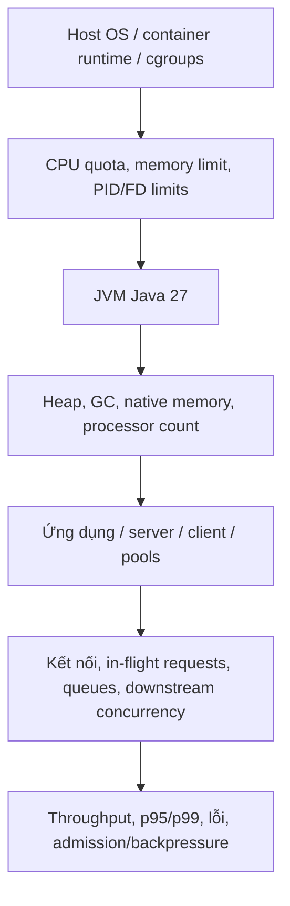
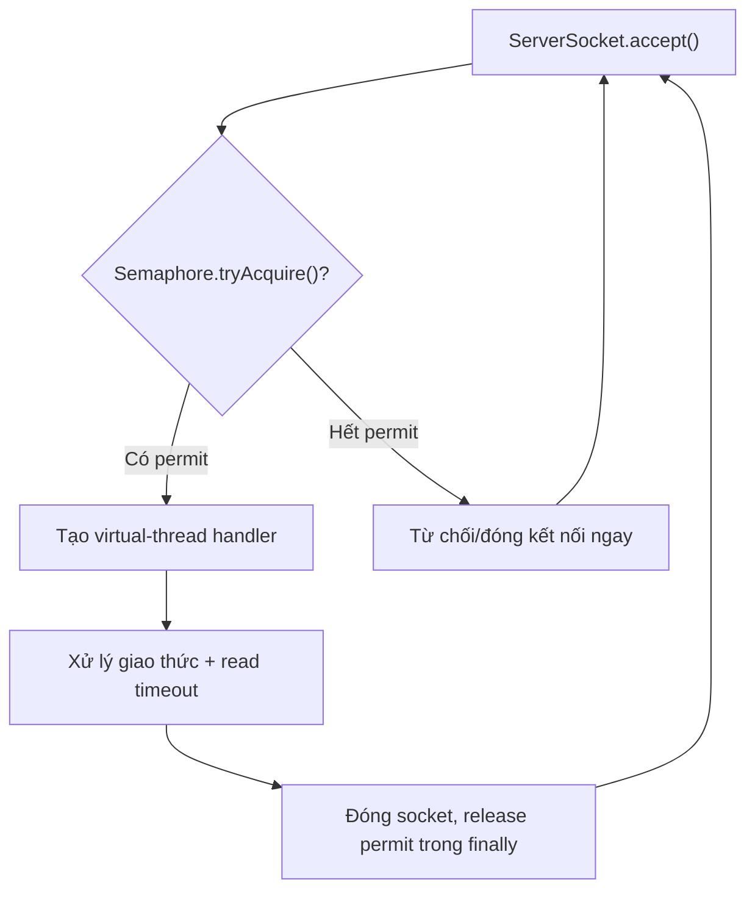

# Đặt giới hạn CPU, bộ nhớ và số kết nối trong môi trường triển khai

Một dịch vụ Java có thể chạy ổn trên máy phát triển nhưng liên tục bị **CPU throttling**, bị hệ điều hành kết thúc do hết bộ nhớ hoặc cạn kết nối khi triển khai vào container. Nguyên nhân thường không phải vì một JVM flag đơn lẻ “sai”, mà vì **các giới hạn ở nhiều tầng không khớp nhau**: hạ tầng cho 1 CPU và 1 GiB RAM, JVM tính toán heap và worker threads theo một giả định khác, còn ứng dụng tiếp nhận số kết nối hoặc request không có trần.

Bài thuộc chương **Đóng gói và triển khai**, module **JAVA_VERSION_JAVA27 — Java 27 và các kiến thức liên quan**. Nội dung sử dụng các cơ chế vẫn hiện hành trong Java SE 27, Docker, Kubernetes và Java networking; không dựa vào các cờ JVM đã lỗi thời hoặc tính năng preview. Mục đích là biến tài nguyên thành **ngân sách có thể kiểm chứng**, thay vì chỉ “tăng RAM hoặc số thread khi chậm”.

Sau bài học, bạn có thể:

- Phân biệt **CPU request**, **CPU limit**, **memory request**, **memory limit** và trần tài nguyên do OS/cgroup quản lý.
- Hiểu `-Xmx`, `-XX:MaxRAMPercentage`, native memory và vì sao **heap không bằng toàn bộ RAM của tiến trình**.
- Hiểu ảnh hưởng của CPU quota đến JVM ergonomics, GC, executor và độ trễ.
- Tách **kết nối TCP đang mở**, **request đang xử lý**, **kết nối ra hệ thống khác** và **connection pool**.
- Dùng `Semaphore` và chính sách từ chối/backpressure để giới hạn tải ở lớp ứng dụng, kể cả với virtual threads.
- Đọc ví dụ Docker/Kubernetes và thiết kế shutdown, probes, metrics, cảnh báo khi chạm giới hạn.

## 1. Ba tầng giới hạn phải phối hợp



| Tầng | Cấu hình ví dụ | Nó **không** tự giới hạn |
|---|---|---|
| Host/container | Docker `--cpus`, `--memory`, cgroups; Kubernetes resources | Số request được chấp nhận theo hợp đồng nghiệp vụ |
| JVM | `-Xmx`, `-XX:MaxRAMPercentage`, `-XX:ActiveProcessorCount` | RSS tổng thể, số kết nối TCP, thời gian gọi downstream |
| Ứng dụng | Semaphore, bounded queue, HTTP limits, database pool | Mức CPU thực được kernel cho dùng, tổng bộ nhớ của tiến trình |
| Downstream/network | Connection pool, API rate limit, timeout | Việc JVM cấp phát object hoặc native buffer |

**Nguyên tắc:** có thể đặt một *hard limit* ở hạ tầng nhưng vẫn cần giới hạn chủ động ở ứng dụng để **từ chối hoặc làm chậm công việc trước khi hệ thống mất khả năng phục vụ**.

Một cấu hình an toàn thường là tập hợp các ràng buộc:

```text
Kết nối đang phục vụ     ≤ giới hạn ứng dụng
In-flight requests      ≤ giới hạn ứng dụng/downstream
Hàng đợi chờ            ≤ giới hạn có kiểm soát
Java heap               < ngân sách memory của container
Tổng RSS + phần cgroup  < memory limit (theo workload và overhead)
CPU demand bền vững     ≤ năng lực CPU thực được cấp
```

Các bất đẳng thức này là **mục tiêu vận hành**, không phải bằng chứng công thức đóng cho mọi workload. Cần đo đạc trong môi trường triển khai thật.

## 2. CPU request khác CPU limit như thế nào?

Trong Kubernetes:

- **`requests.cpu`** chủ yếu dùng cho **lập lịch** trên node và quy tắc phân bổ tài nguyên khi có tranh chấp. Nó không phải “số core JVM được ghim cứng”.
- **`limits.cpu`** là mức trần CPU time kernel thực thi thông qua cơ chế quota/throttling (trong môi trường Linux cgroups tương ứng).
- Đơn vị `500m` nghĩa là **0,5 CPU**, `1000m` hay `1` nghĩa là **1 CPU**.

Ví dụ:

```yaml
resources:
  requests:
    cpu: "500m"
  limits:
    cpu: "1"
```

Container yêu cầu 0,5 CPU để được scheduler đặt lên node phù hợp nhưng có thể sử dụng tới khoảng 1 CPU khi có tải, theo quota và điều kiện hạ tầng. Nếu code liên tục cần 2 CPU nhưng chỉ được giới hạn 1 CPU, kernel có thể **throttle** CPU time; không có quy tắc rằng JVM sẽ nhận đủ 2 CPU chỉ vì node vẫn còn nhiều core vật lý.

**CPU throttling** thường biểu hiện qua độ trễ tăng, nhất là p95/p99, dù logic xử lý của từng request không thay đổi. Một JVM có nhiều runnable workers sẽ **không tự có thêm CPU** nhờ tạo thêm threads.

### 2.1. CPU quota khác ghim CPU

`--cpus=1` hoặc `limits.cpu: "1"` thường quy định tổng lượng **CPU time** được sử dụng, không bắt buộc chỉ chạy mãi trên một CPU core cụ thể. `cpuset` là cơ chế khác để giới hạn **tập core** được phép chạy.

Không nhầm:

- **Quota:** tối đa bao nhiêu CPU time trong một chu kỳ.
- **CPU set / affinity:** được chạy trên những CPU nào.
- **CPU shares/weight:** mức ưu tiên tương đối khi các workload cạnh tranh CPU.

Vì vậy, “container có 1 CPU” là cách nói gọn về **ngân sách CPU**, không phải bằng chứng thread luôn chạy trên đúng một core.

## 3. Java 27 nhận diện giới hạn container như thế nào?

HotSpot trên Linux có cơ chế **container awareness** và hỗ trợ đọc giới hạn cgroup để lựa chọn tham số tài nguyên. Trong Java 27, `UseContainerSupport` được bật mặc định trên môi trường được hỗ trợ.

Các lệnh chẩn đoán hữu ích:

```bash
java -version
java -Xlog:os+container=debug -version
java -XX:+PrintFlagsFinal -version
```

`-Xlog:os+container=debug` cho biết thêm cách JVM nhận biết thông tin container. Kết quả phụ thuộc OS, cgroup version, quyền truy cập và JVM build; **đừng giả định mọi triển khai Java đều in đúng một format log**.

Trong mã Java:

```java
int processors = Runtime.getRuntime().availableProcessors();
System.out.println("JVM processors: " + processors);
```

Giá trị này phản ánh **số processor khả dụng theo JVM** tại thời điểm hỏi, **không phải số request nên chạy đồng thời** và cũng không phải một phép đo CPU usage tức thời.

### 3.1. Khi nào dùng `-XX:ActiveProcessorCount`?

```bash
java -XX:ActiveProcessorCount=2 -jar app.jar
```

Flag này **ghi đè số CPU JVM sử dụng để tính toán một số thread pools và quyết định ergonomics** như GC/ForkJoinPool. Nó không thay đổi CPU quota do OS áp dụng và không tự đặt hard cap “chỉ cho 2 thread chạy”.

Ưu tiên để JVM tự nhận diện giới hạn container trước. Chỉ dùng `-XX:ActiveProcessorCount` khi có lý do cụ thể như việc JVM nhìn nhận processor count chưa phù hợp với cách phân chia tài nguyên hoặc muốn thử nghiệm/tối ưu đã đo được. **Đừng đặt nó một cách mù quáng bằng số lớn hơn CPU quota**, vì điều đó có thể tăng cạnh tranh CPU.

## 4. Ngân sách CPU phải tính cả các công việc ẩn

Không chỉ business logic tiêu thụ CPU:

- Request parsing, authentication, serialization và compression.
- Garbage collection và các thread quản lý của JVM.
- JIT compilation, class loading, background housekeeping.
- TLS encryption/decryption.
- Tác vụ đồng thời, background scheduler, retry và health checks.
- JVM/agent instrumentation và công cụ quan sát.

Ví dụ một service được cấp **1 CPU**, mỗi request dùng trung bình 5 ms **CPU time** chỉ cho phần logic chính. Phép chia lý tưởng `1 giây / 5 ms = 200 request/giây` **chưa tính** GC, TLS, logging, giao thức, variance, contention hay các service downstream. Không được dùng 200 request/giây như cam kết capacity chỉ từ con số đó.

Các tín hiệu cần đo cùng nhau:

| Chỉ số | Gợi ý |
|---|---|
| CPU usage / quota | Demand có đang chạm ngưỡng? |
| CPU throttled periods/time | Quota có làm thread phải đợi? |
| p50, p95, p99 latency | Có ảnh hưởng đến trải nghiệm/tail latency? |
| Throughput | Số request hoặc job hoàn thành/giây |
| GC CPU/pauses | Phần thời gian tiêu tốn cho quản lý bộ nhớ |
| Runnable tasks / queue depth | Có nhiều công việc hơn năng lực xử lý? |

Khi bị throttling, đôi khi **tăng CPU limit**, giảm workload trên mỗi request, giới hạn in-flight requests hoặc tăng số replica có lợi hơn tăng worker threads. Phải đo trước/sau dưới tải tương đương.

## 5. Heap JVM không bằng tổng bộ nhớ container

Một JVM có thể dùng bộ nhớ ở nhiều vùng:

```text
Container memory usage / process RSS (không hoàn toàn đồng nghĩa)
 ├── Java heap: object, dữ liệu, virtual-thread stack chunks
 ├── Metaspace: class metadata
 ├── Code cache / JIT / GC native structures
 ├── Platform-thread stacks và bộ nhớ nội bộ JVM
 ├── NIO direct buffers, FFM/JNI native allocations
 ├── Memory-mapped data, native libraries
 └── Một số page cache / tmpfs được cgroup tính theo cơ chế OS
```

**`-Xmx` chỉ giới hạn Java heap.** Nó không đặt trần tổng thể lên RSS, native memory hoặc dữ liệu được hệ điều hành tính cho cgroup. Đồng thời, **container memory usage** có thể bao gồm một số memory charges khác process RSS; đừng cộng số liệu của các công cụ khác nhau mà không hiểu chúng đo gì.

Ví dụ một container có `memory limit = 1Gi`, đặt `-Xmx1g` là thiết kế nguy hiểm: heap có thể tiêu thụ gần hết ngân sách trong khi JVM còn cần metaspace, stacks, code cache, buffer và các thành phần khác.

### 5.1. Bài toán chia ngân sách minh họa

Giả sử container giới hạn **1 GiB = 1.024 MiB**. Một điểm bắt đầu để **benchmark, không phải công thức mặc định chung**:

| Thành phần | Ngân sách giả định |
|---|---:|
| Java heap tối đa | Khoảng 600 MiB |
| Metaspace, code cache, runtime/GC | Theo workload, phải đo |
| Direct/native buffers và thư viện native | Theo workload, phải đo |
| Platform-thread stacks, mappings, overhead khác | Theo workload, phải đo |
| Dự phòng cho đột biến và biến động | Phần còn lại cần bảo vệ |

Với `-XX:MaxRAMPercentage=60.0`, 60% của 1 GiB xấp xỉ **614 MiB** trước khi xét các quy tắc ergonomics khác. Không nên tuyên bố JVM sẽ dùng *chính xác* 614 MiB làm heap trong mọi cấu hình; hãy kiểm tra giá trị hiệu lực bằng công cụ JVM.

## 6. Chọn giữa `-Xmx` và `-XX:MaxRAMPercentage`

Hai cách phổ biến:

```bash
# Giới hạn heap cố định:
java -Xmx600m -jar app.jar

# Tính ngưỡng heap theo phần trăm bộ nhớ JVM nhìn thấy:
java -XX:MaxRAMPercentage=60.0 -jar app.jar
```

Trong container nhiều môi trường khác nhau, cấu hình **theo phần trăm** giúp heap phản ứng với memory limit mà JVM nhận diện. Cấu hình **cố định** hữu ích nếu muốn kiểm soát chặt trần heap khi đã biết workload và mức RAM được cấp.

**Không đặt cả hai rồi giả định chúng cộng dồn hoặc JVM sẽ áp dụng ngưỡng thấp hơn.** Nhiều tùy chọn JVM có quy tắc ưu tiên và tương tác riêng. Chọn một chính sách heap chính, kiểm tra flags hiệu lực và kiểm thử.

| Tùy chọn | Ý nghĩa | Lưu ý |
|---|---|---|
| `-Xmx600m` | Đặt mức heap tối đa | Không giới hạn toàn bộ native memory |
| `-Xms256m` | Đặt mức heap ban đầu | Không phải một “mức request RAM” của Kubernetes |
| `-XX:MaxRAMPercentage=60.0` | Phần trăm bộ nhớ JVM nhìn thấy dùng để sizing max heap | Không bảo đảm process RSS dưới 60% |
| `-XX:InitialRAMPercentage=...` | Điều chỉnh heap ban đầu theo tỉ lệ | Cần đo startup/GC/footprint |
| `-XX:MaxDirectMemorySize=128m` | Trần phân bổ NIO direct buffers được JVM quản lý theo flag | Không giới hạn mọi loại native allocation |
| `-XX:MaxMetaspaceSize=...` | Trần class metadata | Cấu hình quá thấp có thể gây `OutOfMemoryError: Metaspace` |
| `-Xss...` | Kích thước stack cho platform threads theo JVM/OS | Không phải giới hạn số virtual threads |

**Tránh cấu hình quá nhiều trần tùy tiện:** mỗi giới hạn quá thấp có thể chuyển một vấn đề chậm thành lỗi cấp phát. Đặt giới hạn khi đã có mục tiêu và dữ liệu, không chỉ vì thấy flag tồn tại.

## 7. Direct memory, metaspace và thread stacks

### 7.1. Direct buffers

`ByteBuffer.allocateDirect(...)` cấp phát vùng dữ liệu off-heap được Java quản lý, giúp giảm một số lần copy trong I/O. Nếu ứng dụng dùng nhiều networking buffers hoặc libraries có pooled buffers, phần này có thể đáng kể.

```bash
java -XX:MaxDirectMemorySize=128m -jar app.jar
```

Đây là trần cho cơ chế cấp phát NIO direct buffers theo JDK, **không** phải trần tất cả memory mà JNI/FFM hoặc malloc của thư viện native có thể cấp phát. Nếu đặt thấp hơn mức cần thiết, ứng dụng có thể lỗi direct buffer memory; không tự chữa bằng cách tăng `-Xmx`.

### 7.2. Metaspace và code cache

Metaspace chứa metadata của các lớp được load, nằm ngoài Java heap. Nhiều classloader hoặc tạo class động có thể làm footprint tăng. `-XX:MaxMetaspaceSize` là tùy chọn giới hạn vùng này nhưng nếu cấu hình thấp, ứng dụng có thể bị OOME Metaspace.

Code cache lưu native code được JIT biên dịch và là một phần footprint khác. Cần xem dữ liệu runtime trước khi điều chỉnh.

### 7.3. Platform threads và virtual threads

Platform threads dùng OS threads và có stack native tương ứng. Virtual threads trong Java 27 có stack được biểu diễn linh hoạt bằng các **stack chunks nằm trong Java heap** khi cần, chia sẻ một tập nhỏ hơn các carrier platform threads.

Điều này không có nghĩa **một triệu virtual threads không tốn RAM**. Mỗi task vẫn giữ object graph, context, buffer và có thể giữ socket. Tạo số lượng virtual threads rất lớn mà không có giới hạn nghiệp vụ vẫn có thể dẫn tới heap pressure, cạn file descriptors hoặc quá tải downstream.

## 8. Phân biệt `OutOfMemoryError` với container `OOMKilled`

Hai tình huống thường bị gộp sai:

| Dấu hiệu | Nguồn gây lỗi | Hướng phân tích |
|---|---|---|
| `java.lang.OutOfMemoryError: Java heap space` | JVM không cấp phát thêm được trong heap theo giới hạn/cấu hình | Heap usage, object retention, allocation rate |
| `OutOfMemoryError: Direct buffer memory` | Vấn đề cấp phát direct buffers | Buffer pools, MaxDirectMemorySize và leak |
| `OutOfMemoryError: Metaspace` | Metaspace không đủ | Classloaders/classes, MaxMetaspaceSize |
| Pod/container báo `OOMKilled` | Kernel/cgroup giết process khi memory pressure/limit | Container memory usage, events, RSS, native memory |

`OOMKilled` **không nhất thiết xuất hiện stack trace Java**: process có thể bị kernel kết thúc trước khi JVM in một `OutOfMemoryError` hoặc ghi heap dump.

**CPU vượt limit thường bị throttle**, không bị kernel OOM kill vì CPU limit. **Memory limit** thường được xử lý theo áp lực bộ nhớ và có thể dẫn đến OOM kill; không phải lúc nào container vừa chạm đúng con số giới hạn là lập tức bị giết.

Khi điều tra, đừng chỉ xem `-Xmx`. Thu dữ liệu ở **cả JVM và container**.

## 9. Đo bộ nhớ và CPU mà JVM thực sự nhìn thấy

Ví dụ chương trình Java chạy độc lập, không cần thư viện ngoài:

```java
// RuntimeBudgetSnapshot.java
import java.lang.management.BufferPoolMXBean;
import java.lang.management.ManagementFactory;
import java.lang.management.MemoryUsage;
import java.util.Locale;

public class RuntimeBudgetSnapshot {
    static long toMiB(long bytes) {
        return bytes < 0 ? -1 : bytes / (1024L * 1024L);
    }

    public static void main(String[] args) {
        Runtime runtime = Runtime.getRuntime();
        MemoryUsage heap = ManagementFactory
                .getMemoryMXBean().getHeapMemoryUsage();
        MemoryUsage nonHeap = ManagementFactory
                .getMemoryMXBean().getNonHeapMemoryUsage();

        System.out.println("Java: " + Runtime.version());
        System.out.println("PID: " + ProcessHandle.current().pid());
        System.out.println("Processors: " + runtime.availableProcessors());
        System.out.println("Max heap (MiB): "
                + toMiB(runtime.maxMemory()));
        System.out.println("Heap used/committed (MiB): "
                + toMiB(heap.getUsed()) + "/"
                + toMiB(heap.getCommitted()));
        System.out.println("Non-heap used (MiB): "
                + toMiB(nonHeap.getUsed()));

        for (BufferPoolMXBean pool : ManagementFactory
                .getPlatformMXBeans(BufferPoolMXBean.class)) {
            System.out.printf(Locale.ROOT,
                    "BufferPool %s: count=%d, memoryUsed=%d MiB%n",
                    pool.getName(),
                    pool.getCount(),
                    toMiB(pool.getMemoryUsed()));
        }
    }
}
```

Chạy ở môi trường Java 27:

```bash
java -XX:MaxRAMPercentage=60.0 RuntimeBudgetSnapshot.java
```

Các con số sẽ **khác theo máy/giới hạn container và JVM flags**. `Runtime.maxMemory()` phản ánh max heap mà JVM đã thiết lập, không phải memory limit của container. `BufferPoolMXBean` phản ánh những pool mà JVM biết, **không bao quát toàn bộ allocations của JNI/FFM**.

Trong một ứng dụng **named module**, API `java.lang.management` yêu cầu module descriptor chứa:

```java
module com.example.runtimeprobe {
    requires java.management;
}
```

Mục đích của snapshot này là **đối chiếu thực tế với cấu hình**. Đừng coi việc đọc một snapshot là đo lường memory leak; cần thu thập theo thời gian và dưới workload đại diện.

## 10. Native Memory Tracking và công cụ JVM

Trong Java 27, có thể bật Native Memory Tracking (NMT) khi **khởi động** JVM:

```bash
java -XX:NativeMemoryTracking=summary -jar app.jar
```

Sau khi xác định đúng PID:

```bash
jcmd 12345 VM.native_memory summary
jcmd 12345 VM.native_memory baseline
# Chạy workload trong một khoảng thời gian:
jcmd 12345 VM.native_memory summary.diff
```

NMT phân loại **một phần native memory do HotSpot quản lý**, nhưng **không bảo đảm đo toàn bộ memory của thư viện native bên thứ ba**. Ngoài NMT, cần đo:

- Bộ nhớ container theo cgroup (ví dụ `memory.current` trong cgroup v2).
- Process RSS và mức sử dụng file/page cache phù hợp.
- Heap after-GC, metaspace, direct buffers và số platform threads.
- Tải thực tế, backlog và số kết nối đang mở.

`jcmd` là công cụ của JDK, có yêu cầu về quyền truy cập, môi trường attach và PID namespace. **Không** giả định từ laptop luôn attach trực tiếp được JVM chạy bên trong container hoặc Pod.

## 11. “Số kết nối” cần định nghĩa rõ

Một web service có thể có nhiều loại đồng thời:

| Đại lượng | Đơn vị | Vì sao không giống nhau |
|---|---|---|
| **Accepted TCP connections** | Sockets đang mở | Một connection có thể idle, chờ nhiều requests hoặc HTTP/2 multiplex |
| **In-flight HTTP requests** | Requests chưa trả lời xong | HTTP/2 có thể nhiều requests trên một TCP connection |
| **Active business tasks** | Tasks/jobs | Một request có thể fan-out nhiều tasks |
| **Outbound connections** | TCP connections tới DB/HTTP/Redis... | Phụ thuộc pooling, keep-alive, timeout và protocol |
| **Database pool size** | Kết nối DB đã mở/cho phép mở | DB có hard cap riêng, không phải trần request HTTP |
| **Listener backlog** | Kết nối đang chờ được accept | Không phải số connection đang phục vụ |
| **File descriptors** | Handles do OS cấp | Bao gồm sockets, files, pipes và tài nguyên khác |

Ví dụ: 200 TCP connections có thể tương ứng 0 request đang chạy nếu tất cả client đang idle, hoặc nhiều hơn 200 in-flight requests nếu protocol cho phép multiplexing.

**Không chọn một con số “maxConnections=500” mà chưa định nghĩa chính xác nó đếm cái gì.** Tên metric, điều kiện tăng/giảm và hành vi khi đầy phải được mô tả trong tài liệu vận hành.

## 12. Listener backlog không giới hạn kết nối đang phục vụ

Với `ServerSocket`:

```java
import java.net.InetAddress;
import java.net.ServerSocket;

try (ServerSocket server = new ServerSocket(
        8080, 128, InetAddress.getLoopbackAddress())) {
    // server.accept() trả một Socket riêng cho từng kết nối.
}
```

`128` là **requested backlog** cho các kết nối chờ accept; giá trị thực tế bị điều chỉnh bởi implementation/hệ điều hành. Nó **không phải** lời hứa rằng process sẽ phục vụ tối đa 128 connections.

Sau mỗi lần `accept()`, accepted `Socket` là một tài nguyên riêng. Nếu server cứ `accept()` rồi tạo một virtual thread mới mà không giới hạn, số socket đang mở **vẫn có thể tăng không kiểm soát**.

Để có một trần **kết nối đang phục vụ**, server cần một cơ chế admission/connection limit ở **lớp ứng dụng** hoặc web server/framework, phối hợp với:

- Backlog có giới hạn ở listener.
- Giới hạn file descriptors/pids của OS.
- Read/idle timeout và lifetime tối đa theo chính sách.
- Giới hạn buffer/queue cho từng connection.
- Giới hạn in-flight request và tác vụ gọi downstream.

Nếu dùng framework HTTP, ưu tiên cấu hình **được framework hỗ trợ chính thức** về connection/request limits thay vì sửa socket layer bên dưới framework.

## 13. Giới hạn kết nối bằng `Semaphore`

`Semaphore` trong `java.util.concurrent` cho phép một luồng xử lý **nhận permit trước khi phục vụ**, rồi **trả permit trong `finally`** khi kết nối kết thúc.

Sơ đồ:



Điểm cần chú ý:

1. `tryAcquire()` **không chờ**. Khi hết permit, server phải định nghĩa cách từ chối. Với HTTP có thể gửi 503/429 theo giao thức; với TCP riêng có thể trả mã lỗi đã đặc tả hoặc đóng connection.
2. Mỗi accepted connection **giữ đúng một permit** trong toàn bộ thời gian được phục vụ.
3. Dùng `try/finally` để tránh rò permit nếu xử lý lỗi.
4. **Giới hạn ở đây là active serviced connections**, không phải tổng số socket TCP đã hoàn tất handshake trong kernel; socket bị từ chối vẫn có thể tồn tại ngắn giữa `accept` và `close`.
5. Giữ permit trong suốt thời gian client idle sẽ tốn một slot. Đặt **idle/read timeout** và giới hạn tuổi thọ theo giao thức.
6. `Semaphore` không tự đóng socket, hủy background tasks hay bảo đảm application shutdown; phải quản lý các tài nguyên đó riêng.

Đối với dịch vụ sử dụng `Executors.newVirtualThreadPerTaskExecutor()`, executor này **không tự có trần số request submitted**. Cần admission control **trước khi submit** hoặc một cơ chế queue/bounded concurrency khác đã được thiết kế rõ ràng.

## 14. Ví dụ Java 27 chạy độc lập: chỉ cho một kết nối được phục vụ

Ví dụ sau chạy **trên loopback**, không cần server bên ngoài. Nó cố ý giữ kết nối đầu tiên đang hoạt động cho đến khi client thứ hai bị từ chối. Kết quả không phụ thuộc vào việc `Thread.sleep(...)` bao lâu.

Tạo tệp `ConnectionLimitDemo.java`:

```java
import java.io.IOException;
import java.net.InetAddress;
import java.net.ServerSocket;
import java.net.Socket;
import java.util.concurrent.CountDownLatch;
import java.util.concurrent.Semaphore;
import java.util.concurrent.TimeUnit;
import java.util.concurrent.atomic.AtomicReference;

public final class ConnectionLimitDemo {
    private static final int MAX_ACTIVE = 1;
    private static final int TIMEOUT_MS = 3_000;

    public static void main(String[] args) throws Exception {
        Semaphore slots = new Semaphore(MAX_ACTIVE);
        CountDownLatch firstReady = new CountDownLatch(1);
        CountDownLatch handlerFinished = new CountDownLatch(1);
        AtomicReference<IOException> serverFailure = new AtomicReference<>();
        InetAddress loopback = InetAddress.getLoopbackAddress();

        try (ServerSocket listener = new ServerSocket(0, 8, loopback)) {
            Thread acceptor = Thread.ofVirtual().start(() -> {
                try {
                    // Demo chỉ chấp nhận hai lần connect để tự kết thúc.
                    for (int i = 0; i < 2; i++) {
                        Socket peer = listener.accept();
                        if (!slots.tryAcquire()) {
                            try (peer) {
                                peer.getOutputStream().write(2); // BUSY
                            }
                            continue;
                        }

                        Thread.ofVirtual().start(() -> {
                            try (peer) {
                                peer.setSoTimeout(TIMEOUT_MS);
                                firstReady.countDown();
                                int command = peer.getInputStream().read();
                                if (command != 1) {
                                    throw new IOException("Lệnh không hợp lệ");
                                }
                                peer.getOutputStream().write(17); // OK
                            } catch (IOException ex) {
                                serverFailure.compareAndSet(null, ex);
                            } finally {
                                slots.release();
                                handlerFinished.countDown();
                            }
                        });
                    }
                } catch (IOException ex) {
                    serverFailure.compareAndSet(null, ex);
                }
            });

            try (Socket first = new Socket(
                    loopback, listener.getLocalPort())) {
                first.setSoTimeout(TIMEOUT_MS);
                if (!firstReady.await(3, TimeUnit.SECONDS)) {
                    throw new IllegalStateException("Worker đầu chưa sẵn sàng");
                }

                try (Socket second = new Socket(
                        loopback, listener.getLocalPort())) {
                    second.setSoTimeout(TIMEOUT_MS);
                    int response = second.getInputStream().read();
                    System.out.println("Second rejected: " + (response == 2));
                }

                first.getOutputStream().write(1);
                int response = first.getInputStream().read();
                System.out.println("First served: " + (response == 17));
            } finally {
                listener.close(); // Hủy accept nếu có lỗi client.
            }

            acceptor.join();
            if (!handlerFinished.await(3, TimeUnit.SECONDS)) {
                throw new IllegalStateException("Worker chưa hoàn tất");
            }
            if (serverFailure.get() != null) {
                throw serverFailure.get();
            }
        }
    }
}
```

Chạy với JDK 27:

```bash
java --version
java ConnectionLimitDemo.java
```

Kết quả dự kiến trên hệ thống cho phép TCP loopback:

```text
Second rejected: true
First served: true
```

Giải thích:

- Server mở listener trên port cục bộ được OS chọn (`0`) và có một permit.
- Client đầu tiên được phục vụ trong virtual thread; `CountDownLatch` xác nhận worker đã chiếm slot trước khi client thứ hai kết nối.
- Client thứ hai **được accept nhưng không được phục vụ** vì hết permit; server gửi mã byte `2` (chỉ thuộc **giao thức demo**) rồi đóng.
- Client thứ nhất gửi byte lệnh `1` và nhận byte `17`; handler đóng socket và **release permit** trong `finally`.
- Hai bên có read timeout và một đường thu hồi worker. Mã demo xử lý **đúng hai kết nối**, không phải một server production chạy mãi.

**Không sao chép giao thức một byte này vào HTTP/TLS.** Với HTTP, việc từ chối phải theo HTTP semantics (status, header, connection handling). Với TCP thực tế cần framing, xác thực, chống slow-client, quan sát, graceful shutdown và test tải.

## 15. Giới hạn outbound requests không đồng nghĩa giới hạn TCP connections

Giả sử service xử lý HTTP requests và gọi ba dịch vụ downstream. Có thể dùng một semaphore **bọc mỗi lời gọi outbound**:

```java
import java.util.concurrent.Semaphore;
import java.util.function.Supplier;

final class OutboundLimiter {
    private final Semaphore permits = new Semaphore(16);

    <T> T call(Supplier<T> action) {
        if (!permits.tryAcquire()) {
            throw new IllegalStateException("Quá tải outbound");
        }
        try {
            return action.get();
        } finally {
            permits.release();
        }
    }
}
```

Đây là giới hạn **số lời gọi đồng thời ở cấp ứng dụng**, không khẳng định số TCP connections thực đúng bằng `16`. HTTP/2 có thể multiplex nhiều request trên một connection; ngược lại, một call có thể mở thêm kết nối bởi retry, proxy hoặc client pool.

Nếu muốn giới hạn **connection pool thật**, phải dùng cấu hình được **driver HTTP/database/framework** hỗ trợ. Java `HttpClient` chuẩn không cung cấp một setter portable duy nhất có nghĩa “tối đa 16 physical connections” cho mọi protocol/implementation. Không mặc định áp một system property nội bộ chưa được quy định làm API ổn định.

### 15.1. Giới hạn database connections theo toàn cụm

Ví dụ database cho phép **tối đa 100 connections** cho một ứng dụng. Nếu triển khai 5 replica, mỗi replica mở pool tối đa 30 kết nối thì **150 > 100** trước khi tính admin/maintenance connections.

Ngân sách gợi ý:

```text
Số replica tối đa × max pool/replica
  + phần kết nối quản trị/khác
  ≤ giới hạn của database (có dự phòng)
```

Không coi công thức này là đủ cho mọi hạ tầng: rolling update có thể tạm có thêm Pod; autoscaling có thể tăng replica; các app khác có thể dùng chung DB. Cần tính **max surge**, scale-out, backup/monitoring và hành vi retry.

## 16. Backpressure và bounded queues: xử lý quá tải trước khi crash

Khi request đến nhanh hơn khả năng xử lý, hàng đợi sẽ tăng. Nếu queue không có giới hạn, ứng dụng có thể:

- Giữ nhiều object/closures trong heap.
- Chờ lâu khiến request hết deadline trước khi được phục vụ.
- Dồn nhiều retry từ client, làm quá tải trầm trọng hơn.
- Phát nhiều lệnh vào một downstream đã cạn connection pool.

Chiến lược:

| Tình huống | Hành động có thể phù hợp |
|---|---|
| Có slot và deadline còn đủ | Chấp nhận, xử lý |
| Hết slot nhưng có hàng đợi ngắn và chờ được | Xếp vào **bounded queue** có thời hạn |
| Hết slot và queue đầy | **Reject nhanh** theo protocol |
| Client gửi quá chậm | Áp read/idle timeout, giới hạn frame |
| Downstream bận | Bounded concurrency, circuit breaker/backoff có giới hạn |
| Server chuẩn bị shutdown | Ngừng nhận request mới, chờ in-flight có hạn |

Với HTTP, `503 Service Unavailable` thường diễn đạt server tạm quá tải; `429 Too Many Requests` phù hợp hơn khi áp rate limit cho client. Khi thích hợp có thể dùng `Retry-After`. Không dùng một mã HTTP chỉ để tạo test dễ dàng — hãy chọn theo semantics thực.

**Little's Law** (trong điều kiện hệ ổn định): số tác vụ trung bình trong hệ thống `L ≈ λ × W`, với `λ` là throughput và `W` là thời gian trong hệ thống. Ví dụ 100 request/giây, mỗi request ở trong hệ thống trung bình 0,2 giây, thì trung bình có khoảng 20 requests đang ở trong hệ thống. Đây là cách **ước lượng**, không thay được việc đo p99, burstiness và giới hạn downstream.

## 17. Docker: đặt CPU, RAM và giới hạn OS

Ví dụ Docker Engine trên host Linux có hỗ trợ cgroups phù hợp:

```bash
docker run --rm \
  --cpus=1 \
  --memory=1g \
  --pids-limit=256 \
  --ulimit nofile=2048:2048 \
  -e JAVA_TOOL_OPTIONS="-XX:MaxRAMPercentage=60.0" \
  -e APP_MAX_ACTIVE_CONNECTIONS=200 \
  example.invalid/java-service:27
```

**`example.invalid/java-service:27` là tên image placeholder**, phải thay bằng image đã build và tin cậy của dự án; lệnh không chạy được nguyên xi khi image chưa tồn tại.

Giải thích:

- `--cpus=1`: hạn chế CPU time của container qua runtime/cgroup.
- `--memory=1g`: mức trần memory do Docker áp dụng.
- `--pids-limit=256`: giới hạn số process/tasks cấp OS (bao gồm nhiều platform threads), **không** phải trần số virtual threads Java.
- `--ulimit nofile=2048:2048`: giới hạn file descriptors theo OS; không phải tất cả 2048 FD đều dành cho sockets.
- `JAVA_TOOL_OPTIONS` cung cấp JVM option khi launcher được khởi động; cần kiểm tra image/entrypoint thực sự dùng JVM và cách truyền biến môi trường.
- `APP_MAX_ACTIVE_CONNECTIONS=200` là **biến cấu hình giả định do ứng dụng phải tự đọc và áp dụng**; Docker không có phép màu tự giới hạn accepted connections nhờ biến này.

Lệnh nhiều dòng dùng dấu `\` của shell Unix. Trong Windows PowerShell nên viết thành một dòng hoặc dùng cú pháp nối dòng phù hợp, không sao chép trực tiếp dấu `\`.

### 17.1. Quan sát container thực tế

```bash
docker stats
docker inspect <container-id>
docker logs <container-id>
```

Trong môi trường Linux cgroup v2, có thể có các tệp như `cpu.max`, `cpu.stat`, `memory.max` và `memory.current` ở cgroup của process. **Đường dẫn cụ thể tùy runtime/namespace**, không giả định mọi container đều có cùng mount path.

Đừng tắt OOM killer vô điều kiện để “cứu Java” khi container hết RAM. Cách đúng là xem heap/native usage, giảm buffer/concurrency, sửa leak hoặc tăng ngân sách nếu workload thật cần.

## 18. Kubernetes: requests, limits và cấu hình JVM

Một ví dụ Deployment **rút gọn nhưng đúng cấu trúc**:

```yaml
apiVersion: apps/v1
kind: Deployment
metadata:
  name: java-service
spec:
  replicas: 2
  selector:
    matchLabels:
      app: java-service
  template:
    metadata:
      labels:
        app: java-service
    spec:
      terminationGracePeriodSeconds: 30
      containers:
        - name: java-service
          image: example.invalid/java-service:27
          ports:
            - name: http
              containerPort: 8080
          env:
            - name: JAVA_TOOL_OPTIONS
              value: "-XX:MaxRAMPercentage=60.0"
            - name: APP_MAX_ACTIVE_CONNECTIONS
              value: "200"
          resources:
            requests:
              cpu: "500m"
              memory: "512Mi"
            limits:
              cpu: "1"
              memory: "1Gi"
```

Trong cấu hình mẫu:

- Scheduler dựa trên **requests** để lên kế hoạch đặt Pod.
- **Limits** được runtime/kernel thực thi theo cơ chế CPU/memory tương ứng.
- JVM có thể tự nhận diện giới hạn container khi chạy trên Java 27 HotSpot trong môi trường được hỗ trợ.
- `-XX:MaxRAMPercentage=60.0` dành khoảng **60% bộ nhớ được JVM nhìn thấy** cho heap tối đa trước các heuristics liên quan.
- Giá trị connection cap chỉ có tác dụng nếu **mã Java hoặc framework** được cấu hình dùng biến môi trường đó.

Image và cổng là **ví dụ**, không đại diện cho một ứng dụng có sẵn. Khi áp dụng phải có image thật, service/ingress/network policy, probes và chương trình thực sự nghe trên port 8080.

### 18.1. Phân biệt CPU limit và memory limit khi triển khai

| Tài nguyên | Khi bị sử dụng quá mức | Tín hiệu thường thấy |
|---|---|---|
| CPU | Kernel thường throttle theo quota; request chậm hơn | CPU throttling metrics, p99 tăng |
| Memory | Kernel có thể kích hoạt OOM kill/eviction theo áp lực và limit | `OOMKilled`, container restart, memory.current tăng |
| FD limit | API mở socket/file mới thất bại | `Too many open files` hoặc `IOException` |
| Connection pool | Lời gọi chờ hoặc bị từ chối theo timeout | Queue wait, pool exhaustion, timeout |

Giới hạn hạ tầng **không thay thế** chính sách từ chối ở ứng dụng.

## 19. Graceful shutdown khi replica bị thay thế

Một Pod đang phục vụ 200 kết nối không thể chỉ đơn giản ngừng listener rồi hy vọng không có request nào bị mất. Khi rollout hoặc autoscaling giảm số replica, cần quy trình:

1. Đánh dấu instance **không còn sẵn sàng nhận request mới** (readiness false).
2. Ngừng chấp nhận kết nối mới hoặc chuyển sang chế độ reject phù hợp giao thức.
3. Chờ những request đang xử lý hoàn tất, **có deadline**.
4. Hủy/đóng các kết nối còn lại theo chính sách, giải phóng permits và pool.
5. Đóng listening socket/executor, ghi metrics cuối và cho process thoát.

Kubernetes có `terminationGracePeriodSeconds` (mặc định thường là 30 giây nếu không thay đổi). Khi kết thúc grace period mà process chưa thoát, runtime có thể buộc dừng. **Grace period không tự viết logic drain cho bạn.**

### 19.1. Readiness không phải liveness

- **Readiness:** instance có nên nhận traffic mới không?
- **Liveness:** process có cần bị restart vì không còn hoạt động đúng không?
- **Startup probe:** giúp ứng dụng có giai đoạn khởi động lâu mà không bị đánh giá liveness quá sớm.

Một ứng dụng chỉ còn vài slot connection có thể vẫn “live” nhưng không “ready” theo chính sách tải; tuy nhiên readiness không nên nhấp nháy liên tục theo từng biến động nhỏ khiến traffic dao động. Thiết kế ngưỡng/hysteresis và thử load balancing thực tế.

Các probe HTTP phải được **ứng dụng triển khai endpoint thật**. Không cấu hình `httpGet: /health/ready` trong Deployment nếu server không cung cấp đường dẫn này.

## 20. Autoscaling cần xem tổng ngân sách của cả cụm

Tăng replica là cách mở rộng hiệu năng khi một instance đã dùng hết CPU hoặc đạt giới hạn đồng thời, nhưng nó làm tăng tổng các tài nguyên downstream có thể bị chiếm.

Ví dụ:

```text
2 replica × 16 kết nối DB/replica = 32 kết nối
5 replica × 16 kết nối DB/replica = 80 kết nối
8 replica × 16 kết nối DB/replica = 128 kết nối
```

Nếu DB chỉ cho phép 100 connections, cấu hình 8 replica có thể tự gây cạn pool. Khi có rollout surge, số Pod thực tế có thể tạm thời lớn hơn replica mong muốn.

Cần đánh giá:

- CPU/memory requests và limits của **mỗi replica**.
- Trần tổng **DB/Redis/HTTP outgoing concurrency**.
- HPA behavior và scale-down safety.
- Health/readiness/shutdown và lượng request đang xử lý khi Pod bị thay thế.
- Khả năng cân bằng tải, warm-up/JIT, cache và cold-start.

Không dùng **CPU utilization** làm metric autoscale duy nhất nếu bottleneck là **I/O hoặc một connection pool**; replica mới có thể chỉ tăng tải lên hệ thống đang nghẽn.

## 21. Metrics cần theo dõi trước khi chạm giới hạn

| Nhóm | Những metric quan trọng | Câu hỏi vận hành |
|---|---|---|
| CPU | Usage/quota, throttled periods/time | Có bị giới hạn CPU time không? |
| Memory container | Current/working set, OOM events, restarts | Có tiến gần hard limit hoặc bị kill? |
| JVM heap | Used after GC, committed, max, allocation rate | Heap có căng hay leak? |
| Off-heap | NIO direct buffers, metaspace, NMT, RSS | Native memory chiếm bao nhiêu? |
| Inbound | Active connections, accepted/rejected, idle duration | Admission limit có hoạt động? |
| Request | In-flight, queue depth, p95/p99, timeouts | Khối lượng công việc có vượt capacity? |
| Outbound | Pool active/idle/waiters, acquisition timeout | Có nghẽn downstream không? |
| Availability | Readiness, liveness, restarts, termination | Replica có được drain đúng? |

Một số lệnh chẩn đoán tùy môi trường:

```bash
# Docker:
docker stats

# Kubernetes:
kubectl top pod
kubectl describe pod <pod-name>
kubectl get pod <pod-name> -o wide

# JVM, sau khi xác định đúng PID:
jcmd 12345 VM.flags
jcmd 12345 GC.heap_info
jcmd 12345 VM.native_memory summary
```

`kubectl top` cần nguồn metrics tương ứng; `VM.native_memory` chỉ có dữ liệu khi NMT được bật trước đó. Các ví dụ không phải lệnh đã được chạy trên cluster thật và chỉ dùng trong môi trường người học có quyền truy cập phù hợp.

**Cảnh báo nên gắn với xu hướng và hậu quả**, không chỉ một con số cố định: ví dụ bộ nhớ tăng liên tục gần limit cùng restart, CPU throttling tăng kèm p99 xấu, hoặc pool waiters tăng cùng 5xx/timeouts.

## 22. Quy trình xác định ngân sách trước khi đưa vào production

1. **Xác định workload:** RPS trung bình/đỉnh, kích thước request/response, connection duration, tỷ lệ blocking I/O, CPU time/request, bộ nhớ tạm/request.
2. **Đặt tài nguyên hạ tầng ban đầu:** CPU và memory requests/limits có cơ sở từ thử nghiệm tải.
3. **Chọn heap budget:** cân đối Java heap với native memory, direct buffers, thread stacks, GC và dự phòng; chọn `-Xmx` hoặc `MaxRAMPercentage` theo chính sách rõ ràng.
4. **Xác định các giới hạn ứng dụng:** accepted connections, in-flight requests, queue length, outbound calls, DB pools, kích thước payload, timeout.
5. **Đối chiếu liên hệ giữa limits:** connection cap × buffer/request, số replica × DB pool, CPU quota × thread/workload demand.
6. **Thử load test từng nấc:** bình thường, gần ngưỡng, vượt ngưỡng, burst, slow clients, downstream chậm.
7. **Đo và hiệu chỉnh:** throughput, p95/p99, CPU throttling, OOM, GC, RSS, pool wait, error rate và latency khi reject.
8. **Thử shutdown/rollout:** Pod termination, readiness và việc giải phóng sockets/permits.
9. **Ghi tài liệu vận hành:** giá trị mặc định, tại sao chọn, owner, dashboard và cách rollback.
10. **Giám sát sau release:** thay đổi traffic/phiên bản JVM có thể làm thông số tối ưu trước đó không còn phù hợp.

Không có một giá trị `MaxRAMPercentage` hoặc `MAX_ACTIVE_CONNECTIONS` “chuẩn cho mọi Java service”. Những con số trong bài là **giá trị thực hành để tạo giả thuyết và đo**, không phải lời khuyên áp đặt cho production.

## 23. Lỗi thường gặp và cách sửa

| Lỗi | Vì sao nguy hiểm | Cách xử lý |
|---|---|---|
| Đặt `-Xmx` bằng đúng memory limit | Không còn chỗ cho native memory/overhead | Dành headroom và đo tổng cgroup usage |
| Coi `MaxRAMPercentage` là % giới hạn RSS toàn container | Flag chỉ nhắm tới heap sizing | Kiểm tra max heap + RSS/native footprint |
| Đặt `ActiveProcessorCount` cao hơn quota CPU để “tăng tốc” | JVM tạo thêm parallelism nhưng OS vẫn throttle | Dựa trên quota và số đo thực tế |
| Tăng số worker threads khi CPU đã throttle | Contention/scheduling có thể tăng | Giảm công việc, điều chỉnh limit hoặc scale hợp lý |
| Coi `ServerSocket backlog=100` là max 100 connections | Backlog đếm kết nối chờ accept | Thêm admission limit trên accepted connections |
| Tin virtual threads tự giới hạn tài nguyên | Sockets/buffers/task state vẫn hữu hạn | Semaphore/queues/deadline rõ ràng |
| Coi `APP_MAX_ACTIVE_CONNECTIONS` tự có tác dụng | Env var không được runtime tự hiểu | Ứng dụng phải đọc và áp dụng |
| Giới hạn outbound requests rồi gọi đó là số TCP sockets | HTTP/2 multiplex, connection reuse | Tách request concurrency và pool size |
| Chỉ tính DB pool của một Pod | Autoscaling/rollout có thể vượt max DB connections | Tính toàn cụm và surge |
| Đặt queue vô hạn để “không rơi request” | Memory và latency tăng không kiểm soát | Bounded queues, reject/backpressure |
| Chỉ nhìn JVM heap để điều tra `OOMKilled` | Kernel tính nhiều vùng ngoài heap | Thu cgroup memory/RSS/NMT/buffer stats |
| Chỉ nhìn CPU utilization, bỏ qua throttling | CPU limit có thể gây p99 cao | Theo dõi throttling + latency/throughput |
| Gửi tất cả request vào downstream đã bão hòa | Cascading failures và retry storms | Timeout, concurrency caps, retry/backoff/idempotency |
| Dùng liveness để kiểm tra “đang đầy connection slots” | Pod liên tục restart dù process vẫn khỏe | Phân biệt readiness/admission/liveness |
| Shutdown ngay không drain | Mất request và rò kết nối | Readiness off, ngừng nhận, chờ có hạn, close |
| Tự tăng heap/CPU/pool sau mỗi sự cố mà không test | Tạo bottleneck mới, tốn tài nguyên | Đặt giả thuyết và đo hiệu năng trước/sau |

## 24. Bài tập và ma trận kiểm thử

### Bài 1 — Chia ngân sách memory

Một Pod có `limits.memory = 768Mi`. Hãy đề xuất mức heap ban đầu để thử tải, giải thích phần headroom cho native buffers, metaspace, stacks và margin. Tại sao không có cách suy ngay từ `-Xmx` rằng pod không bao giờ OOMKilled?

### Bài 2 — CPU bị throttling

Ứng dụng dùng trung bình 0,8 CPU nhưng burst đòi 2 CPU trong thời gian ngắn, trong khi Pod có `limits.cpu: "1"`. Hãy giải thích sự khác nhau giữa giá trị trung bình và burst/p99, và đề xuất các metric để chứng minh CPU quota đang ảnh hưởng.

### Bài 3 — Backlog hay active connections?

Server có `new ServerSocket(8080, 128)`. Nó có chắc chỉ có 128 accepted sockets cùng lúc không? Nếu muốn giữ tối đa 50 kết nối đang phục vụ, hãy chọn policy từ chối và nơi giải phóng permit.

### Bài 4 — Virtual threads và outbound limit

Một service dùng 10.000 virtual threads, mỗi task có thể gọi DB. Database chỉ có 40 connections cho app. Đề xuất giới hạn concurrency/pool, thời hạn chờ và cách tránh queue vô hạn.

### Bài 5 — Tính toàn cụm

Có 4 replica, mỗi replica pool DB max 24; khi rollout `maxSurge` tăng thêm 2 replica. Tính số kết nối DB **tối đa theo cấu hình** trong giai đoạn surge và so với giới hạn 120 connections của DB, trước khi trừ tài nguyên cho tác vụ quản trị.

### Bài 6 — Quan sát memory

Java heap used sau GC ổn định ở 350 MiB, nhưng container memory.current tăng gần giới hạn 1 GiB. Nêu các số liệu bổ sung cần kiểm tra và giới hạn của NMT.

### Bài 7 — Từ chối đúng lúc

Sửa `ConnectionLimitDemo` để có 2 permits và 4 clients. Chỉ ra cách dùng latch để tạo tình huống đầy capacity một cách **xác định** thay vì dựa vào `Thread.sleep`, và đo số connection bị từ chối.

### Ma trận thử nghiệm trước release

| Tình huống | Điều phải được xác minh |
|---|---|
| Tải bình thường | Latency/throughput/CPU/memory trong ngân sách |
| CPU chạm quota | Throttling được ghi nhận, ứng dụng vẫn có hành vi phù hợp |
| Memory gần limit | Có cảnh báo và headroom, không OOMKilled bất ngờ |
| Quá giới hạn inbound connections | Kết nối mới bị từ chối/đóng theo giao thức, slot được trả |
| Client idle quá lâu | Kết nối được dọn theo timeout/lifetime |
| Pool outbound đầy | Chờ có giới hạn hoặc reject; không queue vô hạn |
| Slow downstream | Timeout, cancellation/backpressure, không gây retry storm |
| Scale từ 2 lên 6 Pod | Tổng DB/concurrency budgets không vượt downstream |
| Rolling update/shutdown | Readiness/drain/close đúng grace period |
| Lỗi native/FD exhaustion | Có metrics, alert và phục hồi theo runbook |

## 25. Checklist triển khai dịch vụ Java 27

1. Đã định nghĩa CPU/memory **requests** và **limits** theo tài nguyên của cluster chưa?
2. Đã phân biệt CPU quota/throttling với processor affinity chưa?
3. JVM có nhận diện đúng cgroup/container? Đã xem `availableProcessors()` và flags hiệu lực?
4. Có đang dùng `-Xmx` hoặc `MaxRAMPercentage` với chủ đích, không nhầm heap với RSS?
5. Đã tính native memory: metaspace, code cache, platform-thread stacks, direct buffers, JNI/FFM?
6. Giá trị `MaxDirectMemorySize` hoặc `MaxMetaspaceSize` (nếu dùng) có dựa trên dữ liệu thay vì suy đoán?
7. Số kết nối inbound, in-flight requests, outbound requests và DB pool đã có **định nghĩa đo rõ ràng**?
8. Backlog có bị dùng nhầm thành trần active connections?
9. Có semaphore/connection limit thực sự áp dụng trong mã hoặc framework, không chỉ env var?
10. Có bounded queue, payload limits, read/idle/deadline timeout và chính sách từ chối?
11. Virtual threads có được kiểm soát bằng giới hạn nghiệp vụ và tài nguyên downstream?
12. Có tính max replicas + rolling update surge vào tổng ngân sách DB/connections?
13. Có readiness/liveness/shutdown/drain đúng giới hạn thời gian?
14. Có quan sát CPU throttling, GC/heap/native memory, RSS/OOMKilled, active connections, pool waiters và p99?
15. Đã chạy các tình huống bình thường, burst, overload, slow-client và shutdown trong môi trường gần production?

**Kết luận:** giới hạn tài nguyên cho Java 27 phải đặt ở **nhiều tầng**: cgroup/container giới hạn CPU và memory, JVM điều chỉnh heap/parallelism, còn ứng dụng chủ động quản lý connections, requests và queues. `-XX:MaxRAMPercentage` không thay trần RAM container; `--cpus` không thay admission control; virtual threads không loại bỏ file descriptors hay downstream constraints. Chỉ khi đo được **CPU quota, memory footprint, concurrency và hành vi từ chối**, các con số giới hạn mới trở thành một chính sách triển khai đáng tin cậy.

## 26. Tài liệu tham khảo chính thức

- [Java SE 27 — Lệnh `java` và HotSpot VM flags](https://docs.oracle.com/en/java/javase/27/docs/specs/man/java.html): `-Xmx`, `MaxRAMPercentage`, `ActiveProcessorCount`, `UseContainerSupport`, `MaxDirectMemorySize`, `MaxMetaspaceSize` và log container.
- [Java SE 27 — Native Memory Tracking](https://docs.oracle.com/en/java/javase/27/vm/native-memory-tracking.html): theo dõi một phần cấp phát native của JVM và giới hạn coverage.
- [Java SE 27 — `ServerSocket`](https://docs.oracle.com/en/java/javase/27/docs/api/java.base/java/net/ServerSocket.html): backlog, `accept` và đóng listening socket.
- [Java SE 27 — `Semaphore`](https://docs.oracle.com/en/java/javase/27/docs/api/java.base/java/util/concurrent/Semaphore.html): `tryAcquire`/`release` và điều phối permits.
- [Java SE 27 — `Thread`](https://docs.oracle.com/en/java/javase/27/docs/api/java.base/java/lang/Thread.html): platform threads và virtual threads.
- [Java SE 27 — `Executors`](https://docs.oracle.com/en/java/javase/27/docs/api/java.base/java/util/concurrent/Executors.html): `newVirtualThreadPerTaskExecutor` và quản lý concurrency.
- [Java SE 27 — `Runtime`](https://docs.oracle.com/en/java/javase/27/docs/api/java.base/java/lang/Runtime.html): `availableProcessors` và giới hạn heap của JVM.
- [Java SE 27 — `BufferPoolMXBean`](https://docs.oracle.com/en/java/javase/27/docs/api/java.management/java/lang/management/BufferPoolMXBean.html): quan sát các buffer pools do JVM hỗ trợ.
- [Docker Docs — Resource constraints](https://docs.docker.com/engine/containers/resource_constraints/): CPU, memory, swap và giới hạn ở container runtime.
- [Docker Docs — Running containers](https://docs.docker.com/engine/containers/run/): `--pids-limit`, `--ulimit`, CPU/memory flags.
- [Kubernetes — Resource Management for Pods and Containers](https://kubernetes.io/docs/concepts/configuration/manage-resources-containers/): requests/limits, CPU throttling, memory OOM.
- [Kubernetes — Pod Termination](https://kubernetes.io/docs/concepts/workloads/pods/pod-termination/): grace period, termination và shutdown.
- [Kubernetes — Liveness, Readiness and Startup Probes](https://kubernetes.io/docs/concepts/workloads/pods/probes/): phân biệt các loại probes và ý nghĩa vận hành.
