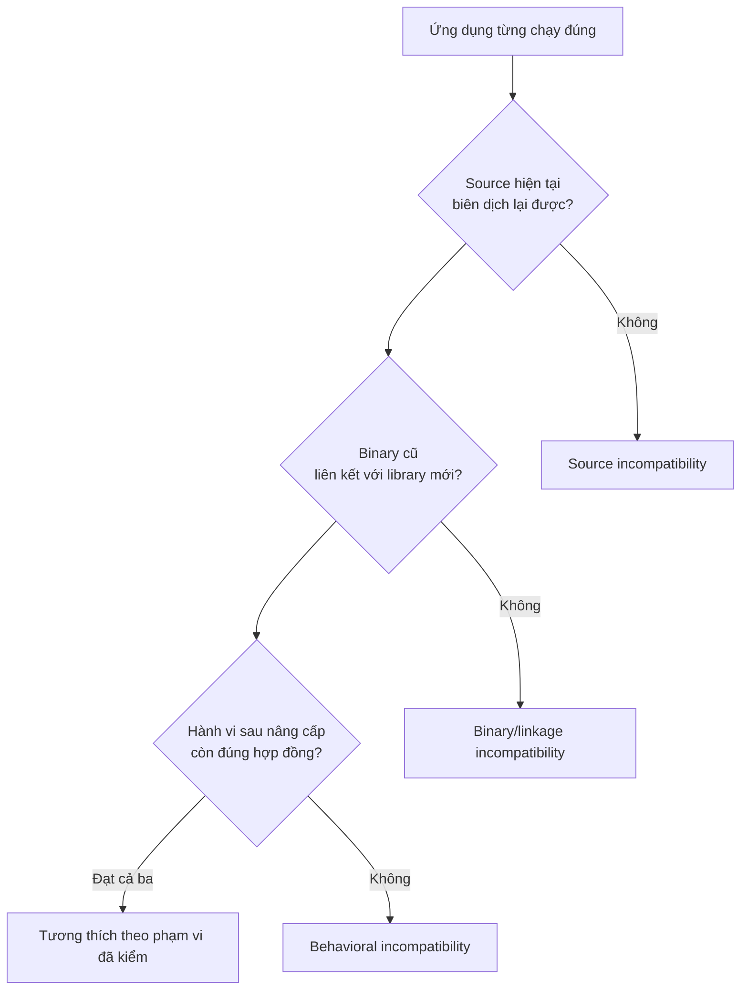
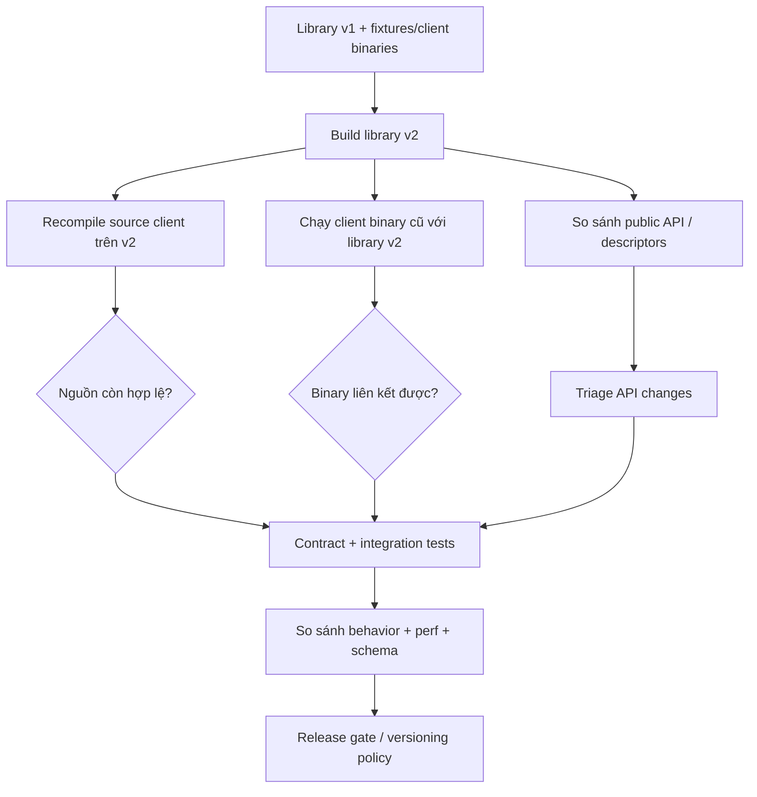

# Phân biệt tương thích mã nguồn, nhị phân và hành vi runtime

Nâng cấp Java, JDK hoặc một thư viện không chỉ là thay số phiên bản rồi chạy lại build. Một ứng dụng có thể **biên dịch lại được** nhưng JAR đã phát hành trước đó không liên kết được; hoặc JAR cũ vẫn liên kết bình thường nhưng **kết quả nghiệp vụ đã thay đổi** sau khi chạy trên runtime mới.

Trong module **Java 27 và các kiến thức liên quan**, bài này thuộc chương **Nâng cấp và tương thích Java 27**. Ta sẽ phân biệt ba khía cạnh tương thích hiện hành theo Java Language Specification (JLS), Java Virtual Machine Specification (JVMS) và hướng dẫn migration JDK 27:

1. **Source compatibility — tương thích mã nguồn:** mã nguồn cũ có còn biên dịch thành công trong ngữ cảnh mới hay không?
2. **Binary compatibility — tương thích nhị phân:** các file `.class` đã biên dịch trước đây có còn liên kết với phiên bản thư viện/runtime mới hay không?
3. **Behavioral compatibility — tương thích hành vi runtime:** chương trình có còn cho kết quả, side effect và đặc tính vận hành theo hợp đồng mong đợi hay không?

Đây là ba câu hỏi **khác nhau**, không phải ba cách nói về cùng một phép kiểm tra. Những kỹ thuật trong bài chỉ dùng Java SE còn hiện hành ở JDK 27; ví dụ không dựa vào API hoặc công cụ legacy, không yêu cầu bật preview.

## 1. Tại sao “build xanh” chưa đủ để kết luận tương thích?

Giả sử ứng dụng đặt hàng gồm ba phần:

- `checkout-app.jar`: mã ứng dụng được build từ source.
- `pricing-api.jar`: thư viện hợp đồng mà ứng dụng biên dịch cùng.
- JDK trong container: runtime thực sự tải class, thực thi mã, đọc timezone/locale và thiết lập TLS.

Có ít nhất ba cách thay đổi có thể xảy ra:



Thực tế ba phép kiểm tra không phải lúc nào cũng chạy theo đúng thứ tự trên: ứng dụng **không biên dịch lại** có thể vẫn dùng class cũ; ứng dụng **biên dịch lại** có thể bị ảnh hưởng hành vi dù không có linkage error.

Ví dụ điển hình:

| Thay đổi | Source cũ khi compile lại | Binary cũ khi chạy với thư viện mới | Hành vi |
|---|---|---|---|
| Thêm overload khiến `call(null)` mơ hồ | Có thể lỗi | Thường vẫn liên kết với method cũ | Có thể không đổi |
| Đổi return type method mà không giữ descriptor cũ | Một số caller vẫn compile được | Có thể `NoSuchMethodError` | Chưa thể kiểm tra nếu linkage lỗi |
| Chỉ sửa thuật toán bên trong method | Vẫn compile | Vẫn liên kết | Có thể khác |
| Xóa method public đang được dùng | Lỗi compile | Có thể `NoSuchMethodError` | Không có kết quả nếu đi vào nhánh lỗi |
| Đổi timezone rules hoặc locale data | Vẫn compile | Thường liên kết | Format/ngày giờ có thể khác |
| Thay một API internal bằng API khác | Có thể lỗi | Có thể lỗi tại runtime | Tùy các đường gọi thực tế |

**Kết luận ban đầu:** “source-compatible”, “binary-compatible” và “behavior-compatible” luôn phải nêu rõ **consumer nào**, **thư viện/JDK phiên bản nào**, **hệ điều hành/cấu hình nào** và **phạm vi hành vi nào** đang được so sánh.

## 2. Định nghĩa chính xác ba khái niệm

### 2.1. Tương thích mã nguồn — Source compatibility

Một thay đổi source-compatible đối với tập source cụ thể nếu **source đã tồn tại vẫn có thể được biên dịch** trong môi trường ngôn ngữ/API mới mà không phát sinh lỗi do thay đổi đó.

Phép kiểm tra thường là:

```text
source cũ + compiler/toolchain mới + API dependency mới
    → javac / Gradle compileJava / Maven compile
    → thành công hay thất bại?
```

Điểm quan trọng:

- Thêm overload mới có thể khiến call site trước đó trở nên **ambiguous** dù không xóa method cũ.
- Source sử dụng tên đơn giản, wildcard import hoặc name lookup có thể bị ảnh hưởng khi thư viện thêm type/method mới.
- Thay đổi type parameters, generic bounds, throws checked exception hoặc annotation-processing contract có thể ảnh hưởng khả năng compile.
- Cùng một source có thể compile được khi đặt `--release 21` nhưng không compile khi source level hoặc dependency API khác; phải ghi lại **cờ compiler và dependency versions**.
- Source compatibility **không đồng nghĩa** compiler tạo lại đúng bytecode hoặc kết quả runtime giữ nguyên.

### 2.2. Tương thích nhị phân — Binary compatibility

Theo **JLS Chapter 13**, một thay đổi binary-compatible với những binary hiện có khi các binary **trước đây liên kết được** vẫn **tiếp tục liên kết được** sau thay đổi đó. Trọng tâm là **linkage của file `.class`**, không phải “build lại source”.

```text
app.class đã biên dịch với library v1
    + library v2
    + JVM
    → còn resolve đúng field/method/class và liên kết được không?
```

Các binary lưu **symbolic references** như tên class, tên method và **method descriptor**. Ví dụ, bytecode có thể yêu cầu:

```text
api/Formatter.title:()Ljava/lang/String;
```

Nếu thư viện mới chỉ còn method cùng tên nhưng trả về `CharSequence`, descriptor sẽ là:

```text
api/Formatter.title:()Ljava/lang/CharSequence;
```

Đó là **hai descriptor khác nhau** ở JVM. Việc Java source code có thể gán cả hai kết quả cho biến `CharSequence` **không** khiến binary cũ tự thay descriptor đã ghi trong `.class`.

**Lưu ý:** Binary compatibility theo JLS không bảo đảm thư viện “hoạt động tương tự” hoặc không có exception khi chạy. Nhiều linkage error chỉ xuất hiện **khi JVM thật sự resolve/call** tới member liên quan, không phải nhất thiết lúc bắt đầu chương trình.

### 2.3. Tương thích hành vi runtime — Behavioral compatibility

Behavioral compatibility là câu hỏi liệu **ngữ nghĩa khi thực thi** có còn đáp ứng kỳ vọng hay không, gồm:

- Giá trị trả về và quy tắc xử lý đầu vào.
- Loại, thời điểm và nội dung exception.
- Side effects: ghi file, gửi HTTP, cập nhật database, phát sự kiện.
- Ordering, concurrency, thread safety, serialization.
- Parsing/formatting theo locale/timezone, encoding và Unicode.
- Tính tương thích dữ liệu đã lưu hoặc dữ liệu trao đổi với dịch vụ khác.
- Trong phạm vi SLO, hiệu năng, latency, memory hoặc thời gian GC có thể là **ràng buộc vận hành cần kiểm thử**, dù không phải lúc nào cũng là thay đổi semantics ngôn ngữ.

Phép kiểm tra gồm **unit/integration/contract tests** và thử nghiệm trên môi trường runtime mục tiêu, chứ không chỉ `javac` và `java --version`.

Ví dụ đổi logic `isEligible(age)` từ `age >= 18` sang `age >= 21` **không đổi API công khai**, nhưng phá hợp đồng nghiệp vụ nếu hệ thống vẫn yêu cầu ngưỡng 18.

## 3. Bảng tổng hợp: cái nào bảo đảm cái nào?

| Kết quả kiểm tra | Có thể kết luận | Không thể kết luận |
|---|---|---|
| Source biên dịch lại thành công | Bộ source đã thử tương thích với compiler/API mới | Binary đã phát hành trước đó chắc chắn chạy đúng |
| Binary cũ liên kết được với JAR mới | Không có lỗi linkage ở phần đã kiểm tra | Business rules, lỗi, serialization, performance vẫn giữ nguyên |
| Unit tests đều xanh | Hành vi được **những test đó** bao phủ vẫn đúng | Mọi input, environment và đường chạy đều đúng |
| Không phát hiện `NoSuchMethodError` | Chưa gặp lỗi method linkage trong các đường đã thực thi | Không có member khác lỗi ở code path chưa chạy |
| `jdeps` không báo JDK internals | Không tìm thấy các dependency thuộc phạm vi phân tích của tool | Không có reflection/dynamic loading/JNI hoặc behavioral break |
| `--release 21` compile thành công trên JDK 27 | Source và API JDK dùng tại compile phù hợp target release được chọn | Mọi third-party JAR chạy trên JDK 21 hay runtime có cấu hình đúng |
| Tất cả dependency versions đã lock | Graph version được kiểm soát | Byte artifact đúng, không có CVE hoặc behavioral compatibility được bảo đảm |

Các chiều **source**, **binary** và **behavior** có thể kết hợp theo nhiều cách. Ví dụ “source-incompatible nhưng binary-compatible” là hoàn toàn có thể; bài sẽ chứng minh bằng thí nghiệm.

## 4. Tính tương thích phải nêu rõ chiều nâng cấp và phạm vi

Một thư viện v2 có thể **backward-compatible** với client đã build trên v1, nhưng điều đó **không tự động** có nghĩa library v1 hỗ trợ client mới sử dụng API của v2.

| Góc nhìn | Câu hỏi |
|---|---|
| **Backward compatibility** | App/binary cũ có làm việc với library/runtime mới không? |
| **Forward compatibility** | App/binary mới có làm việc với library/runtime cũ không? |
| **Source backward compatibility** | Source cũ có biên dịch với API mới không? |
| **Binary backward compatibility** | Class cũ có liên kết với JAR mới không? |
| **Behavioral compatibility** | Hợp đồng runtime có giữ đúng theo chiều và môi trường đang xét không? |

Đừng nói “Java 27 tương thích với Java 21” như một lời bảo đảm vô điều kiện cho mọi ứng dụng. Khả năng chạy phụ thuộc bytecode target, APIs, JNI, reflection, library, flags, provider, OS, security defaults và những thay đổi đặc tả qua từng release.

**Tính tương thích luôn có điều kiện.** Ví dụ source compile với `--release 27` có thể phát ra class file Java 27 mà JVM Java 21 không hiểu. Ngược lại, Java 27 thường có khả năng chạy nhiều class file cũ theo các cam kết tương thích của nền tảng, nhưng không bảo đảm mọi hành vi ứng dụng tùy thuộc API đã bị loại bỏ hoặc thay đổi đều y nguyên.

## 5. Source compatibility nhìn từ compiler và overload resolution

Tại compile time, Java chọn method overload dựa trên **kiểu tĩnh của biểu thức**, method accessibility, type inference, varargs và quy tắc most-specific (JLS `15.12). JVM **không chạy lại overload resolution bằng source** khi một binary đã biên dịch gọi method.

Ví dụ một API v1:

```java
public static String describe(Object value) {
    return "object";
}
```

Client gọi:

```java
String label = Api.describe(null);
```

Source biên dịch được vì chỉ có một overload phù hợp. Nhưng nếu API v2 thêm **hai overload cùng đặc hiệu nhưng không so sánh được**:

```java
public static String describe(String value) {
    return "string";
}

public static String describe(Integer value) {
    return "integer";
}
```

khi compile lại source cũ, `describe(null)` trở nên mơ hồ giữa `describe(String)` và `describe(Integer)`. Trong khi đó, binary cũ vẫn gọi `describe(Object)` nếu method cũ được giữ nguyên.

Đây là ví dụ tiêu biểu: **thêm public API không phải lúc nào source-compatible đối với mọi caller**, mặc dù việc thêm overload được JLS coi là binary-compatible với binary trước đó.

## 6. Binary compatibility nhìn từ class file và linker

Khi code Java được biên dịch, `.class` chứa constant pool với symbolic references. Các loại tham chiếu đáng chú ý:

- `CONSTANT_Class`: tên lớp/interface.
- `CONSTANT_Fieldref`: lớp, tên field và descriptor của field.
- `CONSTANT_Methodref`/`CONSTANT_InterfaceMethodref`: kiểu sở hữu, tên và descriptor method.
- `invokevirtual`, `invokestatic`, `invokeinterface`, `invokespecial`: cách bytecode gọi method.
- `getfield`/`getstatic`: cách truy cập field, với kỳ vọng static/instance thích hợp.

Một thay đổi làm mất method descriptor cũ có thể gây `NoSuchMethodError`. Chuyển giữa instance/static có thể gây `IncompatibleClassChangeError`. Thay concrete method thành abstract có thể dẫn đến `AbstractMethodError` khi method bị gọi.

**Không nhầm kiểu nguồn với descriptor:** generics dùng **type erasure** cho nhiều liên kết runtime, còn compiler có thể sinh **bridge methods** để giữ polymorphism. Vì vậy đổi generic signature không luôn làm mất descriptor, nhưng thay erasure hoặc xóa bridge có thể phá client đã biên dịch.

### Dùng `javap` xem hợp đồng bytecode

Khi đã có file `.class`, công cụ JDK:

```bash
javap -classpath out/classes -s -p demo.api.Api
javap -classpath out/classes -c -v demo.app.Main
```

`-s` hiển thị descriptor; `-c` hiển thị bytecode; `-v` hiển thị thông tin class file và constant pool. Đây là bước chẩn đoán bằng chứng, không phải cách tự sửa binary incompatibility.

## 7. Behavioral compatibility: API còn đó nhưng kết quả đã khác

Một phương thức giữ nguyên tên, parameters và return type vẫn có thể thay đổi hành vi:

```java
// v1
public static boolean qualifies(int score) {
    return score >= 60;
}

// v2
public static boolean qualifies(int score) {
    return score >= 70;
}
```

Cả hai đều có descriptor `(I)Z`; source cũ có thể biên dịch và binary cũ có thể liên kết. Nhưng `qualifies(65)` thay từ `true` sang `false`.

Các dạng thay đổi behavioral thường chỉ xuất hiện khi chạy:

- Một parser từ chối chuỗi đầu vào trước kia được chấp nhận.
- Default charset, timezone database hoặc locale data thay đổi cách xử lý/hiển thị.
- Provider TLS, thuật toán/chính sách certificate hoặc endpoint của dịch vụ bên ngoài đổi.
- Phần tử collection được trả theo thứ tự khác nếu hợp đồng không hứa giữ thứ tự.
- Timeout/retry thay đổi làm các side effect bị lặp hoặc ngừng sớm.
- Concurrency scheduling/phân luồng làm race condition trước đó bị che khuất nay lộ ra.

**Không coi mọi khác biệt là lỗi của JDK.** Nhiều thay đổi behavior đến từ dependency, OS, cấu hình runtime hoặc chính ứng dụng. Khi điều tra, phải giữ một **ma trận phiên bản và dữ liệu đầu vào có thể tái hiện** để biết biến nào gây ra khác biệt.

## 8. Thí nghiệm A — Source lỗi sau nâng cấp, binary cũ vẫn chạy

Mục tiêu: chứng minh **thêm overload** có thể làm source cũ **không compile**, nhưng binary đã được biên dịch trước đó vẫn **liên kết** với API mới.

Tạo các file:

```text
lab-source/
├── v1/demo/api/Selector.java
├── v2/demo/api/Selector.java
└── client/demo/app/Main.java
```

### API v1: chỉ có một overload

File `lab-source/v1/demo/api/Selector.java`:

```java
package demo.api;

public final class Selector {
    private Selector() {
    }

    public static String select(Object value) {
        return "Object overload";
    }
}
```

### API v2: giữ method cũ, thêm hai overload

File `lab-source/v2/demo/api/Selector.java`:

```java
package demo.api;

public final class Selector {
    private Selector() {
    }

    public static String select(Object value) {
        return "Object overload";
    }

    public static String select(String value) {
        return "String overload";
    }

    public static String select(Integer value) {
        return "Integer overload";
    }
}
```

### Client giữ nguyên source

File `lab-source/client/demo/app/Main.java`:

```java
package demo.app;

import demo.api.Selector;

public final class Main {
    public static void main(String[] args) {
        System.out.println(Selector.select(null));
    }
}
```

### Các bước biên dịch và chạy

Giả định đang dùng JDK 27 và shell Linux/macOS/Git Bash, đứng tại thư mục chứa `lab-source`:

```bash
mkdir -p lab-out/api-v1 lab-out/api-v2 lab-out/client lab-out/recompiled

javac --release 27 -d lab-out/api-v1 \
    lab-source/v1/demo/api/Selector.java

javac --release 27 -d lab-out/api-v2 \
    lab-source/v2/demo/api/Selector.java

jar --create --file lab-out/api-v1.jar -C lab-out/api-v1 .
jar --create --file lab-out/api-v2.jar -C lab-out/api-v2 .

# Compile client với API v1.
javac --release 27 -cp lab-out/api-v1.jar \
    -d lab-out/client lab-source/client/demo/app/Main.java

# Không compile lại client: chỉ thay library bằng v2.
java -cp "lab-out/client:lab-out/api-v2.jar" demo.app.Main

# Giờ thử compile lại chính source client ấy với API v2.
javac --release 27 -cp lab-out/api-v2.jar \
    -d lab-out/recompiled lab-source/client/demo/app/Main.java
```

Khi dùng **Windows PowerShell**, tạo thư mục bằng `New-Item -ItemType Directory -Force`, viết lệnh `javac` trên một dòng hoặc dùng cú pháp xuống dòng PowerShell, và tách các entry `-cp` bằng **dấu chấm phẩy `;`** thay vì dấu hai chấm.

**Kết quả dự kiến:**

- Chạy client binary cũ với API v2 in `Object overload`.
- Biên dịch lại client source với API v2 **thất bại**, vì lời gọi `select(null)` mơ hồ giữa `select(String)` và `select(Integer)`.

Để kiểm tra binary lưu method nào:

```bash
javap -classpath lab-out/client -c demo.app.Main
```

Trong output, sẽ thấy bytecode gọi `demo/api/Selector.select:(Ljava/lang/Object;)Ljava/lang/String;` — overload `Object` được compiler quyết định **từ v1**. Sau khi thay thư viện, JVM **không làm lại overload resolution**.

**Phân loại:** *source-incompatible đối với client này*, nhưng *binary-compatible đối với binary cũ này*. Không nên kết luận rằng mọi source Java đều sẽ bị lỗi khi thêm overload; trường hợp này chỉ xảy ra với những lời gọi trở nên mơ hồ.

## 9. Thí nghiệm B — Source vẫn compile, binary cũ không liên kết

Mục tiêu: chứng minh thay **return type** của method có thể khiến **source client vẫn compile** mà **binary client cũ báo `NoSuchMethodError`**.

Tạo cấu trúc thứ hai, độc lập thí nghiệm A:

```text
lab-return/
├── v1/demo/api/Titles.java
├── v2/demo/api/Titles.java
└── client/demo/app/ReturnMain.java
```

### API v1: method trả về `String`

File `lab-return/v1/demo/api/Titles.java`:

```java
package demo.api;

public final class Titles {
    private Titles() {
    }

    public static String title() {
        return "v1";
    }
}
```

### API v2: method trả về `CharSequence`

File `lab-return/v2/demo/api/Titles.java`:

```java
package demo.api;

public final class Titles {
    private Titles() {
    }

    public static CharSequence title() {
        return "v2";
    }
}
```

### Client dùng supertype chung

File `lab-return/client/demo/app/ReturnMain.java`:

```java
package demo.app;

import demo.api.Titles;

public final class ReturnMain {
    public static void main(String[] args) {
        CharSequence text = Titles.title();
        System.out.println(text);
    }
}
```

### Các bước minh họa

```bash
mkdir -p return-out/v1 return-out/v2 return-out/client return-out/recompiled

javac --release 27 -d return-out/v1 \
    lab-return/v1/demo/api/Titles.java
javac --release 27 -d return-out/v2 \
    lab-return/v2/demo/api/Titles.java

jar --create --file return-out/titles-v1.jar -C return-out/v1 .
jar --create --file return-out/titles-v2.jar -C return-out/v2 .

# Biên dịch client với API v1, ghi descriptor String.
javac --release 27 -cp return-out/titles-v1.jar \
    -d return-out/client lab-return/client/demo/app/ReturnMain.java

# Chạy binary cũ với thư viện v1 => in v1.
java -cp "return-out/client:return-out/titles-v1.jar" demo.app.ReturnMain

# Chạy cùng binary cũ với thư viện v2 => NoSuchMethodError dự kiến.
java -cp "return-out/client:return-out/titles-v2.jar" demo.app.ReturnMain

# Compile lại source client bằng API v2 => thành công.
javac --release 27 -cp return-out/titles-v2.jar \
    -d return-out/recompiled lab-return/client/demo/app/ReturnMain.java

# Chạy binary mới với API v2 => in v2.
java -cp "return-out/recompiled:return-out/titles-v2.jar" demo.app.ReturnMain
```

**Nhắc lại với Windows:** dùng dấu `;` trong `-cp` và cách tạo thư mục phù hợp PowerShell.

### Vì sao xảy ra?

`javap -s` cho hai phiên bản sẽ cho descriptor tương ứng:

```text
// v1
title:()Ljava/lang/String;

// v2
title:()Ljava/lang/CharSequence;
```

Đối với Java source của `ReturnMain`, cả `String` lẫn `CharSequence` đều gán được cho biến `CharSequence`. Nhưng **binary đã biên dịch với v1** tìm chính xác method trả về `String`, mà v2 không còn. Khi lời gọi được liên kết/thực thi, có thể ném `NoSuchMethodError`.

**Phân loại:** *source-compatible đối với client này* khi compile lại, *binary-incompatible đối với client binary cũ*. Không được coi việc `javac` thành công với API v2 là bằng chứng rằng **mọi JAR consumer đã phát hành trước đó** vẫn chạy được.

### Tại sao không chỉ giữ cả hai return type để tương thích?

Ở Java source, không thể tự khai báo hai method chỉ khác nhau ở return type. Compiler/runtime có một số kỹ thuật như **bridge methods** trong trường hợp kế thừa/generics/covariant return, nhưng đó không phải lý do để giả định mọi thay đổi return type đều an toàn. Khi thiết kế API thư viện, thường nên **giữ nguyên descriptor cũ**, tạo method mới có tên khác, hoặc có một giai đoạn migration rõ ràng.

## 10. Thí nghiệm C — Source và binary đều hợp lệ, hành vi bị đổi

Mục tiêu: đổi **business rule**, giữ nguyên method signature, để thấy **source/binary compatibility không bảo đảm behavior**.

Cấu trúc:

```text
lab-behavior/
├── v1/demo/api/Rules.java
├── v2/demo/api/Rules.java
└── client/demo/app/RuleMain.java
```

File `lab-behavior/v1/demo/api/Rules.java`:

```java
package demo.api;

public final class Rules {
    private Rules() {
    }

    public static boolean eligible(int score) {
        return score >= 60;
    }
}
```

File `lab-behavior/v2/demo/api/Rules.java`:

```java
package demo.api;

public final class Rules {
    private Rules() {
    }

    public static boolean eligible(int score) {
        return score >= 70;
    }
}
```

File `lab-behavior/client/demo/app/RuleMain.java`:

```java
package demo.app;

import demo.api.Rules;

public final class RuleMain {
    public static void main(String[] args) {
        int score = 65;
        System.out.println("Eligible: " + Rules.eligible(score));
    }
}
```

Lệnh trên Linux/macOS/Git Bash:

```bash
mkdir -p behavior-out/v1 behavior-out/v2 behavior-out/client

javac --release 27 -d behavior-out/v1 \
    lab-behavior/v1/demo/api/Rules.java
javac --release 27 -d behavior-out/v2 \
    lab-behavior/v2/demo/api/Rules.java

jar --create --file behavior-out/rules-v1.jar -C behavior-out/v1 .
jar --create --file behavior-out/rules-v2.jar -C behavior-out/v2 .

javac --release 27 -cp behavior-out/rules-v1.jar \
    -d behavior-out/client lab-behavior/client/demo/app/RuleMain.java

java -cp "behavior-out/client:behavior-out/rules-v1.jar" demo.app.RuleMain
java -cp "behavior-out/client:behavior-out/rules-v2.jar" demo.app.RuleMain
```

Kết quả dự kiến:

| Runtime library | Output |
|---|---|
| `rules-v1.jar` | `Eligible: true` |
| `rules-v2.jar` | `Eligible: false` |

Không có lý do để `javac` hoặc JVM linker báo lỗi: method `eligible(int)` vẫn tồn tại với descriptor `(I)Z`. Nhưng nếu hợp đồng nghiệp vụ nói điểm `65` phải được chấp nhận, ứng dụng đã **behavior-incompatible** sau khi nâng cấp.

Để phát hiện cần một **contract test**, chẳng hạn:

```java
// Đây là assertion minh họa đặt trong code test:
if (!Rules.eligible(65)) {
    throw new AssertionError(
            "Quy tắc nghiệp vụ không được đổi trong release này");
}
```

Test bắt buộc phải phản ánh **hợp đồng đã được các bên phê duyệt**. Nếu ngưỡng mới là thay đổi nghiệp vụ có chủ đích, việc test cũ thất bại là tín hiệu cần cập nhật hợp đồng, dữ liệu, rollout và truyền thông — không phải luôn rollback code.

## 11. Ma trận kết quả từ ba thí nghiệm

| Thí nghiệm | Compile source client trên API v2 | Chạy binary client cũ với API v2 | Đúng hành vi cũ? |
|---|---|---|---|
| A — thêm `select(String)` và `select(Integer)` | **FAIL**: ambiguous invocation | **PASS**: gọi `select(Object)` | Có, với input/logic đã minh họa |
| B — `String title()` → `CharSequence title()` | **PASS** | **FAIL**: `NoSuchMethodError` | Chưa đến được kết quả vì lỗi liên kết |
| C — ngưỡng `60` → `70` | **PASS** | **PASS** | **FAIL** với score `65` |

Kết quả **không phụ thuộc** vào Java 27 có tính năng ngôn ngữ mới nào; đây là các quy tắc cốt lõi của Java type system, class file, method descriptor và linkage vẫn còn áp dụng. Dùng JDK 27 giúp kiểm tra trong đúng phạm vi bài, nhưng bài học đặc biệt hữu ích khi nâng cấp **bất kỳ** Java library nào.

### Điểm giới hạn thí nghiệm

- Mỗi thí nghiệm xây dựng đúng **một API version** tại runtime để tránh lỗi trùng class.
- Ví dụ dùng **classpath**, không cần `module-info.java`, để chỉ ra source/binary/behavior trước khi đưa thêm quy tắc JPMS.
- Lệnh `javac` và `java` trong tài liệu dùng để người học tự chạy; ở bước soạn Markdown này **chưa chạy build hoặc Content QA**.
- Kết quả có thể xuất hiện dưới dạng exception chỉ khi mã tương ứng được thực thi. Với test coverage chưa đủ, lỗi có thể còn ẩn.
- Khi chạy trên Windows, classpath separator là `;`, không phải `:` như Linux/macOS.

## 12. Khi nâng chính JDK: source level, class-file version và runtime version

Nâng cấp từ một JDK cũ lên **Java 27** khác với chỉ thay phiên bản một thư viện bên thứ ba. Ta cần phân biệt ba biến cấu hình:

| Biến | Điều khiển | Ví dụ |
|---|---|---|
| **Compiler JDK** | Phiên bản `javac` thực hiện biên dịch | `javac 27` |
| **Target release** | Ngôn ngữ, API nền tảng và class-file target khi dùng `--release` | `javac --release 21 ...` |
| **Runtime JDK** | JVM và thư viện chuẩn thực thi class files | `java 21` hoặc `java 27` |

### `--release` là lựa chọn đúng khi nhắm một Java release đã hỗ trợ

Ví dụ compiler JDK 27 có thể biên dịch một source Java dùng API nền tảng của Java 21:

```bash
javac --release 21 -d out/target21 src/demo/Main.java
```

Nếu source cần một API chỉ xuất hiện sau Java 21, lệnh phải **thất bại khi compile** thay vì tạo file class không tương thích nền tảng target. Cờ `--release` đồng thời điều chỉnh source language level, target class-file version và tập API Java SE được dùng khi biên dịch.

Ngược lại:

```bash
javac --release 27 -d out/target27 src/demo/Main.java
```

có thể phát class file cần Java 27. JVM Java 21 **không thể mặc nhiên chạy** class file Java 27. Trường hợp runtime quá cũ có thể báo `UnsupportedClassVersionError`.

**Giới hạn:** `--release` kiểm soát API **JDK nền tảng**, không bảo đảm mọi **third-party dependency** trong classpath của bạn tương thích với runtime target. Nếu JAR bên thứ ba được build bằng class-file version cao hơn hoặc dùng API không hỗ trợ runtime target, vẫn có thể lỗi khi deploy. Kiểm thử trên **runtime thực tế** là bắt buộc.

### Class file major version

Các mốc thường gặp:

| Java | Class-file major version |
|---|---|
| Java 8 | 52 |
| Java 17 | 61 |
| Java 21 | 65 |
| Java 25 | 69 |
| Java 27 | 71 |

Có thể xem một file bằng:

```bash
javap -verbose -classpath out/target27 demo.Main
```

Tìm dòng `major version: 71` khi class được biên dịch target Java 27 theo cách thông thường. Major version là dấu hiệu **khả năng nạp bytecode**, không phải bằng chứng behavioral compatibility hoặc patch level của JVM.

### Vì sao không chỉ đặt `-source` và `-target`?

`-source` chọn quy tắc ngôn ngữ; `-target` chọn định dạng class file. Kết hợp hai cờ này **không tự hạn chế đầy đủ việc source tham chiếu API mới của JDK đang compile**. Với cross-compilation Java hiện đại, ưu tiên `--release` khi nhắm một release Java SE đã được `javac` hỗ trợ.

Một số library có thể cung cấp **multi-release JAR** hoặc native code/FFM dependencies. Trường hợp đó cần kiểm tra đúng variant/entry thực sự được JVM target chọn, ngoài class-file version nhìn thấy ở một entry duy nhất.

## 13. JDK 27: đọc release notes theo đúng loại ảnh hưởng

Oracle JDK 27 Release Notes (ngày phát hành ban đầu **15/09/2026**) chủ động phân loại các điểm cần lưu ý thành **source**, **binary** và **behavioral** compatibility. Cùng một release có thể thay đổi ngôn ngữ, API và hành vi hệ thống ở những vùng khác nhau. Không coi danh sách tính năng mới là danh sách lỗi tương thích chắc chắn xảy ra.

Một số ví dụ **đã công bố trong JDK 27** để lập kế hoạch kiểm thử:

| Thay đổi / phạm vi | Nguy cơ nên xem xét | Cách xác minh |
|---|---|---|
| Dữ liệu múi giờ **IANA 2026b** | Cách biểu diễn một số thời điểm lịch sử/tương lai theo vùng có thể thay đổi | Regression tests cho time zones, DST, lịch nghiệp vụ |
| **G1** trở thành GC mặc định trong các môi trường còn lại | Thông lượng, pauses, heap usage có thể khác do GC policy | Đo latency/throughput/GC bằng workload thật và cờ GC thực tế |
| **Compact Object Headers** mặc định trên HotSpot phù hợp | Kích thước object, layout/performance có thể đổi | Benchmark và capacity tests, tránh giả định layout nội bộ |
| **TLS 1.3 post-quantum hybrid key exchange** | Cách thương lượng/compatibility với endpoint, proxy và thiết bị mạng | Integration tests TLS đến các dịch vụ thật, giữ certificate validation |
| Các API bị loại bỏ hoặc hành vi runtime được ghi trong release notes | Compile/runtime break ở vùng API/tool được dùng | Đối chiếu từng CSR/advisory với dependency và code path của ứng dụng |

Các điểm **preview/incubator** của JDK 27 không được dùng trong ví dụ bài này, theo yêu cầu chỉ lấy kiến thức ổn định/còn hiện hành. Khi nâng hệ thống doanh nghiệp, cũng không nên đưa tính năng preview vào baseline production chỉ để vượt một lỗi migration.

**Cẩn trọng về phạm vi:** không phải mọi thay đổi HotSpot/Oracle JDK đều giống nhau trên mọi distribution, kiến trúc CPU, hệ điều hành hoặc cách cấu hình JVM. Ví dụ nếu ứng dụng đã đặt GC tường minh, một thay đổi default GC có thể không ảnh hưởng phần đó. Hãy xác định **vendor/update/build** của môi trường cụ thể.

### “Khác hành vi” không luôn đồng nghĩa “bug”

Một thay đổi timezone database để phản ánh quyết định pháp lý của một quốc gia là **hợp lệ về nền tảng**, nhưng vẫn có thể khiến báo cáo hoặc lịch thanh toán của ứng dụng khác dữ liệu đã lưu từ trước. Nghĩa vụ của nhóm ứng dụng là thống nhất cách xử lý với nghiệp vụ và người dùng, không phải kết luận dữ liệu timezone mới là sai.

## 14. Các phép biến đổi API dễ bị phân loại sai

JLS Chapter 13 mô tả những thay đổi được bảo đảm hoặc không được bảo đảm binary-compatible đối với class/interface.

| Thay đổi trong thư viện | Source compatibility | Binary compatibility | Điểm cần kiểm tra |
|---|---|---|---|
| **Thêm method có tên mới** | Thường giữ được | Thường giữ được | Có trùng tên/inheritance conflict hoặc behavioral mới? |
| **Thêm overload** | Có thể gây ambiguous call khi compile lại | Không làm binary cũ đổi overload đã chọn | `null`, method references, varargs, generics |
| **Xóa/đổi tên method public** | Caller dùng method cũ không compile | Client cũ có thể `NoSuchMethodError` | Tất cả consumer đã phát hành |
| **Đổi kiểu tham số hoặc return** | Phụ thuộc caller/source và conversion | Có thể đổi descriptor, làm lỗi linkage | `javap -s`, binary compatibility tool |
| **Đổi instance method thành static hoặc ngược lại** | Có thể đổi legality của lời gọi | Có thể `IncompatibleClassChangeError` | Method invocation bytecodes |
| **Đổi concrete method thành abstract** | Client/implementation có thể cần sửa | Có thể `AbstractMethodError` khi gọi | Các implementation cũ |
| **Giảm quyền truy cập public → private** | Caller không compile | Có thể `IllegalAccessError` khi resolve | Access flags, JPMS, reflection |
| **Chỉ sửa method body** | Thường vẫn compile | Giữ descriptor/linkage | Hành vi, exception, perf, security |
| **Đổi `public static final` compile-time constant** | Source thường compile | Không nhất thiết có linkage error | Giá trị có thể đã được compiler **inline** vào client cũ |
| **Thêm enum constant** | Thường compile khi dùng enum cũ | Có thể binary-compatible | Exhaustiveness/switch và hành vi của các consumer |
| **Đổi record components** | Callers dùng constructor/accessor có thể lỗi | Có thể đổi constructor/accessor descriptor | Deconstruction patterns, serialization/schema |
| **Đổi sealed hierarchy** | Exhaustive pattern switch có thể không compile lại | Tác động cụ thể theo phép biến đổi trong JLS | Duyệt mọi variant/runtime case |

Bảng trên **không phải bảng quy tắc tuyệt đối** cho mọi phép biến đổi API. Với class/interface inheritance, bridges, overrides, constants, sealed/record/enum và JPMS, xem chính xác tiểu mục liên quan của JLS 13 và thử các client thực tế.

### Compile-time constant có thể khiến binary cũ dùng dữ liệu cũ

API v1:

```java
public final class Flags {
    public static final String MODE = "old";
}
```

API v2:

```java
public final class Flags {
    public static final String MODE = "new";
}
```

Nếu `Flags.MODE` là **constant variable** (`static final` String với constant expression), compiler có thể ghi **trực tiếp giá trị `"old"`** vào bytecode của client cũ. Khi chỉ thay JAR thư viện bằng v2, client có thể vẫn đọc `"old"` mà không có lỗi liên kết; compile lại client mới thấy `"new"`.

Đây là một **bẫy behavioral/version-skew**. Không dùng public compile-time constants cho cấu hình cần thay đổi giữa các lần phát hành mà kỳ vọng binary consumer cũ sẽ tự đọc giá trị mới.

## 15. Generic types, erased signatures và bridge methods

Khi thiết kế API dùng generics, phải xét hai góc nhìn:

- **Source type checking:** compiler kiểm tra generic bounds/type inference và có thể sinh warning hoặc lỗi khi API generic thay đổi.
- **Runtime linkage:** JVM phần lớn làm việc với **erased descriptors** và synthetic bridge methods do compiler tạo khi cần giữ polymorphism.

Ví dụ:

```java
interface Converter<T> {
    T convert(T input);
}

final class StringConverter implements Converter<String> {
    @Override
    public String convert(String input) {
        return input.trim();
    }
}
```

Compiler có thể sinh bridge method cho `StringConverter` tương ứng erasure của `Converter<T>.convert`. Dùng:

```bash
javap -p -c -v demo.StringConverter
```

nếu class đã được compile vào đúng classpath; class `demo.StringConverter` ở đây là tên minh họa cho cấu trúc package thực hành.

**Đừng xóa hoặc “tối ưu hóa” bridge bytecode bằng thao tác đóng gói tùy tiện.** Nếu một binary cũ gọi descriptor đã có, việc làm mất nó có thể dẫn tới lỗi linkage. Khi thay generic signatures hay type bounds, dùng công cụ phân tích binary API và integration tests thay vì chỉ đọc source.

## 16. JPMS, classpath và reflective access có thể phá tương thích ở runtime

Từ Java 9, **JPMS** bổ sung ranh giới module:

- `requires` điều khiển readability giữa named modules.
- `exports` cho phép truy cập package/type public theo quy tắc module.
- `opens` cho phép reflective access ở mức cần thiết.

Một JAR có thể được Maven/Gradle tải thành công nhưng vẫn **không khả dụng** dưới cách chạy module path nếu module chưa được resolve hoặc package không được export. Đây là lỗi **module configuration/access**, không nhất thiết lỗi version mediation.

Ví dụ descriptor:

```java
module com.example.orders {
    requires java.net.http;
    requires com.example.contracts;
}
```

Compiler/runtime cần tìm các named modules đó trong module graph phù hợp; `requires` **không** tự tải dependency từ Internet hay tự ghi version Maven vào `module-info.java`.

### Reflection và strong encapsulation

Một framework có thể dùng reflection để mở constructor/field mà source application không import trực tiếp. Sau khi nâng JDK, thao tác reflective access vào internal/non-opened package có thể thất bại với `InaccessibleObjectException` dù source vẫn compile và các method public vẫn liên kết.

Hướng xử lý bền vững:

1. Nâng framework/library sang bản hỗ trợ JDK mục tiêu.
2. Sử dụng API public được hỗ trợ, không gọi JDK internals.
3. Chỉ mở package cần thiết bằng `opens` hoặc cấu hình giới hạn hợp đồng.
4. Dùng `--add-opens` **có phạm vi và thời hạn** khi cần điều tra/chuyển tiếp, không xem đây là giải pháp lâu dài cho mọi package.

Không dùng những lựa chọn truy cập vô điều kiện đã lỗi thời trong tài liệu Java cũ để “sửa” lỗi. Kiến trúc module/ràng buộc truy cập của Java 27 cần được tôn trọng thay vì bị vô hiệu hóa rộng rãi.

## 17. ClassLoader và phiên bản của artifact được thực sự nạp

Ngay cả khi dependency graph có đúng version, JVM vẫn có thể tải một class khác mong muốn nếu môi trường chứa:

- Hai JAR có cùng binary class name trên classpath.
- Container/server cung cấp JAR riêng.
- Một fat JAR chứa copy đã shade hoặc nested JAR.
- Custom class loader hoặc plugin loader với thứ tự tìm kiếm riêng.
- Module path bị cấu hình khác với lệnh build/test.

Khi gặp `NoSuchMethodError`, đừng chỉ nhìn `pom.xml` hoặc `build.gradle.kts`; hãy tìm **đúng class được nạp ở runtime**.

### Công cụ nạp class trong JVM

```bash
java -Xlog:class+load=info -cp "app.jar:lib/*" com.example.Main
```

Đây là cấu trúc lệnh chẩn đoán, không phải lệnh có thể chạy nếu chưa có `app.jar`, `lib` và main class thực tế. Output có thể chỉ ra nguồn JAR/module của class được load. Cần lọc/log đúng phạm vi để tránh dữ liệu quá lớn và thông tin nhạy cảm.

`Class.getProtectionDomain().getCodeSource()` cũng có thể giúp quan sát code source của một class trong một số môi trường, nhưng có thể không sẵn ở mọi loader và **không** thay cho trace class loading.

Nếu dùng multi-release JAR, phải xem entry/class **thực sự** được runtime chọn theo Java version, không chỉ entry base. Kiểm tra packaging và variant của runtime trước khi chẩn đoán API/binary mismatch.

## 18. Serialization, protocol và dữ liệu: tương thích hành vi vượt ra ngoài `.class`

Mã nguồn và binary có thể hoàn toàn hợp lệ nhưng ứng dụng vẫn không trao đổi được dữ liệu với phiên bản cũ do **schema/protocol** thay đổi.

Các ví dụ:

| Thành phần | Thay đổi | Vấn đề |
|---|---|---|
| JSON REST API | Đổi tên field hoặc ý nghĩa `null` | Consumer cũ parse khác hoặc báo lỗi |
| Database schema | Thêm cột `NOT NULL` chưa có default | Phiên bản app cũ không ghi được |
| Serialized Java object | Đổi cấu trúc dữ liệu, `serialVersionUID` hoặc filter | Có thể `InvalidClassException`/khôi phục không đúng |
| Messaging | Thay event type/order hoặc schema compatibility | Consumer chạy bản cũ xử lý sai |
| TLS | Thay danh sách cipher/provider/certificate policy | Kết nối bị từ chối dù source/binary hợp lệ |
| Timezone/locale | Cập nhật rules/formatting | Lịch, số tiền, tên ngày/tháng hoặc chuỗi hiển thị khác |

**Java Object Serialization** vẫn tồn tại trong nền tảng nhưng không nên được chọn mặc định để nhận dữ liệu không tin cậy. Với hệ thống trao đổi dữ liệu bên ngoài, ưu tiên định dạng/protocol có schema rõ và chính sách tương thích được kiểm soát; nếu phải dùng Java serialization, xem các cơ chế lọc đầu vào và đánh giá bảo mật hiện hành.

### Schema migration theo từng bước

Khi server và client được triển khai lệch thời điểm:

1. Bổ sung field mới theo hướng giữ consumer cũ đọc được khi protocol hỗ trợ.
2. Ghi/chấp nhận cả định dạng cũ và mới trong giai đoạn chuyển tiếp khi phù hợp.
3. Triển khai bản hỗ trợ cả hai phía trước.
4. Theo dõi dữ liệu/consumer còn sử dụng định dạng cũ.
5. Chỉ loại bỏ schema cũ sau khi có bằng chứng tất cả client liên quan đã chuyển.

Đây là một ví dụ **behavioral compatibility theo phân phối phiên bản**, không thể chứng minh chỉ bằng `javac` hoặc bytecode checker.

## 19. Các công cụ JDK hiện hành giúp điều tra tương thích

JDK cung cấp nhiều công cụ, nhưng **mỗi công cụ chỉ trả lời một phần câu hỏi**:

| Công cụ/lệnh | Mục đích | Giới hạn |
|---|---|---|
| `java --version`, `javac --version` | Kiểm tra JDK thực chạy/compile | Không chứng minh ứng dụng tương thích |
| `javac --release N` | Kiểm tra source và API Java SE theo target release | Không kiểm tra mọi third-party runtime |
| `javap -s -p` | Xem method/field descriptors | Không kiểm chứng business behavior |
| `javap -c -v` | Xem bytecode, constant pool, class version | Không tự phát hiện mọi API break |
| `jdeps --jdk-internals` | Tìm static dependencies đến JDK internal APIs | Có thể bỏ sót reflection/dynamic loading |
| `jdeprscan` | Tìm usage của Java SE APIs đã deprecated | Không phải scanner mọi nguồn lỗi/behavior |
| `jar --describe-module` | Kiểm tra module descriptor/automatic module details của JAR | Không thay module resolution lúc chạy |
| `java --show-module-resolution` | Quan sát module graph được resolve lúc launch | Không kiểm tra logic của chương trình |
| `java -Xlog:class+load=info` | Quan sát class nào được nạp từ đâu | Có thể rất nhiều log, cần lọc |
| Maven/Gradle dependency report | Xác nhận version/variant/classpath được chọn | Không cho biết mọi runtime behavior |
| Unit/integration/contract tests | Quan sát hành vi của đường chạy được bao phủ | Không chứng minh mọi điều kiện đầu vào |
| JFR/metrics/profiling | So sánh CPU/GC/latency/resource behavior | Không tự phát hiện API incompatibility |

Lệnh minh họa trên một JAR ứng dụng hiện có:

```bash
# Xác định class file/JDK modules mà artifact tham chiếu.
jdeps --jdk-internals app.jar

# Tìm các API deprecated for removal nằm trong phạm vi quét.
jdeprscan --for-removal app.jar

# Xem module descriptor hoặc thông tin automatic module.
jar --describe-module --file app.jar
```

`app.jar` là placeholder cần thay bằng artifact thực. Lệnh `jar --describe-module` có thể thất bại với artifact không hợp lệ hoặc dạng đóng gói không phù hợp; không mặc định một fat JAR hay nested JAR phản ánh đầy đủ JPMS graph.

**Nguyên tắc:** các công cụ phân tích tĩnh tìm dấu hiệu nguy cơ, nhưng không thay **chạy ứng dụng dưới đúng runtime và cấu hình thực**. Reflection, native code, service providers và tải class theo tên chuỗi có thể làm thiếu thông tin trong phân tích tĩnh.

## 20. Nhận diện các lỗi theo lớp tương thích

| Triệu chứng | Lớp vấn đề thường gặp | Cần điều tra |
|---|---|---|
| `cannot find symbol` | Source / compile | Method/class đã xóa, import, API/scope |
| `reference to method is ambiguous` | Source / overload | Overload mới, `null`, varargs, generics |
| `incompatible types` | Source / type checking | Return type, bounds, inference, annotation processors |
| `NoSuchMethodError` | Binary/linkage | Method descriptor, version JAR/class nạp |
| `NoSuchFieldError` | Binary/linkage | Field descriptor/name, class đã nạp |
| `IncompatibleClassChangeError` | Binary/linkage | Thay class/interface/static/instance hoặc dạng thay đổi khác |
| `AbstractMethodError` | Binary/linkage | Implementation cũ không có method được gọi |
| `IllegalAccessError` | Binary/linkage/access | Access modifier hoặc module access trong linkage |
| `UnsupportedClassVersionError` | Classfile/runtime mismatch | JDK target vs runtime version |
| `InaccessibleObjectException` | Reflection/module access | JPMS exports/opens, library internals |
| `InvalidClassException` | Serialization schema mismatch | `serialVersionUID`/serialization contract |
| Test output khác, không có exception | Behavioral | Contract, locale/tzdb, input, algorithm, concurrency |
| CPU/GC tăng sau nâng cấp | Runtime operational behavior | GC policy, JIT, heap settings, workload/host |
| HTTPS handshake fail | Runtime/configuration behavior | TLS policies, provider, cipher, truststore, endpoint |

Những exception ở trên là **gợi ý**, không phải phép phân loại tuyệt đối. Ví dụ `InaccessibleObjectException` được ném ở runtime khi reflection bị từ chối, nhưng nguyên nhân sâu xa có thể là thư viện đang dùng API nội bộ chưa được nâng cấp.

### Một lỗi linkage có thể bị ẩn qua nhiều lượt test

JVM không nhất thiết resolve mọi method reference của mọi class ngay lúc khởi động. Nếu test không gọi đoạn code lỗi, `NoSuchMethodError` có thể chỉ xuất hiện trong production khi một tính năng hiếm gặp được sử dụng. Bởi vậy, cần test integration **những đường gọi có phụ thuộc thư viện**, không chỉ xác nhận process startup thành công.

## 21. Migration không được đánh đồng với loại bỏ mọi API cũ

Một API đang **deprecated** vẫn có thể tồn tại và hoạt động trong JDK 27; deprecated có thể là cảnh báo định hướng chứ không phải “đã không dùng được”. Nhưng API **deprecated for removal** có rủi ro lớn hơn trong các bản JDK sau.

Quy trình:

1. Xác định API đã deprecated và mức độ sử dụng thực tế.
2. Đọc release notes/migration guide của **đúng phiên bản JDK**.
3. Tìm replacement công khai, được hỗ trợ lâu dài.
4. Di chuyển source và tests theo hợp đồng mới.
5. Tự đánh giá dependency chưa hỗ trợ; nâng hoặc thay thư viện.
6. Kiểm thử cả **binary consumers chưa thể biên dịch lại**.

Ví dụ một ứng dụng cũ phụ thuộc mạnh vào JDK internal packages không nên được duy trì bằng các cờ mở truy cập rộng rãi. Java 27 có ranh giới encapsulation hiện hành và nhiều API thay thế cho những công việc phổ biến. Việc tiếp tục dùng internal APIs có thể tạo lỗi source/runtime trong lần nâng tiếp theo.

Khi đọc bài hướng dẫn Java cũ, hãy phân biệt thông tin **chỉ để hiểu lỗi migration** và **kỹ thuật được khuyến nghị dùng mới**. Trong bài Java 27 này, ưu tiên API chuẩn còn hỗ trợ, không dựa vào preview hoặc thủ thuật bypass cơ chế module.

## 22. Điều tra có kiểm soát: không thay nhiều biến cùng lúc

Khi nâng một ứng dụng Java 21 hoặc Java 25 lên Java 27, cùng một PR thường kéo theo:

- Bản JDK build mới.
- Maven/Gradle wrapper/plugin mới.
- Một hoặc nhiều framework/library bản mới.
- Base image/container và OS packages khác.
- Thay GC/TLS flags hoặc môi trường deployment.

Nếu tất cả cùng thay, rất khó kết luận điều gì làm behavioral test khác. Nên so sánh theo **ma trận biến độc lập**.

Ví dụ:

| Trường hợp | Application code | Dependencies | Runtime | Mục đích |
|---|---|---|---|---|
| A — Baseline | Source/binary cũ | Libraries cũ | JDK cũ đã được hỗ trợ | Ghi hành vi hiện tại |
| B — Runtime-only | Binary cũ | Libraries cũ | JDK 27 | Tìm vấn đề do runtime/JDK |
| C — Dependency-only | Source/binary tương ứng | Libraries mới | JDK cũ nếu được hỗ trợ | Tìm vấn đề do libraries |
| D — Recompile | Source cũ compile lại | Libraries mới | JDK 27 | Kiểm tra source compatibility |
| E — Release candidate | Source mới đã sửa | Libraries mới | JDK 27 và image production | Kiểm tra đầy đủ contract |

Không phải mọi ô trong ma trận đều khả thi: một dependency mới có thể **đòi JDK 27** nên không thể chạy trên JDK cũ. Ghi rõ ô “không hỗ trợ/không khả thi” thay vì giả mạo kết quả PASS.

Quan trọng là có **baseline đối chiếu và thay đổi có thể truy nguồn**, không phải chạy đủ mọi tổ hợp vô nghĩa.

## 23. Pipeline tương thích cho thư viện phát hành cho bên thứ ba

Khi duy trì một Java library được nhiều nhóm sử dụng, hai nhóm consumer cần được bảo vệ:

- **Source consumers:** nhóm rebuild từ source với bản mới.
- **Binary consumers:** nhóm đã biên dịch với thư viện cũ, chỉ thay JAR ở runtime.

Một pipeline đáng tin cậy nên có các giai đoạn:



### Các bước kiểm tra đề xuất

1. **Chụp API baseline:** lưu public/protected signatures/descriptors hoặc output của binary API checker với v1.
2. **Biên dịch source consumers:** dùng compiler/JDK và dependencies mới, ghi compiler errors.
3. **Giữ binary consumers cũ:** tạo fixtures từ v1 và lưu `.class`/JAR; chạy chúng với v2 **không compile lại**.
4. **Diff API binary:** phát hiện xóa method, đổi return/parameter type, access, static/instance, interface/record/sealed thay đổi.
5. **Chạy contract tests:** kiểm tra output, exception, serialization và protocol semantics.
6. **Kiểm thử hệ sinh thái:** module path, reflection, test frameworks, plugins và containers.
7. **Chạy trên đúng JDK deployment:** gồm vendor/update, flags, timezone, locale và TLS.
8. **Review versioning:** thay đổi breaking phải có migration guide và release policy tương ứng; không chỉ tăng patch number.
9. **Lưu bằng chứng:** graph, tool versions, compiled binaries, logs, test results và quyết định release.

Các công cụ kiểm tra API như **Revapi**, **japicmp** hoặc công cụ kiểm thử signature tương tự có thể được dùng **sau khi được tổ chức phê duyệt/pin version**. Chúng giúp tìm breaking binary/source API changes, nhưng không thể tự chứng minh behavioral compatibility.

## 24. Ứng dụng triển khai: kiểm thử đúng artifact chứ không chỉ source

Đối với ứng dụng cuối, CI thường biên dịch toàn bộ code của chính ứng dụng và tests, nên dễ bỏ sót vấn đề **các JAR nội bộ đã biên dịch với API cũ**.

Một checklist runtime thực tế:

- Đúng artifact hash/coordinate của mọi dependency trong runtime graph.
- Không có JAR trùng class trên classpath.
- Không có module/automatic module bị bỏ khỏi layer cần thiết.
- Service providers được cung cấp theo `uses/provides` hoặc `META-INF/services` đúng đường chạy.
- Native libraries/FFM integration được kiểm thử đúng CPU/OS/ABI.
- Framework reflection/bytecode generation hoạt động theo JPMS hiện hành.
- Schema, serialized cache, event format và HTTP clients còn tương thích.
- Quan sát CPU/GC, memory footprint, startup latency và resource limits trên image production.
- Các JVM flags cũ đã được đánh giá theo release notes; không giữ các cờ bị loại bỏ một cách mù quáng.

**Build thành công trong CI không xác nhận JAR đang chạy ở production.** Cần kết nối từ source commit → dependency graph → artifact digest → runtime image → deployed instance. Trong ứng dụng sử dụng nhiều microservices, kiểm tra cả tương thích giữa các phiên bản dịch vụ triển khai lệch thời điểm.

## 25. Ma trận kiểm thử trước khi nâng cấp lên Java 27

Một chiến lược kiểm tra đủ tốt cần có cả **điều kiện thành công** lẫn **điều kiện thất bại có chủ đích**:

| Kịch bản | Đầu vào / Thiết lập | Cần quan sát |
|---|---|---|
| Source tương thích | Source client cũ + library v2 | Compiler PASS với đúng compiler flags |
| Source lỗi do overload | Thí nghiệm A, gọi `select(null)` với API v2 | Compiler báo ambiguous |
| Binary tương thích | Client binary compile bằng API v1 + API v2 giữ descriptor cũ | Chạy và gọi method cũ thành công |
| Binary lỗi do return type | Thí nghiệm B, binary cũ + API v2 | `NoSuchMethodError` khi gọi |
| Behavioral mismatch | Thí nghiệm C, score `65` | Kết quả đổi `true → false` và contract test báo khác |
| API bị xóa | Method public v1 không còn trong v2 | Source compile lại lỗi, binary cũ có thể lỗi linkage |
| Static ↔ instance | Library đổi cách khai báo method | Tìm `IncompatibleClassChangeError` khi code path chạy |
| Constant inlining | Thay giá trị public `static final String` | Client binary cũ có thể giữ giá trị trước đó |
| Java 27 classfile trên runtime cũ | Biên dịch `--release 27` rồi chạy JVM Java 21 | `UnsupportedClassVersionError` dự kiến |
| Target Java 21 từ compiler 27 | `javac --release 21` với API Java SE 21 | Source/standard API tương ứng compile thành công |
| Phụ thuộc API JDK mới trong target 21 | Source dùng API chỉ có sau Java 21 | Compiler target 21 phải báo lỗi |
| Reflection vào package không open | Framework truy cập private member | Xác định access failure và cách cấu hình phù hợp |
| Module resolution | Launch trên module path với `module-info.java` | Module được resolve và exports/opens đúng |
| Runtime dependency xung đột | Hai bản JAR cùng class, hoặc build/runtime chọn khác version | Xác định class thực sự load và triage |
| Serialization cũ-mới | Đọc payload được tạo bởi phiên bản trước | Schema/contract, exception và dữ liệu đúng |
| Locale/timezone | Fixture có DST, múi giờ và locale cố định | Snapshot/contract được đánh giá khi tzdb đổi |
| TLS và HTTP | Kết nối tới endpoint/proxy thử nghiệm có kiểm soát | Handshake và chính sách xác thực vẫn đúng |
| GC/performance | Workload đại diện trước/sau trên cùng tài nguyên | P95/P99 latency, throughput, pause, memory |
| Phát hành image | Deploy canary bằng digest cụ thể | Runtime JDK/version đúng với artifact đã duyệt |

**Không chạy test cố tình gây lỗi binary/classfile trong môi trường production.** Dùng thư mục tạm, fixture JAR và test runtime được cách ly. Test phải nêu rõ điều kiện kỳ vọng **FAIL**, thay vì vô tình coi lỗi minh họa là regression chưa hiểu.

### Đo behavioral compatibility bằng test có nghĩa

Một test tốt mô tả **hợp đồng người dùng quan tâm**. Ví dụ, thay vì chỉ khẳng định `format(date) != null`, hãy tạo fixture ngày giờ với zone/locale có DST, xác định trước timezone data version và mô tả kết quả mong muốn theo policy mới.

Với API trả collection, đừng so thứ tự nếu API không bảo đảm order; ngược lại, nếu giao diện người dùng hoặc wire protocol **đã hứa** order, hãy kiểm tra rõ. Một behavioral test không nên vô tình biến chi tiết implementation không được hứa thành hợp đồng vĩnh viễn.

## 26. Khi phát hiện break, chọn cách xử lý nào?

| Phát hiện | Biện pháp được ưu tiên | Điều cần tránh |
|---|---|---|
| Source ambiguous sau khi thêm overload | Sửa call site bằng cast/type tường minh hoặc đổi API thiết kế | Sửa hỏng thư viện cũ chỉ để compiler hết báo |
| Binary cũ báo `NoSuchMethodError` | Khôi phục method descriptor cũ hoặc phát hành breaking API với migration rõ | Chỉ compile lại một module và giả định mọi consumer đã theo kịp |
| `IllegalAccessError` / `InaccessibleObjectException` | Điều chỉnh public API/module openness phù hợp, nâng framework | Mở toàn bộ JDK internals vô thời hạn |
| Runtime Java không hỗ trợ classfile | Chạy đúng JVM hoặc compile với `--release` phù hợp | Chỉ đổi tên file JAR hoặc bỏ qua error |
| Business rule đổi | Chốt lại contract, thêm compatibility mode/version nếu cần | Xem build PASS là đủ |
| Timezone/locale data cập nhật | Chốt kỳ vọng dữ liệu, xử lý dữ liệu đã lưu và tests | Bắt người dùng theo chuỗi hiển thị cũ khi luật pháp đã đổi |
| TLS handshake đổi | Kiểm tra truststore/cert/endpoint, cấu hình TLS được hỗ trợ | Tắt certificate validation |
| Runtime performance suy giảm | Benchmark, profiling, điều chỉnh GC/heap có chứng cứ | Nâng heap mù quáng hoặc dùng flags không còn hỗ trợ |
| Library transitive không tương thích | Đồng bộ graph/constraint/BOM, nâng upstream, integration test | Exclude transitive dependency vô điều kiện |
| Khách hàng dùng binary cũ | Giữ binary API giai đoạn chuyển tiếp hoặc cung cấp migration plan/version | Phát hành breaking change như một patch “không đáng kể” |

### Không phải lỗi nào cũng cần rollback

Nếu thay đổi behavioral **được yêu cầu bởi quy định pháp lý hoặc security patch**, rollback có thể quay lại trạng thái rủi ro. Quyết định dựa trên mức độ ảnh hưởng, khả năng dùng compatibility layer, feature flag hoặc schema rollout, chứ không chỉ “chạy đúng như trước”.

Ngược lại, nếu breaking change **không có chủ đích**, sửa API để bảo toàn descriptor/hành vi cũ thường là hướng dễ dự đoán hơn ép từng consumer rebuild ngay lập tức.

## 27. Bài tập thực hành

**Bài 1 — Phân biệt ba lớp.** Với một thư viện đổi `calculateTax(int)` từ công thức A sang công thức B nhưng giữ signature, phân loại source/binary/behavior. Nêu loại test bắt buộc để phát hiện ảnh hưởng.

**Bài 2 — Source incompatibility.** Chạy thí nghiệm A: compile `Selector.select(null)` bằng API v1, thay JAR bằng v2, sau đó compile lại source với v2. Chụp lỗi ambiguous và giải thích vì sao binary cũ vẫn chọn `select(Object)`.

**Bài 3 — Sửa source đúng cách.** Sau bài 2, thử `Selector.select((Object) null)`, `Selector.select((String) null)` và `Selector.select((Integer) null)`. So sánh kết quả và xác định cast nào bảo toàn hành vi v1.

**Bài 4 — Binary incompatibility.** Chạy thí nghiệm B; dùng `javap -s` so descriptor `String` với `CharSequence`. Giải thích vì sao source client vẫn compile lại được nhưng class cũ ném `NoSuchMethodError`.

**Bài 5 — Behavioral incompatibility.** Chạy thí nghiệm C và viết tests cho score `59`, `60`, `65`, `70`. Xác định những input phân biệt hai business rules.

**Bài 6 — Class-file version.** Compile một class đơn giản bằng `--release 21` và `--release 27` trên JDK 27, dùng `javap -verbose` kiểm tra classfile major. Giải thích tại sao Java 21 không chạy được classfile target 27.

**Bài 7 — Library upgrade.** Giả sử `report-core` được build với `json-parser:3.0` nhưng application runtime chọn `json-parser:2.0`. Đọc stack trace `NoSuchMethodError` và vẽ cách kiểm tra dependency graph, classload origin, metadata và runtime packaging.

**Bài 8 — JPMS/reflection.** Viết một module public API và một module consumer. Thử bỏ `exports` package API, rồi thử reflective access vào package không `opens`. Phân loại source/module access và runtime reflection failures.

**Bài 9 — Public constant.** Tạo `public static final String VERSION = "one"` ở v1 và `"two"` ở v2. Compile client với v1, chạy với v2, so sánh với compile lại client; giải thích constant inlining.

**Bài 10 — JDK 27 migration.** Từ release notes Java 27, chọn một thay đổi behavioral như timezone data, default GC hoặc TLS negotiation. Thiết kế một test/benchmark chứng minh ứng dụng của bạn có hoặc không bị ảnh hưởng.

**Bài 11 — Compatibility gate.** Lập một kế hoạch CI có source recompilation, old-binary/new-library test, binary API diff, behavioral contract tests, runtime deploy smoke tests và performance baseline. Xác định ai review từng loại failure.

**Bài 12 — Schema rolling upgrade.** Mô tả hai phiên bản service cùng trao đổi JSON. Thêm field mới vào response, rồi đổi tên field cũ. Đề xuất rollout backward-compatible khi old/new consumers cùng tồn tại.

**Bài 13 — Kiểm tra công cụ.** Dùng `jdeps --jdk-internals` và `jdeprscan` trên JAR thử nghiệm phù hợp. Giải thích vì sao output sạch không đủ chứng minh reflection và behavior của ứng dụng an toàn.

**Bài 14 — Quyết định phát hành.** Một update JDK sửa lỗ hổng bảo mật nhưng đổi behavior TLS với một proxy cũ. Thiết kế giải pháp phù hợp chính sách bảo mật, không tắt kiểm tra chứng chỉ chỉ để test PASS.

## 28. Checklist dành cho code review / migration review

### Kiểm tra source

- [ ] Đã xác định compiler JDK, `--release`, dependency API và annotation processors?
- [ ] Đã compile lại **source consumers cũ** với thư viện/JDK mới?
- [ ] Có kiểm tra overload ambiguity, type inference, generics, imports và module exports?
- [ ] Source chỉ dùng API chuẩn hiện hành, không dựa vào JDK internals/preview theo policy?
- [ ] Có phân biệt compiler/toolchain compatibility với runtime compatibility?

### Kiểm tra binary

- [ ] Đã lưu/giữ **client binaries cũ**, không vô tình compile lại trước khi test?
- [ ] Có so sánh public API và những method/field descriptors quan trọng?
- [ ] Có kiểm tra return type, parameter type, access modifier, static/instance, abstract/concrete?
- [ ] Có kiểm tra bridge methods, constant inlining, record/sealed/enum API evolution nếu dùng?
- [ ] Đã chạy JAR consumer cũ với library mới và quan sát linkage errors?
- [ ] Classfile major version phù hợp với JVM target?
- [ ] Đã xác định đúng JAR/class/module được load, tránh duplicate classes?

### Kiểm tra hành vi và môi trường

- [ ] Đã ghi hợp đồng output, exception, side effects, schema và protocol?
- [ ] Có integration/contract tests cho luồng chính và luồng ít gặp?
- [ ] Có so sánh locale/timezone/Unicode/TLS behavior theo data/configuration thực tế?
- [ ] Module path, reflection, native code và service providers được thử đúng environment?
- [ ] GC/heap/latency/throughput có được so sánh trên workload đại diện?
- [ ] Có phân biệt thay đổi hợp lệ do security/legal updates với regression?
- [ ] Đã kiểm thử canary với artifact/runtime đúng digest và rollback/migration policy?

### Chẩn đoán và bàn giao

- [ ] Mọi kết quả PASS/FAIL ghi rõ **source, binary, runtime và library versions**?
- [ ] Đã lưu logs, stack traces, dependency graph, API diff, test results và test environment?
- [ ] Breaking changes có release note, migration guide và versioning policy?
- [ ] Không dùng “build xanh” làm kết luận duy nhất về tương thích?
- [ ] Không giữ cờ tắt bảo mật hoặc hack encapsulation như giải pháp lâu dài?

## 29. Nguồn tham khảo chính thức

### Đặc tả Java và JDK 27

- [Java Language Specification SE 27 — Chapter 13: Binary Compatibility](https://docs.oracle.com/javase/specs/jls/se27/html/jls-13.html): định nghĩa binary compatibility, thay đổi method result types, overloading, generics, interfaces, enums, records và sealed types.
- [Java Language Specification SE 27 — `15.12 Method Invocation Expressions](https://docs.oracle.com/javase/specs/jls/se27/html/jls-15.html#jls-15.12): overload resolution và lựa chọn most-specific method ở compile time.
- [Java Virtual Machine Specification SE 27 — Chapter 4: The class File Format](https://docs.oracle.com/javase/specs/jvms/se27/html/jvms-4.html): constant pool, method/field descriptors, class-file versions.
- [Java Virtual Machine Specification SE 27 — Chapter 5: Loading, Linking, and Initializing](https://docs.oracle.com/javase/specs/jvms/se27/html/jvms-5.html): resolution và linkage.
- [Oracle JDK 27 Release Notes](https://www.oracle.com/java/technologies/javase/27-relnote-issues.html): những thay đổi mới, compatibility issues, timezone data, GC, TLS và phân loại source/binary/behavioral.
- [Oracle JDK Migration Guide, Release 27](https://docs.oracle.com/en/java/javase/27/migrate/index.html): các bước chuẩn bị/migration, API/tools bị loại và các ảnh hưởng bảo mật.
- [Java SE 27 API Documentation](https://docs.oracle.com/en/java/javase/27/docs/api/index.html): API công khai hiện hành.

### Công cụ chẩn đoán JDK 27

- [`javac`](https://docs.oracle.com/en/java/javase/27/docs/specs/man/javac.html): `--release`, source/target và compile options.
- [`javap`](https://docs.oracle.com/en/java/javase/27/docs/specs/man/javap.html): method/field descriptors, bytecode, constant pool.
- [`jdeps`](https://docs.oracle.com/en/java/javase/27/docs/specs/man/jdeps.html): JDK internals và dependency analysis.
- [`jdeprscan`](https://docs.oracle.com/en/java/javase/27/docs/specs/man/jdeprscan.html): nhận diện usage của deprecated Java SE APIs.
- [`jar`](https://docs.oracle.com/en/java/javase/27/docs/specs/man/jar.html): phân tích modular JAR descriptor.
- [`java`](https://docs.oracle.com/en/java/javase/27/docs/specs/man/java.html): cách chạy JVM, module resolution và unified logging.
- [`UnsupportedClassVersionError`](https://docs.oracle.com/en/java/javase/27/docs/api/java.base/java/lang/UnsupportedClassVersionError.html), [`NoSuchMethodError`](https://docs.oracle.com/en/java/javase/27/docs/api/java.base/java/lang/NoSuchMethodError.html), [`IncompatibleClassChangeError`](https://docs.oracle.com/en/java/javase/27/docs/api/java.base/java/lang/IncompatibleClassChangeError.html): chẩn đoán lỗi linkage/bytecode.

**Kết luận:** Với Java 27, **tương thích mã nguồn** hỏi liệu mã cũ có thể biên dịch lại, **tương thích nhị phân** hỏi file `.class` cũ có thể liên kết với API mới, còn **tương thích hành vi runtime** hỏi chương trình có tiếp tục thực hiện đúng hợp đồng và các ràng buộc vận hành hay không. Ba chiều **không suy ra nhau**. Muốn nâng cấp an toàn, hãy **giữ một baseline**, **test cả source và binary consumers**, **so sánh behavioral contracts**, **kiểm tra đúng artifact/runtime**, rồi đưa thay đổi qua quy trình phát hành và giám sát có thể kiểm chứng.
