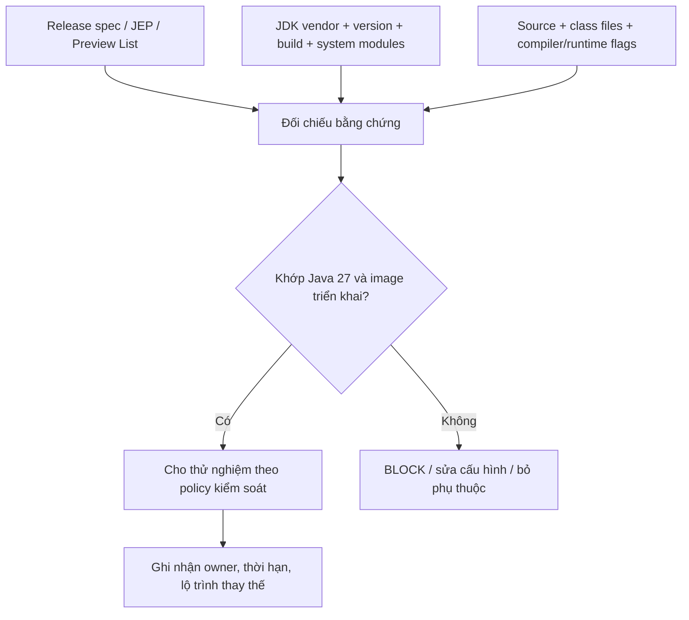
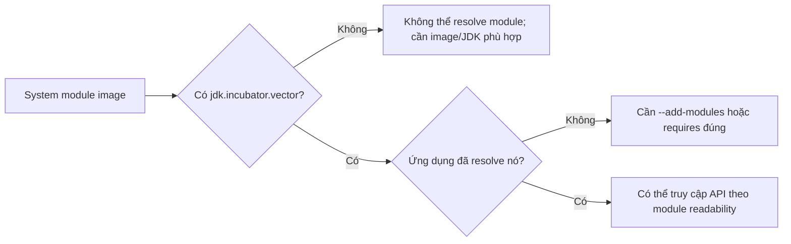
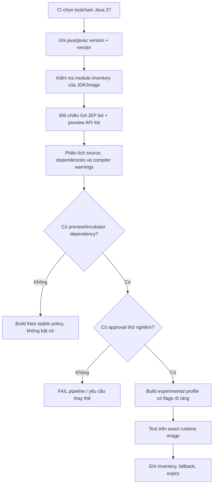

# Xác minh danh sách preview và incubator thực tế của từng build Java 27

Khi một bài viết giới thiệu tính năng “mới trong Java 27”, không thể lập tức kết luận tính năng đó **đã ổn định**, có mặt trong **mọi bản phân phối JDK 27** hoặc có thể dùng mà không cần cấu hình. Trong Java, **preview** là tính năng được cung cấp để thu nhận phản hồi trước khi có quyết định trở thành chính thức; **incubator** là API/module đang được thử nghiệm và có thể thay đổi hoặc bị loại bỏ ở các bản phát hành tiếp theo. Một bản **JDK runtime image tùy biến** thậm chí có thể không chứa module incubator mà tài liệu Java 27 chính thức có nhắc tới.

Bài thuộc chương **Tính năng thử nghiệm có kiểm soát**, module **JAVA_VERSION_JAVA27 — Java 27 và các kiến thức liên quan**. Mục tiêu là **xác minh danh sách thực tế trên đúng build đang biên dịch và chạy**, không coi các ví dụ thử nghiệm là lời khuyên đưa vào production. Nội dung ưu tiên cơ chế còn hiệu lực ở Java 27, đối chiếu JDK chính thức và những câu lệnh kiểm chứng có thể lặp lại; không dựa trên danh sách preview/incubator của những bản Java cũ.

Sau bài học, bạn sẽ:

- Phân biệt **preview language feature**, **preview API**, **preview VM feature**, **incubating module** và **API đã chính thức**.
- Nắm **mốc tham chiếu Oracle JDK 27 GA**: bốn preview và một incubator; biết vì sao đây chưa phải bằng chứng cho runtime image riêng của bạn.
- Kiểm tra **vendor, phiên bản, build, bản JDK đầy đủ hay runtime image rút gọn**, và các module thực sự được đóng gói.
- Dùng `java --list-modules`, `java --describe-module`, `ModuleFinder.ofSystem()`, preview API list, JLS/JVMS và release notes để tạo biên bản kiểm kê.
- Phân biệt chính xác `--enable-preview` với `--add-modules jdk.incubator.vector`, cả lúc biên dịch lẫn chạy.
- Xây quy trình CI và quyết định chấp nhận rủi ro trước khi phụ thuộc vào tính năng chưa ổn định.

## 1. Vì sao phải xác minh trên từng build?

Ví dụ một nhóm lập trình đọc bài về **Vector API** rồi thêm import từ `jdk.incubator.vector`. Trên bản JDK 27 đầy đủ, module đó có thể hiện diện. Nhưng image dùng trong production được tạo bằng `jlink` có thể **không chứa** module này. Kết quả là source build được ở máy lập trình viên nhưng không thể chạy như dự kiến trên image triển khai.

Một trường hợp khác: mã dùng **preview language feature** biên dịch được với JDK 27 và `--enable-preview`. Sau đó pipeline chuyển sang một release JDK khác mà không kiểm tra lại đặc tả. Cùng cú pháp có thể đã thay đổi, trở thành chính thức hoặc bị loại bỏ; class file phụ thuộc preview của **release 27** cũng không thể mặc nhiên chạy trên mọi release khác.

Vì vậy cần trả lời ba câu hỏi **riêng biệt**:

1. **Đặc tả phát hành nói gì?** Java SE/JDK 27 định nghĩa tính năng nào đang preview hoặc incubating?
2. **Build/image trên máy có gì?** Vendor, version, build number, module system image và toolchain thực tế là gì?
3. **Ứng dụng đã dùng và bật gì?** Source, bytecode, module dependencies, compiler/runtime flags và build configuration có khớp với hai câu trên không?



**Không có một lệnh Java chuẩn duy nhất** có thể tự liệt kê toàn bộ preview language features, preview APIs và incubating modules của mọi vendor/build, kèm kết luận phần nào đã được ứng dụng sử dụng. Cần phối hợp **tài liệu đặc tả + kiểm kê binary image + phân tích source/dependencies + chạy thử**.

## 2. Năm khái niệm dễ bị trộn lẫn

| Nhóm | Định nghĩa thực hành | Cách phát hiện | Cách sử dụng |
|---|---|---|---|
| **Preview language feature** | Cú pháp/quy tắc ngôn ngữ được đặc tả và triển khai nhưng chưa chính thức | JLS preview specs, JEP của release, `javac` diagnostics | `--enable-preview` cùng source/release hiện tại |
| **Preview API** | API trong hệ sinh thái `java.*`/`javax.*` được đánh dấu PREVIEW | Java SE 27 API **Preview List**, class/method Javadoc | Cần cấu hình preview phù hợp và chấp nhận thay đổi |
| **Preview VM feature** | Tính năng JVM được định nghĩa preview theo JVMS | JVMS của **đúng release** | Phụ thuộc chính sách preview tương ứng |
| **Incubating module** | JDK module/API thử nghiệm, không thuộc cam kết ổn định Java SE | JEP, module-summary, `java --list-modules` | Giải quyết module, thường `--add-modules` |
| **Stable/final API** | API được công nhận chính thức trong release | Javadoc không gắn PREVIEW/Incubating; release notes | Dùng theo hợp đồng API thông thường |

Đặc biệt, **restricted method** (ví dụ một số phương thức FFM yêu cầu `--enable-native-access`) **không phải** đồng nghĩa preview/incubator. **Experimental JVM flag** (flag được đánh dấu experimental và có chính sách mở khóa riêng) cũng **không phải** một JEP preview language/API. Tránh cộng các hạng mục khác loại để đưa ra một “tổng số tính năng thử nghiệm Java 27” sai.

### 2.1. Preview không có nghĩa “mới có lỗi, chưa dùng được”

Theo quy trình JEP, preview đã được đặc tả và triển khai đầy đủ cho release đó, nhưng **chưa có cam kết API/cú pháp sẽ giữ nguyên** trong release sau. Đây là khác biệt với thử nghiệm tùy ý không có đặc tả. Mục đích chính là cho cộng đồng trải nghiệm và góp ý.

### 2.2. Incubating module không tự trở thành stable vì đã xuất hiện nhiều lần

Một module có thể ở trạng thái incubator qua nhiều release. **Số lần incubator không tự tạo sự bảo đảm ổn định.** Chỉ khi release chính thức công bố đã hoàn thiện hoặc thay đổi trạng thái mới được bỏ quy trình xác minh tương ứng.

## 3. Mốc tham chiếu: danh sách Java 27 GA

Theo **Oracle JDK 27 Release Notes (15/09/2026)**, tài liệu Java SE 27 và các JEP tương ứng, release Java 27 có **bốn tính năng preview** và **một tính năng incubator**:

| Mã JEP | Tên tính năng trong Java 27 | Phân loại trong Java 27 | Ví dụ API/điểm nhận diện |
|---|---|---|---|
| **JEP 532** | Primitive Types in Patterns, `instanceof`, and `switch` (**fifth preview**) | **Preview language** | Primitive type patterns và `instanceof`/`switch` mở rộng |
| **JEP 531** | Lazy Constants (**third preview**) | **Preview API** | `java.lang.LazyConstant`; `List.ofLazy`, `Map.ofLazy`, `Set.ofLazy` |
| **JEP 533** | Structured Concurrency (**seventh preview**) | **Preview API** | `java.util.concurrent.StructuredTaskScope` |
| **JEP 538** | PEM Encodings of Cryptographic Objects (**third preview**) | **Preview API** | `java.security.PEM`, `PEMEncoder`, `PEMDecoder`, `BinaryEncodable` |
| **JEP 537** | Vector API (**twelfth incubator**) | **Incubating module** | `jdk.incubator.vector` |

Các ordinal “fifth”, “third”, “seventh”, “twelfth” là **số vòng preview/incubator**, không phải số phiên bản của API hoặc yêu cầu bật nhiều flag hơn.

**Java SE 27 không định nghĩa preview VM feature** theo JVMS §1.5.2. Điều đó không có nghĩa HotSpot không có tùy chọn VM thử nghiệm; đó chỉ là kết luận trong **phân loại preview feature của đặc tả JVM**.

**Phạm vi danh sách:** bảng là **inventory theo release GA**, không phải bản kê từng preview method. Preview API List có nhiều class, interface và method gắn PREVIEW cùng thuộc ba nhóm **Lazy Constants / Structured Concurrency / PEM Encodings**; bảng không tuyên bố mỗi nhóm chỉ có một API.

### 3.1. Những ví dụ không được ghi nhầm là preview Java 27

- **Virtual threads** đã trở thành tính năng chính thức từ Java 21.
- **Foreign Function & Memory API (FFM)** đã hoàn thiện từ Java 22, dù một số thao tác native vẫn là *restricted* và cần quyền riêng.
- **`ScopedValue`** đã là API chính thức từ Java 25.
- Không lấy các tính năng từng ở preview của **Java 23/24/25/26** để mặc định gắn nhãn preview trong Java 27.

Các ví dụ này chỉ nhằm **phân biệt trạng thái hiện hành**, không sử dụng lại cách triển khai preview cũ làm hướng dẫn.

## 4. Thứ tự nguồn bằng chứng cần ưu tiên

Để không trộn phát hành chính thức, early-access và bản build tùy chỉnh:

1. **Đặc tả Java SE 27 và JVMS/JLS:** xác định preview language và preview VM.
2. **Java SE 27 API Preview List:** chỉ ra chính xác **API nào còn mang nhãn PREVIEW**.
3. **Oracle/OpenJDK JDK 27 release notes + JEP của release:** xác định tên tính năng, trạng thái, JEP ID và incubator.
4. **Java SE 27 JDK API module summary:** ví dụ `jdk.incubator.vector` được đánh dấu incubating.
5. **Kết quả chạy bằng đúng binary JDK/image đích:** tên module, vendor, runtime build, khả năng compile/run.
6. **Repository/build/deployment của ứng dụng:** vị trí sử dụng, dependency và flags compile/runtime thực tế.

Không dùng một bài viết cũ hơn làm nguồn quyết định **trạng thái hiện tại**. Các liên kết tới `download.java.net/java/early_access/...` có thể là tài liệu **EA hoặc nhánh Valhalla riêng**, không phải đặc tả GA tương ứng với image đang chạy. Đối với Java 27 GA, ưu tiên URL tài liệu phát hành như `docs.oracle.com/en/java/javase/27/...` và bản JDK mà bạn xác định được.

**Điểm tinh tế:** tài liệu phát hành là tiêu chuẩn cho **tính năng được định nghĩa**, trong khi binary runtime cho biết **module hiện diện và hành vi cụ thể**. Một binary thiếu incubator không thay đổi danh sách JEP của Java 27; nó cho biết **image ấy không đóng gói module đó**.

## 5. Ghi lại danh tính build đang kiểm chứng

Đừng ghi báo cáo chỉ bằng một nhãn “Java 27”. Tối thiểu lưu:

| Trường | Ví dụ/nguồn lấy |
|---|---|
| Java feature version | `27` |
| Vendor/distribution | Oracle/OpenJDK hoặc nhà cung cấp thực tế của image |
| Full runtime version/build | Kết quả `java --version`, ví dụ build nền GA `27+35` |
| Compiler version | `javac --version` |
| Loại image | Full JDK, JRE/runtime image hoặc image tùy biến bằng `jlink` |
| OS/architecture | Ví dụ Linux x86_64 hoặc Windows ARM64 theo môi trường |
| JDK binary source/digest | Đường dẫn artifact và checksum từ kênh tin cậy |
| Options compile/run | Các flag `--enable-preview` và `--add-modules` được dùng |
| Thời điểm kiểm chứng | Ngày chạy kiểm kê, build job/CI và môi trường |

**Oracle JDK 27 GA release notes** mô tả bản GA nền bằng **`27+35`**. Đây là **ví dụ tham chiếu**, không phải lời khẳng định mọi bản JDK 27 đang được sử dụng đều có full version đúng bằng giá trị đó; các bản update, vendor builds và custom images có thể mang thông tin khác.

### 5.1. Lệnh độc lập hệ điều hành

Trong shell đang trỏ tới **đúng JDK 27 đích**:

```bash
java --version
javac --version
java --list-modules
```

Phải kiểm tra công cụ thực sự đến từ **cùng một installation**. Một máy có nhiều JDK có thể có `java` ở PATH khác với `javac`. Nếu biết đường dẫn JDK đích, dùng trực tiếp `$JAVA_HOME/bin/java` và `$JAVA_HOME/bin/javac` thay cho tên lệnh không có đường dẫn trên Linux/macOS.

Ví dụ PowerShell trên Windows, khi `JAVA_HOME` trỏ đúng JDK:

```powershell
& "$env:JAVA_HOME\bin\java.exe" --version
& "$env:JAVA_HOME\bin\javac.exe" --version
& "$env:JAVA_HOME\bin\java.exe" --list-modules
```

Kết luận về “có module X” chỉ có giá trị cho binary/image được thực thi trong những lệnh đó, không cho tất cả image Java 27 khác.

## 6. Liệt kê module incubator thực sự có trong runtime image

Đối với Oracle JDK 27 GA đầy đủ, incubator được công bố là:

```text
jdk.incubator.vector
```

Trong shell POSIX:

```bash
java --list-modules | grep '^jdk\.incubator\.'
java --describe-module jdk.incubator.vector
```

Trong PowerShell:

```powershell
java --list-modules | Select-String '^jdk[.]incubator[.]'
java --describe-module jdk.incubator.vector
```

**Cần kiểm tra cả hai đầu ra:**

- Nếu `--list-modules` có `jdk.incubator.vector@...`, module **có trong system module image**.
- Nếu `--describe-module jdk.incubator.vector` thành công, bạn có thể xem module descriptor và các package được export.
- Nếu command báo không tìm thấy module, **runtime image hiện tại** thiếu module; đừng tự kết luận toàn bộ Java 27 đã loại bỏ Vector API.
- Chỉ nhìn thấy module trong danh sách **không đồng nghĩa module đang được resolve trong boot layer của một ứng dụng cụ thể**.

**Không dùng** `java --enable-preview` để “bật Vector API”: incubator này yêu cầu **module resolution**; cờ preview **không thay thế** `--add-modules`.

### 6.1. Có trong image khác với đã được resolve



Ứng dụng classpath thường cần `--add-modules jdk.incubator.vector` khi compile và run. Một ứng dụng **named module** có `requires jdk.incubator.vector;` sẽ tạo dependency trong module graph; vẫn phải bảo đảm module tồn tại trong image chạy.

## 7. Ví dụ Java chỉ dùng API ổn định để kiểm kê image

Chương trình sau **không sử dụng preview hoặc incubator API** nên có thể dùng làm công cụ kiểm tra trước khi bật thử nghiệm.

Tạo `BuildInventory.java`:

```java
import java.lang.module.ModuleFinder;
import java.lang.module.ModuleReference;
import java.util.Comparator;

public class BuildInventory {
    public static void main(String[] args) {
        Runtime.Version version = Runtime.version();
        ModuleFinder image = ModuleFinder.ofSystem();

        System.out.println("Feature version: " + version.feature());
        System.out.println("Full runtime version: " + version);
        System.out.println("Vendor: " + System.getProperty("java.vendor"));
        System.out.println("VM: " + System.getProperty("java.vm.name"));
        System.out.println("Architecture: " + System.getProperty("os.arch"));
        System.out.println("Image has vector: "
                + image.find("jdk.incubator.vector").isPresent());
        System.out.println("Boot layer has vector: "
                + ModuleLayer.boot()
                        .findModule("jdk.incubator.vector")
                        .isPresent());

        System.out.println("All incubating module names in image:");
        image.findAll().stream()
                .map(ModuleReference::descriptor)
                .map(descriptor -> descriptor.name())
                .filter(name -> name.startsWith("jdk.incubator."))
                .sorted(Comparator.naturalOrder())
                .forEach(System.out::println);
    }
}
```

Chạy bằng JDK 27:

```bash
java BuildInventory.java
java --add-modules jdk.incubator.vector BuildInventory.java
```

**Điều kiện:** lệnh thứ hai chỉ chạy nếu image thực sự có `jdk.incubator.vector`. Với JDK 27 đầy đủ có module đó, ở lệnh thứ nhất thông thường `Image has vector: true` nhưng `Boot layer has vector: false`; khi thêm `--add-modules`, module được resolve và giá trị thứ hai có thể chuyển thành `true`. Không xem các boolean này là hằng số của mọi image và cấu hình launcher.

Ví dụ này cố ý không dùng `Class.forName("jdk.incubator.vector.IntVector")` làm phép kiểm tra duy nhất: khả năng load class còn phụ thuộc module resolution và classloader. `ModuleFinder.ofSystem()` cho biết **module có trong image**, còn `ModuleLayer.boot()` cho biết **module đã được resolve trong boot layer hiện tại**.

## 8. Kiểm tra preview API của Java 27 đúng cách

Tài liệu API chính thức có trang:

```text
https://docs.oracle.com/en/java/javase/27/docs/api/preview-list.html
```

**Preview List** nhóm các thành phần có nhãn PREVIEW theo tính năng. Ở Java 27 GA, ba nhóm API là:

| Nhóm Preview API | Thành phần tiêu biểu | Ghi chú |
|---|---|---|
| **Lazy Constants** | `LazyConstant`, `List.ofLazy`, `Map.ofLazy`, `Set.ofLazy` | JEP 531; third preview |
| **Structured Concurrency** | `StructuredTaskScope` và các nested types, `StructureViolationException` | JEP 533; seventh preview |
| **PEM Encodings** | `PEM`, `PEMDecoder`, `PEMEncoder`, `BinaryEncodable`, một số method trên `EncryptedPrivateKeyInfo` | JEP 538; third preview |

Danh sách trong bảng **không phải toàn bộ phương thức**. Một class đã ổn định có thể xuất hiện **một method preview mới**; do đó không chỉ kiểm tra tên class. Ví dụ các factory `List.ofLazy`/`Map.ofLazy`/`Set.ofLazy` xuất hiện bên cạnh những phương thức collection đã chính thức từ lâu.

**Quy trình kiểm chứng preview API:**

1. Mở **Preview List cho Java SE 27** đúng version, không dùng trang Java 25/26 hay early-access.
2. Chọn nhóm tính năng/JEP và mở tài liệu của **type hoặc method cụ thể**.
3. Kiểm tra nhãn `PREVIEW`, điều kiện sử dụng và các thành phần liên quan.
4. So sánh với source/dependency của ứng dụng: có gọi API đó trực tiếp, qua generic signature, annotation processing hay reflection không?
5. Xác nhận compiler và runtime đều có cấu hình preview nếu phần mềm thực sự phụ thuộc vào preview API.

**Không có bảo đảm rằng `java --list-modules` tự in ra từng preview class/method.** Preview API có thể nằm trong module chính thức như `java.base`; việc module `java.base` tồn tại không nói lên trạng thái của từng phần tử API.

## 9. Xác minh preview language trong Java 27

Ngôn ngữ Java 27 GA có **JEP 532 — Primitive Types in Patterns, `instanceof`, and `switch` (fifth preview)**. Để xác nhận:

- Kiểm tra **Java SE 27 JLS** phần preview và đặc tả thay đổi JEP 532.
- Xem hướng dẫn ngôn ngữ Java 27 về primitive type patterns và chuyển đổi chính xác.
- Biên dịch ví dụ nhỏ bằng **chính JDK 27 đích**: khi thiếu `--enable-preview`, compiler cần từ chối việc dùng tính năng preview.
- Ghi lại output và flags; không dựa vào bản build có preview từ release trước.

Ví dụ khám phá nhỏ, **không phải khuyến nghị production**:

```java
// PreviewProbe.java — chỉ dành cho JDK 27 với preview enabled.
public class PreviewProbe {
    public static void main(String[] args) {
        int small = 120;
        int large = 200;

        if (small instanceof byte b) {
            System.out.println("Fits in byte: " + b);
        }
        System.out.println("Large fits in byte: "
                + (large instanceof byte));
    }
}
```

Biên dịch và chạy:

```bash
javac --enable-preview --release 27 -Xlint:preview PreviewProbe.java
java --enable-preview PreviewProbe
```

Kết quả dự kiến khi cú pháp JEP 532 được hỗ trợ:

```text
Fits in byte: 120
Large fits in byte: false
```

Các kiểm tra:

- Với `120`, chuyển từ `int` sang `byte` là chính xác về giá trị, nên pattern khớp.
- Với `200`, giá trị không thể biểu diễn bằng `byte` có dấu; phép kiểm tra trả `false`.
- Nếu bỏ `--enable-preview` ở compile time, `javac` sẽ báo dùng preview khi chưa bật.
- Nếu class file được đánh dấu phụ thuộc preview và runtime không bật preview, JVM không tải class theo hợp đồng runtime của release.

**Không được đổi lệnh thành `javac --enable-preview --release 26` trên JDK 27** rồi kỳ vọng preview của Java 26 được bật như thời điểm trước. Preview features được cấp cho **current release**, phải kiểm tra release và compiler phù hợp với nhau.

## 10. `--enable-preview` không giống `--add-modules`

| Thuộc tính | `--enable-preview` | `--add-modules jdk.incubator.vector` |
|---|---|---|
| Bật cái gì? | Cho phép dùng preview features của **release hiện tại** | Thêm module incubator vào **module graph** |
| Dùng khi nào? | Preview language, preview API | Vector API của Java 27 |
| Cần ở compile time? | Có nếu source phụ thuộc preview | Có nếu classpath source import incubator package |
| Cần ở runtime? | Có khi chạy class phụ thuộc preview | Có nếu runtime cần resolve incubator module |
| Có làm thay đổi trạng thái ổn định của feature? | **Không** | **Không** |
| Có tự tạo module bị thiếu trong custom image? | Không | **Không** |

Đừng đặt `--enable-preview` ở mọi ứng dụng chỉ để “mở khóa tất cả tính năng Java 27”. Chỉ bật cho **thử nghiệm đã được duyệt**, với phiên bản JDK được kiểm soát; nếu không dùng preview thì bỏ cờ để tránh tạo phụ thuộc âm thầm.

**Chú ý:** ứng dụng đồng thời dùng preview và incubator có thể cần cả hai nhóm cấu hình. Mỗi flag giải quyết **một cơ chế riêng**, và build/release policy cần cho phép từng cơ chế một cách minh bạch.

## 11. Ví dụ Vector API incubator trên đúng JDK image

JDK 27 GA có **Vector API (JEP 537, twelfth incubator)** trong module `jdk.incubator.vector`. Đây là **API đang incubating**, không phải Java SE API stable.

Tạo `VectorProbe.java`:

```java
import java.util.Arrays;
import jdk.incubator.vector.IntVector;
import jdk.incubator.vector.VectorSpecies;

public class VectorProbe {
    public static void main(String[] args) {
        VectorSpecies<Integer> species = IntVector.SPECIES_PREFERRED;
        int[] values = new int[species.length()];
        Arrays.fill(values, 2);

        IntVector vector = IntVector.fromArray(species, values, 0);
        IntVector doubled = vector.mul(2);
        int[] result = new int[species.length()];
        doubled.intoArray(result, 0);

        System.out.println("Lanes: " + species.length());
        System.out.println("Result: " + Arrays.toString(result));
    }
}
```

Trên **full JDK 27** có module Vector:

```bash
javac --add-modules jdk.incubator.vector VectorProbe.java
java --add-modules jdk.incubator.vector VectorProbe
```

Tùy JDK/CPU, số **lanes** có thể khác. Mọi phần tử của mảng kết quả dự kiến bằng **4**. Lệnh có thể in cảnh báo về việc sử dụng **incubating module**; đó là tín hiệu cần ghi lại trong biên bản, không phải lỗi mà nên giấu bằng cách tắt mọi cảnh báo.

Nếu runtime image thiếu `jdk.incubator.vector`, việc thêm `--add-modules` **không tải được module từ Internet**. Phải thay image hoặc đưa ra lựa chọn triển khai khác, sau khi xác minh phạm vi hỗ trợ.

### 11.1. Named module cần ghi dependency rõ ràng

Ví dụ `module-info.java` của một dự án **thử nghiệm**, không phải code production mặc định:

```java
module sample.vector.experiment {
    requires jdk.incubator.vector;
}
```

Với named modules, `requires` tạo dependency rõ ràng và module resolution xử lý nó nếu module có sẵn. Ở classpath, `--add-modules jdk.incubator.vector` thường là cách trực tiếp để đưa module vào tập module gốc. Đừng dùng `--add-exports` hoặc truy cập các `jdk.internal.*` để thay thế module được export hợp lệ.

## 12. Class file phụ thuộc preview có dấu hiệu gì?

Theo **JVMS Java SE 27**, một class file phụ thuộc preview của release `N` được đánh dấu:

- **Major version:** class file version tương ứng release đó.
- **Minor version:** **65535**.

Trong Java 27, class file version chính là **major 71**. Vì vậy, một class file phụ thuộc preview của Java 27 có dạng **71.65535**.

Sau khi biên dịch `PreviewProbe.java` bằng JDK 27 với preview:

```bash
javap -verbose PreviewProbe
```

Trong phần đầu output, kiểm tra các dòng kiểu:

```text
minor version: 65535
major version: 71
```

**Giới hạn phép kiểm tra:**

- Chỉ dùng kết quả này với **class file thực sự phụ thuộc preview**. Bật cờ preview không có nghĩa mọi class bất kể nội dung đều phải có minor 65535.
- Class file có minor 65535 **không tự cho biết nó đã dùng JEP nào**. Cần kiểm tra source/dependencies và tài liệu.
- Không suy luận rằng class file preview của **Java 26** có thể load trên Java 27 bằng cách bật `--enable-preview`. JVMS ràng buộc class file preview với **release tương ứng**; cần biên dịch lại và thử nghiệm theo Java 27.
- `javap` chỉ quan sát **bytecode đã tạo**, không thay được kiểm tra release notes hay preview API list.

## 13. Kiểm chứng preview API bằng compiler và runtime

Tính năng **Structured Concurrency** minh họa khác biệt giữa “có class” và “được phép sử dụng”:

- Class `java.util.concurrent.StructuredTaskScope` có thể được hiển thị trong Javadoc của JDK 27.
- Nó **mang nhãn PREVIEW**, vì thuộc JEP 533.
- Source import và gọi API preview phải được biên dịch trong **chế độ preview** của release 27.
- Runtime cần chế độ preview khi class phụ thuộc preview được load.

**Không** kiểm tra bằng cách chỉ gọi `Class.forName("java.util.concurrent.StructuredTaskScope")` rồi kết luận nó đã stable. Việc class có tên đó hiện diện trong runtime không nói lên **hợp đồng ổn định** hoặc tính tương thích tương lai.

Tương tự, `java.lang.LazyConstant` và các PEM APIs có thể nằm trong module chuẩn nhưng vẫn là preview. **Tên package hoặc module chuẩn không đủ** để xác nhận trạng thái của từng phương thức.

Đối với những hệ thống bắt buộc chỉ dùng stable Java 27, cách an toàn là **không import, không gọi qua reflection và không yêu cầu bật preview cho production**. Viết một adapter/spike tách riêng nếu cần đánh giá lợi ích của feature preview.

## 14. JVMS: không có preview VM feature ở Java 27

Phần **JVMS §1.5.2 Current Preview VM Features** nêu rằng Java SE 27 **không định nghĩa preview VM feature**.

Ba câu dưới đây khác nghĩa:

1. “Java 27 có preview language feature.” → **Đúng**: JEP 532.
2. “Java 27 có preview APIs.” → **Đúng**: JEP 531, 533, 538.
3. “Java 27 có preview VM feature được JVMS §1.5.2 định nghĩa.” → **Không**.

Đừng vì có những cờ JVM mang tên `-XX:+UnlockExperimentalVMOptions` mà đưa chúng vào mục “preview VM features” của Java 27. **Experimental VM options**, restricted native methods, và preview VM feature là các **phân loại độc lập**.

## 15. JDK 27 GA, update, early-access và custom image

| Môi trường | Cách kiểm tra | Kết luận đúng phạm vi |
|---|---|---|
| **Oracle JDK 27 GA đầy đủ** | Release notes JDK 27 + binary version + modules | So khớp mốc 4 preview / 1 incubator của phát hành |
| **Vendor JDK 27 update** | Vendor/build info + tài liệu release tương ứng | Đối chiếu với GA và những khác biệt được nhà cung cấp công bố |
| **JDK 27 EA** | Version chứa dấu hiệu EA + tài liệu đúng **build EA** | Không dùng danh sách EA để tuyên bố trạng thái GA |
| **Nhánh Project Valhalla hoặc thử nghiệm riêng** | Repository/build ID và tài liệu của nhánh đó | Không đồng nhất với Java SE 27 GA |
| **Image tùy biến bằng `jlink`** | Chạy `image/bin/java --list-modules` trong **đúng image** | Chỉ những module đã đóng gói mới khả dụng |
| **Container runtime image** | Kiểm tra binary **bên trong container**, không chỉ JDK host | Ghi nhận digest image và cấu hình deploy |

Ví dụ các nguồn tài liệu early-access về Project Valhalla có thể nhắc tới **value classes** hoặc preview features thử nghiệm khác. **Không thêm chúng vào bảng GA chỉ vì số phiên bản URL cũng chứa “27”.** Cần xác minh dòng phân phối, build và JEP đã được tích hợp chính thức.

Khi build app bằng JDK từ vendor A nhưng chạy trong image của vendor B, phải lưu cả **hai** kết quả kiểm kê. Khác biệt về module đóng gói, crypto providers, OS architecture hoặc flags có thể ảnh hưởng kết quả ngay cả khi cả hai báo feature version 27.

## 16. Tạo một biên bản kiểm kê có thể audit

Không nên chỉ báo “preview enabled: yes/no”. Một biên bản đủ hữu ích cho CI/release review nên có:

| Nhóm bằng chứng | Trường được lưu |
|---|---|
| **Định danh** | Java vendor, full version/build, OS/arch, image digest và ngày kiểm tra |
| **Compiler** | `javac --version`, flags build, `--release` và cảnh báo preview |
| **Runtime** | `java --version`, flags launch, module image và module resolution |
| **Release manifest** | JEP 531/532/533/538 (preview), JEP 537 (incubator) theo Java 27 GA |
| **Preview API** | Link Preview List 27, class/method cụ thể được ứng dụng sử dụng |
| **Incubator** | `jdk.incubator.vector` có trong image? được resolve? dependency ở đâu? |
| **Bytecode** | Có class file phụ thuộc preview? Nếu có, major/minor và artifact cụ thể |
| **Đánh giá rủi ro** | Owner, use case, fallback, test plan, migration plan, hạn thử nghiệm |

Mẫu báo cáo:

```text
Release target: Java SE 27
Compile JDK: <vendor>, <full-version>, <build-id>
Runtime JDK/image: <vendor>, <full-version>, <image-digest>
OS/arch: <os>, <arch>
Preview spec: JEP 532 / 531 / 533 / 538
Incubator spec: JEP 537, jdk.incubator.vector
Incubating modules found in image: <actual-list>
Vector module resolved at startup: <true/false>
Preview source/API used by app: <actual-inventory>
--enable-preview at compile/run: <actual-flags>
--add-modules at compile/run: <actual-flags>
Risk owner and expiry: <team/date>
Decision: APPROVE EXPERIMENT / BLOCK / REVISIT
```

Không đưa các giá trị placeholder ở trên vào hồ sơ như dữ liệu thật. Kết quả phải được thu thập từ **cùng build pipeline và runtime image** dùng để phát hành.

## 17. Quy trình kiểm tra trong CI

Một pipeline chất lượng có thể thực hiện các cổng kiểm soát:



**Ví dụ policy** (phải điều chỉnh theo tổ chức):

- Nhánh **production**: không cho phép source phụ thuộc preview/incubator, không bật `--enable-preview` hoặc `--add-modules jdk.incubator.vector` trừ ngoại lệ được đánh giá riêng.
- Nhánh **experiment**: cho phép đúng JEP đã phê duyệt, pin full JDK build, bật flags tường minh tại compile/run/test, thu output warnings và test trên image khớp.
- Khi nâng Java release/vendor: chạy lại toàn bộ inventory và đánh giá **API signatures, module resolution, bytecode, JEP status, hiệu năng và fallback**.

Chỉ nhìn thấy `--enable-preview` trong Gradle/Maven **không chứng minh** ứng dụng thực sự dùng preview. Ngược lại, code gọi preview API qua reflection hoặc một dependency build sẵn có thể không xuất hiện qua import trong source. Cần đánh giá cả **runtime linkage** và những đường gọi động.

## 18. Gradle và Maven: cờ phải đi đủ các giai đoạn

### 18.1. Gradle Kotlin DSL — cấu hình thử nghiệm có chủ đích

Một ví dụ **minh họa** cho dự án Gradle đã được cấu hình toolchain JDK 27:

```kotlin
tasks.withType<JavaCompile>().configureEach {
    options.compilerArgs.addAll(listOf("--enable-preview", "--release", "27"))
}

tasks.withType<Test>().configureEach {
    jvmArgs("--enable-preview")
    useJUnitPlatform()
}

tasks.named<JavaExec>("run") {
    jvmArgs("--enable-preview")
}
```

Đây **không** phải build script đầy đủ: cần plugin `java`/`application` phù hợp, repository/dependencies và Gradle version hỗ trợ Java 27. Nếu dùng `options.release.set(27)` trong cấu hình chính, không thêm một lần `--release 27` trùng lặp không cần thiết vào compilerArgs.

**Đừng copy đoạn bật preview này sang mọi dự án.** Chỉ đặt trong profile/nhánh experimental có chủ đích. Cũng phải truyền flags tương ứng cho các quy trình integration test, packaging và môi trường chạy thật nếu chúng dùng class file phụ thuộc preview.

### 18.2. Maven — phân biệt compiler và test runtime

Ví dụ các phần cấu hình liên quan:

```xml
<properties>
    <maven.compiler.release>27</maven.compiler.release>
</properties>
<!-- Compiler plugin: --enable-preview -->
<!-- Surefire/Failsafe: JVM argLine chứa --enable-preview -->
<!-- Launcher production/test image: java --enable-preview ... -->
```

Các dòng trên là **hướng dẫn cấu hình**, không phải POM đầy đủ. Maven compiler plugin và test plugins có tham số riêng; cần theo phiên bản plugin thực sự được dự án sử dụng. Bật cờ ở compiler **không** tự bật nó cho mọi test runner hoặc JVM production.

**Incubator Vector:** với dự án classpath, thêm `--add-modules jdk.incubator.vector` cho đúng compiler/test/runtime profile; với named module, khai báo `requires` tương ứng. Đừng lẫn với preview.

## 19. Các sai lầm về toolchain và version compatibility

| Sai lầm | Vì sao sai | Cách phát hiện/sửa |
|---|---|---|
| “Có `java 27` là chắc có `jdk.incubator.vector`” | Custom image có thể bỏ module | `java --list-modules` trên exact image |
| “`java --list-modules` cho biết mọi preview API” | Preview methods có thể thuộc `java.base` | API Preview List + kiểm tra source |
| “Vector là preview nên bật `--enable-preview`” | Vector là **incubator module** | `--add-modules jdk.incubator.vector` |
| “Có `StructuredTaskScope` trong Javadoc nghĩa là stable” | Class mang nhãn PREVIEW | Xem preview-list và JEP 533 |
| “`ScopedValue` vẫn preview ở Java 27” | API đã final từ Java 25 | Xem Javadoc hiện hành, không dùng tài liệu cũ |
| “Cứ dùng `--enable-preview --release 26` trên javac 27” | Preview chỉ áp dụng theo current release được hỗ trợ | Chọn `--release 27` với JDK 27 |
| “Classfile 71.65535 chạy mọi Java release có preview” | Preview bytecode bị ràng buộc release | Biên dịch lại đúng target release |
| “Bản Valhalla 27-ea là Java 27 GA” | Nhánh thử nghiệm có thể khác GA | Kiểm tra vendor/build và JEP GA |
| “Build xanh ở host, container cũng xanh” | Runtime image có thể khác toolchain | Test exact container image |
| “`--add-modules` tải module bị thiếu” | Flag chỉ yêu cầu resolve module có sẵn | Thay runtime image hoặc bỏ dependency |
| “`jdeps` liệt kê mọi feature preview” | Không có kết luận trạng thái từng preview method | Kiểm tra source/API list/compile/runtime |
| “Chỉ bật preview cho compiler là đủ” | JVM chạy class phụ thuộc preview vẫn cần flag | Truyền flag vào test runner và runtime |
| “Chỉ cần cùng feature version 27” | Build/vendor/image và options có thể khác | Lưu full version và image digest |

Không tắt cảnh báo của compiler/runtime bằng mọi giá. Cảnh báo về incubating module hoặc preview feature là một **bằng chứng cần được ghi lại** trong quá trình đánh giá rủi ro.

## 20. Những điều `jdeps`, `javap` và `jlink` có thể — và không thể — chứng minh

**`jdeps`** giúp phân tích các phụ thuộc **tĩnh** của bytecode:

```bash
jdeps --list-deps my-application.jar
jdeps --print-module-deps my-application.jar
```

Những lệnh trên cần một artifact JAR có thật; `my-application.jar` chỉ là ví dụ. Nếu artifact phụ thuộc trực tiếp vào incubator module, kết quả có thể cho thấy tên module cần resolve. Nhưng:

- Reflection, service loading, dynamic method handles và các module được nạp gián tiếp có thể khiến kết quả không đủ.
- `jdeps` **không phải** công cụ chính thức để kết luận một method có nhãn PREVIEW hoặc không.
- Không coi `--print-module-deps` là cam kết mọi optional/dynamic path đã được kiểm kê.

**`javap -verbose`** xem bytecode/classfile version: hữu ích tìm dấu minor 65535 cho class phụ thuộc preview, nhưng không xác định JEP bằng tên.

**`jlink`** tạo runtime image với tập module được chọn. Khi xác minh ứng dụng:

```bash
# Nếu đã có image được tạo bởi jlink:
./image/bin/java --version
./image/bin/java --list-modules
```

Nếu image thiếu `jdk.incubator.vector` mà artifact lại yêu cầu nó, pipeline **phải fail ở test runtime image**. Không dùng kết quả `java --list-modules` của full development JDK thay cho kết quả trong image triển khai.

## 21. Thử nghiệm không đồng nghĩa chấp nhận dùng production

Với những nhóm tính năng còn preview/incubator, cần có **mục tiêu và giới hạn rõ ràng**:

| Quyết định | Yêu cầu |
|---|---|
| **Thử nghiệm nội bộ** | Pin JDK 27 build, flag rõ ràng, workload có thể tái hiện |
| **Đánh giá hiệu năng** | So với giải pháp stable, đo throughput/latency/CPU/GC trên CPU thực tế |
| **Đánh giá API ergonomics** | Viết feedback có ví dụ, nêu bất tiện hoặc thay đổi cần thiết |
| **Dùng trong thư viện public** | Tránh leak preview types qua public signatures của bản phát hành ổn định |
| **Đưa vào production theo ngoại lệ** | Có phê duyệt, owner, rollback/fallback, pin build, theo dõi release thay đổi |
| **Nâng cấp Java release** | Xác minh lại JEP và API, chạy test/migration, không giữ flags theo quán tính |

Một ví dụ: nếu thư viện dùng `StructuredTaskScope` (preview) trong **public API**, những người dùng thư viện có thể phải dùng preview và gắn chặt vào một release JDK. Nên cân nhắc ẩn thử nghiệm sau một adapter, giữ public API ổn định bằng các kiểu chính thức.

**Tránh phát hành tutorial code preview như “cách chuẩn không cần flag”**. Nếu phải đưa vào tài liệu, gắn nhãn **EXPERIMENT**, chỉ rõ JDK/build và flags, cùng cảnh báo thay đổi giữa release.

## 22. Bài tập kiểm chứng thực hành

### Bài 1 — Ghi lại build thực tế

Chạy `java --version`, `javac --version` và `java --list-modules` bằng **đúng JDK 27** của bạn. Lưu vendor/full version, OS, architecture và các module tên bắt đầu bằng `jdk.incubator.`. Nếu không có module nào, hãy phân biệt “image không đóng gói” với “Java 27 không có incubator”.

### Bài 2 — So release manifest với runtime image

Đối chiếu JEP 531, 532, 533, 538 và 537 với Oracle Java 27 release notes. Xác định nhóm preview language, nhóm preview API và incubator. Vì sao danh sách module của runtime không tự chứa tên JEP 531 hoặc 538?

### Bài 3 — Biên dịch preview language

Biên dịch `PreviewProbe.java` khi **không bật** `--enable-preview` rồi thử lại với `javac --enable-preview --release 27`. Ghi diagnostic khác nhau. Nếu tạo class phụ thuộc preview, kiểm tra major/minor bằng `javap -verbose`.

### Bài 4 — Kiểm tra Vector API

Dùng `java --describe-module jdk.incubator.vector`. Nếu module tồn tại, compile/run `VectorProbe.java` với `--add-modules jdk.incubator.vector`. Nếu không, ghi nhận thiếu module thay vì thêm `--enable-preview` tùy tiện.

### Bài 5 — Tách present khỏi resolved

Chạy `BuildInventory.java` với và không có `--add-modules jdk.incubator.vector`. Giải thích ý nghĩa của `ModuleFinder.ofSystem()` và `ModuleLayer.boot()` trong hai lần chạy.

### Bài 6 — Audit một thư viện

Một JAR được biên dịch bằng JDK 27 có class file major 71 minor 65535, và `jdeps` cho thấy phụ thuộc `jdk.incubator.vector`. Nêu **hai cơ chế khác nhau** cần cấu hình tại runtime và kế hoạch di chuyển khi tổ chức nâng JDK.

### Bài 7 — Cùng 27 nhưng khác build

CI compile trên full JDK 27, production dùng image `jlink` chỉ chứa các module được chọn. Hãy đề xuất bộ kiểm tra để không bỏ sót module incubator và preview flags, đồng thời ghi nhận vendor/full build/digest.

## 23. Ma trận xác minh trước khi cho phép thử nghiệm

| Kiểm tra | Kết quả PASS | Khi FAIL |
|---|---|---|
| Compile JDK đúng 27 | `javac --version` phù hợp | Chọn đúng toolchain |
| Runtime JDK đúng mục tiêu | `java --version` và build/digest đã ghi | Sửa image/deployment |
| JEP inventory khớp release | 4 preview + 1 incubator đối với Java 27 GA | Kiểm tra có dùng nhầm EA/nhánh riêng |
| Preview API List | Các API được đánh dấu chính xác | Không đoán trạng thái từ tên class |
| Incubator module presence | Module cần dùng có trong image | Thay image hoặc bỏ dependency |
| Module resolution | Tên module được resolve đúng | Thêm `requires`/`--add-modules` thích hợp |
| Preview compile config | `--enable-preview` và `--release 27` nếu cần | Fail build và sửa cấu hình |
| Preview runtime config | `java --enable-preview` nếu class phụ thuộc | Fail test/startup |
| Bytecode release compatibility | Classfile khớp runtime đúng release | Compile lại, không đổi minor thủ công |
| Exact image smoke test | Ứng dụng khởi động và chạy đường cần thiết | Không phát hành |
| Governance | Owner, fallback, expiry và phê duyệt rõ ràng | Giữ trong sandbox |

Biên bản PASS chỉ có giá trị cho **đúng artifact, build và image** đã kiểm tra; khi thay phiên bản JDK, container image, OS architecture hoặc module graph, cần chạy lại phần kiểm tra bị ảnh hưởng.

## 24. Checklist tổng kết

1. Đã phân biệt preview **language/API/VM** và **incubator module**, không gộp với restricted/native hoặc JVM experimental flags?
2. Đã ghi vendor, full runtime version, build number, OS/arch, image digest và ngày kiểm tra?
3. Đã đối chiếu danh sách **Java 27 GA**: JEP 532, 531, 533, 538 (preview); JEP 537 (incubator)?
4. Đã xác nhận **Java SE 27 không có preview VM feature** theo JVMS §1.5.2?
5. Đã mở **Preview List 27** và kiểm tra **type/method** thực tế được ứng dụng dùng?
6. Đã chạy `java --list-modules` và `--describe-module` trên **đúng runtime image**?
7. Có phân biệt **module có trong image** với **module đang được resolve**?
8. Có dùng `--enable-preview` và `--release 27` **chỉ khi cần**?
9. Có dùng `--add-modules jdk.incubator.vector` hoặc `requires` khi thử Vector API, không dùng nhầm flag preview?
10. Có kiểm tra class file preview và khả năng chạy trên **đúng Java 27 release**?
11. Có tránh suy từ bài viết Java 23/24/25/26 hoặc JDK 27 EA/Valhalla rằng GA có cùng feature list?
12. Có test trên **exact container/jlink image**, không chỉ development JDK?
13. Có chính sách không đưa preview/incubator vào stable production API một cách vô ý?
14. Có owner, cơ chế rollback, hạn dùng thử và kế hoạch migrate nếu JEP thay đổi hoặc bị gỡ?

**Kết luận:** “Java 27 có tính năng X” phải được tách thành **“release Java 27 định nghĩa X”, “build/image này thực sự chứa X”, và “ứng dụng đã bật, liên kết và kiểm chứng X”**. Mốc Java 27 GA là **bốn preview JEPs (531, 532, 533, 538)** và **một incubator JEP (537, module `jdk.incubator.vector`)**. Hãy dùng JEP/Preview List để biết **trạng thái đặc tả**, dùng lệnh JDK để biết **năng lực image thực tế**, và giữ preview/incubator trong **quy trình thử nghiệm có kiểm soát** cho tới khi có quyết định ổn định được xác nhận.

## 25. Tài liệu tham khảo chính thức

- [Oracle — JDK 27 Release Notes, ngày 15/09/2026](https://www.oracle.com/java/technologies/javase/27-relnote-issues.html): danh sách JEP và tình trạng GA.
- [Oracle Java SE 27 — Significant Changes](https://docs.oracle.com/en/java/javase/27/migrate/significant-changes-jdk-27-release.html): bốn preview và incubator của release.
- [Oracle Java SE 27 — Preview API List](https://docs.oracle.com/en/java/javase/27/docs/api/preview-list.html): chính xác các class, interface, methods có nhãn PREVIEW.
- [Oracle — Java SE 27 Platform Specifications](https://docs.oracle.com/en/java/javase/27/docs/specs/index.html): JLS, JVMS và Java API/JDK tool specifications.
- [Oracle Java SE 27 — Preview Language & VM Features](https://docs.oracle.com/en/java/javase/27/language/preview-language-vm-features.html): quy tắc `--enable-preview` ở compile/run time.
- [Oracle Java SE 27 — Primitive Types in Patterns, instanceof and switch](https://docs.oracle.com/en/java/javase/27/language/primitive-types-patterns-instanceof-switch.html): JEP 532 (fifth preview).
- [Oracle Java SE 27 — JVMS §1.5 Preview Features](https://docs.oracle.com/en/java/javase/27/docs/specs/jvms/jvms-1.html#jvms-1.5): phân loại và preview classfile; §1.5.2 ghi không có preview VM feature.
- [Oracle Java SE 27 — jdk.incubator.vector module](https://docs.oracle.com/en/java/javase/27/docs/api/jdk.incubator.vector/module-summary.html): module incubating của Vector API.
- [Oracle Java SE 27 — The javac Command](https://docs.oracle.com/en/java/javase/27/docs/specs/man/javac.html): `--enable-preview`, `--release`, `--add-modules` và lint options.
- [Oracle Java SE 27 — The java Command](https://docs.oracle.com/en/java/javase/27/docs/specs/man/java.html): `--enable-preview`, `--list-modules`, `--describe-module`.
- [OpenJDK — JEP 531: Lazy Constants](https://openjdk.org/jeps/531).
- [OpenJDK — JEP 532: Primitive Types in Patterns, instanceof, and switch](https://openjdk.org/jeps/532).
- [OpenJDK — JEP 533: Structured Concurrency](https://openjdk.org/jeps/533).
- [OpenJDK — JEP 537: Vector API](https://openjdk.org/jeps/537).
- [OpenJDK — JEP 538: PEM Encodings of Cryptographic Objects](https://openjdk.org/jeps/538).
