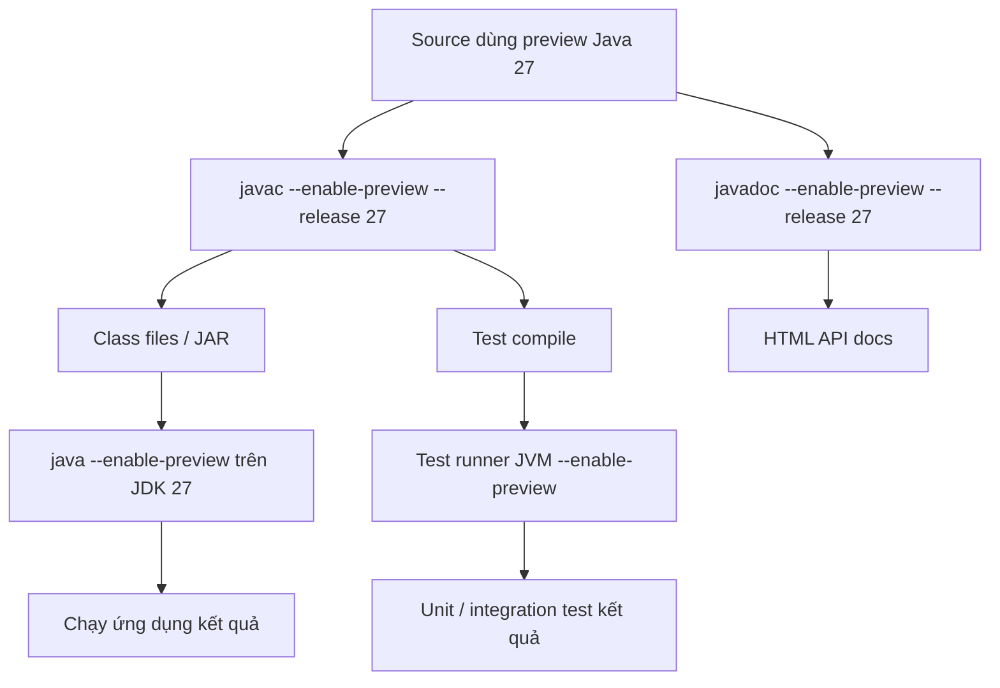

# Bật preview khi biên dịch, chạy, kiểm thử và tạo tài liệu trong Java 27

Java có cơ chế **preview feature** để cộng đồng thử nghiệm những tính năng đã có đặc tả/triển khai, nhưng **chưa phải cam kết API hoặc cú pháp ổn định lâu dài**. Việc dùng preview là lựa chọn có chủ đích: một dự án phải đồng bộ cách bật tính năng này trong **`javac`, JVM runtime, bộ kiểm thử, công cụ tạo Javadoc, IDE và CI**.

Một lỗi rất hay gặp: `mvn compile` chạy được với `--enable-preview` nhưng `mvn test` thất bại, vì compiler và tiến trình JVM thực thi test là **hai giai đoạn khác nhau**. Tương tự, chương trình chạy được từ IDE nhưng khi tạo Javadoc lại không parse được mã preview, hoặc build CI dùng JDK khác khiến artifact không còn tương thích.

Bài thuộc chương **Tính năng thử nghiệm có kiểm soát**, module **`JAVA_VERSION_JAVA27` — Java 27 và các kiến thức liên quan**. Các lệnh và ví dụ hướng đến **JDK 27**, chỉ dùng tính năng hiện còn trong phiên bản này; không lấy tính năng preview của những bản Java cũ đã chuyển sang final làm ví dụ preview hiện thời. Tính năng preview thích hợp cho **học tập, thử nghiệm, tương tác với JEP và chuẩn bị chuyển đổi**; không nên vô tình trở thành yêu cầu bắt buộc của một thư viện công khai hoặc môi trường production không có chính sách chấp nhận rủi ro.

> **Quy tắc cốt lõi:** dùng `javac --enable-preview --release 27` để biên dịch mã preview của Java 27; dùng `java --enable-preview` để chạy lớp cần preview; cấu hình **cả test JVM** và **Javadoc tool**. Không thể bật preview của Java 25/26 bằng cách chọn `--release 25` hoặc `--release 26` trên JDK 27.

## 1. Mục tiêu học tập

Sau bài này bạn có thể:

1. Giải thích sự khác nhau giữa tính năng **final**, **preview language/VM**, **preview API** và **incubator**.
2. Biết một số preview **đang có trong JDK 27** thay vì dựa vào danh sách cũ.
3. Dùng `javac --enable-preview --release 27` (hoặc `--source 27`) và nhận diện các lỗi biên dịch điển hình.
4. Chạy classfile có sử dụng preview bằng JVM cùng phiên bản với `--enable-preview`.
5. Dùng `jshell` và `javadoc` với preview đúng cách.
6. Cấu hình Maven Compiler, Surefire, Failsafe và Javadoc Plugin.
7. Cấu hình Gradle JavaCompile, Test và JavaExec tương ứng.
8. Thiết lập IDE, CI, môi trường đóng gói/triển khai với cùng JDK và các cờ phù hợp.
9. Hiểu tính tương thích của bytecode preview khi nâng phiên bản JDK.
10. Xây quy tắc cô lập, kiểm thử, quan sát và kế hoạch loại bỏ preview khi tính năng chuyển trạng thái.

## 2. Preview có nghĩa là gì?

Tính năng **preview** đã có specification và implementation trong một bản phát hành JDK, nhưng có thể:

- Được điều chỉnh cú pháp hoặc hành vi ở bản sau.
- Tiếp tục preview thêm một số lần.
- Được chuẩn hóa thành tính năng **final**.
- Bị rút lại hoặc thay thế nếu phản hồi thực tế cho thấy vấn đề.

Do đó **preview không phải cú pháp Java ổn định mặc định**; người viết và người chạy chương trình phải thể hiện sự đồng ý qua `--enable-preview`.

### 2.1. Preview language / VM / API

| Loại | Ví dụ ý nghĩa | Điểm kiểm soát |
|---|---|---|
| **Preview language feature** | Cú pháp hoặc quy tắc mới của Java | `javac` cần preview; classfile sử dụng preview cần JVM bật preview |
| **Preview VM feature** | Thay đổi semantics của JVM ở giai đoạn preview | Runtime phải hỗ trợ/cấp quyền preview theo release |
| **Preview API** | Module/lớp/phương thức được đánh dấu preview trong Java Platform | Compiler nhận biết preview API; mã sử dụng cần chính sách preview tương ứng |
| **Final feature** | Tính năng đã trở thành chuẩn chính thức | Không cần cờ preview **chỉ vì** dùng tính năng đó |
| **Incubating API** | API trong module incubator để lấy phản hồi | Thường cần `--add-modules`; **không đồng nghĩa** `--enable-preview` |

Một số API hệ thống có cờ riêng, chẳng hạn **FFM native access** dùng `--enable-native-access`. Không nhầm những cờ điều khiển quyền đặc biệt với việc bật preview syntax/API.

### 2.2. Preview không đồng nghĩa lỗi thời

Một feature được preview trong JDK 27 là **tính năng hiện hành đang được phát triển có kiểm soát**, không phải API đã bị loại bỏ. Nhưng bản preview của các JDK trước không nhất thiết còn dùng y nguyên trong 27. Nên xem **JEP và tài liệu của đúng release** trước khi sử dụng.

## 3. Các ví dụ preview thực tế của Java 27

Theo thông tin phát hành JDK 27 (15/09/2026), những nhóm đáng chú ý:

| Tính năng | Trạng thái ở Java 27 | JEP | Cách tiếp cận |
|---|---|---|---|
| Primitive Types in Patterns, `instanceof`, `switch` | **Fifth Preview** (ngôn ngữ) | JEP 532 | Bật preview trong compiler/runtime |
| Lazy Constants | **Third Preview** (API) | JEP 531 | Bật preview khi dùng API |
| Structured Concurrency | **Seventh Preview** (API) | JEP 533 | Bật preview; kiểm tra API đúng JDK 27 |
| PEM Encodings of Cryptographic Objects | **Third Preview** (API) | JEP 538 | Bật preview; kiểm tra contract về key/certificate |
| Vector API | **Twelfth Incubator** | JEP 537 | Dùng module incubator, không coi là preview |

**Lưu ý:** bảng này dùng để xác định **trạng thái tính năng của JDK 27**, không có nghĩa API/đặc tả sẽ không thay đổi trong JDK 28. Các tính năng đã final trong Java 25 như module import declarations hoặc compact source files **không còn là ví dụ preview hiện hành**.

### 3.1. Phân biệt một feature preview với feature final

Ví dụ `record`, `sealed classes`, pattern matching cho `switch` trên kiểu tham chiếu đã final trong các release trước; không cần bật preview chỉ để dùng chúng. Trong khi **mẫu nguyên thủy trong `switch`** của JDK 27 vẫn preview. Phải phân biệt chính xác "mẫu `switch` nào" đang dùng, không chỉ thấy chữ `switch` rồi kết luận mọi `switch` cần cờ.

## 4. Sơ đồ bốn giai đoạn cần đồng bộ



| Giai đoạn | Công cụ | Tùy chọn then chốt |
|---|---|---|
| Biên dịch main | `javac` hoặc compiler plugin | `--enable-preview --release 27` |
| Biên dịch test | `javac` hoặc compiler plugin | `--enable-preview --release 27` |
| Chạy main | `java` hoặc launcher | `--enable-preview` |
| Chạy test | Forked test JVM của Surefire/Failsafe/Gradle | `--enable-preview` |
| Tạo tài liệu | `javadoc` | `--enable-preview --release 27` |
| Thử trong REPL | `jshell` | `--enable-preview` |

**Chỉ thêm flag vào một bước không tự lan truyền sang bước khác.** Một `Test` task có JVM riêng; một `JavaExec` task khác `JavaCompile`; Javadoc có parser/compiler front-end riêng.

## 5. Chọn đúng bộ JDK trước khi viết code

Kiểm tra các công cụ thật trong terminal:

```bash
java -version
javac -version
javadoc --version
jshell --version
```

Các công cụ nên thuộc **JDK 27** khi biên dịch, chạy và tạo tài liệu cho mã dùng preview 27. Trên hệ thống có nhiều JDK, `java` có thể trỏ tới một bản trong khi `javac` trỏ bản khác do `PATH` hoặc IDE toolchain.

Khi dùng Maven/Gradle, kiểm tra thêm toolchain JDK mà build chọn; `JAVA_HOME` và shell `java -version` không luôn chứng minh compiler/test JVM trong build đã dùng đúng JDK.

### 5.1. Không dùng runtime cũ hơn để chạy bytecode preview 27

Classfile có preview semantics của Java 27 không được thiết kế để chạy bằng JDK 25 hoặc 26, kể cả khi thêm `--enable-preview`. Preview ràng buộc với **release cụ thể**, không phải một chế độ chung để Java "chấp nhận mọi thứ mới".

## 6. Ví dụ Java 27 có dùng preview thật

JEP 532 cho phép mở rộng `switch` và type patterns tới các kiểu nguyên thủy như `long`, `float`, `double`, `boolean`. Tạo file `src/main/java/demo/PreviewSwitchDemo.java`:

```java
package demo;

/**
 * Minh họa primitive type pattern trong switch.
 * Đây là cú pháp preview của Java 27 (JEP 532).
 */
public final class PreviewSwitchDemo {

    private PreviewSwitchDemo() {
    }

    public static String classify(long value) {
        return switch (value) {
            case 0L -> "zero";
            case long n when n < 0L -> "negative";
            case long n -> "positive";
        };
    }

    public static void main(String[] args) {
        System.out.println(classify(-7L));
        System.out.println(classify(0L));
        System.out.println(classify(12L));
    }
}
```

Kết quả dự kiến:

```text
negative
zero
positive
```

**Vì sao đây là preview?** Trên Java cũ, `switch` không cho phép mọi kiểu primitive như `long` và không có đầy đủ type patterns cho các kiểu đó. Với JDK 27, JEP 532 vẫn mang nhãn **Fifth Preview**. Ta cố ý dùng cú pháp thuộc đúng release đang học thay vì ví dụ preview lịch sử.

### 6.1. Thứ tự case

- `case 0L` xử lý giá trị 0.
- `case long n when n < 0L` xử lý số âm.
- `case long n` là mẫu tổng quát xử lý phần còn lại.

Đặt mẫu tổng quát cuối để tránh **dominated/unreachable case**. Guard chỉ được đánh giá khi type pattern trước `when` khớp. Không phải mọi thứ tự `case` đều được compiler chấp nhận.

## 7. Biên dịch bằng javac

Từ thư mục project chứa `src/main/java/demo/PreviewSwitchDemo.java`:

```bash
javac --enable-preview --release 27 -encoding UTF-8 \
      -d out src/main/java/demo/PreviewSwitchDemo.java
```

Trong PowerShell, để tránh cú pháp xuống dòng của shell khác nhau, dùng một dòng:

```powershell
javac --enable-preview --release 27 -encoding UTF-8 -d out src/main/java/demo/PreviewSwitchDemo.java
```

Các cờ:

| Cờ | Tác dụng |
|---|---|
| `--enable-preview` | Cho phép tính năng preview của JDK hiện đang dùng |
| `--release 27` | Đặt ngôn ngữ/API/bytecode target Java 27 |
| `-encoding UTF-8` | Đọc source bằng UTF-8 |
| `-d out` | Đặt class files vào thư mục output thay vì cạnh source |

`--enable-preview` khi dùng `javac` cần đi cùng **`--release 27` hoặc `--source 27`**. Chỉ định `--enable-preview` đơn độc trong lệnh `javac` thông thường không phải cấu hình hợp lệ theo contract; chọn release phù hợp.

### 7.1. Dùng --source 27 thay cho --release 27?

Có thể:

```bash
javac --enable-preview --source 27 -d out src/main/java/demo/PreviewSwitchDemo.java
```

Tuy nhiên `--release 27` thường là lựa chọn rõ nghĩa hơn khi muốn target hệ API và bytecode đúng release. **Đừng dùng đồng thời `--release` và `--source` trong một lệnh**; chúng có vai trò trùng và bị compiler kiểm soát tính tương thích.

### 7.2. Vì sao không dùng --release 25?

Với `javac` của JDK 27, cờ preview chỉ dùng cho **preview của release hiện tại**. Ví dụ kiểu:

```bash
# Cấu hình sai khi JDK hiện hành là JDK 27:
javac --enable-preview --release 25 -d out src/main/java/demo/PreviewSwitchDemo.java
```

`--release 25` có thể dùng để biên dịch mã **ổn định** nhằm tương thích Java 25, nhưng **không thể bật "preview Java 25" trên compiler Java 27** bằng cách này.

## 8. Chạy bằng java: runtime phải bật preview

Sau bước compile:

```bash
java --enable-preview --class-path out demo.PreviewSwitchDemo
```

Kết quả:

```text
negative
zero
positive
```

Nếu bỏ `--enable-preview` trong trường hợp classfile dùng preview language feature, JVM sẽ từ chối load/thực thi classfile có dấu hiệu preview, thường thể hiện qua lỗi kiểu `UnsupportedClassVersionError` liên quan preview.

```bash
# Dùng để quan sát lỗi, không phải lệnh triển khai đúng:
java --class-path out demo.PreviewSwitchDemo
```

**Lưu ý:** không phải mọi file được biên dịch khi bật preview đều nhất thiết có cùng dấu hiệu bytecode như file **thật sự dùng preview language/VM feature**. Hãy dùng một ví dụ preview thật để kiểm tra pipeline, không dùng class `HelloWorld` ổn định rồi kết luận thiếu flag sẽ bị bắt.

## 9. Classfile preview và khả năng tương thích

Classfile sử dụng tính năng ngôn ngữ/VM preview có thể mang **preview minor version `65535`** (theo quy tắc classfile/JEP 12), đồng thời có major version ứng với release tạo ra nó.

Vì vậy:

- JVM của JDK 27 cần `--enable-preview` để load classfile preview 27.
- Một JVM release khác không được xem là runtime hợp lệ cho classfile preview của 27.
- Việc chỉ thay `--release 27` bằng `--release 28` khi build sau nâng cấp không bảo đảm source vẫn hợp lệ: ngôn ngữ/API preview có thể đã đổi.
- Thư viện công khai phân phối classfile preview buộc người dùng phụ thuộc phải chấp nhận compatibility/runtime constraints.

**Không dùng "build successful" làm bằng chứng chạy được trên mọi phiên bản Java.** Cần nêu rõ artifact đang yêu cầu JDK 27 + preview enabled.

## 10. Cảnh báo preview của javac và -Xlint:preview

Khi compile mã dùng preview, `javac` thường phát thông báo tương tự:

```text
Note: ... uses preview features of Java SE 27.
Note: Recompile with -Xlint:preview for details.
```

Muốn xem chi tiết:

```bash
javac --enable-preview --release 27 -Xlint:preview \
      -d out src/main/java/demo/PreviewSwitchDemo.java
```

Đây là **diagnostic về một quyết định có chủ đích**, không tự động là bug của source. Nhưng không nên tắt mọi warning trên toàn project để che việc vô tình kéo preview vào phần không được phép.

### 10.1. Khi dùng -Werror

Nếu CI có `-Werror`, preview lint hoặc warning khác có thể khiến compilation thất bại. Chính sách phù hợp:

1. Xác định loại warning thật.
2. Cân nhắc target project được cho phép preview.
3. Giới hạn ngoại lệ/lint policy ở module thử nghiệm.
4. Giữ diagnostic cho các phần ứng dụng ổn định.

Không tùy tiện bỏ `-Werror` cho cả repository chỉ vì một module thử nghiệm.

## 11. Chạy source-file mode với java

Java launcher có chế độ chạy trực tiếp một file source. Với JDK 27 có thể:

```bash
java --enable-preview src/main/java/demo/PreviewSwitchDemo.java
```

Ở chế độ này launcher thực hiện compilation trong quy trình chạy source file; tùy chọn preview được chuyển vào giai đoạn cần thiết. Điều này tiện cho thử nghiệm nhỏ, **không thay thế build/test pipeline** với classpath/module path, processor, artifacts và tài liệu.

Với mã ở classpath/named module thật, ưu tiên biên dịch và chạy các bước riêng để kiểm soát output và dependency.

## 12. JShell: thử cú pháp preview nhanh

`jshell` của JDK 27 hỗ trợ:

```bash
jshell --enable-preview
```

Trong JShell nhập:

```java
long n = -9L;

String kind = switch (n) {
    case 0L -> "zero";
    case long x when x < 0L -> "negative";
    case long x -> "positive";
};

System.out.println(kind);
```

Kết quả là `negative`. Để thoát JShell:

```text
/exit
```

Thử trong JShell rất tốt để kiểm tra ngữ nghĩa một pattern, nhưng **không đủ làm bằng chứng** rằng Maven, Gradle, IDE hoặc CI đã bật preview cho cả ứng dụng.

## 13. Javadoc cũng cần bật preview

`javadoc` phải đọc và parse source. Nếu class có cú pháp preview Java 27, tạo tài liệu cần bật flag tương ứng và chỉ rõ source/release:

```bash
javadoc --enable-preview --release 27 \
        -d out/docs src/main/java/demo/PreviewSwitchDemo.java
```

Trên PowerShell dùng một dòng:

```powershell
javadoc --enable-preview --release 27 -d out/docs src/main/java/demo/PreviewSwitchDemo.java
```

Với một package trong source tree:

```bash
javadoc --enable-preview --release 27 \
        -sourcepath src/main/java -d out/docs demo
```

`--enable-preview` ở Javadoc **không được thay bằng** `java --enable-preview`: chúng là hai công cụ, hai process khác nhau.

### 13.1. Kiểm tra kết quả

Sau lệnh Javadoc thành công:

- Kiểm tra thư mục `out/docs` và file `index.html`.
- Kiểm tra class `PreviewSwitchDemo` và phương thức `classify` có xuất hiện đúng.
- Kiểm tra cảnh báo doclint, liên kết và source parsing.
- Không coi việc tạo HTML thành công là chứng minh chương trình chạy đúng: vẫn cần runtime tests.

### 13.2. Khi có preview API

Nếu tài liệu của bạn có chữ ký tham chiếu tới preview API trong platform, Javadoc phải xử lý được những kiểu đó. Bật preview ở bước docs là điều kiện của pipeline; không làm preview API trở thành public contract ổn định.

## 14. Tách bốn lớp cấu hình trong một hệ thống

Một project thường có nhiều tiến trình:

```text
Build system (Maven/Gradle)
    |
    +-- compiler process (main)
    |
    +-- compiler process (test)
    |
    +-- forked test JVM
    |
    +-- JavaExec / application JVM
    |
    +-- Javadoc tool process
```

Đưa `--enable-preview` vào **`MAVEN_OPTS`** chỉ ảnh hưởng JVM chạy Maven (nếu có), không đảm bảo javac forked process, Surefire JVM và Javadoc nhận cùng lựa chọn. Tương tự, đặt cờ vào `GRADLE_OPTS` cho Gradle daemon không tự động cấu hình những JavaCompile/Test/JavaExec tasks.

**Nguyên tắc thiết kế:** cấu hình preview ở **task/plugin cụ thể** thay vì dựa vào một biến môi trường global không rõ tác dụng.

## 15. Maven: bật preview khi compile

`maven-compiler-plugin` hỗ trợ option `<enablePreview>true</enablePreview>`. Một đoạn cấu hình:

```xml
<properties>
    <maven.compiler.release>27</maven.compiler.release>
    <project.build.sourceEncoding>UTF-8</project.build.sourceEncoding>
</properties>

<build>
    <plugins>
        <plugin>
            <groupId>org.apache.maven.plugins</groupId>
            <artifactId>maven-compiler-plugin</artifactId>
            <version>3.14.1</version>
            <configuration>
                <release>27</release>
                <enablePreview>true</enablePreview>
            </configuration>
        </plugin>
    </plugins>
</build>
```

Đây là **đoạn XML đặt trong `pom.xml`**, không phải một POM đầy đủ. `<enablePreview>true</enablePreview>` ánh xạ tới compiler argument `--enable-preview`. `maven.compiler.release=27` đảm bảo source/API target theo JDK 27.

**Chú ý:** đoạn này chỉ giải quyết compilation. Nếu test JVM không được cấp flag, các test phải load classfile preview vẫn có thể thất bại.

## 16. Maven: bật preview khi chạy unit tests

`maven-surefire-plugin` quản lý quá trình chạy test, thường thông qua forked JVM. Bổ sung:

```xml
<plugin>
    <groupId>org.apache.maven.plugins</groupId>
    <artifactId>maven-surefire-plugin</artifactId>
    <version>3.5.4</version>
    <configuration>
        <argLine>--enable-preview</argLine>
    </configuration>
</plugin>
```

Nếu viết JUnit test:

```java
package demo;

import org.junit.jupiter.api.Test;
import static org.junit.jupiter.api.Assertions.assertEquals;

class PreviewSwitchTest {

    @Test
    void classifiesLongValues() {
        assertEquals("negative", PreviewSwitchDemo.classify(-7L));
        assertEquals("zero", PreviewSwitchDemo.classify(0L));
        assertEquals("positive", PreviewSwitchDemo.classify(12L));
    }
}
```

**Hai thứ cần đúng:**

- Test source được compiler plugin biên dịch (với preview enabled nếu test source sử dụng cú pháp đó).
- Test JVM của Surefire được chạy với `--enable-preview` để load classfile preview của main/test.

### 16.1. Test JVM trong IDE vẫn là một cấu hình riêng

Run test bằng IDE không nhất thiết dùng Surefire. IDE có thể tạo JVM riêng; cần bật `--enable-preview` cho Run/Debug JUnit configuration hoặc cấu hình "delegate test execution to Maven/Gradle" theo quy định dự án.

## 17. Maven: Failsafe cho integration tests

Nếu dự án dùng Maven Failsafe để chạy integration tests ở phase `integration-test` và `verify`, cũng phải cấp JVM flag:

```xml
<plugin>
    <groupId>org.apache.maven.plugins</groupId>
    <artifactId>maven-failsafe-plugin</artifactId>
    <version>3.5.4</version>
    <configuration>
        <argLine>--enable-preview</argLine>
    </configuration>
    <executions>
        <execution>
            <goals>
                <goal>integration-test</goal>
                <goal>verify</goal>
            </goals>
        </execution>
    </executions>
</plugin>
```

Đặt tên class integration test theo pattern mà Failsafe nhận diện, chẳng hạn `PreviewSwitchIT.java`; chạy:

```bash
mvn verify
```

Không chỉ kiểm tra `mvn test` rồi khẳng định integration tests đã được chạy. Với mô hình Failsafe chuẩn, `mvn verify` mới đi qua các phase cần thiết.

## 18. Maven: tạo Javadoc cho preview source

`maven-javadoc-plugin` có thể chuyển các option tới `javadoc`. Ví dụ:

```xml
<plugin>
    <groupId>org.apache.maven.plugins</groupId>
    <artifactId>maven-javadoc-plugin</artifactId>
    <version>3.11.2</version>
    <configuration>
        <release>27</release>
        <additionalJOptions>
            <additionalJOption>--enable-preview</additionalJOption>
        </additionalJOptions>
    </configuration>
</plugin>
```

Tạo docs:

```bash
mvn javadoc:javadoc
```

**Khác biệt quan trọng:** `enablePreview` là parameter của **Compiler Plugin**, không thể giả định Javadoc Plugin có cùng parameter. Với Javadoc Plugin, ví dụ trên truyền flag qua `additionalJOptions`.

Trong project nhiều module, chỉ cấu hình docs preview cho module thực sự có mã preview hoặc đã quyết định dùng chính sách đó. Nếu plugin version khác, kiểm tra hướng dẫn parameter của **phiên bản đang dùng** và output command line.

## 19. Maven: POM đầy đủ cho demo Java 27

Ví dụ POM cho `PreviewSwitchDemo.java` và `PreviewSwitchTest.java`. Các phiên bản plugin/dependency là **bộ minh họa có cấu hình cụ thể**, không khẳng định luôn mới nhất; cần quản lý qua dependency lock/policy của dự án.

```xml
<project xmlns="http://maven.apache.org/POM/4.0.0"
         xmlns:xsi="http://www.w3.org/2001/XMLSchema-instance"
         xsi:schemaLocation="http://maven.apache.org/POM/4.0.0 https://maven.apache.org/xsd/maven-4.0.0.xsd">
    <modelVersion>4.0.0</modelVersion>

    <groupId>demo</groupId>
    <artifactId>java27-preview-demo</artifactId>
    <version>1.0-SNAPSHOT</version>

    <properties>
        <maven.compiler.release>27</maven.compiler.release>
        <project.build.sourceEncoding>UTF-8</project.build.sourceEncoding>
    </properties>

    <dependencies>
        <dependency>
            <groupId>org.junit.jupiter</groupId>
            <artifactId>junit-jupiter</artifactId>
            <version>6.0.0</version>
            <scope>test</scope>
        </dependency>
    </dependencies>

    <build>
        <plugins>
            <plugin>
                <groupId>org.apache.maven.plugins</groupId>
                <artifactId>maven-compiler-plugin</artifactId>
                <version>3.14.1</version>
                <configuration>
                    <enablePreview>true</enablePreview>
                </configuration>
            </plugin>

            <plugin>
                <groupId>org.apache.maven.plugins</groupId>
                <artifactId>maven-surefire-plugin</artifactId>
                <version>3.5.4</version>
                <configuration>
                    <argLine>--enable-preview</argLine>
                </configuration>
            </plugin>

            <plugin>
                <groupId>org.apache.maven.plugins</groupId>
                <artifactId>maven-failsafe-plugin</artifactId>
                <version>3.5.4</version>
                <configuration>
                    <argLine>--enable-preview</argLine>
                </configuration>
                <executions>
                    <execution>
                        <goals>
                            <goal>integration-test</goal>
                            <goal>verify</goal>
                        </goals>
                    </execution>
                </executions>
            </plugin>

            <plugin>
                <groupId>org.apache.maven.plugins</groupId>
                <artifactId>maven-javadoc-plugin</artifactId>
                <version>3.11.2</version>
                <configuration>
                    <release>27</release>
                    <additionalJOptions>
                        <additionalJOption>--enable-preview</additionalJOption>
                    </additionalJOptions>
                </configuration>
            </plugin>
        </plugins>
    </build>
</project>
```

Chạy từ thư mục project:

```bash
mvn clean verify
mvn javadoc:javadoc
```

`mvn clean verify` biên dịch main/test, chạy unit tests và những integration tests thỏa pattern của Failsafe. `mvn javadoc:javadoc` tạo tài liệu riêng; nếu cần docs trong lifecycle deploy/release thì cấu hình execution cụ thể.

### 19.1. Không đè mất các JVM options khác

Nếu dự án đã cấu hình Surefire `argLine` cho code coverage agent hoặc memory flags, **không thay nguyên giá trị bằng `--enable-preview` một cách máy móc**. Cần hợp nhất với argument hiện có theo cơ chế plugin/agent, và xác minh các flag thực tế của forked JVM.

### 19.2. Giới hạn phụ thuộc preview trong build

Nếu chỉ một module thử nghiệm dùng preview, nên giữ option trong **POM module đó hoặc Maven profile** được kích hoạt có chủ đích. Tránh đặt ở parent POM áp dụng toàn bộ dự án chỉ để thuận tiện, vì sẽ làm mờ điểm phát sinh preview.

## 20. Gradle Kotlin DSL: compile, test và JavaExec

Gradle cũng chạy nhiều task với JVM và compiler configuration riêng. Tạo `build.gradle.kts` phù hợp một project `java` nhỏ:

```kotlin
plugins {
    java
    application
}

repositories {
    mavenCentral()
}

dependencies {
    testImplementation("org.junit.jupiter:junit-jupiter:6.0.0")
    testRuntimeOnly("org.junit.platform:junit-platform-launcher")
}

java {
    toolchain {
        languageVersion.set(JavaLanguageVersion.of(27))
    }
}

application {
    mainClass.set("demo.PreviewSwitchDemo")
}

tasks.withType<JavaCompile>().configureEach {
    options.release.set(27)
    options.encoding = "UTF-8"
    options.compilerArgs.add("--enable-preview")
}

tasks.withType<Test>().configureEach {
    useJUnitPlatform()
    jvmArgs("--enable-preview")
}

tasks.withType<JavaExec>().configureEach {
    jvmArgs("--enable-preview")
}
```

Các bước:

```bash
gradle clean test
gradle run
```

Nếu dùng Gradle wrapper của dự án, ưu tiên `./gradlew` (Linux/macOS) hoặc `gradlew.bat` (Windows) để cố định phiên bản Gradle đã được nhóm kiểm thử. Gradle **phải tương thích JDK 27**; nếu wrapper chưa hỗ trợ toolchain 27, cần nâng Gradle theo chính sách nhóm, không khắc phục bằng cách bật preview trên JDK cũ.

### 20.1. Ý nghĩa từng cấu hình

- `java.toolchain` chỉ định JDK của toolchain Java 27.
- `JavaCompile.options.release.set(27)` cố định phiên bản nguồn/target/API cho compiler.
- `JavaCompile.options.compilerArgs` thêm `--enable-preview` cho **main và test compile**.
- `Test.jvmArgs` thêm `--enable-preview` cho **test runner JVM**.
- `JavaExec.jvmArgs` thêm `--enable-preview` cho **lệnh chạy ứng dụng**.

Một task do plugin khác tạo JVM riêng có thể vẫn cần cấu hình tương ứng. Ví dụ custom `JavaExec` task được tạo bởi plugin có policy riêng; hãy kiểm tra task output thay vì giả định nó nhận mọi setting từ `application`.

## 21. Gradle Groovy DSL tương ứng

Nếu dự án dùng `build.gradle` thay vì `build.gradle.kts`, nguyên tắc không đổi. Ví dụ phần cấu hình các task:

```groovy
plugins {
    id 'java'
    id 'application'
}

repositories {
    mavenCentral()
}

dependencies {
    testImplementation 'org.junit.jupiter:junit-jupiter:6.0.0'
    testRuntimeOnly 'org.junit.platform:junit-platform-launcher'
}

java {
    toolchain {
        languageVersion = JavaLanguageVersion.of(27)
    }
}

application {
    mainClass = 'demo.PreviewSwitchDemo'
}

tasks.withType(JavaCompile).configureEach {
    options.release = 27
    options.encoding = 'UTF-8'
    options.compilerArgs += '--enable-preview'
}

tasks.withType(Test).configureEach {
    useJUnitPlatform()
    jvmArgs += '--enable-preview'
}

tasks.withType(JavaExec).configureEach {
    jvmArgs += '--enable-preview'
}
```

Đây là mẫu cho các task Java chuẩn. Nếu project dùng Kotlin/Scala compiler hoặc plugin tạo source theo ngôn ngữ khác, tính năng preview Java không tự áp dụng cho compiler khác; phải đọc tài liệu plugin tương ứng.

### 21.1. Vấn đề Javadoc trong Gradle

Task `Javadoc` **không phải `JavaCompile`** và cũng không phải `JavaExec`. Vì vậy các block trên **không tự bật preview cho task Javadoc**.

Cách kiểm tra ít mơ hồ nhất là dùng chính Javadoc CLI với source đã build:

```bash
javadoc --enable-preview --release 27 -sourcepath src/main/java -d build/docs/javadoc demo
```

Nếu muốn `gradle javadoc` hoạt động tự động, cấu hình task `Javadoc` / `StandardJavadocDocletOptions` của **phiên bản Gradle đang dùng** để thực sự truyền đủ cả `--enable-preview` và `--release 27` đến công cụ Javadoc. Kiểm tra command line/đầu ra khi chạy lần đầu. **Đừng tin rằng `JavaCompile.options.compilerArgs` sẽ được truyền cho Javadoc**, vì đó là hai task khác nhau.

## 22. Có nên đặt preview trong parent build của toàn repository?

Thông thường **không nên mặc định bật trên mọi module**. Một module backend ổn định có thể không muốn lộ preview API chỉ vì một module spike dùng thử.

Một cấu trúc dễ quản trị hơn:

```text
root-project/
    stable-domain/               # Không có --enable-preview
    stable-api/                  # Contract không chứa preview types
    experiments-java27/         # Bật preview cho compile/test/docs
    benchmarks-java27/          # Bật preview nếu benchmark cần
```

Ưu điểm:

- Giới hạn những classfile cần runtime preview.
- Không vô tình publish preview API trong thư viện stable.
- Cho phép build stable modules mà không bật preview.
- Dễ theo dõi feature/JEP nào đang được thử.
- Việc nâng JDK chỉ cần xử lý một nhóm module trước.

Nếu thật sự có lý do sử dụng preview trong production, hãy có **quyết định kỹ thuật được ghi nhận**, kiểm thử upgrade và quy trình rollback. Không coi một flag trong build là toàn bộ bài toán quản trị rủi ro.

## 23. IDE: cấu hình đồng bộ các tầng

Các IDE như IntelliJ IDEA, Eclipse hoặc VS Code có hỗ trợ Java, nhưng vị trí menu có thể thay đổi theo phiên bản và plugin. Kiểm tra về mặt chức năng:

1. **Project SDK / JDK:** dùng JDK 27.
2. **Language level / compiler:** chọn Java 27 **Preview** hoặc thêm `--enable-preview` nếu IDE yêu cầu.
3. **Project target/release:** Java 27, không phải release cũ.
4. **Application Run/Debug configuration:** JVM arguments có `--enable-preview`.
5. **JUnit Run/Debug configuration:** test JVM có `--enable-preview`.
6. **Javadoc generation:** bật preview và source/release 27.
7. **Maven/Gradle import:** IDE đọc đúng POM/build script và toolchain.

### 23.1. Tránh khác biệt IDE ↔ CI

Có thể có tình huống:

```text
IDE compiler: preview ON
IDE Run:      preview ON
Maven CI:     preview OFF  -> compile FAIL
```

Hoặc ngược lại:

```text
Maven compile: preview ON
Maven test:    preview ON
IDE JUnit Run: preview OFF -> runtime FAIL
```

**Build script nên là nguồn cấu hình có thể tái lập**. IDE nên import/delegate theo build script khi phù hợp, nhưng vẫn cần kiểm tra riêng cách chạy class/test trực tiếp của IDE.

## 24. CI: kiểm tra JDK 27 và tất cả các phase

Một quy trình CI khái niệm:

```text
Checkout source
    |
    v
Set up supported JDK 27 + Maven/Gradle version
    |
    v
Verify java/javac/javadoc versions
    |
    v
Compile main + test (preview ON)
    |
    v
Unit tests (test JVM preview ON)
    |
    v
Integration tests (runner JVM preview ON)
    |
    v
Generate API docs (javadoc preview ON)
    |
    v
Review artifact metadata + release policy
```

Ví dụ các command kiểm tra trong CI dùng Maven:

```bash
java -version
javac -version
mvn -version
mvn clean verify
mvn javadoc:javadoc
```

Không dùng một JDK random được chọn bởi `PATH`. Nếu dùng container, xác nhận image thật sự chứa JDK 27 và toolchain tương thích. Khi cập nhật JDK patch version, chạy lại test preview để phát hiện thay đổi behavior/bug fixes.

### 24.1. Tách bước compile/run/docs để lỗi dễ chẩn đoán

Một pipeline chỉ có `mvn package` có thể **không chạy Javadoc** và cũng có thể thiếu integration tests nếu Failsafe chưa được bind. Việc chia bước làm lộ rõ:

- Fail ở `javac` vì preview chưa bật?
- Fail ở Surefire test JVM vì thiếu `--enable-preview`?
- Fail ở Failsafe khi chạy `*IT`?
- Fail ở Javadoc do quên flag hoặc thiếu classpath/module path?
- Fail ở integration test do môi trường không sẵn sàng?

## 25. Đóng gói JAR không tự ghi nhớ JVM flag

Một file `.jar` có thể chứa classfile dùng preview, nhưng launcher không tự động bật preview chỉ vì bạn chạy `java -jar`:

```bash
java --enable-preview -jar target/java27-preview-demo-1.0-SNAPSHOT.jar
```

Lệnh chỉ chạy được khi JAR chứa `Main-Class` phù hợp và các dependency/classpath được đóng gói đúng. POM ví dụ ở trên **chưa cấu hình executable manifest hoặc fat JAR**, nên đừng copy lệnh này rồi cho rằng JAR tạo bởi `mvn package` tự có executable entry point.

Nếu run qua classpath:

```bash
java --enable-preview -cp target/classes demo.PreviewSwitchDemo
```

### 25.1. Runtime container, service manager và scripts

Các nơi dễ quên flag:

- Docker `ENTRYPOINT` hoặc Kubernetes container command.
- Service manager như systemd (ExecStart).
- Script `.sh` / `.bat` / PowerShell.
- Buildpack hoặc runtime image được CI phát hành.
- Custom Java launcher hay plugin host process.
- Forked JVM do framework test hoặc application tự tạo.

**Chỉ cấu hình build-time không đủ**, và JAR không tự mang lệnh `--enable-preview` để JVM bật theo ý muốn.

## 26. Preview trong named modules (JPMS)

Nếu mã nằm trong named module, `--enable-preview` vẫn là flag của compiler/runtime, không được thay bằng `requires`.

Ví dụ `module-info.java`:

```java
module demo.preview {
    exports demo;
}
```

Khi dùng cấu trúc module source phù hợp, lệnh compile/run cần:

- Module path và output module đúng.
- Release/source 27 và preview tại compiler.
- `--enable-preview` tại JVM.
- `requires` chỉ nếu thực sự phụ thuộc một named module khác.

Không thêm `requires jdk.incubator.vector` chỉ vì đang dùng Java preview; đó là phụ thuộc **incubator module cụ thể**, không phải cờ bật toàn bộ preview.

## 27. Preview API: khác biệt với cú pháp preview

Một API có thể mang trạng thái preview dù mã gọi API đó **không có cú pháp lạ**:

```java
// Mô tả khái niệm (không phải đoạn import chạy độc lập):
// X = new SomePreviewApi(...);
// X.operation();
```

Sự khác biệt:

- **Language preview** ảnh hưởng parser/type checker và có thể đánh dấu classfile preview.
- **Preview API** ảnh hưởng khả năng tham chiếu tới API chưa final; cần xác minh API thực tế được bật và có trong đúng JDK.
- Preview API có thể thay đổi tên/phương thức/contract ở release sau ngay cả khi source code ngoài trông như Java bình thường.
- Không phải mọi class được build với `--enable-preview` đều có classfile marker đặc biệt; chi tiết phụ thuộc loại feature đã dùng.

Ví dụ hiện hành ở JDK 27 là **Structured Concurrency** (JEP 533), **Lazy Constants** (JEP 531) và **PEM Encodings** (JEP 538). Bài này không cố viết ví dụ API dài cho những feature đó để tránh lẫn sang chủ đề chuyên sâu hoặc sử dụng signature của release cũ.

### 27.1. Đọc Javadoc của chính release

Khi import một preview API:

1. Mở **Java SE 27 API docs** của class cần dùng.
2. Đọc nhãn preview và JEP được dẫn.
3. Kiểm tra `@PreviewFeature`/warning nếu compiler hiển thị.
4. Chạy test trên **JDK 27 đúng build**.
5. Ghi rủi ro nâng version ngay trong module đang dùng thử.

## 28. Incubator khác preview: ví dụ Vector API

Ở JDK 27, **Vector API** thuộc incubating module (JEP 537), không phải một preview language feature. Khi dùng `jdk.incubator.vector`, thường cần khai báo/thêm module:

```bash
javac --add-modules jdk.incubator.vector --release 27 -d out VectorDemo.java
java --add-modules jdk.incubator.vector -cp out VectorDemo
```

`VectorDemo.java` là ví dụ tên file; để chạy phải có mã thực sự import API từ `jdk.incubator.vector`. **Đừng cho rằng chỉ thêm `--enable-preview` sẽ tự làm incubator module được resolve**.

Tương tự, không dùng `--enable-preview` thay cho `--enable-native-access` của Foreign Function & Memory API. Các cơ chế này giải quyết các vấn đề khác nhau:

| Flag | Mục đích |
|---|---|
| `--enable-preview` | Cho phép preview language/VM/API của release |
| `--add-modules jdk.incubator.vector` | Resolve một incubating module cụ thể |
| `--enable-native-access=...` | Cấp quyền native access cho các module được chỉ định |
| `--add-opens` | Mở package cho deep reflection theo JPMS |
| `--release 27` | Chọn mức language/API/bytecode mục tiêu khi compile |

Không ghép mọi cờ "cho chắc": chỉ bật đúng quyền/tính năng thực sự được sử dụng.

## 29. Lỗi compile thường gặp và cách xử lý

| Dấu hiệu | Nguyên nhân hay gặp | Cách xử lý |
|---|---|---|
| `preview features are disabled by default` | Source dùng preview nhưng javac chưa bật | Thêm `--enable-preview --release 27` |
| `--enable-preview must be used with either -source or --release` | Thiếu chỉ định source/release | Chỉ định `--release 27` |
| `invalid source release: 27` | Compiler đang là JDK cũ | Kiểm tra `javac -version` và toolchain |
| Preview only supported for current release | Dùng JDK 27 nhưng chọn release 25/26 | Chọn preview của JDK 27 hoặc bỏ preview |
| `cannot find symbol` với preview API | Sai tên API/nhầm release hoặc chưa bật | Đọc JDK 27 API docs và JEP |
| Lỗi pattern dominance/exhaustiveness | Logic `case` không hợp lệ | Sắp thứ tự case, thêm fallback thích hợp |
| Error từ `-Werror` sau preview lint | Preview warning bị nâng thành lỗi | Xác định warning và policy module |
| Không tạo được output classes | Thiếu `-d`/permissions/dependency | Kiểm tra command, output path, classpath |

### 29.1. Không phải cứ fail là cần bật preview

Một file `switch` dùng pattern tham chiếu final vẫn có thể fail do lỗi logic, sai import hoặc JDK/toolchain. Đừng áp dụng `--enable-preview` như phản xạ cho mọi lỗi compiler: đọc thông báo thật và xác định feature nào cần bật.

## 30. Lỗi runtime và test thường gặp

| Dấu hiệu | Tình huống | Cách khắc phục |
|---|---|---|
| `UnsupportedClassVersionError` về preview | Chạy classfile preview mà JVM không bật | `java --enable-preview` với đúng JDK |
| Class file version newer than runtime | Artifact JDK 27 trên runtime thấp hơn | Dùng runtime 27 phù hợp |
| Main chạy, JUnit fail | Surefire/IDE test JVM thiếu flag | Bật `argLine`/`Test.jvmArgs` |
| Maven test pass, Gradle run fail | `JavaExec` chưa bật preview | Cấu hình JavaExec |
| Unit pass, integration fail | Failsafe JVM khác Surefire | Bật Failsafe `argLine` |
| CLI pass, container fail | Docker ENTRYPOINT thiếu flag | Thêm JVM flag vào lệnh startup |
| JDK 27 code không build trên JDK 28 | API/cú pháp preview thay đổi | Di chuyển code theo JEP release mới |
| Runtime báo class không tìm thấy | Sai classpath/manifest | Kiểm tra đóng gói, không đổ cho preview |

### 30.1. Đặt flag ở đúng vị trí trong launcher

Ví dụ:

```bash
java --enable-preview -cp out demo.PreviewSwitchDemo
```

`--enable-preview` là **tùy chọn của `java`**, phải xuất hiện trước main class/`-jar` theo cú pháp launcher. Nếu đặt sau class name, nó có thể được truyền như **argument cho `main(String[])`** thay vì bật preview.

## 31. Tạo tài liệu: các lỗi riêng của Javadoc

| Triệu chứng | Gợi ý kiểm tra |
|---|---|
| Javadoc không parse source preview | Đã truyền `--enable-preview` chưa? |
| Javadoc báo source/release không hợp lệ | Tool thực sự dùng JDK 27? |
| Compiler build pass nhưng Javadoc fail | Javadoc là tool riêng, cần flag riêng |
| Javadoc không thấy dependency | Classpath/module path của Javadoc có đủ? |
| Link/Doclint warnings | Kiểm tra chú thích, ký hiệu và links |
| Preview API bị mô tả như stable | Đánh dấu tình trạng/giới hạn trong tài liệu công khai |

### 31.1. Minh bạch tình trạng thử nghiệm trong API docs

Nếu module thử nghiệm có API công khai, tài liệu nên nói rõ:

- Đang dùng JEP nào, lần preview nào.
- Yêu cầu JDK 27 và bật preview.
- Hợp đồng có thể thay đổi khi nâng JDK.
- Người dùng có nên phụ thuộc vào API này trong production không.
- Thời điểm nhóm dự định review lại khi JDK tiếp theo phát hành.

Không xóa nhãn preview khỏi docs để giao diện trông "ổn định" hơn.

## 32. Kiểm tra CI bằng smoke test có preview thật

Một cách kiểm tra cấu hình đáng tin là đảm bảo test thực sự load lớp dùng **cú pháp preview**:

```java
// File PreviewSwitchTest.java đặt cùng package demo.
package demo;

import org.junit.jupiter.api.Test;
import static org.junit.jupiter.api.Assertions.assertEquals;

class PreviewSwitchTest {

    @Test
    void supportsPrimitiveSwitchPreview() {
        assertEquals("negative", PreviewSwitchDemo.classify(-1L));
        assertEquals("zero", PreviewSwitchDemo.classify(0L));
        assertEquals("positive", PreviewSwitchDemo.classify(1L));
    }
}
```

Điều kiện PASS:

1. Source main chứa cú pháp JEP 532.
2. Compiler thực sự chấp nhận `--release 27 --enable-preview`.
3. Test compiler và runtime thực sự dùng JDK 27.
4. Test JVM có `--enable-preview`.
5. Javadoc có thể xử lý source nếu pipeline có bước docs.

Nếu chỉ test một `HelloWorld` không dùng preview, pipeline có thể pass ngay cả khi quên bật flag ở runtime.

## 33. Đánh giá rủi ro khi công bố thư viện có preview

Một thư viện được nhiều ứng dụng phụ thuộc cần xem kỹ:

- Classfile preview có thể không chạy trên JVM khác release.
- Consumer có thể phải bật preview ngay cả khi phần lớn ứng dụng không dùng tính năng đó.
- API preview có thể thay đổi package/method signature ở JDK tiếp theo.
- Các công cụ bytecode, AOT, coverage, mocking, annotation processing có thể cần nâng cấp.
- Documentation và semantic versioning của thư viện phải phản ánh rủi ro thay đổi.
- Policy sử dụng JDK LTS của khách hàng có thể không cho phép Java 27 preview.

Nếu mục tiêu chỉ là học hoặc thử nghiệm, **giữ preview trong module/private application boundary** là cách giảm rủi ro. Khi có thể, cung cấp một interface ổn định ở ranh giới và ẩn implementation preview phía sau.

## 34. Chiến lược nâng từ JDK 27 sang JDK kế tiếp

**Không** coi nâng từ `--release 27` sang một số mới là thay đổi cấu hình duy nhất.

Quy trình đề xuất:

1. Liệt kê JEP preview đang dùng và version hiện tại (ví dụ JEP 532).
2. Đọc JEP/tài liệu của JDK đích: feature **tiếp tục preview, final, đổi hoặc bị rút lại**?
3. Nếu final, thử loại bỏ `--enable-preview` khi nguồn không còn phụ thuộc preview khác.
4. Nếu tiếp tục preview, cập nhật source/API theo spec mới và bật preview tương ứng.
5. Chạy compile/test/docs trên JDK đích.
6. Chạy test ngữ nghĩa: boundary conditions, runtime exceptions, concurrency semantics.
7. Kiểm tra artifact, dependencies, toolchain, bytecode và launch scripts.
8. Chỉ công bố phiên bản mới sau khi so sánh kết quả và chấp nhận rủi ro.

**Không giả định** API/nguồn preview của JDK 27 sẽ chạy nguyên vẹn trên JDK 28 chỉ vì JDK mới hơn.

## 35. Chính sách sử dụng preview có kiểm soát

Một team có thể quy định:

| Quyết định | Khuyến nghị |
|---|---|
| Phạm vi | Chỉ module thí nghiệm/POC trừ khi được review riêng |
| Chủ sở hữu | Có người chịu trách nhiệm theo dõi JEP/release |
| Toolchain | Khóa bản JDK, Maven/Gradle, IDE và CI phù hợp |
| Enablement | Bật ở compile/test/run/docs, không dùng global flag mơ hồ |
| Ranh giới API | Tránh publish preview classfile/API cho consumer stable |
| Test | Có smoke test dùng cú pháp/API preview thật |
| Observability | Ghi release/preview dependency trong docs và artifacts |
| Nâng cấp | Kiểm tra lại khi JDK mới phát hành |
| Rollback | Có đường quay lại implementation ổn định nếu cần |
| Tắt preview | Loại bỏ flag khi không còn sử dụng preview |

Preview không phải "tính năng cấm". Đây là cơ chế thử nghiệm chính thức của OpenJDK, nhưng cần **quản lý như một quyết định kỹ thuật tạm thời**.

## 36. Bài tập thực hành

### Bài 1. Phân loại feature

Cho các trường hợp: `record`, `switch` với pattern nguyên thủy JEP 532, Structured Concurrency JEP 533, Vector API JEP 537, FFM native access. Hãy phân loại final/preview/incubator/restricted và cờ cần thiết của từng nhóm.

### Bài 2. Compile thất bại có chủ đích

Biên dịch `PreviewSwitchDemo.java` với `javac --release 27` nhưng **không** có `--enable-preview`. Ghi nhận diagnostic. Sau đó thêm flag và kiểm tra kết quả. Không sửa mã bằng cú pháp ổn định để làm test "pass giả".

### Bài 3. Release mismatch

Dùng JDK 27, thử `javac --enable-preview --release 25` với mã preview. Giải thích vì sao compiler không cho phép "dùng preview của release cũ" bằng JDK mới.

### Bài 4. Runtime flag

Compile đúng, chạy `java -cp out demo.PreviewSwitchDemo` không bật preview rồi quan sát lỗi. Chạy lại bằng `java --enable-preview -cp out demo.PreviewSwitchDemo` và đối chiếu output.

### Bài 5. -Xlint:preview

Thêm `-Xlint:preview`, ghi lại cảnh báo thực tế và giải thích warning nào là sự đánh đổi đã được chấp nhận, warning nào cần sửa source.

### Bài 6. JShell

Chạy `jshell --enable-preview` và viết `switch` có selector `long`, nhánh âm, 0, dương. Đối chiếu kết quả với ví dụ Java trong bài.

### Bài 7. Maven compiler + Surefire

Tạo POM với `<enablePreview>true</enablePreview>` và `Surefire argLine`. Viết JUnit test gọi `PreviewSwitchDemo.classify`. Bỏ lần lượt flag ở compiler/test runner để nhận diện loại lỗi khác nhau.

### Bài 8. Maven Failsafe

Thêm class `PreviewSwitchIT.java`, cấu hình Failsafe `integration-test`/`verify` và `argLine`. Giải thích vì sao chỉ chạy `mvn test` có thể chưa kiểm tra integration-test phase.

### Bài 9. Javadoc

Tạo docs cho `PreviewSwitchDemo.java` bằng `javadoc --enable-preview --release 27`. Bỏ flag để quan sát lỗi parse source. Kiểm tra `index.html` và method `classify`.

### Bài 10. Gradle

Tạo `build.gradle.kts` có JDK 27 toolchain, `JavaCompile`, `Test` và `JavaExec` flags. Chạy `test` và `run`, xác nhận JVM thật đã bật preview.

### Bài 11. CI và IDE

Một developer chạy được trong IDE nhưng CI fail ở Surefire. Lập checklist: JDK, language level, compiler, test JVM, Maven effective POM và launcher args. Đề xuất smoke test tránh tái phát.

### Bài 12. Tách module

Đề xuất cách tổ chức `stable-api` và `experiments-java27`. Hãy chứng minh module stable không cần preview trong compile/run, trong khi module thử nghiệm chạy đủ compile/test/docs.

### Bài 13. Nâng cấp release

Giả sử JDK kế tiếp thay đổi primitive patterns. Viết kế hoạch kiểm tra JEP, sửa source, build, test, Javadoc và rủi ro với classfiles/JAR đã phân phối.

### Bài 14. Runtime image

Thiết kế cấu hình Docker/service launch để truyền `--enable-preview` vào JVM đúng vị trí. Mô tả triệu chứng nếu chỉ bật ở `javac` nhưng thiếu ở container production.

### Bài 15. Incubator khác preview

Tạo kế hoạch build dùng Vector API module incubator và mô tả cách dùng `--add-modules jdk.incubator.vector`. Giải thích vì sao `--enable-preview` không thay thế `--add-modules`.

## 37. Tóm tắt

**Bật preview trong Java 27 là công việc xuyên nhiều giai đoạn**, không chỉ thêm một flag cho compiler:

- **Biên dịch:** `javac --enable-preview --release 27`.
- **Chạy:** `java --enable-preview` trên JDK 27.
- **Kiểm thử:** compiler test dùng preview và **test JVM** (Surefire/Failsafe/Gradle/IDE) cũng phải bật.
- **Tài liệu:** `javadoc --enable-preview --release 27`.
- **Thử nhanh:** `jshell --enable-preview`.

Mã preview Java 27 nên được minh họa bằng **tính năng thực sự preview ở JDK 27**, chẳng hạn primitive patterns/`switch` (JEP 532), không phải một tính năng đã final. Preview API và incubator module cũng có cơ chế riêng; Vector API incubator không được bật bằng cách chỉ có `--enable-preview`.

Một dự án dùng preview tốt phải cố định toolchain, có smoke test thật, giới hạn phạm vi module, không publish classfile preview vô tình, ghi rõ rủi ro phiên bản và có quy trình nâng cấp/loại bỏ preview khi JEP thay đổi. **Cú pháp biên dịch được chỉ là bước đầu; điều quan trọng là build, runtime, tests và docs cùng nhất quán với release.**

## Tài liệu tham khảo

- [Java SE 27 — Preview Features](https://docs.oracle.com/en/java/javase/27/language/preview-language-vm-features.html)
- [Java SE 27 — Primitive Types in Patterns, instanceof, and switch](https://docs.oracle.com/en/java/javase/27/language/primitive-types-patterns-instanceof-switch.html)
- [JDK 27 — Significant Changes](https://docs.oracle.com/en/java/javase/27/migrate/significant-changes-jdk-27-release.html)
- [JDK 27 — javac Command](https://docs.oracle.com/en/java/javase/27/docs/specs/man/javac.html)
- [JDK 27 — java Command](https://docs.oracle.com/en/java/javase/27/docs/specs/man/java.html)
- [JDK 27 — javadoc Command](https://docs.oracle.com/en/java/javase/27/docs/specs/man/javadoc.html)
- [JDK 27 — jshell Command](https://docs.oracle.com/en/java/javase/27/docs/specs/man/jshell.html)
- [JDK 27 Release Notes — 15 September 2026](https://www.oracle.com/java/technologies/javase/27-relnote-issues.html)
- [JEP 12 — Preview Features](https://openjdk.org/jeps/12)
- [JEP 532 — Primitive Types in Patterns, instanceof, and switch (Fifth Preview)](https://openjdk.org/jeps/532)
- [JEP 531 — Lazy Constants (Third Preview)](https://openjdk.org/jeps/531)
- [JEP 533 — Structured Concurrency (Seventh Preview)](https://openjdk.org/jeps/533)
- [JEP 538 — PEM Encodings (Third Preview)](https://openjdk.org/jeps/538)
- [JEP 537 — Vector API (Twelfth Incubator)](https://openjdk.org/jeps/537)
- [Apache Maven Compiler Plugin — enablePreview](https://maven.apache.org/plugins/maven-compiler-plugin/compile-mojo.html)
- [Apache Maven Surefire Plugin](https://maven.apache.org/surefire/maven-surefire-plugin/)
- [Apache Maven Failsafe Plugin](https://maven.apache.org/surefire/maven-failsafe-plugin/)
- [Apache Maven Javadoc Plugin](https://maven.apache.org/plugins/maven-javadoc-plugin/)
- [Gradle — Enabling Java Preview Features](https://docs.gradle.org/current/userguide/building_java_projects.html)
- [JUnit 6 User Guide](https://docs.junit.org/6.0.0/user-guide/)
