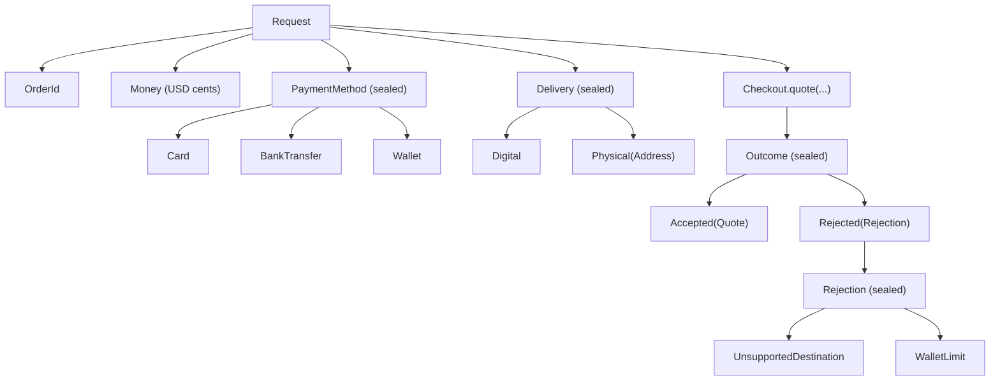

# Thiết kế thư viện mô hình miền với sealed type và pattern matching

Một **thư viện mô hình miền** (*domain model library*) mô tả các khái niệm, trạng thái và quy tắc nghiệp vụ dưới dạng những kiểu Java mà ứng dụng khác có thể sử dụng. Nếu thiết kế chỉ gồm `String`, `Map<String, Object>` và hàng loạt cờ boolean, người gọi rất dễ tạo trạng thái bất hợp lệ hoặc bỏ quên một biến thể của nghiệp vụ.

Trong **Java 27**, có thể kết hợp ba nhóm tính năng ngôn ngữ đã ổn định:

- **`record`** để biểu diễn những giá trị dữ liệu có thành phần rõ ràng; record có constructor, accessor, `equals`, `hashCode` và `toString` theo hợp đồng.
- **`sealed interface` / `sealed class`** để giới hạn các biến thể trực tiếp hợp lệ của một loại giá trị miền.
- **Pattern matching** trong `switch`, `instanceof` và **record patterns** để xử lý các biến thể bằng mã rõ ràng, được compiler kiểm tra tính bao phủ (*exhaustiveness*).

Bài học thuộc chương **Thực hành tích hợp** của khóa **Java 27 và các kiến thức liên quan**. Ta sẽ xây **thư viện báo giá thanh toán** độc lập với HTTP, database và framework: mô hình phương thức thanh toán, hình thức giao hàng, yêu cầu báo giá, kết quả thành công/từ chối; viết mã nghiệp vụ, mô-đun Java Platform Module System (JPMS), chương trình gọi thư viện, kiểm thử và quy trình phát hành.

**Phạm vi hiện đại:** `sealed` chính thức từ Java 17 (JEP 409); record patterns và pattern matching cho `switch` chính thức từ Java 21 (JEP 440/441); unnamed patterns (`_`) chính thức từ Java 22 (JEP 456). Các ví dụ không dùng preview feature và chạy với `javac --release 27`, không cần `--enable-preview`. **Primitive type patterns làm top-level case trong Java 27 vẫn là preview**; bài không dùng chúng.

## 1. Bài toán và ranh giới miền

Giả sử hệ thống bán hàng cần **báo giá trước khi thu tiền**:

- Hình thức thanh toán là **thẻ**, **chuyển khoản** hoặc **ví điện tử**.
- Hình thức nhận hàng là **sản phẩm số** hoặc **giao hàng vật lý**.
- Mỗi phương thức có phí xử lý khác nhau.
- Giao hàng vật lý chỉ hỗ trợ một quốc gia nhất định trong ví dụ.
- Ví có hạn mức báo giá; khi vượt hạn mức, kết quả là **từ chối có lý do**, không phải crash.
- Thư viện chỉ **tính báo giá**, tuyệt đối không thật sự trừ tiền, lưu token thẻ, gửi email hoặc gọi API thanh toán.

Mục tiêu là thiết kế API khiến caller sử dụng các kiểu hợp lệ:

```java
// Có thể biểu diễn rõ ý định ngay ở ranh giới API.
new Request(
    new OrderId("ORD-001"),
    new Money(12_000),              // USD 120.00, tính bằng cent
    new Card("4242"),               // Chỉ 4 chữ số cuối, không phải PAN
    new Physical(new Address("US", "94105"))
);
```

Thay vì API dễ dùng sai:

```java
// Tránh API không phân biệt trạng thái và đơn vị.
quote("ORD-001", 120, "CARD", "US", true, false, null);
```

Cách thứ hai khiến ý nghĩa của `120`, quan hệ giữa các boolean và sự hợp lệ của trạng thái phụ thuộc vào comment hoặc logic runtime rải rác.

### Sơ đồ mô hình miền



Cấu trúc này cố tình **đóng** các tập biến thể nghiệp vụ mà thư viện hiện tại sở hữu, nhưng để người dùng tự đưa vào các giá trị như order ID, địa chỉ và số tiền thông qua record constructor có validation.

## 2. Vì sao sealed type phù hợp với tập biến thể hữu hạn?

Một interface bình thường có thể được triển khai bởi mã bên ngoài:

```java
interface PaymentMethod {}

final class Card implements PaymentMethod {}
// Một thư viện thứ ba vẫn có thể implements PaymentMethod.
```

Nếu bộ tính phí chỉ biết Card/BankTransfer/Wallet, một subtype không dự kiến có thể rơi vào nhánh `default` hoặc một chuỗi `if/else` không đầy đủ.

Với `sealed`, thư viện tuyên bố rõ những subtype **được phép xuất hiện**:

```java
public sealed interface PaymentMethod
        permits Card, BankTransfer, Wallet {
}
```

Các subtype trực tiếp phải đáp ứng điều kiện sau:

| Từ khóa/kiểu | Tính chất | Dùng khi |
|---|---|---|
| `final class` | Không thể kế thừa tiếp | Biến thể có trạng thái/hành vi riêng |
| `record` | Implicitly final; không thể mở rộng bằng kế thừa | Biến thể data-oriented, thành phần rõ ràng |
| `sealed class/interface` | Tiếp tục giới hạn những subtype trực tiếp | Phân cấp nhiều tầng |
| `non-sealed class/interface` | Cho phép mở rộng trở lại ở nhánh này | Cần extension point do bên ngoài triển khai |

Với **named module**, các subtype được `permits` phải ở **cùng module** với sealed type; trong **unnamed module**, chúng phải cùng package. Trong bài, các biến thể đều nằm chung named module `com.example.checkout` nên không thể để một module bên ngoài tự định nghĩa thêm `PaymentMethod`.

### Sealed không thay thế validation

`sealed` giới hạn **kiểu của biến thể**, nhưng không bảo đảm trường dữ liệu hợp lệ:

```java
record Card(String lastFour) implements PaymentMethod {}
```

Nếu không có validation, caller vẫn có thể tạo `new Card(null)` hoặc `new Card("sai")`. Cần kiểm tra invariant ngay trong constructor.

## 3. Record và invariant của mô hình

Record phù hợp với các giá trị mà **danh tính nghiệp vụ nằm trong dữ liệu**, ví dụ một khoản tiền, địa chỉ hoặc request bất biến.

Một record không tự làm dữ liệu trở nên hợp lệ:

```java
record Money(long cents) {
    public Money {
        if (cents < 0) {
            throw new IllegalArgumentException("Số cent phải >= 0");
        }
    }
}
```

Đây là **compact canonical constructor**. Tham số `cents` được kiểm tra trước khi Java tự gán vào component field. Các record là **bất biến nông**: không thể gán lại field của record sau construction, nhưng nếu một component trỏ đến `List` mutable, đối tượng bên trong vẫn có thể bị thay đổi.

### Vì sao chọn long cents trong ví dụ?

Trong chương trình, `Money(long cents)` được quy ước **chỉ biểu diễn USD với hai chữ số thập phân**:

- `new Money(12_000)` nghĩa là USD 120.00.
- `new Money(25)` nghĩa là USD 0.25.
- Không dùng `double` để tính số cent.
- Dùng `Math.addExact` để phát hiện overflow khi cộng.
- Phí tỷ lệ được tính bằng `BigDecimal` rồi làm tròn về **số cent nguyên** theo quy tắc khai báo.

Đây là **lựa chọn của bài thực hành**, không phải định nghĩa Money cho mọi đồng tiền. JPY có 0 chữ số thập phân, một số tiền tệ có quy tắc khác; nếu mở rộng đa tiền tệ, nên đưa currency và chính sách scale/rounding vào mô hình tường minh thay vì mặc định hai chữ số.

### Validate sớm, báo lỗi đúng tầng

- Constructor của `OrderId`, `Card`, `Address`: từ chối **đối tượng cấu tạo sai hợp đồng** bằng `IllegalArgumentException` hoặc `NullPointerException`.
- `Checkout.quote`: trả `Rejected` khi request hợp lệ về mặt cấu trúc nhưng **không đáp ứng quy tắc nghiệp vụ**.
- Lỗi lập trình/hạ tầng (ví dụ số học overflow do input không được giới hạn): không tự chuyển thành “khách hàng bị từ chối” nếu chưa có quy tắc miền tương ứng.

Đừng dùng exception cho mọi tình huống nghiệp vụ bình thường: “không hỗ trợ quốc gia X” hoặc “ví vượt hạn mức” là **kết quả có kiểu**, có thể trả về rõ ràng.

## 4. Thiết kế public API của thư viện

Để ví dụ có thể chép vào project nhỏ và biên dịch được, bài đặt các public type dưới dạng **nested records và nested sealed interfaces** bên trong lớp công khai `Checkout`. Chúng vẫn là public API; caller có thể `import com.example.checkout.Checkout.*`.

Trong thư viện lớn, bạn có thể tách chúng thành nhiều top-level type ở các file tương ứng, giữ nguyên quan hệ `permits` và quy tắc export module.

### Cấu trúc project

```text
checkout-workspace/
└── src/
    ├── com.example.checkout/
    │   ├── module-info.java
    │   └── com/
    │       └── example/
    │           └── checkout/
    │               └── Checkout.java
    └── com.example.app/
        ├── module-info.java
        └── com/
            └── example/
                └── app/
                    └── Main.java
```

**Module thư viện** `src/com.example.checkout/module-info.java`:

```java
module com.example.checkout {
    exports com.example.checkout;
}
```

Không cần khai báo `requires java.base` vì mọi module đều đọc `java.base` một cách ngầm định. Chỉ package chứa public API được export; các package implementation riêng (nếu có trong tương lai) có thể giữ kín.

### Mã nguồn thư viện — Checkout.java

Lưu tại `src/com.example.checkout/com/example/checkout/Checkout.java`:

```java
package com.example.checkout;

import java.math.BigDecimal;
import java.math.RoundingMode;
import java.util.Locale;
import java.util.Objects;

public final class Checkout {

    private Checkout() {}

    // Bài thực hành chỉ hỗ trợ USD, lưu bằng số cent nguyên.
    public record Money(long cents) {
        public static final Money ZERO = new Money(0);

        public Money {
            if (cents < 0) {
                throw new IllegalArgumentException(
                    "Số tiền không được âm"
                );
            }
        }

        public Money plus(Money other) {
            Objects.requireNonNull(other, "other");
            return new Money(Math.addExact(cents, other.cents));
        }

        @Override
        public String toString() {
            return "USD " + BigDecimal.valueOf(cents, 2)
                                     .toPlainString();
        }
    }

    public record OrderId(String value) {
        public OrderId {
            Objects.requireNonNull(value, "value");
            value = value.strip();
            if (!value.matches("[A-Za-z0-9-]{3,40}")) {
                throw new IllegalArgumentException("OrderId sai định dạng");
            }
        }
    }

    // Chỉ ba phương thức đã định nghĩa mới có thể implements.
    public sealed interface PaymentMethod
            permits Card, BankTransfer, Wallet {}

    public record Card(String lastFour) implements PaymentMethod {
        public Card {
            if (lastFour == null
                    || !lastFour.matches("[0-9]{4}")) {
                throw new IllegalArgumentException(
                    "Chỉ lưu đúng 4 chữ số cuối của thẻ"
                );
            }
        }
    }

    public record BankTransfer(String reference)
            implements PaymentMethod {
        public BankTransfer {
            Objects.requireNonNull(reference, "reference");
            reference = reference.strip();
            if (reference.isEmpty()) {
                throw new IllegalArgumentException(
                    "Mã tham chiếu chuyển khoản không được rỗng"
                );
            }
        }
    }

    public record Wallet(String provider) implements PaymentMethod {
        public Wallet {
            Objects.requireNonNull(provider, "provider");
            provider = provider.strip();
            if (provider.isEmpty()) {
                throw new IllegalArgumentException(
                    "Tên nhà cung cấp ví không được rỗng"
                );
            }
        }
    }

    // Hai cách giao hàng là hai biến thể đóng.
    public sealed interface Delivery permits Digital, Physical {}

    public record Digital(String email) implements Delivery {
        public Digital {
            Objects.requireNonNull(email, "email");
            email = email.strip();
            if (email.isEmpty()) {
                throw new IllegalArgumentException(
                    "Địa chỉ nhận hàng số không được rỗng"
                );
            }
            // Xác minh email thật cần tầng/chuẩn riêng.
        }
    }

    public record Address(String countryCode, String postalCode) {
        public Address {
            Objects.requireNonNull(countryCode, "countryCode");
            Objects.requireNonNull(postalCode, "postalCode");

            countryCode = countryCode.strip()
                                     .toUpperCase(Locale.ROOT);
            postalCode = postalCode.strip();

            if (!countryCode.matches("[A-Z]{2}")
                    || postalCode.isEmpty()) {
                throw new IllegalArgumentException(
                    "Thông tin địa chỉ không hợp lệ"
                );
            }
        }
    }

    public record Physical(Address address) implements Delivery {
        public Physical {
            Objects.requireNonNull(address, "address");
        }
    }

    public record Request(
            OrderId orderId,
            Money subtotal,
            PaymentMethod payment,
            Delivery delivery) {
        public Request {
            Objects.requireNonNull(orderId, "orderId");
            Objects.requireNonNull(subtotal, "subtotal");
            Objects.requireNonNull(payment, "payment");
            Objects.requireNonNull(delivery, "delivery");
        }
    }

    public record Quote(
            OrderId orderId,
            Money subtotal,
            Money processingFee,
            Money shippingFee,
            Money total) {
        public Quote {
            Objects.requireNonNull(orderId, "orderId");
            Objects.requireNonNull(subtotal, "subtotal");
            Objects.requireNonNull(processingFee, "processingFee");
            Objects.requireNonNull(shippingFee, "shippingFee");
            Objects.requireNonNull(total, "total");

            Money expected = subtotal.plus(processingFee)
                                     .plus(shippingFee);
            if (!expected.equals(total)) {
                throw new IllegalArgumentException(
                    "Tổng tiền không khớp các thành phần"
                );
            }
        }
    }

    public sealed interface Outcome permits Accepted, Rejected {}

    public record Accepted(Quote quote) implements Outcome {
        public Accepted {
            Objects.requireNonNull(quote, "quote");
        }
    }

    public record Rejected(Rejection reason) implements Outcome {
        public Rejected {
            Objects.requireNonNull(reason, "reason");
        }
    }

    public sealed interface Rejection
            permits UnsupportedDestination, WalletLimit {}

    public record UnsupportedDestination(String countryCode)
            implements Rejection {
        public UnsupportedDestination {
            Objects.requireNonNull(countryCode, "countryCode");
        }
    }

    public record WalletLimit(Money maximum) implements Rejection {
        public WalletLimit {
            Objects.requireNonNull(maximum, "maximum");
        }
    }

    public static Outcome quote(Request request) {
        Objects.requireNonNull(request, "request");

        // Digital(_) là unnamed record pattern, ổn định từ Java 22.
        return switch (request.delivery()) {
            case Digital(_) ->
                calculate(request, Money.ZERO);

            // Guard 'when' chọn riêng địa chỉ trong US.
            case Physical(Address(String country, _))
                    when country.equals("US") ->
                calculate(request, new Money(500));

            // Nhánh này bao phủ mọi Physical còn lại.
            case Physical(var address) ->
                new Rejected(
                    new UnsupportedDestination(address.countryCode())
                );
        };
    }

    private static Outcome calculate(Request request, Money shipping) {
        // Vượt USD 100.00 là kết quả từ chối nghiệp vụ.
        if (request.payment() instanceof Wallet(_)
                && request.subtotal().cents() > 10_000L) {
            return new Rejected(new WalletLimit(new Money(10_000)));
        }

        Money processingFee = switch (request.payment()) {
            case Card(_) ->
                percentage(request.subtotal(), "0.02");
            case BankTransfer(_) ->
                Money.ZERO;
            case Wallet(_) ->
                new Money(25);
        };

        Money total = request.subtotal()
                             .plus(processingFee)
                             .plus(shipping);

        return new Accepted(new Quote(
            request.orderId(),
            request.subtotal(),
            processingFee,
            shipping,
            total
        ));
    }

    private static Money percentage(Money base, String rate) {
        long roundedCents = BigDecimal.valueOf(base.cents())
            .multiply(new BigDecimal(rate))
            .setScale(0, RoundingMode.HALF_UP)
            .longValueExact();

        return new Money(roundedCents);
    }

    public static String describe(Outcome outcome) {
        Objects.requireNonNull(outcome, "outcome");

        return switch (outcome) {
            case Accepted(var quote) ->
                "ACCEPTED " + quote.orderId().value()
                    + ": subtotal=" + quote.subtotal()
                    + ", processing=" + quote.processingFee()
                    + ", shipping=" + quote.shippingFee()
                    + ", total=" + quote.total();

            case Rejected(var reason) -> switch (reason) {
                case UnsupportedDestination(var country) ->
                    "REJECTED: Không giao hàng tới " + country;
                case WalletLimit(var maximum) ->
                    "REJECTED: Giới hạn ví là " + maximum;
            };
        };
    }
}
```

**Điểm có chủ đích trong mã:**

1. `PaymentMethod`, `Delivery`, `Outcome` và `Rejection` đều là các **tập biến thể đóng**. Các record triển khai trực tiếp là implicitly final.
2. `Money` dùng `long` cent và `Math.addExact`; phí 2% dùng `BigDecimal` với quy tắc `HALF_UP` công khai.
3. Constructor kiểm tra các invariant **mà model thực sự cam kết**; ví dụ `Digital` chỉ kiểm tra chuỗi không rỗng, chưa hứa xác minh email có tồn tại.
4. Một `Request` hợp lệ có thể nhận `Rejected`. Từ chối là **giá trị miền**, không phải ngoại lệ lập trình.
5. `switch` trên sealed type **không có `default`**. Khi thêm biến thể mới và biên dịch lại client, compiler sẽ nhắc các nhánh còn thiếu.
6. `case Physical(Address(String country, _)) when ...` là **record pattern lồng nhau có guard**; `case Physical(var address)` là nhánh bao phủ đầy đủ, kể cả khi guard không thỏa.
7. `case Card(_)` không gán tên cho component không sử dụng; đó là cú pháp unnamed pattern đã ổn định, không phải primitive-pattern preview.

Mức phí và giới hạn trong bài là **giả định thực hành**, không phải quy tắc phí của ngân hàng, nhà cung cấp ví hay hệ thống thanh toán thực.

## 5. Chương trình ứng dụng tiêu thụ thư viện qua JPMS

Để có đúng **ranh giới thư viện–client**, đặt ứng dụng vào một **named module khác** thay vì gọi mã thử trong cùng lớp.

File `src/com.example.app/module-info.java`:

```java
module com.example.app {
    requires com.example.checkout;
}
```

File `src/com.example.app/com/example/app/Main.java`:

```java
package com.example.app;

import com.example.checkout.Checkout;
import com.example.checkout.Checkout.*;

import java.util.List;

public final class Main {

    private Main() {}

    public static void main(String[] args) {
        var requests = List.of(
            new Request(
                new OrderId("ORD-001"),
                new Money(12_000),
                new Card("4242"),
                new Physical(new Address("US", "94105"))
            ),
            new Request(
                new OrderId("ORD-002"),
                new Money(5_500),
                new BankTransfer("TRF-100"),
                new Digital("buyer@example.test")
            ),
            new Request(
                new OrderId("ORD-003"),
                new Money(15_000),
                new Wallet("DEMO-WALLET"),
                new Digital("buyer@example.test")
            ),
            new Request(
                new OrderId("ORD-004"),
                new Money(3_000),
                new Card("1000"),
                new Physical(new Address("VN", "700000"))
            )
        );

        for (Request request : requests) {
            Outcome outcome = Checkout.quote(request);
            System.out.println(Checkout.describe(outcome));
        }
    }
}
```

Ở đây `Main` chỉ biết **public API** do module `com.example.checkout` export. Nó không cần biết cách tính phí bên trong `Checkout.calculate` hay gọi API nào của database.

### Biên dịch và chạy bằng JDK 27

Đứng ở thư mục `checkout-workspace`, với source tree đúng như trên:

```shell
# Biên dịch cả module thư viện và module client.
javac --release 27 \
  --module-source-path src \
  -d out \
  -m com.example.checkout,com.example.app

# Chạy module ứng dụng, dùng output làm module path.
java --module-path out \
  -m com.example.app/com.example.app.Main
```

`--release 27` buộc compiler dùng quy tắc ngôn ngữ/API phù hợp Java 27. Không cần `--enable-preview`. Module `com.example.app` có thể đọc API của `com.example.checkout` vì khai báo `requires`; thư viện mở package public bằng `exports`.

Đầu ra dự kiến:

```text
ACCEPTED ORD-001: subtotal=USD 120.00, processing=USD 2.40, shipping=USD 5.00, total=USD 127.40
ACCEPTED ORD-002: subtotal=USD 55.00, processing=USD 0.00, shipping=USD 0.00, total=USD 55.00
REJECTED: Giới hạn ví là USD 100.00
REJECTED: Không giao hàng tới VN
```

Giải thích:

1. `ORD-001`: 2% của 12.000 cent là 240 cent, phí ship US 500 cent; tổng là 12.740 cent.
2. `ORD-002`: chuyển khoản không có phí theo quy tắc ví dụ, giao hàng số không có phí ship; tổng giữ nguyên 5.500 cent.
3. `ORD-003`: ví điện tử với subtotal 15.000 cent vượt hạn 10.000 cent nên trả `Rejected(WalletLimit)`; không tạo `Quote`.
4. `ORD-004`: hàng vật lý ngoài US bị từ chối; không tính toán thêm phí.

**Kết quả là deterministic** với dữ liệu và chính sách cố định trong source, không phụ thuộc network hoặc đồng hồ. Đây là báo giá minh họa, không phải giao dịch thanh toán đã thực hiện.

### Vì sao dùng hai module thay vì hai package trong cùng module?

Với Java Platform Module System:

- `com.example.checkout` **exports** bề mặt API cần thiết.
- `com.example.app` có **requires** rõ ràng và không thể truy cập member `private` của thư viện.
- Compiler bảo vệ ranh giới module và luật `permits` của sealed type.
- Có thể đóng gói module thư viện thành JAR và publish riêng, nhưng khi thay phiên bản phải xem **semantic versioning và tính tương thích client**.

Việc có module không làm giao dịch trở nên an toàn hay tự sinh cơ chế serialization, xác thực hoặc persistence. Đó là những trách nhiệm khác.

## 6. Pattern matching: type pattern, record pattern và guard

Ba dạng trong thư viện có mục đích riêng.

### Type pattern

Kiểm tra kiểu và gán biến sau khi kiểm tra thành công:

```java
if (payment instanceof Checkout.Wallet wallet) {
    System.out.println("Provider = " + wallet.provider());
}
```

Đây là pattern matching với `instanceof`, khác việc dùng `instanceof` rồi cast thủ công:

```java
// Viết dài và dễ quên cast đúng kiểu.
if (payment instanceof Checkout.Wallet) {
    Checkout.Wallet wallet = (Checkout.Wallet) payment;
}
```

Với Java 27, type pattern cho **reference types** đã ổn định, không cần flag preview.

### Record pattern

Một record pattern tách các component sau khi kiểm tra shape:

```java
String summary = switch (delivery) {
    case Checkout.Digital(String email) ->
        "Gửi sản phẩm số đến " + email;

    case Checkout.Physical(Checkout.Address(String country, _)) ->
        "Giao vật lý tại " + country;
};
```

`Checkout.Physical` chứa `Address`, còn `Address` chứa `countryCode` và `postalCode`. Pattern lồng nhau lấy trực tiếp `country`; dấu `_` bỏ qua postal code không sử dụng.

**Dữ liệu null:** Các type/record patterns thông thường không match một giá trị `null` ở selector. Khi `switch` nhận null mà không có `case null`, thông thường sẽ ném `NullPointerException`. Constructor của `Request` và `Physical` bảo vệ ranh giới đối với các trường bắt buộc.

### Guard khi một subtype còn cần điều kiện nghiệp vụ

```java
return switch (request.delivery()) {
    case Digital(_) -> calculate(request, Money.ZERO);

    case Physical(Address(String country, _))
            when country.equals("US") ->
        calculate(request, new Money(500));

    case Physical(var address) ->
        new Rejected(
            new UnsupportedDestination(address.countryCode())
        );
};
```

Ở đây `when` kiểm tra một điều kiện **ngoài kiểu dữ liệu**. Guard không tự làm một nhánh trở nên exhaustive: nếu chỉ có case US mà không có case `Physical` còn lại thì chương trình vẫn phải xử lý những địa chỉ không được hỗ trợ.

**Thứ tự case quan trọng:** nhánh có guard (hẹp hơn) phải đứng trước nhánh `Physical` bao phủ chung. Nếu đặt nhánh chung trước, case phía sau có thể bị báo lỗi do bị bao phủ (*dominated*) hoặc không bao giờ được chọn.

### Unnamed pattern có phải preview không?

Từ Java 22, `_` trong vị trí unnamed pattern là tính năng **permanent** (JEP 456). Ví dụ:

```java
case Card(_) -> ...
```

nghĩa là quan tâm giá trị thuộc biến thể `Card` nhưng không cần nội dung `lastFour`. `_` ở đây **không** có nghĩa một biến Java tên `_` có thể được sử dụng sau đó.

**Không nhầm** với JEP 532 về primitive types trong top-level patterns, `instanceof` và `switch`. Những mở rộng đó vẫn là **preview trong JDK 27**. Bài không dùng chúng nên không cần bật preview.

## 7. Exhaustive switch: compiler giúp bảo vệ invariant hành vi

Xét sealed interface:

```java
public sealed interface PaymentMethod
        permits Card, BankTransfer, Wallet {}
```

Đoạn sau **exhaustive**, không cần `default`:

```java
String kind = switch (method) {
    case Card(_) -> "card";
    case BankTransfer(_) -> "bank-transfer";
    case Wallet(_) -> "wallet";
};
```

Nếu thư viện được sửa để cho phép subtype mới, chẳng hạn `GiftCard`, thì khi biên dịch lại mã switch tương ứng, compiler có thể báo lỗi vì chưa bao phủ hết các biến thể. Đây là đặc tính đáng giá của **closed-world modeling**.

Trái lại, đoạn sau làm mất cảnh báo hữu ích:

```java
String kind = switch (method) {
    case Card(_) -> "card";
    case BankTransfer(_) -> "bank-transfer";
    default -> "other";
};
```

Khi thêm `Wallet` hoặc một subtype mới trong tương lai, mã vẫn biên dịch nhưng có thể đưa nghiệp vụ mới vào nhóm `other` mà không được người duyệt nhận ra.

### Khi nào nên có default?

Không phải `default` luôn sai. Nó có thể phù hợp khi:

- Đầu vào thực sự là hệ **mở**, ví dụ `Object`, JSON field từ bên ngoài hoặc plugin chưa biết.
- Hợp đồng nghiệp vụ có nhánh fallback đúng và được **thiết kế cố ý**.
- Cần giữ tương thích hành vi khi gặp extension mới từ nguồn ngoài.

Nhưng với một sealed hierarchy do thư viện **chủ động đóng và sở hữu**, thường nên xử lý hết các trường hợp hiện có và **không thêm default chỉ để compiler im lặng**.

### Exhaustive tại compile-time vẫn có vấn đề khi version lệch nhau

Nếu client đã biên dịch với phiên bản thư viện chỉ có ba subtype, còn runtime nạp một bản thư viện đã thay đổi hierarchy, một exhaustive switch cũ có thể không match subtype mới và ném `MatchException`. Điều đó là lý do phải **kiểm thử tương thích binary và tái biên dịch consumer** khi thay đổi public sealed hierarchy.

Vì vậy: lợi ích compile-time lớn, nhưng không có nghĩa có thể phát hành các subtype mới mà không cân nhắc client và deployment.

## 8. Thiết kế Result type: expected failure khác exception

Trong bài, `Outcome` là sealed interface:

```java
public sealed interface Outcome permits Accepted, Rejected {}

public record Accepted(Quote quote) implements Outcome {}
public record Rejected(Rejection reason) implements Outcome {}
```

Với request có cấu trúc hợp lệ, việc quốc gia chưa được hỗ trợ hoặc ví vượt hạn là **kết quả của quy tắc nghiệp vụ**. Client có thể xử lý:

```java
void render(Checkout.Outcome outcome) {
    switch (outcome) {
        case Checkout.Accepted(var quote) ->
            System.out.println("Tổng: " + quote.total());

        case Checkout.Rejected(var reason) ->
            System.out.println("Từ chối: " + reason);
    }
}
```

Ngược lại, `new Money(-100)` là vi phạm invariant của value object và nên bị constructor từ chối ngay. Không nên tạo `Rejected(InvalidMoney)` nếu chính API `Money` đã tuyên bố không cho phép số âm: trường hợp đó thuộc **boundary parsing/validation**.

Thư viện có thể mở rộng `Rejection` thành những lý do khác nếu nghiệp vụ phát triển, nhưng chính việc mở rộng đó là **thay đổi API có ảnh hưởng đến exhaustive consumers**.

### Những kiểu Outcome không mô tả điều gì?

`Accepted(Quote)` **không** đồng nghĩa “đã thu tiền”. Nếu sau này có workflow thu tiền bất đồng bộ, cần các khái niệm khác như `PaymentAuthorization`, `CaptureResult`, idempotency key và trạng thái thanh toán. Không ghép lẫn **quote** với **settlement** chỉ vì chúng đều liên quan tiền.

Một thiết kế miền đúng phải diễn đạt thật rõ **mỗi trạng thái cam kết điều gì**, và không cam kết điều mình chưa thực hiện.

## 9. Kiểm thử không phụ thuộc framework

Ta có thể viết một chương trình thử đơn giản để xác minh quy tắc bằng API public. Để dùng được trong ví dụ JPMS, tạo thêm file:

`src/com.example.app/com/example/app/SmokeTest.java`

```java
package com.example.app;

import com.example.checkout.Checkout;
import com.example.checkout.Checkout.*;

import java.util.Objects;

public final class SmokeTest {

    private static void check(boolean condition, String message) {
        if (!condition) {
            throw new AssertionError(message);
        }
    }

    private static void equal(Object expected, Object actual) {
        if (!Objects.equals(expected, actual)) {
            throw new AssertionError(
                "Expected " + expected + " but got " + actual
            );
        }
    }

    private static void expectInvalid(Runnable action) {
        try {
            action.run();
            throw new AssertionError("Phải ném IllegalArgumentException");
        } catch (IllegalArgumentException expected) {
            // PASS: constructor chặn dữ liệu sai.
        }
    }

    public static void main(String[] args) {
        var usCard = new Request(
            new OrderId("TEST-001"),
            new Money(12_000),
            new Card("4242"),
            new Physical(new Address("us", "94105"))
        );

        Outcome outcome = Checkout.quote(usCard);
        if (!(outcome instanceof Accepted(Quote quote))) {
            throw new AssertionError("Báo giá US/card phải được chấp nhận");
        }

        equal(new Money(12_000), quote.subtotal());
        equal(new Money(240), quote.processingFee());
        equal(new Money(500), quote.shippingFee());
        equal(new Money(12_740), quote.total());

        // Record compact constructor đã chuẩn hóa countryCode.
        equal("US", ((Physical) usCard.delivery())
            .address().countryCode());

        var bankDigital = new Request(
            new OrderId("TEST-002"),
            new Money(5_500),
            new BankTransfer("REF-01"),
            new Digital("buyer@example.test")
        );

        Outcome bankOutcome = Checkout.quote(bankDigital);
        check(bankOutcome instanceof Accepted,
              "Bank/digital phải được chấp nhận");

        var walletOverLimit = new Request(
            new OrderId("TEST-003"),
            new Money(15_000),
            new Wallet("DEMO"),
            new Digital("buyer@example.test")
        );

        Outcome walletOutcome = Checkout.quote(walletOverLimit);
        check(walletOutcome instanceof Rejected(WalletLimit _),
              "Ví vượt USD 100.00 phải bị từ chối");

        var vnShipment = new Request(
            new OrderId("TEST-004"),
            new Money(3_000),
            new Card("1234"),
            new Physical(new Address("VN", "700000"))
        );

        check(
            Checkout.quote(vnShipment)
                instanceof Rejected(UnsupportedDestination _),
            "Quốc gia chưa hỗ trợ phải bị từ chối"
        );

        expectInvalid(() -> new Money(-1));
        expectInvalid(() -> new Card("424242"));
        expectInvalid(() -> new OrderId("x"));

        // Không làm tràn số âm thầm.
        try {
            new Money(Long.MAX_VALUE).plus(new Money(1));
            throw new AssertionError("Phải phát hiện overflow");
        } catch (ArithmeticException expected) {
            // PASS.
        }

        System.out.println("All checkout smoke tests passed");
    }
}
```

**Lưu ý cú pháp:** `instanceof Rejected(WalletLimit _)` là record pattern lồng nhau (record `Rejected` chứa `Rejection`) với unnamed pattern; không phải primitive pattern preview.

Biên dịch lại cả hai module:

```shell
javac --release 27 \
  --module-source-path src \
  -d out \
  -m com.example.checkout,com.example.app

java --module-path out \
  -m com.example.app/com.example.app.SmokeTest
```

Đầu ra kỳ vọng:

```text
All checkout smoke tests passed
```

Đây là **smoke test** với các case cốt lõi, không thay thế bộ unit/integration tests đầy đủ. Trong dự án lớn nên dùng JUnit phiên bản hiện hành, property-based tests khi phù hợp, CI và kiểm thử tính tương thích public API.

### Ma trận test nên bao phủ

| Nhóm kiểm thử | Tình huống | Kỳ vọng |
|---|---|---|
| Value object | Số tiền âm | Constructor từ chối |
| Value object | Tổng tiền vượt `long` | `Math.addExact` phát hiện |
| Order ID | Rỗng/sai regex | Constructor từ chối |
| Card | Không đúng bốn chữ số cuối | Constructor từ chối |
| Address | `us` viết thường | Chuẩn hóa thành `US` |
| Delivery | Digital | Không tính phí ship |
| Delivery | Physical US | Phí ship 500 cent |
| Delivery | Physical khác US | `Rejected(UnsupportedDestination)` |
| Payment | Card | Phí 2% làm tròn theo chính sách |
| Payment | BankTransfer | Phí xử lý 0 |
| Payment | Wallet trong hạn | Phí cố định 25 cent |
| Payment | Wallet vượt hạn | `Rejected(WalletLimit)` |
| Outcome | Accepted | `Quote` có subtotal + fees = total |
| Outcome | Rejected | Không có `Quote` hợp lệ bị tạo ra |
| Consumer | Mọi biến thể trong sealed hierarchy | Branch mapping đầy đủ |
| Module boundary | Client imports public API | Compile được |
| Module boundary | Client cố tạo subtype `PaymentMethod` ngoài module | Bị compiler từ chối |

Ở các bài toán tiền tệ, nên kiểm thử thêm giá trị rất nhỏ, quy tắc rounding tại đúng nửa cent, giới hạn cực lớn, đồng tiền khác (nếu được hỗ trợ) và thay đổi chính sách phí.

## 10. Kiểm thử tính exhaustive bằng thay đổi API có chủ đích

Giả sử phiên bản mới của thư viện muốn thêm `GiftCard`:

```java
// Mẫu thiết kế trong bản thư viện MỚI, không thêm vào source chính.
//
// public sealed interface PaymentMethod
//         permits Card, BankTransfer, Wallet, GiftCard {}
//
// public record GiftCard(String code) implements PaymentMethod {}
```

Sau thay đổi này, `switch (request.payment())` trong thư viện **phải** xử lý `GiftCard`. Nếu còn một client bên ngoài dùng exhaustive `switch` không có `default`, client đó cũng cần được biên dịch lại và xử lý subtype mới.

Đây là cách compiler biến việc “thêm biến thể nghiệp vụ” thành một thay đổi **có thể kiểm tra**.

### Cảnh báo về API công khai

Nếu `PaymentMethod` là public API được nhiều nhóm phụ thuộc, việc thêm subtype dù vẫn giữ tên interface có thể ảnh hưởng:

- **Source compatibility:** exhaustive switch của client có thể không còn compile.
- **Runtime compatibility:** client biên dịch cũ có thể gặp `MatchException` với giá trị subtype mới.
- **Serialization:** schema JSON/event cần discriminator mới, phía consumer cũ không hiểu.
- **Contract documentation:** nhóm nghiệp vụ cần định nghĩa chính sách phí/cách xử lý mới.

Vì vậy, `sealed` phù hợp nhất khi thư viện thực sự **sở hữu tập biến thể hữu hạn** và chấp nhận cập nhật client khi mở rộng mô hình. Nó không phù hợp nếu yêu cầu quan trọng nhất là **third-party plugins được tự do implements interface**.

### Nếu thật sự cần extension point?

Có thể tách một tầng policy mở ra khỏi model đóng:

```java
@FunctionalInterface
interface PricingPolicy {
    Money calculate(Request request);
}
```

Đây là **minh họa kiến trúc**; trong dự án thực, nên định nghĩa interface với các kiểu qualified/import chính xác và quy tắc error handling phù hợp. Plugin có thể cung cấp policy qua DI hoặc `ServiceLoader`, trong khi những **giá trị miền** vẫn được giữ trong sealed hierarchy khi cần. Nếu plugin thật sự cần bổ sung phương thức thanh toán mới, mô hình PaymentMethod có thể phải được thiết kế theo kiểu mở hoặc có extension subtype đã được kiểm soát trong module.

Không sử dụng `non-sealed` chỉ để né compiler rồi tuyên bố switch vẫn exhaustive cho tất cả subtype từ bên ngoài.

## 11. Lựa chọn sealed interface hay sealed class

Trong Java, `sealed interface` và `sealed class` đều kiểm soát subtype trực tiếp, nhưng phục vụ các bài toán hơi khác nhau.

| Tiêu chí | Sealed interface | Sealed class |
|---|---|---|
| Quan hệ | “Là một biến thể/khả năng” | “Là một loại chuyên biệt của base class” |
| Trạng thái chung | Không có instance fields như class | Có thể có field và constructor chung |
| Nhiều vai trò | Một class có thể implements nhiều interface | Chỉ extends một superclass |
| Kết hợp record | Record có thể implements sealed interface | Record không thể extends một sealed class tùy ý |
| Phù hợp trong bài | `PaymentMethod`, `Delivery`, `Outcome` | Có thể dùng cho base class cần state/hành vi chung |

Đối với **data-oriented domain**, `sealed interface` kết hợp `record` thường ít ceremony và ít chia sẻ state không cần thiết.

Một sealed class có thể hợp lý khi cần một base class với invariant chung, constructor bảo vệ trạng thái hoặc hành vi có ý nghĩa cho tất cả các subtype. Đừng tạo base class chỉ để tránh viết vài dòng code giống nhau; quan hệ kế thừa phải diễn đạt đúng ý nghĩa nghiệp vụ.

### Ví dụ nhiều tầng

```java
sealed interface Notification
        permits EmailNotification, PushNotification {}

record EmailNotification(String address)
        implements Notification {}

// Nhánh này lại là một sealed interface.
sealed interface PushNotification extends Notification
        permits AndroidPush, IosPush {}

record AndroidPush(String token) implements PushNotification {}
record IosPush(String token) implements PushNotification {}
```

Trong ví dụ, compiler có thể suy ra tính bao phủ của các nhánh qua cả **hai tầng sealed**. Tuy nhiên, khi public library có nhiều hierarchy lồng nhau, chi phí thay đổi subtype cũng lan xa hơn. Chỉ dùng khi thật sự cần những phân nhóm có ý nghĩa.

## 12. Value object, entity và domain service

Mọi record không phải là “entity” theo nghĩa domain-driven design.

| Kiểu miền | Ví dụ | Đặc điểm |
|---|---|---|
| Value object | `Money`, `Address` | So sánh theo giá trị; có validation |
| Entity identity | `OrderId` | Đại diện định danh, được nhúng vào request/quote |
| Command/request | `Request` | Một yêu cầu xử lý, dữ liệu bất biến |
| Result/outcome | `Accepted`, `Rejected` | Các kết quả có tập biến thể đóng |
| Domain service | `Checkout.quote` | Quy tắc kết hợp nhiều giá trị |
| Aggregate | Đơn hàng có trạng thái sống lâu trong DB | Cần state transition, version/concurrency policy riêng |

Thư viện báo giá ở đây là một **domain calculation library**, không phải một aggregate repository. Nó không sở hữu transaction database, giữ lock, lập lịch retry hay thực hiện side effect thanh toán.

### Khi nào record không phù hợp?

Không nên ép mọi loại object vào record:

- Một entity có trạng thái thay đổi liên tục với identity ổn định đôi khi cần class và API chuyển trạng thái có kiểm soát.
- Một đối tượng mở resource như JDBC connection hoặc native handle có thể cần `AutoCloseable` và quản lý vòng đời thay vì record trần.
- Một public type có yêu cầu mở rộng bằng subclassing cho plugin không phù hợp với record (record luôn final).
- Một object chứa cấu trúc mutable mà không thể copy được cần thiết kế ownership rõ hơn.

Dùng record khi **giá trị dữ liệu** là bản chất của đối tượng, không phải chỉ vì syntax ngắn.

## 13. Record chỉ bất biến nông: bảo vệ collection components

Một record có component là `List` không tự làm danh sách đó bất biến:

```java
record BasketUnsafe(java.util.List<String> skuCodes) {}

var mutable = new java.util.ArrayList<String>();
mutable.add("A");
var basket = new BasketUnsafe(mutable);

mutable.add("B"); // Nội dung record thay đổi gián tiếp.
```

Mẫu bảo vệ bằng defensive copy:

```java
import java.util.List;
import java.util.Objects;

record Basket(List<String> skuCodes) {
    public Basket {
        skuCodes = List.copyOf(
            Objects.requireNonNull(skuCodes, "skuCodes")
        );
        if (skuCodes.isEmpty()) {
            throw new IllegalArgumentException("Giỏ hàng rỗng");
        }
    }
}
```

Khi đó cả danh sách nguồn lẫn danh sách trả về từ accessor không thể thay đổi `Basket` qua thao tác cấu trúc danh sách. Tuy nhiên, `List.copyOf` là **shallow copy**; nếu phần tử là object mutable, cần kiểm soát cả trạng thái bên trong phần tử.

`List.copyOf` không cho phép phần tử null. Nếu hợp đồng business chấp nhận null, phải chọn một kiểu dữ liệu rõ ý nghĩa hơn thay vì dùng null làm tín hiệu ngầm cho một trạng thái cần tên.

Trong thư viện ví dụ, các component là `String`, primitive hoặc record/value object đã kiểm soát, nên không có danh sách mutable cần copy.

## 14. Null, pattern matching và tính toàn phần của hàm

Một sealed hierarchy có đầy đủ subtype **không** tự giải quyết giá trị `null`.

Ví dụ:

```java
PaymentMethod method = null;

// Nếu không có case null, switch pattern thường ném NPE.
// var name = switch (method) {
//     case Card(_) -> "card";
//     case BankTransfer(_) -> "bank";
//     case Wallet(_) -> "wallet";
// };
```

Nếu input đến từ hệ thống ngoài chưa được validate, một phương án là xử lý null có chủ đích:

```java
String result = switch (method) {
    case null -> "missing";
    case Card(_) -> "card";
    case BankTransfer(_) -> "bank";
    case Wallet(_) -> "wallet";
};
```

Ở **ranh giới thư viện** bài này, `Request` constructor yêu cầu `payment` khác null. Bên trong `Checkout.quote` vì thế có thể sử dụng exhaustive switch mà không cần nhánh null để báo lỗi nghiệp vụ; nếu caller cố tạo request null, constructor thất bại ngay.

Cần phân biệt:

- **Compiler exhaustiveness:** mã đã liệt kê đủ các subtype hợp lệ trong mô hình sealed.
- **Runtime invariant:** giá trị thực sự không null, đúng quy tắc business và không bị tham chiếu mutable phá hỏng.
- **Wire/input validation:** JSON, HTTP hoặc DB có thể cung cấp trường thiếu/sai kiểu; phải kiểm tra trước khi tạo domain value.

Một chuỗi `if (x != null)` rải rác không thay thế được việc thiết kế rõ hợp đồng nullability của public API.

## 15. Serialization và tương thích hợp đồng bên ngoài

**Record** là kiểu Java; **sealed interface** là quy tắc subtype của Java. Chúng **không tự tạo ra JSON protocol ổn định**.

Giả sử HTTP API gửi payment method:

```json
{
  "type": "CARD",
  "lastFour": "4242"
}
```

Thiết kế parser nên:

1. Kiểm tra `type` bằng **danh sách giá trị được cho phép**.
2. Validate các trường cần cho từng loại.
3. Tạo `Card`, `BankTransfer` hoặc `Wallet` qua constructor của domain.
4. Chuyển lỗi dữ liệu đầu vào thành thông báo rõ ràng ở boundary.
5. Không gọi class loader trên tên lớp tùy ý nhận từ client (ví dụ `Class.forName` trực tiếp từ trường `type`).

Nếu dùng Jackson hoặc một framework serialization khác, phải cấu hình phiên bản thư viện, polymorphic type handling và discriminator một cách **tường minh, an toàn**. Không mặc định rằng thêm một `record` vào `permits` là khách hàng cũ tự hiểu JSON mới.

### DTO ngoài, domain model trong

Một thiết kế có thể tách:

```text
HTTP JSON
   ↓ parse + validate
Transport DTO (versioned wire schema)
   ↓ mapping/normalization
Checkout.Request + sealed domain values
   ↓ quote
Checkout.Outcome
   ↓ map
HTTP response DTO
```

Ưu điểm:

- JSON schema có thể phát triển theo version riêng.
- Logic nghiệp vụ không phụ thuộc HTTP hoặc annotation của framework.
- Có thể đổi cách serialize mà không buộc mọi consumer compile lại theo wire format.
- Dễ kiểm soát dữ liệu không tin cậy và tạo lỗi 4xx phù hợp thay vì làm lộ stack trace.

Đừng tự động expose tất cả component record làm contract công khai của REST API, đặc biệt khi chúng chứa dữ liệu riêng tư hoặc chỉ phục vụ nội bộ.

## 16. Thiết kế phí, số tiền và chính sách có thể đổi

Trong ví dụ, chính sách phí được viết trực tiếp trong `Checkout`:

```java
Money processingFee = switch (request.payment()) {
    case Card(_) -> percentage(request.subtotal(), "0.02");
    case BankTransfer(_) -> Money.ZERO;
    case Wallet(_) -> new Money(25);
};
```

Ưu điểm là dễ đọc, dễ kiểm thử và có **một nơi** nêu quy tắc. Nhưng trong sản phẩm thực, giá phí có thể phụ thuộc thời gian hiệu lực, chương trình khuyến mãi, nhà cung cấp, khu vực hoặc hợp đồng riêng.

Khi phí cần thay đổi theo môi trường/dữ liệu, bạn có thể giữ **model sealed** mà đưa chiến lược tính phí ra một policy object được quản lý. Tuy nhiên, policy là **hành vi mở**, nên cần chống việc plugin bỏ qua validation, tạo số tiền âm hoặc tính bằng currency sai.

### Money và overflow

`Math.addExact` phát hiện tràn số nguyên, nhưng exception đó chưa phải kết quả nghiệp vụ từ chối. Nếu product cho phép đơn hàng rất lớn hoặc lượng tiền từ bên ngoài chưa được giới hạn, nên:

- Đặt một **maximum order amount** ở boundary theo quy tắc sản phẩm.
- Trả mã lỗi nghiệp vụ có kiểu nếu vượt ngưỡng.
- Kiểm thử ở ranh giới `Long.MAX_VALUE`.
- Cân nhắc `BigDecimal` và `Currency` nếu mở rộng currency/scale.
- Xác định rounding mode, tỷ lệ phí và thứ tự làm tròn **trong hợp đồng**.

Không tự dùng `double` để tính phí rồi chuyển về số cent mà không biết sai số hoặc quy tắc làm tròn.

### Nhận diện và bảo vệ dữ liệu nhạy cảm

`Card("4242")` trong bài chỉ giữ **bốn chữ số cuối**, không phải số thẻ đầy đủ, CVV, expiry hay payment token. Hệ thống thanh toán thật cần tuân theo các quy tắc bảo mật, tokenization, quyền truy cập và yêu cầu tuân thủ liên quan. Không dùng mô hình bài tập như một dịch vụ xử lý thẻ thực.

## 17. Đóng gói JAR module và phát hành

Một **thư viện** cần có artifact có thể tiêu thụ từ project khác. Khi các module đã được biên dịch vào `out`, có thể đóng mỗi module thành modular JAR.

Tại thư mục project:

```shell
mkdir -p dist

jar --create \
  --file dist/com.example.checkout.jar \
  -C out/com.example.checkout .

jar --create \
  --file dist/com.example.app.jar \
  -C out/com.example.app .

java --module-path dist \
  -m com.example.app/com.example.app.Main
```

Cách này đóng gói những `module-info.class` đã biên dịch và các class bên trong. Nếu cần đặt tên main class trong manifest/module descriptor cho launcher khác, hãy cấu hình tương ứng thay vì giả định mọi JAR đều chạy bằng `java -jar`.

Với dự án thực, nên dùng **Gradle/Maven** với plugin/toolchain tương thích JDK 27, kiểm tra dependency locking, version pinning, checksum/signature, test và cách xây modular JAR. Bài không yêu cầu chạy lệnh build trong workspace của hệ thống học liệu; lệnh ở đây dành cho người học tự thực hành.

### Mô-đun không phải cơ chế phân phối policy runtime tự động

`exports` xác định package mà client được truy cập qua module system, không tự ngăn consumer copy dữ liệu, gửi request sai hoặc gọi `Checkout.quote` liên tiếp. Để cung cấp một thư viện ổn định, còn cần:

- API documentation và semantic versioning.
- Test tương thích source/binary trên các version được hỗ trợ.
- Policy phát hành mô hình sealed hierarchy.
- Quy tắc chuyển đổi DTO/JSON/DB.
- License, provenance và cập nhật lỗ hổng dependency nếu có.

## 18. Các sai lầm thiết kế thường gặp

| Sai lầm | Hậu quả | Cách sửa |
|---|---|---|
| Mọi loại payment đều là `String` | Sai chính tả, nhánh không được xử lý | Sealed hierarchy với biến thể có tên |
| Dùng `Object`/`Map<String,Object>` làm public API | Cast runtime, dễ tạo dữ liệu sai | Record/value object rõ kiểu |
| Dùng sealed nhưng constructor không validate | Vẫn có `Card(null)` hoặc `Money(-1)` | Kiểm tra invariant tại canonical constructor |
| Thêm `default -> null` vào exhaustive switch | Che subtype mới, rò null | Xử lý đủ từng biến thể |
| Dùng `non-sealed` bừa bãi | Phá closed-world modeling | Chỉ mở nhánh khi có extension contract |
| Tưởng record bất biến sâu | Danh sách con có thể bị sửa | `List.copyOf` và immutable elements |
| Tạo `Rejected` cho lỗi lập trình | Không phân biệt bug với business refusal | Thiết kế error taxonomy rõ |
| Tạo `Exception` cho mọi business refusal | Khó dùng API, kiểm soát luồng bằng catch | `Outcome` sealed có kiểu |
| Dùng `double` tính tiền | Sai số và rounding không rõ | Integer cents/BigDecimal + policy |
| Tự biến domain record thành JSON công khai | Thay domain làm vỡ wire contract | DTO/protocol versioning riêng |
| Cho extension từ module ngoài implements sealed | Không biên dịch | Thiết kế API mở khi cần plugin |
| Quên `case null` tại input boundary | `NullPointerException` bất ngờ | Validate hoặc xử lý null có chủ đích |
| Thay đổi `permits` không kiểm thử client | Compile break/`MatchException` runtime | Rebuild và compatibility tests |
| Ghi dữ liệu thẻ nhạy cảm vào record/log | Rủi ro bảo mật | Tokenization, tránh PAN/CVV |
| Lẫn báo giá với thanh toán thật | Sai cam kết nghiệp vụ | Tách quote, authorize, capture, settlement |

## 19. Checklist review thư viện mô hình miền

1. **Boundary:** thư viện mô tả nghiệp vụ nào, không làm những gì?
2. **Ubiquitous language:** tên kiểu/method có khớp khái niệm kinh doanh không?
3. **Closed vs open:** tập biến thể có thực sự hữu hạn và do module sở hữu không?
4. **Invariants:** mọi constructor public có ngăn trạng thái không hợp lệ không?
5. **Nullable fields:** có khai báo rõ required/optional không?
6. **Value semantics:** các record có chứa mutable collection cần defensive copy không?
7. **Currency/precision:** đơn vị tiền, scale, rounding và overflow có hợp đồng rõ không?
8. **Exhaustiveness:** các `switch` sealed có cố tình tránh `default` che lỗi không?
9. **Errors:** phân biệt programming fault, input validation và business refusal?
10. **Module API:** chỉ exports package công khai; implementation có giữ kín không?
11. **Serialization:** domain model có bị ràng buộc trực tiếp vào wire schema không?
12. **Extensibility:** client ngoài module có cần bổ sung biến thể không?
13. **Compatibility:** thay subtype/record components có quy trình update consumer không?
14. **Tests:** có test đủ biến thể, null, invalid data, giới hạn số và các thay đổi API không?
15. **Security:** có dữ liệu nhạy cảm đi vào record, log, `toString` không?
16. **Packaging:** source/build, JDK target, modular JAR và artifact được phát hành có thể tái tạo không?
17. **Documentation:** có ví dụ sử dụng và hành vi từ chối rõ ràng không?
18. **Observability:** consumer có thể log lý do từ chối một cách an toàn mà không rò dữ liệu không?

## 20. Bài tập mở rộng

### Bài 1 — Thêm phương thức GiftCard

Thêm `GiftCard(String code)` vào hierarchy `PaymentMethod`, quy định phí xử lý 0. Đảm bảo compiler chỉ ra những `switch` nào cần sửa. Vì sao thay đổi này có thể ảnh hưởng consumer ngoài module?

### Bài 2 — Thêm hình thức giao hàng Pickup

Thêm `Pickup(String storeId)` vào `Delivery` và cho shipping fee bằng 0. Cần thay đổi `permits`, constructor, `switch` và test nào?

### Bài 3 — Phí thẻ theo tier

Quy định phí thẻ 2% khi subtotal dưới USD 50.00, và 1.5% khi từ USD 50.00 trở lên. Sử dụng `when` ở đâu là hợp lý? Hay nên đặt điều kiện trong domain service với một policy riêng?

### Bài 4 — Null từ JSON

Một request JSON không có trường `payment`. Có nên gọi `Checkout.quote` với `null` rồi đợi `switch` ném lỗi không? Hãy thiết kế validation/HTTP error boundary.

### Bài 5 — Collection bất biến

Tạo record `Basket(List<LineItem> items)`. Hãy copy danh sách đầu vào và bảo vệ từng `LineItem` khỏi thay đổi ngoài ý muốn.

### Bài 6 — Exhaustive switch

Viết một `switch` để ánh xạ tất cả `Outcome` thành mã trạng thái `SUCCESS` hoặc `FAILED` mà không dùng `default`. Sau đó thêm một subtype mới vào hierarchy và quan sát compile error.

### Bài 7 — Phiên bản thư viện

Đội phát triển bổ sung `PaymentMethod.NewProvider` vào phiên bản mới nhưng client cũ chưa recompile. Mô tả những vấn đề có thể xảy ra và cách lên kế hoạch rollout.

### Bài 8 — Lỗi nghiệp vụ và lỗi kỹ thuật

Hãy phân biệt: quốc gia chưa hỗ trợ, số tiền âm, mất kết nối database, ví vượt hạn và overflow khi cộng số cent. Trường hợp nào là `Rejected`, trường hợp nào cần validation/exception/technical error riêng?

### Bài 9 — Kiểm thử tính bất biến

Một record chứa `List<String>` được trả từ thư viện. Viết test chứng minh caller không thể sửa nội dung record thông qua danh sách gốc hoặc accessor.

### Bài 10 — Đổi đơn vị tiền

Bài mẫu chỉ hỗ trợ USD cents. Hãy thiết kế `Money(BigDecimal amount, Currency currency)` có quy tắc scale/rounding rõ. Tại sao dùng duy nhất một giá trị `double` là không phù hợp?

### Đáp án và định hướng

**1.** Thêm subtype vào `permits`, thêm constructor validation và cập nhật tất cả `switch`/codec/API tests. Client exhaustive có thể phải recompile và cập nhật logic.

**2.** `Delivery permits Digital, Physical, Pickup`; tạo record `Pickup` có validation, bổ sung `case Pickup(_)` trong `Checkout.quote` và các test mới.

**3.** Có thể dùng guard nếu muốn phân nhánh theo kiểu và ngưỡng; tuy nhiên mức phí có thể được mô hình hóa dễ kiểm thử hơn trong một `PricingPolicy` hoặc hàm được dùng trong case `Card`. Quan trọng nhất là thống nhất rounding và thử ranh giới USD 50.00.

**4.** Parser/DTO boundary phải trả lỗi input rõ ràng trước khi tạo domain request; không dùng NPE như một HTTP response nghiệp vụ mặc định.

**5.** Dùng `List.copyOf(items)` và value object/record bất biến cho từng item. Nếu item chứa mutable object, cần defensive copy sâu hoặc thay cấu trúc.

**6.** `switch (outcome) { case Accepted(var q) -> "SUCCESS"; case Rejected(var r) -> "FAILED"; }`. Khi thêm direct subtype mới, compiler sẽ yêu cầu xử lý nhánh mới.

**7.** Lập kế hoạch versioning, build matrix client–library, test serialization, triển khai đồng bộ khi có thay đổi subtype. Client cũ có thể ném `MatchException` khi gặp subtype lạ lúc runtime.

**8.** Country/Wallet limit: `Rejected`. Money âm: lỗi validation. Database mất kết nối: technical error (không thuộc quote library hiện tại). Overflow: exception kỹ thuật/vi phạm giới hạn input, cần policy nghiệp vụ tường minh nếu muốn phân loại thành từ chối.

**9.** Tạo một `ArrayList`, tạo `Basket`, sửa list gốc rồi kiểm tra Basket không đổi; thử `basket.items().add(...)` phải không thành công; đồng thời kiểm tra các phần tử bên trong bất biến.

**10.** Cần quy tắc default fraction digits của currency, cách xử lý rounding, đổi tiền, so sánh theo currency và chính sách tiền tệ. `double` biểu diễn nhị phân xấp xỉ, không bảo đảm giữ chính xác các giá trị thập phân như 0.1.

## 21. Tổng kết

**Sealed type + record + pattern matching** tạo một bộ công cụ hiện đại để thiết kế thư viện mô hình miền trong Java 27:

- `record` mô tả giá trị dữ liệu với constructor và hợp đồng equality rõ ràng.
- `sealed interface/class` công bố **tập biến thể được phép**, ngăn extension không dự kiến.
- `switch` pattern matching và record patterns giúp biểu diễn phép xử lý theo cấu trúc giá trị; compiler có thể kiểm tra các nhánh **exhaustive**.
- `when` và nested record patterns diễn đạt các điều kiện nghiệp vụ phức tạp mà không cần chuỗi cast/`instanceof` dài.
- `_` bỏ qua thành phần không cần dùng, là cú pháp ổn định từ Java 22.
- JPMS tạo ranh giới công khai rõ giữa thư viện và client; constructor validation bảo vệ invariant; `Outcome` sealed phân biệt từ chối nghiệp vụ với lỗi lập trình.

Tuy nhiên, **sealed không thay thế validation, record không tự immutable sâu, và compiler exhaustiveness không loại bỏ bài toán versioning hay serialization**. Trong thư viện công khai, thêm một subtype là thay đổi cần kiểm thử consumer; trong API mạng, nên tách DTO/protocol khỏi mô hình miền.

Bài thực hành đã thiết kế một thư viện báo giá không side effect, dùng integer cents/`BigDecimal` với chính sách phí rõ và tạo kết quả `Accepted`/`Rejected`. Những ý tưởng này áp dụng được cho đơn hàng, workflow, trạng thái tài liệu, thông báo, kết quả xác thực và các miền có **tập biến thể hữu hạn** khác — khi thật sự cần chúng.

## Tài liệu tham khảo

- [Oracle Java SE 27 — Java Language Changes Summary](https://docs.oracle.com/en/java/javase/27/language/java-language-changes-summary.html): thời điểm `sealed`, record, record patterns, switch patterns và unnamed patterns được chuẩn hóa; preview trong Java 27.
- [Oracle Java SE 27 — Sealed Classes and Interfaces](https://docs.oracle.com/en/java/javase/27/language/sealed-classes-interfaces.html): `sealed`, `permits`, `final`, `non-sealed` và giới hạn module.
- [Oracle Java SE 27 — Pattern Matching with switch](https://docs.oracle.com/en/java/javase/27/language/pattern-matching-switch.html): exhaustiveness, guarded `when`, dominance, null behavior.
- [Oracle Java SE 27 — Record Patterns](https://docs.oracle.com/en/java/javase/27/language/record-patterns.html): destructuring và nested record patterns.
- [Oracle Java SE 27 — Unnamed Patterns and Variables](https://docs.oracle.com/en/java/javase/27/language/unnamed-variables-patterns.html): `_` ổn định từ Java 22 (JEP 456).
- [JEP 395 — Records](https://openjdk.org/jeps/395): giá trị dữ liệu và record classes.
- [JEP 409 — Sealed Classes](https://openjdk.org/jeps/409): sealed types trong Java 17.
- [JEP 440 — Record Patterns](https://openjdk.org/jeps/440): record patterns từ Java 21.
- [JEP 441 — Pattern Matching for switch](https://openjdk.org/jeps/441): pattern switch từ Java 21.
- [JEP 456 — Unnamed Variables and Patterns](https://openjdk.org/jeps/456): dấu `_` đã chuẩn hóa trong Java 22.
- [Oracle Java SE 27 — The javac Command](https://docs.oracle.com/en/java/javase/27/docs/specs/man/javac.html): `--release 27` và `--module-source-path`.
- [Oracle Java SE 27 — The java Command](https://docs.oracle.com/en/java/javase/27/docs/specs/man/java.html): `--module-path`, `-m` và khởi chạy module.
- [Oracle Java SE 27 — The jar Command](https://docs.oracle.com/en/java/javase/27/docs/specs/man/jar.html): đóng gói modular JAR.
- [Oracle Java SE 27 — The Java Language Specification](https://docs.oracle.com/javase/specs/jls/se27/html/index.html): quy tắc sealed classes/interfaces, records, pattern matching, exhaustiveness và `MatchException`.
