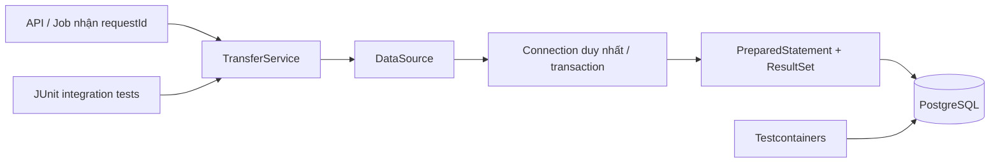
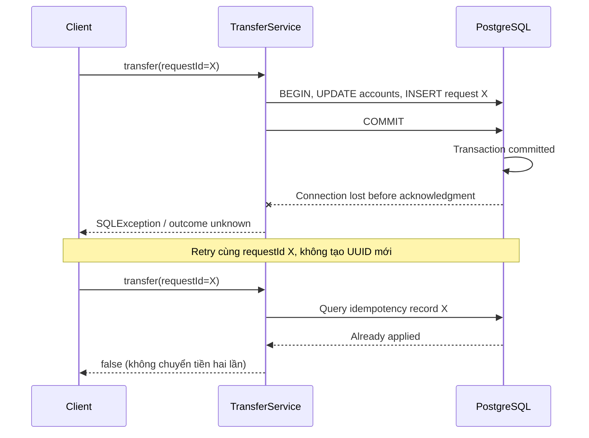

# Xây dựng tầng JDBC có transaction, timeout và kiểm thử tích hợp

Một ứng dụng **Java 27** có thể gửi một lệnh SQL đúng nhưng vẫn xử lý sai nghiệp vụ nếu hai lệnh cập nhật được commit riêng rẽ, kết nối bị kẹt vô thời hạn, hoặc test chỉ giả lập `Connection` mà không kiểm tra database thật. Bài thực hành này xây dựng **tầng JDBC cho thao tác chuyển số dư** giữa hai tài khoản, rồi kiểm chứng commit, rollback, timeout, khóa hàng, idempotency và vòng đời tài nguyên.

Bài thuộc chương **Thực hành tích hợp**, phạm vi **Java 27 và các kiến thức liên quan** (`JAVA_VERSION_JAVA27`). Mã dùng các API JDBC ổn định trong `java.sql` và `javax.sql`, PostgreSQL thực tế, JUnit Jupiter cùng Testcontainers. Không sử dụng những kỹ thuật Java đã lỗi thời hoặc các tính năng preview.

Sau khi hoàn thành, người học cần giải thích và thực hành được:

- Phân biệt đơn vị nghiệp vụ **một transaction** với từng câu lệnh SQL chạy `autoCommit`.
- Đặt ranh giới transaction tại service; truyền **cùng một `Connection`** qua các thao tác DAO.
- Dùng `PreparedStatement`, `try`-with-resources, `commit`/`rollback` và bảo toàn nguyên nhân lỗi.
- Phân biệt **query timeout**, **lock wait**, **login/connect timeout**, **socket/network timeout** và **deadline toàn nghiệp vụ**.
- Chống update mất dữ liệu và giảm vòng chờ khi nhiều giao dịch cùng sửa hai tài khoản.
- Không thực hiện lại chuyển tiền do lỗi mạng/commit không rõ trạng thái nhờ **idempotency key**.
- Viết integration tests chạy trên PostgreSQL có thật, kiểm tra trạng thái **sau commit/rollback**, không chỉ verify method của mock.

## 1. Đề bài nghiệp vụ và tiêu chí chấp nhận

Hệ thống có bảng `accounts` với số dư nguyên theo **đơn vị nhỏ nhất** (`balance_cents`) và bảng `transfer_requests` ghi ID yêu cầu đã hoàn tất. API nghiệp vụ:

```java
boolean transfer(UUID requestId,
                 long fromAccountId,
                 long toAccountId,
                 long amountCents) throws SQLException;
```

Hợp đồng:

1. `requestId` là khóa idempotency của một yêu cầu chuyển tiền.
2. Hai account ID khác nhau và tồn tại; `amountCents > 0`.
3. Không được tạo số dư âm; tổng số dư **không đổi** khi chuyển thành công.
4. Hai lần cập nhật phải **cùng commit** hoặc **cùng rollback**.
5. Gửi lại **cùng request ID + cùng payload** sau khi giao dịch đã commit thì trả `false`, không trừ tiền lần thứ hai.
6. Dùng lại request ID nhưng **payload khác** phải bị từ chối.
7. Khi exception, không để lại một account bị trừ hoặc bản ghi idempotency nửa vời.
8. Hai transfer đồng thời giữa hai tài khoản không được mất cập nhật; có thứ tự lấy lock thống nhất.
9. Có **timeout cho từng SQL statement**; caller cần quản lý thêm deadline tổng nếu nghiệp vụ yêu cầu.
10. Việc test phải đọc **trạng thái database**, không chỉ kiểm tra return value.

`transfer` trả `true` khi yêu cầu này **mới được commit**; trả `false` khi phát hiện yêu cầu tương đương **đã commit trước đó**. Nó **không** có ý nghĩa “giao dịch chưa bao giờ chạy” khi caller chỉ nhận một lỗi mạng.

### Ranh giới của bài

Ví dụ cố ý dùng **PostgreSQL-specific SQL** như `SELECT ... FOR UPDATE` và `INSERT ... ON CONFLICT DO NOTHING` để có hành vi rõ ràng với database được kiểm thử. Các interface JDBC dùng API chuẩn Java, nhưng **SQL dialect, isolation/lock semantics và timeout/cancellation phụ thuộc driver + database**. Không tuyên bố có thể đổi URL sang mọi RDBMS mà code/kiểm thử vẫn giữ nguyên.

Hệ thống chuyển tiền production còn cần authentication, authorization, durable audit, accounting ledger, reconciliation, phát hiện gian lận, migration schema và điều phối giữa nhiều dịch vụ. Đây là **bài thực hành local transaction**, không phải một hệ thống ngân hàng đầy đủ.

## 2. Kiến trúc: transaction do service sở hữu



| Lớp | Trách nhiệm | Không nên làm |
|---|---|---|
| API/controller | Validate đầu vào ở ranh giới, authentication và trace ID | Tự mở hai connection riêng cho debit và credit |
| `TransferService` | Bắt đầu/kết thúc transaction, thực thi quy tắc nghiệp vụ | Cho từng helper tự commit |
| DAO/helper JDBC | SQL tham số hóa và ánh xạ kết quả | Đóng `Connection` không thuộc quyền sở hữu của mình |
| `DataSource` | Cung cấp connection; production có thể là connection pool | Chia sẻ một `Connection` mutable cho nhiều request |
| PostgreSQL | Transaction, unique constraints, row locks, dữ liệu bền vững | Bảo đảm tự động mọi business rule nếu schema/service thiếu |
| Integration tests | Xác nhận commit/rollback/timeout/concurrency trên DB thật | Mock `commit()` rồi kết luận database đúng |

**Quy tắc sở hữu:** Service mở `Connection` và chịu trách nhiệm commit/rollback/close; các helper chỉ mở/đóng `PreparedStatement`/`ResultSet` được tạo từ connection đó. Không chuyển `Connection` qua nhiều thread, không lưu trong biến static dùng chung.

## 3. Vì sao `autoCommit` mặc định có thể làm sai nghiệp vụ?

Theo JDBC, một `Connection` mới thường có `autoCommit = true`. Khi đó, mỗi statement được tự commit khi hoàn tất theo hợp đồng JDBC.

**Sai nếu chuyển tiền bằng hai statement rời rạc:**

```java
// Minh họa lỗi thiết kế: không dùng trực tiếp trong production.
try (Connection c = dataSource.getConnection()) {
    debit(c, fromId, amount);  // statement thứ nhất có thể auto-commit
    credit(c, toId, amount);   // nếu lỗi, tiền đã bị trừ trước đó
}
```

Các helper `debit`/`credit` ở đây chỉ đại diện hành động nghiệp vụ. Lỗi xảy ra sau debit không tự rollback statement đã commit.

**Đúng ở mức transaction:**

```java
try (Connection c = dataSource.getConnection()) {
    c.setAutoCommit(false);
    try {
        debit(c, fromId, amount);
        credit(c, toId, amount);
        c.commit();
    } catch (SQLException | RuntimeException failure) {
        try {
            c.rollback();
        } catch (SQLException rollbackFailure) {
            failure.addSuppressed(rollbackFailure);
        }
        throw failure;
    }
}
```

Đây là skeleton minh họa: production còn phải quản lý isolation, locks, timeout, kiểm tra số dư, result counts và idempotency như phần code đầy đủ bên dưới. Mỗi helper **không được** gọi `commit` hay `close` trên connection của service.

**Quan trọng:** Đổi `setAutoCommit(true)` khi transaction còn đang mở có thể **tự commit** transaction đó. Đừng “khôi phục autoCommit” trước khi đã commit/rollback xong. Với pooled connection, reset trạng thái cần theo hợp đồng của pool hoặc lớp transaction management đáng tin cậy.

## 4. Lựa chọn công cụ và cấu trúc project

Bài này dùng:

| Thành phần | Vai trò | Ví dụ phiên bản GA đã kiểm tra 27/11/2026 |
|---|---|---|
| Java / JDK | Compile và chạy mã | JDK 27 (bản update theo vendor được phê duyệt) |
| Gradle | Build Java, dependency resolution và test | Gradle **9.8.2+**, chọn bản đã được phê duyệt |
| PostgreSQL JDBC driver | JDBC implementation để kết nối PostgreSQL | `org.postgresql:postgresql:42.7.14` |
| JUnit Jupiter | Framework chạy test | JUnit **6.1.3** |
| Testcontainers PostgreSQL | Database tạm biệt lập cho integration test | `org.testcontainers:testcontainers-postgresql:2.0.5` |
| PostgreSQL image | Server thử nghiệm | `postgres:17.6` (image minh họa, pin digest khi dùng thật) |

Các version ở bảng nhằm làm ví dụ có thể tái tạo về mặt khai báo, **không** là bảo đảm “an toàn nhất trong tương lai”. JDK/Gradle/plugin/JDBC driver/container image cần được cập nhật theo advisory và tương thích chính thức. Đặc biệt Testcontainers **2.x** dùng artifact `testcontainers-postgresql` và package `org.testcontainers.postgresql`; đừng copy cấu hình `org.testcontainers:postgresql`/package cũ từ ví dụ Testcontainers 1.x.

Project người học có thể tạo:

```text
jdbc-transfer/
├── settings.gradle.kts
├── build.gradle.kts
├── gradlew / gradlew.bat / gradle/wrapper/...  (tạo bằng Gradle Wrapper)
├── src/main/java/example/jdbc/TransferService.java
└── src/test/java/example/jdbc/TransferServiceTest.java
```

**Chỉ lưu một bài Markdown trong nhiệm vụ Worker này**; cây dự án trên là cấu trúc người học tự dựng khi thực hành, không phải yêu cầu tạo thêm file trong workspace Java-learning.

### `settings.gradle.kts`

```kotlin
rootProject.name = "jdbc-transfer"
```

### `build.gradle.kts`

```kotlin
plugins {
    java
}

java {
    toolchain {
        languageVersion.set(JavaLanguageVersion.of(27))
    }
}

repositories {
    mavenCentral()
}

dependencies {
    implementation("org.postgresql:postgresql:42.7.14")

    testImplementation(platform("org.junit:junit-bom:6.1.3"))
    testImplementation("org.junit.jupiter:junit-jupiter")
    testRuntimeOnly("org.junit.platform:junit-platform-launcher")

    // Artifact và package theo Testcontainers Java 2.x.
    testImplementation("org.testcontainers:testcontainers-postgresql:2.0.5")
}

tasks.test {
    useJUnitPlatform()
    maxParallelForks = 1
}
```

Điều kiện thực hành:

- JDK 27 và Gradle Wrapper có hỗ trợ Java 27 (**Gradle 9.8.0 trở lên** theo compatibility matrix, nhưng nên dùng bản patch đã được phê duyệt).
- Một **container runtime** mà Testcontainers phát hiện được (Docker/compatible environment); có quyền pull/chạy PostgreSQL image.
- Network/repository để tải những dependencies được duyệt khi setup.
- Không yêu cầu database PostgreSQL đã cài sẵn ở host.

**Không chạy Gradle trong bước biên soạn tài liệu này** theo `STEP_4_WORKER_NEW`; các lệnh ở phần sau dành cho người học/CI khi triển khai bài.

## 5. Schema PostgreSQL: bất biến ở tầng database

Hai bảng được tạo trong test setup:

```sql
CREATE TABLE accounts (
    id BIGINT PRIMARY KEY,
    balance_cents BIGINT NOT NULL CHECK (balance_cents >= 0)
);

CREATE TABLE transfer_requests (
    request_id UUID PRIMARY KEY,
    from_id BIGINT NOT NULL,
    to_id BIGINT NOT NULL,
    amount_cents BIGINT NOT NULL CHECK (amount_cents > 0),
    CHECK (from_id <> to_id)
);
```

Bảng `accounts` đảm bảo một balance không âm. `transfer_requests.request_id` là unique key cho idempotency. Các cột ID nguồn/đích trong bảng request có thể có **foreign keys** nếu chọn schema production tương ứng; ví dụ này cố ý kiểm tra sự tồn tại và khóa cả hai account bằng SQL trước khi ghi record, tránh thay đổi thứ tự khóa do foreign-key row locking trong thí nghiệm concurrency.

Số tiền dùng **`long` đơn vị cents**, không dùng `double`. Khi cộng vào tài khoản đích, dùng `Math.addExact` để phát hiện tràn số ở Java trước khi UPDATE; CHECK constraint giữ số dư không âm ngay trong DB. Nếu cần xử lý nhiều currency/tỷ giá, cần một model money riêng (`BigDecimal` cùng currency/scale hoặc integer minor units đúng với đồng tiền).

### Dữ liệu khởi tạo của mỗi test

```sql
INSERT INTO accounts (id, balance_cents)
VALUES (1, 10000), (2, 10000);
```

Mỗi test bắt đầu từ hai account cùng 10.000 cents; cách reset trong JUnit sẽ **DROP/CREATE** hai bảng trong *container test riêng*, không chạy migration phá dữ liệu trên database thật.

## 6. `DataSource` và quyền sở hữu kết nối

JDBC định nghĩa `javax.sql.DataSource` để tầng nghiệp vụ lấy `Connection` mà không cần biết kết nối đến database nào. Với pgJDBC, `PGSimpleDataSource` là implementation **không có connection pool**; phù hợp để viết test rõ ràng và học vòng đời kết nối.

```java
import org.postgresql.ds.PGSimpleDataSource;
import javax.sql.DataSource;

static DataSource createDataSource(
        String jdbcUrl, String username, String password) {

    PGSimpleDataSource ds = new PGSimpleDataSource();
    ds.setURL(jdbcUrl);
    ds.setUser(username);
    ds.setPassword(password);
    return ds;
}
```

Đoạn mã nằm trong một utility/test class tùy dự án; method `createDataSource` không tự chạy riêng. Trong test, `jdbcUrl`, username và password được lấy **động** từ Testcontainers.

Trong service thật, nên truyền `DataSource` qua constructor và dùng **pool được quản lý** bởi framework hay thư viện phù hợp; không tạo một pool mới cho mỗi request. Các setting `autoCommit`, isolation, schema, read-only và network timeout có thể bị thay đổi trong một transaction: phải có chính sách **reset trạng thái connection trước khi trả về pool**.

**Không chia sẻ một Connection dùng chung giữa những thread.** JDBC `Connection` mô tả một session/transaction mutable, không phải một singleton stateless service.

## 7. Service hoàn chỉnh: transaction, khóa hàng, rollback và idempotency

Lưu mã sau tại `src/main/java/example/jdbc/TransferService.java`. Đây là **một class Java độc lập** (sau khi bổ sung dependency/SQL schema ở trên), không phụ thuộc framework transaction bên ngoài:

```java
package example.jdbc;

import javax.sql.DataSource;
import java.sql.Connection;
import java.sql.PreparedStatement;
import java.sql.ResultSet;
import java.sql.SQLException;
import java.util.Objects;
import java.util.UUID;

public final class TransferService {
    private final DataSource dataSource;
    private final int queryTimeoutSeconds;

    public TransferService(DataSource dataSource, int queryTimeoutSeconds) {
        this.dataSource = Objects.requireNonNull(dataSource);
        if (queryTimeoutSeconds <= 0) {
            throw new IllegalArgumentException("queryTimeoutSeconds > 0");
        }
        this.queryTimeoutSeconds = queryTimeoutSeconds;
    }

    /**
     * true: yêu cầu mới được commit;
     * false: cùng requestId/payload đã commit trước đó.
     */
    public boolean transfer(
            UUID requestId,
            long fromId,
            long toId,
            long amountCents) throws SQLException {

        Objects.requireNonNull(requestId, "requestId");
        if (fromId <= 0 || toId <= 0 || fromId == toId
                || amountCents <= 0) {
            throw new IllegalArgumentException("Transfer arguments invalid");
        }

        try (Connection connection = dataSource.getConnection()) {
            // Trong demo, PGSimpleDataSource cung cấp connection mới,
            // không có transaction đang mở.
            connection.setTransactionIsolation(
                    Connection.TRANSACTION_READ_COMMITTED);
            connection.setAutoCommit(false);

            try {
                // Mọi transaction lấy row lock theo một thứ tự toàn cục.
                long firstId = Math.min(fromId, toId);
                long secondId = Math.max(fromId, toId);
                long firstBalance = lockBalance(connection, firstId);
                long secondBalance = lockBalance(connection, secondId);

                long fromBalance = fromId == firstId
                        ? firstBalance : secondBalance;
                long toBalance = toId == secondId
                        ? secondBalance : firstBalance;

                // Ghi idempotency key trong CÙNG transaction
                // với việc cập nhật số dư.
                if (!insertRequest(connection, requestId,
                        fromId, toId, amountCents)) {
                    verifySameRequest(connection, requestId,
                            fromId, toId, amountCents);
                    connection.commit();
                    return false;
                }

                if (fromBalance < amountCents) {
                    throw new IllegalArgumentException("Insufficient funds");
                }

                long targetBalance =
                        Math.addExact(toBalance, amountCents);

                updateBalance(connection,
                        fromId, fromBalance - amountCents);
                updateBalance(connection, toId, targetBalance);

                connection.commit();
                return true;
            } catch (SQLException | RuntimeException failure) {
                try {
                    connection.rollback();
                } catch (SQLException rollbackFailure) {
                    failure.addSuppressed(rollbackFailure);
                }
                throw failure;
            }
        }
    }

    private long lockBalance(Connection connection, long accountId)
            throws SQLException {
        String sql = """
                SELECT balance_cents
                FROM accounts
                WHERE id = ?
                FOR UPDATE
                """;
        try (PreparedStatement ps = connection.prepareStatement(sql)) {
            ps.setQueryTimeout(queryTimeoutSeconds);
            ps.setLong(1, accountId);
            try (ResultSet rs = ps.executeQuery()) {
                if (!rs.next()) {
                    throw new IllegalArgumentException(
                            "Account not found: " + accountId);
                }
                return rs.getLong(1);
            }
        }
    }

    private boolean insertRequest(
            Connection connection, UUID requestId,
            long fromId, long toId, long amountCents)
            throws SQLException {
        String sql = """
                INSERT INTO transfer_requests
                    (request_id, from_id, to_id, amount_cents)
                VALUES (?, ?, ?, ?)
                ON CONFLICT (request_id) DO NOTHING
                """;
        try (PreparedStatement ps = connection.prepareStatement(sql)) {
            ps.setQueryTimeout(queryTimeoutSeconds);
            ps.setObject(1, requestId);
            ps.setLong(2, fromId);
            ps.setLong(3, toId);
            ps.setLong(4, amountCents);
            return ps.executeUpdate() == 1;
        }
    }

    private void verifySameRequest(
            Connection connection, UUID requestId,
            long fromId, long toId, long amountCents)
            throws SQLException {
        String sql = """
                SELECT from_id, to_id, amount_cents
                FROM transfer_requests
                WHERE request_id = ?
                """;
        try (PreparedStatement ps = connection.prepareStatement(sql)) {
            ps.setQueryTimeout(queryTimeoutSeconds);
            ps.setObject(1, requestId);
            try (ResultSet rs = ps.executeQuery()) {
                if (!rs.next()
                        || rs.getLong(1) != fromId
                        || rs.getLong(2) != toId
                        || rs.getLong(3) != amountCents) {
                    throw new IllegalArgumentException(
                            "Idempotency key reused with different payload");
                }
            }
        }
    }

    private void updateBalance(
            Connection connection, long id, long balance)
            throws SQLException {
        String sql = """
                UPDATE accounts
                SET balance_cents = ?
                WHERE id = ?
                """;
        try (PreparedStatement ps = connection.prepareStatement(sql)) {
            ps.setQueryTimeout(queryTimeoutSeconds);
            ps.setLong(1, balance);
            ps.setLong(2, id);
            if (ps.executeUpdate() != 1) {
                throw new SQLException("Expected exactly one account row");
            }
        }
    }
}
```

### Các điểm đáng chú ý trong code

**Một connection, một transaction.** Hai `UPDATE` và bản ghi idempotency được commit/rollback cùng nhau. Không có trạng thái “đã trừ nhưng chưa cộng” nếu transaction hoàn tất theo hợp đồng PostgreSQL.

**Thứ tự khóa cố định.** Dù chuyển `1 → 2` hay `2 → 1`, service luôn chạy `SELECT ... FOR UPDATE` với ID nhỏ trước. Điều này ngăn **vòng chờ do việc lấy hai account row locks theo chiều ngược** trong chính service. Nó **không thể** chứng minh toàn database không có deadlock nếu các transaction khác dùng thứ tự khóa khác.

**Không mất cập nhật.** Mỗi transaction lấy row lock trước khi đọc `balance_cents`, tính số dư mới và ghi lại; các transaction liên quan cùng account phải chờ, không ghi đè dựa trên dữ liệu cũ.

**Không dùng floating point cho tiền.** Số dư là `long` cents; `Math.addExact` phát hiện overflow. Việc dùng Java `long` giả định amount nằm trong phạm vi integer đã chọn và business quy định currency/scale.

**Idempotency là bản ghi cùng transaction.** Nếu lần đầu commit thành công nhưng response tới caller bị mất, caller có thể gửi lại cùng UUID/payload và nhận `false` thay vì trừ thêm lần nữa. Nếu lần đầu rollback, bản ghi key cũng rollback và retry có thể chạy lại.

**Mọi SQL có timeout cục bộ.** `setQueryTimeout` được áp dụng trước `executeQuery`/`executeUpdate` ở từng `PreparedStatement`, không dùng một thread sleep để mô phỏng timeout của JDBC.

**`PreparedStatement` chống SQL injection ở giá trị.** Mọi ID, amount và UUID được bind bằng tham số; không nối input người dùng vào SQL. Tên bảng/cột cố định trong source, không nhận trực tiếp từ request.

**Rollback giữ lỗi gốc.** Nếu `rollback()` cũng ném exception, lỗi rollback được thêm bằng `addSuppressed` thay vì thay thế `failure` chính.

**Connection đóng nhờ try-with-resources.** PostgreSQL driver có thể hỏng kết nối sau lỗi network/timeout; scope operation sẽ đóng session. Khi dùng pool, cần đúng chính sách reset/evict unhealthy connections của pool.

### Những giới hạn cần hiểu trước khi dùng production

- Service giả định `DataSource` cung cấp một connection mới/clean cho mỗi transaction như `PGSimpleDataSource` trong bài. Với connection pool, phải cấu hình reset session state (`autoCommit`, isolation, schema, session variables), theo tài liệu pool.
- `queryTimeoutSeconds` **không phải** deadline chung của toàn transfer. Có nhiều statements, nên tổng thời gian có thể lớn hơn timeout này.
- `READ_COMMITTED` và row locks bảo vệ business rule được minh họa; những predicate xuyên nhiều rows, báo cáo tổng hợp hay invariant phức tạp hơn có thể cần isolation khác hoặc ràng buộc DB bổ sung.
- `ON CONFLICT (request_id) DO NOTHING` là cú pháp PostgreSQL. RDBMS khác cần cú pháp/chiến lược tương đương và integration tests riêng.
- Nếu `commit()` báo lỗi do network đứt, **không thể suy chắc** server có commit hay chưa. Caller cần tra/retry cùng idempotency key sau khi kết nối được phục hồi, không tự tạo UUID mới rồi chạy lại.
- Demo này không có cơ chế tự động retry deadlock/serialization failure; nếu bổ sung, **retry cả transaction** có giới hạn, với request ID giữ nguyên, theo hợp đồng business và SQLSTATE của driver.
- Lỗi hoặc trạng thái timeout không đồng nghĩa tự động rollback ở tất cả RDBMS/driver; hãy chủ động `rollback`/close theo hợp đồng, không tiếp tục dùng transaction đã lỗi như thể bình thường.

## 8. Integration test thực sự: PostgreSQL container + JUnit Jupiter

Một mock `DataSource` chỉ cho biết code đã gọi `commit()` hay `rollback()`, **không** chứng minh PostgreSQL xử lý constraint, transaction visibility, lock wait hoặc SQL dialect đúng. Integration test cần kết nối đến DB thật và kiểm tra dữ liệu sau thao tác.

Lưu file tại `src/test/java/example/jdbc/TransferServiceTest.java`. Class này dùng **Testcontainers 2.x** — package `org.testcontainers.postgresql.PostgreSQLContainer` — và **JUnit 6.1.3**:

```java
package example.jdbc;

import org.junit.jupiter.api.AfterAll;
import org.junit.jupiter.api.BeforeAll;
import org.junit.jupiter.api.BeforeEach;
import org.junit.jupiter.api.Test;
import org.junit.jupiter.api.TestInstance;
import org.postgresql.ds.PGSimpleDataSource;
import org.testcontainers.postgresql.PostgreSQLContainer;

import java.sql.Connection;
import java.sql.PreparedStatement;
import java.sql.ResultSet;
import java.sql.SQLException;
import java.sql.Statement;
import java.util.UUID;
import java.util.concurrent.ExecutorService;
import java.util.concurrent.Executors;
import java.util.concurrent.TimeUnit;

import static org.junit.jupiter.api.Assertions.*;

@TestInstance(TestInstance.Lifecycle.PER_CLASS)
class TransferServiceTest {
    private final PostgreSQLContainer postgres =
            new PostgreSQLContainer("postgres:17.6");

    private PGSimpleDataSource dataSource;
    private TransferService service;

    @BeforeAll
    void startDatabase() {
        postgres.start();

        dataSource = new PGSimpleDataSource();
        dataSource.setURL(postgres.getJdbcUrl());
        dataSource.setUser(postgres.getUsername());
        dataSource.setPassword(postgres.getPassword());

        service = new TransferService(dataSource, 3);
    }

    @AfterAll
    void stopDatabase() {
        postgres.stop();
    }

    @BeforeEach
    void resetSchema() throws SQLException {
        // CHỈ chạy trên PostgreSQL container kiểm thử riêng!
        try (Connection c = dataSource.getConnection();
             Statement s = c.createStatement()) {
            s.execute("DROP TABLE IF EXISTS transfer_requests");
            s.execute("DROP TABLE IF EXISTS accounts");

            s.execute("""
                    CREATE TABLE accounts (
                        id BIGINT PRIMARY KEY,
                        balance_cents BIGINT NOT NULL
                            CHECK (balance_cents >= 0)
                    )
                    """);

            s.execute("""
                    CREATE TABLE transfer_requests (
                        request_id UUID PRIMARY KEY,
                        from_id BIGINT NOT NULL,
                        to_id BIGINT NOT NULL,
                        amount_cents BIGINT NOT NULL
                            CHECK (amount_cents > 0),
                        CHECK (from_id <> to_id)
                    )
                    """);

            s.execute("""
                    INSERT INTO accounts (id, balance_cents)
                    VALUES (1, 10000), (2, 10000)
                    """);
        }
    }

    @Test
    void commitUpdatesBothAccounts() throws SQLException {
        UUID requestId = UUID.randomUUID();

        assertTrue(service.transfer(requestId, 1, 2, 1_500));
        assertEquals(8_500L, balance(1));
        assertEquals(11_500L, balance(2));
        assertEquals(20_000L, balance(1) + balance(2));
        assertEquals(1L, requestCount());
    }

    @Test
    void insufficientFundsRollsBackEverything() throws SQLException {
        UUID requestId = UUID.randomUUID();

        assertThrows(IllegalArgumentException.class,
                () -> service.transfer(requestId, 1, 2, 50_000));

        assertEquals(10_000L, balance(1));
        assertEquals(10_000L, balance(2));
        assertEquals(0L, requestCount());
    }

    @Test
    void failureOnSecondUpdateRollsBackFirstUpdate()
            throws SQLException {
        // Tạo lỗi thật ở UPDATE account đích sau khi account
        // nguồn đã bị UPDATE trong transaction đang mở.
        try (Connection c = dataSource.getConnection();
             Statement s = c.createStatement()) {
            s.execute("""
                    ALTER TABLE accounts
                    ADD CONSTRAINT test_balance_ceiling
                    CHECK (balance_cents <= 12000)
                    """);
        }

        UUID requestId = UUID.randomUUID();
        assertThrows(SQLException.class,
                () -> service.transfer(requestId, 1, 2, 3_000));

        // Nếu không rollback, account 1 có thể còn 7000.
        assertEquals(10_000L, balance(1));
        assertEquals(10_000L, balance(2));
        assertEquals(0L, requestCount());
    }

    @Test
    void sameRequestIsAppliedOnlyOnce() throws SQLException {
        UUID requestId = UUID.randomUUID();

        assertTrue(service.transfer(requestId, 1, 2, 800));
        assertFalse(service.transfer(requestId, 1, 2, 800));

        assertEquals(9_200L, balance(1));
        assertEquals(10_800L, balance(2));
        assertEquals(1L, requestCount());
    }

    @Test
    void sameKeyWithDifferentPayloadIsRejected()
            throws SQLException {
        UUID requestId = UUID.randomUUID();

        assertTrue(service.transfer(requestId, 1, 2, 500));
        assertThrows(IllegalArgumentException.class,
                () -> service.transfer(requestId, 1, 2, 600));

        assertEquals(9_500L, balance(1));
        assertEquals(10_500L, balance(2));
        assertEquals(1L, requestCount());
    }

    @Test
    void concurrentOppositeTransfersKeepConsistentBalances()
            throws Exception {
        try (ExecutorService executor =
                     Executors.newVirtualThreadPerTaskExecutor()) {

            var forward = executor.submit(() ->
                    service.transfer(UUID.randomUUID(), 1, 2, 200));
            var backward = executor.submit(() ->
                    service.transfer(UUID.randomUUID(), 2, 1, 100));

            assertTrue(forward.get(10, TimeUnit.SECONDS));
            assertTrue(backward.get(10, TimeUnit.SECONDS));
        }

        assertEquals(9_900L, balance(1));
        assertEquals(10_100L, balance(2));
        assertEquals(20_000L, balance(1) + balance(2));
        assertEquals(2L, requestCount());
    }

    @Test
    void queryTimeoutCancelsLongRunningPostgresStatement()
            throws SQLException {
        try (Connection c = dataSource.getConnection();
             Statement s = c.createStatement()) {

            s.setQueryTimeout(1);
            // pg_sleep là hàm riêng PostgreSQL, dùng có chủ đích.
            SQLException error = assertThrows(SQLException.class,
                    () -> s.execute("SELECT pg_sleep(4)"));

            assertNotNull(error.getSQLState());
        }
    }

    private long balance(long accountId) throws SQLException {
        try (Connection c = dataSource.getConnection();
             PreparedStatement ps = c.prepareStatement(
                     "SELECT balance_cents FROM accounts WHERE id = ?")) {
            ps.setLong(1, accountId);
            try (ResultSet rs = ps.executeQuery()) {
                assertTrue(rs.next(), "Account missing in test");
                return rs.getLong(1);
            }
        }
    }

    private long requestCount() throws SQLException {
        try (Connection c = dataSource.getConnection();
             Statement s = c.createStatement();
             ResultSet rs = s.executeQuery(
                     "SELECT COUNT(*) FROM transfer_requests")) {
            assertTrue(rs.next());
            return rs.getLong(1);
        }
    }
}
```

### Kết quả mà test thực sự xác nhận

| Test | Trạng thái DB mong đợi | Loại lỗi được bắt |
|---|---|---|
| `commitUpdatesBothAccounts` | 8.500 + 11.500 = 20.000, 1 request | Transaction commit thành công |
| `insufficientFundsRollsBackEverything` | Hai account giữ 10.000, không có request | Business exception phải rollback |
| `failureOnSecondUpdateRollsBackFirstUpdate` | Hai account giữ 10.000, không có request | Database CHECK constraint khiến UPDATE thứ hai lỗi |
| `sameRequestIsAppliedOnlyOnce` | Chuyển 800 đúng một lần | Idempotency sau commit |
| `sameKeyWithDifferentPayloadIsRejected` | Không có lần chuyển thứ hai | Không tái sử dụng UUID cho payload khác |
| `concurrentOppositeTransfersKeepConsistentBalances` | 9.900 + 10.100 = 20.000, 2 request | Row locking + concurrent transactions |
| `queryTimeoutCancelsLongRunningPostgresStatement` | Câu SQL bị driver/server hủy sau timeout; không đổi dữ liệu | JDBC statement timeout theo driver PostgreSQL |

**Chi tiết quan trọng về phép thử timeout:** PostgreSQL và pgJDBC có thể báo `SQLException` với SQLSTATE dạng cancellation (thường `57014`); **không ép mọi driver phải trả cùng Java exception subtype** hay cùng message. Test chỉ khẳng định có lỗi SQL hợp lệ khi cố chạy câu `pg_sleep(4)` với query timeout 1 giây; cần bổ sung kiểm tra timeout duration/specific SQLSTATE khi đã cố định driver, version và môi trường CI.

Test dùng `@TestInstance(PER_CLASS)` để quản lý một container cho cả class; `@BeforeEach` reset dữ liệu nên mỗi test có trạng thái đầu vào rõ ràng. **Không bật parallel execution cho các test dùng chung schema này**, vì test này đang `DROP/CREATE` bảng trước mỗi lượt. Khi cần chạy test song song, dùng schema/database riêng theo test hoặc cơ chế cô lập tương đương.

### Tại sao gọi là integration test?

- Thật sự tạo/kết thúc **session PostgreSQL**.
- Thật sự chạy `INSERT`, `SELECT ... FOR UPDATE`, `UPDATE` và `COMMIT/ROLLBACK`.
- Thật sự phát hiện CHECK constraint ngay ở database.
- Thử isolation/row lock với **hai connections** do `PGSimpleDataSource` cấp.
- Thử `Statement.setQueryTimeout` cùng driver và database có thật.

Mock-based unit test vẫn hữu ích cho input validation hoặc policy thuần, nhưng **không thay thế** những kiểm tra nói trên.

## 9. Chạy bộ test tích hợp

Với project người học đã tạo đầy đủ file và Gradle Wrapper tương thích Java 27:

```bash
java --version
./gradlew --version
./gradlew test
```

Ở Windows PowerShell:

```powershell
.\gradlew.bat test
```

Gradle lưu kết quả test dưới `build/test-results/test` và báo cáo HTML dưới `build/reports/tests/test` theo cấu hình mặc định thông thường. Tên file `TransferServiceTest.java` có hậu tố `Test` giúp công cụ test discovery nhận diện; class dùng `@Test` của JUnit Jupiter.

**Đây là lệnh dành cho người học/CI**, không phải lệnh đã được chạy khi biên soạn bài. Theo nhiệm vụ Worker của dự án Java-learning, bước viết này **không tạo project phụ, không chạy Gradle/test và chưa thực hiện vòng Content QA chuyên môn**.

### Khi Testcontainers không chạy được

Các lỗi thường gặp không liên quan code JDBC:

- Docker/container runtime không hoạt động hoặc tài khoản không có quyền.
- Image `postgres:17.6` không pull được do proxy/registry/network.
- Environment của CI không cho phép Testcontainers truy cập container runtime.
- Thiếu driver `org.postgresql:postgresql` dù có Testcontainers module.
- Mismatch Testcontainers 1.x và 2.x artifact hoặc package import.
- Gradle wrapper quá cũ không hỗ trợ chạy trên JDK 27.

**Không tự sửa lỗi Testcontainers bằng cách cho test truy cập DB production.** Tách riêng database test, dùng credentials không có quyền ngoài môi trường thử nghiệm và kiểm soát network/registry. Nếu môi trường build không có container runtime, cần thiết kế môi trường test tương đương được quản trị; không báo “integration test PASS” dựa trên mocks.

## 10. Timeout JDBC: ít nhất năm lớp khác nhau

Một request HTTP với deadline 5 giây có thể phải lấy connection, chờ lock, chạy nhiều SQL, commit và serialize response. Chỉ đặt `Statement.setQueryTimeout(3)` chưa bảo đảm cả công việc xong trong 5 giây.

| Loại timeout | API/cấu hình phổ biến | Giới hạn | Khi hết hạn |
|---|---|---|---|
| **Pool acquisition timeout** | Cấu hình connection pool | Thời gian chờ mượn một connection rảnh | Pool từ chối/cảnh báo theo implementation |
| **Login/connect timeout** | `DataSource.setLoginTimeout`, pgJDBC `loginTimeout`/`connectTimeout` | Bắt tay/thiết lập kết nối DB | Lỗi tạo connection; driver-specific |
| **Query timeout** | `Statement.setQueryTimeout(seconds)` | `execute`/`executeQuery`/`executeUpdate` của từng statement | Driver thử hủy câu SQL, thường `SQLException` |
| **Server statement/lock timeout** | PostgreSQL `statement_timeout`/`lock_timeout` | Server giới hạn execution hoặc chờ lock | PostgreSQL hủy statement, SQLSTATE phù hợp |
| **Network/socket timeout** | JDBC `Connection.setNetworkTimeout`, pgJDBC `socketTimeout` | Chờ DB phản hồi ở tầng socket/network | Connection có thể bị đánh dấu hỏng/đóng |
| **Business deadline** | `Duration`/`System.nanoTime()`, cancellation policy | Toàn bộ workflow, retry, DB và phản hồi caller | Ứng dụng quyết định từ chối/hủy/đối soát |

### `Statement.setQueryTimeout` có ý nghĩa cụ thể

```java
try (Connection c = dataSource.getConnection();
     PreparedStatement ps = c.prepareStatement(
             "SELECT balance_cents FROM accounts WHERE id = ?")) {
    ps.setQueryTimeout(3);  // seconds
    ps.setLong(1, 1L);
    try (ResultSet rs = ps.executeQuery()) {
        if (rs.next()) {
            System.out.println(rs.getLong(1));
        }
    }
}
```

- `0` là không đặt giới hạn của **statement**; giá trị âm không hợp lệ.
- Driver JDBC phải áp query timeout cho các method `execute`/`executeQuery`/`executeUpdate` theo hợp đồng; việc hủy thành công và exception chi tiết phụ thuộc driver và DB.
- Một số driver còn áp timeout cho đọc `ResultSet`, nhưng **không** được suy rằng mọi driver sẽ làm như vậy.
- `setQueryTimeout(3)` trên **năm statements liên tiếp** không tương đương deadline **3 giây** cho cả transaction.
- Nếu timeout xảy ra giữa transaction, cần quy trình rollback/close như code service; đừng tự retry chỉ statement cuối mà bỏ các quyết định SQL trước đó.

### PostgreSQL có timeout tại server

Trong transaction của PostgreSQL, có thể áp chính sách riêng:

```sql
SET LOCAL lock_timeout = '800ms';
SET LOCAL statement_timeout = '3s';
```

`SET LOCAL` được dùng **trong transaction** và chỉ có hiệu lực ở phạm vi transaction hiện tại. Với demo, query timeout của JDBC vẫn được áp ở từng statement. Trong production cần xác định **cơ chế nào chịu trách nhiệm** cho mỗi giới hạn: đặt `lock_timeout` ngắn hơn `statement_timeout` nếu muốn phân biệt chờ lock và chạy query. Đừng cấu hình nhiều timeout trái ngược khiến nguyên nhân thất bại khó giải thích.

Thời gian `statement_timeout` của PostgreSQL không phải cùng khái niệm với khoảng chờ kết nối từ client hoặc deadline của một workflow nhiều transaction.

### Network timeout có tác động mạnh hơn

Theo JDBC `Connection.setNetworkTimeout(executor, milliseconds)`, khi network wait vượt giới hạn, driver có thể đánh dấu connection **đã đóng và không còn dùng được**. Đây là cơ chế phòng sự cố network partition kéo dài, không phải lựa chọn thay thế thông thường cho query timeout. Executor được truyền vào phải hoạt động đúng và được quản lý vòng đời.

Với pgJDBC, các connection properties `connectTimeout`, `socketTimeout` và `cancelSignalTimeout` còn có mục đích riêng. `socketTimeout` có thể cắt connection; `cancelSignalTimeout` điều khiển việc gửi yêu cầu cancel qua kết nối riêng. Khi cấu hình, nên tham khảo docs của **đúng driver version** đang deploy và test network fault bằng môi trường riêng.

## 11. Timeout, cancellation và trạng thái commit không chắc chắn

Một yêu cầu chuyển tiền có thể hoàn tất trên server ngay trước khi kết nối mạng bị ngắt. Từ phía caller, chỉ nhìn thấy exception **không đủ để kết luận tiền chưa chuyển**:



Đây là **mô hình minh họa trạng thái commit không rõ ràng**, không phải cam kết mọi server/driver đều có chính xác chuỗi gói tin như sơ đồ. Điểm cần nhớ:

- Timeout hoặc `SQLException` trước khi caller nhận kết quả **không đồng nghĩa** server rollback.
- Nếu giao dịch đầu tiên commit nhưng acknowledgment mất, tạo **UUID mới** rồi retry là nguy cơ nhân đôi side effect.
- Giữ `requestId` nhất quán qua retry; lookup/replay qua transaction mới có thể phân biệt trạng thái sau khi hệ thống phục hồi.
- Với nhiều hệ thống hoặc side effect ngoài DB, idempotency nội DB **chưa đủ**; cần outbox/saga hoặc giao thức điều phối có chủ đích.
- Không tự động retry mọi `SQLException`. Một số lỗi là dữ liệu không hợp lệ, vi phạm constraint hoặc bug logic cần sửa, không phải lỗi tạm thời.

### `Future.cancel(true)` không phải “rollback SQL”

Nếu bọc thao tác JDBC trong `ExecutorService.submit` rồi gọi `future.cancel(true)`, Java có thể **interrupt thread**, nhưng driver/JDBC call đang block **không bắt buộc** phản hồi như `Thread.sleep`. Không dùng trạng thái cancelled của `Future` làm bằng chứng database đã rollback.

Khi có khả năng cần hủy query từ thread khác, JDBC có `Statement.cancel()`, nhưng driver/DB có thể không hỗ trợ hoặc hủy không tức thời. Cách vận hành bền vững hơn là đặt **query/DB server timeout**, quản lý connection, và có policy rõ với kết quả không xác định sau lỗi mạng.

## 12. Isolation level và giữ bất biến dưới concurrency

JDBC `Connection.setTransactionIsolation(...)` hỗ trợ các hằng số như `READ_COMMITTED`, `REPEATABLE_READ`, `SERIALIZABLE` theo khả năng của DB/driver. Hợp đồng cụ thể của isolation và row locks vẫn phụ thuộc database.

| Isolation level | Mục tiêu tổng quát | Cần lưu ý |
|---|---|---|
| `READ_COMMITTED` | Không đọc dirty data; PostgreSQL dùng snapshot mới cho mỗi statement | Những thao tác read-modify-write cần locking/atomic update |
| `REPEATABLE_READ` | Giữ tính nhất quán đọc trong transaction theo cơ chế DB | PostgreSQL có snapshot behavior riêng; có thể gặp serialization failure |
| `SERIALIZABLE` | DB cố cho kết quả tương đương một lịch tuần tự theo mô hình của DB | Có thể abort transaction bằng SQLSTATE `40001` để caller retry toàn bộ |
| `READ_UNCOMMITTED` | Theo JDBC có tên level nhưng semantics thực tế DB khác nhau | PostgreSQL xử lý như `READ_COMMITTED`; không dùng để giả định dirty reads |

Trong `TransferService`, ta chọn **PostgreSQL READ COMMITTED + `SELECT ... FOR UPDATE`** để khóa đúng hai rows. Nếu chỉ làm:

```text
T1: SELECT balance = 10000
T2: SELECT balance = 10000
T1: UPDATE balance = 9000
T2: UPDATE balance = 9500  <-- ghi đè quyết định của T1
```

thì kết quả có thể bị mất cập nhật do cả hai tính toán từ snapshot cũ. `SELECT ... FOR UPDATE` giữ row lock trong transaction để lần đọc-ghi sau phải chờ transaction trước.

### Thứ tự khóa giảm rủi ro deadlock

Giả sử hai task:

- T1 chuyển `1 → 2`.
- T2 chuyển `2 → 1`.

Nếu lấy lock theo chiều chuyển, có thể xảy ra T1 giữ account 1 đợi 2 và T2 giữ account 2 đợi 1. Service luôn lấy `min(ID)` trước `max(ID)` nên tránh vòng chờ **ở cặp account locks**.

Đây không phải bảo đảm tuyệt đối chống mọi deadlock trong database: trigger, foreign keys, index locks hoặc transaction khác có thể khóa resource theo thứ tự riêng. Khi gặp PostgreSQL SQLSTATE `40P01`, cần phân tích lock graph và chính sách retry có kiểm soát.

### Retry serialization/deadlock nên bắt đầu transaction mới

PostgreSQL dùng `40001` cho `serialization_failure` và `40P01` cho `deadlock_detected`. Với các lỗi có thể retry, **không** chỉ lặp lại câu `UPDATE` cuối:

1. Rollback transaction thất bại.
2. Đóng connection hỏng hoặc đưa lại pool theo chính sách.
3. Mở transaction **mới**.
4. Đọc lại dữ liệu/lock và chạy lại **toàn bộ logic quyết định**.
5. Giữ cùng idempotency key.
6. Có giới hạn số lần retry, backoff/jitter và deadline chung.

Không retry `23514` (CHECK violation), `23503` (foreign key), `23505` (unique violation) một cách vô điều kiện; cần phân loại xem đó là lỗi nghiệp vụ, idempotency hay xung đột tạm thời.

## 13. Một transaction không được chia qua nhiều connection

Sai về cấu trúc:

```java
try (Connection first = dataSource.getConnection();
     Connection second = dataSource.getConnection()) {
    // Debit và credit trên 2 connections không cùng transaction local.
    // first.commit() KHÔNG bao phủ statement chạy trên second.
}
```

Kể cả hai connection tới **cùng PostgreSQL server**, chúng là hai database sessions với transaction riêng. `commit`/`rollback` trên session này không tự tác động session kia.

Với transaction local:

```text
Controller
  └── TransferService.transfer()
        └── Connection c (owner)
              ├── SELECT account 1 FOR UPDATE
              ├── SELECT account 2 FOR UPDATE
              ├── INSERT transfer_requests
              ├── UPDATE account 1
              ├── UPDATE account 2
              └── COMMIT hoặc ROLLBACK
```

Nếu thiết kế nhiều DAO classes, truyền `Connection c` vào các method nội bộ của repository/DAO, hoặc dùng transaction manager được hỗ trợ; không để từng DAO tự `getConnection()` và tự commit khi chúng phải nằm trong **một** transaction nghiệp vụ.

### Không dùng database local transaction như distributed transaction

Nếu một thao tác còn gửi email, HTTP hay publish Kafka event, các side effect đó **không tự rollback** theo JDBC. Nếu email gửi thành công rồi DB rollback, hai hệ thống vẫn có thể không nhất quán. Với integration thực tế, cân nhắc transactional outbox, eventual consistency hoặc saga; không gọi HTTP bên ngoài trong lúc giữ row locks nếu có thể tránh.

## 14. `SQLException`, SQLSTATE và suppressed exceptions

Trong JDBC, `SQLException` có thể mang:

- `getSQLState()`: mã trạng thái chuẩn/đặc thù driver.
- `getErrorCode()`: vendor error code.
- `getNextException()`: exception liên quan do driver chain.
- `getCause()` và `getSuppressed()`: nguyên nhân gốc và lỗi phụ của Java.

Ví dụ quan sát có kiểm soát:

```java
static void logSqlException(SQLException error) {
    for (SQLException current = error;
         current != null;
         current = current.getNextException()) {

        System.err.println("SQLSTATE=" + current.getSQLState()
                + ", errorCode=" + current.getErrorCode());
    }
}
```

Snippet này dành cho công cụ chẩn đoán, **không log nguyên SQL, password, token hoặc giá trị PII** từ ứng dụng thật. Mã SQLSTATE của PostgreSQL được tài liệu chính thức phân loại thành các nhóm như `08xxx` (connection exception), `23xxx` (integrity constraint), `40xxx` (transaction rollback), `57xxx` (operator intervention/cancellation).

| SQLSTATE PostgreSQL thường gặp | Diễn giải | Quyết định sơ bộ |
|---|---|---|
| `23514` | Check violation | Business/schema invalid, không retry ngay |
| `23505` | Unique violation | Có thể trùng request/khóa khác; cần xác minh |
| `40001` | Serialization failure | Retry **toàn transaction** khi idempotent |
| `40P01` | Deadlock detected | Retry toàn transaction có giới hạn khi phù hợp |
| `57014` | Query cancelled, gồm server query timeout | Xem timeout budget/cancel policy, rollback |
| `08xxx` | Connection problem | Tình trạng commit có thể không rõ; reconcile theo request ID |

Không chỉ dựa vào **message text** vì có thể khác locale, driver version và database. Mặt khác, cũng không coi riêng SQLSTATE đủ để quyết định retry mọi nghiệp vụ; cần thêm loại thao tác và tính idempotent.

### Rollback có thể thất bại — giữ lỗi ban đầu

Nếu SQL lỗi khiến transaction abort nhưng đường mạng cũng đứt trước khi `rollback()`, rollback có thể ném thêm `SQLException`. Mẫu trong service:

```java
catch (SQLException | RuntimeException failure) {
    try {
        connection.rollback();
    } catch (SQLException rollbackFailure) {
        failure.addSuppressed(rollbackFailure);
    }
    throw failure;
}
```

Caller vẫn thấy **nguyên nhân đầu tiên**, nhưng không mất dấu lỗi rollback khi debug. Đóng connection bằng try-with-resources cũng có thể thêm lỗi đóng dưới dạng suppressed exception nếu đang ném exception chính.

Nếu `commit()` ném exception, việc gọi `rollback()` sau đó **không xác minh** commit đã thất bại: trạng thái ở server có thể không xác định. Vì vậy phải có chiến lược idempotency/reconciliation thay vì giả định "rollback success" nghĩa là chưa bao giờ commit.

## 15. Connection pool: hiệu năng, quyền sở hữu và transaction leakage

`PGSimpleDataSource` mở connection mới theo lần gọi; điều này hợp lý cho bài học và integration test nhưng không phải lựa chọn tối ưu cho một API có hàng trăm yêu cầu đồng thời. Một production service thường dùng **một `DataSource` dạng pool** do framework hoặc thư viện đã được bảo trì quản lý.

Khi dùng pool, cần quản lý:

| Thiết lập | Ý nghĩa | Nguy cơ cấu hình sai |
|---|---|---|
| Maximum pool size | Số physical connections DB tối đa | Quá lớn làm DB quá tải; quá nhỏ làm queue dài |
| Connection acquisition timeout | Thời gian caller chờ pool trả connection | Request bị giữ lâu dù SQL nhanh |
| Idle/max lifetime | Tái sử dụng và thay connection không còn phù hợp | Giữ session stale, kết nối đóng bất ngờ |
| Validation | Kiểm tra connection còn dùng được | Mượn connection đã bị server/network đóng |
| Auto-commit reset | Trả session về trạng thái mặc định sau giao dịch | Request sau vô tình tham gia transaction sai |
| Isolation/schema/read-only reset | Loại ảnh hưởng từ request trước | Đọc dữ liệu sai schema hoặc isolation ngoài dự kiến |
| Leak detection/metrics | Phát hiện connection không trả về pool | Pool cạn và toàn bộ request bị chờ |

**Không** tạo một pool mới cho mỗi lần transfer. Dùng chung `DataSource` đã cấu hình và mỗi request chỉ mượn `Connection` trong phạm vi ngắn, rồi đóng (trả về pool) trong `finally`/try-with-resources.

### Transaction ownership có quyết định trực tiếp tới reset state

Trong ví dụ `TransferService`, ta gọi `connection.setTransactionIsolation(...)` và `setAutoCommit(false)`. Với `PGSimpleDataSource`, một physical connection mới được tạo cho mỗi thao tác rồi đóng. Nếu thay bằng pool, phải đảm bảo pool **biết và hoàn nguyên trạng thái phiên làm việc**, hoặc áp transaction-manager pattern đúng cách để:

1. Không để transaction còn mở khi trả về pool.
2. Không để `autoCommit=false` của caller trước ảnh hưởng caller sau.
3. Reset isolation, schema, read-only và những session properties đã thay.
4. Loại bỏ connection đã gãy/không thể rollback an toàn.
5. Không trả connection có state không rõ ràng cho request tiếp theo.

Không tự gọi `setAutoCommit(true)` trong `finally` nếu chưa biết transaction đã kết thúc: theo JDBC, chuyển từ false sang true có thể **commit transaction đang hoạt động**. Đây là anti-pattern nghiêm trọng khi đang cố cleanup một lỗi.

## 16. Security: SQL injection, secrets và quyền database

`PreparedStatement` với parameters giúp tránh SQL injection qua **giá trị**:

```java
String sql = "SELECT balance_cents FROM accounts WHERE id = ?";
try (PreparedStatement ps = connection.prepareStatement(sql)) {
    ps.setLong(1, accountId);
    // execute và dùng ResultSet như trong service.
}
```

Đừng viết:

```java
// Sai: nối input người dùng vào SQL.
String sql = "SELECT * FROM accounts WHERE id = " + userInput;
```

Bài này chỉ dùng SQL identifiers cố định; nếu một công cụ cần tạo tên bảng/cột động, `?` placeholders **không thể** đại diện identifiers. Khi đó phải dùng **allowlist cấu trúc** và quoting phù hợp dialect, không nối tùy tiện đầu vào.

Các kiểm soát quan trọng khác:

- Dùng database user **ít quyền nhất**: CRUD trên bảng cần thiết, không cấp `SUPERUSER`/DDL cho runtime account.
- Tách user **schema migration** khỏi user chạy ứng dụng.
- Không log raw SQL có chứa dữ liệu nhạy cảm, password hoặc JDBC URL có embedded credentials.
- Lấy secret từ vault hoặc cấu hình deployment được bảo vệ; không hardcode password production vào source/test fixtures.
- Dùng TLS và xác minh danh tính PostgreSQL server phù hợp chính sách (không dùng `sslmode=disable` để “chữa” lỗi môi trường thật).
- Áp dụng authorization cấp nghiệp vụ: người gọi có quyền chuyển tiền từ account này hay không? `requestId` **không phải credential**.
- Với dịch vụ nhiều tenant, thêm tenant ID trong khóa truy vấn/điều kiện và schema để tránh chuyển tiền giữa các tenant ngoài quyền.
- Áp limit/monitor số lượng transaction, query load, amount và tần suất retry; pooling/virtual threads không tự bảo vệ database khỏi overload.

Trong bài, test database và credentials do Testcontainers cấp nằm trong môi trường cô lập; **không** có lý do để chạy `resetSchema()` trên một database không phải test.

## 17. Schema migration và sự khác nhau giữa demo với production

Trong integration test, `@BeforeEach` dùng `DROP TABLE`/`CREATE TABLE` để tạo trạng thái sạch trên container riêng. Trong production, **không** gọi kiểu reset này ở startup của service.

Thay vào đó dùng công cụ migration đang được bảo trì (ví dụ Flyway hoặc Liquibase khi phù hợp), với các nguyên tắc:

1. Migration có version, review và kiểm tra tương thích.
2. Tách quyền chạy DDL khỏi quyền runtime ứng dụng.
3. Chạy migration trong quy trình phát hành, không đua nhau giữa nhiều app instances.
4. Thiết kế schema rollout cho phiên bản app cũ và mới cùng tồn tại (expand/migrate/contract).
5. Kiểm thử migration trên bản sao dữ liệu có cấu trúc đại diện và kế hoạch rollback hợp lý.
6. Theo dõi index/constraint thời gian tạo, locking của DDL và tác động tới production.
7. Khi thêm unique key để hỗ trợ idempotency, phải hiểu dữ liệu cũ, duplicate keys và xử lý chuyển tiếp.

**Không** dùng schema demo làm ledger kế toán hoàn chỉnh: bảng `transfer_requests` hiện lưu request ID và payload để ngăn chạy lại, chưa thay thế sổ cái double-entry có audit bất biến. Thiết kế production cần thêm transaction IDs, business status, timestamps, reconciliation, event/outbox và quyền truy cập phù hợp.

## 18. Observability: biết transaction đã làm gì mà không lộ dữ liệu

Đo lường nên tách rõ:

- **Connection acquisition latency**: chờ DataSource/pool.
- **Transaction duration**: từ lúc bắt đầu transaction đến commit/rollback.
- **Query/lock wait duration**: từng statement và thời gian bị blocking.
- **Outcome**: newly committed / already applied / business rejected / DB failure / retryable failure / outcome unknown.
- **SQLSTATE**: chỉ dùng mã trạng thái và phân loại, hạn chế lưu SQL chứa input.
- **Rollback failures**: lưu suppressed exception và connection state khi có thể.
- **Pool usage**: active, idle, pending, timeout, leaks.
- **DB indicators**: deadlocks, long-running transactions, slow queries, WAL/disk, connection count.

Ví dụ đo thời gian **từ phía caller**:

```java
long startedNanos = System.nanoTime();

try {
    boolean newlyApplied =
            service.transfer(requestId, fromId, toId, amountCents);
    System.out.println("newlyApplied=" + newlyApplied);
} finally {
    long elapsed = System.nanoTime() - startedNanos;
    System.out.println("transferElapsedMillis="
            + elapsed / 1_000_000.0);
}
```

`service` và các tham số trong snippet này đã được cấu hình ở caller. Không dùng `System.currentTimeMillis()` để đo khoảng thời gian trong cùng process khi cần chính xác trước sự thay đổi của đồng hồ hệ thống. `System.nanoTime()` phù hợp để đo elapsed durations.

**Không ghi số tài khoản thực, token hoặc UUID request ID của khách hàng ra log công khai**. Khi muốn trace giữa các dịch vụ, dùng correlation ID/trace context với quyền truy cập và thời hạn lưu trữ phù hợp; request ID có thể vẫn là dữ liệu cần bảo vệ.

## 19. Bảo vệ deadline toàn nghiệp vụ

`Statement.setQueryTimeout(3)` đảm bảo một giới hạn cho **mỗi** statement theo hợp đồng JDBC; transaction có thể chạy 5 statements và kéo dài hơn 3 giây. Với API có SLA, cần chính sách tổng.

Một cách đơn giản là tính **remaining budget** từ đồng hồ monotonic:

```java
long started = System.nanoTime();
long budgetNanos =
        java.time.Duration.ofSeconds(8).toNanos();

long elapsedNanos = System.nanoTime() - started;
long remainingNanos = budgetNanos - elapsedNanos;

if (remainingNanos <= 0) {
    throw new IllegalStateException("Business deadline exceeded");
}
```

Đây là **mẫu đo budget**, chưa phải bản sửa `TransferService`. Trong phiên bản nâng cao:

- Caller truyền deadline/budget tường minh.
- Trước mỗi điểm chặn, tính remaining time (tránh round lên quá mức).
- Pool acquire, DB statement và retry phải dùng phần ngân sách còn lại.
- Đừng mở giao dịch mới nếu deadline đã hết.
- Khi timeout, rollback/close vẫn phải được xử lý an toàn, kể cả nếu vượt budget ban đầu.
- Nếu side effect đã commit mà response hết deadline, trả trạng thái không chắc chắn và reconcile bằng request ID, không giả định chưa chạy.

**Deadline Java không tự hủy SQL đang chạy.** Cần kết hợp query/server/network timeout của DB với cơ chế cancel có hỗ trợ, thay vì chỉ thêm điều kiện `if (elapsed > budget)` sau khi câu SQL đã block vô hạn.

## 20. Bẫy thường gặp khi test JDBC

### 20.1. Chỉ kiểm tra mock `Connection.commit()`

Mock xác nhận method được gọi, không chứng minh DB constraint, transaction atomicity hoặc row lock. Dùng unit test cho logic thuần và integration test trên DB thật cho hành vi database.

### 20.2. Mỗi DAO tự mở và đóng connection

Các statement tưởng cùng một transaction thực chất chạy ở hai session khác nhau. Đặt transaction boundary tại service/transaction manager và truyền cùng connection.

### 20.3. Bỏ quên `setAutoCommit(false)`

Hai `UPDATE` có thể được commit riêng rẽ, làm mất bất biến nếu statement thứ hai lỗi.

### 20.4. Chỉ bắt `SQLException` và quên runtime exception

Business validation, `Math.addExact` hoặc mapper có thể ném runtime exception giữa transaction. Mẫu demo bắt `SQLException | RuntimeException` để rollback.

### 20.5. Rollback thất bại che mất exception ban đầu

Dùng `addSuppressed`, đồng thời bảo đảm connection đóng/được pool loại bỏ nếu session không khỏe.

### 20.6. Dùng `double` cho số tiền

Floating-point nhị phân có sai số đối với nhiều giá trị thập phân. Dùng integer minor units theo currency hoặc `BigDecimal` có scale/rounding policy rõ.

### 20.7. Dùng `Statement.setQueryTimeout` như timeout toàn transaction

Mỗi statement có giới hạn riêng. Caller và DB server cần deadline/timeout khác cho workflow nhiều statements.

### 20.8. Nhầm JDBC `setNetworkTimeout` với query timeout

Network timeout có thể làm đóng connection. Cần đặt nó đủ cao và phối hợp với pool, driver, query timeout; không tùy tiện dùng làm giới hạn nghiệp vụ chính.

### 20.9. Bắt exception rồi retry bằng UUID mới

Nếu commit lần đầu đã thành công nhưng client mất acknowledgment, retry với key mới có thể trừ tiền lần hai.

### 20.10. Retry chỉ câu SQL cuối của transaction đã lỗi

Với serialization/deadlock, cần **rollback và lặp lại toàn logic transaction**, với dữ liệu mới và giới hạn retry.

### 20.11. Dùng một `Connection` từ hai virtual threads

Virtual threads nhẹ không khiến JDBC connection trở thành thread-safe; một connection mutable dùng chung có thể trộn transaction/session state. Mỗi task mượn connection riêng.

### 20.12. Chạy `DROP TABLE` của integration test trên DB thật

Cách reset này chỉ dùng cho test container riêng được quản lý. Production cần migration/versioning và tài khoản runtime không có quyền DDL.

### 20.13. Chạy test song song trên cùng schema reset

Các test có thể xóa bảng của nhau khi `@BeforeEach` cùng chạy. Tách schema/database mỗi test hoặc cấu hình không parallel trong scope demo.

### 20.14. Tin rằng test H2 in-memory thay thế PostgreSQL

H2 hữu ích để kiểm thử nhanh một số SQL, nhưng PostgreSQL có riêng `ON CONFLICT`, `FOR UPDATE`, SQLSTATE, isolation và lock behavior. Integration test release phải bao gồm **đúng RDBMS/dialect** đang triển khai.

### 20.15. Xóa `PreparedStatement` parameterization để “dễ debug”

Nối SQL từ input mở đường SQL injection, còn khiến SQL/parser/caching khó kiểm soát. Giữ parameters và log metadata an toàn.

## 21. Ma trận các trường hợp cần kiểm tra

| Case | Kỳ vọng | Tham chiếu |
|---|---|---|
| Chuyển 1.500 cents | A=8.500, B=11.500; 1 request | `commitUpdatesBothAccounts` |
| Chuyển vượt số dư | A/B không đổi; 0 request | `insufficientFundsRollsBackEverything` |
| DB constraint thất bại ở UPDATE thứ hai | UPDATE thứ nhất cũng rollback; 0 request | `failureOnSecondUpdateRollsBackFirstUpdate` |
| Gửi lại cùng UUID và payload | Lần hai trả false, số dư không đổi thêm | `sameRequestIsAppliedOnlyOnce` |
| Cùng UUID, payload khác | Từ chối, không chuyển tiếp | `sameKeyWithDifferentPayloadIsRejected` |
| Chuyển hai chiều đồng thời | Không mất cập nhật, tổng bảo toàn | `concurrentOppositeTransfersKeepConsistentBalances` |
| `pg_sleep(4)` với query timeout 1 giây | Có lỗi SQL/cancellation phù hợp | `queryTimeoutCancelsLongRunningPostgresStatement` |
| Account ID không tồn tại | Thất bại và rollback | Bài tập bổ sung |
| Overflow `long` ở account đích | Exception và rollback | Bài tập bổ sung |
| Mất kết nối khi commit | Outcome unknown; retry/reconcile cùng UUID | Fault-injection test nâng cao |
| Serialization failure `40001` | Rollback và bounded whole-transaction retry | Fault-injection test nâng cao |
| Deadlock `40P01` | Ghi nhận/rollback và retry có kiểm soát | Test nhiều transaction/script |
| Pool hết connection | Bounded waiting và thông báo lỗi rõ | Stress test riêng |
| Test chạy lặp lại | Schema/data độc lập, không còn state từ test khác | `@BeforeEach` reset |
| CI không có container runtime | Test không chạy; **không báo PASS giả** | Kiểm tra environment CI |

Không nhất thiết phải nhét mọi fault-injection scenario vào class demo duy nhất. Các test phá network, giết database process hoặc gây deadlock cần fixture riêng và cơ chế teardown/deadline tránh làm treo test runner.

## 22. Bài tập mở rộng

**Bài 1 — Chuyển tiền thành công.** Dựng project Gradle, tạo `TransferService.java` và `TransferServiceTest.java` như các phần trên. Chạy test trên PostgreSQL Testcontainers, sau đó sửa số tiền chuyển và tự tính lại cả hai số dư.

**Bài 2 — Ranh giới transaction.** Cố tình bật `autoCommit=true` và chạy một tình huống lỗi ở UPDATE thứ hai trong database **chỉ dành cho test**. Ghi nhận tại sao `rollback()` không thể khôi phục một statement đã commit. Khôi phục thiết kế đúng.

**Bài 3 — Account không tồn tại.** Thêm integration test chuyển từ ID 999 sang 2 và ngược lại. Khẳng định không có số dư nào bị sửa, không tạo `transfer_requests`. Phân tích loại lỗi nên trả về qua API.

**Bài 4 — Integer overflow.** Tạo account đích với số dư gần `Long.MAX_VALUE` trong test. Gọi transfer làm vượt miền `long`, quan sát `Math.addExact` ném `ArithmeticException` và xác nhận rollback. Nhớ schema `CHECK` không đủ để phát hiện tràn ở Java nếu bỏ kiểm soát.

**Bài 5 — Idempotency dưới concurrency.** Nộp hai task đồng thời với **cùng UUID và cùng payload**. Một lần chuyển phải commit, lần còn lại phải nhận kết quả đã áp dụng; tổng số dư không đổi ngoài một lần chuyển. Thử tiếp trường hợp cùng UUID nhưng payload khác.

**Bài 6 — Query timeout.** Thay thời gian `pg_sleep` và `setQueryTimeout` trong test, ghi nhận `SQLException`/SQLSTATE và đo thời gian thực tế. Giải thích vì sao không nên test chính xác “phải xong trong 1000 ms” trên CI bận.

**Bài 7 — Server lock timeout.** Trong một transaction test, dùng `SELECT ... FOR UPDATE` giữ row lock; trong transaction khác thực hiện `SET LOCAL lock_timeout = '500ms'` và thử khóa cùng row. Đảm bảo cả hai transaction được teardown và không treo runner.

**Bài 8 — Tăng isolation.** So sánh `READ_COMMITTED` và `SERIALIZABLE` trong PostgreSQL trên một tình huống tranh chấp predicate phức tạp. Thiết kế bounded retry khi gặp SQLSTATE `40001`, chạy lại toàn logic và giữ idempotency key.

**Bài 9 — Transaction manager.** Tách `TransferService` thành service và DAO nhưng bảo đảm **cùng `Connection`** xuyên suốt một transaction. Viết test chứng minh hai DAO không commit riêng.

**Bài 10 — Pooling.** Thay `PGSimpleDataSource` bằng một connection pool được phê duyệt. Cấu hình maximum pool size, acquisition timeout, validation và state reset. Viết test mượn-trả nhiều lần và xác nhận auto-commit/isolation không bị rò giữa request.

**Bài 11 — Fault injection.** Giả lập mất kết nối sau khi DB có thể đã commit bằng công cụ/network test cách ly. Mô tả vì sao outcome unknown, và cách retry/reconcile **cùng UUID** mà không chuyển tiền hai lần.

**Bài 12 — Audit/outbox.** Thêm bảng `outbox_events` và insert event **cùng transaction** với hai UPDATE. Sau commit, một worker riêng publish event theo idempotency key, xử lý khả năng publish lại. Giải thích vì sao gọi HTTP trực tiếp trong lúc giữ row locks là rủi ro.

**Bài 13 — Tenant isolation.** Bổ sung tenant ID vào bảng và mọi câu SQL, thêm authorization ở API boundary. Viết negative test đảm bảo account từ hai tenant không được chuyển tiền xuyên quyền.

**Bài 14 — CI gate.** Thiết kế pipeline chạy Testcontainers trên runner phù hợp, lưu kết quả JUnit và không cho deploy khi test rollback/idempotency/concurrency thất bại. Thêm trường hợp runner không có container runtime để xác minh pipeline **không báo giả** tất cả tests PASS.

## 23. Gợi ý cấu trúc dự án khi mở rộng

Sau khi thí nghiệm nền tảng hoạt động, có thể tách mã thành các vai trò:

```text
example.jdbc
├── api/
│   ├── TransferRequest.java
│   └── TransferResponse.java
├── application/
│   └── TransferService.java
├── persistence/
│   ├── AccountRepository.java
│   ├── TransferRequestRepository.java
│   └── JdbcTransactionRunner.java
└── infrastructure/
    ├── DataSourceConfiguration.java
    └── DatabaseMigrations.java
```

Đây là **kiến trúc gợi ý**, không phải những file đã được tạo trong bài Worker. Khi tách thành các class riêng:

- Giữ business transaction boundary ở **application service** hoặc transaction runner.
- Repository nhận `Connection` do runner cung cấp, **không tự commit/rollback/close**.
- Trả ra dữ liệu domain/DTO, không đưa `ResultSet` hoặc `Connection` ra ngoài scope.
- Phân loại exception rõ: business rejection khác SQL failure, SQL failure khác outcome unknown.
- Đặt timeout/retry policy ở ranh giới caller/service, không để mỗi DAO tự retry SQL theo cách khác nhau.
- Sử dụng resource pool và migration tool được bảo trì khi chuyển sang production.
- Có integration tests cho phần transaction thật ngay cả khi viết unit tests với test doubles cho logic thuần.

### Một endpoint API sẽ xử lý kết quả thế nào?

| Kết quả service | Hành vi API có thể áp dụng | Lưu ý |
|---|---|---|
| `true` | Phản hồi lần đầu được commit | Log/audit an toàn và trả transaction identifier |
| `false` | Trả kết quả “đã xử lý” theo cùng idempotency key | Không trả nghĩa “bị từ chối” khi thực tế đã commit trước |
| Input/business exception | Trả lỗi validation/insufficient funds phù hợp | Không lộ SQL/schema details |
| `SQLException` có thể retry | Trả trạng thái tạm thời/đặt retry có budget | Giữ request ID, không retry vô hạn |
| `SQLException` tại commit với network failure | Outcome unknown và tra lại trạng thái | Không khẳng định chưa chuyển tiền |
| Database constraint violation | Phân loại rủi ro/invariant, alert khi bất thường | Không coi mọi CHECK violation là lỗi do user |

Bảng API trên chỉ gợi ý cách **dịch kết quả**, chưa định nghĩa một HTTP API chuẩn bắt buộc. Khi triển khai thật, hệ thống cần phân biệt status codes, correlation IDs, kiểm soát quyền và dữ liệu trả về theo hợp đồng đã được đội ngũ phê duyệt.

## 24. Checklist hoàn thành bài thực hành

### Transaction và tính đúng đắn

- [ ] Một transaction nghiệp vụ dùng đúng **một `Connection`**?
- [ ] `setAutoCommit(false)` được gọi trước khi chạy các statement thuộc transaction?
- [ ] `commit()` chỉ xảy ra khi **tất cả** validation và SQL thành công?
- [ ] `rollback()` được gọi khi SQL hoặc runtime exception giữa transaction?
- [ ] Nếu rollback cũng lỗi, nguyên nhân chính vẫn được giữ?
- [ ] `PreparedStatement` bind mọi giá trị đầu vào?
- [ ] `ResultSet`/`Statement`/`Connection` được đóng đúng ownership?
- [ ] Hai account được khóa và cập nhật theo thứ tự cố định?
- [ ] Các phép tính tiền dùng integer/decimal chính xác, có kiểm soát overflow?
- [ ] Idempotency key và các cập nhật được commit/rollback **cùng nhau**?
- [ ] Có phân biệt duplicate cùng payload với UUID bị dùng lại cho payload khác?

### Timeout, retry và kết nối

- [ ] Đã đặt query timeout cho những statement có thể chạy lâu?
- [ ] Có hiểu query timeout **không** phải transaction/business deadline?
- [ ] Đã có chính sách pool acquisition, login/connect và network timeout khi dùng production?
- [ ] Khi SQL timeout, connection/transaction được xử lý theo driver/DB contract?
- [ ] Khi commit acknowledgment bị mất, **không** retry bằng request ID mới?
- [ ] Nếu retry serialization/deadlock, có retry **toàn transaction** với giới hạn?
- [ ] Production pool có cleanup/reset session state và evict connection hỏng?
- [ ] Không gọi HTTP ngoài trong khi đang giữ database row locks nếu có thể tránh?

### Test, vận hành và bảo mật

- [ ] Integration tests chạy trên **PostgreSQL thật**, không chỉ mocks/H2?
- [ ] Có test commit, rollback vì business failure và rollback vì DB constraint?
- [ ] Có test idempotency, concurrent transfers và timeout?
- [ ] Test database và credentials được cách ly tuyệt đối khỏi production?
- [ ] Test dùng schema sạch và không đua khi chạy parallel?
- [ ] JDK/Gradle/JUnit/Testcontainers/driver versions còn được hỗ trợ và được pin?
- [ ] CI không coi “không chạy được container” là một kết quả test PASS?
- [ ] Application DB account có quyền tối thiểu và không có quyền migration DDL?
- [ ] Có metrics cho transaction duration, timeout, lock wait, pool và SQLSTATE?
- [ ] Có migration, audit/outbox, reconciliation và security review nếu phát triển thành production?

## 25. Nguồn tham khảo chính thức

### JDBC — Java SE 27

- [`java.sql.Connection` — Java SE 27](https://docs.oracle.com/en/java/javase/27/docs/api/java.sql/java/sql/Connection.html): `setAutoCommit`, `commit`, `rollback`, isolation, `setNetworkTimeout` và vòng đời session.
- [`java.sql.Statement` — Java SE 27](https://docs.oracle.com/en/java/javase/27/docs/api/java.sql/java/sql/Statement.html): `setQueryTimeout`, `cancel`, execute semantics và SQL timeout.
- [`java.sql.PreparedStatement` — Java SE 27](https://docs.oracle.com/en/java/javase/27/docs/api/java.sql/java/sql/PreparedStatement.html): bind tham số, thực thi câu SQL và xử lý statement.
- [`java.sql.ResultSet` — Java SE 27](https://docs.oracle.com/en/java/javase/27/docs/api/java.sql/java/sql/ResultSet.html): đọc dữ liệu và quản lý vòng đời cursor.
- [`java.sql.SQLException` — Java SE 27](https://docs.oracle.com/en/java/javase/27/docs/api/java.sql/java/sql/SQLException.html): SQLSTATE, vendor code và exception chaining.
- [`javax.sql.DataSource` — Java SE 27](https://docs.oracle.com/en/java/javase/27/docs/api/java.sql/javax/sql/DataSource.html): nguồn kết nối chuẩn JDBC, login timeout.
- [`java.util.concurrent.Executors` — Java SE 27](https://docs.oracle.com/en/java/javase/27/docs/api/java.base/java/util/concurrent/Executors.html): virtual-thread-per-task executor dùng trong concurrency test.

### PostgreSQL và JDBC driver

- [PostgreSQL — Transaction Isolation](https://www.postgresql.org/docs/current/transaction-iso.html): mức isolation và visibility/locking.
- [PostgreSQL — Explicit Locking](https://www.postgresql.org/docs/current/explicit-locking.html): `FOR UPDATE`, row/table locks và deadlocks.
- [PostgreSQL — Serialization Failure Handling](https://www.postgresql.org/docs/current/mvcc-serialization-failure-handling.html): retry nguyên transaction với `40001`, cân nhắc `40P01`.
- [PostgreSQL — Runtime Configuration: Client Connection Defaults](https://www.postgresql.org/docs/current/runtime-config-client.html): `statement_timeout`, `lock_timeout` và related settings.
- [PostgreSQL — Error Codes](https://www.postgresql.org/docs/current/errcodes-appendix.html): SQLSTATE, đặc biệt `23514`, `23505`, `40001`, `40P01`, `57014`.
- [pgJDBC — Using the Driver](https://jdbc.postgresql.org/documentation/use/): `connectTimeout`, `loginTimeout`, `socketTimeout`, `queryTimeout` và cancellation.
- [pgJDBC — Connection Pools and Data Sources](https://jdbc.postgresql.org/documentation/datasource/): `PGSimpleDataSource`, quản lý DataSource và pooling.

### Kiểm thử và build Java 27

- [Testcontainers — PostgreSQL Module](https://java.testcontainers.org/modules/databases/postgres/): `PostgreSQLContainer`, dependency artifact 2.x và cách dùng.
- [Testcontainers — JUnit 5 / Jupiter](https://java.testcontainers.org/test_framework_integration/junit_5/): vòng đời container trong test; ví dụ bài dùng manual lifecycle.
- [JUnit — User Guide](https://docs.junit.org/current/user-guide/): `@Test`, `@BeforeAll`, `@BeforeEach` và assertions.
- [Gradle — Java Testing](https://docs.gradle.org/current/userguide/java_testing.html): `Test` task, test reports và JUnit Platform.
- [Gradle — Java Compatibility Matrix](https://docs.gradle.org/current/userguide/compatibility.html): phiên bản Gradle hỗ trợ chạy/build với Java 27.

**Kết luận:** Một tầng JDBC đáng tin cậy trong Java 27 không chỉ cần chạy đúng `SELECT`/`UPDATE`. Nó cần **transaction boundary rõ**, một connection cho toàn bộ thao tác, **commit/rollback có xử lý lỗi**, tham số hóa SQL, kiểm soát concurrency bằng locks/isolation và **idempotency** cho trạng thái commit không xác định. Timeout phải được phân lớp theo kết nối, statement, network và deadline nghiệp vụ; không phải một flag duy nhất. Quan trọng nhất, **integration tests phải xác minh trạng thái database thật** sau commit, rollback, lỗi constraint, timeout và giao dịch đồng thời. Đó là nền tảng để phát triển từ bài thực hành thành tầng truy cập dữ liệu có thể vận hành và kiểm chứng được.
