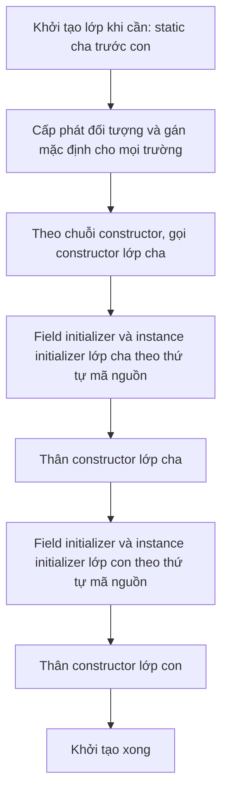

# Constructor, `this` và thứ tự khởi tạo đối tượng

Trong Java 27, lệnh `new` không chỉ cấp phát bộ nhớ mà còn bắt đầu một chuỗi khởi tạo: giá trị mặc định của trường, lời gọi constructor, các initializer của lớp cha và lớp con, rồi phần thân constructor. Nắm vững thứ tự này giúp xây dựng đối tượng có trạng thái hợp lệ, tránh lỗi `null` và hiểu tại sao một số phương thức có thể quan sát dữ liệu chưa khởi tạo.

Bài học thuộc chương **Lớp và đối tượng** trong **JAVA_VERSION_JAVA27 — Java 27 và các kiến thức liên quan**. Các ví dụ dùng những quy tắc đã chính thức trong Java 27, gồm **Flexible Constructor Bodies** (hoàn tất từ Java 25), không dùng API hay cú pháp legacy hoặc phụ thuộc preview.

Mục tiêu: viết và nạp chồng constructor; dùng `this` và `super` đúng vai trò; phân tích thứ tự chạy của `static`, field initializer, instance initializer và constructor; tổ chức kiểm tra đầu vào an toàn.

## 1. Constructor là gì?

**Constructor** là thành phần của lớp được thực hiện trong quá trình tạo một instance, thường nhằm thiết lập trạng thái ban đầu và bảo đảm các điều kiện hợp lệ của đối tượng.

```java
public class Product {
    private final String code;
    private final int quantity;

    public Product(String code, int quantity) {
        if (code == null || code.isBlank()) {
            throw new IllegalArgumentException("Mã sản phẩm không hợp lệ");
        }
        if (quantity < 0) {
            throw new IllegalArgumentException("Số lượng không được âm");
        }
        this.code = code.strip();
        this.quantity = quantity;
    }

    public String code() {
        return code;
    }

    public int quantity() {
        return quantity;
    }

    public static void main(String[] args) {
        Product p = new Product(" P-001 ", 5);
        System.out.println(p.code() + ": " + p.quantity());
    }
}
```

Lưu là `Product.java` và chạy `java Product.java` với JDK 27. Kết quả: `P-001: 5`.

| Đặc điểm | Constructor | Phương thức thường |
|---|---|---|
| Tên | Trùng chính xác tên lớp | Tên do người viết chọn |
| Kiểu trả về | Không khai báo, **kể cả `void`** | Có kiểu trả về hoặc `void` |
| Mục đích | Khởi tạo instance | Thực hiện hành vi |
| Nạp chồng | Có, theo danh sách tham số | Có |
| Kế thừa / override | Không kế thừa, không override | Có thể theo các quy tắc Java |
| Quyền truy cập | `public`, `protected`, package-private, `private` | Tùy khai báo |

`public void Product() { }` là **phương thức** mang tên `Product`, không phải constructor. Constructor không thể khai báo `static`.

## 2. Constructor mặc định, không tham số và nạp chồng

### 2.1. Khi nào Java tự sinh constructor?

Nếu một lớp thông thường **không khai báo constructor nào**, trình biên dịch cung cấp một *default constructor* không tham số. Quyền truy cập của constructor mặc định tương ứng với quyền truy cập lớp trong các trường hợp thông thường.

```java
class Settings {
    boolean enabled;
}

// Có thể dùng:
Settings s = new Settings();
System.out.println(s.enabled); // false
```

Khi đã khai báo bất kỳ constructor nào, Java **không sinh thêm** constructor mặc định:

```java
class Settings {
    final boolean enabled;

    Settings(boolean enabled) {
        this.enabled = enabled;
    }
}

// new Settings(); // Lỗi biên dịch.
```

**Default constructor** là constructor không tham số do trình biên dịch cung cấp; **no-arg constructor** chỉ mọi constructor không tham số, kể cả constructor do bạn tự viết. Trong lớp kế thừa, một lời gọi `super()` ngầm định chỉ hợp lệ nếu lớp cha có constructor không tham số có thể truy cập. Nếu lớp cha chỉ có constructor nhận tham số, lớp con phải chọn `super(args)` phù hợp.

### 2.2. Constructor overloading và constructor chaining

Nhiều constructor trong cùng lớp được phân biệt bởi số lượng, thứ tự hoặc kiểu tham số. Có thể dùng `this(...)` để một constructor ủy quyền cho constructor khác.

```java
public class ConnectionOptions {
    private final String host;
    private final int port;

    public ConnectionOptions(String host) {
        this(host, 443);
    }

    public ConnectionOptions(String host, int port) {
        if (host == null || host.isBlank()) {
            throw new IllegalArgumentException("Host phải có nội dung");
        }
        if (port < 1 || port > 65_535) {
            throw new IllegalArgumentException("Port ngoài phạm vi");
        }
        this.host = host.strip();
        this.port = port;
    }

    public String endpoint() {
        return host + ":" + port;
    }

    public static void main(String[] args) {
        System.out.println(new ConnectionOptions("example.com").endpoint());
        System.out.println(new ConnectionOptions("localhost", 8080).endpoint());
    }
}
```

Kết quả:

```text
example.com:443
localhost:8080
```

Việc đưa kiểm tra dữ liệu vào constructor chính giúp tránh lặp lại logic giữa các phiên bản constructor. Không thể overload chỉ bằng tên tham số hoặc quyền truy cập.

## 3. Phân biệt `this`, `this(...)`, `super(...)`

| Cú pháp | Ý nghĩa | Khi nào dùng |
|---|---|---|
| `this.field` | Truy cập trường của đối tượng hiện tại | Phân biệt trường với biến cục bộ/tham số cùng tên |
| `this.method()` | Gọi phương thức trên đối tượng hiện tại | Khi muốn thể hiện rõ receiver |
| `this(...)` | Gọi constructor khác của **cùng lớp** | Dùng chung một quy trình khởi tạo |
| `super(...)` | Gọi constructor của **lớp cha trực tiếp** | Chuyển tham số và khởi tạo phần trạng thái của lớp cha |
| `super.method()` | Gọi phiên bản phương thức của lớp cha theo quy tắc Java | Trong ngữ cảnh instance hợp lệ |

Ví dụ `this.field`:

```java
class Member {
    private final String name;

    Member(String name) {
        this.name = name; // Bên trái: trường; bên phải: tham số.
    }
}
```

`this` biểu thị đối tượng hiện tại trong ngữ cảnh instance hợp lệ. Không được dùng `this` trong phương thức `static`. Khi gọi `this(...)` hoặc `super(...)` trong constructor, đây là một **lời gọi constructor đặc biệt**, không phải cách gọi phương thức thông thường.

Mỗi constructor có **tối đa một** lời gọi constructor tường minh. Không thể đặt cả `this(...)` và `super(...)` trong cùng một thân constructor; cũng không được tạo chuỗi `this(...)` gọi vòng tròn (trực tiếp hay gián tiếp).

```java
class InvalidChain {
    // Ví dụ không hợp lệ:
    // InvalidChain() { this(1); }
    // InvalidChain(int number) { this(); }
}
```

## 4. Gọi constructor lớp cha với `super(...)`

Lớp con cần khởi tạo cả phần trạng thái do lớp cha quản lý. Chọn đúng constructor lớp cha:

```java
class Account {
    private final String id;

    Account(String id) {
        this.id = id;
    }

    String id() {
        return id;
    }
}

class PremiumAccount extends Account {
    private final int points;

    PremiumAccount(String id, int points) {
        super(id);
        if (points < 0) {
            throw new IllegalArgumentException("Điểm phải không âm");
        }
        this.points = points;
    }
}
```

Nếu bỏ `super(id)` và không gọi `this(...)`, Java sẽ tìm cách gọi `super()`. Lớp `Account` không có constructor không tham số, nên lớp con sẽ không biên dịch. Constructor không được kế thừa như phương thức; lớp con phải gọi constructor của lớp cha qua cơ chế khởi tạo.

## 5. Các lớp giá trị mặc định và thứ tự khởi tạo

Để hiểu thứ tự thực thi, cần phân biệt **class initialization** và **instance initialization**.

**Class initialization** chạy các field initializer `static` và khối `static { }` theo thứ tự xuất hiện trong lớp, khi lớp được JVM khởi tạo. Quá trình này diễn ra theo vòng đời lớp (và class loader), không lặp lại mỗi lần `new`; khi cần khởi tạo lớp con, lớp cha được khởi tạo trước theo quy tắc ngôn ngữ.

**Instance initialization** diễn ra khi tạo từng đối tượng. Trước khi các initializer hay constructor thực hiện việc gán, tất cả trường instance, kể cả trường khai báo trong các lớp cha, đã nhận **giá trị mặc định**.

| Loại trường | Giá trị mặc định |
|---|---|
| `byte`, `short`, `int`, `long` | `0` (theo kiểu tương ứng) |
| `float`, `double` | `0.0` (theo kiểu tương ứng) |
| `char` | Ký tự NUL (mã Unicode U+0000) |
| `boolean` | `false` |
| Tham chiếu, ví dụ `String` hay `List` | `null` |

Biến **cục bộ** không tự động có các giá trị mặc định này; Java yêu cầu biến cục bộ phải được gán chắc chắn trước khi đọc.

### 5.1. Quy trình thường gặp khi `new Child()`

Với các constructor không có lệnh trước lời gọi `super(...)`/`this(...)`, thứ tự có thể hình dung như sau:



Trong mỗi lớp, initializer của trường và khối instance **xen kẽ theo đúng thứ tự xuất hiện**, không phải mọi trường đều được gán xong rồi mới chạy các khối initializer. Nếu có nhiều cấp kế thừa, việc khởi tạo instance đi từ lớp tổ tiên tới lớp con cụ thể. Trường hợp constructor có **prologue** trước `super(...)`/`this(...)` được trình bày ở mục 7; một phần lệnh có thể chạy sớm hơn sơ đồ cơ bản.

## 6. Ví dụ quan sát thứ tự thực thi

Lưu toàn bộ ví dụ trong `InitializationTimeline.java`:

```java
public class InitializationTimeline {
    static int log(String event) {
        System.out.println(event);
        return 1;
    }

    static class Parent {
        static int parentStatic = log("P-static");
        int parentField = log("P-field");

        {
            log("P-instance-block");
        }

        Parent() {
            log("P-constructor");
        }
    }

    static class Child extends Parent {
        static int childStatic = log("C-static");
        int firstField = log("C-field-1");

        {
            log("C-instance-block");
        }

        int secondField = log("C-field-2");

        Child() {
            log("C-constructor");
        }
    }

    public static void main(String[] args) {
        System.out.println("Lần thứ nhất:");
        new Child();
        System.out.println("Lần thứ hai:");
        new Child();
    }
}
```

Chạy: `java InitializationTimeline.java`.

```text
Lần thứ nhất:
P-static
C-static
P-field
P-instance-block
P-constructor
C-field-1
C-instance-block
C-field-2
C-constructor
Lần thứ hai:
P-field
P-instance-block
P-constructor
C-field-1
C-instance-block
C-field-2
C-constructor
```

Các dòng `P-static` và `C-static` chỉ xuất hiện một lần do hai lớp được khởi tạo trước lần tạo đối tượng đầu tiên. Lần `new` thứ hai vẫn chạy toàn bộ **instance initializer** và thân constructor, nhưng không lặp lại class initialization.

## 7. Flexible Constructor Bodies: điểm cần biết trong Java 27

**Flexible Constructor Bodies** (JEP 513) đã trở thành tính năng chính thức trong Java 25 và tiếp tục được hỗ trợ trong Java 27. Vì vậy, quan niệm cũ rằng `super(...)` hoặc `this(...)` **luôn phải là lệnh đầu tiên** không còn đúng.

Một constructor được phép chứa các câu lệnh trước lời gọi constructor tường minh. Phần trước đó gọi là **prologue**, phần sau là **epilogue**. Điều này hữu ích để xác thực, chuyển đổi hoặc chuẩn hóa tham số **trước** khi gửi tới constructor lớp cha.

```java
public class FlexibleConstructorDemo {
    static class Parent {
        Parent(String label) {
            System.out.println("Parent: " + label);
        }
    }

    static class Child extends Parent {
        Child(String rawLabel) {
            if (rawLabel == null || rawLabel.isBlank()) {
                throw new IllegalArgumentException("Nhãn không hợp lệ");
            }
            String normalized = rawLabel.strip();
            super(normalized);
            System.out.println("Child đã sẵn sàng");
        }
    }

    public static void main(String[] args) {
        new Child("  hello  ");
    }
}
```

Kết quả:

```text
Parent: hello
Child đã sẵn sàng
```

Ví dụ này hợp lệ trong Java 27 và **không cần** `--enable-preview`. Nếu tham số không hợp lệ, chương trình ném ngoại lệ ngay tại prologue, trước khi gọi `Parent(...)`.

### 7.1. Giới hạn của early construction context

Trong *early construction context* (prologue và biểu thức đối số của `super(...)`/`this(...)`), không được dùng đối tượng hiện tại như một instance đã sẵn sàng: đặc biệt không được **đọc trường instance**, gọi phương thức instance hoặc sử dụng `this`, `super` theo các cách bị hạn chế.

```java
class EarlyUse {
    private String label = "default";

    EarlyUse(String input) {
        // Các cách đọc đối tượng sau đây không hợp lệ nếu đặt trước super():
        // System.out.println(this.label);
        // System.out.println(label);
        // this.toString();
        super();
        this.label = input;
    }
}
```

Có thể dùng tham số, biến cục bộ và các phép tính độc lập với instance ở prologue. Một điểm tinh tế của Java 27: trong một số trường hợp, **gán trực tiếp** vào trường của chính lớp đang tạo trước `super(...)` được cho phép, dù đọc trường đó vẫn bị hạn chế. Field initializer chạy sau lời gọi constructor lớp cha có thể **ghi đè** phép gán sớm. Vì vậy, nên dùng cách viết này có chủ đích, kiểm tra đầy đủ; với chương trình thông thường, xác thực tham số trước `super(...)` thường dễ hiểu hơn.

Prologue cũng có thể đứng trước `this(...)`. Dù vậy, không được tạo chuỗi constructor gọi vòng và mỗi thân constructor vẫn chỉ có tối đa **một** constructor invocation tường minh.

## 8. `this(...)` không khởi tạo lại các trường instance

Để kiểm tra thứ tự khi constructor ủy quyền cho nhau:

```java
public class DelegationOrder {
    private int number = show("Field initializer");

    {
        show("Instance block");
    }

    DelegationOrder() {
        this(10);
        show("No-arg constructor body");
    }

    DelegationOrder(int number) {
        this.number = number;
        show("Int constructor body");
    }

    private static int show(String message) {
        System.out.println(message);
        return 0;
    }

    public static void main(String[] args) {
        new DelegationOrder();
    }
}
```

Kết quả khi chạy `java DelegationOrder.java`:

```text
Field initializer
Instance block
Int constructor body
No-arg constructor body
```

Constructor không tham số ủy quyền cho constructor nhận `int`. Field initializer và instance initializer của `DelegationOrder` chạy **một lần**; sau khi constructor nhận `int` kết thúc, phần thân còn lại của constructor không tham số mới thực hiện.

Nếu prologue, lời gọi constructor lớp cha, initializer hay thân constructor ném ngoại lệ, biểu thức `new` không trả về đối tượng khởi tạo hoàn chỉnh cho bên gọi.

## 9. Rủi ro khi constructor gọi phương thức có thể override

**Dynamic dispatch** trong Java vẫn hoạt động ngay khi đối tượng đang được tạo. Constructor lớp cha gọi phương thức có thể bị lớp con override sẽ thực thi phiên bản của lớp con **trước khi** lớp con hoàn thành initializer:

```java
public class OverrideDuringConstruction {
    static class Base {
        Base() {
            show();
        }

        void show() {
            System.out.println("Base");
        }
    }

    static class Derived extends Base {
        private String label = "Sẵn sàng";

        @Override
        void show() {
            System.out.println(label);
        }
    }

    public static void main(String[] args) {
        new Derived();
    }
}
```

Kết quả:

```text
null
```

`Base()` gọi `show()` nhưng Java điều phối tới `Derived.show()`. Khi đó `Derived.label` mới có giá trị mặc định `null`; field initializer `"Sẵn sàng"` chưa thực hiện.

Để tránh lỗi, không nên gọi phương thức có thể override từ constructor hoặc instance initializer. Không công bố `this` quá sớm ra listener, biến dùng chung hay tác vụ đồng thời có thể truy cập đối tượng đang xây dựng. Có thể dùng phương thức `private` hoặc helper `static` cho các bước khởi tạo độc lập với dynamic dispatch.

## 10. Constructor, `final` và `record` trong Java hiện đại

Với trường instance `final` chưa được khởi tạo khi khai báo (*blank final*), compiler yêu cầu giá trị được gán đúng theo quy tắc **definite assignment** trên các đường đi kết thúc constructor bình thường. Constructor là nơi tốt để kiểm tra bất biến:

```java
final class EmailAddress {
    private final String value;

    EmailAddress(String value) {
        if (value == null || value.isBlank() || !value.contains("@")) {
            throw new IllegalArgumentException("Email không hợp lệ");
        }
        this.value = value.strip();
    }
}
```

Từ khóa `final` ngăn gán lại **tham chiếu của trường**, không tự làm cho đối tượng được tham chiếu trở nên bất biến. Nếu lưu danh sách hay cấu trúc có thể sửa, cân nhắc sao chép phòng vệ.

Nếu chỉ cần mô tả một nhóm giá trị, `record` là cấu trúc ổn định và hỗ trợ **compact canonical constructor**:

```java
record Money(String currency, long minorUnits) {
    Money {
        if (currency == null || currency.isBlank()) {
            throw new IllegalArgumentException("Thiếu loại tiền");
        }
        currency = currency.strip().toUpperCase(java.util.Locale.ROOT);
        if (minorUnits < 0) {
            throw new IllegalArgumentException("Số tiền không được âm");
        }
    }
}
```

Trong compact constructor, `currency` và `minorUnits` là các **tham số ngầm định**. Sau khi thân constructor hoàn thành bình thường, compiler tự gán chúng vào các component field tương ứng. Không trực tiếp gán `this.currency` trong thân compact constructor. Record không tùy ý kế thừa từ lớp thường; canonical constructor không gọi `super(...)` tường minh, còn constructor phụ phải ủy quyền tới canonical constructor qua `this(...)` theo quy tắc record.

## 11. Các lỗi phổ biến

| Hiện tượng | Nguyên nhân | Cách giải quyết |
|---|---|---|
| `new Type()` không biên dịch | Lớp đã khai báo constructor có tham số, không có no-arg constructor | Khai báo no-arg constructor hoặc truyền đúng tham số |
| Constructor lớp con không biên dịch | `super()` ngầm định không có đích hợp lệ | Dùng `super(args)` phù hợp |
| Constructor gọi vòng | Chuỗi `this(...)` quay lại chính nó | Chọn một constructor chính và ủy quyền một chiều |
| Field initializer “bị mất giá trị” | Constructor ghi đè hoặc gán sớm bị initializer ghi đè | Theo dõi thứ tự gán, tập trung trách nhiệm thiết lập trường |
| Phương thức override thấy `null` / `0` | Phương thức chạy trước khi lớp con hoàn tất khởi tạo | Tránh gọi phương thức có thể override từ constructor |
| Lỗi dùng `this` trước `super(...)` | Truy cập instance sai trong early construction context | Chỉ xử lý các dữ liệu được phép, như tham số và biến cục bộ |
| `static` chạy một lần, khác kỳ vọng | Nhầm class initialization với mỗi lần tạo đối tượng | Phân biệt vòng đời lớp với vòng đời instance |
| Đối tượng bị dùng khi chưa đủ trạng thái | `this` thoát ra ngoài constructor quá sớm | Chỉ chia sẻ đối tượng sau khi khởi tạo hoàn tất |

### Tự kiểm tra thứ tự thực thi

```java
class Sample {
    int value = 4;

    Sample() {
        this(3);
        value += 2;
    }

    Sample(int value) {
        this.value = value;
    }
}

// System.out.println(new Sample().value);
```

Kết quả là **`5`**. Giá trị mặc định ban đầu là `0`; field initializer gán `4` một lần; constructor nhận `int` gán `3`; phần thân còn lại của constructor không tham số cộng `2`, thu được `5`.

## 12. Tài liệu tham khảo chính thức

- [Java SE 27 — JLS §8.8: Constructor Declarations](https://docs.oracle.com/en/java/javase/27/docs/specs/jls/jls-8.html#jls-8.8): khai báo, nạp chồng, `this(...)`, `super(...)` và constructor mặc định.
- [Java SE 27 — JLS §12.5: Creation of New Class Instances](https://docs.oracle.com/en/java/javase/27/docs/specs/jls/jls-12.html#jls-12.5): cấp phát, giá trị mặc định, prologue và thứ tự khởi tạo.
- [Java SE 27 — JLS §12.4: Initialization of Classes and Interfaces](https://docs.oracle.com/en/java/javase/27/docs/specs/jls/jls-12.html#jls-12.4): khởi tạo lớp, trường và khối `static`.
- [Java SE 27 — Flexible Constructor Bodies](https://docs.oracle.com/en/java/javase/27/language/flexible-constructor-bodies.html): cú pháp hợp lệ và giới hạn của early construction context.
- [Java SE 27 — JLS §8.10.4: Record Constructor Declarations](https://docs.oracle.com/en/java/javase/27/docs/specs/jls/jls-8.html#jls-8.10.4): canonical và compact constructor của record.
