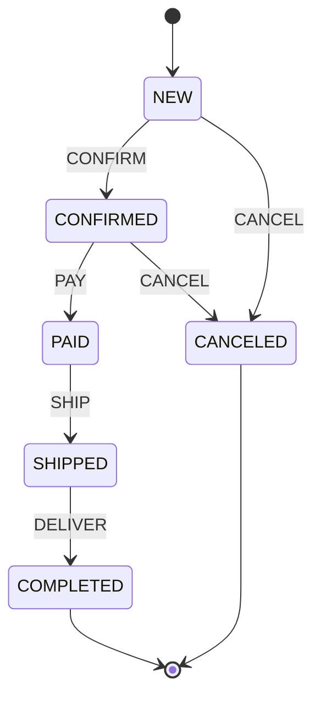

# Enum với dữ liệu, hành vi và mô hình trạng thái hữu hạn trong Java 27

Trong Java, `enum` định nghĩa một kiểu có **tập giá trị hữu hạn, được đặt tên và biết trước khi biên dịch**. Mỗi giá trị là một đối tượng duy nhất thuộc kiểu enum tương ứng. Ngoài việc đặt tên các trạng thái hoặc lựa chọn, enum còn có thể mang dữ liệu, khai báo phương thức và tổ chức quy tắc chuyển trạng thái.

Bài này thuộc chương **Lớp và đối tượng** của Java 27. Nội dung sử dụng các khả năng được hỗ trợ chính thức trong Java hiện hành, gồm enum, `switch` expression, `EnumSet` và `EnumMap`; không cần bật preview.

## 1. Khi nào nên dùng enum?

Giả sử ứng dụng quản lý đơn hàng chỉ nhận các trạng thái:

- `NEW`: mới tạo;
- `CONFIRMED`: đã xác nhận;
- `PAID`: đã thanh toán;
- `SHIPPED`: đã gửi hàng;
- `COMPLETED`: hoàn tất;
- `CANCELED`: đã hủy.

Nếu dùng `String` cho mọi trạng thái, lập trình viên có thể truyền nhầm `"PAYED"`, `"paid"` hoặc một chuỗi không được định nghĩa. Với enum:

```java
enum OrderState {
    NEW,
    CONFIRMED,
    PAID,
    SHIPPED,
    COMPLETED,
    CANCELED
}

OrderState current = OrderState.NEW;

if (current == OrderState.NEW) {
    System.out.println("Đơn hàng mới được tạo");
}
```

Compiler nhận biết kiểu `OrderState`, IDE có thể gợi ý các giá trị hợp lệ, và việc gọi một phương thức nhận `OrderState` sẽ được kiểm tra kiểu tại thời điểm biên dịch.

Enum đặc biệt phù hợp với tập khái niệm đóng, chẳng hạn ngày trong tuần, quyền trong một ứng dụng, loại thao tác, kết quả xử lý hoặc trạng thái của một quy trình. Nó kém phù hợp nếu tập giá trị được thêm liên tục từ cấu hình hoặc cơ sở dữ liệu mà không triển khai lại chương trình.

## 2. Enum là một kiểu class đặc biệt

Cú pháp cơ bản:

```java
public enum Priority {
    LOW,
    MEDIUM,
    HIGH
}
```

Các hằng enum được ngăn cách bằng dấu phẩy. Dấu chấm phẩy sau hằng cuối có thể bỏ qua khi enum không khai báo thành viên nào khác. Khi muốn khai báo field, constructor hoặc method bên dưới danh sách hằng, cần đặt dấu `;` trước các khai báo thành viên.

```java
enum Priority {
    LOW,
    MEDIUM,
    HIGH;

    public boolean isUrgent() {
        return this == HIGH;
    }
}
```

Một số đặc điểm quan trọng:

| Đặc điểm | Ý nghĩa |
|---|---|
| Mỗi hằng là một instance | `Priority.HIGH` là một đối tượng duy nhất của enum |
| Tập instance đóng | Không thể tự tạo thêm giá trị bằng `new Priority(...)` |
| Lớp cha trực tiếp | Mỗi enum `E` kế thừa ngầm từ `java.lang.Enum<E>` |
| Kế thừa | Không khai báo `extends` một class khác; enum có thể `implements` interface |
| Hành vi | Có thể có field, constructor, method, initializer và hành vi riêng theo từng hằng |
| So sánh | Có thể dùng `==` và `!=` để so sánh các hằng enum |
| Class lồng | Member enum và local enum được coi là static theo quy tắc ngôn ngữ |

Enum không được khai báo tường minh là `final`, `abstract`, `sealed` hoặc `non-sealed`. Theo JLS Java 27, enum không có constant-specific class body là **ngầm định final**; enum có ít nhất một hằng chứa class body là **ngầm định sealed**, với các lớp con được phép là các lớp vô danh gắn với các hằng đó. Trong cả hai trường hợp, mã nguồn bên ngoài không thể mở rộng tập hằng của enum.

### 2.1. So sánh hằng enum

```java
Priority priority = Priority.HIGH;

System.out.println(priority == Priority.HIGH);    // true
System.out.println(priority.equals(Priority.HIGH)); // true
```

`==` phù hợp với enum vì không thể có hai instance khác nhau đại diện cho cùng một hằng. Khi giá trị có thể là `null`, cách viết `Priority.HIGH == priority` cũng an toàn, trong khi `priority.equals(...)` có thể ném `NullPointerException`.

## 3. Enum mang dữ liệu bằng field và constructor

Enum không chỉ là danh sách tên. Mỗi hằng có thể truyền đối số cho constructor để khởi tạo dữ liệu riêng.

```java
public enum Priority {
    LOW("Thấp", 3),
    MEDIUM("Trung bình", 2),
    HIGH("Cao", 1);

    private final String label;
    private final int sortOrder;

    Priority(String label, int sortOrder) {
        this.label = label;
        this.sortOrder = sortOrder;
    }

    public String label() {
        return label;
    }

    public int sortOrder() {
        return sortOrder;
    }
}
```

Sử dụng:

```java
Priority priority = Priority.HIGH;

System.out.println(priority.label());      // Cao
System.out.println(priority.sortOrder());  // 1
```

Tại thời điểm khởi tạo class enum, Java tạo các hằng theo thứ tự khai báo. Mỗi hằng truyền các đối số cho constructor phù hợp. Một hằng enum chỉ được khởi tạo một lần trong vòng đời class tương ứng.

### 3.1. Vì sao constructor của enum không public?

Constructor của enum không được khai báo `public` hoặc `protected`. Nếu không ghi modifier truy cập, constructor của enum được hiểu là `private`; có thể ghi `private` tường minh để làm rõ ý đồ.

```java
enum TaxRate {
    STANDARD(0.10),
    REDUCED(0.05);

    private final double rate;

    private TaxRate(double rate) {
        this.rate = rate;
    }

    public double rate() {
        return rate;
    }
}
```

Việc không tạo được enum bằng `new` giữ cho tập instance luôn đúng với danh sách hằng đã khai báo.

### 3.2. Ưu tiên dữ liệu bất biến

Thông thường nên khai báo các field chứa thuộc tính của hằng enum là `private final`. Các đối tượng enum được chia sẻ rộng rãi, nên field có thể thay đổi sẽ gây khó hiểu và dễ phát sinh vấn đề đồng thời.

**Tránh thiết kế như sau:**

```java
enum BadStatus {
    PAID;

    int currentOrderAmount; // không nên chứa dữ liệu riêng của từng đơn hàng
}
```

`BadStatus.PAID` là một đối tượng dùng chung cho mọi đơn hàng; field `currentOrderAmount` của nó sẽ bị chia sẻ giữa các đơn hàng. Dữ liệu của **từng đơn hàng** phải nằm trong đối tượng đơn hàng. Enum chỉ nên chứa dữ liệu **gắn với bản thân loại trạng thái**, ví dụ mã, nhãn hoặc quy tắc chung.

### 3.3. Lưu ý khi khởi tạo

Không thiết kế constructor hoặc initializer instance của enum phụ thuộc vào field static chưa được khởi tạo của cùng enum. Java có những hạn chế về tham chiếu đến static field trong quá trình khởi tạo enum nhằm ngăn chu trình khởi tạo.

Các field cố định đơn giản truyền qua constructor như `label` và `sortOrder` là cách thiết kế dễ hiểu. Bảng tra cứu static phức tạp nên được tạo sau khi các hằng enum đã sẵn sàng, trong static initializer phù hợp hoặc ở một class riêng.

## 4. Phương thức và hành vi chung của enum

Enum có thể khai báo method giống class thông thường. Một method có thể đọc field của hằng, tính toán dựa trên hằng hiện tại hoặc trả về một kết quả khác.

Ví dụ, phân nhóm quyền người dùng:

```java
enum Role {
    VIEWER,
    EDITOR,
    ADMIN;

    public boolean canEdit() {
        return this == EDITOR || this == ADMIN;
    }

    public boolean canManageUsers() {
        return this == ADMIN;
    }
}
```

Sử dụng:

```java
Role role = Role.EDITOR;

System.out.println(role.canEdit());        // true
System.out.println(role.canManageUsers()); // false
```

Cách này giữ quy tắc đơn giản nằm gần kiểu dữ liệu mà nó mô tả. Tuy nhiên, những quy tắc phụ thuộc vào database, cấu hình hoặc thông tin của từng người dùng nên được đặt ở service hay đối tượng miền nghiệp vụ phù hợp, để enum không trở thành một class chứa mọi logic ứng dụng.

### 4.1. Enum triển khai interface

Một enum có thể implements interface để tham gia API chung:

```java
interface Labeled {
    String label();
}

enum PaymentMethod implements Labeled {
    CARD("Thẻ"),
    BANK_TRANSFER("Chuyển khoản"),
    CASH("Tiền mặt");

    private final String label;

    PaymentMethod(String label) {
        this.label = label;
    }

    @Override
    public String label() {
        return label;
    }
}
```

Điều này hữu ích khi nhiều enum khác nhau cần hỗ trợ cùng một hành vi, ví dụ `label()`, `code()` hoặc `description()`.

## 5. Hành vi riêng cho từng hằng

Mỗi hằng enum có thể khai báo một *constant-specific class body*, trong đó override method được khai báo trong enum. Đây là một cách triển khai đa hình, giúp tránh chuỗi `if` hoặc `switch` dài khi mỗi hằng có thuật toán riêng.

```java
enum Operation {
    ADD {
        @Override
        double apply(double left, double right) {
            return left + right;
        }
    },
    SUBTRACT {
        @Override
        double apply(double left, double right) {
            return left - right;
        }
    },
    MULTIPLY {
        @Override
        double apply(double left, double right) {
            return left * right;
        }
    },
    DIVIDE {
        @Override
        double apply(double left, double right) {
            if (right == 0.0) {
                throw new IllegalArgumentException("Mẫu số phải khác 0");
            }
            return left / right;
        }
    };

    abstract double apply(double left, double right);
}
```

Sử dụng:

```java
double result = Operation.MULTIPLY.apply(6, 7);
System.out.println(result); // 42.0
```

Vì enum khai báo `abstract double apply(...)`, **mọi hằng** phải có class body với phần triển khai cụ thể của phương thức này. Nếu quên triển khai ở một hằng, compiler báo lỗi.

Constant-specific class body không thể khai báo constructor riêng. Nó là lớp vô danh đặc biệt được Java tạo để triển khai hành vi của hằng. Method mới chỉ khai báo trong class body của một hằng không trở thành method có thể gọi qua kiểu enum chung; hãy khai báo method tại enum và override nếu muốn dùng từ bên ngoài.

**Chọn cách triển khai:**

- Một vài quy tắc chung hoặc lựa chọn đơn giản: dùng method với `switch` expression.
- Mỗi hằng có thuật toán riêng tương đối độc lập: cân nhắc constant-specific method.
- Quy tắc nghiệp vụ lớn, thường xuyên thay đổi hoặc cần nhiều dependency: cân nhắc tách logic vào class/service riêng.

## 6. Các phương thức có sẵn của enum

Với enum `Priority`, Java tạo ngầm các phương thức `Priority.values()` và `Priority.valueOf(String)`. Ngoài ra, các hằng còn kế thừa những method từ `java.lang.Enum`.

| Phương thức | Công dụng | Lưu ý |
|---|---|---|
| `Priority.values()` | Nhận mảng chứa mọi hằng theo thứ tự khai báo | Mỗi lời gọi trả về một mảng mới |
| `Priority.valueOf("HIGH")` | Tìm hằng bằng **tên khai báo chính xác** | Phân biệt chữ hoa/thường; không thấy tên thì ném `IllegalArgumentException` |
| `name()` | Lấy tên hằng đúng như trong mã nguồn | Không phải nhãn hiển thị cho người dùng |
| `ordinal()` | Vị trí hằng tính từ 0 | Không phù hợp làm ID ổn định trong dữ liệu lưu trữ |
| `toString()` | Chuỗi mô tả hằng | Có thể override; mặc định thường tương ứng `name()` |
| `getDeclaringClass()` | Lấy class khai báo kiểu enum | Hữu ích khi hằng có constant-specific class body |

Ví dụ:

```java
for (Priority priority : Priority.values()) {
    System.out.printf("%s: %s%n", priority.name(), priority.label());
}

Priority parsed = Priority.valueOf("MEDIUM");
System.out.println(parsed == Priority.MEDIUM); // true
```

Lời gọi `Priority.valueOf("medium")` sẽ ném `IllegalArgumentException`; `valueOf(null)` ném `NullPointerException`. Nếu đầu vào đến từ người dùng hoặc API bên ngoài, hãy xử lý dữ liệu không hợp lệ một cách có chủ đích.

### 6.1. Phân biệt tên kỹ thuật và mã dữ liệu bền vững

`name()` gắn trực tiếp với tên hằng trong mã nguồn. Nếu dùng tên đó làm giá trị lưu vào database hoặc hợp đồng API, việc đổi tên hằng có thể làm hỏng dữ liệu đã lưu.

Có thể khai báo mã ổn định riêng:

```java
enum ShippingSpeed {
    STANDARD("standard", "Tiêu chuẩn"),
    EXPRESS("express", "Hỏa tốc");

    private final String code;
    private final String label;

    ShippingSpeed(String code, String label) {
        this.code = code;
        this.label = label;
    }

    public String code() {
        return code;
    }

    public String label() {
        return label;
    }

    public static java.util.Optional<ShippingSpeed> fromCode(String input) {
        if (input == null) {
            return java.util.Optional.empty();
        }

        for (ShippingSpeed value : values()) {
            if (value.code.equalsIgnoreCase(input.strip())) {
                return java.util.Optional.of(value);
            }
        }
        return java.util.Optional.empty();
    }
}
```

Đối với API công khai, mã như `"standard"` và `"express"` là một phần của hợp đồng dữ liệu; nếu thay đổi, cần có kế hoạch tương thích và di chuyển dữ liệu.

**Không dùng `ordinal()` để tạo mã nghiệp vụ hoặc ID trong cơ sở dữ liệu.** Chèn hoặc sắp xếp lại các hằng có thể làm thay đổi ordinal.

## 7. Kết hợp enum với switch expression

Một lợi ích của enum là `switch` có thể liệt kê đầy đủ các trường hợp. Từ Java 14, `switch` expression là tính năng chính thức, và được hỗ trợ bình thường trong Java 27.

```java
enum TrafficLight {
    RED, YELLOW, GREEN
}

String instruction(TrafficLight light) {
    return switch (light) {
        case RED -> "Dừng lại";
        case YELLOW -> "Chuẩn bị dừng";
        case GREEN -> "Được đi";
    };
}
```

Vì mỗi hằng của `TrafficLight` đã có nhánh tương ứng, `switch` expression ở đây có tính **exhaustive** (bao phủ tất cả giá trị enum). Không cần `default` chỉ để làm cho ví dụ này biên dịch được.

Khi thêm một hằng mới, ví dụ `FLASHING_YELLOW`, mà chưa thêm nhánh xử lý, việc biên dịch lại mã nguồn sẽ giúp phát hiện trường hợp chưa được xử lý. Đây là lý do thường nên liệt kê rõ các trạng thái thay vì đặt `default` bao quát mọi giá trị.

Đối với `null`, một `switch` dạng trên thông thường ném `NullPointerException`. Hãy kiểm tra `null` trước khi chuyển trạng thái, hoặc sử dụng `case null` khi thực sự muốn xử lý nhánh này.

Nếu một nhánh cần nhiều câu lệnh, dùng block và `yield` để trả kết quả của nhánh:

```java
String text = switch (TrafficLight.GREEN) {
    case RED -> "Stop";
    case YELLOW -> "Wait";
    case GREEN -> {
        String message = "Go";
        yield message;
    }
};
```

## 8. EnumSet và EnumMap cho tập trạng thái hữu hạn

Java Collections Framework có hai cấu trúc dữ liệu chuyên dụng cho enum. Chúng giúp mô tả quyền, tập sự kiện và bảng quy tắc hiệu quả, rõ kiểu dữ liệu.

### 8.1. EnumSet: tập hợp các hằng enum

`EnumSet<E>` là `Set` chuyên biệt cho một kiểu enum. Nó thường được lưu trữ bằng các bit, phù hợp với tập quyền hoặc tập thao tác hợp lệ.

```java
import java.util.EnumSet;

enum Permission {
    READ, WRITE, DELETE, APPROVE
}

class PermissionDemo {
    public static void main(String[] args) {
        EnumSet<Permission> editor =
                EnumSet.of(Permission.READ, Permission.WRITE);

        editor.add(Permission.APPROVE);

        System.out.println(editor.contains(Permission.DELETE));  // false
        System.out.println(editor.contains(Permission.APPROVE)); // true
    }
}
```

Các factory method thường dùng:

| Method | Ý nghĩa |
|---|---|
| `EnumSet.noneOf(Permission.class)` | Tạo tập rỗng, biết trước kiểu enum |
| `EnumSet.allOf(Permission.class)` | Tạo tập có mọi hằng |
| `EnumSet.of(READ, WRITE)` | Tạo tập từ các hằng cụ thể |
| `EnumSet.range(READ, DELETE)` | Tạo tập theo dải thứ tự khai báo, bao gồm hai đầu |
| `EnumSet.copyOf(existing)` | Sao chép một tập enum đã có |

`EnumSet` là **mutable**, không nhận phần tử `null`, và không tự đồng bộ khi nhiều thread truy cập và có thread thay đổi tập. Nếu trả về một tập nội bộ cho mã bên ngoài, hãy cân nhắc tạo bản sao hoặc trả về một `Set` bất biến.

### 8.2. EnumMap: bảng tra cứu theo khóa enum

`EnumMap<K, V>` chuyên dùng enum làm khóa. Các khóa thuộc một kiểu enum xác định, được duyệt theo thứ tự khai báo; cấu trúc này thích hợp với ánh xạ từ trạng thái sang thông tin cấu hình hoặc tập sự kiện cho phép.

```java
import java.util.EnumMap;
import java.util.EnumSet;

enum State {
    NEW, PROCESSING, DONE
}

enum Action {
    START, FINISH, CANCEL
}

class ActionTableDemo {
    public static void main(String[] args) {
        EnumMap<State, EnumSet<Action>> allowed =
                new EnumMap<>(State.class);

        allowed.put(State.NEW, EnumSet.of(Action.START, Action.CANCEL));
        allowed.put(State.PROCESSING, EnumSet.of(Action.FINISH, Action.CANCEL));
        allowed.put(State.DONE, EnumSet.noneOf(Action.class));

        boolean canStart = allowed.get(State.NEW).contains(Action.START);
        System.out.println(canStart); // true
    }
}
```

`EnumMap` không nhận khóa `null`, nhưng có thể nhận giá trị `null`. Bản thân nó cũng là mutable và không tự đồng bộ. Đặc biệt, `Map.copyOf(allowed)` chỉ tạo một map không cho sửa cấu trúc; các `EnumSet` chứa bên trong vẫn có thể bị sửa nếu còn tham chiếu. Muốn bảng quy tắc thực sự bất biến, cần xử lý cả các giá trị tập hợp lồng trong map.

## 9. Mô hình trạng thái hữu hạn là gì?

*Mô hình trạng thái hữu hạn* (finite-state machine, FSM) mô tả một thực thể có:

1. Một tập trạng thái hữu hạn.
2. Một tập sự kiện (event) hoặc tín hiệu đầu vào.
3. Một quy tắc chuyển từ trạng thái hiện tại sang trạng thái kế tiếp.
4. Một trạng thái ban đầu và, nếu cần, các trạng thái kết thúc.
5. Những điều kiện (guard) và tác dụng phụ (action) gắn với nghiệp vụ.

Ta có thể diễn đạt quy tắc chuyển trạng thái dưới dạng:

```text
nextState = transition(currentState, event)
```

Trong ứng dụng quản lý đơn hàng, enum dùng để định nghĩa **các trạng thái và sự kiện có thể xảy ra**; trạng thái hiện tại của **mỗi đơn hàng** nằm trong đối tượng đơn hàng tương ứng.

### 9.1. Đặt quy tắc chuyển trạng thái

Xét luồng đơn hàng sau:



Các trạng thái `COMPLETED` và `CANCELED` là trạng thái kết thúc trong mô hình ví dụ. Quy tắc nghiệp vụ có thể khác ở hệ thống thực tế: nhiều nền tảng còn cho phép hoàn tiền, hủy sau thanh toán hoặc trả hàng; khi đó cần bổ sung trạng thái và sự kiện tương ứng.

Bảng chuyển trạng thái:

| Trạng thái hiện tại | Sự kiện | Trạng thái kế tiếp |
|---|---|---|
| `NEW` | `CONFIRM` | `CONFIRMED` |
| `NEW` | `CANCEL` | `CANCELED` |
| `CONFIRMED` | `PAY` | `PAID` |
| `CONFIRMED` | `CANCEL` | `CANCELED` |
| `PAID` | `SHIP` | `SHIPPED` |
| `SHIPPED` | `DELIVER` | `COMPLETED` |

Mọi cặp trạng thái/sự kiện không xuất hiện trong bảng đều không hợp lệ trong mô hình này.

### 9.2. Ví dụ hoàn chỉnh chạy được trên Java 27

Lưu nội dung dưới đây vào file `OrderFlowDemo.java`. Ví dụ sử dụng hai enum, một class chứa trạng thái hiện tại và một method kiểm soát mọi lần chuyển trạng thái.

```java
import java.util.Objects;

enum OrderEvent {
    CONFIRM,
    PAY,
    SHIP,
    DELIVER,
    CANCEL
}

enum OrderState {
    NEW,
    CONFIRMED,
    PAID,
    SHIPPED,
    COMPLETED,
    CANCELED;

    public boolean isTerminal() {
        return this == COMPLETED || this == CANCELED;
    }

    public OrderState transition(OrderEvent event) {
        Objects.requireNonNull(event, "event");

        return switch (this) {
            case NEW -> switch (event) {
                case CONFIRM -> CONFIRMED;
                case CANCEL -> CANCELED;
                default -> throw invalidTransition(event);
            };
            case CONFIRMED -> switch (event) {
                case PAY -> PAID;
                case CANCEL -> CANCELED;
                default -> throw invalidTransition(event);
            };
            case PAID -> switch (event) {
                case SHIP -> SHIPPED;
                default -> throw invalidTransition(event);
            };
            case SHIPPED -> switch (event) {
                case DELIVER -> COMPLETED;
                default -> throw invalidTransition(event);
            };
            case COMPLETED, CANCELED ->
                    throw invalidTransition(event);
        };
    }

    private IllegalStateException invalidTransition(OrderEvent event) {
        return new IllegalStateException(
                "Không thể thực hiện " + event + " khi trạng thái là " + this
        );
    }
}

public class OrderFlowDemo {
    private OrderState state = OrderState.NEW;

    public OrderState state() {
        return state;
    }

    public void dispatch(OrderEvent event) {
        // Chỉ cập nhật sau khi tính được trạng thái hợp lệ.
        state = state.transition(event);
    }

    public static void main(String[] args) {
        OrderFlowDemo order = new OrderFlowDemo();

        System.out.println(order.state());
        order.dispatch(OrderEvent.CONFIRM);
        System.out.println(order.state());
        order.dispatch(OrderEvent.PAY);
        System.out.println(order.state());
        order.dispatch(OrderEvent.SHIP);
        System.out.println(order.state());
        order.dispatch(OrderEvent.DELIVER);
        System.out.println(order.state());
        System.out.println(order.state().isTerminal());
    }
}
```

Biên dịch và chạy:

```bash
javac OrderFlowDemo.java
java OrderFlowDemo
```

Kết quả:

```text
NEW
CONFIRMED
PAID
SHIPPED
COMPLETED
true
```

Nếu gọi `order.dispatch(OrderEvent.PAY)` khi trạng thái vẫn là `NEW`, method `transition` ném `IllegalStateException` và field `state` không được gán sang trạng thái mới.

**Vì sao thiết kế này hữu ích?**

- Enum `OrderState` chứa một tập trạng thái đóng và quy tắc chuyển cơ bản.
- Enum `OrderEvent` định nghĩa những loại sự kiện hợp lệ về mặt kiểu.
- Đối tượng `OrderFlowDemo` chứa trạng thái riêng của từng đơn hàng.
- Method `dispatch` tập trung việc cập nhật trạng thái, tránh sửa trạng thái tự do ở nhiều nơi.
- `switch` expression liệt kê đầy đủ các trạng thái; khi thêm trạng thái mới, compiler có thể giúp tìm nơi còn thiếu xử lý.

Ví dụ trên minh họa FSM **trong bộ nhớ và tuần tự**. Một hệ thống thực tế phải bổ sung lưu trữ bền vững, transaction, kiểm soát đồng thời và các quy tắc nghiệp vụ tương ứng.

### 9.3. Điều kiện chuyển trạng thái và tác dụng phụ

Trong thực tế, chỉ biết trạng thái và event có thể chưa đủ. Ví dụ, `PAY` chỉ nên thành công nếu giao dịch thanh toán đã được hệ thống xác thực. `SHIP` có thể cần kiểm tra địa chỉ và tồn kho.

Nên phân biệt:

- **Transition rule:** cặp trạng thái và sự kiện nào được phép, trạng thái tiếp theo là gì.
- **Guard:** điều kiện nghiệp vụ phải đúng trước khi chuyển.
- **Action:** tác dụng phụ khi chuyển thành công, như ghi lịch sử hoặc phát sự kiện tích hợp.

Ví dụ bổ sung guard:

```java
public void confirmPayment(boolean paymentVerified) {
    if (!paymentVerified) {
        throw new IllegalStateException("Thanh toán chưa được xác thực");
    }

    dispatch(OrderEvent.PAY);
}
```

Method này giả định đang nằm trong class quản lý đơn hàng của ví dụ trước. Guard kiểm tra bằng chứng thanh toán, còn `dispatch` tiếp tục kiểm tra trạng thái hiện tại có cho phép event `PAY` hay không.

Trong ứng dụng thực tế, không nên thực hiện các tác dụng phụ quan trọng rồi mới phát hiện chuyển trạng thái không hợp lệ. Cần xác định ranh giới transaction để trạng thái và dữ liệu liên quan được cập nhật nhất quán.

## 10. Hai cách tổ chức quy tắc FSM

Có nhiều cách dùng enum để biểu diễn FSM. Hai cách dễ hiểu nhất là `switch` trên trạng thái và bảng chuyển được lưu riêng.

### 10.1. Quy tắc nằm trong enum

Dùng method `transition(event)` như ví dụ trước. Cách này phù hợp khi số trạng thái và số event tương đối nhỏ, quy tắc ổn định và không phụ thuộc vào nhiều dịch vụ bên ngoài.

Ưu điểm là logic gần với kiểu trạng thái, biểu thức `switch` rõ ràng và compiler có thể kiểm tra tính bao phủ trạng thái. Hạn chế là method chuyển có thể trở nên dài khi quy trình phức tạp.

### 10.2. Bảng chuyển bằng EnumMap

Khi quy tắc là các cặp `(state, event) -> nextState` đơn giản, một `EnumMap` lồng nhau có thể giúp biểu diễn dữ liệu rõ hơn.

```java
import java.util.EnumMap;
import java.util.Map;
import java.util.Optional;

enum Phase {
    NEW, ACTIVE, CLOSED
}

enum Signal {
    START, CLOSE
}

final class PhaseTransitions {
    private static final Map<Phase, Map<Signal, Phase>> RULES = createRules();

    private static Map<Phase, Map<Signal, Phase>> createRules() {
        EnumMap<Phase, Map<Signal, Phase>> all =
                new EnumMap<>(Phase.class);

        EnumMap<Signal, Phase> fromNew = new EnumMap<>(Signal.class);
        fromNew.put(Signal.START, Phase.ACTIVE);
        all.put(Phase.NEW, Map.copyOf(fromNew));

        EnumMap<Signal, Phase> fromActive = new EnumMap<>(Signal.class);
        fromActive.put(Signal.CLOSE, Phase.CLOSED);
        all.put(Phase.ACTIVE, Map.copyOf(fromActive));

        all.put(Phase.CLOSED, Map.of());
        return Map.copyOf(all);
    }

    static Optional<Phase> next(Phase current, Signal event) {
        Map<Signal, Phase> options = RULES.get(current);
        return Optional.ofNullable(
                options == null ? null : options.get(event)
        );
    }
}
```

Cách sử dụng:

```java
PhaseTransitions.next(Phase.NEW, Signal.START)
        .ifPresent(System.out::println); // ACTIVE
```

Ví dụ này dùng `Map.copyOf` cho cả map ngoài và map bên trong để tránh cho mã khác sửa bảng quy tắc. Method trả `Optional.empty()` khi không tìm thấy quy tắc chuyển; mã gọi cần quyết định nên báo lỗi, bỏ qua hay xử lý theo trường hợp nghiệp vụ.

Bảng chuyển dễ hiển thị và kiểm tra khi có nhiều cặp trạng thái/sự kiện. Nếu guard và action trở nên phức tạp, tách thành một lớp workflow hoặc state machine chuyên trách thường dễ bảo trì hơn.

## 11. Những quyết định thiết kế quan trọng

### 11.1. Không đặt trạng thái từng đối tượng vào enum constant

Sai về mô hình:

```java
enum OrderState {
    PAID;

    private String orderId; // một field dùng chung cho mọi đơn PAID
}
```

Đúng hơn là để enum mô tả loại trạng thái, còn mỗi đơn hàng có field riêng:

```java
class Order {
    private final String orderId;
    private OrderState state = OrderState.NEW;

    Order(String orderId) {
        this.orderId = orderId;
    }

    public String id() {
        return orderId;
    }

    public OrderState state() {
        return state;
    }
}
```

`OrderState` ở đây là enum đã khai báo trong ví dụ FSM. Một `OrderState.PAID` được nhiều đơn hàng sử dụng như **giá trị trạng thái**, còn field `state` nằm trên từng đối tượng `Order`.

### 11.2. Không dùng ordinal để điều khiển workflow

Ví dụ `if (state.ordinal() >= 2)` có thể hỏng khi thay đổi thứ tự hằng. Quy tắc nghiệp vụ phải dựa trên tên trạng thái hoặc method rõ nghĩa:

```java
boolean isPaidOrLater(OrderState state) {
    return switch (state) {
        case PAID, SHIPPED, COMPLETED -> true;
        case NEW, CONFIRMED, CANCELED -> false;
    };
}
```

Mệnh đề `"or later"` ở đây chỉ là cách đặt tên theo quy trình ví dụ; cần làm rõ trạng thái `CANCELED` có được xem là đã thanh toán hay không trong từng mô hình nghiệp vụ. Khi thiết kế thực tế, có thể dùng tên chính xác hơn như `hasSuccessfulPayment` dựa trên dữ liệu thanh toán thực.

### 11.3. Mở rộng workflow có kiểm soát

Thêm một enum constant là thay đổi mô hình. Sau khi thêm trạng thái hoặc event mới, cần rà soát:

- Các nhánh `switch` và logic transition.
- Dữ liệu lưu trữ và quy tắc chuyển đổi từ phiên bản cũ.
- API, message, log hoặc hợp đồng tích hợp có sử dụng `name()` hay mã enum.
- Dashboard, báo cáo và những tác vụ xử lý theo trạng thái.
- Các hành vi bất thường như timeout, retry, hủy, hoàn tiền và rollback.

Một `switch` expression liệt kê đầy đủ trạng thái mà không có `default` bao trùm thường hỗ trợ quá trình này bằng lỗi biên dịch khi bổ sung giá trị mới nhưng thiếu nhánh.

### 11.4. Đồng thời và tính nhất quán

Enum constant là đối tượng dùng chung, nhưng điều đó không làm việc cập nhật trạng thái trên một đối tượng nghiệp vụ trở nên thread-safe. Hai yêu cầu đồng thời có thể cùng đọc trạng thái cũ rồi ghi đè nhau.

Trong hệ thống server có nhiều request, cần dùng cách kiểm soát phù hợp như đồng bộ nội bộ, khóa khi cập nhật, optimistic locking theo version hoặc transaction trong database. Chọn cơ chế dựa trên nơi trạng thái đang được lưu và yêu cầu nhất quán. Không dùng mutable field trong enum để giải quyết quản lý trạng thái của nhiều thực thể.

## 12. Enum, record, sealed type và State pattern: chọn cách nào?

Java 27 có nhiều công cụ mô hình hóa miền dữ liệu. Chúng giải quyết các nhu cầu khác nhau.

| Công cụ | Phù hợp khi | Giới hạn chính |
|---|---|---|
| `enum` | Tập giá trị đóng, hữu hạn, các hằng có danh tính riêng | Không tạo instance tùy ý theo từng thực thể |
| `enum` + `switch` | FSM nhỏ với quy tắc chuyển rõ ràng | `switch` có thể dài khi workflow lớn |
| `EnumMap` | Quy tắc có dạng bảng tra cứu trạng thái/sự kiện | Guard và action phức tạp khó biểu diễn chỉ bằng bảng |
| `record` | Dữ liệu bất biến theo từng đối tượng, ví dụ kết quả xử lý hoặc snapshot trạng thái | Không tự giới hạn tập instance bằng các hằng cố định |
| `sealed interface` và các lớp/record triển khai | Các loại trạng thái mang dữ liệu khác nhau hoặc cần phân nhánh theo kiểu | Nhiều kiểu hơn, cấu trúc phức tạp hơn enum |
| State pattern | Mỗi trạng thái có nhiều hành vi và dependency riêng | Tốn thêm lớp, cần thiết kế cẩn thận |

Ví dụ, nếu trạng thái chỉ là `NEW`, `PAID`, `CANCELED`, dùng enum rất hợp lý. Nếu mỗi trạng thái cần dữ liệu khác nhau như `Paid(transactionId)` hoặc `Rejected(reason)`, có thể cân nhắc một sealed interface với các record đại diện cho từng biến thể.

Không nhất thiết phải chọn một công cụ duy nhất: enum có thể biểu diễn loại event, record có thể chứa payload và service có thể điều phối FSM.

## 13. Các lỗi thường gặp

| Lỗi | Nguyên nhân | Cách tránh |
|---|---|---|
| Viết `new MyEnum()` | Enum chỉ có những hằng đã khai báo | Dùng `MyEnum.VALUE` |
| Khai báo constructor enum là `public` | Constructor enum không được public/protected | Dùng constructor private hoặc bỏ modifier |
| Quên dấu `;` trước field/method | Có khai báo thành viên sau danh sách hằng | Đặt dấu chấm phẩy sau hằng cuối |
| Thay đổi mutable field trong hằng | Mỗi hằng là một instance dùng chung | Ưu tiên immutable field; dữ liệu từng thực thể nằm ở class riêng |
| Lưu `ordinal()` vào database | Sắp xếp lại hằng làm thay đổi ordinal | Dùng mã ổn định khai báo riêng |
| Dùng `valueOf` với đầu vào bất kỳ | Tên phải khớp chính xác | Validate hoặc viết parser trả `Optional` |
| Cho phép chuyển trạng thái tùy ý | Chỉ kiểm tra enum hợp lệ, chưa kiểm tra transition | Tập trung chuyển trạng thái qua một method hoặc service |
| Bỏ qua trạng thái terminal | Có thể tiếp tục chuyển sai quy trình | Mô hình hóa trạng thái kết thúc và phản hồi lỗi rõ ràng |
| Gắn dữ liệu khách hàng/đơn hàng lên enum | Dữ liệu bị dùng chung giữa các thực thể | Đặt trong entity/record của thực thể |
| Tưởng `EnumSet`/`EnumMap` bất biến | Hai collection này mặc định mutable | Sao chép hoặc đóng gói trước khi công khai |
| Dùng enum cho tập giá trị tăng động | Muốn thêm giá trị phải thay đổi mã nguồn | Dùng dữ liệu cấu hình/cơ sở dữ liệu nếu tập giá trị cần mở rộng lúc chạy |
| Nhầm `switch` exhaustive là kiểm tra toàn bộ nghiệp vụ | Bao phủ trạng thái chưa đảm bảo guard, concurrency hay side effect | Kiểm tra đầy đủ event, guard và transaction |

## 14. Bài tập thực hành

### Bài 1. Enum có dữ liệu và hành vi

Tạo enum `SubscriptionPlan` gồm `FREE`, `STANDARD`, `PREMIUM`. Mỗi hằng có mã ổn định, tên hiển thị và giới hạn số dự án. Viết `canCreateProject(int currentCount)` trả về `boolean`.

### Bài 2. Phân tích constant-specific behavior

Tạo enum `DiscountRule` gồm `NONE`, `PERCENT_10` và `FIXED_50000`. Mỗi hằng tự triển khai method `apply(long originalPrice)`, đảm bảo giá sau giảm không âm.

### Bài 3. Kiểm tra trạng thái và sự kiện

Mở rộng FSM đơn hàng ở mục 9 bằng event `REFUND` và trạng thái `REFUNDED`. Tự xác định những trường hợp có thể hoàn tiền. Cập nhật sơ đồ, bảng transition và các nhánh `switch`, đồng thời giải thích khi nào không được phép hoàn tiền.

### Bài 4. Dùng EnumSet

Với enum `Permission`, tạo tập quyền cho vai trò `VIEWER`, `EDITOR` và `ADMIN`. Viết method `hasAllPermissions(Set<Permission> actual, Set<Permission> required)` dựa trên `containsAll`.

### Bài 5. Kiểm thử quy tắc chuyển trạng thái

Liệt kê các cặp `(OrderState, OrderEvent)` hợp lệ và không hợp lệ của mục 9. Với các cặp không hợp lệ, xác nhận phương thức ném `IllegalStateException` và trạng thái ban đầu không bị thay đổi.

## 15. Tóm tắt

`enum` trong Java 27 là một loại class đặc biệt, có tập instance được xác định bởi các hằng khai báo. Enum có thể chứa field, constructor private, method và cách triển khai khác nhau cho từng hằng. Các method `values()`, `valueOf()` và `name()` hỗ trợ duyệt và tra cứu; `ordinal()` không nên dùng làm mã dữ liệu bền vững.

`EnumSet` phù hợp với tập các hằng cùng kiểu; `EnumMap` phù hợp với ánh xạ có khóa enum. Kết hợp enum với `switch` expression hoặc bảng quy tắc giúp triển khai FSM rõ ràng. Hãy để enum định nghĩa trạng thái và quy tắc chung, còn dữ liệu và trạng thái hiện tại của từng thực thể nằm trong đối tượng nghiệp vụ riêng. Khi hệ thống lớn hơn, cần bổ sung guard, action, lưu trữ bền vững và kiểm soát đồng thời.

## Tài liệu tham khảo

- [Java Language Specification, Java SE 27 — §8.9 Enum Classes](https://docs.oracle.com/en/java/javase/27/docs/specs/jls/jls-8.html#jls-8.9)
- [Java Language Specification, Java SE 27 — §14.11.1.1 Exhaustive Switch Blocks](https://docs.oracle.com/en/java/javase/27/docs/specs/jls/jls-14.html#jls-14.11.1.1)
- [Java SE 27 API — java.lang.Enum](https://docs.oracle.com/en/java/javase/27/docs/api/java.base/java/lang/Enum.html)
- [Java SE 27 API — java.util.EnumSet](https://docs.oracle.com/en/java/javase/27/docs/api/java.base/java/util/EnumSet.html)
- [Java SE 27 API — java.util.EnumMap](https://docs.oracle.com/en/java/javase/27/docs/api/java.base/java/util/EnumMap.html)
