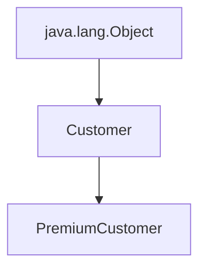

# Kế thừa lớp, Object và quan hệ kiểu con

Trong Java 27, **kế thừa lớp** (*class inheritance*) giúp xây dựng một lớp chuyên biệt từ một lớp tổng quát. Lớp con có thể sử dụng những thành viên được kế thừa, bổ sung trạng thái và hành vi riêng, đồng thời ghi đè phương thức được phép ghi đè. **Quan hệ kiểu con** (*subtyping*) cho phép dùng đối tượng thuộc kiểu cụ thể tại nơi yêu cầu một kiểu tổng quát hơn. Đây là nền tảng của đa hình trong Java.

Kế thừa hữu ích khi các đối tượng thực sự có quan hệ *is-a* ("là một loại của"). Tuy nhiên, Java hiện đại còn có interface, record, sealed class và composition để biểu đạt hợp đồng hoặc tái sử dụng hành vi. Hiểu sự khác nhau giúp bạn thiết kế các hệ thống dễ mở rộng mà không tạo phân cấp lớp không cần thiết.

## 1. Lớp cha, lớp con và `extends`

Một lớp thông thường dùng từ khóa `extends` để chỉ định **một lớp cha trực tiếp** (*direct superclass*):

```java
class Document {
    public String category() {
        return "Tài liệu";
    }
}

class Invoice extends Document {
    public String invoiceNumber() {
        return "INV-2026-001";
    }
}
```

`Invoice extends Document` cho biết `Invoice` là lớp con trực tiếp của `Document`. Một đối tượng `Invoice` có thể gọi cả `category()` được kế thừa và `invoiceNumber()` do lớp con khai báo:

```java
Invoice invoice = new Invoice();
System.out.println(invoice.category());      // Tài liệu
System.out.println(invoice.invoiceNumber()); // INV-2026-001
```

Các khái niệm cần phân biệt:

| Thuật ngữ | Ý nghĩa | Trong ví dụ |
|---|---|---|
| Superclass | Lớp cha cung cấp một phần hành vi và trạng thái | `Document` |
| Subclass | Lớp con chuyên biệt hóa lớp cha | `Invoice` |
| `extends` | Khai báo lớp cha trực tiếp của lớp thông thường | `Invoice extends Document` |
| Inherited members | Các thành viên lớp con được thừa hưởng theo quy tắc truy cập và kế thừa | `category()` |
| Subtype | Một kiểu có thể dùng trong ngữ cảnh chấp nhận kiểu cha hoặc superinterface | `Invoice` là kiểu con của `Document` |

Một lớp Java thông thường chỉ được `extends` một lớp trực tiếp. Nhưng một lớp có thể gián tiếp kế thừa nhiều lớp theo chuỗi, chẳng hạn `SpecialInvoice extends Invoice extends Document` **nếu** `Invoice` cho phép được mở rộng. Java không hỗ trợ kế thừa nhiều lớp trực tiếp (`class X extends A, B` là sai cú pháp), vì điều đó tạo ra những xung đột phức tạp về trạng thái và phương thức.

## 2. `java.lang.Object` là gốc của phân cấp lớp

`Object` thuộc package `java.lang`, được tự động nhập vào mọi mã Java. **Mọi lớp đều có `Object` trong chuỗi lớp cha**, trực tiếp hoặc gián tiếp. Nếu một lớp thông thường không có mệnh đề `extends`, lớp cha trực tiếp mặc định của nó là `Object`.

```java
class Customer { }           // ngầm hiểu extends Object
class PremiumCustomer extends Customer { }

Object first = new Customer();
Object second = new PremiumCustomer();
```

Sơ đồ quan hệ:



`Object` **không có lớp cha**. Đây là ngoại lệ duy nhất ở gốc phân cấp lớp. Mảng cũng là đối tượng và có thể tham chiếu qua kiểu `Object`:

```java
Object text = "Java 27";    // String là một lớp con của Object
Object numbers = new int[] {1, 2, 3};

System.out.println(text.getClass().getSimpleName());    // String
System.out.println(numbers.getClass().isArray());        // true
```

Kiểu nguyên thủy như `int`, `boolean` hoặc `double` không phải là lớp con của `Object`. Chẳng hạn, `Object value = 10;` được chấp nhận nhờ **boxing** từ `int` sang `Integer`, rồi phép chuyển tham chiếu lên `Object`; bản thân `int` không thừa kế `Object`.

### Những phương thức phổ biến của `Object`

| Phương thức | Vai trò | Lưu ý thiết kế |
|---|---|---|
| `toString()` | Tạo biểu diễn dạng chuỗi của đối tượng | Có thể override để hỗ trợ log/quan sát; tránh để lộ dữ liệu nhạy cảm |
| `equals(Object)` | So sánh tính bằng nhau theo hợp đồng của kiểu | Mặc định của `Object` so sánh cùng tham chiếu; kiểu giá trị thường cần override |
| `hashCode()` | Cung cấp mã băm cho cấu trúc như `HashMap`, `HashSet` | Nếu override `equals`, thường phải override `hashCode` nhất quán |
| `getClass()` | Trả về `Class<?>` biểu diễn lớp thực tế lúc chạy | Đây là phương thức `final`, không override được |

`Object` còn có các API liên quan đến đồng bộ hóa ở mức monitor và sao chép đối tượng. Trong chương trình mới, hãy ưu tiên các công cụ đồng thời cấp cao và cách tạo bản sao có hợp đồng rõ ràng. Phương thức `finalize()` đã **deprecated for removal**, không được dùng để quản lý vòng đời tài nguyên; với tài nguyên cần đóng, ưu tiên `AutoCloseable` và `try`-with-resources.

## 3. Ví dụ đầy đủ: kế thừa và đa hình động

Một chương trình có thể khai báo lớp cha trừu tượng chứa quy tắc chung và lớp con hiện thực hành vi cụ thể. Ví dụ sau có thể đặt toàn bộ vào file `InheritanceDemo.java`:

```java
import java.util.Objects;

public class InheritanceDemo {
    public static void main(String[] args) {
        Message message = new EmailMessage("lan@example.com", "Xin chào");

        System.out.println(message.recipient());
        System.out.println(message.summary());
        System.out.println(message.getClass().getSimpleName());
    }
}

abstract class Message {
    private final String recipient;

    protected Message(String recipient) {
        this.recipient = Objects.requireNonNull(recipient, "recipient");
    }

    public final String recipient() {
        return recipient;
    }

    public abstract String summary();
}

final class EmailMessage extends Message {
    private final String content;

    EmailMessage(String recipient, String content) {
        super(recipient);
        this.content = Objects.requireNonNull(content, "content");
    }

    @Override
    public String summary() {
        return "Email gửi " + recipient() + ": " + content;
    }
}
```

Biên dịch và chạy bằng JDK 27:

```bash
javac --release 27 InheritanceDemo.java
java InheritanceDemo
```

Kết quả:

```text
lan@example.com
Email gửi lan@example.com: Xin chào
EmailMessage
```

Điểm đáng chú ý: biến `message` có **kiểu khai báo** là `Message`, nhưng đối tượng thực tế là `EmailMessage`. Khi gọi `message.summary()`, JVM chọn phần hiện thực được override ở `EmailMessage`. Đây là **đa hình động** (*runtime polymorphism*) của phương thức instance.

Trong khi đó, compiler chỉ cho phép gọi các phương thức mà kiểu `Message` công khai. Nếu chỉ `EmailMessage` có một phương thức `subject()` thì không thể gọi trực tiếp `message.subject()` dù đối tượng thực tế là `EmailMessage`, trừ khi xác định lại kiểu phù hợp.

## 4. Constructor, `super` và quyền truy cập của lớp con

**Constructor không được kế thừa.** Mỗi lớp tự khai báo các constructor dùng để tạo đối tượng thuộc kiểu đó. Constructor lớp con phải bảo đảm một constructor hợp lệ của lớp cha được gọi để khởi tạo phần trạng thái mà lớp cha chịu trách nhiệm.

Ví dụ:

```java
class Account {
    private final String id;

    protected Account(String id) {
        this.id = Objects.requireNonNull(id, "id");
    }

    public final String id() {
        return id;
    }
}

final class SavingsAccount extends Account {
    private final int interestBasisPoints;

    SavingsAccount(String id, int interestBasisPoints) {
        super(id);
        this.interestBasisPoints = interestBasisPoints;
    }

    public int interestBasisPoints() {
        return interestBasisPoints;
    }
}
```

Ở ví dụ này, cần `import java.util.Objects;`. Lệnh `super(id)` gọi constructor của `Account`; lớp cha kiểm tra và lưu định danh. Sau khi phần khởi tạo lớp cha hoàn tất, constructor lớp con tiếp tục khởi tạo trạng thái riêng.

Nếu không khai báo lời gọi constructor rõ ràng, Java thường chèn một lời gọi `super()` ngầm định. Khi lớp cha không có constructor không tham số có thể truy cập, bạn phải chỉ định constructor thích hợp bằng `super(...)`. **Không nên giả định** lớp con tự động có constructor cùng tham số với lớp cha.

Lời gọi `super.method()` có thể dùng khi một phương thức lớp con cần mở rộng hành vi của lớp cha:

```java
class Report {
    public String title() {
        return "Báo cáo";
    }
}

class SalesReport extends Report {
    @Override
    public String title() {
        return super.title() + " doanh số";
    }
}
```

Ở đây `super.title()` chọn cách thực hiện của `Report`, còn `this.title()` từ một phương thức khác sẽ gọi phiên bản phù hợp theo đối tượng hiện tại.

### Những giới hạn truy cập quan trọng

- `public`: có thể truy cập từ nơi mà lớp và thành viên được phép sử dụng theo luật package/module.
- `protected`: được phép truy cập trong cùng package và trong lớp con ở package khác theo những quy tắc truy cập của Java; không đồng nghĩa với "mọi mã có đối tượng con đều truy cập được".
- Không có modifier (package-private): chỉ được truy cập từ cùng package; không tự trở thành public khi lớp con nằm ở package khác.
- `private`: các thành viên private của lớp cha vẫn là một phần triển khai của đối tượng, nhưng lớp con không thể truy cập trực tiếp chúng bằng tên như thành viên được kế thừa. Dùng API phù hợp của lớp cha.

Thực hành tốt là giữ trạng thái ở `private`, cung cấp các phương thức cần thiết và chỉ dùng `protected` cho các điểm mở rộng được thiết kế có chủ đích. Việc đưa quá nhiều field thành `protected` làm lớp con phụ thuộc sâu vào chi tiết triển khai của lớp cha.

## 5. Overriding, overloading và thành viên `static`

**Overriding** (ghi đè) xảy ra khi lớp con cung cấp phiên bản mới của phương thức instance có chữ ký tương thích với phương thức được kế thừa. Dùng `@Override` để compiler xác nhận bạn thực sự đang override:

```java
class Animal {
    public String sound() {
        return "Âm thanh";
    }
}

final class Dog extends Animal {
    @Override
    public String sound() {
        return "Gâu gâu";
    }
}

Animal animal = new Dog();
System.out.println(animal.sound()); // Gâu gâu
```

Với lời gọi instance method được override, **kiểu thực tế của đối tượng** quyết định phần triển khai nào được chạy. Kiểu tĩnh của biểu thức vẫn quyết định phương thức nào được phép gọi và quy tắc overload nào được xét lúc biên dịch.

**Overloading** (nạp chồng) là khai báo các phương thức trùng tên nhưng có danh sách tham số khác nhau. Nó không đòi hỏi quan hệ kế thừa:

```java
void send(String text) { /* ... */ }
void send(String text, int priority) { /* ... */ }
```

Đừng nhầm phương thức `static` hoặc field bị **hiding** (che khuất) với overriding. Phương thức `static` được chọn theo kiểu và tên lớp ở compile time, không thực hiện đa hình động như instance method:

```java
class Parent {
    static String type() { return "Parent"; }
    String name() { return "Parent"; }
}

class Child extends Parent {
    static String type() { return "Child"; }

    @Override
    String name() { return "Child"; }
}

Parent value = new Child();
System.out.println(value.name());  // Child: instance method dispatch
System.out.println(Parent.type()); // Parent: gọi rõ ràng theo lớp
System.out.println(Child.type());  // Child: static method của lớp con
```

Gọi phương thức static bằng tên lớp giúp thể hiện đúng ý nghĩa. Tránh khai báo lại field trùng tên ở lớp con vì field access không tuân theo cơ chế overriding của phương thức instance; điều đó dễ gây hiểu lầm khi tham chiếu có kiểu cha.

### Các ràng buộc khi override

| Quy tắc | Ý nghĩa |
|---|---|
| Chữ ký phù hợp | Tên và tham số phải đáp ứng quy tắc override; đổi danh sách tham số sẽ thành overload |
| Kiểu trả về | Có thể dùng kiểu trả về hẹp hơn theo quy tắc *covariant return* đối với kiểu tham chiếu |
| Quyền truy cập | Không được giảm mức truy cập của phương thức được override |
| Checked exception | Không được mở rộng tùy ý danh sách checked exception so với khai báo ở lớp cha |
| `final` instance method | Không được override |
| `private` method | Không được kế thừa/override theo nghĩa thông thường |
| `static` method | Có thể bị hiding theo các quy tắc tương ứng, không có dynamic dispatch |

Ví dụ về covariant return:

```java
class Factory {
    Number create() { return 1; }
}

class IntegerFactory extends Factory {
    @Override
    Integer create() { return 42; }
}
```

`Integer` là subtype của `Number`, nên kiểu trả về `Integer` phù hợp khi ghi đè `create()`. Với primitive return type, không thể đổi tùy ý như vậy.

## 6. Quan hệ kiểu con (*subtyping*) và phép gán tham chiếu

Kế thừa lớp là một cách hình thành quan hệ kiểu con, nhưng **quan hệ kiểu con rộng hơn quan hệ lớp cha - lớp con**: lớp triển khai interface cũng là subtype của interface; một interface có thể mở rộng nhiều interface khác.

```java
interface Payable {
    void pay();
}

class Invoice implements Payable {
    @Override
    public void pay() {
        System.out.println("Đã thanh toán");
    }
}

Payable payment = new Invoice();  // gán lên interface
Object object = payment;          // tham chiếu tới Object
```

Phép gán một giá trị thuộc subtype sang biến kiểu supertype được gọi là **upcasting**. Khi quan hệ tương thích được compiler biết, upcast thường diễn ra ngầm định và không làm thay đổi đối tượng:

```java
Dog dog = new Dog();
Animal animal = dog;
Object object = animal;

System.out.println(dog == animal); // true: cùng một đối tượng
```

`Dog`, `Animal` và `Object` ở đây là các kiểu tham chiếu khác nhau đối với **cùng một đối tượng**. Upcast không tạo bản sao và cũng không xóa các thành viên của đối tượng; nó chỉ làm phạm vi thao tác mà compiler cho phép thông qua biến trở nên tổng quát hơn.

### Downcast và `instanceof` với pattern variable

Ép xuống subtype (*downcast*) có thể thất bại nếu đối tượng thực tế không đúng kiểu:

```java
Animal animal = new Dog();
Dog dog = (Dog) animal; // hợp lệ ở runtime vì đối tượng thực sự là Dog
```

Ngược lại, ép một đối tượng thuộc lớp không tương thích sẽ ném `ClassCastException`. Trong Java 27, cách hiện hành và rõ ràng để kiểm tra rồi dùng đối tượng là **pattern matching for `instanceof`**:

```java
static void inspect(Animal animal) {
    if (animal instanceof Dog dog) {
        System.out.println(dog.sound());
    } else {
        System.out.println("Không phải Dog");
    }
}
```

Pattern `Dog dog` vừa kiểm tra kiểu vừa tạo biến `dog` trong phạm vi mà compiler chứng minh phép kiểm tra đúng. `instanceof` trả `false` với tham chiếu `null`; vì vậy không thể dùng nó thay cho mọi kiểm tra null trong hợp đồng API.

Nếu cần so khớp **đúng một lớp cụ thể**, có thể xem `getClass()`. Nếu muốn chấp nhận cả các subtype, `instanceof` hoặc một interface chung thường phù hợp hơn. Không nên kiểm tra `getClass()` tràn lan chỉ để chọn logic khác nhau cho từng lớp con; hãy cân nhắc đa hình hoặc pattern `switch`.

## 7. Kế thừa `Object`: phân biệt identity và value equality

Trong Java, hai biến có thể cùng tham chiếu một đối tượng, hoặc tham chiếu hai đối tượng khác nhau nhưng mang cùng dữ liệu:

```java
String first = new String("java");
String second = new String("java");

System.out.println(first == second);      // false: hai tham chiếu khác nhau
System.out.println(first.equals(second)); // true: String so sánh nội dung
```

- `==` với hai tham chiếu kiểm tra chúng có trỏ tới **cùng một đối tượng** hay không.
- `equals(Object)` cho phép một lớp định nghĩa thế nào là **bằng nhau theo giá trị hoặc theo ý nghĩa của kiểu**.
- Nếu lớp không override `equals`, cách thực hiện của `Object` tương đương so sánh identity (`==`) đối với hai tham chiếu không null.

Khi định nghĩa một lớp giá trị thủ công, hãy giữ hợp đồng `equals` và `hashCode` nhất quán. Một ví dụ đơn giản:

```java
import java.util.Objects;

public final class ProductId {
    private final String value;

    public ProductId(String value) {
        this.value = Objects.requireNonNull(value, "value");
    }

    @Override
    public boolean equals(Object other) {
        return other instanceof ProductId that
                && value.equals(that.value);
    }

    @Override
    public int hashCode() {
        return value.hashCode();
    }

    @Override
    public String toString() {
        return value;
    }
}
```

Vì `ProductId` là `final`, không có lớp con có thể thay đổi ngữ nghĩa equality đã định nghĩa. Nếu hai `ProductId` có cùng `value`, chúng bằng nhau và có cùng hash code. Nếu hai đối tượng không bằng nhau, chúng vẫn **có thể** có cùng hash code; mã băm không phải một định danh duy nhất.

Hợp đồng `equals` bao gồm tính phản xạ, đối xứng, bắc cầu, nhất quán và `x.equals(null)` trả `false`. `hashCode` phải cho cùng kết quả đối với hai đối tượng bằng nhau. Nếu đối tượng được dùng làm key trong `HashMap` hoặc phần tử của `HashSet`, các field dùng để tính equality/hash code nên bất biến trong thời gian đối tượng nằm trong cấu trúc đó.

### `record` là cách hiện đại cho đối tượng dữ liệu đơn giản

Nếu mục đích chính chỉ là lưu các thành phần dữ liệu có tên, Java cung cấp `record`:

```java
import java.util.Objects;

public record ProductId(String value) {
    public ProductId {
        Objects.requireNonNull(value, "value");
        if (value.isBlank()) {
            throw new IllegalArgumentException("ProductId không được trống");
        }
    }
}
```

`record` tự tạo constructor chính, accessor, `equals`, `hashCode` và `toString` theo các thành phần được khai báo, với khả năng tùy chỉnh hợp lệ khi cần. Mỗi record **ngầm định là `final`** và trực tiếp kế thừa `java.lang.Record`, lớp mà bản thân nó kế thừa `Object`. Record không thể `extends` một lớp tùy chọn, nhưng có thể `implements` interface. Record là kiểu mang dữ liệu *shallowly immutable*; nếu component giữ một đối tượng mutable như `List` có thể sửa, bạn vẫn phải cân nhắc defensive copy và tính bất biến của dữ liệu bên trong.

Chọn record khi mô hình chủ yếu mô tả giá trị. Chọn lớp thông thường khi đối tượng có trạng thái thay đổi, vòng đời phức tạp hoặc cần kiểm soát đặc biệt về identity. Không cần tạo hệ thống kế thừa nhiều tầng chỉ để tái sử dụng `equals`, `hashCode` và accessor.

## 8. `abstract class`, interface và `final class` khác nhau thế nào?

| Công cụ | Đặc điểm chính | Trường hợp phù hợp |
|---|---|---|
| `abstract class` | Có thể chứa trạng thái instance, constructor, method đã cài đặt và method abstract; lớp con dùng `extends` | Nhiều lớp con thật sự có cùng bản chất và cần chia sẻ trạng thái/hành vi đã định nghĩa |
| `interface` | Mô tả hợp đồng hành vi; lớp dùng `implements`; một lớp có thể triển khai nhiều interface | Nhiều loại đối tượng không cùng cây lớp nhưng cần dùng chung một khả năng |
| `final class` | Không cho phép lớp khác kế thừa | Kiểu có ngữ nghĩa hoàn chỉnh, đối tượng giá trị hoặc thiết kế cần bảo vệ bất biến |
| `sealed class` / `sealed interface` | Giới hạn các subtype trực tiếp được phép | Một miền nghiệp vụ có tập biến thể được kiểm soát |
| `record` | Lớp `final` mang tập component cố định, được hỗ trợ sẵn các phương thức giá trị | DTO hoặc dữ liệu cần cấu trúc rõ và equality theo component |

Ví dụ một lớp có thể kế thừa `Account` đồng thời triển khai nhiều hợp đồng:

```java
interface Auditable {
    String auditLabel();
}

interface Exportable {
    String export();
}

class BusinessAccount extends Account implements Auditable, Exportable {
    BusinessAccount(String id) {
        super(id);
    }

    @Override
    public String auditLabel() {
        return "Tài khoản " + id();
    }

    @Override
    public String export() {
        return id();
    }
}
```

Trong ví dụ này, `Account` là lớp cha có constructor và state, còn `Auditable` và `Exportable` thể hiện hai khả năng của `BusinessAccount`. Java cho phép một lớp triển khai nhiều interface. Interface cũng có thể `extends` một hoặc nhiều interface khác; đây là quan hệ kế thừa interface, không phải đa kế thừa lớp.

Một interface có thể khai báo `default` method và `static` method. Tuy nhiên, interface không giữ các field instance theo cách của một lớp. Nếu hai interface cung cấp `default` method có chữ ký xung đột, lớp triển khai có thể phải override để giải quyết xung đột một cách tường minh.

## 9. Kiểm soát cây kế thừa với `sealed`, `non-sealed` và `final`

Java 27 hỗ trợ **sealed classes/interfaces** như tính năng ổn định. Chúng cho phép mô hình hóa một tập kiểu con được phép, thay vì để bất kỳ mã nào cũng mở rộng phân cấp.

```java
sealed abstract class Delivery permits StandardDelivery, ExpressDelivery {
    public abstract int estimatedDays();
}

final class StandardDelivery extends Delivery {
    @Override
    public int estimatedDays() {
        return 5;
    }
}

non-sealed class ExpressDelivery extends Delivery {
    @Override
    public int estimatedDays() {
        return 2;
    }
}
```

Ở đây `Delivery` chỉ cho phép `StandardDelivery` và `ExpressDelivery` là hai subtype **trực tiếp**. `StandardDelivery` được khai báo `final` nên không cho phép mở rộng thêm. `ExpressDelivery` là `non-sealed`, vì vậy các lớp khác có thể kế thừa nó theo các quy tắc truy cập thông thường.

Lớp trực tiếp kế thừa một sealed class phải khai báo một trong ba dạng phù hợp: `final`, `sealed` hoặc `non-sealed` (record và enum có quy tắc ngầm định riêng). Những subtype trực tiếp của cùng một sealed type cần tuân thủ các ràng buộc package hoặc module và danh sách `permits` theo JLS.

Trong mô hình dữ liệu, sealed interface kết hợp record là lựa chọn gọn:

```java
sealed interface PaymentResult permits Paid, Rejected { }

record Paid(String transactionId) implements PaymentResult { }
record Rejected(String reason) implements PaymentResult { }

static String describe(PaymentResult result) {
    return switch (result) {
        case Paid paid -> "Đã thanh toán: " + paid.transactionId();
        case Rejected rejected -> "Từ chối: " + rejected.reason();
    };
}
```

`switch` dạng pattern trên sealed interface có thể kiểm tra tính đầy đủ các trường hợp khi biên dịch. Vì hai nhánh đã bao phủ mọi subtype trực tiếp được cho phép, biểu thức không cần `default` cho các giá trị không null; **hãy vẫn định nghĩa hợp đồng đối với `null`**. Nếu `result == null`, `switch` kiểu này sẽ ném `NullPointerException` trừ khi thêm `case null`.

Những kiểu này rất hữu ích khi mô hình không phải là một cây kế thừa mở vô hạn, mà là một tập kết quả như `Paid`/`Rejected`, `Success`/`Failure` hoặc các loại sự kiện đã biết. Record không thể mở rộng một lớp nghiệp vụ nhưng có thể triển khai sealed interface.

## 10. Những điểm dễ nhầm về subtype: generic và mảng

Quan hệ `Dog extends Animal` không có nghĩa là mọi kiểu tổng hợp chứa `Dog` đều là subtype của kiểu tổng hợp chứa `Animal`. Đây là điểm đặc biệt quan trọng với generic.

### Generic là bất biến (*invariant*) theo tham số kiểu

Giả sử `Dog extends Animal`:

```java
List<Dog> dogs = List.of(new Dog());

// Không hợp lệ: List<Dog> không phải subtype của List<Animal>.
// List<Animal> animals = dogs;

List<? extends Animal> animals = dogs;
Animal animal = animals.get(0);
```

`List<? extends Animal>` cho phép **đọc** các phần tử như `Animal`, nhưng không thể thêm tùy ý một `Animal`, `Dog` hoặc `Cat` vào danh sách đó, vì kiểu phần tử cụ thể có thể là một subtype khác. Nếu một API chủ yếu **ghi các giá trị `Dog` vào một cấu trúc**, `List<? super Dog>` có thể thích hợp. Chọn giới hạn kiểu theo nhu cầu đọc/ghi thực tế, thay vì ép kiểu không an toàn.

Một lý do generic không cho phép `List<Dog>` biến thành `List<Animal>` là: nếu phép gán đó hợp lệ, người dùng có thể thêm một `Cat` vào danh sách thật sự chỉ được phép chứa `Dog`.

### Mảng tham chiếu có tính hiệp biến (*covariant*) và kiểm tra runtime

Khác generic, mảng tham chiếu Java cho phép kiểu mảng con được gán cho biến kiểu mảng cha. Vì vậy có thể xảy ra lỗi khi ghi phần tử ở runtime:

```java
class Cat extends Animal { }

Animal[] animals = new Dog[1];
animals[0] = new Cat(); // Ném ArrayStoreException tại runtime
```

Mảng thực tế được tạo là `Dog[]`, nên không thể chứa `Cat`. Dù compiler cho phép biểu thức `animals[0] = new Cat()` dựa trên kiểu tham chiếu `Animal[]`, JVM kiểm tra kiểu phần tử thực tế và từ chối phép gán. Khi thiết kế API mới, hãy ưu tiên generic collection có kiểu rõ ràng nếu cần tập hợp đối tượng linh hoạt.

## 11. Chọn kế thừa, interface hay composition?

**Composition** nghĩa là một lớp giữ tham chiếu tới đối tượng cộng tác rồi ủy quyền công việc, thay vì kế thừa lớp thực hiện công việc đó.

Ví dụ hệ thống gửi thông báo:

```java
interface MessageSender {
    void send(String recipient, String content);
}

final class ReminderService {
    private final MessageSender sender;

    ReminderService(MessageSender sender) {
        this.sender = Objects.requireNonNull(sender, "sender");
    }

    public void remind(String recipient) {
        sender.send(recipient, "Bạn có lịch hẹn sắp tới");
    }
}
```

Ví dụ này cần `import java.util.Objects;`. `ReminderService` **có một** `MessageSender`, nhưng nó **không phải là** một `MessageSender`. Vì vậy, composition diễn đạt mô hình chính xác hơn `ReminderService extends SomeSender`. Có thể thay đối tượng sender bằng implementation gửi email, ghi log thử nghiệm hoặc dịch vụ khác mà không thay đổi phân cấp lớp.

Trước khi chọn `extends`, hãy hỏi:

1. Lớp con có thật sự **là một loại** của lớp cha, về cả dữ liệu lẫn hành vi, hay chỉ muốn dùng lại vài dòng mã?
2. Nếu một hàm yêu cầu lớp cha, có thể thay nó bằng bất kỳ lớp con hợp lệ mà không làm hỏng các giả định của caller không?
3. Các lớp con có chia sẻ bất biến và vòng đời của lớp cha, hay cần nhiều cách triển khai độc lập?
4. Hợp đồng có cần cho phép bên ngoài bổ sung subtype, hay muốn giới hạn bằng `sealed`/`final`?
5. Có thể biểu diễn khả năng bằng interface và tái sử dụng bằng composition đơn giản hơn không?

Đây là cách áp dụng **nguyên lý thay thế Liskov** (*Liskov Substitution Principle*): lớp con phải duy trì những lời hứa mà API của lớp cha đặt ra. Ví dụ, nếu lớp cha hứa cho phép rút một số tiền hợp lệ mà không có hạn mức bổ sung, lớp con không nên bí mật bổ sung một điều kiện từ chối trái với hợp đồng đó. Nếu hai kiểu có quy tắc khác nhau về căn bản, interface chung hoặc tách abstraction có thể an toàn hơn.

### Khi nào từng lựa chọn phù hợp?

| Tình huống | Lựa chọn thường phù hợp | Lý do |
|---|---|---|
| Các biến thể thật sự chia sẻ state, invariant và hành vi lõi | `abstract class` + subclass | Mô hình hóa một loại đối tượng chung có phần triển khai chung |
| Các đối tượng không cùng họ lớp nhưng cùng thực hiện một khả năng | `interface` + `implements` | Tách hợp đồng khỏi cách hiện thực |
| Chỉ cần một dịch vụ khác làm hộ công việc | Composition | Quan hệ *has-a*, thay thế dependency thuận tiện |
| Miền có tập biến thể đã biết và muốn compiler kiểm tra đầy đủ | `sealed interface`/`sealed class` | Giới hạn subtype được phép |
| Dữ liệu đơn giản và equality theo các component | `record` | Mã gọn, hợp đồng dữ liệu rõ ràng |
| Kiểu có bất biến phải được bảo vệ và không nên mở rộng | `final class` | Không có subclass thay đổi semantics |

## 12. Các lỗi thiết kế thường gặp

### 12.1. Dùng `extends` chỉ để tái sử dụng code

Một lớp chuyên xử lý báo cáo không nên `extends` một lớp tiện ích chỉ vì cần một method format. Tốt hơn là tạo service hoặc utility có trách nhiệm rõ ràng rồi gọi nó qua composition. Phân cấp lớp nên phản ánh mô hình đối tượng, tránh biến thành một cơ chế phụ thuộc chặt vào triển khai.

### 12.2. Hiểu nhầm `private` hoặc constructor được kế thừa

Field `private` của lớp cha phải được truy cập qua những API được công khai có chủ đích. Constructor của lớp cha cần được gọi theo cơ chế khởi tạo lớp, nhưng không trở thành constructor của lớp con. Nếu superclass chỉ có constructor nhận tham số, lớp con phải gọi constructor phù hợp.

### 12.3. Quên `@Override` hoặc tạo overload ngoài ý muốn

Một lỗi chính tả hoặc đổi nhầm kiểu tham số có thể tạo một method mới thay vì override. Gắn `@Override` với các phương thức định ghi đè để compiler phát hiện sai lệch. Không thêm modifier `static` vào method vốn định override instance method.

### 12.4. Định nghĩa `equals` nhưng bỏ quên `hashCode`

Đối tượng so sánh bằng nhau qua `equals` nhưng cho hash code khác nhau có thể làm `HashMap`/`HashSet` hoạt động trái mong đợi. Với value type đơn giản, cân nhắc record thay cho việc tự viết đầy đủ hợp đồng. Hai ví dụ `ProductId` ở phần trước là **hai cách triển khai thay thế** cho cùng một khái niệm, không khai báo cả hai trong cùng package.

### 12.5. Ép xuống subtype khi chưa kiểm tra

Việc phải downcast lặp đi lặp lại thường là dấu hiệu abstraction đang thiếu hành vi chung. Nếu vẫn cần xử lý riêng theo loại, ưu tiên `instanceof` pattern hoặc pattern `switch` đã kiểm tra kiểu. Không giả định mọi đối tượng kiểu cha đều là một subtype cụ thể.

### 12.6. Gọi method có thể override từ constructor lớp cha

Khi constructor của lớp cha gọi một phương thức instance có thể bị override, Java có thể chuyển đến implementation ở lớp con **trước khi các field do constructor lớp con quản lý được khởi tạo đầy đủ**. Điều này dễ tạo lỗi khó nhận biết. Hạn chế gọi method có thể override trong constructor; ưu tiên khởi tạo trực tiếp các field của lớp cha, và giữ các điểm mở rộng sau khi tạo đối tượng hoàn tất.

### 12.7. Cho phép một cây lớp mở rộng tùy ý

Một lớp cha có nhiều bất biến quan trọng nhưng cho phép mọi lớp con tùy ý thay đổi hành vi có thể dẫn tới lỗi thay thế. Đánh dấu `final` nếu không hỗ trợ mở rộng, dùng `sealed` nếu chỉ có vài biến thể được xác định hoặc công bố extension points được kiểm soát bằng `protected`/abstract method khi thật sự cần.

## 13. Checklist khi xây dựng một phân cấp lớp

- Xác định rõ quan hệ *is-a* giữa lớp cha và lớp con, và vai trò của interface.
- Viết hợp đồng của các method mà caller có thể gọi qua supertype.
- Đóng gói state bằng `private`; mở `protected` có chủ đích.
- Đảm bảo constructor thiết lập invariant đúng, và lớp con gọi `super(...)` hợp lệ.
- Gắn `@Override` cho method override và kiểm tra quy tắc kiểu trả về, ngoại lệ, quyền truy cập.
- Không phụ thuộc vào `getClass()` hoặc cast để triển khai logic mà đa hình có thể xử lý.
- Kiểm tra `equals`/`hashCode` nếu đối tượng mang semantics giá trị; cân nhắc record.
- Chọn `final`/`sealed` để phản ánh chủ ý mở rộng; không để lớp cha mở ngoài ý muốn.
- Kiểm thử bằng biến kiểu cha chứa các đối tượng lớp con khác nhau; kết quả phải vẫn tuân thủ hợp đồng của cha.
- Với collection generic, xác định đúng variance và tránh cast không an toàn.

## 14. Bài tập thực hành

1. Tạo lớp trừu tượng `Document` có `id`, constructor kiểm tra `id` và abstract method `render()`. Tạo hai lớp con `InvoiceDocument`, `ReportDocument` override `render()` theo hai cách khác nhau.
2. Tạo một `List<Document>` chứa cả hai loại tài liệu và viết vòng lặp gọi `render()` mà không cần ép kiểu xuống lớp con. Giải thích vì sao mỗi đối tượng trả kết quả đúng.
3. Tạo record `DocumentId(String value)`, kiểm tra chuỗi rỗng bằng compact constructor và so sánh hai đối tượng khác nhau có cùng `value` bằng `equals`.
4. Chuyển hai loại kết quả xuất tài liệu thành `sealed interface ExportResult` với hai record `Exported` và `ExportFailed`. Viết `switch` expression bao phủ đầy đủ các trường hợp.
5. Viết một ví dụ lỗi `List<Child>` không gán được cho `List<Parent>`, rồi sửa bằng `List<? extends Parent>` nếu chỉ cần đọc giá trị.

## 15. Tài liệu tham khảo chính thức

- [Java SE 27 Language Specification — Chapter 4: Types, Values, and Variables](https://docs.oracle.com/javase/specs/jls/se27/html/jls-4.html): phân biệt reference type và primitive type, subtype, supertype, generic và array.
- [Java SE 27 Language Specification — Chapter 8: Classes](https://docs.oracle.com/javase/specs/jls/se27/html/jls-8.html): khai báo lớp, `extends`, constructor, overriding, `final`, `sealed`, record và enum.
- [Java SE 27 Language Specification — Chapter 9: Interfaces](https://docs.oracle.com/javase/specs/jls/se27/html/jls-9.html): `implements`, mở rộng interface và quan hệ subtype qua interface.
- [Java SE 27 Language Specification — Chapter 15: Expressions](https://docs.oracle.com/javase/specs/jls/se27/html/jls-15.html): method invocation, `instanceof`, truy cập field và biểu thức.
- [Java SE 27 — `java.lang.Object`](https://docs.oracle.com/en/java/javase/27/docs/api/java.base/java/lang/Object.html): gốc phân cấp lớp và các hợp đồng của `equals`, `hashCode`, `getClass`, `toString`.
- [Java SE 27 — `java.lang.Record`](https://docs.oracle.com/en/java/javase/27/docs/api/java.base/java/lang/Record.html): lớp cha của record và phương thức dữ liệu được tổng hợp tự động.

Kế thừa lớp là công cụ mạnh khi các kiểu thực sự cùng một bản chất và có thể thay thế nhau qua hợp đồng chung. Hãy nhớ `Object` nằm ở gốc phân cấp lớp, subtype quyết định tính tương thích kiểu, còn overriding cho phép hành vi instance phụ thuộc vào đối tượng thực tế. Trong Java 27, phối hợp class inheritance với interface, record, sealed hierarchy và composition giúp thiết kế đối tượng chính xác hơn, kiểm soát được khả năng mở rộng và tránh phụ thuộc không cần thiết.
