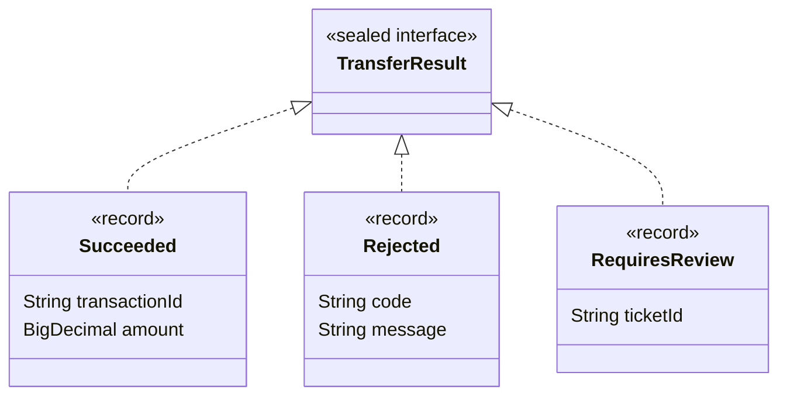

# Mô hình hóa dữ liệu và kết quả nghiệp vụ bằng record với sealed

Khi thiết kế một API nghiệp vụ, chúng ta thường phải biểu diễn hai loại thông tin: **dữ liệu của một giá trị** (mã đơn hàng, số tiền, người nhận) và **những khả năng kết quả khác nhau** (thành công, bị từ chối, đang chờ phê duyệt). Trong Java 27, `record` và `sealed` kết hợp tự nhiên để giải quyết hai nhu cầu này.

- `record` mô tả một cấu trúc dữ liệu có các thành phần rõ ràng, đi kèm constructor, accessor và ngữ nghĩa so sánh theo giá trị.
- `sealed interface` hoặc `sealed class` giới hạn các kiểu được phép trực tiếp triển khai hoặc kế thừa, phù hợp để định nghĩa tập kết quả nghiệp vụ.
- `switch` với type pattern hoặc record pattern cho phép xử lý từng trường hợp và kiểm tra **tính bao phủ đầy đủ** (*exhaustiveness*) khi biên dịch.

Những tính năng này đã chính thức hóa từ Java 16 (`record`), Java 17 (`sealed`) và Java 21 (record patterns cùng pattern matching cho `switch`). Ví dụ trong bài dùng cú pháp ổn định được hỗ trợ trong Java 27, không phụ thuộc vào tính năng preview.

## 1. Bài toán: một kết quả có nhiều trạng thái

Giả sử hệ thống chuyển tiền phải trả về một trong ba kết quả:

| Trạng thái | Dữ liệu cần trả về | Ý nghĩa nghiệp vụ |
|---|---|---|
| Thành công | Mã giao dịch, số tiền đã chuyển | Giao dịch hoàn tất |
| Từ chối | Mã lý do, thông báo | Không được phép thực hiện giao dịch |
| Chờ duyệt | Mã hồ sơ chờ duyệt | Giao dịch cần một bước kiểm tra tiếp theo |

Nếu gộp mọi trường hợp vào một lớp có nhiều trường tùy chọn, chương trình dễ tạo ra trạng thái thiếu nhất quán:

```java
// Minh họa thiết kế khó kiểm soát, không phải cách khuyến nghị.
record TransferResponse(
    boolean success,
    String transactionId,
    String rejectionCode,
    String approvalTicket
) {}
```

Không có gì trong kiểu trên ngăn một giá trị `success = true` nhưng `transactionId = null` hoặc đồng thời chứa cả `transactionId` và `rejectionCode`. Mọi nơi sử dụng phải tự nhớ tổ hợp trường nào hợp lệ.

Một mô hình tốt hơn phân biệt rõ: **mỗi trạng thái là một kiểu dữ liệu riêng**, còn toàn bộ kết quả có một kiểu chung được giới hạn bằng `sealed`.



Về mặt mô hình dữ liệu, một record chứa nhiều thành phần mô tả **một giá trị**; sealed hierarchy diễn tả **một trong nhiều biến thể**. Cách kết hợp này thường được gọi là kiểu dữ liệu tích và tổng (*product and sum types*), dù Java không yêu cầu dùng các thuật ngữ đó khi lập trình.

## 2. Record dùng để mô hình hóa giá trị nghiệp vụ

Một record khai báo các *record components* trong phần header:

```java
import java.math.BigDecimal;

record TransferRequest(
    String sourceAccount,
    String destinationAccount,
    BigDecimal amount
) {}
```

Với khai báo đó, trình biên dịch cung cấp những thành phần chính sau:

- Các trường tương ứng với component, có phạm vi `private final`.
- Các accessor cùng tên component: `sourceAccount()`, `destinationAccount()`, `amount()`.
- Canonical constructor nhận các tham số theo đúng thứ tự và kiểu trong header.
- `equals()`, `hashCode()` và `toString()` theo quy tắc dành cho record.

Ví dụ:

```java
var first = new TransferRequest(
    "A001", "A002", new BigDecimal("250.00")
);
var second = new TransferRequest(
    "A001", "A002", new BigDecimal("250.00")
);

System.out.println(first.sourceAccount());  // A001
System.out.println(first.amount());         // 250.00
System.out.println(first.equals(second));  // true
```

Record so sánh dựa trên giá trị các component thay vì dựa trên danh tính của đối tượng. Cần chú ý quy tắc `equals()` của từng component: chẳng hạn `BigDecimal("250.0")` và `BigDecimal("250.00")` không bằng nhau theo `equals()` do khác scale, dù `compareTo()` xem chúng có cùng giá trị số học.

### Kiểm soát invariant bằng compact canonical constructor

Record không bắt buộc phải chấp nhận mọi giá trị được truyền vào. Bạn có thể khai báo **compact canonical constructor** để xác thực invariant và chuẩn hóa dữ liệu trước khi các component được gán vào trường:

```java
import java.math.BigDecimal;
import java.util.Objects;

record TransferRequest(
    String sourceAccount,
    String destinationAccount,
    BigDecimal amount
) {
    TransferRequest {
        Objects.requireNonNull(sourceAccount, "sourceAccount");
        Objects.requireNonNull(destinationAccount, "destinationAccount");
        Objects.requireNonNull(amount, "amount");

        sourceAccount = sourceAccount.strip();
        destinationAccount = destinationAccount.strip();

        if (sourceAccount.isEmpty() || destinationAccount.isEmpty()) {
            throw new IllegalArgumentException("Mã tài khoản phải có giá trị");
        }
        if (amount.signum() <= 0) {
            throw new IllegalArgumentException("Số tiền phải lớn hơn 0");
        }
    }
}
```

Trong compact constructor, các tham số có thể được chuẩn hóa rồi được tự động gán cho các trường component khi constructor kết thúc bình thường. Không gán thủ công `this.sourceAccount = ...` trong compact constructor. Nếu cần điều khiển việc gán trường bằng tay, hãy khai báo canonical constructor dạng thông thường và tuân thủ toàn bộ quy tắc khởi tạo của record.

Nên phân biệt **invariant cấu trúc** với **điều kiện nghiệp vụ**. Mã tài khoản trống hoặc số tiền âm có thể bị từ chối ngay khi tạo request. Nhưng tài khoản đang bị khóa, giao dịch cần phê duyệt hoặc vượt hạn mức là những kết quả của quá trình xử lý nghiệp vụ; chúng phù hợp để biểu diễn bằng các biến thể kết quả.

### Record chỉ bất biến nông

Các trường component của record là `final`, nhưng điều đó **không tự làm đối tượng được tham chiếu trở nên bất biến**.

```java
import java.util.ArrayList;
import java.util.List;

record UnsafeBatch(List<String> ids) {}

var source = new ArrayList<String>();
source.add("T001");

var batch = new UnsafeBatch(source);
source.add("T002");

// Nội dung batch.ids() cũng đã thay đổi.
System.out.println(batch.ids()); // [T001, T002]
```

Nếu muốn record nắm giữ một snapshot danh sách không thể sửa đổi, hãy tạo bản sao phòng vệ:

```java
record Batch(List<String> ids) {
    Batch {
        ids = List.copyOf(ids);
    }
}
```

`List.copyOf` tạo danh sách không thể chỉnh sửa qua API của nó và từ chối `null` trong danh sách. Đây vẫn là tính bất biến nông: nếu phần tử là đối tượng mutable, trạng thái của từng phần tử vẫn có thể thay đổi. Với component là mảng hoặc một đối tượng mutable khác, cần bảo vệ cả đầu vào và giá trị trả ra từ accessor nếu yêu cầu bất biến thực sự.

## 3. Sealed giới hạn các biến thể kết quả

Một `sealed interface` chỉ cho phép những kiểu được xác định trước trực tiếp triển khai nó:

```java
sealed interface TransferResult
        permits Succeeded, Rejected, RequiresReview {}

record Succeeded(String transactionId, BigDecimal amount)
        implements TransferResult {}

record Rejected(String code, String message)
        implements TransferResult {}

record RequiresReview(String ticketId)
        implements TransferResult {}
```

Ở đây, `TransferResult` có đúng ba kiểu triển khai trực tiếp được phép. Một class khác không thể tùy ý viết `implements TransferResult` nếu không được liệt kê trong `permits`.

Các kiểu triển khai trực tiếp của sealed type phải quyết định rõ khả năng mở rộng tiếp theo:

| Dạng subtype | Ý nghĩa |
|---|---|
| `final` | Không cho kế thừa tiếp; record đã ngầm định `final` |
| `sealed` | Tiếp tục giới hạn các subtype trực tiếp bên dưới |
| `non-sealed` | Mở lại khả năng kế thừa ở nhánh đó |

Với các biến thể kết quả đơn giản, record là lựa chọn thuận tiện vì đã ngầm định `final` và có cấu trúc dữ liệu tường minh.

**Ràng buộc vị trí khai báo:** các subtype trực tiếp được permit phải thuộc cùng *named module* với sealed type. Nếu mã thuộc unnamed module (không khai báo module), chúng phải thuộc cùng package. Java có thể suy ra danh sách permitted subtype trong một số trường hợp khi các subtype cùng compilation unit, nhưng ghi rõ `permits` thường giúp người đọc thấy ngay tập biến thể nghiệp vụ.

Record không thể `extends` một lớp nghiệp vụ vì record đã kế thừa `java.lang.Record`; tuy nhiên record có thể `implements` một hoặc nhiều interface, bao gồm sealed interface.

## 4. Ví dụ hoàn chỉnh: kết quả chuyển tiền

Đặt toàn bộ mã sau vào file `TransferDemo.java`. Các kiểu được khai báo lồng trong một lớp để ví dụ có thể biên dịch và chạy như một chương trình độc lập.

```java
import java.math.BigDecimal;
import java.util.Objects;

public class TransferDemo {

    record TransferRequest(
        String sourceAccount,
        String destinationAccount,
        BigDecimal amount
    ) {
        TransferRequest {
            Objects.requireNonNull(sourceAccount, "sourceAccount");
            Objects.requireNonNull(destinationAccount, "destinationAccount");
            Objects.requireNonNull(amount, "amount");

            sourceAccount = sourceAccount.strip();
            destinationAccount = destinationAccount.strip();

            if (sourceAccount.isEmpty() || destinationAccount.isEmpty()) {
                throw new IllegalArgumentException("Mã tài khoản không được trống");
            }
            if (amount.signum() <= 0) {
                throw new IllegalArgumentException("Số tiền phải lớn hơn 0");
            }
        }
    }

    sealed interface TransferResult
            permits Succeeded, Rejected, RequiresReview {}

    record Succeeded(String transactionId, BigDecimal amount)
            implements TransferResult {
        Succeeded {
            Objects.requireNonNull(transactionId, "transactionId");
            Objects.requireNonNull(amount, "amount");
        }
    }

    record Rejected(String code, String message)
            implements TransferResult {
        Rejected {
            Objects.requireNonNull(code, "code");
            Objects.requireNonNull(message, "message");
        }
    }

    record RequiresReview(String ticketId)
            implements TransferResult {
        RequiresReview {
            Objects.requireNonNull(ticketId, "ticketId");
        }
    }

    static TransferResult execute(
        TransferRequest request,
        boolean sourceAccountActive,
        boolean requiresApproval
    ) {
        Objects.requireNonNull(request, "request");

        // Các cờ ở đây chỉ giả lập kết quả kiểm tra nghiệp vụ.
        if (!sourceAccountActive) {
            return new Rejected(
                "ACCOUNT_INACTIVE", "Tài khoản nguồn chưa hoạt động"
            );
        }

        if (request.sourceAccount().equals(request.destinationAccount())) {
            return new Rejected(
                "SAME_ACCOUNT", "Không chuyển tiền vào chính tài khoản nguồn"
            );
        }

        if (requiresApproval) {
            return new RequiresReview("RV-" + request.sourceAccount());
        }

        return new Succeeded(
            "TX-" + request.sourceAccount(), request.amount()
        );
    }

    static String describe(TransferResult result) {
        Objects.requireNonNull(result, "result");

        return switch (result) {
            case Succeeded(var id, var amount) ->
                "Thành công " + id + ", số tiền " + amount.toPlainString();

            case Rejected(var code, var message) ->
                "Từ chối [" + code + "]: " + message;

            case RequiresReview(var ticketId) ->
                "Chờ phê duyệt, mã hồ sơ " + ticketId;
        };
    }

    public static void main(String[] args) {
        var request = new TransferRequest(
            "A001", "A002", new BigDecimal("250.00")
        );

        System.out.println(describe(execute(request, true, false)));
        System.out.println(describe(execute(request, false, false)));
        System.out.println(describe(execute(request, true, true)));
    }
}
```

Có thể chạy bằng JDK 27:

```shell
javac TransferDemo.java
java TransferDemo
```

Kết quả minh họa:

```text
Thành công TX-A001, số tiền 250.00
Từ chối [ACCOUNT_INACTIVE]: Tài khoản nguồn chưa hoạt động
Chờ phê duyệt, mã hồ sơ RV-A001
```

Mỗi trường hợp trả về một record mang đúng dữ liệu của trạng thái đó. Mã xử lý không phải đọc các trường không liên quan hoặc kiểm tra một loạt giá trị `null`.

Trong sản phẩm thật, trạng thái tài khoản và quyết định phê duyệt phải được lấy từ tầng nghiệp vụ, cơ sở dữ liệu hoặc hệ thống kiểm soát phù hợp. Hai tham số `boolean` ở ví dụ chỉ giúp dễ chủ động tái hiện ba kết quả.

## 5. Pattern matching và switch xử lý mọi trường hợp

Trong phương thức `describe`, một `switch` expression trả về `String`. Các nhánh:

```java
return switch (result) {
    case Succeeded(var id, var amount) ->
        "Thành công: " + id + ", " + amount;

    case Rejected(var code, var message) ->
        "Từ chối " + code + ": " + message;

    case RequiresReview(var ticketId) ->
        "Chờ duyệt: " + ticketId;
};
```

là **record patterns**: vừa kiểm tra biến thể record, vừa tách trực tiếp các component ra biến cục bộ. Ví dụ `Succeeded(var id, var amount)` tương ứng với `String id` và `BigDecimal amount`, suy luận từ header record.

Nếu chỉ muốn phân biệt các biến thể mà không cần tách component, dùng type pattern:

```java
static String stateName(TransferResult result) {
    return switch (Objects.requireNonNull(result)) {
        case Succeeded succeeded -> "SUCCESS";
        case Rejected rejected -> "REJECTED";
        case RequiresReview review -> "REVIEW_REQUIRED";
    };
}
```

### Exhaustiveness bảo vệ việc mở rộng nghiệp vụ

Vì `TransferResult` là sealed interface và tất cả subtype trực tiếp là record (ngầm định final), trình biên dịch biết tập biến thể hữu hạn. `switch` trên đây bao phủ đầy đủ ba trường hợp nên **không cần nhánh `default`**.

Giả sử sau này bổ sung:

```java
record Cancelled(String reason) implements TransferResult {}
```

Để khai báo này hợp lệ, bạn cũng phải thêm `Cancelled` vào `permits` của `TransferResult`. Khi biên dịch lại những `switch` expression chưa xử lý `Cancelled`, trình biên dịch có thể báo không bao phủ đầy đủ. Điều đó nhắc người phát triển cập nhật phần render, ánh xạ HTTP, log hoặc các bộ xử lý khác.

Thêm nhánh `default -> ...` có thể làm mất lợi thế cảnh báo khi thêm biến thể mới. Chỉ sử dụng `default` khi có lý do ngữ nghĩa rõ ràng, chẳng hạn cố tình gom các trường hợp còn lại và chấp nhận không phân biệt từng biến thể.

Cần phân biệt kiểm tra tại biên dịch với tương thích khi triển khai: mã đã biên dịch từ phiên bản cũ có thể gặp một subtype mới lúc runtime nếu các thành phần được triển khai lệch phiên bản. Khi đó, một `switch` đáng lẽ exhaustive theo phân cấp cũ có thể ném `MatchException`. Vì vậy, khi thay đổi tập `permits` trong API công khai, hãy biên dịch lại và kiểm thử các module hoặc ứng dụng dùng API đó.

### Giá trị null và guard

`switch` với type pattern không tự xem `null` là một trong những subtype được permit. Nếu selector là `null` và không có `case null`, biểu thức `switch` sẽ ném `NullPointerException`.

Ví dụ dùng `Objects.requireNonNull(result, "result")` để bộc lộ hợp đồng API không nhận null. Nếu nghiệp vụ thực sự muốn phân biệt giá trị không tồn tại, hãy biểu diễn trường hợp đó rõ ràng, thay vì phụ thuộc vào null.

Khi cần thêm điều kiện ở một nhánh, bạn có thể dùng guard `when`:

```java
static String rejectionLabel(TransferResult result) {
    return switch (Objects.requireNonNull(result)) {
        case Rejected(var code, var message)
                when code.equals("ACCOUNT_INACTIVE") ->
            "Tài khoản chưa hoạt động";

        case Rejected(var code, var message) ->
            "Từ chối: " + message;

        case Succeeded success -> "Thành công";
        case RequiresReview review -> "Chờ duyệt";
    };
}
```

Nhánh có guard chỉ khớp khi điều kiện `when` đúng. Nhánh `Rejected` không có guard phía dưới xử lý mọi trường hợp từ chối khác, nhờ đó `switch` vẫn exhaustive.

## 6. Mô hình hóa kết quả tổng quát bằng generic

Nếu nhiều tính năng có cùng cặp kết quả *thành công/thất bại*, có thể tạo một kiểu kết quả generic:

```java
sealed interface Outcome<T> permits OutcomeOk, OutcomeFailure {}

record OutcomeOk<T>(T value) implements Outcome<T> {}

record OutcomeFailure<T>(String code, String message)
        implements Outcome<T> {}
```

Ví dụ sử dụng:

```java
Outcome<String> success = new OutcomeOk<>("Đơn hàng đã được tạo");

Outcome<String> failure = new OutcomeFailure<>(
    "OUT_OF_STOCK", "Sản phẩm đã hết hàng"
);
```

Với kiểu generic, dữ liệu thành công có thể là `String`, một record nghiệp vụ hoặc một collection. Phần lỗi có cấu trúc chung nếu những tính năng đó thật sự chia sẻ cùng hợp đồng.

Tuy nhiên, đừng cố dùng `Outcome<T>` cho mọi nghiệp vụ bằng cách đưa thêm `Object payload`, `Map<String, Object>` hoặc nhiều trường nullable. Nếu quy trình có các trạng thái riêng như `RequiresReview`, `Expired`, `PartiallyFulfilled`, một sealed hierarchy chuyên biệt thường thể hiện ngữ nghĩa tốt hơn.

Một cách tổ chức thực tế là phân biệt hai tầng:

- **Domain result:** thể hiện các trạng thái nghiệp vụ bằng các record cụ thể, sealed theo phạm vi miền.
- **Transport result:** lớp API chuyển kết quả nghiệp vụ thành HTTP status, JSON body, mã lỗi hoặc thông điệp cho khách hàng.

Không nên để một record dùng để gửi dữ liệu HTTP vô tình trở thành hợp đồng miền cho mọi lớp trong ứng dụng. Giữ ranh giới ánh xạ rõ ràng giúp các giao diện bên ngoài có thể thay đổi mà không làm sai ý nghĩa nghiệp vụ.

## 7. Thiết kế invariant và dữ liệu lồng nhau

Một giá trị nghiệp vụ có thể gồm nhiều record lồng nhau:

```java
import java.math.BigDecimal;
import java.util.List;
import java.util.Objects;

record OrderLine(String sku, int quantity, BigDecimal unitPrice) {
    OrderLine {
        Objects.requireNonNull(sku, "sku");
        Objects.requireNonNull(unitPrice, "unitPrice");
        if (sku.isBlank() || quantity <= 0 || unitPrice.signum() < 0) {
            throw new IllegalArgumentException("Dòng đơn hàng không hợp lệ");
        }
    }

    BigDecimal total() {
        return unitPrice.multiply(BigDecimal.valueOf(quantity));
    }
}

record OrderDraft(String orderId, List<OrderLine> lines) {
    OrderDraft {
        Objects.requireNonNull(orderId, "orderId");
        lines = List.copyOf(lines);
        if (orderId.isBlank() || lines.isEmpty()) {
            throw new IllegalArgumentException("Đơn hàng phải có dữ liệu");
        }
    }

    BigDecimal total() {
        return lines.stream()
            .map(OrderLine::total)
            .reduce(BigDecimal.ZERO, BigDecimal::add);
    }
}
```

`OrderDraft` chứa danh sách các `OrderLine` (là record, trong đó các thành phần đều không bị thay đổi sau khởi tạo). Việc copy danh sách giúp tránh sửa danh sách từ bên ngoài, còn phương thức `total()` tính giá trị dẫn xuất thay vì lưu một trường tổng tiền dễ bị lệch với các dòng hàng.

Record có thể chứa hành vi có ý nghĩa nghiệp vụ, chẳng hạn `total()` hoặc phương thức tạo giá trị chuẩn hóa. Nó không bắt buộc chỉ là một “túi dữ liệu”. Tuy nhiên, record phù hợp nhất với giá trị có thành phần cố định và ngữ nghĩa theo giá trị. Những thực thể cần danh tính ổn định cùng vòng đời hoặc trạng thái có thể thay đổi thường thích hợp với class hơn.

Trong mô hình tiền tệ, `BigDecimal` giúp biểu diễn số thập phân chính xác nhưng vẫn cần quy tắc về tiền tệ, scale, làm tròn và giới hạn giá trị theo miền. Chỉ chọn `BigDecimal` không tự động giải quyết tất cả quy tắc về tiền.

## 8. Phân biệt lỗi lập trình, từ chối nghiệp vụ và lỗi hạ tầng

Một điểm thiết kế quan trọng là không biến mọi ngoại lệ thành `Rejected`.

| Tình huống | Cách thể hiện thường hợp lý |
|---|---|
| Input vi phạm invariant căn bản để tạo value object | Xác thực tại biên hoặc ném ngoại lệ phù hợp trong constructor |
| Tài khoản bị khóa theo quy tắc nghiệp vụ | `Rejected` với mã nghiệp vụ rõ ràng |
| Giao dịch cần kiểm duyệt | `RequiresReview` |
| Giao dịch đã hoàn tất | `Succeeded` |
| Mất kết nối cơ sở dữ liệu, lỗi hệ thống không dự kiến | Ngoại lệ hoặc cơ chế lỗi hạ tầng riêng có chiến lược retry, quan sát và xử lý |

Cùng một lỗi có thể được phân loại khác nhau tùy hợp đồng: ví dụ một mã tài khoản không tồn tại có thể là kết quả nghiệp vụ có thể dự đoán, còn một lỗi truy cập hệ thống tài khoản là lỗi kỹ thuật. Hãy quyết định dựa trên khả năng xử lý của caller và ngữ nghĩa miền.

Mã lý do như `ACCOUNT_INACTIVE` nên ổn định và có tài liệu. Thông điệp hiển thị cho người dùng có thể được bản địa hóa ở tầng trình bày. Không đưa dữ liệu nhạy cảm, thông tin nội bộ hoặc stack trace vào thông điệp công khai chỉ vì nó dễ đặt vào component `message`.

## 9. Những sai lầm cần tránh

**1. Nhầm record với đối tượng bất biến sâu.** Trường `final` chỉ cố định tham chiếu. Dùng defensive copying hoặc value object bất biến cho các component mutable.

**2. Nhầm record với entity có danh tính.** `equals()` và `hashCode()` của record dựa trên các component. Nếu hai đối tượng có cùng ID nhưng các thuộc tính khác nhau vẫn phải được xem là cùng một entity theo nghiệp vụ, hãy cân nhắc một kiểu khác hoặc định nghĩa rõ mô hình định danh.

**3. Nhồi nhiều trạng thái vào boolean và null.** Kết quả `success + errorCode + pendingTicket` dễ xuất hiện tổ hợp dữ liệu vô nghĩa. Dùng một biến thể record cho từng kết quả có ý nghĩa riêng.

**4. Mở nhánh `non-sealed` không chủ ý.** Sealed chỉ giới hạn subtype trực tiếp. Nếu subtype được khai báo `non-sealed`, hệ phân cấp mở rộng tự do dưới nhánh đó. Chọn `final` hoặc record khi cần đóng hoàn toàn các trạng thái.

**5. Che thiếu nhánh trong switch bằng `default`.** Khi mô hình đóng thay đổi, việc biên dịch lại nên giúp phát hiện consumer còn thiếu xử lý biến thể mới.

**6. Giả định mọi công cụ tự tương thích với record.** Khi kết hợp JSON serialization, ORM, reflection hoặc framework, hãy xác minh thư viện đang dùng hỗ trợ constructor, accessor và cách ánh xạ record. Record là cấu trúc ngôn ngữ, không tự bảo đảm ánh xạ của từng framework.

**7. Phụ thuộc vào thứ tự hoặc biểu diễn `toString()` để giao tiếp máy.** `toString()` của record phù hợp cho mô tả kỹ thuật, nhưng hợp đồng trao đổi dữ liệu nên dùng schema/serializer chính thức. Tránh làm rò rỉ token hoặc trường bí mật qua log từ `toString()`.

**8. Lạm dụng generic result cho các trạng thái nghiệp vụ khác nhau.** Nếu một `Error<T>` cần hàng loạt code để phân biệt chờ duyệt, từ chối và hết hạn, cân nhắc tạo các biến thể riêng để consumer xử lý rõ ràng.

## 10. Bài tập thực hành

Hãy thiết kế một API đặt chỗ theo yêu cầu:

1. Request có `customerId`, `eventId` và số vé; số vé phải lớn hơn 0.
2. Kết quả có ba khả năng: `Confirmed` chứa mã đặt chỗ, `SoldOut` chứa mã sự kiện, `WaitingList` chứa vị trí trong danh sách chờ.
3. Dùng một sealed interface để giới hạn ba kiểu kết quả và mỗi kết quả là record.
4. Viết một `switch` expression trả về thông điệp cho từng kết quả; không sử dụng `default`.
5. Thử bổ sung biến thể `Cancelled`, sửa danh sách `permits` và quan sát tác động tới `switch`.

Một lời giải tham khảo:

```java
record BookingRequest(String customerId, String eventId, int tickets) {
    BookingRequest {
        if (customerId == null || customerId.isBlank()
                || eventId == null || eventId.isBlank() || tickets <= 0) {
            throw new IllegalArgumentException("Yêu cầu đặt chỗ không hợp lệ");
        }
    }
}

sealed interface BookingResult
        permits Confirmed, SoldOut, WaitingList {}

record Confirmed(String bookingId) implements BookingResult {}
record SoldOut(String eventId) implements BookingResult {}
record WaitingList(int position) implements BookingResult {}

class BookingMessages {
    static String describe(BookingResult result) {
        return switch (java.util.Objects.requireNonNull(result)) {
            case Confirmed(var bookingId) ->
                "Đã xác nhận: " + bookingId;
            case SoldOut(var eventId) ->
                "Sự kiện " + eventId + " đã hết vé";
            case WaitingList(var position) ->
                "Vị trí chờ: " + position;
        };
    }
}
```

Trong phiên bản dùng thật, nên thêm invariant cho từng record kết quả (mã đặt chỗ không rỗng, vị trí chờ dương), xây dựng giá trị bằng tầng dịch vụ và có kiểm thử cho từng nhánh.

## 11. Câu hỏi kiểm tra kiến thức

**Câu 1.** Tại sao record triển khai được sealed interface mà không cần ghi `final`?

Vì record vốn đã ngầm định `final`; không class nào có thể kế thừa record đó.

**Câu 2.** Nếu thêm một subtype trực tiếp vào sealed interface, cần thay đổi những gì?

Cần cho phép subtype mới trong `permits` (hoặc điều chỉnh khai báo để suy ra đúng nếu dùng cách suy luận); sau đó biên dịch lại các consumer và bổ sung nhánh trong những `switch` expression chưa exhaustive.

**Câu 3.** `switch` exhaustive trên sealed interface có tự xử lý `null` không?

Không. Nếu không có `case null`, selector null gây `NullPointerException`. Có thể chủ động yêu cầu non-null trong hợp đồng API.

**Câu 4.** Record chứa `List<MutableItem>` và gọi `List.copyOf` đã bất biến sâu chưa?

Chưa. Danh sách không thể thay đổi qua tham chiếu được copy, nhưng trạng thái của từng `MutableItem` vẫn có thể thay đổi.

**Câu 5.** Vì sao nên tách `RequiresReview` khỏi `Rejected`?

Vì “đang chờ” là một trạng thái có thể tiếp tục quy trình; còn “từ chối” thường là kết quả kết thúc với lý do. Tách kiểu giúp caller thực hiện hành động đúng mà không giải mã từ chuỗi code hay boolean.

**Câu 6.** Khi nào record không phải lựa chọn thích hợp?

Khi mô hình cần danh tính độc lập với toàn bộ dữ liệu, mutable state theo vòng đời, kế thừa class tùy ý hoặc tính tương thích đặc thù với framework chưa đáp ứng cấu trúc record.

## Tài liệu tham khảo

- [Java Language Changes Summary — Java SE 27](https://docs.oracle.com/en/java/javase/27/language/java-language-changes-summary.html): các mốc chính thức hóa `record`, `sealed`, record patterns và `switch` pattern matching.
- [Java SE 27 JLS §8.10 — Record Classes](https://docs.oracle.com/en/java/javase/27/docs/specs/jls/jls-8.html#jls-8.10): quy tắc record, canonical constructor, component và các phương thức ngầm định.
- [Java SE 27 JLS §8.1.1.2 — sealed, non-sealed, and final Classes](https://docs.oracle.com/en/java/javase/27/docs/specs/jls/jls-8.html#jls-8.1.1.2): quy tắc kiểm soát subtype của sealed class.
- [Java SE 27 JLS §9.1.1.4 — sealed and non-sealed Interfaces](https://docs.oracle.com/en/java/javase/27/docs/specs/jls/jls-9.html#jls-9.1.1.4): phân cấp sealed interface và điều kiện triển khai.
- [Java SE 27 JLS §14.11.1 — switch Blocks](https://docs.oracle.com/en/java/javase/27/docs/specs/jls/jls-14.html#jls-14.11.1): tính exhaustive và các pattern label.
- [Java SE 27 JLS §15.28 — switch Expressions](https://docs.oracle.com/en/java/javase/27/docs/specs/jls/jls-15.html#jls-15.28): kiểu kết quả và đánh giá biểu thức switch.
- [Java SE 27 JLS §14.30 — Patterns](https://docs.oracle.com/en/java/javase/27/docs/specs/jls/jls-14.html#jls-14.30): type patterns và record patterns.
- [JEP 395 — Records](https://openjdk.org/jeps/395), [JEP 409 — Sealed Classes](https://openjdk.org/jeps/409), [JEP 440 — Record Patterns](https://openjdk.org/jeps/440), [JEP 441 — Pattern Matching for switch](https://openjdk.org/jeps/441): tài liệu thiết kế và lịch sử đưa các tính năng vào Java.
