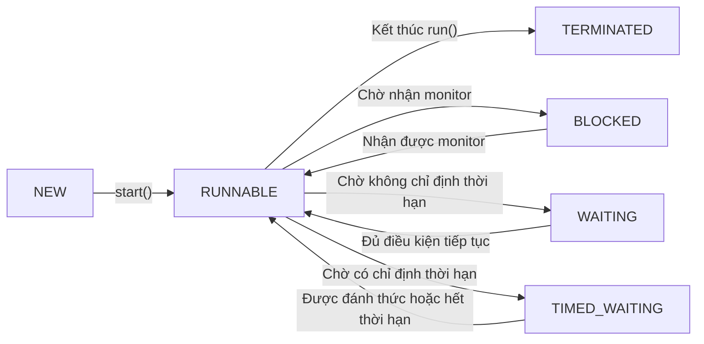

# Thread.State và các trạng thái vòng đời luồng

## 1. Trạng thái luồng giúp chẩn đoán điều gì?

Một ứng dụng phản hồi chậm không nhất thiết có luồng chạy vòng lặp vô hạn. Luồng có thể đang chờ monitor, chờ dữ liệu trong hàng đợi, ngủ theo lịch hoặc đợi một tác vụ khác kết thúc.

`Thread.State` là bộ sáu trạng thái mà JVM dùng để mô tả vòng đời và kiểu hoạt động/chờ của một đối tượng `Thread` tại thời điểm quan sát. Nó giúp đặt câu hỏi chẩn đoán đúng, nhưng không tự giải thích nguyên nhân đầy đủ và không chứng minh tác vụ nghiệp vụ đã thành công.

Ba lớp thông tin cần phân biệt:

- **Trạng thái luồng Java:** các giá trị trong `Thread.State`.
- **Trạng thái luồng của hệ điều hành:** cách hệ điều hành hoặc bộ lập lịch quản lý tài nguyên thực thi.
- **Trạng thái công việc:** đang xử lý đơn hàng, đợi HTTP, thành công, lỗi hoặc bị hủy.

Không thể thay thế lớp này bằng lớp khác. Một worker đang `WAITING` có thể chỉ đang đợi công việc mới và hoạt động hoàn toàn bình thường; một công việc đang lỗi có thể đã kết thúc trong khi worker của executor vẫn sống để nhận việc tiếp theo.

## 2. Sáu trạng thái và ý nghĩa cốt lõi

| Trạng thái | Ý nghĩa | Tình huống thường gặp |
| --- | --- | --- |
| `NEW` | Đối tượng Thread chưa được khởi động | Đã `new Thread(...)`, chưa gọi `start()` |
| `RUNNABLE` | Luồng đang ở trạng thái thực thi của JVM | Đang chạy Java hoặc có thể đang chờ tài nguyên hệ điều hành |
| `BLOCKED` | Đang chờ nhận monitor nội tại | Chưa vào được đoạn/phương thức `synchronized` |
| `WAITING` | Đang chờ không có giới hạn thời gian đã chỉ định | `Object.wait()`, `Thread.join()`, `LockSupport.park()` |
| `TIMED_WAITING` | Đang chờ với giới hạn thời gian đã chỉ định | `sleep`, `wait(timeout)`, `join(timeout)`, các phiên bản park có thời hạn |
| `TERMINATED` | Luồng đã kết thúc thực thi | `run()` hoàn tất bình thường hoặc kết thúc do ngoại lệ không được xử lý |

Đây là trạng thái của máy ảo, không phải ánh xạ một-một sang trạng thái luồng hệ điều hành. Mỗi luồng có một trạng thái tại một thời điểm; nơi quan sát có thể đọc được các trạng thái khác nhau ở hai lần kiểm tra liên tiếp. [Tài liệu Thread.State](https://docs.oracle.com/en/java/javase/25/docs/api/java.base/java/lang/Thread.State.html)

Tên trạng thái là điểm bắt đầu. Để biết luồng đợi ai, đợi ở đâu và có tiến triển không, phải kết hợp stack trace, tài nguyên đang chờ và các lần quan sát tiếp theo.

## 3. Vòng đời không phải một chuỗi đi qua đủ sáu trạng thái

Luồng không bắt buộc đi lần lượt `NEW → RUNNABLE → BLOCKED → WAITING → TIMED_WAITING → TERMINATED`. Các trạng thái chờ là các nhánh có thể xuất hiện nhiều lần hoặc không xuất hiện lần nào.

Sơ đồ khái quát:



Sơ đồ lược bỏ một số bước trung gian. Sau `Object.wait()`, luồng phải nhận lại monitor trước khi phương thức chờ thực sự trở về; nếu monitor chưa rảnh, có thể quan sát `BLOCKED` ở giai đoạn đó.

Một luồng cũng có thể đi từ `NEW` qua `RUNNABLE` đến `TERMINATED` quá nhanh để một luồng khác kịp quan sát `RUNNABLE`. Không nhìn thấy một trạng thái trong quá trình lấy mẫu không có nghĩa trạng thái đó chưa từng xảy ra.

### 3.1. NEW và TERMINATED đều có thể không còn hoạt động

`isAlive()` trả `false` với cả luồng chưa start và luồng đã kết thúc. Muốn phân biệt hai tình huống, có thể quan sát `getState()`.

Một đối tượng Thread chỉ được khởi động một lần. Gọi lại `start()` sau khi nó đã kết thúc không tạo một vòng đời mới; phải tạo đối tượng luồng khác hoặc gửi công việc mới vào executor phù hợp.

Gọi trực tiếp `thread.run()` cũng không thay thế `start()`: đó là một lời gọi phương thức trên chính luồng đang gọi, không phải yêu cầu JVM lập lịch một luồng mới.

### 3.2. Trạng thái kết thúc không biểu diễn kết quả nghiệp vụ

`TERMINATED` cho biết luồng đã dừng, không cho biết công việc thành công. Muốn biết kết quả, cần giao thức riêng như `Future.get()`, một kết quả được công bố an toàn hoặc cơ chế báo lỗi.

Tương tự, ngắt không phải một giá trị thứ bảy trong enum. Một luồng có thể có trạng thái ngắt trong khi vẫn `RUNNABLE`, và cách nó phản ứng phụ thuộc thao tác đang thực hiện cùng chính sách hủy của chương trình.

## 4. RUNNABLE không đồng nghĩa luôn sử dụng CPU

Trong ngữ nghĩa Java, `RUNNABLE` rộng hơn “đang chiếm CPU tại đúng thời điểm chụp”.

Một luồng ở trạng thái này có thể:

- Đang thực hiện vòng lặp tính toán.
- Đang chờ được bộ lập lịch cấp CPU.
- Nằm trong một lời gọi native hoặc I/O mà JVM vẫn biểu diễn là RUNNABLE, tùy cơ chế thực thi.

Do đó, nhìn thấy nhiều `RUNNABLE` không đủ để kết luận ứng dụng thiếu CPU hoặc mọi luồng đang bận tính toán. Cần xem CPU thực tế và stack trace. Một stack ở vòng lặp Java tăng cùng mức CPU cao gợi ý khác với stack ở tầng đọc socket nhưng mức CPU thấp.

Ngược lại, trạng thái không có mục riêng “RUNNING” và “READY”. Không tự thêm hai giá trị đó vào danh sách enum rồi dùng như kết quả của `Thread.getState()`.

Với virtual thread trên Java 21 trở lên, cũng phải tách trạng thái logic của Thread khỏi trạng thái luồng thực thi nền. Ví dụ trong bài dùng các platform thread tạo bằng constructor để chạy được trên JDK 17; không suy diễn các quan sát của nó thành thông tin về số luồng hệ điều hành trong ứng dụng dùng virtual thread. [Tài liệu Thread](https://docs.oracle.com/en/java/javase/25/docs/api/java.base/java/lang/Thread.html)

## 5. BLOCKED chỉ rõ một loại chờ: monitor nội tại

### 5.1. Chờ vào synchronized

Giả sử A đang giữ monitor `guard`:

```java
// Đoạn minh họa.
synchronized (guard) {
    doProtectedWork();
}
```

Nếu B muốn vào một đoạn `synchronized (guard)` khác mà A chưa nhả monitor, B có thể ở `Thread.State.BLOCKED`.

Monitor đang chờ phải là cùng đối tượng. Hai đối tượng khác nhau không tạo một điểm loại trừ nhau chỉ vì cùng tên biến hoặc cùng lớp.

Với phương thức `synchronized` không static, monitor gắn với đối tượng nhận lời gọi. Với phương thức `static synchronized`, monitor gắn với đối tượng `Class` tương ứng.

### 5.2. “Bị chặn” trong ngôn ngữ thường không luôn là BLOCKED

Một luồng đang chờ `ReentrantLock`, semaphore hoặc latch thường chờ qua cơ chế park của bộ đồng bộ. Khi thực sự park, nó có thể ở `WAITING` hoặc `TIMED_WAITING`.

Vì vậy, câu “luồng này đang bị chặn ở một lock” chưa đủ để dự đoán giá trị enum. Phải xác định đó là monitor nội tại, một bộ đồng bộ dựa trên AQS hay một loại chờ khác.

Cũng không kết luận ngược “không có BLOCKED nên không có tranh chấp khóa”. Tranh chấp khóa có thể thể hiện qua các trạng thái khác và stack trace tương ứng.

### 5.3. Notify không trao monitor ngay

Một luồng `Object.wait()` nhả monitor của chính đối tượng được wait. Sau khi được báo hiệu, nó vẫn phải nhận lại monitor trước khi tiếp tục.

Nếu luồng báo hiệu vẫn đang giữ monitor, luồng được báo hiệu có thể chuyển sang `BLOCKED` để tranh monitor. Khi đó, `notifyAll()` đã được gọi nhưng bên chờ chưa thể chạy tiếp; đây không tự động là lỗi của notify.

`wait()` không nhả mọi khóa mà luồng đang giữ, chỉ nhả monitor gắn với đối tượng chờ. Việc giữ thêm khóa khác trong khi chờ có thể tạo chuỗi phụ thuộc khó phát hiện. [Tài liệu Object.wait/notify](https://docs.oracle.com/en/java/javase/25/docs/api/java.base/java/lang/Object.html)

## 6. WAITING và TIMED_WAITING nói về kiểu chờ, không nói về sức khỏe

### 6.1. WAITING không có nghĩa chắc chắn phải chờ mãi

Trạng thái này biểu diễn một thao tác chờ không chỉ định giới hạn thời gian. Thao tác vẫn có thể kết thúc khi điều kiện phù hợp xảy ra, khi được ngắt hoặc theo ngữ nghĩa riêng của API.

Ví dụ:

- `join()`: chờ luồng đích kết thúc.
- `wait()`: chờ trong tập chờ của monitor, rồi nhận lại monitor.
- `park()`: chờ theo giấy phép và quy tắc của LockSupport.

Không đồng nhất `WAITING` với `Object.wait()`; phải đọc stack để phân biệt.

### 6.2. TIMED_WAITING không bảo đảm thực hiện tiếp đúng thời điểm

Một khoảng chờ có thời hạn không phải cam kết luồng sẽ nhận CPU và hoàn tất công việc đúng tại mốc đó. Lập lịch và việc nhận lại khóa có thể làm thời gian trước khi mã tiếp theo chạy dài hơn.

Ngoài ra, một số thao tác có thể trở về trước thời hạn, chẳng hạn khi được đánh thức hoặc bị ngắt. Không dùng một lần thấy `TIMED_WAITING` để đoán rằng luồng nhất định ngủ thêm bao nhiêu mili giây.

Các giá trị timeout có trường hợp đặc biệt. Chẳng hạn, `Object.wait(0)` và `Thread.join(0)` chờ không có thời hạn; không chỉ nhìn thấy một lời gọi có tham số rồi kết luận luôn là `TIMED_WAITING`.

### 6.3. Sleep, wait và park có quy tắc khác nhau

| Thao tác | Mục đích | Giải phóng khóa đang giữ? | Khi bị ngắt |
| --- | --- | --- | --- |
| `Thread.sleep(...)` | Tạm dừng luồng đang gọi theo thời gian | Không tự nhả monitor đang giữ | Có thể ném InterruptedException |
| `Object.wait(...)` | Chờ điều kiện gắn với monitor | Nhả monitor của đối tượng được wait; phải nhận lại trước khi trở về | Có thể ném InterruptedException |
| `LockSupport.park(...)` | Cơ chế chờ thấp tầng | Không tự nhả các khóa ứng dụng đang giữ | Có thể trở về; không tự ném InterruptedException |
| `Condition.await(...)` | Chờ điều kiện gắn với một Lock | Theo hợp đồng condition; loại phổ biến nhả rồi nhận lại khóa gắn với nó | Theo biến thể phương thức chờ |

Điểm cần chẩn đoán là luồng đang giữ tài nguyên nào trong lúc chờ. Một luồng ngủ khi vẫn giữ monitor có thể làm nhiều luồng khác `BLOCKED`, dù bản thân nó đang `TIMED_WAITING`.

Với condition, dùng phương thức và hợp đồng của condition thay cho suy luận từ tên trạng thái. [Tài liệu Condition](https://docs.oracle.com/en/java/javase/25/docs/api/java.base/java/util/concurrent/locks/Condition.html)

Với park, một lần trở về không chứng minh điều kiện đã đúng; cần kiểm tra điều kiện trong vòng lặp. [Tài liệu LockSupport](https://docs.oracle.com/en/java/javase/25/docs/api/java.base/java/util/concurrent/locks/LockSupport.html)

## 7. Ví dụ chạy được: tạo tình huống để quan sát đủ sáu trạng thái

Ví dụ không đoán “ngủ 100 ms là luồng kia chắc đã chờ”. Nó tạo các mốc phối hợp bằng latch và giữ tình huống cần quan sát cho đến khi main hoàn tất bước quan sát.

Hàm `showState` lấy mẫu có thời hạn chỉ phục vụ thí nghiệm chẩn đoán. Không dùng mẫu này làm giao thức đồng bộ nghiệp vụ: trong ứng dụng thật, hãy chờ bằng latch, future, khóa hoặc điều kiện phù hợp.

Tạo tệp `ThreadStateDemo.java`:

```java
import java.util.concurrent.CountDownLatch;
import java.util.concurrent.TimeUnit;
import java.util.concurrent.atomic.AtomicBoolean;

public class ThreadStateDemo {
    static void awaitStarted(CountDownLatch started)
            throws InterruptedException {
        if (!started.await(5, TimeUnit.SECONDS)) {
            throw new IllegalStateException("worker did not start");
        }
    }

    static void showState(String label, Thread thread, Thread.State expected)
            throws InterruptedException {
        long started = System.nanoTime();
        long budget = TimeUnit.SECONDS.toNanos(5);
        while (System.nanoTime() - started < budget) {
            Thread.State observed = thread.getState();
            if (observed == expected) {
                System.out.println(label + "=" + observed);
                return;
            }
            if (observed == Thread.State.TERMINATED) {
                throw new IllegalStateException(
                        label + " terminated before expected state");
            }
            Thread.sleep(1);
        }
        throw new IllegalStateException(
                label + ": expected " + expected
                        + ", observed " + thread.getState());
    }

    static void finish(Thread thread) throws InterruptedException {
        thread.join(5_000);
        if (thread.isAlive()) {
            throw new IllegalStateException(
                    "worker still alive: " + thread.getName());
        }
    }

    static void observeRunnable() throws InterruptedException {
        AtomicBoolean stop = new AtomicBoolean(false);
        CountDownLatch started = new CountDownLatch(1);
        Thread worker = new Thread(() -> {
            started.countDown();
            while (!stop.get()) {
                Thread.onSpinWait();
            }
        }, "runnable-worker");
        worker.start();
        try {
            awaitStarted(started);
            showState("runnable", worker, Thread.State.RUNNABLE);
        } finally {
            stop.set(true);
            finish(worker);
        }
    }

    static void observeBlocked() throws InterruptedException {
        Object monitor = new Object();
        CountDownLatch attempting = new CountDownLatch(1);
        Thread worker = new Thread(() -> {
            attempting.countDown();
            synchronized (monitor) {
                // The worker can enter only after main releases the monitor.
            }
        }, "blocked-worker");

        try {
            synchronized (monitor) {
                worker.start();
                awaitStarted(attempting);
                showState("blocked", worker, Thread.State.BLOCKED);
            }
        } finally {
            // Main has left synchronized before waiting for worker termination.
            finish(worker);
        }
    }

    static void observeWaiting() throws InterruptedException {
        Object monitor = new Object();
        boolean[] released = {false};
        CountDownLatch started = new CountDownLatch(1);
        Thread worker = new Thread(() -> {
            synchronized (monitor) {
                started.countDown();
                try {
                    while (!released[0]) {
                        monitor.wait();
                    }
                } catch (InterruptedException e) {
                    Thread.currentThread().interrupt();
                }
            }
        }, "waiting-worker");

        worker.start();
        try {
            awaitStarted(started);
            showState("waiting", worker, Thread.State.WAITING);
        } finally {
            synchronized (monitor) {
                released[0] = true;
                monitor.notifyAll();
            }
            finish(worker);
        }
    }

    static void observeTimedWaiting() throws InterruptedException {
        CountDownLatch started = new CountDownLatch(1);
        Thread worker = new Thread(() -> {
            started.countDown();
            try {
                Thread.sleep(30_000);
            } catch (InterruptedException e) {
                Thread.currentThread().interrupt();
            }
        }, "sleeping-worker");

        worker.start();
        try {
            awaitStarted(started);
            showState("timed", worker, Thread.State.TIMED_WAITING);
        } finally {
            worker.interrupt();
            finish(worker);
        }
    }

    public static void main(String[] args) throws InterruptedException {
        Thread lifecycle = new Thread(() -> {}, "lifecycle-worker");
        System.out.println("new=" + lifecycle.getState());

        observeRunnable();
        observeBlocked();
        observeWaiting();
        observeTimedWaiting();

        lifecycle.start();
        finish(lifecycle);
        System.out.println("terminated=" + lifecycle.getState());
    }
}
```

Biên dịch và chạy bằng JDK 17 trở lên:

```shell
javac -encoding UTF-8 ThreadStateDemo.java
java ThreadStateDemo
```

Stdout dự kiến trong điều kiện chạy thông thường:

```text
new=NEW
runnable=RUNNABLE
blocked=BLOCKED
waiting=WAITING
timed=TIMED_WAITING
terminated=TERMINATED
```

Chương trình không chờ ngủ đủ 30 giây: main ngắt sleeping-worker sau khi quan sát. Các giới hạn 5 giây giúp thí nghiệm thất bại có thông báo thay vì chờ vô hạn nếu môi trường không tiến triển như dự kiến. Chúng không tạo bảo đảm thời gian thực trong một máy bị treo hoặc quá tải nghiêm trọng.

Vòng lặp tính toán trong `observeRunnable` chỉ tồn tại ngắn để tạo tình huống RUNNABLE rõ ràng; không dùng nó để chờ dữ liệu trong ứng dụng.

### 7.1. Vì sao latch chưa thay thế hoàn toàn bước quan sát?

Một worker hạ latch trước khi gọi `wait()` có thể vẫn đang chạy vài lệnh trước khi thực sự chờ. Main nhận được tín hiệu “đã đến mốc chuẩn bị” nhưng không được bảo đảm `getState()` ngay sau đó đã là WAITING.

Tương tự, worker báo chuẩn bị vào monitor chưa chắc đã đến thao tác tranh monitor đúng tại lần đọc đầu tiên. Vì vậy, thí nghiệm dùng latch để tạo thứ tự ban đầu, rồi lấy mẫu có giới hạn để quan sát trạng thái.

Trong phần BLOCKED, main chủ động giữ monitor cho đến khi đã quan sát được worker chờ. Trong phần WAITING, điều kiện `released` vẫn sai cho đến khi main hoàn tất quan sát; thức dậy giả chỉ khiến worker kiểm tra rồi chờ lại.

### 7.2. Vì sao phải ra khỏi synchronized trước khi join?

Nếu main vẫn giữ monitor mà worker cần nhận để kết thúc, rồi main gọi `join()`, main sẽ đợi worker còn worker đợi monitor do main giữ. Ví dụ cố ý đặt `finish(worker)` sau khi main đã ra khỏi khối synchronized.

Đây là minh họa quan hệ giữa trạng thái và chuỗi phụ thuộc: biết một luồng BLOCKED chưa đủ; phải biết nó chờ tài nguyên do ai giữ và người đó đang đợi điều gì.

## 8. getState là quan sát tức thời, không phải tín hiệu điều phối

Đoạn mã sau không phải cách an toàn để gửi một tín hiệu:

```java
// Đoạn minh họa một cách dùng không đáng tin cậy.
if (worker.getState() == Thread.State.WAITING) {
    sendSignal();
}
```

Giữa lúc đọc và lúc hành động, worker có thể đã đổi trạng thái. Ngược lại, worker có thể chưa vào WAITING tại lần kiểm tra nhưng sẽ vào ngay sau đó. Kết quả là tín hiệu bị bỏ qua hoặc quyết định sai về tiến độ.

Hãy lưu điều kiện hoặc kết quả bằng một giao thức đồng bộ có ý nghĩa rõ: future cho kết quả, latch cho một mốc, hàng đợi cho công việc, condition cho một điều kiện được khóa bảo vệ.

Tương tự, không suy luận rằng đọc thấy `TERMINATED` cho phép bỏ qua thiết kế công bố dữ liệu hoặc kết quả. Nếu nơi gọi cần chờ hoàn tất, dùng API chờ hoàn tất phù hợp; nếu cần biết lỗi, lấy kết quả theo giao thức đó.

Một số quan sát có giá trị ổn định hơn: trước khi ai được phép start, đối tượng chưa start là NEW; sau khi `join` xác nhận luồng đã kết thúc, luồng đó không quay lại RUNNABLE. Nhưng các trạng thái đang chạy và chờ vẫn thay đổi theo quá trình thực thi.

## 9. Cách biến trạng thái thành một giả thuyết chẩn đoán

Thay vì dừng ở “luồng này WAITING”, hãy đi theo chuỗi câu hỏi:

1. Đó là luồng nào và đang phục vụ công việc gì? Tên luồng giúp định vị nhưng chưa phải nguyên nhân.
2. Stack trace cho biết đang chờ ở API nào?
3. Nó đợi monitor, condition, kết quả, dữ liệu hay một luồng khác kết thúc?
4. Ai có trách nhiệm làm điều kiện đó thay đổi?
5. Người có trách nhiệm có đang chạy, đang chờ tài nguyên khác hay đã lỗi/kết thúc?
6. Các lần chụp tiếp theo có cho thấy tiến triển không?
7. Mức CPU, độ dài hàng đợi và thời gian phản hồi có phù hợp với giả thuyết không?

Ví dụ suy luận:

| Quan sát | Chưa thể kết luận | Điều cần xem thêm |
| --- | --- | --- |
| Nhiều worker WAITING ở thao tác lấy từ hàng đợi | Hệ thống bị treo | Hàng đợi có trống và worker có đang nhàn đúng thiết kế không |
| Nhiều luồng BLOCKED trên cùng monitor | Mọi luồng đều lỗi | Ai đang giữ monitor và đang làm gì trong vùng tới hạn |
| Một luồng RUNNABLE lâu | Chắc chắn vòng lặp tính toán | Stack, CPU và lời gọi native/I/O |
| Một luồng TIMED_WAITING | Sắp hoàn tất tác vụ | Đang ngủ định kỳ hay đang chờ một điều kiện chưa đủ |
| Luồng đã TERMINATED | Công việc thành công | Kết quả, ngoại lệ, log hoặc Future của công việc |

Thông tin quản lý luồng như `ThreadInfo` có thể kết hợp trạng thái, stack trace, đối tượng đang chờ và chủ sở hữu khóa. Những dữ liệu này phục vụ giám sát/chẩn đoán, không phải giao thức để chương trình cấp quyền thực thi cho nhau. [Tài liệu ThreadInfo](https://docs.oracle.com/en/java/javase/25/docs/api/java.management/java/lang/management/ThreadInfo.html)

Khi ứng dụng dùng virtual thread, cần chọn công cụ có phạm vi hỗ trợ phù hợp với JDK và loại luồng. Không giả định mọi cơ chế thống kê/chụp luồng truyền thống đều liệt kê đầy đủ mọi virtual thread chỉ vì `Thread.State` vẫn có sáu giá trị.

## 10. Trạng thái và deadlock: không có giá trị DEADLOCK

Deadlock là quan hệ phụ thuộc tạo thành vòng, không phải một trạng thái enum riêng.

Ví dụ:

```text
A giữ monitor X và chờ monitor Y do B giữ.
B giữ monitor Y và chờ monitor X do A giữ.
```

Cả A và B có thể ở BLOCKED. Nhưng một deadlock liên quan các bộ đồng bộ khác có thể thể hiện WAITING. Ngược lại, một luồng BLOCKED trong thời gian ngắn có thể chỉ đang tranh chấp bình thường.

Muốn xác định deadlock, cần xây được quan hệ “ai chờ tài nguyên nào, tài nguyên đó do ai giữ” và thấy vòng không thể tự tiến triển. Đếm số luồng WAITING hay BLOCKED không đủ.

Ngoài deadlock, chương trình còn có thể không tiến triển do thiếu bên báo hiệu, chờ kết quả bị bỏ quên, cạn worker hoặc vòng lặp không hoàn tất. Các tình huống đó có thể cho những ảnh trạng thái khác nhau và cần cách xử lý khác nhau.

## 11. Những nhầm lẫn cần sửa ngay từ mô hình

- **Có RUNNABLE nghĩa là có CPU:** cần đối chiếu số đo và stack.
- **BLOCKED nghĩa là mọi kiểu chờ:** enum này gắn với monitor nội tại.
- **WAITING nghĩa là chương trình lỗi:** luồng nhàn hoặc chờ công việc là trường hợp bình thường.
- **TIMED_WAITING nghĩa là chắc chắn tự hết đúng giờ:** hết thời hạn chưa bảo đảm đã nhận CPU hoặc nhận lại monitor.
- **TERMINATED nghĩa là thành công:** cần kết quả và nguyên nhân kết thúc riêng.
- **Ngắt tự đưa luồng sang TERMINATED:** ngắt là tín hiệu; phản ứng phụ thuộc API và mã tác vụ.
- **Sleep nhả khóa:** nó không tự nhả monitor đang giữ.
- **Notify chuyển thẳng sang chạy:** bên chờ còn phải nhận lại monitor.
- **Một tác vụ xong thì worker phải TERMINATED:** worker trong pool thường tiếp tục sống.
- **Có thể dùng getState để chờ điều kiện nghiệp vụ:** quan sát tức thời không thay thế primitive đồng bộ.

## 12. Bài tập vận dụng

1. Thay `Thread.sleep(30_000)` trong ví dụ bằng `monitor.wait(30_000)` đúng giao thức. Giải thích điểm khác nhau về monitor khi cả hai đều có thể hiện TIMED_WAITING.
2. Sau khi báo hiệu worker đang `wait()`, cố ý giữ monitor thêm một khoảng trong một thí nghiệm riêng. Quan sát khả năng xuất hiện BLOCKED khi worker nhận lại monitor.
3. Tạo một worker chờ `ReentrantLock`, rồi đối chiếu stack và trạng thái với worker chờ vào `synchronized`. Không dùng từ “bị chặn” thay cho giá trị enum cụ thể.
4. Cho một luồng kết thúc bằng ngoại lệ không được xử lý. Giải thích vì sao trạng thái cuối vẫn là TERMINATED và cần thêm bằng chứng nào để biết lỗi.
5. Dùng executor thực thi hai tác vụ liên tiếp. Chỉ ra tại sao vòng đời tác vụ không trùng với vòng đời worker Thread.
6. Với một ảnh chụp có nhiều WAITING và một RUNNABLE, liệt kê ít nhất hai giả thuyết khác nhau và dữ liệu bổ sung cần thu thập để phân biệt.

Khi sử dụng Thread.State, hãy gắn mỗi trạng thái với một cơ chế cụ thể và một câu hỏi tiếp theo. Giá trị của nó nằm ở khả năng thu hẹp điều cần điều tra, còn kết luận về nguyên nhân phải dựa trên cả ngữ cảnh và bằng chứng tiến triển.
