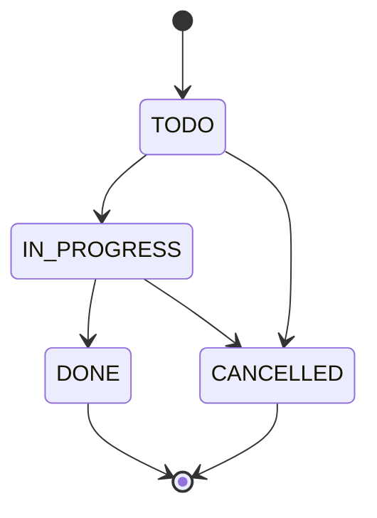

# Kiểu liệt kê và mô hình tập giá trị hữu hạn

## 1. Enum trả lời câu hỏi “giá trị này được phép là một trong những gì?”

Một công việc có thể đang chờ, đang thực hiện, hoàn thành hoặc bị hủy. Nếu đây là những lựa chọn được chương trình xác định trước, có thể mô hình hóa bằng kiểu liệt kê `enum`:

```java
enum TaskStatus {
    TODO,
    IN_PROGRESS,
    DONE,
    CANCELLED
}
```

Khai báo tạo ra:

- Một kiểu mới tên `TaskStatus`.
- Bốn hằng enum có tên rõ ràng.
- Một miền lựa chọn hữu hạn được nêu trực tiếp trong mã.

Sử dụng:

```java
TaskStatus status = TaskStatus.TODO;
status = TaskStatus.IN_PROGRESS;
```

Biến `status` chứa một lựa chọn của đúng miền `TaskStatus`. Nó không phải một chuỗi tự do, cũng không phải một số dùng làm mã ngầm định.

Có thể hình dung miền hằng là:

```text
TaskStatus = { TODO, IN_PROGRESS, DONE, CANCELLED }
```

“Hữu hạn” ở đây nói về tập hằng đã khai báo của kiểu enum. Nó không có nghĩa chương trình có thể suy ra mọi quy tắc nghiệp vụ chỉ từ tên các hằng.

Enum là một kiểu lớp đặc biệt trong Java, được quy định ở [JLS §8.9](https://docs.oracle.com/javase/specs/jls/se25/html/jls-8.html#jls-8.9). Đây vẫn là cơ chế hiện hành để biểu đạt những miền lựa chọn đóng trong Java hiện đại.

## 2. Vì sao cần một kiểu riêng thay vì nhận mọi chuỗi?

Nếu API nhận `String`, những giá trị như `"DONE"`, `"done"`, `"DN"` hoặc một chuỗi không liên quan đều có cùng kiểu Java. Mỗi nơi sử dụng phải tự kiểm tra nội dung và thống nhất cách diễn giải.

Nếu API nhận `TaskStatus`, trình biên dịch có thể từ chối những đối số không thuộc miền kiểu này:

```java
static void showStatus(TaskStatus status) {
    System.out.println(status);
}
```

Lời gọi hợp lệ:

```java
showStatus(TaskStatus.DONE);
```

Những lời gọi bị từ chối:

```java
// showStatus("DONE"); // String không phải TaskStatus.
// showStatus(2);      // int không phải TaskStatus.
```

Lợi ích không chỉ là tránh gõ sai tên. Chữ ký phương thức đã nói rõ miền dữ liệu mà nó cần, và công cụ có thể hỗ trợ hoàn thành tên, tìm nơi sử dụng, đổi tên và kiểm tra các nhánh xử lý.

Enum không làm dữ liệu bên ngoài tự hợp lệ. Nếu đầu vào đến từ HTTP, tệp hoặc cơ sở dữ liệu dưới dạng chuỗi/mã, vẫn cần một bước chuyển đổi có kiểm tra ở ranh giới. Sau bước đó, mã bên trong có thể làm việc với kiểu miền rõ ràng hơn.

## 3. Hai enum khác nhau vẫn là hai miền khác nhau

Giả sử có hai khai báo độc lập:

```java
enum TaskStatus { TODO, DONE }
enum DeliveryStatus { TODO, DONE }
```

Tên hằng trùng nhau không làm `TaskStatus.DONE` và `DeliveryStatus.DONE` trở thành cùng một kiểu. Một trạng thái giao hàng không được tự truyền vào phương thức cần trạng thái công việc.

Các khai báo trên chỉ là ví dụ riêng về quan hệ kiểu, không đặt cạnh khai báo `TaskStatus` bốn hằng của chương trình hoàn chỉnh trong cùng một phạm vi.

Tính phân biệt miền này giúp tránh những lỗi mà một chuỗi chung như `"DONE"` dễ che đi. Nếu nghiệp vụ cần ánh xạ giữa hai miền, hãy viết ánh xạ tường minh; không cho rằng cùng tên đồng nghĩa cùng ý nghĩa.

Java quản lý các instance hằng của enum. Mã ứng dụng không tạo một hằng mới bằng `new TaskStatus()` hoặc thêm một tên tùy ý vào kiểu lúc chạy.

## 4. Khi nào mô hình hữu hạn phù hợp?

Enum thường phù hợp khi các lựa chọn là một phần của quy tắc chương trình và được kiểm soát qua mã nguồn, ví dụ:

- Trạng thái xử lý có một danh sách được định nghĩa rõ.
- Cấp độ ưu tiên đã được chính sách cố định.
- Một lựa chọn chiến lược hoặc chế độ hoạt động được chương trình hỗ trợ.
- Một tập loại sự kiện hoặc kết quả xử lý có biên rõ ràng.

Điều kiện quan trọng không chỉ là “hôm nay có ít giá trị”. Một danh sách sản phẩm hiện có năm mục vẫn có thể tăng tùy ý từ dữ liệu quản trị; nó không nhất thiết nên trở thành một enum.

Cân nhắc mô hình dữ liệu khác khi các giá trị do người dùng tạo thêm lúc chạy, được quản trị độc lập với phiên bản ứng dụng hoặc có danh tính/thuộc tính cần lưu như các thực thể riêng.

| Câu hỏi thiết kế | Nếu câu trả lời là có |
| --- | --- |
| Tập lựa chọn được chương trình biết và kiểm soát trước? | Enum có thể phù hợp |
| Thêm một lựa chọn có thể đòi hỏi sửa các nhánh xử lý? | Enum giúp đưa thay đổi đó vào quá trình biên dịch/rà soát |
| Người dùng phải tự tạo loại mới mà không phát hành ứng dụng? | Thường cần mô hình dữ liệu mở hơn |
| Một đối tượng đồng thời chọn nhiều mục? | Cần một tập lựa chọn, không chỉ một biến enum đơn |

Một biến enum biểu đạt một lựa chọn tại một thời điểm. Nếu cần nhiều quyền đồng thời, phải mô hình hóa một tập quyền; không tự hiểu một biến enum như một tập bit số nguyên.

## 5. Enum là kiểu tham chiếu, nên `null` vẫn có thể xuất hiện

Đây là mã Java hợp lệ về kiểu:

```java
TaskStatus status = null;
```

Vì vậy, cần phân biệt:

- Miền các hằng enum được khai báo: bốn lựa chọn trong ví dụ.
- Các giá trị một biến tham chiếu có thể giữ: còn có thể là `null` nếu API không ngăn chặn.

Nếu trạng thái là bắt buộc, hãy kiểm tra và bảo vệ điều đó trong constructor hoặc phương thức ranh giới:

```java
Objects.requireNonNull(status, "status");
```

Một hằng `UNKNOWN` cũng không phải giải pháp mặc định cho mọi chỗ thiếu dữ liệu. Chỉ thêm nó nếu “chưa biết” là một trạng thái có ý nghĩa nghiệp vụ và có quy tắc xử lý rõ, thay vì dùng nó để lặng lẽ che dữ liệu sai.

Cũng không đặt dữ liệu riêng của từng công việc vào trạng thái dùng chung của một hằng enum. Nhiều công việc có thể cùng tham chiếu `TaskStatus.TODO`; mỗi công việc cần trường trạng thái riêng của nó. Enum mô tả lựa chọn, không thay thế toàn bộ đối tượng công việc.

## 6. Một tập trạng thái chưa phải một máy trạng thái hoàn chỉnh

Từ bốn hằng ở đầu bài, không thể tự suy ra rằng mọi chuyển đổi giữa chúng đều hợp lệ. Cả `TODO` và `DONE` đều là giá trị đúng kiểu, nhưng chuyển trực tiếp từ `TODO` sang `DONE` có thể bị nghiệp vụ cấm.

Giả sử chính sách của ví dụ là:



Ký hiệu đầu/cuối của sơ đồ không phải các hằng bổ sung của enum. Miền vẫn có đúng bốn hằng; các mũi tên là quy tắc chuyển trạng thái.

Cần hai lớp bảo đảm riêng:

1. **An toàn kiểu:** đối số là một `TaskStatus`, không phải chuỗi hoặc trạng thái của miền khác.
2. **Đúng nghiệp vụ:** từ trạng thái hiện tại có được sang trạng thái đích hay không.

Trình biên dịch kiểm tra lớp thứ nhất. Lớp thứ hai phải được biểu đạt bằng quy tắc và thực thi ở nơi phù hợp. Một biến enum tự nó không ngăn lệnh gán `status = TaskStatus.DONE` trong mọi ngữ cảnh.

Khi cần bảo vệ quy tắc, đối tượng hoặc dịch vụ quản lý công việc nên kiểm soát việc thay đổi trạng thái thay vì cho mọi nơi tự ghi trực tiếp. Ví dụ cuối bài dùng hàm `moveTo` để làm rõ sự khác biệt này, không xây một hệ thống quản lý công việc đầy đủ.

## 7. Duyệt miền giá trị và xử lý từng lựa chọn

Trình biên dịch cung cấp phương thức `values()` cho mỗi enum:

```java
for (TaskStatus status : TaskStatus.values()) {
    System.out.println(status);
}
```

Trong ví dụ, nó liệt kê `TODO`, `IN_PROGRESS`, `DONE`, `CANCELLED` theo thứ tự khai báo. Có thể dùng để biết các lựa chọn mà phiên bản chương trình này hỗ trợ.

Thứ tự khai báo không tự nói rằng trạng thái sau luôn được đi từ trạng thái trước, hoặc trạng thái nào có mức ưu tiên cao hơn. Không viết quy tắc chuyển trạng thái bằng cách cộng vào `ordinal()` hay mặc định “hằng tiếp theo là trạng thái tiếp theo”.

Một biểu thức `switch` có thể làm rõ việc xử lý đầy đủ từng lựa chọn:

```java
static String label(TaskStatus status) {
    Objects.requireNonNull(status, "status");
    return switch (status) {
        case TODO -> "waiting";
        case IN_PROGRESS -> "working";
        case DONE -> "completed";
        case CANCELLED -> "cancelled";
    };
}
```

Các nhãn trả về ở đây chỉ là ví dụ. Tên hằng kỹ thuật và văn bản trình bày cho người dùng là hai quyết định riêng.

Vì biểu thức `switch` này liệt kê các trường hợp mà không dùng một `default` chung, thêm hằng mới rồi biên dịch lại sẽ buộc xem lại tính đầy đủ của biểu thức. Điều đó hữu ích khi mở rộng miền giá trị; không nên tự động gom mọi giá trị mới vào một nhánh mặc định thiếu ý nghĩa.

## 8. Tên enum, dữ liệu bên ngoài và ý nghĩa của định danh

Có thể chuyển một tên khớp chính xác thành hằng:

```java
TaskStatus parsed = TaskStatus.valueOf("IN_PROGRESS");
```

`valueOf` yêu cầu tên hằng đúng, có phân biệt hoa/thường. Một chuỗi như `"PAUSED"` không tạo thêm hằng mới; nó gây `IllegalArgumentException` vì kiểu hiện tại không có hằng đó.

Đây là kiểm tra lúc chạy tại ranh giới dữ liệu, khác với lỗi biên dịch khi truyền trực tiếp một `String` vào phương thức cần `TaskStatus`.

Khi thiết kế dữ liệu lưu trữ hoặc giao tiếp công khai:

- Không dùng `ordinal()` như mã nghiệp vụ bền vững; đổi thứ tự hoặc chèn hằng có thể thay ý nghĩa số.
- Không mặc định mọi nhãn hiển thị phải trùng tên hằng kỹ thuật.
- Nếu dùng tên hằng làm định dạng trao đổi, đổi tên trở thành một thay đổi cần xem xét tương thích.
- Nếu nhận tên chưa biết, quyết định chính sách báo lỗi hoặc ánh xạ một cách tường minh, thay vì tự chọn một trạng thái không liên quan.

Các hành vi như `name`, `ordinal` và chuyển tên được mô tả trong [Enum](https://docs.oracle.com/en/java/javase/25/docs/api/java.base/java/lang/Enum.html). Bài tập trung vào mô hình miền hữu hạn; lựa chọn mã trao đổi ổn định hoặc cách lưu cơ sở dữ liệu cần một thiết kế ranh giới riêng.

## 9. Chương trình hoàn chỉnh

Lưu vào `FiniteEnumDemo.java`, dùng Java 17 trở lên:

```java
import java.util.Arrays;
import java.util.Objects;

public class FiniteEnumDemo {
    enum TaskStatus {
        TODO,
        IN_PROGRESS,
        DONE,
        CANCELLED
    }

    static String label(TaskStatus status) {
        Objects.requireNonNull(status, "status");
        return switch (status) {
            case TODO -> "waiting";
            case IN_PROGRESS -> "working";
            case DONE -> "completed";
            case CANCELLED -> "cancelled";
        };
    }

    static TaskStatus moveTo(TaskStatus current, TaskStatus next) {
        Objects.requireNonNull(current, "current");
        Objects.requireNonNull(next, "next");
        boolean allowed = switch (current) {
            case TODO -> next == TaskStatus.IN_PROGRESS || next == TaskStatus.CANCELLED;
            case IN_PROGRESS -> next == TaskStatus.DONE || next == TaskStatus.CANCELLED;
            case DONE, CANCELLED -> false;
        };
        if (!allowed) {
            throw new IllegalStateException("Transition is not allowed");
        }
        return next;
    }

    public static void main(String[] args) {
        System.out.println("all = " + Arrays.toString(TaskStatus.values()));
        TaskStatus current = TaskStatus.TODO;
        System.out.println("initial = " + current);
        current = moveTo(current, TaskStatus.IN_PROGRESS);
        System.out.println("after start = " + current);
        current = moveTo(current, TaskStatus.DONE);
        System.out.println("after finish = " + current);
        System.out.println("label = " + label(current));
        System.out.println("is done = " + (current == TaskStatus.DONE));

        TaskStatus parsed = TaskStatus.valueOf("IN_PROGRESS");
        System.out.println("parsed = " + parsed);
        try {
            TaskStatus.valueOf("PAUSED");
        } catch (IllegalArgumentException ex) {
            System.out.println("unknown name rejected");
        }
        try {
            moveTo(current, TaskStatus.TODO);
        } catch (IllegalStateException ex) {
            System.out.println("transition rejected");
        }

        TaskStatus missing = null;
        System.out.println("nullable variable = " + missing);
        try {
            label(missing);
        } catch (NullPointerException ex) {
            System.out.println("null rejected by API");
        }
    }
}
```

Biên dịch và chạy:

```shell
javac --release 17 -Xlint:all -Werror -encoding UTF-8 FiniteEnumDemo.java
java FiniteEnumDemo
```

Kết quả chuẩn:

```text
all = [TODO, IN_PROGRESS, DONE, CANCELLED]
initial = TODO
after start = IN_PROGRESS
after finish = DONE
label = completed
is done = true
parsed = IN_PROGRESS
unknown name rejected
transition rejected
nullable variable = null
null rejected by API
```

Các điểm cần rút ra:

- `values()` mô tả tập hằng của kiểu trong phiên bản này.
- Các biến trạng thái dùng đúng kiểu `TaskStatus`.
- `==` phù hợp để so sánh hằng enum; nó không phải so sánh nội dung chuỗi.
- Tên lạ từ bên ngoài bị từ chối lúc chuyển đổi.
- Chuyển từ `DONE` về `TODO` bị cấm bởi hàm nghiệp vụ, dù hai giá trị đều đúng kiểu.
- `null` vẫn gán được vào biến enum; API của ví dụ từ chối nó bằng kiểm tra tường minh.

Hàm `moveTo` trả trạng thái đích khi quy tắc cho phép. Nơi gọi gán kết quả vào biến `current`; hằng enum không tự thay đổi thành một hằng khác.

## 10. Những nhầm lẫn thường gặp

**“Enum chỉ là những số nguyên được đổi tên.”** Không. Enum tạo một kiểu tham chiếu riêng với các hằng có tên, giúp phân biệt miền dữ liệu và kiểm tra lời gọi. Không dựa vào số thứ tự để suy ra toàn bộ ý nghĩa.

**“Có enum thì mọi trạng thái đều hợp lệ trong mọi lúc.”** Không. Đúng kiểu và đúng chuyển trạng thái là hai điều khác nhau.

**“Enum tự loại bỏ `null`.”** Không. Cần thiết kế hợp đồng và kiểm tra bắt buộc khi dữ liệu không được thiếu.

**“Danh sách nhỏ nào cũng nên là enum.”** Không. Cần xem tập giá trị có thuộc quy tắc đóng trong chương trình hay là dữ liệu mở được quản trị lúc chạy.

**“Thêm một hằng chỉ là thêm một dòng.”** Có thể phải cập nhật nhánh xử lý, quy tắc chuyển trạng thái, dữ liệu trao đổi và kiểm thử. Lợi ích của enum là giúp các lựa chọn trở nên rõ để rà soát, không làm các tác động đó biến mất.

**“Tất cả đối tượng công việc ở TODO là cùng một công việc.”** Không. Chúng chỉ dùng chung một giá trị trạng thái. Danh tính và dữ liệu từng công việc thuộc các đối tượng công việc riêng.

## 11. Tự kiểm tra

**Câu 1.** Tập hằng `TaskStatus` có bao nhiêu lựa chọn trong ví dụ, và `null` có phải một hằng thứ năm không?

Có bốn hằng. `null` không phải hằng enum; nó là giá trị mà một biến tham chiếu có thể giữ nếu hợp đồng không loại bỏ.

**Câu 2.** `TaskStatus.DONE` và `DeliveryStatus.DONE` có tự thay thế nhau chỉ vì cùng tên không?

Không. Chúng thuộc hai kiểu miền riêng.

**Câu 3.** Vì sao enum trạng thái chưa đủ để cấm chuyển trực tiếp từ `TODO` sang `DONE`?

Enum chỉ xác định các giá trị của miền. Quy tắc chuyển giữa những giá trị đó phải được mô hình hóa và kiểm tra riêng.

**Câu 4.** Có nên dùng vị trí của hằng trong `values()` làm quy trình xử lý bắt buộc không?

Không. Thứ tự khai báo không tự là thứ tự nghiệp vụ; cần quy tắc tường minh.

**Câu 5.** Nếu người quản trị phải thêm loại trạng thái tùy ý mà không phát hành mã mới, enum có chắc là mô hình phù hợp không?

Không. Yêu cầu đó có thể cần một mô hình dữ liệu mở hơn. Cần phân tích ai sở hữu tập giá trị và cách các quy tắc thay đổi.
