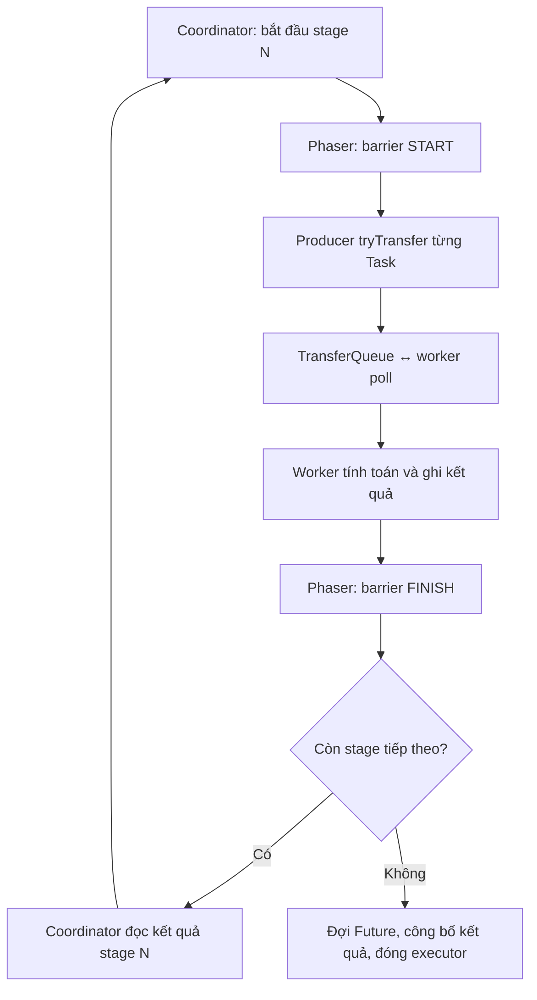

# Phối hợp các giai đoạn bằng Phaser và chuyển giao qua TransferQueue

## 1. Bài toán thực hành và mục tiêu

Xét một quy trình xử lý dữ liệu gồm hai giai đoạn:

1. **Giai đoạn 1:** hai worker nhận các công việc có giá trị đầu vào `1, 2, 3, 4`, tính bình phương và ghi kết quả.
2. **Giai đoạn 2:** hai worker nhận chính các kết quả đã hoàn thành của giai đoạn 1, cộng thêm `10` rồi ghi kết quả cuối.

Yêu cầu quan trọng: giai đoạn 2 **chỉ được bắt đầu sau khi tất cả công việc của giai đoạn 1 thực sự xử lý xong**. Trong mỗi giai đoạn, producer cần **chuyển giao trực tiếp** từng công việc cho worker thay vì chỉ bỏ công việc vào hàng đợi rồi mặc định coi là đã xử lý.

Hai API đồng bộ hóa trong `java.util.concurrent` phù hợp để phối hợp yêu cầu này:

- **`Phaser`:** tổ chức điểm đồng bộ hóa lặp lại giữa các bên tham gia (parties), có đánh số phase. Mỗi phase chỉ tiến lên khi các bên đã đăng ký cùng báo đến điểm hẹn; cũng hỗ trợ đăng ký/hủy đăng ký động khi kiến trúc cần.
- **`TransferQueue<E>`:** hàng đợi truyền dữ liệu có khả năng để producer **chờ cho đến khi consumer thực sự nhận phần tử**. `LinkedTransferQueue<E>` là một triển khai phổ biến, không giới hạn dung lượng theo cấu trúc cố định.

**Phân biệt then chốt:** worker **nhận** một công việc không đồng nghĩa worker đã **xử lý xong** công việc đó. `TransferQueue.transfer` hoặc `tryTransfer(..., timeout, ...)` chỉ xác nhận **handoff đến consumer**; `Phaser` ở cuối giai đoạn xác nhận **tất cả workers đã đến điểm hoàn tất giai đoạn**.

Các API này được giới thiệu từ Java 7 và **vẫn được hỗ trợ trong Java hiện hành**. Ví dụ dưới đây viết theo Java 17+, dùng các API công khai, không phụ thuộc thư viện bên thứ ba hoặc công cụ concurrency lỗi thời.

## 2. Hiểu rõ Phaser: hàng rào đồng bộ theo nhiều phase

### 2.1. Parties, phase và điểm hẹn

Tạo `Phaser` cho một coordinator (luồng chính) và hai worker:

```java
Phaser phaser = new Phaser(3); // main + worker A + worker B
```

Đây là **đoạn minh họa**, cần import `java.util.concurrent.Phaser`. `Phaser` bắt đầu ở phase `0`. Các bên đăng ký phải thông báo `arrive()`, `arriveAndAwaitAdvance()` hoặc `arriveAndDeregister()` để đưa phase hiện tại tiến lên. Khi cả ba bên đều đến, phaser chuyển sang phase tiếp theo.

Một vòng xử lý có thể dùng **hai điểm hẹn**:

1. **Barrier bắt đầu:** các bên chờ nhau trước khi cùng bắt đầu giai đoạn.
2. **Barrier kết thúc:** sau khi các worker xử lý hết phần việc được giao, mọi bên chờ nhau; chỉ sau barrier này coordinator mới được dùng toàn bộ kết quả.

Với hai giai đoạn, một ví dụ không hủy đăng ký trong lúc chạy sẽ đi qua phase `0 → 1 → 2 → 3 → 4`:

```text
                  START giai đoạn 1     FINISH giai đoạn 1
Main:             arrive + wait ----> chuyển việc ----> arrive + wait
Worker 1:         arrive + wait ----> xử lý 2 việc ---> arrive + wait
Worker 2:         arrive + wait ----> xử lý 2 việc ---> arrive + wait
                           phase 1                  phase 2

                  START giai đoạn 2     FINISH giai đoạn 2
Main:             arrive + wait ----> chuyển việc ----> arrive + wait
Worker 1:         arrive + wait ----> xử lý 2 việc ---> arrive + wait
Worker 2:         arrive + wait ----> xử lý 2 việc ---> arrive + wait
                           phase 3                  phase 4
```

Điểm quan trọng: **tất cả các bên phải gọi đúng số lần arrive cho từng phase**. Nếu coordinator đã đợi ở barrier nhưng một worker không bao giờ tham gia, chương trình có thể bị kẹt vô thời hạn nếu không có timeout/cơ chế hủy.

### 2.2. Các thao tác thường gặp

| Phương thức | Ý nghĩa thực tế |
| --- | --- |
| `register()` | Thêm một party vào phaser. |
| `bulkRegister(n)` | Thêm nhiều party; chỉ dùng khi biết đúng số luồng/tác vụ sẽ tham gia. |
| `arrive()` | Báo đã đến phase hiện tại nhưng **không chờ** tất cả bên khác. |
| `arriveAndAwaitAdvance()` | Báo đến và chờ phase tiến lên; thích hợp khi không cần timeout/interruptible waiting. |
| `awaitAdvance(phase)` | Chờ phase đổi mà **không tự báo arrive**; không đáp ứng ngắt theo cách nhiều người kỳ vọng. |
| `awaitAdvanceInterruptibly(phase, timeout, unit)` | Chờ có thể ngắt hoặc timeout; sau timeout **phaser không tự bị hủy**. |
| `arriveAndDeregister()` | Báo đến đồng thời hủy đăng ký party khỏi các phase sau. |
| `forceTermination()` | Buộc phaser vào trạng thái kết thúc, giải phóng các tác vụ đang đợi, hữu ích khi xử lý lỗi/hủy. |
| `getPhase()`, `getRegisteredParties()`, `getUnarrivedParties()` | Xem trạng thái tại thời điểm đọc; không dùng các giá trị snapshot này làm điều kiện điều khiển đồng bộ hóa. |

**Memory visibility:** theo hợp đồng `Phaser`, các hành động xảy ra trước `arrive` của một party có quan hệ *happens-before* với phase advance, và các hành động sau khi bên khác vượt qua advance. Do đó kết quả đã ghi trong mảng ở giai đoạn 1 có thể được coordinator đọc sau barrier kết thúc giai đoạn 1, miễn là thiết kế tránh nhiều worker ghi đè cùng phần tử. Không cần tự thêm `volatile` vào từng ô kết quả chỉ để tạo visibility ở điểm hẹn đó.

### 2.3. Khi cần đồng bộ có timeout

Thay vì chờ mãi bằng `arriveAndAwaitAdvance()`, một helper thường dùng:

```java
int phase = phaser.arrive(); // Party này đã báo đến.
int next = phaser.awaitAdvanceInterruptibly(
        phase, 30, TimeUnit.SECONDS);
if (next < 0) {
    throw new IllegalStateException("Phaser đã kết thúc");
}
```

Đây là **đoạn minh họa bên trong phương thức** có `phaser`; cần xử lý `InterruptedException` và `TimeoutException`. Nếu `awaitAdvanceInterruptibly` timeout, phương thức ném `TimeoutException` nhưng không tự loại party khỏi phaser; thường nên quyết định hủy toàn bộ pipeline bằng `forceTermination()` hoặc thực hiện recovery có chủ đích.

## 3. Hiểu rõ TransferQueue: nhận việc khác hoàn thành việc

`TransferQueue<E>` mở rộng `BlockingQueue<E>`. Ngoài các thao tác `put`/`take`/`poll` thông thường, nó có thêm các cách handoff có xác nhận **việc consumer đã nhận**.

| Producer gọi | Khi nào trả về? | Dữ liệu có bị chờ consumer nhận? |
| --- | --- | --- |
| `queue.put(task)` | Sau khi chèn được vào queue (với `LinkedTransferQueue` không giới hạn dung lượng cố định, thường trả về ngay). | **Không**; task có thể còn nằm trong queue. |
| `queue.transfer(task)` | Khi một consumer đã nhận task bằng `take()`/`poll()`; có thể chờ vô hạn. | **Có**; không bảo đảm consumer đã xử lý xong. |
| `queue.tryTransfer(task)` | Trả về ngay: `true` nếu có consumer đang đợi và đã nhận; ngược lại `false`, **không giữ task trong queue**. | Không chờ. |
| `queue.tryTransfer(task, 30, TimeUnit.SECONDS)` | Chờ tối đa 30 giây để consumer nhận; `true` khi đã giao, `false` khi timeout. | **Có chờ có giới hạn**; nếu timeout, task không còn được giữ lại như một việc pending trong queue. |
| Consumer `queue.take()` | Đợi cho tới khi có phần tử để nhận. | Đây là **đầu nhận**; không tự báo hoàn tất xử lý. |
| Consumer `queue.poll(timeout, unit)` | Đợi có giới hạn; trả `null` nếu không nhận được phần tử trước timeout. | Giúp tránh chờ vô hạn. |

`hasWaitingConsumer()` và `getWaitingConsumerCount()` chỉ trả về trạng thái/ước lượng **tức thời**, có thể thay đổi ngay sau khi đọc; không viết code dựa vào hai giá trị này để thay cơ chế handoff đúng đắn.

`LinkedTransferQueue` là hàng đợi **không giới hạn dung lượng theo capacity cố định**. Nếu dùng `put`/`offer` từ nhiều producer nhanh hơn consumer, việc tồn đọng có thể tăng và gây áp lực bộ nhớ. `transfer`/`tryTransfer(timeout)` cung cấp một dạng điều tiết tại điểm nhận việc, nhưng **không phải giới hạn số công việc đang xử lý dở** khi có nhiều producer/consumer đồng thời. Một pipeline thực có thể cần quota, giới hạn in-flight, semaphore hoặc hàng đợi có capacity tùy yêu cầu.

## 4. Kiến trúc kết hợp: hai barrier cho mỗi stage, queue để handoff

Trong bài thực hành, mỗi giai đoạn có **4 việc**, hai worker và mỗi worker nhận **2 việc**. Coordinator dùng chung một queue và một phaser:



Hai quy tắc giúp tránh deadlock:

- **Không gửi tất cả task rồi mới mở barrier START** khi worker cũng đang chờ barrier START: `transfer` sẽ đợi consumer, trong khi consumer chưa được phép `poll`.
- **Không cho worker đợi barrier FINISH trước khi nhận đủ phần việc**. Trong bài này hai worker mỗi người nhận đúng hai task, nên tổng cộng có bốn lần `poll`. Hợp đồng số lượng công việc phải rõ ràng; nếu số task linh hoạt, cần thêm cơ chế phân phối/điều kiện hoàn tất phù hợp.

Ở cuối mỗi giai đoạn, coordinator chỉ được dùng kết quả khi **barrier FINISH** đã tiến qua, tức mọi worker đã ghi xong các phần tử kết quả được phân công.

## 5. Chương trình Java 17+ đầy đủ

Tạo tệp **PhasedTransferDemo.java**, lưu UTF-8. Chương trình có hai stage, hai worker, một `TransferQueue` và một `Phaser` đăng ký 3 parties. Mọi lần chờ có timeout để tránh treo mãi khi một bên lỗi. Từng worker ghi kết quả vào đúng index của task để stdout cuối cùng **không phụ thuộc thứ tự lập lịch thread**.

```java
import java.util.ArrayList;
import java.util.Arrays;
import java.util.List;
import java.util.concurrent.ExecutorService;
import java.util.concurrent.Executors;
import java.util.concurrent.Future;
import java.util.concurrent.LinkedTransferQueue;
import java.util.concurrent.Phaser;
import java.util.concurrent.TimeUnit;
import java.util.concurrent.TimeoutException;
import java.util.concurrent.TransferQueue;

public final class PhasedTransferDemo {
    private static final int WORKERS = 2;
    private static final int ITEMS_PER_WORKER = 2;
    private static final int ITEMS_PER_STAGE = WORKERS * ITEMS_PER_WORKER;
    private static final int STAGES = 2;
    private static final long TIMEOUT_SECONDS = 30;

    private record Task(int stage, int index, int value) {}

    private static void checkpoint(Phaser phaser)
            throws InterruptedException, TimeoutException {
        int phase = phaser.arrive();
        int next = phaser.awaitAdvanceInterruptibly(
                phase, TIMEOUT_SECONDS, TimeUnit.SECONDS);

        if (next < 0) {
            throw new IllegalStateException("Phaser đã bị hủy");
        }
    }

    private static void consume(TransferQueue<Task> queue,
            Phaser phaser, int[][] results) throws Exception {
        try {
            for (int stage = 0; stage < STAGES; stage++) {
                checkpoint(phaser); // Barrier START.

                for (int slot = 0; slot < ITEMS_PER_WORKER; slot++) {
                    Task task = queue.poll(TIMEOUT_SECONDS, TimeUnit.SECONDS);
                    if (task == null) {
                        throw new TimeoutException("Worker chờ việc quá lâu");
                    }
                    if (task.stage() != stage) {
                        throw new IllegalStateException("Task sai stage");
                    }

                    int value = stage == 0
                            ? task.value() * task.value()
                            : task.value() + 10;
                    results[stage][task.index()] = value;
                }

                checkpoint(phaser); // Barrier FINISH: đã xử lý xong.
            }
        } catch (InterruptedException ex) {
            Thread.currentThread().interrupt();
            phaser.forceTermination();
            throw ex;
        } catch (Exception ex) {
            phaser.forceTermination();
            throw ex;
        }
    }

    public static void main(String[] args) throws Exception {
        TransferQueue<Task> queue = new LinkedTransferQueue<>();
        Phaser phaser = new Phaser(WORKERS + 1); // 2 workers + main.
        int[][] results = new int[STAGES][ITEMS_PER_STAGE];

        ExecutorService executor = Executors.newFixedThreadPool(WORKERS);
        List<Future<?>> futures = new ArrayList<>();

        try {
            for (int worker = 0; worker < WORKERS; worker++) {
                futures.add(executor.submit(() -> {
                    consume(queue, phaser, results);
                    return null;
                }));
            }

            for (int stage = 0; stage < STAGES; stage++) {
                checkpoint(phaser); // Main và workers cùng bắt đầu.

                for (int index = 0; index < ITEMS_PER_STAGE; index++) {
                    int input = stage == 0
                            ? index + 1
                            : results[0][index];

                    Task task = new Task(stage, index, input);
                    boolean taken = queue.tryTransfer(
                            task, TIMEOUT_SECONDS, TimeUnit.SECONDS);
                    if (!taken) {
                        throw new TimeoutException("Không có worker nhận task");
                    }
                }

                checkpoint(phaser); // Đợi mọi worker hoàn tất stage.
            }

            for (Future<?> future : futures) {
                future.get(TIMEOUT_SECONDS, TimeUnit.SECONDS);
            }

            System.out.println("Giai đoạn 1: "
                    + Arrays.toString(results[0]));
            System.out.println("Giai đoạn 2: "
                    + Arrays.toString(results[1]));
        } finally {
            phaser.forceTermination(); // Giải phóng bên đang chờ nếu có lỗi.
            executor.shutdownNow();    // Ngắt worker còn tồn tại.
        }
    }
}
```

Biên dịch và chạy bằng **JDK 17+** (không cần thư viện bổ sung):

```bash
javac -encoding UTF-8 PhasedTransferDemo.java
java PhasedTransferDemo
```

Kết quả stdout khi các stage hoàn tất thành công:

```text
Giai đoạn 1: [1, 4, 9, 16]
Giai đoạn 2: [11, 14, 19, 26]
```

**Vì sao stdout ổn định?** Worker nào nhận task `index=0` hay `index=3` có thể khác mỗi lần chạy, nhưng mỗi task luôn có index riêng và chỉ ghi vào `results[stage][index]`. Coordinator không in theo thứ tự worker kết thúc; nó đợi barrier cuối cùng và các `Future` rồi mới in mảng theo index.

### 5.1. Diễn giải từng bước

1. **Đăng ký chính xác parties:** `new Phaser(WORKERS + 1)` tạo 3 bên, tương ứng main và 2 worker. `newFixedThreadPool(2)` bảo đảm hai worker có thể chạy độc lập; không tạo phaser đợi ba worker trong khi pool chỉ cung cấp hai thread bị block.
2. **Worker đợi điểm START:** mỗi worker gọi `checkpoint(phaser)` trước `poll`; main cũng gọi. Khi đủ 3 bên, phase tiến lên và worker có thể nhận việc.
3. **Producer chuyển giao từng task:** `tryTransfer(task, 30, SECONDS)` chỉ thành công khi consumer đã lấy task qua `poll`. Nếu hết thời gian, trả `false` và chương trình báo lỗi. Producer không giả định task đã xử lý ngay khi `tryTransfer` trả `true`.
4. **Worker xử lý hai task:** `poll` giới hạn thời gian chờ, xác minh đúng `stage`, tính toán và ghi vào `results` theo index. Vì có tổng cộng 4 task ở mỗi stage và mỗi worker nhận 2, không worker nào còn đợi task sau khi main đã chuyển đủ 4 task.
5. **Barrier FINISH kiểm tra xử lý xong:** main và mỗi worker tiếp tục gọi `checkpoint` lần hai. Main chỉ thoát barrier này sau khi tất cả worker đã kết thúc phần xử lý của stage hiện tại.
6. **Dữ liệu giai đoạn sau phụ thuộc giai đoạn trước:** input của stage 2 lấy từ `results[0][index]`. Barrier FINISH của stage 1 bảo đảm main đọc kết quả khi các worker đã ghi xong và có đồng bộ visibility.
7. **Future và dọn dẹp:** `Future.get` giúp nhận ngoại lệ khi worker thất bại. Trong `finally`, `forceTermination` giải phóng các thread còn chờ barrier; `shutdownNow` gửi ngắt đến worker còn chạy. Các phương thức chờ trong ví dụ đều hỗ trợ ngắt/timeout.

**Vòng đời executor trên Java 17:** `ExecutorService` được quản lý bằng `shutdown()/shutdownNow()` và khi cần `awaitTermination`. Không mặc định dựa vào cú pháp `try (ExecutorService ...)` nếu mã cần hỗ trợ Java 17, vì việc dùng executor dưới dạng `AutoCloseable` phụ thuộc phiên bản JDK mới hơn.

### 5.2. Các bảo đảm và giới hạn của ví dụ

Ví dụ có thể tránh **nhiều kiểu chờ vô hạn** bằng timeout, nhưng không phải hệ thống xử lý việc đầy đủ về giao dịch:

- Nếu lỗi xảy ra giữa một stage, một phần tử kết quả có thể đã được ghi. Khi đó không công bố mảng như kết quả thành công. Ví dụ sẽ ném lỗi và đi tới `finally`.
- Timeout 30 giây chỉ là hạn mức minh họa. Với workload thật, chọn theo SLA và môi trường, phân biệt timeout handoff, timeout xử lý, timeout toàn pipeline.
- `shutdownNow()` **yêu cầu** thread ngừng qua interrupt, không cam kết mọi thread đã dừng tức thì. Ứng dụng thật thường gọi thêm `awaitTermination` sau khi ra lệnh hủy và theo dõi tác vụ không đáp ứng interrupt.
- Ví dụ dùng mảng kết quả được index theo task, không có nhiều worker ghi cùng một index. Nếu task trùng index hoặc có shared mutable state không được đồng bộ hóa, Phaser không tự sửa data race.
- Luồng coordinator gửi từng task tuần tự và **đợi đã có consumer nhận**, nên đây là dạng backpressure ở thời điểm handoff. Nếu cần hàng triệu task, lưu bền vững, retry chính xác một lần hoặc xử lý phân tán, kiến trúc queue và failure semantics phải thiết kế thêm.

## 6. Phân tích các lỗi đồng bộ hóa thường gặp

### 6.1. Deadlock do sai thứ tự barrier và handoff

**Sai:** main gọi `queue.transfer(task)` **trước khi** main đến barrier START, trong khi mọi worker đang chờ START. Main đợi worker nhận, worker đợi main đến barrier. Hai bên chờ nhau mãi.

**Đúng:** main và worker cùng hoàn tất barrier START, rồi mới tiến hành `tryTransfer`/`poll`. Sau khi worker xử lý, cả main lẫn worker đến barrier FINISH.

### 6.2. Handoff không phải acknowledgement hoàn tất

Đoạn minh họa:

```java
queue.transfer(task);
publishResult(); // Quá sớm nếu consumer chỉ vừa nhận task.
```

Đây là **pseudocode Java** với `queue`, `task`, `publishResult` đã tồn tại; không phải chương trình độc lập. Khi `transfer` trả về, chỉ biết consumer đã **nhận** task. Nếu cần công bố kết quả khi xử lý xong, chờ barrier FINISH, `Future`, `CompletionStage` hoặc một acknowledgement riêng tùy thiết kế.

### 6.3. Sai số lượng parties

Nếu tạo `new Phaser(4)` nhưng chỉ ba bên thực sự đến barrier, phase có thể không tiến lên. Ngược lại, một party không đăng ký mà vẫn `arrive` có thể làm hỏng kế toán arrival. Hãy thiết kế rõ **bên nào register, mỗi bên arrive mấy lần, bên nào deregister**.

Đối với số worker thay đổi, dùng `register()`/`arriveAndDeregister()` nhưng phải kiểm soát race khi đăng ký trong lúc phase chuyển. Không hủy đăng ký bừa bãi trước khi đã hoàn tất công việc được giao.

### 6.4. Timeout mà không giải phóng những bên khác

`awaitAdvanceInterruptibly(..., timeout, ...)` ném `TimeoutException` nhưng **không hủy phaser**. Một bên bị timeout mà bỏ đi, các bên còn lại có thể tiếp tục chờ barrier không còn đủ parties. Khi quyết định hủy toàn bộ pipeline, gọi `forceTermination()` và phát tín hiệu hủy đến workers, như ví dụ.

`forceTermination` làm phaser chuyển sang trạng thái kết thúc, **không tự ngắt** một thread đang `TransferQueue.transfer` hoặc `BlockingQueue.take`. Vì vậy cần interrupt, timeout hoặc giao thức shutdown riêng cho các wait trên queue.

### 6.5. Dựa vào `queue.size()` hoặc `hasWaitingConsumer()` để ra quyết định

`queue.size()` trong môi trường concurrency là snapshot có thể lỗi thời ngay sau khi đọc; với `LinkedTransferQueue`, việc đếm phần tử cũng không phải công cụ điều khiển rẻ tiền. `hasWaitingConsumer()` chỉ báo tình trạng tức thời. Đừng dùng chúng làm điều kiện để suy ra "tất cả task đã xong" hoặc "transfer chắc chắn không chặn".

Cần đồng bộ hóa có ngữ nghĩa: kết quả `tryTransfer`, trạng thái `Future`, barrier `Phaser` và một hợp đồng rõ ràng về số lượng công việc.

### 6.6. Không quan sát ngoại lệ worker

Nếu nộp việc qua `ExecutorService.submit(...)` rồi bỏ qua `Future`, ngoại lệ worker có thể bị giữ trong `Future` và không hiển thị theo kỳ vọng của main. Trong ví dụ, `future.get(...)` giúp đẩy lỗi lên coordinator; ở hệ thống lớn hơn, cần cơ chế **propagate failure, cancel và theo dõi worker** kịp thời.

### 6.7. Chặn thread pool quá nhỏ

Nếu mỗi worker là một task chặn trên `Phaser`, pool phải có đủ threads để **mọi registered party đang chờ** có cơ hội được chạy. Pool một thread nhưng nộp hai worker cùng chờ barrier với main là một cách gây kẹt: worker đầu chờ ở barrier và chiếm thread, worker thứ hai chưa được chạy.

Sử dụng fixed-size pool có kích thước phù hợp với mô hình blocking. Không mặc định rằng tác vụ bị block trong thread pool sẽ được JVM tự tăng số thread.

## 7. Chiến lược thất bại, hủy và shutdown trong hệ thống thật

Để dùng hai công cụ trong production, ngoài cơ chế đúng khi chạy thành công, cần có chính sách khi lỗi:

| Vấn đề | Hướng xử lý |
| --- | --- |
| Producer bị interrupt giữa `transfer` | Tôn trọng `InterruptedException`; quyết định hủy stage/pipeline. Phần tử bị ngắt khi chờ transfer **không còn nằm pending** theo hợp đồng TransferQueue. |
| Timed `tryTransfer` hết hạn | Xử lý `false` như **chưa handoff**, dừng hoặc retry có chính sách rõ; không tự coi task đã được xử lý. |
| Consumer bị lỗi sau khi nhận task | Handoff đã thành công nhưng xử lý thất bại; cần báo lỗi cho coordinator, cancellation hoặc retry có kiểm soát. |
| Worker không đến barrier đúng thời gian | Dùng timed wait, `forceTermination()` để giải phóng barrier, rồi interrupt/cancel các thao tác queue đang chờ. |
| Đăng ký/phân chia parties thay đổi | Chỉ `register()/arriveAndDeregister()` theo giao thức rõ; đếm số task và worker thật. |
| Muốn kết thúc worker sau cùng | Dùng stage end condition, future completion hoặc poison pill **có giao thức rõ ràng**; không đặt poison pill khi vẫn còn task có thể bị bỏ qua. |
| Muốn giảm bộ nhớ tồn đọng | Giới hạn số tác vụ đang gửi, áp quota/in-flight hoặc dùng queue có capacity nếu cần; `LinkedTransferQueue.put` không tự cung cấp bounded queue. |
| Muốn lưu việc bền vững/khôi phục khi crash | `TransferQueue` chỉ là cấu trúc trong bộ nhớ JVM; cần job store/message broker riêng nếu yêu cầu persistence. |

### 7.1. Mẫu cleanup cho ExecutorService

Nếu cần shutdown có xác nhận, chương trình có thể thêm logic sau vào vùng cleanup thực tế:

```java
executor.shutdownNow(); // Yêu cầu ngắt các worker chưa kết thúc.
try {
    if (!executor.awaitTermination(10, TimeUnit.SECONDS)) {
        System.err.println("Worker vẫn chưa kết thúc");
    }
} catch (InterruptedException e) {
    Thread.currentThread().interrupt();
}
```

Đây là **đoạn minh họa** ở nơi có biến `executor`, không phải chương trình độc lập. `awaitTermination` chỉ chờ tài nguyên executor đóng; nó không sửa được lỗi nhiệm vụ không hỗ trợ interrupt. Khi cần phát hiện và xử lý một task treo thực sự, phải thiết kế task hợp tác với hủy.

### 7.2. Phaser có thể hủy đăng ký linh hoạt

Ví dụ nhiều task kết thúc và không cần tham gia phase tiếp theo có thể gọi `phaser.arriveAndDeregister()`, cho phép giảm số registered parties. Nhưng việc đó chỉ đúng nếu tất cả bên còn lại đồng ý và không giả định party đó còn tham gia phase sau.

Trong bài thực hành, số party **cố định** và hết đúng hai stage, vì vậy việc hủy toàn phaser sau khi mọi `Future` hoàn tất là đơn giản hơn. Không cần tạo nhiều phaser hoặc tăng party count không cần thiết.

## 8. Kiểm thử để tin rằng pipeline thật sự đúng

Một số kiểm thử hữu ích hơn việc chỉ xem log ngẫu nhiên:

1. **Đúng ngữ nghĩa:** chạy nhiều lần, kết quả cuối vẫn là `[1, 4, 9, 16]` và `[11, 14, 19, 26]`; không phụ thuộc worker nào nhận task trước.
2. **Không tiến stage sớm:** cố ý làm một worker xử lý stage 1 chậm hơn. Xác nhận stage 2 chỉ bắt đầu sau khi worker chậm hoàn tất; không thêm `Thread.sleep` vào chương trình chính để ép thứ tự sự kiện.
3. **Handoff khác hoàn thành:** đặt breakpoint sau `queue.poll` trước khi ghi `results`; quan sát producer đã có thể nhận `true` từ `tryTransfer` nhưng coordinator vẫn bị giữ ở barrier FINISH.
4. **Timeout/cancellation:** mô phỏng một worker kết thúc bất thường và xác nhận coordinator báo lỗi/timeout thay vì chờ mãi; tránh chạy những bài test cố ý chặn vô hạn.
5. **Interrupt:** dừng quá trình trong khi một worker chờ queue hoặc phaser, xác nhận worker đáp ứng ngắt và cleanup không báo thành công giả.
6. **Nhiều vòng:** mở rộng thành ba stage, mỗi stage có cùng số task và barrier; xem phase number tăng qua mỗi cặp START/FINISH.
7. **Nhiều worker:** thay đổi số worker và số task/worker nhất quán. Không tự ý đặt `ITEMS_PER_STAGE` khác tổng số task worker sẽ tiêu thụ, nếu không sẽ gây chờ thừa hoặc mất việc.

**Lưu ý về kiểm thử thời gian:** một test concurrency đúng phải dựa vào sự kiện/barrier/latch, không chỉ dựa vào `sleep(100)` để “hy vọng” thread chạy trước. Trên CI, scheduler có thể thay đổi thứ tự và tốc độ một cách đáng kể.

## 9. Khi nào nên dùng từng API?

| Nhu cầu | API phù hợp |
| --- | --- |
| Nhiều luồng phải đồng bộ ở **nhiều giai đoạn** liên tiếp, có thể thay đổi số parties | `Phaser`. |
| Producer cần biết consumer **đã nhận** một công việc trước khi tiếp tục | `TransferQueue.transfer` / `tryTransfer(timeout)`. |
| Producer chỉ muốn gửi công việc để consumer xử lý sau, không quan tâm thời điểm nhận | `BlockingQueue.put` hoặc cơ chế queue phù hợp. |
| Chỉ cần rendezvous giữa hai bên, không lưu backlog | `SynchronousQueue` có semantics zero-capacity; kiểm tra nhu cầu trước khi chọn. |
| Cần kết quả/tín hiệu **xử lý xong từng task** | `Future`, `CompletableFuture`, acknowledgement riêng hoặc kết hợp với barrier. |
| Chỉ có một điểm hẹn lặp với số parties cố định | Có thể dùng `CyclicBarrier`; `Phaser` thích hợp hơn khi cần quản lý phase/parties linh hoạt. |

Không cần đưa cả `Phaser` và `TransferQueue` vào mọi chương trình đa luồng. Chúng phối hợp tốt khi **hai câu hỏi độc lập cùng tồn tại**: "task đã đến tay worker chưa?" và "tất cả worker đã xong một giai đoạn chưa?".

## 10. Lỗi thường gặp và cách sửa

| Sai lầm | Hệ quả | Cách làm đúng |
| --- | --- | --- |
| `transfer` xong thì coi task hoàn thành | Dùng kết quả chưa tính xong. | Đợi barrier FINISH hoặc acknowledgement của xử lý. |
| Gọi `transfer` trước khi mở barrier START | Producer và worker chờ chéo nhau. | START xong mới handoff. |
| `new Phaser(4)` nhưng chỉ 3 bên arrive | Phase không tiến lên. | Đếm chính xác parties. |
| Dùng `awaitAdvance` rồi hy vọng interruption dừng wait | Chờ không interruptible theo cách mong đợi. | `awaitAdvanceInterruptibly` với timeout nếu cần. |
| Có timeout nhưng không có protocol hủy | Một số worker vẫn chờ queue/barrier. | `forceTermination` + interrupt + cleanup. |
| Dùng `hasWaitingConsumer()` như kiểm tra chắc chắn | Giá trị là snapshot, có race. | Dùng `tryTransfer`/`transfer` trực tiếp. |
| Dùng `put` vào `LinkedTransferQueue` không giới hạn | Có thể tích tụ công việc trong bộ nhớ. | Thiết kế backpressure/giới hạn in-flight. |
| Bỏ qua `Future.get` | Lỗi worker bị ẩn khỏi coordinator. | Đợi và truyền lỗi lên caller. |
| Worker cùng ghi vào một biến kết quả chung không đồng bộ | Race, mất cập nhật. | Chia index, dùng queue/atomic/lock theo hợp đồng. |
| Pool ít thread hơn số worker đang đợi phaser | Một số parties không được scheduler chạy. | Đủ executor threads hoặc thiết kế khác. |

## 11. Bài tập tự luyện

1. Chuyển đầu vào stage 1 từ `1,2,3,4` thành `2,3,4,5` và tính chính xác stdout mới trước khi chạy.
2. Thêm stage thứ ba tính `value * 2`, cập nhật `STAGES` và logic biến đổi. Kiểm tra stage 3 không dùng kết quả chưa hoàn tất của stage 2.
3. Thay `tryTransfer(task, timeout)` bằng `transfer(task)` trong bản thử nghiệm, rồi giải thích vì sao cần interruption/cancellation để tránh kẹt vô hạn khi không có worker nhận.
4. Cố ý giảm số worker xuống 1 nhưng vẫn giữ `WORKERS=2` và phaser 3 parties để tái hiện failure có timeout; giải thích thiếu party gây ra hiện tượng gì.
5. Dùng `tryTransfer(task)` không timeout và dự đoán khi nào nó trả `false`. Vì sao không thể dùng lời gọi đó để chắc chắn handoff trong môi trường consumer chưa chờ?
6. Cho một worker ném ngoại lệ sau khi nhận task ở stage 1. Phân tích vì sao `tryTransfer` có thể đã thành công dù toàn pipeline phải thất bại.
7. Thiết kế một quy trình có số lượng task stage không chia hết cho worker. Bạn sẽ thay đổi phân phối/điều kiện kết thúc thế nào để không ai chờ task vô hạn?
8. Viết test chứng minh coordinator chỉ đọc kết quả stage 1 sau barrier FINISH, không cần `Thread.sleep` để đồng bộ.

## 12. Tài liệu tham khảo chính thức

- [Java SE 21 — Phaser](https://docs.oracle.com/en/java/javase/21/docs/api/java.base/java/util/concurrent/Phaser.html): parties, phase advance, `arrive`, `awaitAdvanceInterruptibly`, `forceTermination` và memory consistency.
- [Java SE 21 — TransferQueue](https://docs.oracle.com/en/java/javase/21/docs/api/java.base/java/util/concurrent/TransferQueue.html): khác biệt giữa `put`, `transfer`, `tryTransfer` và `take`/`poll`.
- [Java SE 21 — LinkedTransferQueue](https://docs.oracle.com/en/java/javase/21/docs/api/java.base/java/util/concurrent/LinkedTransferQueue.html): hàng đợi handoff không giới hạn dung lượng cố định.
- [Java SE 21 — ExecutorService](https://docs.oracle.com/en/java/javase/21/docs/api/java.base/java/util/concurrent/ExecutorService.html): `submit`, `Future`, `shutdownNow`, `awaitTermination`.
- [Java SE 21 — Package java.util.concurrent](https://docs.oracle.com/en/java/javase/21/docs/api/java.base/java/util/concurrent/package-summary.html): các cơ chế đồng bộ hóa và quy tắc memory consistency.

**Ghi nhớ:** `Phaser` phối hợp **ranh giới giai đoạn**; `TransferQueue` xác nhận **nhận từng công việc**. Kết hợp cả hai cần chốt đúng số parties, thứ tự barrier/handoff, số task, timeout và giao thức hủy. Đừng nhầm task được nhận với task đã xử lý xong.