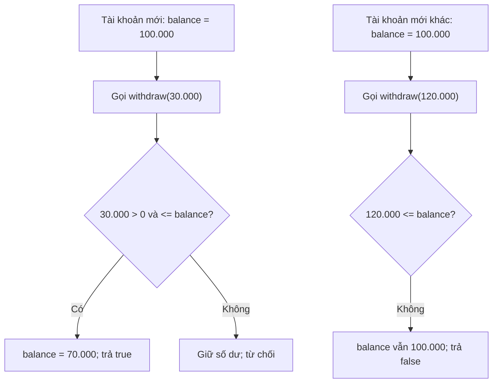
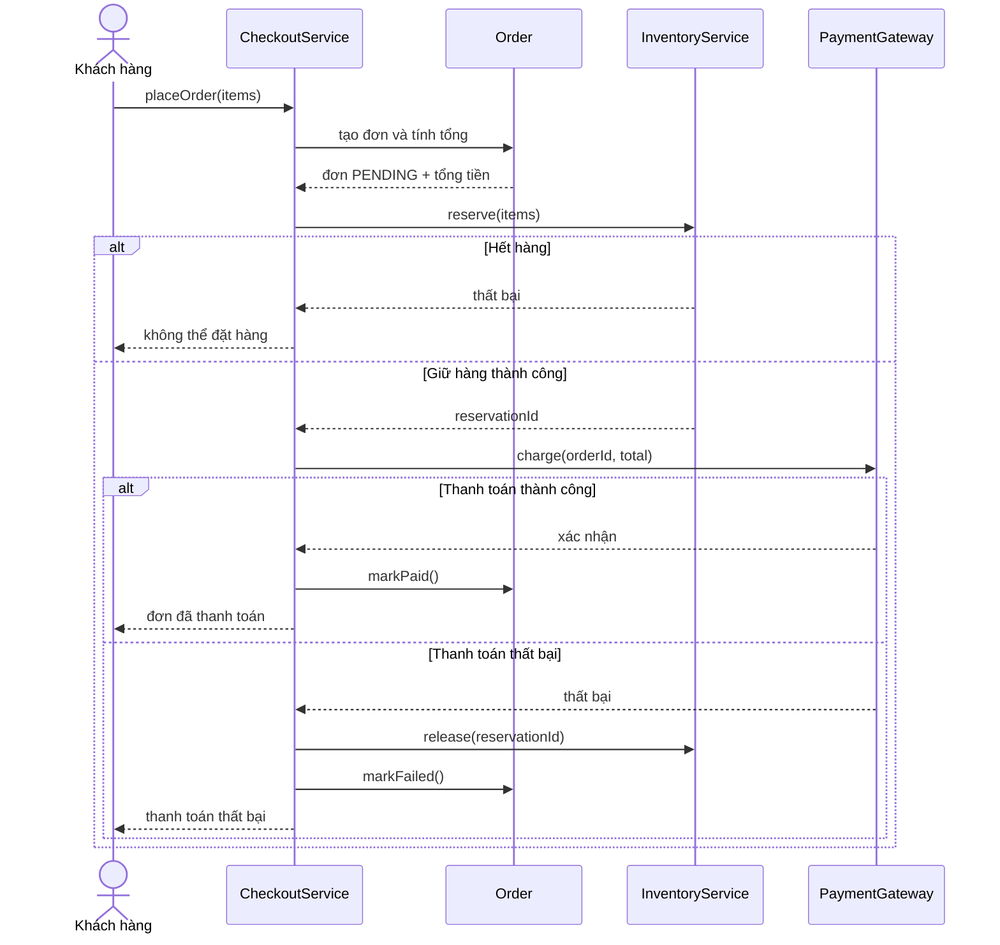

# What Is OOP, and Why Does Program Organization Matter?

When a program has only a few dozen lines, it is usually easy to tell where data lives, which function handles which task, and what needs to change when requirements evolve. Now imagine an application with accounts, orders, inventory, payments, multiple developers, and hundreds of new requirements. The hard question gradually shifts from “How do I write this loop?” to **“How should I organize the program so that data, behavior, and business rules each have a clearly defined place?”**

**Object-oriented programming (OOP)** is a way of thinking about and organizing programs around **objects**. Each object represents an entity or concept with a specific responsibility; it can hold state, perform behavior, and collaborate with other objects to accomplish a task.

This lesson focuses on two questions: **What is OOP?** And **what challenges in organizing programs make OOP useful?** Techniques such as inheritance, polymorphism, and SOLID will be mentioned where relevant, but they are not the focus yet.

## 1. Why Is “Organizing a Program” a Problem Worth Solving?

Suppose you are implementing a cash withdrawal feature. At first, the problem seems simple:

1. Read the current balance.
2. Receive the requested withdrawal amount.
3. Check that the amount is valid and the balance is sufficient.
4. Deduct the money if the withdrawal is allowed.
5. Return the result.

If the program handles only one account, a few functions and variables might suffice. But a larger system brings additional requirements: thousands of accounts; transaction histories; daily withdrawal limits; account freezing; access control; suspicious-transaction alerts; concurrent transactions; testing; and changes to rules without breaking existing functionality.

Some notable challenges are:

| Problem | Signs in the source code | Possible consequence |
|---|---|---|
| Data and operations are separated | Many places directly modify `balance` | One place skips validation, leaving the data invalid |
| Responsibilities are scattered | Withdrawal rules are spread across controllers, services, and utilities | Changing one business operation requires finding and updating many locations |
| Dependencies are tangled | Changing a payment method forces changes in unrelated components | Changes are difficult and can introduce unintended bugs |
| Control flow is hard to understand | It is unclear who is allowed to do what with the data | New developers struggle to read and maintain the code |
| Testing is difficult | One function reads data, calculates, writes to the database, and sends notifications | Testing one rule requires setting up the entire system |

**OOP offers an approach to organization:** identify the objects responsible for parts of the problem, assign appropriate behaviors to them, and let them collaborate through well-defined interfaces and methods. OOP **does not automatically** solve every problem in the table; an object-oriented design can still be poor if responsibilities are assigned incorrectly.

## 2. What Exactly Is an “Object”?

Consider a bank account from the perspective of a software model:

- **Identity:** which account it is, for example the business identifier `ACC-01`.
- **State:** its balance, active status, limits, and so on at the current point in time.
- **Behavior:** depositing money, withdrawing money, freezing an account, and so on, subject to the conditions under which those actions are permitted.
- **Responsibility:** enforcing rules that belong to the account, such as disallowing a negative balance under the chosen policy.

For example, account `ACC-01` has a balance of 100.000 VND. When asked to withdraw 30.000 VND, it checks the request and updates the balance to 70.000 VND. If asked to withdraw 120.000 VND while its balance is 100.000 VND, it rejects the request and keeps the balance at 100.000 VND.

**An object is more than “a bag of data.”** A well-designed object also defines the valid operations on the data it is responsible for. At the same time, not every object has mutable state: an immutable value object, such as `Money` representing an amount and currency, also fits OOP perfectly well.

### Distinguishing Classes from Objects

| Concept | Role | Example |
|---|---|---|
| `class` | A description of shared structure and behavior | `BankAccount` |
| `object` | An instance created from a class that exists at runtime | Account A and account B |
| Attribute / field | Data belonging to an instance or a class, depending on its declaration | An account's `balance` |
| Method | Behavior provided by an object or a class | `withdraw(amount)` |
| Reference | A value used in Java to refer to an object | `accountA` |

Two accounts created from the same class can have **different balances**. Each object has its own state when that state is stored in instance fields. A “business identifier” such as `accountNumber` also differs from “object identity” in Java: two objects can have the same account number if the program allows them to be created that way.

## 3. The Procedural Approach and Where Organizational Problems Arise

A program can be organized around separate data and functions. The following example deliberately leaves the data exposed:

```java
class AccountData {
    String accountNumber;
    long balance;
}

class AccountFunctions {
    static boolean withdraw(AccountData account, long amount) {
        if (amount <= 0 || amount > account.balance) {
            return false;
        }
        account.balance -= amount;
        return true;
    }
}

// Trong cùng package:
AccountData account = new AccountData();
account.balance = 100_000;
AccountFunctions.withdraw(account, 30_000); // còn 70_000

account.balance = -999_000; // vẫn sửa được, bỏ qua quy tắc rút tiền
```

Here, `withdraw` performs validation, but `balance` can still be modified directly elsewhere in the same package. As the program grows, it becomes difficult to ensure that **every place modifying the balance follows the same rule**. This is a problem with **the design of this particular example**, not proof that every procedural program is unsafe: procedural approaches can also protect data through functions, modules, immutable data types, and access control.

The object-oriented approach places protected data and the behaviors that enforce its rules together under one responsible component.

## 4. A Runnable Java OOP Example

Create a file named `Main.java` as follows (Java 11+):

```java
public class Main {
    static final class BankAccount {
        private final String accountNumber;
        private long balance;

        public BankAccount(String accountNumber, long openingBalance) {
            if (accountNumber == null || accountNumber.isBlank()) {
                throw new IllegalArgumentException("Account number is required");
            }
            if (openingBalance < 0) {
                throw new IllegalArgumentException("Opening balance cannot be negative");
            }
            this.accountNumber = accountNumber;
            this.balance = openingBalance;
        }

        public String getAccountNumber() {
            return accountNumber;
        }

        public long getBalance() {
            return balance;
        }

        public void deposit(long amount) {
            requirePositive(amount);
            balance = Math.addExact(balance, amount);
        }

        public boolean withdraw(long amount) {
            requirePositive(amount);
            if (amount > balance) {
                return false;
            }
            balance -= amount;
            return true;
        }

        private void requirePositive(long amount) {
            if (amount <= 0) {
                throw new IllegalArgumentException("Amount must be positive");
            }
        }
    }

    public static void main(String[] args) {
        BankAccount a = new BankAccount("ACC-01", 100_000);
        System.out.println(a.getBalance()); // 100000

        boolean success = a.withdraw(30_000);
        System.out.println(success);         // true
        System.out.println(a.getBalance()); // 70000

        BankAccount b = new BankAccount("ACC-02", 100_000);
        boolean rejected = b.withdraw(120_000);
        System.out.println(rejected);        // false
        System.out.println(b.getBalance()); // 100000

        b.deposit(5_000);
        System.out.println(b.getBalance()); // 105000
    }
}
```

Commands to run it:

```bash
javac Main.java
java Main
```

In this example:

- `private long balance`: external code cannot write `a.balance = -10` through ordinary Java access; changes must go through methods permitted by the class.
- `withdraw`: validates the amount before changing the balance. If funds are insufficient, it returns `false` and **does not modify the state**.
- `deposit`: requires a positive amount; `Math.addExact` signals an error if adding two `long` values overflows, preventing an incorrect balance caused by overflow.
- `accountNumber`: is assigned during construction and has no method for changing it; in this example it is an immutable business identifier.
- `a` and `b`: are separate objects; operations on `a` do not change `b`'s balance.

### Reading Code as a Chain of Cause and Effect



**Note:** the two branches start with **two new accounts, each with a balance of 100.000**, so their states must not be confused. If you attempt to withdraw 120.000 *after* withdrawing 30.000 from the same account `a`, that attempt also fails, but the balance remains **70.000** at that point; it does not return to 100.000.

This model illustrates the value of making an object **responsible for maintaining valid state**, while also showing its limitations: `BankAccount` demonstrates in-memory logic within one process; it is **not yet** a secure money-transfer system. With multiple threads or servers updating data concurrently, you also need database transactions, locking/concurrency control, duplicate-processing prevention, security, auditing, and more. `private` does not make code thread-safe by itself.

## 5. How Does OOP Organize *an Entire Program*?

A single `BankAccount` class does not convey the entire idea. Suppose a sales application must let a customer order two products; the system must check prices and availability, record the order, and request payment.

If every step lives in one enormous function such as `processEverything()`, that function can easily balloon to include database queries, total calculations, inventory checks, payment gateway calls, logging, sending emails, and more. Adding “cash on delivery” or “order cancellation” then means editing a function with too many reasons to change.

Instead, we can assign tasks according to responsibility:

| Component | Primary responsibility | Should not handle on its own |
|---|---|---|
| `Order` | Manage order items, order status, and valid state transitions | Make HTTP calls to the payment gateway |
| `OrderItem` | Hold the product, quantity, and unit price at the time of ordering | Update all inventory records |
| `InventoryService` | Check and reserve stock according to inventory rules | Decide payment status |
| `PaymentGateway` | Define the contract for sending payment requests and receiving results | Directly change stock quantities |
| `CheckoutService` | Coordinate order creation, stock reservation, and payment requests | Contain every other object's internal business rules |

One possible interaction flow looks like this:



The diagram shows **responsibilities and messages** exchanged between objects; it is an instructional model that does not yet address timeouts, network failures, or refunds in detail. In a real system, a `charge` operation might succeed even when its response is lost; therefore, persistent state, idempotency, controlled retries, and reconciliation/compensation mechanisms are needed before the flow is complete.

Here, `CheckoutService` **knows which component to ask to do which task**. `Order` enforces its own order-state rules; the inventory component is responsible for reservations; `PaymentGateway` is a communication contract. Each component has one primary reason to change, making it easier for readers to find the right place to work.

It is also important to distinguish **objects with meaningful responsibilities** from **creating large numbers of classes**. If a feature merely performs simple addition, splitting it into seven classes and ten interfaces creates more confusion than value.

## 6. What Does It Mean for “Objects to Collaborate”?

In Java, objects commonly work together through **method calls**. A conceptual example:

```java
interface PaymentGateway {
    PaymentResult charge(String orderId, long amount);
}

class CheckoutService {
    private final PaymentGateway paymentGateway;

    CheckoutService(PaymentGateway paymentGateway) {
        this.paymentGateway = paymentGateway;
    }

    PaymentResult requestPayment(String orderId, long amount) {
        if (amount <= 0) {
            throw new IllegalArgumentException("Amount must be positive");
        }
        return paymentGateway.charge(orderId, amount);
    }
}

// PaymentResult là kiểu kết quả do ứng dụng định nghĩa.
// Đoạn này minh họa cách phối hợp, không phải file Java độc lập.
```

`CheckoutService` needs the ability to “collect payment,” so it depends on the `PaymentGateway` contract. One class might implement a real payment gateway, while another simulates results for tests. This reduces coupling to specific implementation details.

This is a major benefit of OOP when building systems: **you can change an implementation while reducing the need to modify the code that uses it**. But introducing an interface should have a purpose, such as supporting multiple implementations, substituting a test implementation, or establishing a dependency boundary; not every class needs its own matching interface.

## 7. How Does OOP Differ from Procedural Programming?

The comparison should focus on **how responsibilities are divided and managed**, rather than labeling one approach “old” or “inferior”:

| Question | Procedural / function-oriented organization | Object-oriented organization |
|---|---|---|
| Main way of thinking | Which steps/functions transform input into output? | Which objects hold responsibilities, and what must they exchange? |
| Data and behavior | Can reside in separate modules/functions | Related state and behavior are often grouped within objects |
| Natural strengths | Linear processing flows, algorithms, data transformations | Models with state and rules; collaboration among components |
| Managing change | Through modules, function contracts, and data types | Through object boundaries, methods, and interfaces |
| Risks of poor application | Overlong functions and uncontrolled shared state | Oversized classes, tangled relationships, unnecessary layers |

Both approaches can **coexist in one application**: an `Order` object can use a pure function to calculate tax; a service can call an object's methods; a data-processing pipeline can use functions or streams instead of creating an object for every step. Java supports object-oriented programming, but writing Java code alone does not guarantee a good OOP design.

### A Practical Scenario for Comparison

When the requirement changes to “withdrawals must be blocked for frozen accounts,” OOP thinking suggests placing the rule in `BankAccount.withdraw()` or another clearly responsible domain component. The web interface, mobile application, and background jobs all invoke the same behavior, avoiding separate, inconsistent checks in each client.

If three controllers each access the database and deduct a balance directly for convenience, creating a `BankAccount` class helps little: **the rules remain scattered**. The benefit comes from the design and disciplined use of object boundaries, not from class names.

## 8. How Do You Identify Objects from Requirements?

Do not rush to create a class for every noun in a sentence. Start with actual behaviors and rules.

**Example requirement:** “A customer can cancel an order before it is handed over to the shipping carrier; once handed over, it cannot be canceled directly.”

You can ask the following questions in order:

1. **What information must be kept?** An order has an identifier, items, and statuses such as `CREATED`, `PAID`, `SHIPPED`, and `CANCELLED`.
2. **Which rules must always hold?** Once an order is `SHIPPED`, an ordinary `cancel()` operation must not transition it directly to `CANCELLED`.
3. **Who should enforce the rule?** `Order` is a natural candidate because it owns the state and determines valid transitions.
4. **Which other components must collaborate?** `OrderService` might retrieve the order from storage; shipping or refund mechanisms have their own rules.
5. **What should be able to change independently?** Switching carriers should not require `Order` to rewrite all its HTTP logic.

A very brief sketch:

```java
enum OrderStatus { CREATED, PAID, SHIPPED, CANCELLED }

class Order {
    private OrderStatus status = OrderStatus.CREATED;

    void cancel() {
        if (status == OrderStatus.SHIPPED) {
            throw new IllegalStateException("Shipped order cannot be cancelled here");
        }
        if (status == OrderStatus.CANCELLED) {
            return; // ví dụ chọn hành vi gọi lặp không làm thay đổi trạng thái
        }
        status = OrderStatus.CANCELLED;
    }
}
```

This models just one small rule. In a real product, cancellation may be restricted to a more specific set of states; refunds, restocking, event history, and user permissions are responsibilities that must be analyzed separately. The key point is that **state rules have a clear “home”**: other code calls `cancel()` instead of changing `status` arbitrarily.

## 9. How Does OOP Relate to Encapsulation, Abstraction, Inheritance, and Polymorphism?

OOP is often introduced through its “four pillars.” These are tools for building and extending designs, but **memorizing the names of the four pillars alone is not enough to understand OOP**.

| Concept | What question does it answer? | Connection to this lesson |
|---|---|---|
| **Encapsulation** | Who may change data, and through which operations? | `balance` is `private`; withdrawals go through `withdraw()` |
| **Abstraction** | What does the outside world need to know, and which details can be hidden? | Callers only need to know whether `withdraw(amount)` succeeds or fails |
| **Inheritance** | When is a parent–child type relationship appropriate for reuse or extension? | Not needed for the account example; inheritance is not always appropriate |
| **Polymorphism** | How can different implementations share one contract? | Different implementations of `PaymentGateway` |

**Encapsulation and abstraction are not the same thing.** Using `private` to restrict access is an encapsulation technique; choosing a compact interface that hides implementation details is an abstraction decision. A class with many `private` fields but all its business logic in a controller still does not have a sound division of responsibilities.

## 10. When Is OOP Useful, and When Should You Avoid Forcing It?

OOP is especially useful when a program has **many interacting entities, state and rules that evolve over time**, multiple development teams that need agreed boundaries, or behaviors requiring different implementations.

Conversely, a CSV conversion script, a pure arithmetic calculation, batch processing in a pipeline, or a small program may be clearer with simple functions and data structures. No rule requires every operation to create a new object. Many real applications combine object-oriented, procedural, and functional approaches.

Some warning signs that a design should be reconsidered:

- **God object:** one class handles everything from business logic to SQL, HTTP, and email.
- **Anemic domain model:** objects mostly contain getters/setters, while the rules governing their state are scattered elsewhere. For DTOs or data-transfer structures, data-only objects can still be entirely appropriate.
- **Overuse of inheritance:** using `extends` merely to reuse a few lines of code, making subclasses heavily dependent on their parent classes.
- **Too many intermediary classes:** a simple operation passes through a string of interfaces, managers, and helpers without meaningful boundaries.
- **Ignoring concurrency and persistence:** assuming that hiding a field or using `synchronized` within one object automatically protects data across multiple application instances.

In **Spring Boot**, `@Service`, `@Controller`, and `@Repository` commonly mark application-layer roles. They can be used in an OOP design, but adding annotations does not automatically make a class a good domain model. For example, a controller should receive and validate data at the boundary and delegate to domain components; domain objects can enforce state-transition rules. With JPA, transactions and optimistic/pessimistic locking must be considered separately for concurrent updates.

## 11. Check Your Understanding

Try answering before reading the hints:

**Scenario A.** A `Wallet` class has `public long balance` and a very strict `withdraw()` method. Other code can still write `wallet.balance = -1`. What is wrong?  
**Hint:** the class does not enforce the balance rule because there is still a way to modify state without passing through the validation behavior.

**Scenario B.** Two `BankAccount` objects both have `balance = 100000`. Must they be the same object?  
**Hint:** no. Equal state values do not imply equal identity or the same reference; nor do they mean the business account identifiers are equal.

**Scenario C.** Every time a new payment method is added, developers must modify numerous `if/else` branches in `CheckoutService`. What design approach could help?  
**Hint:** define a shared payment contract and separate concrete implementations if the system genuinely needs multiple payment methods.

**Scenario D.** An `Order` class calculates totals, calls a bank over HTTP, sends emails, executes SQL, writes logs, and manages inventory. Is this good because “everything is in one object”?  
**Hint:** no; good encapsulation also requires **assigning responsibilities appropriately**, so changes in one area have less impact on others.

## 12. What Should You Remember from This Lesson?

OOP is a way to **divide a system into objects with state, behavior, and clear responsibilities that collaborate through contracts**. It is useful because, as a project grows, we need to know **who owns the data, where the rules live, who may request which operations, and which parts are affected by a change**.

To practice, choose a familiar business concept such as an account or order and write down 3 things: **the state it must maintain, its valid behaviors, and the rules that must never be violated**. Then try writing a class that enforces those rules and check its state before and after each call. When you add a second object, identify the messages and responsibilities of each participant. This is a first step from “writing code that runs” toward **designing a program that can be understood, tested, and changed**.
