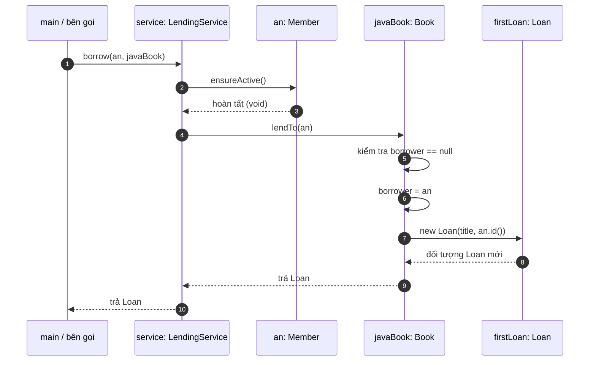
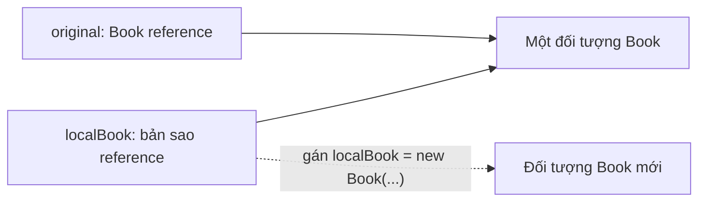
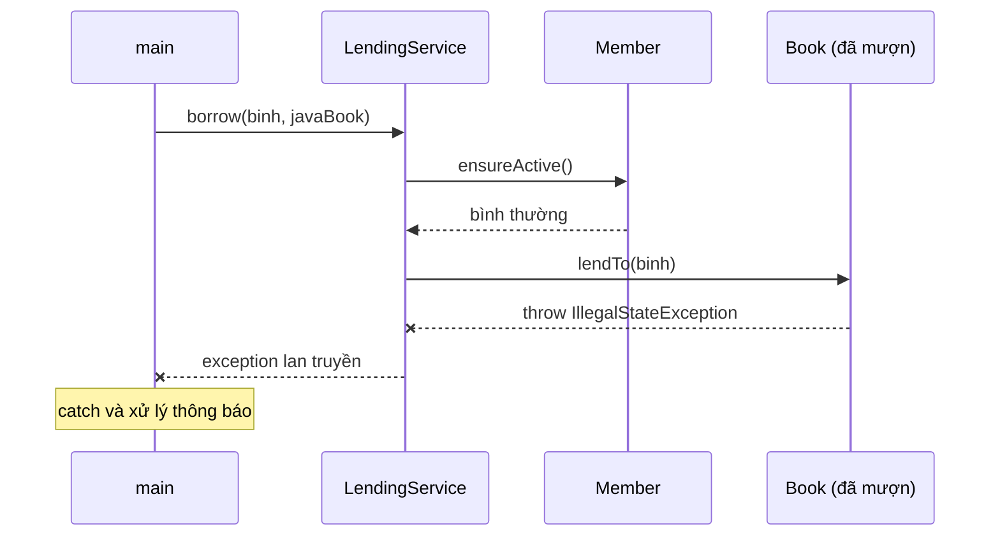

# Object Interactions and Method Calls in OOP

Suppose a reader visits a library and says, “I would like to borrow this book.” In real life, the reader does not enter the system and change the book's status to “borrowed.” A librarian receives the request, verifies the reader's eligibility, checks availability, and records the loan.

The same idea applies to object-oriented programs: **an object generally does not do everything itself**. It uses other objects by **calling methods** to ask them to perform the work for which they are responsible.

For example, `LendingService` receives a borrowing request, asks `Member` whether the member may borrow, then asks `Book` to record the borrower and receives a `Loan` (loan record). This is an **interaction between objects**.

This lesson helps you read a Java statement such as `book.lendTo(member)` and understand what happens: **who calls, who receives, what information is passed, where the method executes, what it returns, how state can change, and what happens on failure**.

## 1. What Is Object Interaction?

In OOP, **object interaction** means objects collaborating to carry out a behavior or process. One object can call another object's methods to retrieve information, request validation, change state, or perform a task.

Imagine the following:

```text
Người dùng
   |
   | Yêu cầu mượn sách
   v
LendingService
   |                       |
   | ensureActive()        | lendTo(member)
   v                       v
 Member                   Book
                           |
                           | tạo phiếu mượn
                           v
                          Loan
```

Not every arrow represents network traffic. In ordinary Java, `member.ensureActive()` is **a direct method call within the same process**, executed synchronously on the current thread. The term “message passing” in OOP descriptions is **conceptual**: object A requests work from object B through B's public interface. It does not necessarily involve sending a Kafka message or HTTP request, or executing asynchronously.

### Four Elements of a Method Call

Consider:

```java
Loan loan = book.lendTo(member);
```

| Element | In the example | Meaning |
|---|---|---|
| **Caller** | The code executing inside `LendingService` | Where the request originates |
| **Receiver / target object** | The object referenced by variable `book` | The object executing the `lendTo` behavior |
| **Method + arguments** | `lendTo(member)` | The requested behavior and input data |
| **Result** | A `Loan` object assigned to `loan` | The value returned after successful execution |

If the method cannot complete and throws an exception, the assignment of its result **does not complete**. Depending on its design, a method can also change state without returning a value (return type `void`), or only read data without changing anything.

## 2. Complete Java Example: A Minimal Library Lending System

The process has four roles:

- `Member` knows the member's information and active status.
- `Book` knows who currently has the book on loan.
- `LendingService` coordinates borrowing.
- `Loan` records information about a loan as the result; the example uses an immutable `record`.

Create the following `Main.java` file (Java 17 or later):

```java
import java.util.Objects;

public class Main {

    static final class Member {
        private final String id;
        private final boolean active;

        Member(String id, boolean active) {
            if (id == null || id.isBlank()) {
                throw new IllegalArgumentException("Member id is required");
            }
            this.id = id;
            this.active = active;
        }

        String id() {
            return id;
        }

        void ensureActive() {
            if (!active) {
                throw new IllegalStateException("Member is inactive");
            }
        }
    }

    static final class Book {
        private final String title;
        private Member borrower; // null nghĩa là chưa có người mượn

        Book(String title) {
            if (title == null || title.isBlank()) {
                throw new IllegalArgumentException("Title is required");
            }
            this.title = title;
        }

        boolean isAvailable() {
            return borrower == null;
        }

        Loan lendTo(Member member) {
            Objects.requireNonNull(member, "member");

            if (borrower != null) {
                throw new IllegalStateException("Book is already borrowed");
            }

            borrower = member;
            return new Loan(title, member.id());
        }
    }

    record Loan(String bookTitle, String memberId) {}

    static final class LendingService {
        Loan borrow(Member member, Book book) {
            Objects.requireNonNull(member, "member");
            Objects.requireNonNull(book, "book");

            member.ensureActive();
            return book.lendTo(member);
        }
    }

    public static void main(String[] args) {
        Member an = new Member("M01", true);
        Member binh = new Member("M02", true);
        LendingService service = new LendingService();
        Book javaBook = new Book("Java căn bản");

        // Lần 1: mượn thành công.
        Loan firstLoan = service.borrow(an, javaBook);
        System.out.println(firstLoan.bookTitle()
                + " -> " + firstLoan.memberId());
        System.out.println(javaBook.isAvailable());

        // Lần 2: thử mượn chính cuốn sách đó.
        try {
            service.borrow(binh, javaBook);
        } catch (IllegalStateException e) {
            System.out.println(e.getMessage());
        }
        System.out.println(javaBook.isAvailable());

        // Trường hợp độc lập: thành viên không hoạt động.
        Member inactive = new Member("M03", false);
        Book otherBook = new Book("Clean Code");
        try {
            service.borrow(inactive, otherBook);
        } catch (IllegalStateException e) {
            System.out.println(e.getMessage());
        }
        System.out.println(otherBook.isAvailable());
    }
}
```

Run with:

```bash
javac Main.java
java Main
```

Expected output:

```text
Java căn bản -> M01
false
Book is already borrowed
false
Member is inactive
true
```

Calls that borrow the same `javaBook` **share the state of one book object**. After the first successful loan, `javaBook` is unavailable; the second attempt throws an exception, and the original borrower remains unchanged. The `inactive` member case uses **a new `otherBook` object**, so that book remains available after the request is rejected.

This is an in-memory model for learning about interactions. It does not yet include a database, book returns, transactions, access control, or safety when multiple threads attempt to borrow the same book.

## 3. Tracing Exactly How a Method Call Works

The key line in `main` is:

```java
Loan firstLoan = service.borrow(an, javaBook);
```

Follow the steps:

1. `main` holds three **references**: `service` refers to a `LendingService`, `an` to a `Member`, and `javaBook` to a `Book`.
2. Java executes `borrow(an, javaBook)` on the object referenced by `service`. The argument values are passed into the method parameters `member` and `book`.
3. Inside `borrow`, `member.ensureActive()` calls a method **on the same member object referenced by `an`**. That object checks `active` and returns normally because the member is active.
4. `book.lendTo(member)` calls `lendTo` on **the very same `javaBook` object**. The book finds `borrower == null`, so it assigns `borrower = member`.
5. `Book` creates a `Loan` containing the book title and member ID, then returns it to `LendingService`.
6. `LendingService` uses `return` to forward the result to `main`; `main` receives a reference to the `Loan` and assigns it to `firstLoan`.



This diagram shows the order of calls, operations, and returns. Each object **is responsible for its own state**: the member checks `active`, while the book checks `borrower`.

### Which Object Is Running Code at Each Point?

While executing the body of `LendingService.borrow`, `this` refers to the `service` object. Upon entering `Member.ensureActive`, `this` refers to the `an` object. Inside `Book.lendTo`, `this` refers to `javaBook`.

```java
// Trong Book:
Loan lendTo(Member member) {
    // "this" là đối tượng Book đang được gọi.
    // "member" là tham chiếu tới đối tượng Member được truyền vào.
    // ...
}
```

Therefore, `this.borrower` and `member.id()` access **two different objects**. `this` is not “the object that started the entire process”; it is the receiver of **the current method call**.

## 4. Distinguishing Reference Variables from Actual Objects

In Java, variables of reference types such as `Book`, `Member`, and `Loan` hold **references**, not entire copies of objects.

```java
Book first = new Book("Java căn bản");
Book second = first;

System.out.println(first == second); // true
```

`first` and `second` refer to **the same `Book` object**. If a valid operation through `first` changes that object, inspecting its state through `second` will reveal the change.

```java
Book a = new Book("Java căn bản");
Book b = new Book("Java căn bản");

System.out.println(a == b); // false
```

Two books with the same title can still be **two independent objects**. The `==` operator on references checks whether they refer to the same object; it does not automatically compare contents. Comparing business values requires a suitable `equals()` rule; “same book title” must not be confused with “same physical copy of a book.”

### Java Passes Parameters by Value, Including References

This point is easy to misunderstand when a method call modifies an object.

```java
static void reassign(Book localBook) {
    localBook = new Book("Sách khác");
}

static void borrowThroughReference(Book localBook, Member member) {
    localBook.lendTo(member);
}
```

With `reassign(original)`, the method receives **a copy of the reference value** and then reassigns local variable `localBook` to a new object; the caller's `original` variable still refers to the initial book. With `borrowThroughReference(original, member)`, both `localBook` and `original` refer to the same book, so `lendTo` changes **the shared object's state**. This is fully consistent with the principle that **Java always passes parameters by value**.



After the assignment shown by the dashed arrow, `localBook` refers to the new object within the method's scope, while `original` still refers to the original object.

## 5. Reading Method-Call Syntax

Consider some familiar statements:

```java
book.isAvailable();
book.lendTo(member);
member.ensureActive();
String id = member.id();
Loan loan = service.borrow(member, book);
```

| Syntax | How to read it | What to observe |
|---|---|---|
| `book.isAvailable()` | Ask whether the book is available | Returns `boolean`; only reads state in this example |
| `book.lendTo(member)` | Ask the book to record the member as borrower | Returns `Loan`; changes book state |
| `member.ensureActive()` | Ask the member to validate its own eligibility | `void`; may throw an exception |
| `member.id()` | Retrieve the member ID | Returns `String`; does not change state |
| `service.borrow(member, book)` | Ask the service to coordinate borrowing | Calls other objects; returns `Loan` |

A method call generally has this form:

```java
receiver.methodName(argument1, argument2);
```

- **Receiver:** the target object to which the expression on the left of the dot evaluates.
- **Method name:** the behavior to be performed.
- **Arguments:** values supplied by the caller at the call site.
- **Parameters:** variables declared in the method definition that receive those values.
- **Return type:** specifies which kind of value the method may return; `void` means no value is returned.

An example distinguishing arguments from parameters:

```java
// "member" là parameter trong khai báo:
Loan lendTo(Member member) { /* ... */ }

// "an" là argument ở chỗ gọi:
Loan loan = javaBook.lendTo(an);
```

The names `an` and `member` need not match. What matters is compatibility between argument types and the method signature under Java's rules.

A call may also **omit an explicit receiver** when invoking an instance method within the same class: inside `Book`, for example, calling `isAvailable()` is interpreted as `this.isAvailable()` when there is no naming conflict. By contrast, `Math.max(4, 7)` invokes a **static method** through a class name: there is no concrete `Math` object acting as receiver.

## 6. Calls Can Return Results, Change State, or Raise Errors

### Case A — Returning Information Only

```java
boolean available = javaBook.isAvailable();
```

As written, this method **does not modify** the book's state; it only reads `borrower`. Query-like methods often have names beginning with `get...`, `is...`, `find...`, or `calculate...`, but **a name alone does not guarantee the absence of side effects**. The contract and implementation must be examined.

### Case B — Changing State and Returning a Result

```java
Loan loan = javaBook.lendTo(an);
```

If the book is available, `borrower` is assigned to `an` and a `Loan` is returned. These are two distinct things:

- **Side effect:** the `javaBook` object has changed state.
- **Return value:** the caller receives a `Loan` object for further use.

The returned `Loan` value **is not the `Book` object itself**, and it does not automatically disappear when `lendTo` finishes. If the caller retains a reference, the `Loan` object remains available for later use. The data in `record Loan` describes the loan as created; it does not automatically track every future change to the book.

### Case C — Validating and Returning `void`

```java
an.ensureActive();
```

When the member is active, the method completes normally without returning a Java value. `void` **does not mean** that nothing happens: a `void` method can write state, publish events, log information, or throw an exception.

### Case D — A Call Throws an Exception

```java
service.borrow(binh, javaBook); // sách đã có người mượn
```

`Book.lendTo` checks `borrower != null` and executes `throw new IllegalStateException(...)`. Therefore `lendTo` never reaches `return new Loan(...)`, and `LendingService.borrow` has no valid value to return either. The exception propagates back to `main`; the `catch` block handles it, and execution continues.



**An exception does not automatically undo all preceding side effects.** For example, if `LendingService` calls two methods that modify two objects and a third call then throws, the first two changes may remain. For database data, atomicity depends on the transaction and actual configuration. Do not interpret `throw` as “roll back everything.”

## 7. Sequential Calls, Nested Calls, and the Call Stack

Inside `LendingService.borrow`, the program calls `Member.ensureActive` and then `Book.lendTo` before producing the loan record. These are **nested calls**: a method invokes another method before it finishes.

Imagine the call stack while `Book.lendTo` is executing:

```text
       Đỉnh stack — lời gọi đang chạy
       +-----------------------------+
       | Book.lendTo(member)         |
       +-----------------------------+
       | LendingService.borrow(...)  |
       +-----------------------------+
       | Main.main(args)             |
       +-----------------------------+
       Đáy stack
```

Each ordinary call creates a *stack frame* that holds execution context such as local variables and the return location (with details managed by the JVM). When `lendTo` finishes, execution returns to `borrow`; when `borrow` finishes, execution returns to `main`.

This explains why:

- After `member.ensureActive()` finishes, `borrow` continues with the next statement.
- With `return book.lendTo(member)`, the result of `lendTo` becomes the result of `borrow`.
- When an exception is not handled in an inner layer, the JVM unwinds the relevant stack frames and looks for a matching exception handler.

Any method can be called from multiple places; **the actual execution order is determined by the call flow**, not by the order of class definitions in the file.

## 8. A Method Is a Contract Between Objects

If `LendingService` wants `Book` to lend a book, it must know **how to call the method and what behavior is promised**. That is the *method contract*.

For:

```java
Loan lendTo(Member member)
```

A clear contract should specify:

| Contract element | Meaning in the example |
|---|---|
| Preconditions | `member` is non-null; the book is not already borrowed |
| Result on success | Returns a `Loan` containing the book title and member ID |
| Postcondition | `Book.borrower` refers to the member who just borrowed the book |
| When the operation cannot complete | Throws `NullPointerException` for a null member or `IllegalStateException` if the book is already borrowed |
| Invariant | In this model, a `Book` object has at most one `borrower` at a time (under sequential execution) |

In Java, a **method signature** primarily involves the method name and parameter types used to resolve a call; a **method contract** is broader, encompassing business meaning, valid conditions, state changes, errors, and behavior callers can rely on. Two methods with the same signature may still violate the contract if they behave differently.

Clearly named methods such as `lendTo(member)`, `ensureActive()`, and `isAvailable()` make code read more like business-language statements. By contrast, an API that exposes only setters:

```java
book.setBorrower(member);
book.setAvailable(false);
book.setLoanCount(book.getLoanCount() + 1);
```

forces **the caller to know too many details about what to update and in which order**. Missing one line can leave the state inconsistent. A method representing the complete business operation centralizes related rules, provided that method itself is correctly designed.

## 9. Object Relationships and Control Over State

Good interaction does not mean object A may modify every field of object B. Given:

```java
private Member borrower;
```

another object cannot write `javaBook.borrower = binh` through ordinary Java access. It must use a method provided by `Book`. That gives `Book` the opportunity to enforce its own rules before changing state.

However, **`private` is only access control**. If the class still exposes unsafe methods such as `setBorrower` without validation, the model can still be broken. Conversely, some objects exist mainly to hold data, such as DTOs or this example's `record Loan`, and need not contain extensive business behavior.

### Why Should Services and Entities Not Do All of Each Other's Work?

In this example:

- `Member` owns the rule determining whether a member is active.
- `Book` owns the state indicating whether the book has a borrower.
- `LendingService` determines the order of collaboration to fulfill a borrowing request.

One subtlety of this simplified version is that `Book.lendTo` checks whether the book is already borrowed but **does not check whether the member is active**; `LendingService` performs that check. If arbitrary code can call `book.lendTo(inactiveMember)`, it may bypass the service's workflow. A real design must define **authorized business entry points** or move mandatory checks to a place that cannot be bypassed. A sound division of responsibilities balances keeping rules with their “owners” against restricting paths that can violate those rules.

That is why you must ask **“What is this object allowed to request from that object?”**, not merely “Can these two objects call each other?”

## 10. When the Same Call Has Multiple Implementations

Suppose the library sends notifications by email or through an application. The coordinating component needs only the `send` behavior:

```java
interface Notifier {
    void send(String memberId, String message);
}

class EmailNotifier implements Notifier {
    @Override
    public void send(String memberId, String message) {
        System.out.println("Email to " + memberId + ": " + message);
    }
}

class AppNotifier implements Notifier {
    @Override
    public void send(String memberId, String message) {
        System.out.println("App to " + memberId + ": " + message);
    }
}

class ReminderService {
    private final Notifier notifier;

    ReminderService(Notifier notifier) {
        this.notifier = notifier;
    }

    void remind(String memberId) {
        notifier.send(memberId, "Please return your book");
    }
}
```

This separate illustration of collaboration can be added to a project with suitable class organization, including within the same file if appropriate. `ReminderService` holds a reference whose **declared type is `Notifier`**, while the actual object may be an `EmailNotifier` or `AppNotifier`. When `notifier.send(...)` runs, Java selects the overridden method according to **the object's actual type**. This illustrates **runtime polymorphism in method calls**.

This organization is useful when notification implementations genuinely need to vary. If the project always has exactly one delivery mechanism and no need to substitute it, there is no requirement to introduce an interface merely to look “properly object-oriented.”

Distinguish the following:

- **Overloading:** methods share a name but have different parameter lists; Java selects the applicable version primarily from expression types at compile time.
- **Overriding:** a subclass or implementing class provides another implementation of a method with the corresponding contract; for an overridden instance method, the actual object determines the implementation at runtime.

Both affect method calls, but they are different mechanisms.

## 11. Common Misconceptions When Reading OOP Calls

| Claim | More accurate explanation |
|---|---|
| “Calling another object's method sends a message across the network.” | Usually it is just an in-process Java call; network communication is a separate mechanism. |
| “A `void` method has no effect.” | `void` only means there is no **return value**; the method may still change state or throw an exception. |
| “Passing an object to a function directly passes that object by reference.” | Java copies **the reference value**. You can modify the same object through the copied reference, but reassigning a parameter does not change the caller's variable. |
| “Two variables with different names always represent different objects.” | Two variables can refer to the same object. |
| “A method that reads data never changes anything.” | Look at the contract and code; even a method named `get...` may have side effects if written that way. |
| “A method throwing an exception undoes all changes.” | An exception changes control flow; undoing changes requires appropriate design or transaction mechanisms. |
| “Many methods calling one another means good OOP design.” | Quality depends on responsibility boundaries, consistency, and understandable interactions. |
| “Using `private` eliminates concurrency concerns.” | Hiding fields does not establish atomicity across threads or processes. |

### A Very Common Error: A `null` Receiver

```java
Book book = null;
book.isAvailable(); // NullPointerException
```

There is no `Book` object to receive the call. Before invoking the method, ensure that the receiver exists through initialization rules, `null` checks, or suitable API design. An ordinary instance method cannot be invoked on a `null` receiver.

### Another Error: Misreading Chained Calls

```java
service.borrow(member, book).memberId();
```

This expression performs two operations in order: `service.borrow` runs **first** and returns a `Loan` if successful; only then is `memberId()` called on that `Loan`. If `borrow` throws an exception, `memberId()` **is never called**. Chaining is concise but can obscure side effects, so separating state-changing operations into lines often makes them easier to read and debug.

## 12. Reason Through the Code Before Running It

**Question 1.** `Member an` is passed into `service.borrow(an, book)`. Inside `borrow`, the parameter is named `member`. Was a new member created?

> No. `member` receives a copy of the reference value pointing to the same object as `an`. Only `new Member(...)` (or another corresponding creation mechanism) creates an additional object.

**Question 2.** After `service.borrow(an, javaBook)` succeeds, `javaBook.isAvailable()` returns `false`. Which method changed the state?

> `Book.lendTo` executes `borrower = member`. `LendingService.borrow` only coordinates the calls; `isAvailable` observes the resulting state.

**Question 3.** When the book is already borrowed, `service.borrow(binh, javaBook)` fails. Does `new Loan(...)` execute inside `Book.lendTo`?

> No. `throw` occurs before the `Loan` creation statement. In this sequential example, `borrower` still refers to the previous borrower.

**Question 4.** Does assigning `Book other = javaBook` and attempting to borrow `other` create a second book?

> No. `other` and `javaBook` both refer to the existing book and share its state.

**Question 5.** You add a rule that “suspended members cannot borrow books.” Should validation live on every UI button or in a shared business-layer entry point?

> UI checks improve the user experience, but mandatory rules must be enforced in the business layer that controls borrowing. In this model, `Member.ensureActive()` performs the check and `LendingService.borrow` must call it. As the system grows, ensure no alternative borrowing path can bypass this condition.

## 13. Short Practice Exercise

Using the `Main.java` example above, add a **book-return** feature with these requirements:

- `Book.returnBy(Member member)` must allow only the current borrower to return the book; otherwise it must reject the request with a clear message.
- On success, update `borrower = null` so that `isAvailable()` returns `true`.
- `LendingService.returnBook(member, book)` coordinates the call into `Book`.
- In `main`, test three distinct situations: a book successfully returned by its borrower; a return attempt by someone else is rejected; and a return attempt for a book nobody has borrowed is rejected.

Before coding, answer: **“Who should own the rule that only the current borrower may return a book?”** `Book` is an appropriate owner in this model because it directly manages `borrower`.

You can draw the sequence `main → LendingService → Book → main` for both success and failure paths. Use fresh book objects for independent test cases to prevent state from one case affecting another.

## 14. Key Points to Remember

When reading an OOP call, determine the following in order:

1. **Which object is the receiver?** Does it actually exist, and what is its current state?
2. **Who is the caller?** Why does the caller need that object to perform this behavior?
3. **What information is passed?** Distinguish arguments at the call site from parameters in the method body; remember pass-by-value.
4. **What does the method guarantee?** Valid conditions, before/after states, side effects, return values, or exceptions.
5. **Where does control go afterward?** Does execution return to the caller, continue into another object, or propagate an exception upward?

**Object interaction** is how separate responsibilities combine into a complete business process. Method calls are the primary mechanism for expressing that collaboration in Java. Once you can trace `caller → receiver → hành vi → thay đổi trạng thái → kết quả` (caller → receiver → behavior → state change → result), reading and designing OOP flows becomes much clearer.
