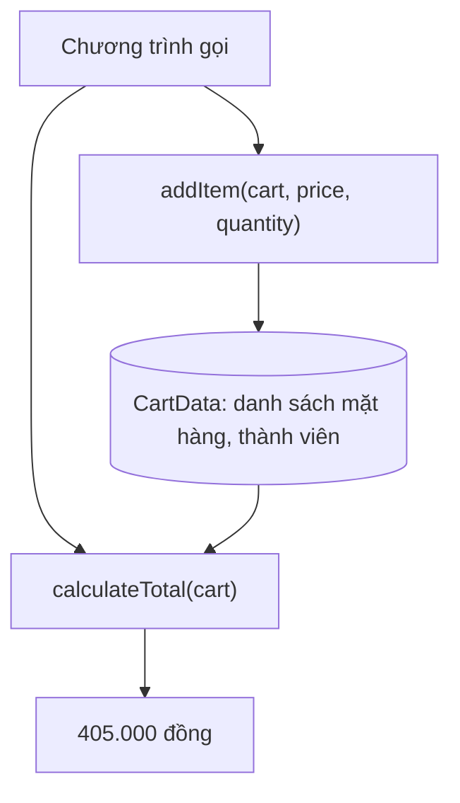
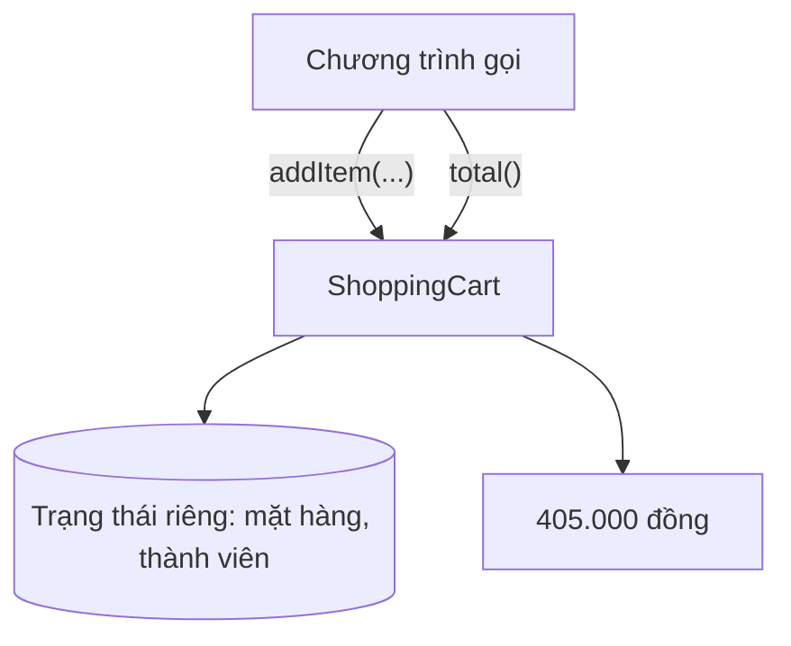
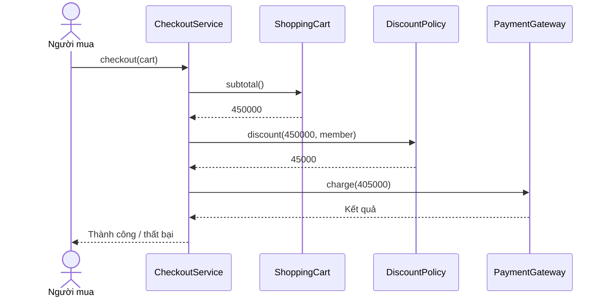

# OOP and Procedural Programming: Decomposing a Problem

Suppose you receive this requirement: **“Build a shopping cart feature that lets customers add products and calculate the amount due. Members receive a 10% discount.”**

Where would you begin designing?

- You could list **the steps to perform**: receive data → validate → add an item → calculate the total → apply a discount → return the result.
- Or you could identify **the responsible objects**: a cart manages its items, a pricing policy determines the discount, and a checkout service coordinates payment.

These are two common ways to decompose a problem in **procedural programming** and **object-oriented programming (OOP)**. Both can satisfy the same requirement using loops, conditions, functions, and data structures. The useful difference to study is **where we place data, operations, and responsibilities**, and how that organization affects readability and future changes.

## 1. What Does “Problem Decomposition” Actually Mean?

A business requirement typically involves many smaller tasks: validating input, storing state, calculating values, reporting results, persisting data, or calling other systems. Decomposing a problem means deciding **which part of the source code is responsible for each task**, how those parts communicate, and what must change when requirements evolve.

For example, a cart must satisfy the following:

1. The cart must store a list of added items.
2. Each item's quantity must be greater than 0; its unit price cannot be negative.
3. Each line total equals unit price multiplied by quantity.
4. The subtotal before discounts is the sum of all line totals.
5. Members receive 10% off the subtotal.
6. The final amount returned must be nonnegative.

These pricing rules **remain unchanged** between the two approaches. Only the placement of code and collaboration of components differ, allowing us to see the effects of design.

| Design question | Typical procedural question | Typical OOP question |
| --- | --- | --- |
| Where does decomposition start? | “Which steps/functions are needed?” | “Which entities exist? Who is responsible for what?” |
| Where does data live? | In variables, data structures, or records passed between functions | In object state or values managed by objects |
| Where does behavior live? | In functions/procedures operating on data | In methods and collaborating objects |
| How do components collaborate? | Functions call functions, passing and receiving data | Objects invoke other objects; a coordinator can still call many methods in sequence |
| What happens when business rules change? | Find the functions implementing the rule | Find the object/policy owning the corresponding responsibility |

**These are organizational tendencies, not absolute boundaries.** Even procedural-style Java code uses `class` declarations to hold code; OOP still uses `if`, `for`, algorithms, and helper functions for calculations. Real systems often combine multiple approaches.

## 2. One Requirement, Two Ways to Assign Responsibilities

### 2.1. Procedural Decomposition: Data Flows Through Processing Steps

With this approach, we might identify:

- `CartData`: holds cart data.
- `addItem(cart, price, quantity)`: validates and adds an item.
- `calculateTotal(cart)`: reads cart data, sums amounts, and applies the discount.
- `main`: invokes the steps in the required order.

Visualize the flow:



Functions receive required data through parameters. They can return results or update data structures. This is convenient for a **clear sequential process** or for transforming input data into output.

One concern: if many parts of the application can modify `CartData` directly, they may bypass validation. A procedural design **can still protect data** through access scopes, modules, immutable types, or rules that permit updates only through functions; exposing data publicly is merely one possible design choice.

### 2.2. OOP Decomposition: Assigning Responsibilities to Objects

With OOP, we might create a `ShoppingCart` object responsible for maintaining valid cart state:

- `cart.addItem(price, quantity)`: the cart validates and adds its own item.
- `cart.total()`: the cart calculates the amount based on its items and membership status.
- Callers do not need to know whether its internal list uses an `ArrayList` or another representation.



Here, the object both **manages state** and **provides valid operations on that state**. External code interacts through the object's methods instead of controlling every internal detail itself.

This does not mean every action belongs in one enormous object. If discounts have multiple strategies, that responsibility may belong to a separate `DiscountPolicy`; `ShoppingCart` and the pricing policy then collaborate. Good OOP design depends on assigning responsibilities correctly, not on the number of classes.

## 3. Complete Java Example: Same Result, Different Structure

The following code contains **two independent versions for comparison**, each pricing two items: 2 products at 200.000 VND and 1 product at 50.000 VND; the customer is a member.

- Subtotal: `2 × 200.000 + 1 × 50.000 = 450.000` VND.
- 10% discount: `45.000` VND.
- Amount due: **405.000 VND**.

The code deliberately repeats the same business rule in both versions so you can see the organizational differences. In a real product, we would choose one appropriate design for that area.

```java
// Main.java — chạy với Java 11+
import java.util.ArrayList;
import java.util.List;

public class Main {

    // Chỉ giữ dữ liệu của một dòng sản phẩm.
    static final class ItemData {
        final long unitPrice;
        final int quantity;

        ItemData(long unitPrice, int quantity) {
            this.unitPrice = unitPrice;
            this.quantity = quantity;
        }
    }

    // PHƯƠNG ÁN A — THỦ TỤC
    // Dữ liệu và các thao tác xử lý được đặt ở hai nơi khác nhau.
    static final class CartData {
        final boolean member;
        final List<ItemData> items = new ArrayList<>();

        CartData(boolean member) {
            this.member = member;
        }
    }

    static final class CartProcedures {
        static void addItem(CartData cart, long price, int quantity) {
            if (price < 0 || quantity <= 0) {
                throw new IllegalArgumentException("Invalid item");
            }
            cart.items.add(new ItemData(price, quantity));
        }

        static long calculateTotal(CartData cart) {
            long subtotal = 0;
            for (ItemData item : cart.items) {
                long amount = Math.multiplyExact(
                    item.unitPrice, (long) item.quantity
                );
                subtotal = Math.addExact(subtotal, amount);
            }
            long discount = cart.member ? subtotal / 10 : 0;
            return subtotal - discount;
        }
    }

    // PHƯƠNG ÁN B — OOP
    // Giỏ hàng tự quản lý dữ liệu và những thao tác hợp lệ.
    static final class ShoppingCart {
        private final boolean member;
        private final List<ItemData> items = new ArrayList<>();

        ShoppingCart(boolean member) {
            this.member = member;
        }

        void addItem(long price, int quantity) {
            if (price < 0 || quantity <= 0) {
                throw new IllegalArgumentException("Invalid item");
            }
            items.add(new ItemData(price, quantity));
        }

        long total() {
            long subtotal = 0;
            for (ItemData item : items) {
                long amount = Math.multiplyExact(
                    item.unitPrice, (long) item.quantity
                );
                subtotal = Math.addExact(subtotal, amount);
            }
            long discount = member ? subtotal / 10 : 0;
            return subtotal - discount;
        }
    }

    public static void main(String[] args) {
        // A: truyền dữ liệu vào các hàm xử lý.
        CartData data = new CartData(true);
        CartProcedures.addItem(data, 200_000, 2);
        CartProcedures.addItem(data, 50_000, 1);
        System.out.println(CartProcedures.calculateTotal(data));
        // 405000

        // B: gửi yêu cầu tới chính đối tượng.
        ShoppingCart cart = new ShoppingCart(true);
        cart.addItem(200_000, 2);
        cart.addItem(50_000, 1);
        System.out.println(cart.total());
        // 405000
    }
}
```

Run with:

```bash
javac Main.java
java Main
```

Output:

```text
405000
405000
```

Using `long` lets the example represent monetary amounts as integers; real applications also need conventions for currency units, rounding, taxes, and overflow scenarios. `Math.multiplyExact` and `Math.addExact` report errors instead of silently overflowing during calculations.

### Reading the Code from Two Perspectives

**Approach A:**

```java
CartProcedures.addItem(data, 200_000, 2);
long payable = CartProcedures.calculateTotal(data);
```

The central question is **which procedures to call, in what order, and with which data**. `CartProcedures` groups functions operating on `CartData`; data flows from the item-adding step to the total-calculation step.

**Approach B:**

```java
cart.addItem(200_000, 2);
long payable = cart.total();
```

The central question is **which object owns the information and is responsible for the operation**. `ShoppingCart` keeps its item list `private`, validates added items, and calculates its own total when asked.

Notice that the summation algorithm **does not change at all**. Both versions iterate over items, multiply prices by quantities, sum line totals, and apply the discount. Switching to OOP does not automatically make calculations faster, more accurate, or shorter. The relevant benefits to evaluate are **responsibility boundaries**, the ability to maintain valid state, and ease of future changes.

## 4. What Happens When Requirements Change?

A design shows its value when new requirements arrive. Suppose the store owner adds these features:

| New requirement | Procedural-leaning organization | OOP-leaning organization |
| --- | --- | --- |
| Add receipt printing | Write a `printReceipt(cart)` function that reads data | Write a `ReceiptPrinter` component receiving cart data or a summary; it need not live in `ShoppingCart` |
| Change discount rules | Modify or add a discount-calculation function | Extract `DiscountPolicy` and assign calculations to a policy object |
| Change how the item list is stored | Review functions that directly access the data structure | If details are well encapsulated, change the representation inside `ShoppingCart` with little effect on callers |
| Add quantity-validation rules | Add checks to functions operating on data; ensure all modification paths comply | Validate within `addItem` or a dedicated validation object |
| Add another discount type | Add a function and possibly a rule-selection branch | With `DiscountPolicy`, add another policy implementation |
| Export data to CSV | A conversion function receiving data/DTOs can be natural | Use a separate export object; avoid putting every export operation inside the domain object |

This table **does not promise** that OOP always requires editing fewer files. If an OOP design spreads a small rule across too many classes, a simple change can take more effort. Conversely, procedural code with clear modules and protected data can be very maintainable.

Therefore, consider **which kinds of changes occur frequently**:

- If the problem mostly adds **new operations on a stable set of data**, a collection of independent functions may be clear and easy to test.
- If it frequently adds **new object variants or behavioral rules**, OOP interfaces and polymorphism can reduce the locations that need editing.
- If it has **state that must remain valid**, placing validation and state-changing operations behind a clear boundary is valuable; OOP supports this but is not the only way.
- If the requirement is simply **read data → transform it → output results**, a sequence of functions or pure transformations is often simpler than building an entire object system.

## 5. When Multiple OOP Objects Collaborate

In the initial example, `ShoppingCart` calculates prices and discounts itself for clarity. In a larger application, however, the cart need not know every promotion type. We can separate responsibilities:

| Component | Responsibility | Should not take over |
| --- | --- | --- |
| `ShoppingCart` | Maintain valid items in the cart | Send emails or directly query payment gateways |
| `DiscountPolicy` | Determine discount amounts according to applicable rules | Arbitrarily modify the item list |
| `CheckoutService` | Coordinate pricing, confirmation, and payment | Become a container for every object's internal rules |
| `PaymentGateway` | Communicate with payment systems | Calculate line totals or decide member discounts |

One reasonable flow:



**Note:** this is an illustrative design diagram, not complete payment code. Real systems must handle transactions, connection failures, duplicate payments, security, and many other concerns.

The diagram shows that OOP **does not eliminate process flows**. `CheckoutService` still carries out steps in order. The difference is that specialized responsibilities are assigned to components with clear interfaces while the coordinator focuses on orchestration.

The same idea can be expressed procedurally:

```text
subtotal = calculateSubtotal(cartData)
discount = calculateDiscount(subtotal, memberData)
result = chargePayment(subtotal - discount)
```

Both approaches can describe **the same business flow**. The design decision is which data and behaviors belong together, where independent boundaries lie, and whether those groupings offer practical benefits.

## 6. Four Criteria for Evaluating Decomposition

### 6.1. Cohesion: Do a Component's Parts Share a Purpose?

A `ShoppingCart` class that adds/removes items and calculates totals usually has a clear purpose. But if it also sends emails, writes system logs, queries databases, renders screens, and calls payment gateways, its responsibilities have become too broad.

Similarly, a `Utils` file with 70 unrelated functions merely “puts everything in one place”; it is not good decomposition. Function-oriented designs also need modules with coherent purposes.

### 6.2. Coupling: How Many Other Places Does One Change Affect?

If ten functions directly access `cart.items` and assume it is an `ArrayList`, changing its storage representation may require edits to many functions. A stable API such as `cart.addItem(...)` or `calculateSubtotal(cart)` reduces coupling when callers do not need to know how data is stored internally.

**A boundary is valuable when it hides details likely to change**, not merely when it increases the number of classes or forwarding functions.

### 6.3. Business Invariants: Who Ensures Valid State?

An invariant is a condition that must always hold at specified points. Simple examples: cart item quantities must always be greater than 0, and unit prices must be nonnegative.

In an OOP model, `ShoppingCart` can be designed so that external code changes the item list only through validated methods. In a procedural design, `CartData` can be read-only outside a module that exposes validated update functions. **Both can protect invariants** if data modification is fully controlled.

### 6.4. Cost of Understanding and Testing

A `calculateTotal(cart)` function with explicit inputs, a return value, and no side effects is usually easy to test. In OOP, a `cart.total()` method can be just as easy to test when the state of `cart` is set up clearly.

On the other hand, objects with tangled dependencies and state modified in many places make bugs harder to reproduce. Choose a structure that lets new developers trace **inputs, rules, state changes, and outputs** conveniently.

## 7. Commonly Misleading Comparisons

| Claim | More accurate assessment |
| --- | --- |
| “Procedural code is old; OOP is modern.” | Both approaches remain widely used; the problem and its constraints are what matter. |
| “Procedural programming has no structure or reuse.” | Functions and modules are powerful tools for organization, reuse, and testing. |
| “Using classes means applying OOP well.” | Grouping `static` utilities in a class does not automatically create responsibility boundaries or protect state. |
| “OOP means everything must have state and getters/setters.” | Objects can be immutable or expose only meaningful behavior; excessive getters/setters may reveal internal details. |
| “OOP never uses sequential steps.” | Every program executes operations in some order; OOP still coordinates process flow. |
| “Only OOP can encapsulate data.” | Modules and access scopes in other paradigms can also hide data. |
| “Procedural code is always faster than OOP,” or vice versa. | Performance depends on algorithms, data structures, allocation, the JVM, I/O, and actual workloads; labels alone prove nothing. |
| “Turning every function into a method means you have designed OOP.” | Consider whether a method really belongs to the object's responsibility or has merely changed syntactic location. |

**A frequently debated example:** `cart.getItems().add(...)` may expose the internal list, letting external code bypass validation. If a list is needed for display, returning a read-only view, a copy, or a suitable data type may be better. However, not all getters are wrong; consider what they reveal and what outsiders are permitted to change.

## 8. When Should You Start with Procedures, and When Should You Consider OOP?

No rigid rule applies to every project. Consider the following before naming classes.

| Situation | Often suitable starting approach | Why |
| --- | --- | --- |
| Read a CSV file, filter data, produce a report | Functions/modules and a data-transformation flow | Easy to express as independent steps with clear inputs and outputs |
| Compute a formula on immutable data | Pure function | Little state to manage; straightforward tests |
| Manage a cart/order through many state-changing operations | Domain objects with clear responsibilities | Keep update rules close to the data they affect |
| Multiple shipping methods with different calculations | Interfaces and OOP implementations, or a set of strategy functions | Swap calculation variants through a shared contract |
| A multistep system-integration flow | Coordinator plus specialized functions/objects | Separate execution of individual steps from orchestration |
| Small one-off script | Simple procedural structure | Avoid unnecessary types and abstraction layers |

In Java/Spring Boot, a `@Service` may coordinate `validate → calculate → save → publish` in sequence, while domain objects maintain valid state. This can still be a sound OOP design. Conversely, creating a new class for every line of code rarely establishes meaningful boundaries.

A practical starting process:

1. Write down **inputs, outputs, and rules** in business language.
2. List the **states that must remain valid** and the operations allowed to change them.
3. Identify the **processing steps**: validate, calculate, persist, and report results.
4. Decide which parts should be independent functions and which need responsible objects; identify the coordinator as well.
5. Review which requirements are likely to change. Establish boundaries where changes genuinely need isolation.
6. Test a successful case and a failure case. Can you trace execution and identify where the rule is enforced?

## 9. Test Your Design Thinking

**Exercise 1 — Exporting reports.** The system only needs to read transactions, filter by date, sum revenue, and export CSV. Would you create a `TransactionReport` object with extensive state, or functions such as `filterByDate`, `sumRevenue`, and `writeCsv`?

*Hint:* If each step is a clear transformation of data, independent functions may be easier to understand. You can group them into a module or service if needed; an object holding state for every calculation is not required.

**Exercise 2 — Protecting the cart.** External code can execute `cart.items.clear()` or `cart.items.add(new ItemData(-100, -5))`. What is the risk, and where would you enforce the boundary?

*Hint:* Outside code can change data in violation of the rules. Restrict read/write access and require updates to pass through validated operations, whether organized as object methods or module functions.

**Exercise 3 — Adding promotions.** You will later need three discount policies: membership, coupon code, and seasonal discount. Should you create a `DiscountPolicy` implementation for each variation?

*Hint:* If variants are frequently added and swapped, a shared contract (such as `discount(subtotal, context)`) may make extension clearer. If there is only one stable rule, a small function can still be a good choice.

**Exercise 4 — Identifying responsibilities.** An `OrderService` stores order lines, calculates tax, builds email HTML, calls a bank, and directly writes SQL. Is the problem its name or its division of responsibilities?

*Hint:* This suggests one component owns too many responsibilities. Separate boundaries with clear purposes, while the service can retain its coordinating role.

**Exercise 5 — Explain it in your own words.** If someone asks, “Both versions calculate the same 405.000 VND, so how is OOP different from procedural programming?”, describe **who owns the data, who applies the rules, and where callers interact**. This measures understanding better than simply counting classes or methods.

## What to Keep in Mind When Applying This to a Project

Procedural programming helps us view a problem as **a sequence of operations organized into functions/modules**. OOP helps us view it through **responsible objects, usable interfaces, and collaborations**. Neither automatically guarantees maintainability: the decisive factors are whether responsibilities are placed appropriately, data is protected, and changes are reasonably contained.

When facing a new problem, sketch both **the processing flow** and **the entities that own state/rules** before coding. This will help you see which parts suit simple functions, which warrant objects, and how the components should collaborate.
