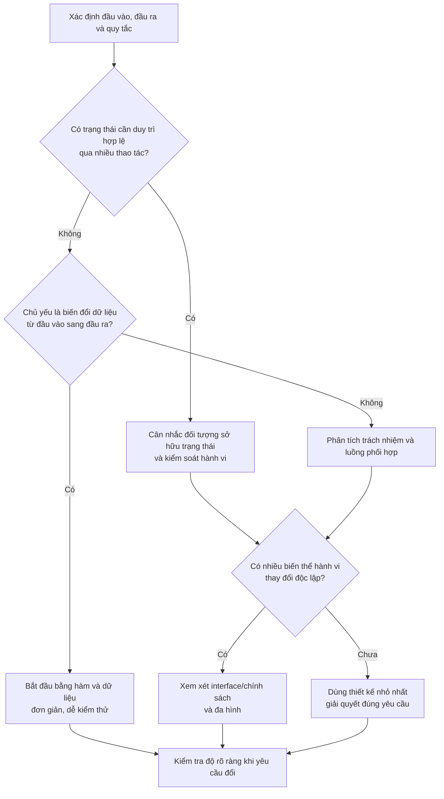

# When to Use OOP and When Not To

**Should you use object-oriented programming (OOP) for every Java problem?** No. OOP is a useful way to organize programs when managing state, responsibilities, and collaboration among components. But some tasks need only a few clear functions; introducing many extra classes often makes such code harder to read.

For example, both of these requirements can be implemented in Java:

- **Requirement A:** Read a day's sales records, validate the data, calculate the sum, and output the result. Data passes through a transformation, and the process ends.
- **Requirement B:** Manage an order through the states `DRAFT → SUBMITTED → PAID`. Items must not be edited after submission; an unsubmitted order must not be marked as paid; several operations can affect the same order.

Requirement A is a good candidate for **functions operating on data**. Requirement B often benefits from an **`Order` object that enforces its own state rules**. Both approaches can coexist within one application.

This lesson offers practical signs for deciding **when OOP provides value, when it adds costs, and how much OOP is appropriate**.

## 1. First, Understand What “Using OOP” Means

In Java, we encounter `class` almost everywhere: even a program containing only `public static void main` resides inside a class. Therefore, **having classes in source code does not prove that a design uses OOP meaningfully**.

When discussing “OOP design,” we usually consider three things:

1. **Responsibility:** which object has the necessary information and a sound reason to perform a behavior?
2. **Boundary:** what can callers ask an object to do, and which details should the object manage internally?
3. **Collaboration:** through which contracts do objects work together to complete business tasks without knowing all of one another's details?

A well-designed object does not have to change state. For example, an immutable `Money` object may contain an amount and currency and offer addition with currency validation. An interface need not have multiple implementations from day one. OOP is **about assigning and protecting responsibilities**, not competing to create the most classes.

Similarly, **“do not use OOP for this part”** does not mean abandoning Java or all classes. We can still write `static` functions, records, immutable data, `Stream` transformations, and simple modules inside a project that uses OOP elsewhere.

## 2. Five Questions to Help You Decide

Before designing a class or interface, answer these questions in order:

| Question | When the answer favors OOP | When the answer favors simple functions/processes |
| --- | --- | --- |
| **Does state persist across multiple operations?** | An order exists and changes state as several features operate on it throughout its lifecycle | Input arrives, is transformed, and produces output without remembering previous operations |
| **Must rules be enforced on every change?** | Withdrawals cannot exceed the balance; submitted orders cannot be edited; status cannot change arbitrarily | Rules only validate input to an independent calculation |
| **Do entities own distinct responsibilities and collaborate?** | `Order`, `Inventory`, and `PaymentGateway` have different obligations | Filtering, summing, normalizing strings, or mapping data |
| **Are there behavioral variants that need substitution or extension?** | Discount, payment, or shipping policies vary independently behind a shared contract | Two rarely changing branches do not yet need an extension mechanism |
| **Do change-management benefits outweigh design costs?** | Long-lived code has many callers and needs to hide internal decisions | A one-off script, small calculation, or stable requirement where abstraction costs more than the problem itself |

These are **signals for discussion**, not a formula such as “three checkmarks mean you must use OOP.” What matters most is **the kinds of changes and risks in the actual software being built**.

One possible decision process looks like this:



The diagram is a guide for organizing your thinking. For instance, a stateless operation may still benefit from an interface when several external integrations must be interchangeable; conversely, simple state does not automatically require a complex object system.

## 3. When OOP Is Especially Useful: State and Business Lifecycles

Consider an order: while it is being created, customers can add products. Once submitted, its item list must be locked. After successful payment, the system transitions to `PAID`.

If each feature reads and modifies `status` and `items` directly, bugs are likely: cart updates might accidentally modify a paid order, or some code might assign `PAID` while the order is still `DRAFT`.

We can make `Order` responsible for **enforcing the rules whenever state transitions occur**:

```java
// File: OrderDemo.java — Java 17+
import java.util.ArrayList;
import java.util.List;

public class OrderDemo {
    enum Status { DRAFT, SUBMITTED, PAID }

    record Line(long unitPrice, int quantity) {
        Line {
            if (unitPrice < 0 || quantity <= 0) {
                throw new IllegalArgumentException("Invalid line");
            }
        }

        long amount() {
            return Math.multiplyExact(unitPrice, (long) quantity);
        }
    }

    static final class Order {
        private final String id;
        private final List<Line> lines = new ArrayList<>();
        private Status status = Status.DRAFT;

        Order(String id) {
            if (id == null || id.isBlank()) {
                throw new IllegalArgumentException("Invalid order id");
            }
            this.id = id;
        }

        void addLine(long price, int quantity) {
            require(Status.DRAFT);
            lines.add(new Line(price, quantity));
        }

        long total() {
            long result = 0;
            for (Line line : lines) {
                result = Math.addExact(result, line.amount());
            }
            return result;
        }

        void submit() {
            require(Status.DRAFT);
            if (lines.isEmpty()) {
                throw new IllegalStateException("Empty order");
            }
            status = Status.SUBMITTED;
        }

        // Chỉ gọi khi hệ thống thanh toán đã xác nhận thành công.
        void confirmPaid() {
            require(Status.SUBMITTED);
            status = Status.PAID;
        }

        Status status() {
            return status;
        }

        String id() {
            return id;
        }

        private void require(Status expected) {
            if (status != expected) {
                throw new IllegalStateException(
                    "Expected " + expected + ", actual " + status
                );
            }
        }
    }

    public static void main(String[] args) {
        Order order = new Order("ORD-001");

        order.addLine(100_000, 2);
        order.addLine(50_000, 1);
        System.out.println(order.total()); // 250000

        order.submit();
        System.out.println(order.status()); // SUBMITTED

        try {
            order.addLine(10_000, 1);
        } catch (IllegalStateException ex) {
            System.out.println("Rejected"); // Rejected
        }

        order.confirmPaid();
        System.out.println(order.status()); // PAID
    }
}
```

Run with `javac OrderDemo.java` followed by `java OrderDemo`.

### What Makes an Object Useful Here?

The `order` object has **identity** (`ORD-001`), **its own state** (`DRAFT`, `SUBMITTED`, `PAID`), and **state-appropriate behavior**. The `addLine`, `submit`, and `confirmPaid` methods control valid transitions.

| Situation | Result |
| --- | --- |
| Add an item while the order is `DRAFT` | Valid; the list grows |
| Submit an empty order | Rejected |
| Submit an order containing items | Transitions to `SUBMITTED` |
| Add an item after submission | Rejected |
| Confirm payment while still `DRAFT` | Rejected |
| Confirm payment after `SUBMITTED` | Transitions to `PAID` |

If `status` and `lines` were exposed for arbitrary modification, these checks could be bypassed. In this design, state changes must go through the provided behaviors. **OOP helps keep rules alongside the state they protect.**

This is only an in-memory model for explaining responsibilities. In a real application, data may be updated concurrently by several requests or service instances. `private` **does not resolve concurrent-update conflicts**: transactions, optimistic/pessimistic locking, database state checks, and safe payment confirmation may be required. Also, `confirmPaid()` merely illustrates a boundary; `Order` does not independently verify a bank transaction.

Another detail: `Line` is an **immutable record**. Object-oriented programming does not imply that every field must be mutable.

## 4. When OOP Helps: Behavioral Variants Sharing One Contract

Suppose shipping fees have two possible calculations:

- Standard delivery: always 30.000 VND.
- Promotional delivery: free for subtotals of at least 200.000 VND; otherwise 30.000 VND.

If these rules change frequently or many flows need them, we can define a `ShippingPolicy` contract with separate calculations:

```java
// File: ShippingDemo.java — Java 17+
public class ShippingDemo {

    interface ShippingPolicy {
        long fee(long subtotal);
    }

    static final class FlatShipping implements ShippingPolicy {
        private final long amount;

        FlatShipping(long amount) {
            if (amount < 0) throw new IllegalArgumentException();
            this.amount = amount;
        }

        @Override
        public long fee(long subtotal) {
            if (subtotal < 0) throw new IllegalArgumentException();
            return amount;
        }
    }

    static final class FreeAboveThreshold implements ShippingPolicy {
        private final long threshold;
        private final long regularFee;

        FreeAboveThreshold(long threshold, long regularFee) {
            if (threshold < 0 || regularFee < 0) {
                throw new IllegalArgumentException();
            }
            this.threshold = threshold;
            this.regularFee = regularFee;
        }

        @Override
        public long fee(long subtotal) {
            if (subtotal < 0) throw new IllegalArgumentException();
            return subtotal >= threshold ? 0 : regularFee;
        }
    }

    static long finalAmount(long subtotal, ShippingPolicy policy) {
        return Math.addExact(subtotal, policy.fee(subtotal));
    }

    public static void main(String[] args) {
        ShippingPolicy standard = new FlatShipping(30_000);
        ShippingPolicy promotion =
            new FreeAboveThreshold(200_000, 30_000);

        System.out.println(finalAmount(250_000, standard));  // 280000
        System.out.println(finalAmount(250_000, promotion)); // 250000
        System.out.println(finalAmount(100_000, promotion)); // 130000
    }
}
```

The `finalAmount` function only needs to know **the `ShippingPolicy` contract**; it does not need to know a policy's concrete class. Different calculations can be supplied through the same parameter. This demonstrates the value of **polymorphism** when changeable behavior is behind a stable interface.

However, if the application has only one fixed-fee rule, a `calculateShippingFee(subtotal)` function may be sufficient. An interface and implementing classes are worthwhile only when they reduce coupling or meet a **real** need for extension.

Even when behavior must vary, Java can use **functional interfaces, lambdas, or functions passed as arguments** instead of many classes, especially when the behavior is a short calculation:

```java
import java.util.function.LongUnaryOperator;

LongUnaryOperator shippingFee =
    subtotal -> subtotal >= 200_000 ? 0 : 30_000;

long amount = Math.addExact(250_000, shippingFee.applyAsLong(250_000));
// amount == 250000
```

The statements above belong inside a Java method (such as `main`). Both options have the same computational meaning; a custom interface is appropriate when you need a domain name, a clear contract, or multiple methods, while a lambda is usually more concise for one behavior.

## 5. When **Not to Force OOP**: Short, Independent Data Transformations

Many problems follow **input → validation → transformation → output**, without an entity that needs management across multiple stages. For example: receive a list of valid sales lines and calculate their total.

An independent function can express this clearly:

```java
// File: RevenueDemo.java — Java 17+
import java.util.List;

public class RevenueDemo {
    record Sale(long unitPrice, int quantity) {
        Sale {
            if (unitPrice < 0 || quantity <= 0) {
                throw new IllegalArgumentException("Invalid sale");
            }
        }
    }

    static long totalRevenue(List<Sale> sales) {
        long total = 0;
        for (Sale sale : sales) {
            long line = Math.multiplyExact(
                sale.unitPrice(), (long) sale.quantity()
            );
            total = Math.addExact(total, line);
        }
        return total;
    }

    public static void main(String[] args) {
        List<Sale> sales = List.of(
            new Sale(100_000, 2),
            new Sale(50_000, 1)
        );
        System.out.println(totalRevenue(sales)); // 250000
    }
}
```

The `totalRevenue` function receives data, calculates a value, and returns a result. It does not store the total in a stateful object or modify its input list. This makes its result easy to verify: **the same input produces the same output**, assuming no arithmetic error.

You could create a `RevenueCalculator` class with a `calculate` method, but if that class merely forwards an addition and has no other responsibility, ask: **what useful complexity does the abstraction hide?**

Avoid prematurely designing something like:

```java
// Ví dụ về sự phức tạp chưa cần thiết:
RevenueCalculatorFactory factory = ...;
RevenueCalculator calculator = factory.create();
RevenueResult result = calculator.execute(request);
```

for a problem already expressed clearly by `long total = totalRevenue(sales);`. This illustration is **pseudocode** for a design with unnecessary classes, not complete compilable code.

### Situations Often Better Suited to Functions or Procedures

- One-off file-processing scripts: read CSV, discard invalid records, normalize columns, and export another CSV.
- Pure converters: parse strings, format dates, and calculate independent formulas.
- Data pipelines with clearly named steps: `parse → validate → transform → export`.
- Numerical algorithms or array processing with well-defined inputs and outputs.
- Small prototypes testing algorithms before complex domain rules exist.

Functions can still be grouped into modules/classes for naming and scoping, and records can represent data. The question is not “Does the code contain a class?” but “**Does it need multiple objects with lifecycles and interactions?**”

## 6. Common Choices in Java/Spring Boot Projects

| Problem | Reasonable starting approach | When to consider more OOP |
| --- | --- | --- |
| Validate an email using a simple rule | Validation function or small validator component | Multiple configurable rules, strategies, or a need to attach behavior to a value |
| Aggregate nightly logs into a report | Pipeline of independent functions/steps | Data sources, report formats, or processing strategies must vary independently |
| Bank account supporting deposits, withdrawals, freezing | Account object enforcing state rules; coordinating service | Objects are often justified from the start; concurrent-data protection is still needed |
| Order moving through multiple statuses | Domain object with valid state-transition methods | As rules become complex, consider extracting policies and collaborators |
| Call one fixed REST API for data | Clearly named client or service function | With multiple providers, a client contract and implementations may help |
| Send notifications by email, SMS, or push | A notification component with a clear responsibility | When multiple channels actually exist, interfaces and implementations can reduce coupling |
| Fixed tax formula expressed in one operation | A clearly named function with explicit input | Multiple countries/scenarios, versioning, or independently replaceable policies |
| Query a database using Spring Data JPA | Repository using the framework's abstraction | No need to wrap every `findById` in a layer that merely forwards the call |

In Spring Boot in particular, `@Service`, `@Component`, and `@Repository` help organize and manage components, but **the number of annotations or layers is not a measure of OOP quality**.

For example, an `OrderService` may coordinate loading an order, invoking domain operations on `Order`, and saving it. If the rule “Which order statuses permit editing?” is duplicated in five controllers and services, the business boundary is weakened. Conversely, do not force a JPA entity to make HTTP calls or manage transactions itself just to satisfy the idea that “all behavior must live in an object.”

## 7. Why Can Overusing OOP Backfire?

### 7.1. Too Many Classes That Merely Forward Calls

For example:

```text
Controller
  → RequestHandler
    → Manager
      → Facade
        → Coordinator
          → Service
            → Calculator
```

If each layer merely calls `return next.calculate(input);` without adding responsibilities, boundaries, error handling, or substitutability, investigating a bug requires navigating many files. **An abstraction should solve a concrete problem**, rather than simply creating the appearance of a “multi-layer architecture.”

### 7.2. Data-Holding Classes Completely Separated from Their Rules

For example, `Order` exposes public `getStatus()` and `setStatus(...)` methods while all rules are scattered across services. Any caller can assign `PAID` before submission. This indicates an *anemic domain model* **when the problem genuinely requires state protection**.

However, a DTO that transports data from an API to a service can be entirely appropriate as a value-only container. A DTO need not be forced into a behavior-rich domain object.

### 7.3. Creating Interfaces for One Implementation Without a Useful Boundary

`UserService` and `UserServiceImpl` can make sense when an interface defines a contract shared across modules or supports provider replacement. If the entire system has one implementation with no substitution requirement or dependency to invert, that interface may merely add another file to open without providing value.

**Even one implementation can justify an interface** when the contract defines an important technical boundary; the current number of implementations is only a signal, not a prohibition.

### 7.4. Overusing Inheritance

With a chain such as `BaseService → AbstractBaseService → AbstractConfiguredService → ConcreteService`, each change can require understanding several parent classes, and behavior may depend on overrides that are difficult to trace.

Use inheritance only when the *is-a* relationship holds in both behavior and contract. In many situations, **composition**—an object holding another component and delegating appropriate responsibilities—is easier to modify than deep inheritance.

### 7.5. Anticipating Too Many Requirements That Do Not Yet Exist

Prebuilding ten `Strategy` classes, three `Factory` classes, a plugin registry, and selection configuration for a problem with one policy creates maintenance costs today while benefits may never materialize. Let current requirements and credible future changes guide design.

## 8. Does OOP Make Programs Slower?

There is no universally correct answer. Some OOP designs can create extra objects, allocate memory, and add calls through interfaces. But the JVM offers optimizations such as JIT inlining, escape analysis, and allocation optimizations in suitable cases. Conversely, a procedural loop using a poor algorithm may be much slower than a reasonable OOP design.

**Distinguish three concerns:**

| Concern | How to evaluate it |
| --- | --- |
| Business correctness | Verify invariants, results, and failure cases |
| Maintainability | Check how many places a requirement change affects and whether responsibilities are understandable |
| Performance | Measure using realistic data and workloads; benchmark before optimizing |

For example, a loop processing millions of elements may benefit from fewer intermediate objects to save memory. But in a request whose database call takes tens of milliseconds, a few method calls are usually not the main bottleneck. Use profiling and benchmarks instead of guessing based on whether the code uses OOP.

For Java, microbenchmarks should use a suitable methodology (often JMH) to avoid misleading results from JVM warmup, compiler optimizations, and garbage collection.

## 9. Does OOP Automatically Solve Concurrency, Microservices, or Business Changes?

**No.** These three concerns require broader design:

- **Concurrency:** An object with a `private int balance` field can still have race conditions if multiple threads update it without proper synchronization. Encapsulation helps control update locations but does not guarantee thread safety.
- **Microservices:** Each service may be written using OOP, but network boundaries, timeouts, distributed data, transactions, and idempotency still require separate handling. Splitting code into classes is not the same as splitting it into microservices.
- **Business changes:** Interfaces help replace one kind of behavior when boundaries are well designed, but changing a fundamental rule across a system can still require modifying many components.

Choosing OOP appropriately improves **the organization and protection of responsibilities in source code**. It cannot replace measures ensuring correctness and operational reliability across the system.

## 10. Evaluating a Scenario Through Two Implementations

Suppose you are asked to “calculate customer loyalty points.” Compare two versions of the requirement:

**Version 1 — one-time calculation.** Each transaction has an `amount`. Reward points equal the amount divided by 10.000 using integer division. The program receives a list of transactions, sums the points, and outputs the result. The rule is fixed; no persistent point wallet is managed.

You could start with:

```java
static long pointsFor(long amount) {
    if (amount < 0) throw new IllegalArgumentException();
    return amount / 10_000;
}
```

This is a simple, easily tested function. Introducing `PointContext`, `PointCalculatorFactory`, and `AbstractPointStrategy` from the outset might add no value.

**Version 2 — a loyalty account with a lifecycle.** Points can be earned after transactions, redeemed for gifts, expire, have a history, be subject to usage limits, and must not go negative. Multiple operations can change the same points account.

Now a `LoyaltyAccount` object with `earn(...)` and `redeem(...)` operations and rules protecting its state may define a useful boundary. However, real points transactions still need consistency mechanisms in persistence, concurrency control, and duplicate-processing prevention.

**Lesson:** The same business-domain name does not determine the design style. **State complexity, interaction frequency, and kinds of change** drive that decision.

## 11. Checklist Before Creating Another Class or Interface

Instead of asking “Am I using enough OOP?”, answer these questions:

1. **Can I describe the class's responsibility in one clear sentence?** For example: “`Order` controls which operations are valid in each order status.”
2. **Which data belongs to that responsibility?** Who may update it? Which rules must always hold?
3. **What do callers actually need to know?** Can internal structures be hidden behind more meaningful operations than getters/setters?
4. **Why is an interface needed?** Are there multiple implementations, module boundaries, integration contracts, or real substitution requirements?
5. **If requirements change next week, how many places must I edit?** Will the new class isolate changes or just lengthen the call chain?
6. **Would a pure function express the solution more clearly?** If so, using a function is a valid design choice even in an OOP project.
7. **Where can I test it?** Can I establish initial state, execute behavior, and verify results or error conditions without running the whole application?

If you cannot answer these questions yet, start with a small, clear structure, observe frequently changing areas, and separate responsibilities when justified. Evidence-based refactoring is often more effective than prebuilding an abstraction layer with no users.

## 12. Self-Assessment Questions

**Question 1.** You write a CLI program that reads a file, normalizes phone numbers, and writes a new file. Do you need a `PhoneNumberNormalizationManagerFactory` class and multiple interface layers?

**Hint:** There is no clear need yet. A normalization function and a file-processing function are usually sufficient, provided errors and boundary cases are handled and tested.

**Question 2.** A `BankAccount` object has `deposit` and `withdraw` methods but also exposes `setBalance` publicly. Is using a class enough to protect the business rules?

**Hint:** No. `setBalance` can bypass deposit/withdrawal checks and violate invariants. The design must control every path that updates state.

**Question 3.** All reports currently export CSV, but the team is certain it will add PDF and Excel exports in the same quarter. Is a `ReportExporter` interface worth considering?

**Hint:** Yes, there is a clear basis because different exporters share a purpose, but establish the contract and real differences before adding classes.

**Question 4.** A colleague says, “Splitting a payment-calculation function into four classes will definitely improve performance.” How would you respond?

**Hint:** Class count does not guarantee performance. Examine algorithms, I/O, allocation, and representative measurements. Maintainability and performance are separate criteria.

**Question 5.** An order needs `addItem`, `submit`, and `cancel`, and cancellation rules depend on status. Would you put the rule in a controller, scattered functions, or the boundary responsible for order state? Why?

**Hint:** Prefer centralizing the rule within a boundary that consistently controls state. `Order` is a natural choice, while a service can coordinate persistence and integrations. Different systems may still have different appropriate boundaries.

---

**Practical principle:** Choose the simplest structure that expresses responsibilities, protects rules, and accommodates credible changes. **Use OOP when objects and contracts make the problem clearer; use functions and procedures when they express it more directly.** In a well-designed Java application, the two approaches often complement each other.
