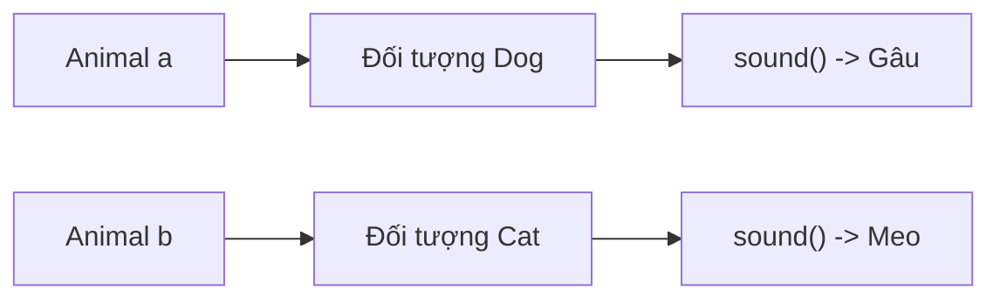
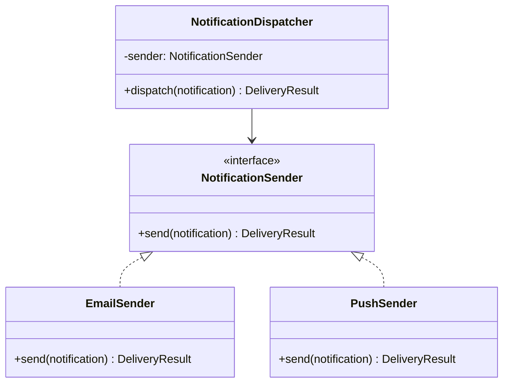
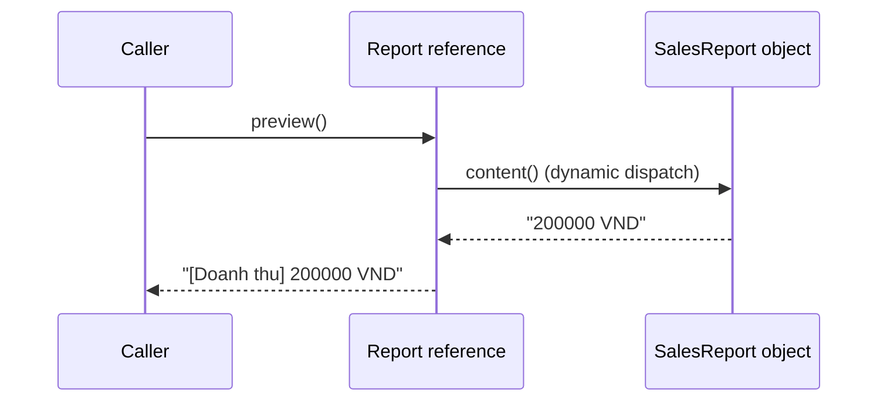

# Subtype Polymorphism Through Interfaces or Parent Classes in Java

**Subtype polymorphism (subtype polymorphism)** lets code use multiple objects of **different subtypes** through **the same parent type or interface**, while actual behavior may vary with the runtime object.

For example, a notification system can send messages by email, push notification, or another channel. The coordinator only needs to request "send this content" through a shared contract rather than writing its own `if/else` for every concrete class.

In Java, subtype polymorphism commonly relies on two relationships:

- **Implement interface**: `EmailSender implements NotificationSender`.
- **Class inheritance**: `SalesReport extends Report`.

The most important distinction is between the **declared type of a variable** and the **actual type of its object**. This explains what calls Java checks at compile time and what implementation it selects at runtime.

## 1. Parent-Typed Variables Can Refer to Subtype Objects

```java
interface Animal {
    String sound();
}

class Dog implements Animal {
    @Override
    public String sound() {
        return "Gâu";
    }
}

class Cat implements Animal {
    @Override
    public String sound() {
        return "Meo";
    }
}
```

The same declared type `Animal` can refer to two different objects:

```java
Animal a = new Dog();
Animal b = new Cat();

System.out.println(a.sound()); // Gâu
System.out.println(b.sound()); // Meo
```

Here:

| Variable | Declared type (*compile-time type*) | Actual object type (*runtime class*) | Method executed |
|---|---|---|---|
| `a` | `Animal` | `Dog` | `Dog.sound()` |
| `b` | `Animal` | `Cat` | `Cat.sound()` |

The compiler accepts both `sound()` calls because `Animal` declares that behavior. At runtime, Java uses **dynamic dispatch** for overridable instance methods to select the implementation associated with the actual object.

The variable `a` has not itself become a `Dog`. Its declared type remains `Animal`; it simply refers to a `Dog` object.



Replacing `new Dog()` with `new Cat()` makes the same `a.sound()` call behave differently, provided the surrounding code permits reassignment.

## 2. Practical Example: An Interface for Interchangeable Notification Channels

Suppose the system sends customer notifications through email and push notifications. To focus on OOP, the example **simulates delivery results** without connecting to SMTP or a real push service.

The contract states:

- Callers provide a valid `Notification` containing a customer ID and message.
- Every `NotificationSender` implementation supports `send(notification)` and returns a `DeliveryResult`.
- Orchestration code need not know how each channel works.

File `NotificationPolymorphismDemo.java` (Java 17+):

```java
import java.util.List;
import java.util.Objects;

public class NotificationPolymorphismDemo {

    record Notification(String customerId, String message) {
        Notification {
            if (customerId == null || customerId.isBlank()) {
                throw new IllegalArgumentException("Thiếu customerId");
            }
            if (message == null || message.isBlank()) {
                throw new IllegalArgumentException("Nội dung rỗng");
            }
        }
    }

    record DeliveryResult(String channel, String status) {}

    // Hợp đồng chung cho mọi kênh gửi.
    interface NotificationSender {
        DeliveryResult send(Notification notification);
    }

    static final class EmailSender implements NotificationSender {
        @Override
        public DeliveryResult send(Notification notification) {
            Objects.requireNonNull(notification, "notification");

            System.out.println(
                "EMAIL -> " + notification.customerId()
            );
            return new DeliveryResult("EMAIL", "SIMULATED");
        }
    }

    static final class PushSender implements NotificationSender {
        @Override
        public DeliveryResult send(Notification notification) {
            Objects.requireNonNull(notification, "notification");

            System.out.println(
                "PUSH -> " + notification.customerId()
            );
            return new DeliveryResult("PUSH", "SIMULATED");
        }
    }

    static final class NotificationDispatcher {
        private final NotificationSender sender;

        NotificationDispatcher(NotificationSender sender) {
            this.sender = Objects.requireNonNull(sender, "sender");
        }

        DeliveryResult dispatch(Notification notification) {
            return sender.send(notification);
        }
    }

    public static void main(String[] args) {
        Notification notification =
            new Notification("CUS-01", "Đơn hàng đã sẵn sàng");

        List<NotificationSender> senders =
            List.of(new EmailSender(), new PushSender());

        for (NotificationSender sender : senders) {
            NotificationDispatcher dispatcher =
                new NotificationDispatcher(sender);

            DeliveryResult result =
                dispatcher.dispatch(notification);

            System.out.println(
                "Result: " + result.channel() + "/"
                    + result.status()
            );
        }
    }
}
```

Run:

```bash
javac NotificationPolymorphismDemo.java
java NotificationPolymorphismDemo
```

Output:

```text
EMAIL -> CUS-01
Result: EMAIL/SIMULATED
PUSH -> CUS-01
Result: PUSH/SIMULATED
```

Notice three places where polymorphism appears:

1. `List<NotificationSender>` contains different `EmailSender` and `PushSender` objects.
2. `NotificationDispatcher` receives a `NotificationSender` through its constructor. It **depends on the contract**, not directly on the email or push class.
3. When `sender.send(notification)` executes, the matching implementation is selected from the object referenced by `sender`.

If we add `SmsSender implements NotificationSender`, we can pass it to `NotificationDispatcher` without changing the dispatcher's source, **provided** the new implementation actually honors the `send` contract.

### Dependency Diagram



**Design benefit:** channel selection belongs at object construction or configuration; the dispatcher only knows the sending contract. Swapping implementations does not require `if (sender instanceof EmailSender)` branches inside it.

In a real system, the contract must also define behavior for errors, timeouts, retries, successful delivery, and merely accepted requests. Implementations should not use the same `SUCCESS` label with inconsistent meanings.

## 3. Polymorphism Through a Parent Class: Inheritance and Overriding

Interfaces are not the only option. A superclass-typed variable can also refer to subclass objects.

Consider a report-display system. Every report has a title and a shared preview workflow, but its preview content differs.

File `ReportPolymorphismDemo.java`:

```java
public class ReportPolymorphismDemo {

    static abstract class Report {
        private final String title;

        protected Report(String title) {
            if (title == null || title.isBlank()) {
                throw new IllegalArgumentException("Tiêu đề rỗng");
            }
            this.title = title;
        }

        // Thuật toán chung cố định ở lớp cha.
        public final String preview() {
            return "[" + title + "] " + content();
        }

        // Điểm mở rộng mà lớp con phải triển khai.
        protected abstract String content();
    }

    static final class SalesReport extends Report {
        private final long revenueVnd;

        SalesReport(long revenueVnd) {
            super("Doanh thu");
            if (revenueVnd < 0) {
                throw new IllegalArgumentException("Doanh thu âm");
            }
            this.revenueVnd = revenueVnd;
        }

        @Override
        protected String content() {
            return revenueVnd + " VND";
        }
    }

    static final class AuditReport extends Report {
        private final int eventCount;

        AuditReport(int eventCount) {
            super("Kiểm toán");
            if (eventCount < 0) {
                throw new IllegalArgumentException("Số sự kiện âm");
            }
            this.eventCount = eventCount;
        }

        @Override
        protected String content() {
            return eventCount + " sự kiện";
        }
    }

    static void display(Report report) {
        System.out.println(report.preview());
    }

    public static void main(String[] args) {
        Report sales = new SalesReport(200_000L);
        Report audit = new AuditReport(3);

        display(sales);
        display(audit);
    }
}
```

Output:

```text
[Doanh thu] 200000 VND
[Kiểm toán] 3 sự kiện
```

In this example:

- `Report` is the parent type and holds the shared `title` state.
- `SalesReport` and `AuditReport` are subtypes.
- `Report.preview()` contains the shared workflow but calls `content()`, which is overridden.
- When `preview()` runs on a `SalesReport` object, its `content()` call dispatches to `SalesReport.content()`; the same applies to `AuditReport`.

This shows that **code executing in a parent class can still trigger behavior specific to the actual subclass object**.



The diagram shows the logical call order. `Report` and `SalesReport` refer to **one runtime object** in this situation, not two independent objects communicating across a network.

### Why Not Override Every Method?

`preview()` is marked `final` so subclasses cannot alter the preview framework; they can customize only `content()`. This design choice protects a shared rule. Not every superclass method needs to be overridable.

Also avoid calling overridable methods from a superclass constructor, because subclass state may not yet be fully initialized.

## 4. Upcasting: From Subtype to Parent Type

**Upcasting** means viewing a subtype object through a reference of a parent type or an interface it implements. This is a valid type conversion and is usually performed implicitly by the compiler.

```java
class Device {}

class Printer extends Device {
    void printPage() {
        System.out.println("Printing...");
    }
}

Printer printer = new Printer();
Device device = printer; // Upcasting ngầm định
```

`device` and `printer` refer to **the same Printer object**; no object copy is created.

Because `device` is declared as `Device`, it cannot invoke methods available only in `Printer`:

```java
printer.printPage(); // Hợp lệ
// device.printPage(); // Lỗi biên dịch
```

This does not contradict polymorphism. Java performs **two different tasks**:

1. **Check whether a call is valid:** based on the declared type, available members, Java access rules, and overload rules.
2. **Select the implementation of an overridable instance call:** based on the actual object type at runtime.

If `Device` declares `public void start()` and `Printer` overrides it, `device.start()` invokes the `Printer` version. But `device.printPage()` is invalid if `Device` does not declare `printPage()`.

## 5. Downcasting and instanceof: Use Only When Necessary

**Downcasting** converts a parent-typed reference to a particular subtype. Since not every `Device` is a `Printer`, Java requires an explicit cast and performs a runtime check.

```java
class Device {}

class Printer extends Device {
    void printPage() {
        System.out.println("Printing...");
    }
}

class Scanner extends Device {}

Device first = new Printer();
Printer printer = (Printer) first; // Hợp lệ lúc chạy
printer.printPage();

// Device second = new Scanner();
// Printer wrong = (Printer) second; // ClassCastException
```

If the runtime type is incompatible with the target type, Java throws `ClassCastException`.

Java 16+ supports pattern matching with `instanceof`; the following example uses Java 17:

```java
static void tryPrinting(Device device) {
    if (device instanceof Printer printer) {
        printer.printPage();
    } else {
        System.out.println("Thiết bị không hỗ trợ in");
    }
}
```

This pattern is appropriate when **an operation truly belongs only to a particular subtype**. However, if application code repeatedly looks like:

```java
if (sender instanceof EmailSender) {
    // Gửi email
} else if (sender instanceof PushSender) {
    // Gửi push
}
```

consider whether the shared behavior belongs in `NotificationSender` so callers can simply invoke `send(...)`. When the capability can be expressed through a clear common contract, **polymorphism is usually preferable to chains of concrete-type checks**.

## 6. Members That Do Not Use Subtype Dynamic Dispatch

`Animal a = new Dog()` allows polymorphic `a.sound()` calls **when that method is an overridable instance method**. This does not automatically apply to every member. Consider the snippets below; place the calls inside a Java method such as `main`:

~~~java
class Parent {
    String field = "Parent field";
    String who() { return "Parent method"; }
    static String category() { return "Parent static"; }
}
class Child extends Parent {
    String field = "Child field";
    @Override String who() { return "Child method"; }
    static String category() { return "Child static"; }
}
Parent value = new Child();
System.out.println(value.who());       // Child method
System.out.println(value.field);       // Parent field
System.out.println(Parent.category()); // Parent static
~~~

| Member | Rule When Accessed Through Parent Type |
|---|---|
| Overridden instance method | Selects implementation by runtime object |
| Same-named parent/child field | Selects the field by the expression's static type |
| Same-signature static method | Hiding; selects by class name/static type |
| Private/final instance method | Cannot be overridden by a subclass |
| Multiple same-named overloads | Compiler selects the signature by static types; any override of that signature is then selected at runtime |

The distinction between **compile-time overloading and runtime overriding** is covered in *Static Method Resolution and Dynamic Dispatch*. Field hiding, static hiding, and getters are examined in *Distinguishing Member Hiding from Overriding* and *Scope of Polymorphism for Methods and Fields*.

## 7. Comparing Interface and Parent-Class Polymorphism

| Criterion | Through an interface | Through a superclass |
|---|---|---|
| Type relationship | Class `implements` interface | Class `extends` superclass |
| What callers depend on | Behavioral contract exposed by the interface | Shared superclass API |
| Shared instance state inherited from the common type | Interfaces do not provide instance fields | Superclasses can manage shared fields |
| Shared constructor | Interfaces have no constructors | Superclasses may provide constructors invoked by subclasses |
| Number of direct relationships | A class may implement multiple interfaces | A class directly extends only one superclass |
| Coupling to implementation | Often suitable for types from unrelated inheritance families | Suitable when there is an is-a relationship and common structure/behavior |
| Shared principle | Both allow a common-type reference to hold subtype objects and invoke suitable overridden methods | The same subtype-polymorphism mechanism |

A class can **both extend a superclass and implement interfaces**; the choices are not mutually exclusive.

For example:

```java
interface Identifiable {
    String id();
}

abstract class BaseEntity implements Identifiable {
    private final String id;

    protected BaseEntity(String id) {
        this.id = java.util.Objects.requireNonNull(id);
    }

    @Override
    public final String id() {
        return id;
    }
}

final class Customer extends BaseEntity {
    Customer(String id) {
        super(id);
    }
}

Identifiable a = new Customer("C01");
BaseEntity b = new Customer("C02");

System.out.println(a.id()); // C01
System.out.println(b.id()); // C02
```

`Customer` is a subtype of both `BaseEntity` and `Identifiable`. These two common reference types expose different portions of the API to different consumers as needed.

## 8. The Shared Contract Must Support Safe Substitution

Matching method signatures alone does not make polymorphism useful. When callers use a parent type, all subtypes must preserve **the expectations of the parent-type contract** (*substitutability*, commonly associated with the Liskov Substitution Principle).

For example, suppose `NotificationSender.send(notification)` specifies:

- `notification` must not be `null`.
- The result must not be `null`.
- `DeliveryResult.status` has consistent meaning.
- On failure, a reporting convention must be used that callers can handle.

Then one implementation should not arbitrarily return `null` while others return valid objects; nor should `"SIMULATED"` mean "request submitted" in one implementation but "read by recipient" in another.

### Example of Violating Expectations

```java
interface DiscountPolicy {
    // Hợp đồng: trả phần trăm trong khoảng 0..100.
    int discountPercent();
}

class StandardDiscount implements DiscountPolicy {
    public int discountPercent() {
        return 10;
    }
}

class InvalidDiscount implements DiscountPolicy {
    public int discountPercent() {
        return 250; // Phá vỡ hợp đồng về khoảng giá trị
    }
}
```

The compiler accepts this because `InvalidDiscount` implements the required signature. But a caller using `DiscountPolicy` to calculate monetary amounts may receive nonsense.

Therefore, verify **input/output semantics, state constraints, and failure behavior**, not just `implements` or `extends` declarations.

### Polymorphism Does Not Automatically Make Code Extensible

Adding an interface to replace a class that has only one implementation is not always useful. Apply subtype polymorphism when there is **a genuine need to substitute implementations**, a useful contract shared by multiple object types, or an API boundary that should not depend on concrete classes.

Conversely, an abstract class can appropriately share a stable algorithm among subtypes, but inheritance couples subclasses to the parent API and its changes. When combining independent capabilities, **composition** usually creates less coupling.

## 9. Polymorphic Collections and Generics

A common type allows different objects to be processed in the same list:

```java
List<NotificationSender> senders = List.of(
    new EmailSender(),
    new PushSender()
);

for (NotificationSender sender : senders) {
    sender.send(notification);
}
```

Here, `EmailSender` and `PushSender` are classes from the complete example above. Each iteration holds a `NotificationSender` variable but dispatches to the appropriate implementation.

However, note the following:

```java
List<EmailSender> emailSenders = new ArrayList<>();

// List<NotificationSender> all = emailSenders; // Không hợp lệ.
```

Java generics are **invariant in their type parameters** (*invariant*): although `EmailSender` is a subtype of `NotificationSender`, `List<EmailSender>` is not a subtype of `List<NotificationSender>`.

If the list only needs to be read through the contract, use a wildcard:

```java
static void runAll(
        List<? extends NotificationSender> senders,
        Notification notification) {

    for (NotificationSender sender : senders) {
        sender.send(notification);
    }
}
```

`List<? extends NotificationSender>` accepts a list whose elements belong to some subtype of `NotificationSender`. However, you cannot freely add `new EmailSender()` to it because the list's precise type argument is unknown.

**Subtype polymorphism of objects** and **variance rules for generic collections** are related but distinct concepts.

## 10. Common Design Errors

| Symptom | Cause | Remedy |
|---|---|---|
| Assuming `Animal a = new Dog()` can invoke all `Dog`-specific methods | Declared type restricts API available at compile time | Expose a shared contract or cast/check if genuinely necessary |
| Writing many `if (obj instanceof X)` branches to invoke subtype-specific behavior | Callers depend on concrete classes | Move shared behavior into an interface/superclass and override it |
| Expecting fields to dispatch like overridden methods | Field hiding differs from method overriding | Keep fields private and expose behavior through contracted methods |
| Assuming overload selection uses parameter runtime types | Overload resolution occurs primarily at compile time | Distinguish overloading from overriding |
| Unconditionally casting to a subtype | Not every parent-type object belongs to that subtype | Avoid casting or use `instanceof` when justified |
| Subtypes returning results that violate the shared contract | Signature matches, but semantics differ | Specify and test the contract for every implementation |
| Assuming `List<Dog>` is `List<Animal>` | Generic types are invariant | Use an appropriate wildcard or declare the collection with a common element type |
| Running customizable algorithms in superclass constructors | Dynamic dispatch might call an incompletely initialized subclass | Avoid overridable method calls from constructors |

## 11. Self-Check Exercises

### Exercise 1 — Predict the Polymorphic Result

```java
interface Shape {
    int area();
}

class Square implements Shape {
    private final int side;

    Square(int side) {
        this.side = side;
    }

    public int area() {
        return side * side;
    }
}

class Rectangle implements Shape {
    public int area() {
        return 12;
    }
}

Shape first = new Square(3);
Shape second = new Rectangle();

System.out.println(first.area());
System.out.println(second.area());
```

**Answer:**

```text
9
12
```

Both variables have the declared type `Shape`. The `area()` call runs the actual object's implementation. `Rectangle` returns a constant value merely to keep the exercise short; it is not a complete geometric model.

### Exercise 2 — Calling a Subtype-Only Method

```java
class Vehicle {
    void move() {
        System.out.println("Moving");
    }
}

class Bike extends Vehicle {
    void ringBell() {
        System.out.println("Ring!");
    }
}

Vehicle v = new Bike();
v.move();
// v.ringBell(); // Có biên dịch không?
```

**Answer:** `v.ringBell()` fails compilation because `Vehicle` does not declare `ringBell()`. When a feature genuinely belongs only to `Bike`, Java 17 can use `if (v instanceof Bike bike) { bike.ringBell(); }`.

### Exercise 3 — Declared Type or Runtime Type?

```java
class Parent {
    String value(Object x) {
        return "Parent/Object";
    }

    String value(String x) {
        return "Parent/String";
    }
}

class Child extends Parent {
    @Override
    String value(Object x) {
        return "Child/Object";
    }
}

Parent p = new Child();
Object item = "hello";

System.out.println(p.value(item));
System.out.println(p.value("hello"));
```

**Answer:**

```text
Child/Object
Parent/String
```

In the first call, the `value(Object)` overload is selected because `item` is declared as `Object`, then dispatch reaches `Child.value(Object)`. In the second call, the `value(String)` overload is selected and is not overridden by `Child`, so `Parent` runs.

### Exercise 4 — Design Your Own Solution

A payment system supports `CardPayment` and `BankTransferPayment`. Design:

1. An `PaymentMethod` interface exposing `PaymentReceipt pay(long amountVnd)`.
2. Two implementing classes that both reject `amountVnd <= 0` and return results under one consistent contract.
3. A `Checkout` class accepting `PaymentMethod` in its constructor and invoking `pay` without checking concrete classes.
4. Construct two `Checkout` objects with different implementations and verify that the same `checkout(...)` call works.

For a robust solution, specify what success and failure mean, how asynchronous transactions are represented, and whether idempotency is required. These are **parts of the contract** that polymorphism must keep consistent; sharing a method name `pay` alone is not enough.

---

**Remember:** Subtype polymorphism lets **one interface- or parent-typed reference work with many subtype objects**. The compiler checks calls against the **declared type's API**; for overridable instance methods, the JVM chooses an implementation using the **runtime type**. Use this so callers depend on contracts rather than concrete classes, while ensuring each subtype truly fulfills the shared contract.
