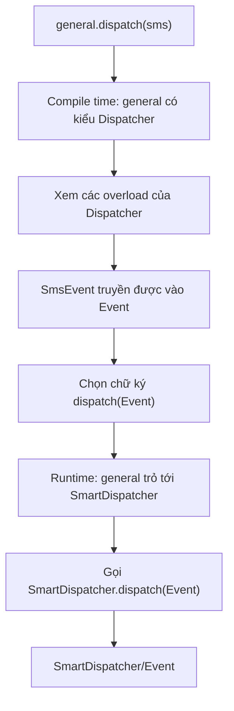

# Static Method Resolution and Dynamic Dispatch in Java

One of the most important aspects of understanding Java **polymorphism** is distinguishing **which method signature is selected at compile time** from **which implementation runs at runtime**.

These two questions do not always have the same answer for a method-call expression:

1. **Static resolution (*compile-time method resolution*):** uses **types known to the compiler**, method names, argument counts/types, access rules, and other information to select a valid method signature. This matters especially for **overloading**.
2. **Dynamic resolution (*runtime method dispatch*):** after a signature has been selected, the JVM selects the appropriate (*override*) implementation for an **overridable instance method** based on the **actual class of the receiver object**.

Thus neither "Java always chooses methods at compile time" nor "Java always chooses them by runtime object" is universally correct. **One call may involve both steps**, depending on the kind of method.

## 1. Two Concepts in a Short Example

```java
class Animal {}

class Dog extends Animal {}

class Handler {
    String process(Animal value) {
        return "Handler/Animal";
    }

    String process(Dog value) {
        return "Handler/Dog";
    }
}

class SpecialHandler extends Handler {
    @Override
    String process(Animal value) {
        return "SpecialHandler/Animal";
    }

    @Override
    String process(Dog value) {
        return "SpecialHandler/Dog";
    }
}
```

Now consider:

```java
Handler handler = new SpecialHandler();
Animal animal = new Dog();

System.out.println(handler.process(animal));
```

The result is:

```text
SpecialHandler/Animal
```

**Why not `SpecialHandler/Dog`?**

- **At compile time:** `animal` is declared as `Animal`. The compiler selects the **`process(Animal)`** overload rather than `process(Dog)`, even though the actual object is a `Dog`.
- **At runtime:** `handler` refers to a `SpecialHandler` object. The JVM invokes the **`SpecialHandler.process(Animal)`** override.

Here is the key idea:

> **Overloading selects a signature using compile-time type information; overriding selects an implementation of that signature based on the runtime receiver object.**

## 2. Complete Java Example: Combining Overloading and Overriding

Save the entire snippet as **`Main.java`**. It runs with Java 17 or Java 21 and requires no external library.

```java
class Event {}

class EmailEvent extends Event {}

class SmsEvent extends Event {}

class Dispatcher {
    String dispatch(Event event) {
        return "Dispatcher/Event";
    }

    String dispatch(EmailEvent event) {
        return "Dispatcher/EmailEvent";
    }

    static String source() {
        return "Dispatcher/static";
    }
}

class SmartDispatcher extends Dispatcher {
    @Override
    String dispatch(Event event) {
        return "SmartDispatcher/Event";
    }

    @Override
    String dispatch(EmailEvent event) {
        return "SmartDispatcher/EmailEvent";
    }

    // Overload mới chỉ có trên SmartDispatcher.
    String dispatch(SmsEvent event) {
        return "SmartDispatcher/SmsEvent";
    }

    // Đây là static method hiding, không phải overriding.
    static String source() {
        return "SmartDispatcher/static";
    }
}

public class Main {
    public static void main(String[] args) {
        Dispatcher general = new SmartDispatcher();
        SmartDispatcher specific = new SmartDispatcher();

        Event emailAsEvent = new EmailEvent();
        EmailEvent email = new EmailEvent();
        SmsEvent sms = new SmsEvent();

        System.out.println(general.dispatch(emailAsEvent));
        System.out.println(general.dispatch(email));
        System.out.println(general.dispatch(sms));
        System.out.println(specific.dispatch(sms));
        System.out.println(((Dispatcher) specific).dispatch(sms));

        System.out.println(Dispatcher.source());
        System.out.println(SmartDispatcher.source());
        System.out.println(general.getClass().getSimpleName());
    }
}
```

Compile and run:

```bash
javac Main.java
java Main
```

Exact output:

```text
SmartDispatcher/Event
SmartDispatcher/EmailEvent
SmartDispatcher/Event
SmartDispatcher/SmsEvent
SmartDispatcher/Event
Dispatcher/static
SmartDispatcher/static
SmartDispatcher
```

### Analyzing Each Call

| Call | Overload selected **at compile time** | Implementation run **at runtime** |
| --- | --- | --- |
| `general.dispatch(emailAsEvent)` | `dispatch(Event)` | `SmartDispatcher.dispatch(Event)` |
| `general.dispatch(email)` | `dispatch(EmailEvent)` | `SmartDispatcher.dispatch(EmailEvent)` |
| `general.dispatch(sms)` | `dispatch(Event)` because the `Dispatcher` type does not expose the `SmsEvent` overload | `SmartDispatcher.dispatch(Event)` |
| `specific.dispatch(sms)` | `dispatch(SmsEvent)` | `SmartDispatcher.dispatch(SmsEvent)` |
| `((Dispatcher) specific).dispatch(sms)` | `dispatch(Event)` because the post-cast expression has type `Dispatcher` | `SmartDispatcher.dispatch(Event)` |

Compare the following two calls:

```java
specific.dispatch(sms);                 // SmartDispatcher/SmsEvent
((Dispatcher) specific).dispatch(sms); // SmartDispatcher/Event
```

**Both use the same `specific` object and the same `sms` argument**. What changes is **the receiver expression's compile-time reference type**, so the compiler sees a different set of overloads. Dynamic dispatch then selects the implementation based on the actual object for each selected signature.



## 3. Static Resolution: How Does Java Select Overloads?

**Overloading** means multiple methods share a name but have **different parameter lists** (parameter counts or types):

```java
class Formatter {
    String format(Object value) {
        return "Object";
    }

    String format(Number value) {
        return "Number";
    }

    String format(Integer value) {
        return "Integer";
    }
}
```

Given this code:

```java
Formatter formatter = new Formatter();
Integer integer = 10;
Number number = integer;
Object object = integer;

System.out.println(formatter.format(integer)); // Integer
System.out.println(formatter.format(number));  // Number
System.out.println(formatter.format(object));  // Object
```

Although all three variables may refer to the same `Integer` object, their argument expressions have different declared types. The compiler uses those types to find an **applicable, most-specific method** under Java's rules.

### It Is Not Simply "Pick the Closest-Sounding Parameter"

Java has detailed rules for applicable methods, primitive conversions, boxing/unboxing, and varargs. Consider this important example:

```java
class Choice {
    void choose(long value) {
        System.out.println("long");
    }

    void choose(Integer value) {
        System.out.println("Integer");
    }

    void choose(int... values) {
        System.out.println("varargs");
    }
}

new Choice().choose(5); // long
```

For the literal `5` of type `int`, the `choose(long)` overload applies through **widening primitive conversion** in a method-selection phase that does not require boxing. Java does not automatically choose `choose(Integer)` or `choose(int...)` just because other conversions could make them accept the value.

At a high level, remember that Java first searches for applicable overloads without boxing or varargs, then considers boxing/unboxing cases, and finally variable-arity invocation if earlier phases fail. The final choice still follows "most specific" rules; no single priority table correctly describes every pair of types.

### Overloads Can Be Ambiguous

```java
class Ambiguous {
    void send(String message) {}
    void send(Integer code) {}
}

// new Ambiguous().send(null); // Lỗi biên dịch: ambiguous
```

`null` can be assigned to `String` or `Integer`; neither type is a subtype of the other, so the compiler cannot choose one overload.

You can make the intent explicit:

```java
new Ambiguous().send((String) null);
```

**Note:** The cast resolves overload selection; it does not mean that the implementation handles `null` safely. Each method's contract must still validate inputs where necessary.

## 4. Dynamic Dispatch: Overriding Methods by Object Type

**Overriding** occurs when a subclass supplies a new implementation of an **overridable instance method** inherited from its superclass or defined by an interface contract.

```java
class Payment {
    String status() {
        return "Payment";
    }
}

class CardPayment extends Payment {
    @Override
    String status() {
        return "CardPayment";
    }
}

Payment p = new CardPayment();
System.out.println(p.status()); // CardPayment
```

The compiler checks that the `p` variable of type `Payment` has a `status()` method. At runtime, the JVM sees that the actual object is `CardPayment` and invokes `CardPayment.status()`.

This lets us write logic accepting a parent type:

```java
static void printStatus(Payment payment) {
    System.out.println(payment.status());
}
```

Pass `new Payment()`, `new CardPayment()`, or another subtype to `printStatus` without checking `instanceof` for each type. This is **runtime polymorphism**.

### Calls Through Interfaces Can Also Dispatch Dynamically

```java
interface Notifier {
    void notifyUser();
}

class EmailNotifier implements Notifier {
    @Override
    public void notifyUser() {
        System.out.println("Email");
    }
}

class SmsNotifier implements Notifier {
    @Override
    public void notifyUser() {
        System.out.println("SMS");
    }
}

Notifier n = new EmailNotifier();
n.notifyUser(); // Email
n = new SmsNotifier();
n.notifyUser(); // SMS
```

`Notifier` defines **the capability being invoked**. `EmailNotifier` or `SmsNotifier` determines **the actual implementation**. Choosing an interface in the design does not remove compile-time type checking: `n` can still call only suitable methods exposed through `Notifier` and `Object`.

## 5. `static` Methods: Hiding, Not Overriding

A major source of confusion is methods declared `static`. In Java, static methods **belong to classes** and cannot be overridden through instance polymorphism. A corresponding static method in a subclass causes **method hiding**.

```java
class Parent {
    static String typeName() {
        return "Parent";
    }
}

class Child extends Parent {
    static String typeName() {
        return "Child";
    }
}

Parent ref = new Child();
System.out.println(Parent.typeName()); // Parent
System.out.println(Child.typeName());  // Child

// System.out.println(ref.typeName()); // Nếu viết sẽ trả Parent,
// nhưng nên tránh gọi static qua biến tham chiếu.
```

Calling `ref.typeName()` is syntactically allowed (though IDEs often warn against it), but the method is selected using the reference expression's **`Parent` type**, not the object's actual `Child` class.

Therefore, use `Parent.typeName()` or `Child.typeName()` for static calls to avoid misleading readers about dynamic dispatch.

| Method Type | Runtime Object-Based Overriding? | Notes |
| --- | --- | --- |
| Overridable instance method | **Yes** | A subclass may replace the implementation |
| `final` instance method | **Cannot override** | No valid subclass override can replace it |
| `private` instance method | **Cannot override** | Not inherited in the usual overriding sense |
| `static` method | **No** | May be *hidden* by a corresponding static method |
| Constructor | **No** | Not inherited or overridden |
| `super.method()` call | Invokes the designated parent-class implementation | Does not dispatch to the subclass's own override of that call |

**Do not assume that "`final` always compiles into a static invocation opcode".** At the language level, `final` prevents overriding; the JVM/JIT may optimize calls appropriately. That is different from Java's compile-time overload-resolution process.

## 6. Field Access Is Not the Same as Calling Instance Methods

Polymorphism applies to overridden instance methods, **not to fields in the same way**.

```java
class Base {
    String name = "Base";

    String getName() {
        return name;
    }
}

class Derived extends Base {
    String name = "Derived";

    @Override
    String getName() {
        return name;
    }
}

Base ref = new Derived();

System.out.println(ref.name);      // Base
System.out.println(ref.getName()); // Derived
```

`ref.name` uses a field selected by the **`Base` reference type**, whereas `ref.getName()` invokes the `Derived` override on the actual object.

This is a reason to avoid redeclaring the same field name in parent and child classes (*field hiding*). Prefer encapsulating fields with `private` and exposing behavior or values through methods with explicit contracts.

## 7. Overloads Are Selected First, but Overrides Can Still Execute

Put the two stages side by side to avoid confusion:

```java
class Converter {
    String convert(Object x) {
        return "Converter/Object";
    }

    String convert(String x) {
        return "Converter/String";
    }
}

class LoggingConverter extends Converter {
    @Override
    String convert(Object x) {
        return "LoggingConverter/Object";
    }

    @Override
    String convert(String x) {
        return "LoggingConverter/String";
    }
}
```

Given:

```java
Converter converter = new LoggingConverter();
Object textAsObject = "hello";

System.out.println(converter.convert(textAsObject));
// LoggingConverter/Object

System.out.println(converter.convert("hello"));
// LoggingConverter/String
```

**First call:** the argument is of type `Object`, so Java selects the `convert(Object)` signature; the receiver is a `LoggingConverter`, so the `LoggingConverter.convert(Object)` override executes.

**Second call:** the literal `"hello"` has type `String`, so the `convert(String)` signature is selected; runtime executes the `LoggingConverter.convert(String)` override.

Java primarily uses **single dispatch** for instance methods: dynamic dispatch depends on the receiver, **not** on automatically reselecting an overload using each argument's runtime class. For behavior dependent on multiple runtime types, consider Visitor/double dispatch, pattern matching, or type-based handler tables as appropriate. These are different design decisions, not Java's default overloading mechanism.

## 8. How `this`, `super`, and Parent-Class Calls Relate

Inside an instance method, when you write:

```java
this.run();
```

A normal `run()` call can still use dynamic dispatch because `this` is the actual receiver object. If it belongs to a subclass overriding `run()`, the subclass implementation can run.

By contrast:

```java
super.run();
```

is used within a subclass to invoke the corresponding accessible parent-class implementation rather than reentering that subclass's own override.

For example:

```java
class Parent {
    void greet() {
        System.out.println("Xin chào");
    }
}

class Child extends Parent {
    @Override
    void greet() {
        super.greet();
        System.out.println("Từ lớp con");
    }
}

Parent value = new Child();
value.greet();
```

Output:

```text
Xin chào
Từ lớp con
```

The sequence is: `value.greet()` dispatches to `Child.greet()`, then `super.greet()` invokes the `Parent` implementation before the remainder of `Child.greet()` executes.

**Constructor pitfall:** avoid calling overridable methods from a superclass constructor because they may dispatch to a subclass **before subclass fields have finished initialization**. Dynamic dispatch still applies during construction, which can cause `null` values or incomplete state.

## 9. JVM Bytecode Connections (Just Enough Detail)

The Java Virtual Machine provides invocation instructions with different semantics. At a high level:

| JVM Instruction | Typical Call Category |
| --- | --- |
| `invokestatic` | Invokes `static` methods |
| `invokevirtual` | Invokes ordinary instance methods on objects |
| `invokeinterface` | Invokes instance methods through interface contracts |
| `invokespecial` | Certain special calls, such as constructors, `super.method()`, and private methods |
| `invokedynamic` | JVM-level dynamic call-site linkage, including some lambda and string-concatenation implementations |

**Be careful with names:** `invokedynamic` in bytecode is **not synonymous** with ordinary OOP dynamic dispatch of overridden methods. Instance-method dispatch mainly involves instructions such as `invokevirtual` and `invokeinterface`; `invokedynamic` serves dynamically linked call sites with a *bootstrap method*.

A simple way to inspect a compiled example:

```bash
javac Main.java
javap -c Main
```

The `javap -c` command displays bytecode for the specified class. To inspect methods in other classes from the example, specify their correct class names. Bytecode helps reveal the mechanism, but for OOP learning and design, first master **signature selection at compile time** and **implementation selection at runtime**.

## 10. Common Mistakes

| Incorrect Assumption or Code | Why It Is Wrong | What to Remember |
| --- | --- | --- |
| "The runtime argument is `EmailEvent`, so Java must choose `dispatch(EmailEvent)`" | Overloads are selected from compile-time expression types | An `Event` variable selects the `Event` overload |
| "The variable type is `Dispatcher`, so `Dispatcher` code always executes" | Overrides execute based on the actual object class | `new SmartDispatcher()` may invoke an override |
| "A subclass static method overrides its parent's static method" | This is method hiding | Invoke static methods through class names |
| "The `name` field dispatches dynamically too" | Fields are resolved from the reference type | Distinguish `ref.name` from `ref.getName()` |
| "Casting the receiver does not affect overloads" | The receiver expression type can change the available overload set | Compare `specific.dispatch(sms)` with `((Dispatcher)specific).dispatch(sms)` |
| "A different parameter list still allows `@Override`" | Different parameters may form an overload instead | Add `@Override` to let the compiler detect mistakes |
| "`send(null)` can choose any overload automatically" | Unrelated reference-type overloads may be ambiguous | Cast explicitly when truly necessary |
| "`invokedynamic` means overriding" | These are different JVM-level concepts | Do not infer behavior from opcode names |
| "A `final` method can be overridden but not called" | `final` prevents overriding, not normal calls | Use `final` to fix behavior when justified |

## 11. When Is This Distinction Useful?

- **API design:** with multiple overloads, make parameter types clear so callers do not accidentally select the wrong method merely because a variable is declared as a supertype.
- **Debugging:** if results differ from expectations, identify **which signature the compiler selected** before checking **which override executed**.
- **Dependency injection:** interface-typed variables still invoke runtime implementations correctly; this underpins polymorphism in service and adapter layers.
- **Refactoring:** adding an overload can change the selected method when call sites are recompiled, even if existing overrides remain unchanged.
- **Testing:** test combinations of reference types, argument types, and actual object classes when an API mixes overloading and inheritance.
- **Performance:** the JVM can inline, devirtualize, and optimize appropriate calls; do not assume all polymorphic calls incur one fixed performance penalty. Use profiling and benchmarks when performance matters.

## 12. Self-Check

**Question 1.** What does the following code print?

```java
Dispatcher dispatcher = new SmartDispatcher();
Event event = new EmailEvent();
System.out.println(dispatcher.dispatch(event));
```

**Answer:** `SmartDispatcher/Event`. The compiler selects `dispatch(Event)`, and runtime executes the override from `SmartDispatcher`.

**Question 2.** Why does `specific.dispatch(sms)` differ from `((Dispatcher) specific).dispatch(sms)`?

**Answer:** Their compile-time reference types differ. `SmartDispatcher` exposes `dispatch(SmsEvent)`, while `Dispatcher` only exposes `dispatch(Event)` and `dispatch(EmailEvent)`; with `SmsEvent`, it selects `Event`.

**Question 3.** Given `Parent ref = new Child();`, which method is used for `ref.typeName()` when both classes declare same-named `static` methods?

**Answer:** The static method associated with type `Parent`. Prefer spelling it `Parent.typeName()` to avoid confusion.

**Question 4.** Why does `format(number)` choose `format(Number)` when `number` has declared type `Number` but points to `Integer`?

**Answer:** Overload resolution uses the compile-time expression type; it does not automatically choose an overload using the argument's runtime class.

**Question 5.** If a subclass overrides `greet()`, does `super.greet()` in the override call the subclass's own override again?

**Answer:** No. It invokes the corresponding parent-class implementation according to `super` semantics, allowing the subclass to reuse parent behavior.

**Question 6.** A `List<Payment>` contains `new CardPayment()`; which implementation does `payment.status()` invoke in a loop?

**Answer:** For a `CardPayment` element, if `status()` is overridden, `CardPayment.status()` executes. The declared `Payment` element type only determines the callable contract.

**Remember:** To predict a Java method call, ask in order: **"Which signature does the compiler select from visible types?"** and **"Does the actual receiver object override that signature?"** Overloading is primarily static resolution; overriding uses dynamic dispatch. `static` methods, fields, constructors, and `super` calls have separate rules. Understanding this boundary clarifies polymorphism and prevents subtle inheritance bugs.
