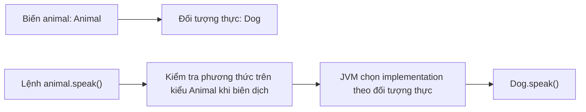
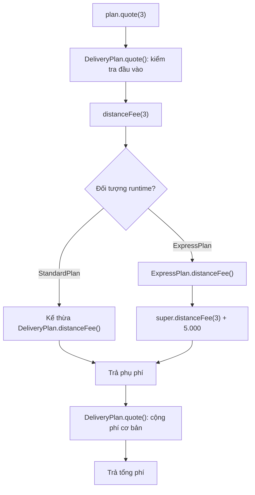

# Method Overriding and Runtime Method Selection in Java

> **OOP → Polymorphism.** When a parent-typed variable refers to a subclass object, a call to an **overridable instance method** runs the implementation appropriate to the object's **actual runtime type**. This is called **dynamic dispatch** (runtime method selection). It lets one piece of code handle multiple object types without `if/else` checks for each class.

## 1. Two Types to Distinguish in a Method Call

```java
Animal animal = new Dog();
animal.speak();
```

The first line contains **two different types**:

- **Declared type (compile-time type):** `Animal`. The compiler uses it to check which methods are available and how a valid call is selected.
- **Actual type (runtime class):** `Dog`. When `Dog` overrides `speak()`, the JVM invokes the `Dog` implementation of that instance method.

A short example:

```java
class Animal {
    void speak() {
        System.out.println("Âm thanh động vật");
    }
}

class Dog extends Animal {
    @Override
    void speak() {
        System.out.println("Gâu gâu");
    }
}

// Đặt trong một phương thức như main():
Animal animal = new Dog();
animal.speak(); // Gâu gâu
```

Although the variable is declared `Animal`, the actual object is a `Dog`. `speak()` in `Dog` **overrides** the inherited `speak()` from `Animal`, so Java selects the `Dog` implementation at runtime.



**Key point:** seeing `new Dog()` does not mean the compiler simply rewrites every call to use `Dog`. **Signature selection** and **access checks** still use compile-time type information. Only eligible instance-method calls use the runtime object to choose an implementation.

## 2. Complete Example: Multiple Delivery Plans, One `quote()` Call

A shipping system offers standard and express plans. Both calculate the total fee after validating distance, but their distance surcharges may differ.

Save all code as `RuntimeDispatchDemo.java` (**Java 17+**):

```java
import java.util.List;

public class RuntimeDispatchDemo {

    static class DeliveryPlan {
        private final long baseFeeVnd;

        protected DeliveryPlan(long baseFeeVnd) {
            if (baseFeeVnd < 0) {
                throw new IllegalArgumentException("Phí cơ bản không thể âm");
            }
            this.baseFeeVnd = baseFeeVnd;
        }

        public String name() {
            return "Gói giao hàng";
        }

        protected long distanceFee(int distanceKm) {
            return Math.multiplyExact(2_000L, distanceKm);
        }

        // Quy trình chung: lớp con không được ghi đè toàn bộ quy trình này.
        public final long quote(int distanceKm) {
            if (distanceKm <= 0) {
                throw new IllegalArgumentException("Khoảng cách phải dương");
            }

            long extra = distanceFee(distanceKm);
            if (extra < 0) {
                throw new IllegalStateException("Phụ phí không thể âm");
            }

            return Math.addExact(baseFeeVnd, extra);
        }
    }

    static final class StandardPlan extends DeliveryPlan {
        StandardPlan() {
            super(10_000L);
        }

        @Override
        public String name() {
            return "Thông thường";
        }
        // Giữ nguyên distanceFee() do lớp cha định nghĩa.
    }

    static final class ExpressPlan extends DeliveryPlan {
        ExpressPlan() {
            super(15_000L);
        }

        @Override
        public String name() {
            return "Hỏa tốc";
        }

        @Override
        protected long distanceFee(int distanceKm) {
            long normalDistanceFee = super.distanceFee(distanceKm);
            return Math.addExact(normalDistanceFee, 5_000L);
        }
    }

    public static void main(String[] args) {
        List<DeliveryPlan> plans = List.of(
            new StandardPlan(),
            new ExpressPlan()
        );

        for (DeliveryPlan plan : plans) {
            System.out.println(plan.name() + ": "
                    + plan.quote(3) + " VND");
        }

        DeliveryPlan selected = new ExpressPlan();
        System.out.println("Đối tượng thực: "
                + selected.getClass().getSimpleName());
    }
}
```

Compile and run:

```bash
javac RuntimeDispatchDemo.java
java RuntimeDispatchDemo
```

Output:

```text
Thông thường: 16000 VND
Hỏa tốc: 26000 VND
Đối tượng thực: ExpressPlan
```

Calculations for 3 km:

| Actual Object Type | Base Fee | Surcharge | Total |
|---|---:|---:|---:|
| `StandardPlan` | 10.000 VND | 3 × 2.000 = 6.000 VND | **16.000 VND** |
| `ExpressPlan` | 15.000 VND | 3 × 2.000 + 5.000 = 11.000 VND | **26.000 VND** |

The same `plan.name()` or `plan.quote(3)` call behaves according to the object referenced by `plan`:

- `StandardPlan` **overrides `name()`** but not `distanceFee()`, so it uses the parent class's distance-surcharge formula.
- `ExpressPlan` **overrides both `name()` and `distanceFee()`**. Inside `distanceFee()`, the `super.distanceFee(...)` call uses the parent formula before adding 5.000 VND.
- `quote()` is `final`, so subclasses cannot override it. However, inside `quote()` it invokes the **instance method** `distanceFee()`, which **still dispatches dynamically** to the appropriate implementation.
- `getClass()` reports the object's runtime class, not the variable's declared type.

The `for` loop needs no subclass-name checks to calculate fees. A new plan type can be added later with minimal changes to shared calling code.

### Tracing the Call



This combines **overriding**, **polymorphism**, and **shared methods**. `DeliveryPlan` need not be `abstract` for overriding to work: concrete classes can also have overridable instance methods.

## 3. What Conditions Must Overriding Satisfy?

Two methods with the same name **do not necessarily** constitute overriding.

```java
class Parent {
    public Number value() {
        return 10;
    }
}

class Child extends Parent {
    @Override
    public Integer value() {
        return 20;
    }
}
```

This is valid overriding. The `Integer` return type is **covariant** with `Number` because it is a subtype of `Number`. If a `Parent`-typed variable holds a `Child`, `value()` still returns an object produced by the `Child` implementation.

Main rules:

| Aspect | Rule |
|---|---|
| Name and parameters | Must match a compatible override signature; changing parameters usually creates an **overload** |
| Return type | Must be compatible; reference types may use a subtype (covariant return) |
| Access level | Must not be narrowed, such as `public` to `protected` |
| Checked exceptions | Must not broaden checked exceptions beyond the parent's method contract |
| `final` instance method | Cannot be overridden |
| `private` method | Not inherited in a way that permits overriding |
| `static` method | May be **hidden (method hiding)**, not dynamically overridden |
| Constructor | Not inherited or overridden |
| `@Override` | Recommended: the compiler verifies that a declaration truly overrides or implements an eligible method |

A common incorrect example:

```java
class Parent {
    public void execute(String task) {}
}

class Child extends Parent {
    // @Override // Nếu thêm @Override, trình biên dịch sẽ báo lỗi.
    public void execute(int task) {}
}
```

`execute(int)` does not override `execute(String)`: their parameter lists differ, so the former is an **overload**. Calling `execute("task")` still uses `Parent.execute(String)` if `Child` has not overridden that signature.

An abstract method or interface method may also be overridden by an implementation. Overriding is not limited to concrete parent-class methods.

## 4. Runtime Selects an Implementation **After** the Compiler Selects a Signature

If the parent class declares `process(Object)`, the child overrides it and adds `process(String)`, these two calls may differ:

~~~java
class Parent {
    String process(Object value) { return "Parent/Object"; }
}
class Child extends Parent {
    @Override String process(Object value) { return "Child/Object"; }
    String process(String value) { return "Child/String"; }
}

Parent parentView = new Child();
Child childView = new Child();

System.out.println(parentView.process("hi")); // Child/Object
System.out.println(childView.process("hi"));  // Child/String
~~~

For the first call, the compiler sees only `process(Object)` through `Parent`, then dispatches to `Child.process(Object)`. For the second, the compiler sees `process(String)` on `Child` and selects the more specific signature. **Overloading uses static types; overriding uses the runtime receiver**. The lesson *Distinguishing Overriding from Overloading* discusses the full rules, including `null`, boxing, and varargs.

## 5. `static`, `private`, `final`, and Fields Have Different Rules

| Member | What to Remember |
|---|---|
| Static method | Matching subclass signature causes *hiding*; call via the class name for clarity |
| Field | Cannot be overridden; access uses the expression's static type |
| Private method | Not inherited for overriding |
| Final instance method | Cannot be overridden, but **can still call an overridable hook** |
| Constructor | Can be overloaded, not overridden |

That is why `DeliveryPlan.quote()` can be `final` while its internal `distanceFee()` call still dispatches by subtype. For precise examples of field hiding, static hiding, and getters, see *Distinguishing Member Hiding from Overriding* and *Scope of Polymorphism for Methods and Fields*.

## 6. What Does `super.method()` Mean?

Within a subclass, `super.method()` invokes the corresponding inherited parent-class implementation under Java's rules; it **does not** "turn the object into the parent class".

For example, in `ExpressPlan.distanceFee()`:

```java
@Override
protected long distanceFee(int distanceKm) {
    long base = super.distanceFee(distanceKm);
    return Math.addExact(base, 5_000L);
}
```

`super.distanceFee(...)` invokes the `DeliveryPlan` calculation, after which the subclass adds its surcharge. The `this` reference is still **the same `ExpressPlan` object**.

A subclass can also replace the behavior completely without calling `super`:

```java
@Override
protected long distanceFee(int distanceKm) {
    return Math.multiplyExact(4_000L, distanceKm);
}
```

Whether to extend or replace behavior depends on the parent contract. Blindly calling `super` may duplicate side effects; failing to call `super` when the parent requires invariants can also cause bugs. Base classes should clearly specify which hooks may be overridden and which conditions remain mandatory.

## 7. Managing Dynamic-Dispatch Risks in Constructors

A common trap is a superclass constructor calling a method overridden by a subclass.

```java
public class ConstructorDispatchTrap {
    static class Parent {
        Parent() {
            System.out.println("Trong Parent(): " + describe());
        }

        String describe() {
            return "Parent";
        }
    }

    static final class Child extends Parent {
        private String name = "Sẵn sàng";

        @Override
        String describe() {
            return name;
        }
    }

    public static void main(String[] args) {
        Child child = new Child();
        System.out.println("Sau khi tạo: " + child.describe());
    }
}
```

Output:

```text
Trong Parent(): null
Sau khi tạo: Sẵn sàng
```

When the `Parent` constructor runs, the `name` field in `Child` has not yet received its initializer `"Sẵn sàng"`. Even so, Java dispatches `describe()` to `Child.describe()`, and the subclass observes `name == null`.

**Avoid calling overridable methods from constructors**, especially when subclasses need fully initialized fields. Use suitable `private` or `final` helpers during construction, or move extension hooks until after initialization. The problem is not the `@Override` syntax but the timing of object construction.

## 8. When Is Overriding a Good Design?

Subclasses must preserve the **parent-class contract**. For example, every `DeliveryPlan.quote(km)` should return a nonnegative fee for positive distance; a subclass must not silently produce a negative fee or change the meaning of the `km` unit.

Guidelines:

| Situation | Choice |
|---|---|
| Objects are genuine variants of the same type | Inheritance plus overriding may fit |
| A mandatory shared workflow has one variable step | Base class keeps the `final` method and calls an overridable hook |
| Types are not in an is-a relationship but share a capability | Interface plus separate implementations |
| Several independent rules must be combined (surcharges, discounts, etc.) | Composition/strategy is often more extensible than deep inheritance |
| A subclass cannot honor the parent contract | Reconsider the inheritance relationship |

To protect the shared workflow, `quote()` is `final` in the example, while `distanceFee()` is the extension point. This preserves distance validation and overflow handling in the base class while allowing subclasses to calculate surcharges differently.

**Performance note:** dynamic dispatch does not automatically mean "every call is very slow". The JVM/JIT can optimize and inline many virtual calls when it has enough information. Measure actual cost through profiling or benchmarks; prioritize correctness and maintainability over micro-optimization.

## 9. Common Errors When Designing Overridable Hooks

- **Misspelling the signature** and assuming the subclass replaced behavior: add `@Override` for compiler checks and verify parameter types and names.
- **Making an extension point `static`** and expecting dynamic polymorphism: use an instance method with a clear contract.
- **Calling overridable hooks in constructors** before subclasses finish initialization: use non-overridable methods during setup or move activation after construction.
- **Allowing subclasses to violate invariants**: if `quote(km)` requires positive distance and nonnegative fees, a subclass's `distanceFee(km)` hook must honor those constraints.
- **Overusing `super`**: invoke parent behavior only when the contract permits combining it; avoid duplicate side effects.

With Template Method, keep the invariant workflow in a `final` method and expose only the smallest necessary extension hook. This reduces risk compared with letting every subclass override all validation and pricing steps.

## 10. Self-Check

### Exercise 1: Predict the Output

```java
class A {
    String message() { return "A"; }
}
class B extends A {
    @Override String message() { return "B"; }
}
class C extends B {
    @Override String message() { return "C"; }
}

// Trong main():
A x = new C();
B y = new C();
System.out.println(x.message());
System.out.println(y.message());
```

**Answer:** both lines print `C`. Despite the different variable declarations, both refer to actual `C` objects, and the instance-method implementation comes from `C`.

### Exercise 2: Distinguish the Two Stages

```java
class Base {
    String send(Object value) { return "Base:Object"; }
}
class Derived extends Base {
    @Override
    String send(Object value) { return "Derived:Object"; }

    String send(String value) { return "Derived:String"; }
}

Base base = new Derived();
Derived derived = new Derived();
Object text = "Java";

System.out.println(base.send("Java"));
System.out.println(derived.send("Java"));
System.out.println(derived.send(text));
```

**Answer:** `Derived:Object`, `Derived:String`, `Derived:Object`. Identify the signature chosen by the compiler in each call and the runtime class providing its implementation.

### Exercise 3: Add a Delivery Plan

Starting from `RuntimeDispatchDemo`, add `SameDayPlan extends DeliveryPlan` with a base fee of 20.000 VND and a surcharge of 4.000 VND per kilometer. Add an instance to `List<DeliveryPlan>`. Verify that the loop in `main` needs no structural changes to call `name()` and `quote()`.

### Exercise 4: Check an Override Boundary

Try adding `@Override` before a subclass's `quote(int)` method. Why does the compiler reject it? Explain the purpose of `final` in the base-class design.

### Exercise 5: Static Methods

In `StaticHidingDemo`, replace `Parent reference = new Child()` with `Child reference = new Child()`. Predict `reference.type()` and `reference.describe()`. Explain the difference between method hiding and dynamic dispatch.

---

**Remember:** In Java, **overloading determines a signature at compile time**, whereas **overriding selects an instance-method implementation based on the actual object class at runtime**. Declared types determine callable methods; runtime types determine which override executes. Understanding this distinction helps read polymorphic code and prevents confusing `static` methods, fields, and constructors with instance methods.
