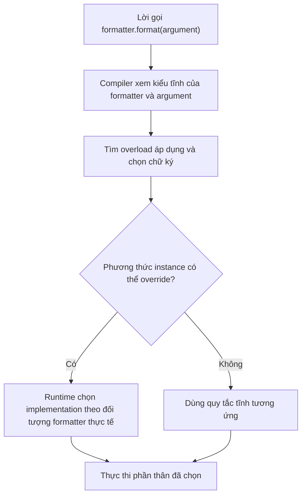

# Distinguishing Method Overriding from Overloading in Java

**Method overriding** and **method overloading** both allow multiple methods to share a name, but they are **two different mechanisms**. Knowing the distinction is fundamental to Java polymorphism: *which method the compiler selects*, *which body the JVM executes*, and *how reference-variable types affect the outcome*.

A useful rule of thumb:

- **Overloading:** *Same name, different parameter lists*. The compiler chooses an applicable signature from the **argument types at the call site**.
- **Overriding:** *A subclass redefines an inherited instance method with a compatible signature*. The JVM selects **the actual object's implementation** when invoked.

Both mechanisms can occur **within a single call**, so merely looking at a method name is not enough to predict the result.

## 1. Quick Comparison

| Feature | Overloading | Overriding |
| --- | --- | --- |
| Purpose | Offer multiple same-named call forms with different inputs | Allow a subclass to change how an inherited behavior is implemented |
| Inheritance relationship | Not required; can occur in one class | Involves inheritance or implementing a supertype's method contract |
| Method name | The same | The same |
| Parameter list | **Must differ** in number, type, or type order | Must have a signature compatible with overriding |
| Return type | Cannot alone distinguish overloads | Must be compatible; may return a more specific reference type (*covariant return*) |
| Primary selection time | **Compile time**: overload signature | **Runtime**: implementation of the selected instance method |
| Role of variable type | Very important for overload selection | Static type controls available calls; runtime type controls overriding |
| `@Override` | Not used to mark a pure overload | Recommended for compiler verification |
| `static` | Static methods can be overloaded | Static methods **cannot override**; same-signature subclass methods hide them |
| `private` | Can be overloaded within its access scope | Private methods are not inherited for overriding |
| `final` | A final method name can be overloaded with different parameters | Final instance methods cannot be overridden |

**Key point:** Java does not "select overloads by the runtime type of an argument". If a variable is declared `Animal` but holds `Dog`, an ordinary overload call still sees the expression as type `Animal` at compile time.

## 2. Overloading: Same Name, Different Parameters

For example, a class offers two addition operations:

```java
public class Calculator {
    public int add(int a, int b) {
        return Math.addExact(a, b);
    }

    public double add(double a, double b) {
        return a + b;
    }

    public int add(int a, int b, int c) {
        return Math.addExact(Math.addExact(a, b), c);
    }
}
```

Using the class:

```java
Calculator calculator = new Calculator();

System.out.println(calculator.add(2, 3));       // 5
System.out.println(calculator.add(1.5, 2.25));  // 3.75
System.out.println(calculator.add(2, 3, 4));    // 9
```

Methods named `add` are distinguished by their **parameter lists**:

- `add(int, int)`
- `add(double, double)`
- `add(int, int, int)`

In Java, a *method signature* primarily consists of the name and parameter types, not the return type. Thus this example is **invalid**:

```java
class InvalidCalculator {
    int calculate(int a) {
        return a;
    }

    // LỖI biên dịch: chỉ đổi kiểu trả về không tạo overload.
    // double calculate(int a) {
    //     return a;
    // }
}
```

Parameter variable names do not change a signature either: `sum(int left)` and `sum(int right)` still have identical signatures.

### How Does the Compiler Select an Overload?

The compiler considers **applicable** calls given the argument types, legal conversions (`widening`, boxing/unboxing, varargs, etc.), and rules for selecting the **most specific** of the applicable candidates.

For example:

```java
class Printer {
    void print(int value) {
        System.out.println("int: " + value);
    }

    void print(long value) {
        System.out.println("long: " + value);
    }
}

Printer printer = new Printer();
printer.print(5);   // int: 5
printer.print(5L);  // long: 5
```

`print(5)` exactly matches `print(int)`, while `print(5L)` has type `long`. If only `print(long)` exists, Java can widen `int` to `long` to make the call valid.

Do not memorize one simplistic priority order for every situation: specificity, generics, boxing, varargs, and parameter types can interact to create complex or **ambiguous** cases.

## 3. Overriding: A Subclass Replaces the Parent Implementation

Suppose a class defines a message-sending behavior:

```java
class MessageSender {
    public String send(String message) {
        return "Mặc định: " + message;
    }
}

class EmailSender extends MessageSender {
    @Override
    public String send(String message) {
        return "Email: " + message;
    }
}
```

When called:

```java
MessageSender sender = new EmailSender();
System.out.println(sender.send("Xin chào")); // Email: Xin chào
```

The `sender` reference has the **declared type** `MessageSender` but holds an `EmailSender` object. `send(String)` is available through the reference type; then the JVM invokes the `EmailSender` override. This is **runtime polymorphism**.

`@Override` is especially helpful when writing:

```java
@Override
public String send(String message) {
    return "Email: " + message;
}
```

If you accidentally change the parameter to `Object` or misspell the method name, the annotation makes the compiler report that the method **does not actually override** the intended method. It does not alter runtime dispatch.

### Requirements for Valid Overriding

Some basic rules:

1. A method must override an inherited instance method or implement a corresponding supertype method; constructors cannot be overridden.
2. Signatures must be compatible under Java's rules; differing parameter names are irrelevant.
3. Access must not be narrowed; for example, if a parent method is `public`, the child method must also be `public`.
4. Return types must be compatible. Reference types may be **covariant**, such as a parent returning `Animal` and a child returning `Dog`; primitive returns cannot arbitrarily change from `int` to `long`.
5. Declared checked exceptions must not be broadened incompatibly relative to the parent method.
6. A `final` method cannot be overridden; `static` and `private` methods do not participate in ordinary overriding.

A class *extending* another does not automatically make every same-named method an override.

## 4. Most Important Example: Overloading and Overriding Together

Create a single file named **`DispatchDemo.java`**:

```java
public class DispatchDemo {

    static class Animal {
    }

    static class Dog extends Animal {
    }

    static class Formatter {
        public String format(Animal value) {
            return "Formatter: Animal";
        }

        public String format(Dog value) {
            return "Formatter: Dog";
        }
    }

    static class SpecialFormatter extends Formatter {
        @Override
        public String format(Animal value) {
            return "SpecialFormatter: Animal";
        }

        // Không override format(Dog), nên vẫn kế thừa bản cha.
    }

    public static void main(String[] args) {
        Dog dog = new Dog();
        Animal animalReference = dog;
        Formatter formatter = new SpecialFormatter();

        System.out.println(formatter.format(animalReference));
        System.out.println(formatter.format(dog));
        System.out.println(formatter.format((Animal) dog));
        System.out.println(formatter.format(new Animal()));

        Formatter base = new Formatter();
        System.out.println(base.format(dog));
    }
}
```

Compile and run with JDK 11+:

```bash
javac DispatchDemo.java
java DispatchDemo
```

The **exact** output:

```text
SpecialFormatter: Animal
Formatter: Dog
SpecialFormatter: Animal
SpecialFormatter: Animal
Formatter: Dog
```

### Analyzing Each Call

| Call | Argument Static Type | Compiler-Selected Overload | Executed Implementation |
| --- | --- | --- | --- |
| `formatter.format(animalReference)` | `Animal` | `format(Animal)` | `SpecialFormatter.format(Animal)` |
| `formatter.format(dog)` | `Dog` | `format(Dog)` | `Formatter.format(Dog)` (inherited) |
| `formatter.format((Animal) dog)` | `Animal` after casting | `format(Animal)` | `SpecialFormatter.format(Animal)` |
| `formatter.format(new Animal())` | `Animal` | `format(Animal)` | `SpecialFormatter.format(Animal)` |
| `base.format(dog)` | `Dog` | `format(Dog)` | `Formatter.format(Dog)` |

There are two successive steps:

1. **Select an overload:** the name `format`, the argument's **static type**, and the methods visible through the receiver's static type allow the compiler to select a signature such as `format(Animal)`.
2. **Select an override:** for the selected signature, the JVM examines **the actual receiver object type** `formatter`. Since it is `SpecialFormatter`, `format(Animal)` executes the subclass override. If `format(Dog)` was selected instead, the subclass does not override it, so Java uses the inherited implementation from `Formatter`.

This is why:

```java
Dog dog = new Dog();
Animal reference = dog;
```

Two variables can refer to **the same Dog object** while `format(dog)` and `format(reference)` select **different overloads**. The runtime type of `reference` does not cause the compiler to switch to `format(Dog)`.

### Method-Call Resolution Diagram



This diagram summarizes ordinary method calls. `super.method()`, constructor calls, and static methods have separate rules.

## 5. Both Receiver and Argument Types Matter

Not only argument types but also **the declared type of the receiver expression** affects which overloads are visible at compile time.

```java
class BaseHandler {
    void handle(Object value) {
        System.out.println("Base: Object");
    }
}

class ChildHandler extends BaseHandler {
    void handle(String value) {
        System.out.println("Child: String");
    }
}
```

Consider:

```java
BaseHandler baseRef = new ChildHandler();
ChildHandler childRef = new ChildHandler();

baseRef.handle("hi");   // Base: Object
childRef.handle("hi");  // Child: String
```

For `baseRef`, the compiler sees only `handle(Object)` through the `BaseHandler` API; it does not discover the new `handle(String)` overload declared only in `ChildHandler`. `ChildHandler` also **does not override** `handle(Object)` because it only declares `handle(String)`.

If a subclass needs to change how existing `BaseHandler` calls behave, it must override the exact `handle(Object)` method:

```java
class AnotherHandler extends BaseHandler {
    @Override
    void handle(Object value) {
        System.out.println("Another: Object");
    }
}
```

Therefore, overloading is **not** a substitute for overriding when polymorphism through a parent type or interface is needed.

## 6. Overload Resolution and `null`

A potentially confusing case:

```java
class NullExample {
    void show(Object value) {
        System.out.println("Object");
    }

    void show(String value) {
        System.out.println("String");
    }
}

new NullExample().show(null); // String
```

Both `Object` and `String` can accept `null`, but `String` is more specific than `Object`, so `show(String)` is chosen.

By contrast:

```java
class AmbiguousExample {
    void show(String value) {
    }

    void show(Integer value) {
    }
}

// new AmbiguousExample().show(null); // LỖI: ambiguous
```

`String` and `Integer` are unrelated subtypes, so `null` alone cannot determine which overload is more specific. An explicit cast can disambiguate:

```java
new AmbiguousExample().show((String) null);
```

**Caution:** Java may select an overload accepting `null`, but its body may throw `NullPointerException` if it dereferences that argument. Overload selection and input safety are separate concerns.

## 7. Overloading: Widening, Boxing, and Varargs

An example showing compile-time precedence:

```java
class NumberExample {
    void show(long value) {
        System.out.println("long");
    }

    void show(Integer value) {
        System.out.println("Integer");
    }

    void show(int... values) {
        System.out.println("varargs");
    }
}

NumberExample numbers = new NumberExample();
numbers.show(10);   // long
numbers.show(10L);  // long
```

For `10` of type `int`, `show(long)` is applicable through **primitive widening**; the compiler prefers a phase without boxing over `show(Integer)`. `varargs` is a separate mechanism considered when no applicable method was selected in earlier phases.

The important point is not that "`long` always beats `Integer`" in every program, but rather:

- Overloads are selected according to **compile-time rules**.
- Legal type conversions affect candidate methods.
- Overload sets with too many nearly identical parameter types can become confusing or ambiguous.

**Design tip:** when two methods perform semantically different operations, distinct, descriptive names are often better than overloading just to reduce the number of API names.

## 8. `static`, `private`, `final`: Do Not Confuse Them with Overriding

### Static Method Hiding Is Not Overriding

```java
class Base {
    static String category() {
        return "Base";
    }
}

class Child extends Base {
    static String category() {
        return "Child";
    }
}

Base value = new Child();
System.out.println(Base.category());  // Base
System.out.println(Child.category()); // Child
```

`static` methods belong to classes. Declaring the same signature in a subclass produces **method hiding**, not dynamic dispatch. Prefer calling them through **class names** for clarity. Do not place `@Override` on `static` methods intending to override.

### Private Methods Are Not Inherited for Overriding

```java
class Base {
    private String internal() {
        return "base internal";
    }

    public String run() {
        return internal();
    }
}

class Child extends Base {
    public String internal() {
        return "child internal";
    }
}

System.out.println(new Child().run()); // base internal
```

`Child.internal()` is a method of the subclass, not an override of `Base.internal()` because the parent method is `private`. Calls within `Base.run()` still use `Base.internal()`.

### Final Methods Cannot Be Overridden

```java
class Base {
    public final void validate() {
        System.out.println("Kiểm tra chung");
    }
}

class Child extends Base {
    // @Override
    // public void validate() { } // LỖI: final
}
```

A subclass may still declare an overload `validate(String context)` because it has a **different signature**, leaving the parent's final `validate()` unchanged.

### Constructors Can Be Overloaded but Not Overridden

```java
class Account {
    Account() {
        this("DEFAULT");
    }

    Account(String id) {
        System.out.println(id);
    }
}
```

`Account()` and `Account(String)` are **overloaded constructors**. Constructors are not inherited like ordinary methods, so Java has no "constructor overriding". `this(...)` selects another constructor in the same class; `super(...)` invokes a superclass constructor, not an override.

## 9. `@Override` and Compatibility Rules

Use `@Override` when **actually implementing or overriding a contract**:

```java
interface Describable {
    String describe();
}

class Product implements Describable {
    @Override
    public String describe() {
        return "Sản phẩm";
    }

    public String describe(String language) {
        return "vi".equals(language)
                ? "Sản phẩm"
                : "Product";
    }
}
```

`describe()` implements an interface method; `describe(String)` is an overload in the same class. Both are valid and can coexist.

### Covariant Return Types in Overriding

```java
class Animal {
}

class Cat extends Animal {
}

class Shelter {
    Animal adopt() {
        return new Animal();
    }
}

class CatShelter extends Shelter {
    @Override
    Cat adopt() {
        return new Cat();
    }
}
```

The child method `adopt()` returns `Cat`, a subtype of `Animal`, which is valid. By contrast, **only changing the return type** can never create a new overload with an otherwise identical signature.

### Exception and Access Rules

- If a superclass method is `public`, its override cannot be `protected` or package-private.
- If the parent declares the checked exception `IOException`, its override can declare `FileNotFoundException` (a subtype of `IOException`) or no checked exception; it cannot arbitrarily broaden that exception to an incompatible checked type.
- Unchecked exceptions have different declaration rules, but subtypes must still preserve the behavioral contract on which callers rely.
- A method returning `void` cannot be overridden with a `String` return type when the name and parameters are identical.

The compiler verifies syntax and type compatibility; business contracts still require separate tests.

## 10. Overriding and the Liskov Substitution Principle

Overriding is commonly used when clients hold parent-typed references:

```java
AnimalHandler handler = new DogHandler();
handler.handle();
```

When types are related by subtyping, overrides must preserve the parent API's promises: do not strengthen valid preconditions, weaken postconditions, violate invariants, or introduce side effects contrary to the contract.

For example, if the `PaymentCalculator` interface promises nonnegative fees for valid monetary amounts, an override of `calculate` returning negative fees violates behavior even if it compiles.

Overloading, in contrast, is a decision to **offer an additional calling form**, not a polymorphic guarantee. If a client only knows a parent's `calculate(int)`, adding `calculate(String)` in the child does not suddenly redirect `calculate(int)` calls to the new body.

Therefore, to change behavior through an abstraction, override the exact published method. Use an overload to support additional parameter forms, but specify each overload's behavior to avoid surprising results.

## 11. Practical Test: Distinguish the Two Resolution Phases

Create another standalone file, **`DispatchContractCheck.java`**:

```java
public class DispatchContractCheck {
    static class Parent {
        String call(Object value) {
            return "Parent:Object";
        }

        String call(String value) {
            return "Parent:String";
        }
    }

    static class Child extends Parent {
        @Override
        String call(Object value) {
            return "Child:Object";
        }
    }

    public static void main(String[] args) {
        Parent receiver = new Child();

        Object stringAsObject = "Java";
        String stringAsString = "Java";

        check("Child:Object".equals(receiver.call(stringAsObject)));
        check("Parent:String".equals(receiver.call(stringAsString)));
        check("Child:Object".equals(receiver.call((Object) stringAsString)));

        System.out.println("PASS: overload và override được phân biệt");
    }

    static void check(boolean ok) {
        if (!ok) {
            throw new AssertionError("Sai quy tắc phân giải method");
        }
    }
}
```

Compile and run:

```bash
javac DispatchContractCheck.java
java DispatchContractCheck
```

Output:

```text
PASS: overload và override được phân biệt
```

**Reason:**

- `stringAsObject` has static type `Object`, so the compiler selects `call(Object)`; the actual receiver is `Child`, so `Child.call(Object)` executes.
- `stringAsString` has static type `String`, so the compiler selects `call(String)`; `Child` does not override this method, so the inherited version from `Parent` runs.
- Casting `(Object) stringAsString` changes the call-site expression type and selects the `call(Object)` overload, even though the actual string object is unchanged.

This is the most memorable test of **"overload first, override second"**.

## 12. Practice Exercises

**Exercise 1 — Predict the Result**

```java
class Parent {
    String test(Number n) { return "Parent-Number"; }
    String test(Integer n) { return "Parent-Integer"; }
}
class Child extends Parent {
    @Override
    String test(Number n) { return "Child-Number"; }
}

Parent p = new Child();
Number n = Integer.valueOf(7);
Integer i = Integer.valueOf(7);

System.out.println(p.test(n)); // ?
System.out.println(p.test(i)); // ?
```

**Answer:** `Child-Number` and `Parent-Integer`. Overloading selects signatures using the static types of `n`/`i`; runtime dispatch executes an override if the selected signature is overridden.

**Exercise 2 — Only Change the Return Type**

Are `int calculate(int x)` and `double calculate(int x)` in the same class valid together? **No.** They have the same signature; return types do not distinguish overloads.

**Exercise 3 — Explain an `@Override` Error**

```java
class Base {
    void process(String s) { }
}

class Sub extends Base {
    // @Override
    void process(Object o) { }
}
```

Why is `@Override` invalid here? `process(Object)` is a new overload, not an override of `process(String)`. To override, declare `void process(String s)`.

**Exercise 4 — Static and Instance Methods**

Write parent/child classes with the same `static String type()` and an overridden instance method `String describe()`. Use a parent-typed variable referring to a child object. Predict the result of calling the static method by **class name** and the instance method through the variable.

**Exercise 5 — API Design**

You have `NotificationSender.send(String text)` and want to support sending to multiple recipients:

- Adding `send(String text, String recipient)` creates an **overload** — another signature.
- If `EmailSender` changes how the already defined `send(String text)` sends a message, that is an **override** — a different implementation of shared behavior.

Create a comparison table for both approaches: the client-visible type, selected signature, executed body, and behavioral expectations that must remain valid.

## Common Mistakes

| Misconception | Correct Understanding |
| --- | --- |
| "Overloading only occurs between inherited classes" | Overloads may exist in the same class |
| "Overriding requires only the same name" | Signatures and other override conditions must be compatible |
| "Different return types create overloads" | False; return types alone are insufficient |
| "Java automatically chooses overloads by runtime argument class" | False; static types and overload-resolution rules determine selection |
| "The compiler always selects the final override body" | The compiler selects the signature; instance-method dispatch occurs at runtime |
| "Child static methods override parent static methods" | This is method hiding |
| "Parent private methods can be overridden" | Private methods are not inherited for overriding |
| "`@Override` is required for the JVM to dispatch" | No; the annotation provides compile-time checking |
| "Adding an overload in a child class makes all parent-typed calls select it" | No; receiver static types determine visible APIs |
| "Constructors can be overridden" | Constructors can be overloaded, not overridden |

**Conclusion:** To resolve a Java call with multiple same-named methods, first ask **which overloads the compiler sees and which signature it selects using static types**. Then, for overridable instance methods, ask **what class the receiver object actually belongs to** to determine the body executed. These two steps prevent most confusion between **overloading** and **overriding**.
