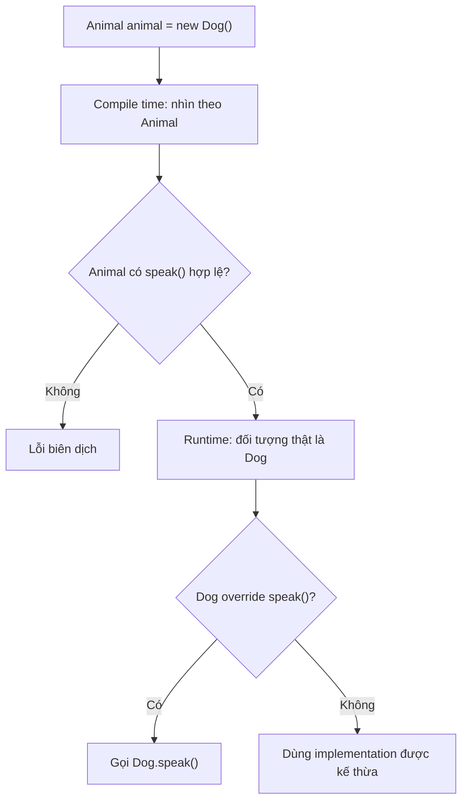

# Scope of Polymorphism for Methods and Fields in Java

Consider this declaration:

```java
Parent value = new Child();
```

The variable `value` has the **declared type** `Parent` but refers to an object whose **actual type** is `Child`. If `Child` validly (*overrides*) an instance method, a call through `value` can execute the `Child` implementation. This is **dynamic polymorphism (runtime polymorphism)**.

Not every Java member works this way. **Fields cannot be overridden; static methods may be hidden (*hiding*) but do not dispatch dynamically; and overloads are selected using compile-time types.**

This lesson establishes exactly **which members participate in polymorphism**, how the compiler and JVM select behavior, and common traps involving superclasses, subclasses, and interfaces.

## 1. Two Stages, Two Decisions

Consider:

```java
Animal animal = new Dog();
animal.speak();
```

Java must handle two separate questions:

1. **At compile time:** Given that `animal` has type `Animal`, is calling `speak()` valid? If there are overloads, which signature applies?
2. **At runtime:** For an overridable instance method, the actual object is `Dog`, so the selected implementation can be `Dog.speak()`.

In other words: **the declared type limits which members are accessible; the runtime type determines the implementation of dynamically dispatched instance methods.**



The diagram applies to **overridable instance methods**, not every field or static method.

## 2. Complete Java Example: Same Object, Different Results

File `PolymorphismScopeDemo.java`:

```java
public class PolymorphismScopeDemo {

    static class Ticket {
        // Field: thuộc tính dữ liệu, không hỗ trợ override.
        public String label = "Ticket-field";

        // Instance method: có thể được subclass override.
        public String display() {
            return "Ticket-method";
        }

        // final instance method: subclass không thể override.
        public final String code() {
            return "T-001";
        }

        // Static method: có thể bị hiding, không dynamic dispatch.
        public static String category() {
            return "Ticket-static";
        }

        // Private method: không được override ở subclass.
        private String internalNote() {
            return "Ticket-private";
        }

        public String showInternalNote() {
            return internalNote();
        }

        // Đọc field thuộc lớp khai báo phương thức này.
        public String showField() {
            return "Ticket.showField: " + label;
        }
    }

    static final class VipTicket extends Ticket {
        // Field khác, che khuất Ticket.label.
        public String label = "VIP-field";

        @Override
        public String display() {
            return "VIP-method";
        }

        // Đây là static method hiding, không phải override.
        public static String category() {
            return "VIP-static";
        }

        // Cùng tên nhưng không override private method của cha.
        private String internalNote() {
            return "VIP-private";
        }

        public String vipOnly() {
            return "Chức năng riêng của VIP";
        }

        public String bothFields() {
            return super.label + " / " + this.label;
        }
    }

    public static void main(String[] args) {
        Ticket ticket = new VipTicket();

        System.out.println(ticket.display());
        System.out.println(ticket.label);
        System.out.println(((VipTicket) ticket).label);
        System.out.println(ticket.code());

        System.out.println(Ticket.category());
        System.out.println(VipTicket.category());

        // Tránh viết ticket.category() trong code thực tế:
        // Cú pháp được Java cho phép nhưng dễ gây hiểu nhầm.
        System.out.println(ticket.category());

        System.out.println(ticket.showInternalNote());
        System.out.println(ticket.showField());

        VipTicket vip = (VipTicket) ticket;
        System.out.println(vip.bothFields());
        System.out.println(vip.vipOnly());
    }
}
```

Run:

```bash
javac PolymorphismScopeDemo.java
java PolymorphismScopeDemo
```

Output:

```text
VIP-method
Ticket-field
VIP-field
T-001
Ticket-static
VIP-static
Ticket-static
Ticket-private
Ticket.showField: Ticket-field
Ticket-field / VIP-field
Chức năng riêng của VIP
```

Why do results differ for the same `VipTicket` object?

| Expression | Result | Mechanism |
|---|---|---|
| `ticket.display()` | `VIP-method` | **Override + dynamic dispatch** |
| `ticket.label` | `Ticket-field` | Field resolution using static type `Ticket` |
| `((VipTicket) ticket).label` | `VIP-field` | The cast expression has static type `VipTicket` |
| `ticket.code()` | `T-001` | `final` instance method; cannot be overridden |
| `Ticket.category()` | `Ticket-static` | Static method of the explicitly named class |
| `VipTicket.category()` | `VIP-static` | Another static method hiding the parent's |
| `ticket.category()` | `Ticket-static` | Static method selected by expression `ticket`'s static type |
| `ticket.showInternalNote()` | `Ticket-private` | A method of `Ticket` invokes a private method of `Ticket` |
| `ticket.showField()` | `Ticket.showField: Ticket-field` | The `Ticket` implementation reads `Ticket.label` |
| `vip.bothFields()` | `Ticket-field / VIP-field` | `super.label` and `this.label` refer to two separate fields |
| `vip.vipOnly()` | Subclass-specific feature | A `VipTicket`-typed expression can invoke a method declared only by the subclass |

**Important observation:** `Ticket.label` and `VipTicket.label` are **two separate fields coexisting in one subclass object**. Redeclaring the field does not alter parent-class field access or create field polymorphism.

In production designs, avoid the public or same-named fields used in this deliberately illustrative example. They expose the language rules here but are poor design choices.

## 3. Fields Do Not Override: Changing a Reference Type Can Change Which Field Is Read

~~~java
class Base {
    String value = "base";
}
class Derived extends Base {
    String value = "derived";
}
Base ref = new Derived();
System.out.println(ref.value);             // base
System.out.println(((Derived) ref).value); // derived
~~~

A `Derived` instance contains **two different fields**, one in the `Base` portion and one in `Derived`. A valid cast changes only the expression's static type; it neither changes the object nor copies a value. Because fields do not dispatch at runtime, changing a variable type from `Base` to `Derived` can select a different member even with the same instance.

This is an important reason to avoid same-named public/protected fields and encapsulate state instead. *Distinguishing Member Hiding from Overriding* covers field hiding, `super.field`, static hiding, and access rules in detail; this lesson focuses next on **getters as polymorphic APIs**.

## 4. Getters Are Methods: Behavior Can Be Polymorphic Even When Fields Are Not

In Java, "property" sometimes means a data field, while many frameworks and libraries use **JavaBean properties** exposed via `getXxx()`/`setXxx()` methods. Distinguish:

- `obj.value`: accesses a **field** — no dynamic dispatch.
- `obj.getValue()`: calls a **method** — potentially overridable and dynamically dispatched.

For example:

```java
class Person {
    private final String name;

    Person(String name) {
        this.name = name;
    }

    public String getDisplayName() {
        return name;
    }
}

class Employee extends Person {
    private final String department;

    Employee(String name, String department) {
        super(name);
        this.department = department;
    }

    @Override
    public String getDisplayName() {
        return super.getDisplayName() + " (" + department + ")";
    }
}

Person person = new Employee("An", "Backend");

System.out.println(person.getDisplayName()); // An (Backend)
```

The `person` variable knows only the `Person` contract, but `getDisplayName()` returns a value according to the `Employee` implementation.

This **does not mean the `name` field is overridden**: `name` remains private data managed by `Person`. The getter behavior is overridden, not the field.

### Which Design Should You Choose?

When state must satisfy invariants, favor `private` fields and expose **meaningful behavior** or controlled access methods. If a subclass needs a different presentation, overriding `getDisplayName()` is clearer than declaring another `name` field with the same name.

However, if a getter is `final`, subclasses cannot override it. Polymorphism does not require every getter to be overridable.

## 5. Scope of Polymorphism by Member Type

| Member Type | Dynamic Dispatch by Runtime Object? | Explanation |
|---|---|---|
| Overridable instance method | **Yes** | The subclass implementation is selected when overriding satisfies the contract |
| `abstract` method implemented in a subclass | **Yes** | A call through the abstract type invokes the concrete implementation |
| Interface method implemented by a class | **Yes** | A call through an interface reference selects the appropriate implementation |
| Interface `default method` | **Possible** | Can be inherited or overridden; conflicts require correct resolution |
| `final` instance method | Cannot be overridden by a subclass | No subclass override can provide a different implementation |
| `private` method | Cannot override | A same-named subclass method is a separate member |
| `static` method | **No** | Can be hidden; calls resolve by static type/class name |
| Constructor | **No** | Not inherited or overridden |
| Overloaded method | Overload selected at compile time | After selecting the signature, an instance-method implementation can still be dispatched |
| Instance field | **No** | Field hiding/resolution by static type |
| `static` field | **No** | Class-level state; no field polymorphism |

Note that `final`, `private`, and `static` are not "behaviorless". They can execute ordinary code. The distinction is that **they do not cause runtime selection among instance-method overrides**.

## 6. Polymorphism Applies to the **Selected Method Signature**

~~~java
class Speaker {
    String speak(Object value) { return "Speaker/Object"; }
}
class DogSpeaker extends Speaker {
    @Override String speak(Object value) { return "DogSpeaker/Object"; }
    String speak(String value) { return "DogSpeaker/String"; }
}
Speaker caller = new DogSpeaker();
System.out.println(caller.speak("Gâu")); // DogSpeaker/Object
~~~

The compiler sees only the `speak(Object)` overload through type `Speaker`; after selecting that signature, the JVM dispatches to `DogSpeaker.speak(Object)`. The `speak(String)` overload exists only in the subclass and does not become part of the static API available through `caller`.

Remember the scope: **the receiver type determines valid calls; the actual object selects the implementation only for an eligible instance method**. The previous lessons explain overloading/overriding, `null`, boxing, and varargs in detail.

## 7. Static and Private Methods Are Not Equivalent Runtime Extension Points

`Base ref = new Derived()` does not make `ref.staticMethod()` select a static method from `Derived`: static methods belong to **classes**. Calling `Base.staticMethod()` or `Derived.staticMethod()` is clearer. A matching subclass static method causes **method hiding**.

Similarly, private superclass methods are not inherited for overriding; a same-named subclass method cannot replace the private implementation invoked by parent code. The lesson *Distinguishing Member Hiding from Overriding* provides runnable examples. These rules limit polymorphism to **instance methods that can genuinely be overridden**.

## 8. Final Methods, Abstract Methods, and Interfaces

### 8.1. final instance method

```java
class BasePolicy {
    public final boolean isEnabled() {
        return true;
    }
}

class SpecialPolicy extends BasePolicy {
    // public boolean isEnabled() { return false; }
    // Lỗi biên dịch vì isEnabled() là final.
}
```

A `BasePolicy p = new SpecialPolicy();` variable can still call `p.isEnabled()`. But because the subclass cannot override it, no subclass-specific implementation is selected for that method. `final` is useful for protecting an invariant rule or algorithmic step.

### 8.2. Abstract Methods and Interfaces Support Dynamic Dispatch

```java
abstract class Shape {
    abstract double area();
}

final class Circle extends Shape {
    private final double radius;

    Circle(double radius) {
        if (radius <= 0) {
            throw new IllegalArgumentException("Bán kính phải dương");
        }
        this.radius = radius;
    }

    @Override
    double area() {
        return Math.PI * radius * radius;
    }
}

Shape shape = new Circle(2);
System.out.println(shape.area()); // Khoảng 12.56637
```

`Shape.area()` has no implementation in the abstract class, but a `Shape`-typed variable can still call it. At runtime, Java invokes `Circle.area()`.

Likewise, when a class implements an interface method, a call through an interface reference uses the appropriate implementation:

```java
interface Formatter {
    String format(String text);
}

final class UpperFormatter implements Formatter {
    @Override
    public String format(String text) {
        return text.toUpperCase(java.util.Locale.ROOT);
    }
}

Formatter formatter = new UpperFormatter();
System.out.println(formatter.format("java")); // JAVA
```

### 8.3. Interface Default Methods Can Participate in Polymorphism

```java
interface Greeter {
    default String hello() {
        return "Hello";
    }
}

class FriendlyGreeter implements Greeter {
    @Override
    public String hello() {
        return "Xin chào";
    }
}

Greeter greeter = new FriendlyGreeter();
System.out.println(greeter.hello()); // Xin chào
```

`default` supplies an implementation when a class does not provide a more specific one. An overriding class implementation runs even through an interface-typed reference. For conflicting default methods, Java applies class-method priority, more-specific-interface rules, and sometimes requires explicit overriding to resolve ambiguity.

Conversely, **interface static methods are not inherited as instance methods** and are called through their interface names:

```java
interface Normalizer {
    static String normalize(String value) {
        return value.strip();
    }
}

System.out.println(Normalizer.normalize(" A ")); // A
```

## 9. `super` Does Not Create Another Object

If `MonthlyReport extends Report`, a `super.header()` call in the subclass invokes the appropriate superclass implementation, while `this.header()` is an ordinary instance call that may dispatch to an override.

~~~java
class Report {
    String header() { return "Báo cáo"; }
    String render() { return "[" + header() + "]"; }
}
class MonthlyReport extends Report {
    @Override String header() { return "Báo cáo tháng"; }
    String parentHeader() { return super.header(); }
}
Report report = new MonthlyReport();
System.out.println(report.render()); // [Báo cáo tháng]
~~~

Even when `render()` runs in superclass code, the receiver is a `MonthlyReport` instance, so `header()` can dynamically dispatch. `super` only changes the implementation selected for that call; it does not create another `Report` object. Avoid overridable calls in superclass constructors, where subclass state may still be uninitialized.

## 10. Do Casts and instanceof Make Fields Polymorphic?

No. A cast changes **the static type of an expression** and which member accesses the compiler permits; it does not change an object's runtime class.

```java
class Base {
    public String code = "BASE";
    public String code() {
        return "Base-method";
    }
}

class Child extends Base {
    public String code = "CHILD";

    @Override
    public String code() {
        return "Child-method";
    }

    public String childOnly() {
        return "extra";
    }
}

Base ref = new Child();

System.out.println(ref.code);          // BASE
System.out.println(ref.code());        // Child-method
System.out.println(((Child) ref).code); // CHILD
```

The object remains unchanged; only **field access** changes due to the cast expression's static type.

For variables that may reference different subclasses, check before casting:

```java
if (ref instanceof Child child) {
    System.out.println(child.childOnly()); // extra
}
```

This is pattern matching for `instanceof` (Java 16+, runnable with Java 17). An invalid downcast can throw `ClassCastException`. In particular, a `Parent` variable referencing a `Child` object **does not add every `Child`-specific method to the `Parent` API**.

## 11. Real-World Polymorphism: Prefer Behavior to Fields

An example of poor design:

```java
class Discount {
    public double percent;
}

class VipDiscount extends Discount {
    public double percent; // Field hiding gây nhầm lẫn
}
```

If a caller declares `Discount d = new VipDiscount();` and reads `d.percent`, it gets `Discount`'s field, not automatically the "VIP percentage".

A clearer design expresses the fee calculation as behavior:

```java
interface DiscountPolicy {
    long apply(long originalPriceVnd);
}

final class NoDiscount implements DiscountPolicy {
    @Override
    public long apply(long originalPriceVnd) {
        if (originalPriceVnd < 0) {
            throw new IllegalArgumentException("Giá không được âm");
        }
        return originalPriceVnd;
    }
}

final class TenPercentDiscount implements DiscountPolicy {
    @Override
    public long apply(long originalPriceVnd) {
        if (originalPriceVnd < 0) {
            throw new IllegalArgumentException("Giá không được âm");
        }
        // Quy tắc ví dụ: giảm 10%, làm tròn xuống VND nguyên.
        return originalPriceVnd - originalPriceVnd / 10;
    }
}
```

Callers need not read a potentially hidden `percent` field:

```java
DiscountPolicy policy = new TenPercentDiscount();
System.out.println(policy.apply(100_000)); // 90000

policy = new NoDiscount();
System.out.println(policy.apply(100_000)); // 100000
```

Each implementation manages its own rules while callers depend on the shared `DiscountPolicy.apply(...)` contract. This is generally more extensible and safer than depending on public fields.

## 12. Common Misconceptions

| Claim | Assessment | Explanation |
|---|---|---|
| `Parent p = new Child()` followed by `p.method()` always runs the parent method | False | An overridden instance method can execute `Child`'s implementation |
| `Parent p = new Child()` followed by `p.field` automatically reads the field in `Child` | False | Fields are resolved using static types |
| Redeclaring a same-named field in a subclass is overriding | False | This is **field hiding** |
| A getter can be overridden, making its returned behavior polymorphic | True, if the getter is an overridable instance method | Its underlying field is not automatically polymorphic |
| Static methods are selected by runtime type | False | Static method hiding uses compile-time resolution |
| Private methods can be overridden | False | A same-named subclass method is a separate member |
| A final method can be overridden by casting to a subclass | False | `final` prevents overriding |
| Overloads are selected using argument runtime classes | False | Overload resolution uses compile-time types and conversion rules |
| Interface methods can dispatch to a class implementation | True | This is interface polymorphism |
| `super.method()` calls a separate parent object | False | It is still the same object but selects the appropriate superclass implementation |
| Casting a variable changes the runtime object type | False | Only the expression's static type changes, with possible runtime type checks |

## 13. Self-Check Exercises

### Exercise 1 — Predict Three Results

```java
class A {
    int number = 1;
    String name() {
        return "A";
    }
    static String type() {
        return "A-static";
    }
}

class B extends A {
    int number = 2;
    @Override
    String name() {
        return "B";
    }
    static String type() {
        return "B-static";
    }
}

A value = new B();

System.out.println(value.number);
System.out.println(value.name());
System.out.println(value.type());
```

**Answer:** `1`, `B`, `A-static`. Fields and static methods use the `A` static type; `name()` instance calls dispatch to the `B` override. In real code, prefer `A.type()` instead of static calls through variables.

### Exercise 2 — Does Overloading Depend on Runtime Objects?

```java
class Animal {}
class Dog extends Animal {}

void examine(Animal a) {
    System.out.println("Animal");
}
void examine(Dog d) {
    System.out.println("Dog");
}

Animal argument = new Dog();
examine(argument);
```

**Answer:** `Animal`. Overload selection uses the declared type of `argument`. Casting with `examine((Dog) argument)` makes the compiler select the `Dog` overload (if the cast is runtime-compatible).

### Exercise 3 — Getter or Field?

```java
class Parent {
    String title = "Parent-field";
    String getTitle() {
        return "Parent-method";
    }
}

class Child extends Parent {
    String title = "Child-field";
    @Override
    String getTitle() {
        return "Child-method";
    }
}

Parent obj = new Child();
```

**Question:** What results do `obj.title` and `obj.getTitle()` produce?

**Answer:** `Parent-field` and `Child-method`. Fields are not overridden; the getter is.

### Exercise 4 — Redesign the API

A library uses `class Notification` with a `public String messageType` field. Subclasses `EmailNotification` and `SmsNotification` both redeclare `messageType`, causing code using `Notification` to read the wrong channel.

Try refactoring:

1. Keep essential state in `private` fields.
2. Declare `String channel()` in the parent class or a `Notification` interface.
3. Each implementation provides suitable `channel()` behavior.
4. Create a `List<Notification>` containing multiple subtypes and call `channel()` without reading fields directly.
5. Explain why method calls preserve polymorphism while same-named fields do not.

---

**Remember:** **Java's dynamic polymorphism mainly applies to overridable instance methods**, including those defined by abstract classes and interfaces. **Fields, static methods, and overload selection are not resolved by runtime objects in the same way**. Distinguishing **field hiding**, **static method hiding**, **overriding**, and **overloading** helps predict results and design APIs around behavior rather than direct state access.
