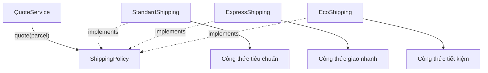

# Using Polymorphism Instead of Type-Based Conditionals in Java

When a program supports multiple object types, the most obvious first approach is to repeatedly ask **"What kind of object is this?"**, then use `if/else`, `switch`, or `instanceof` to select behavior.

```java
if (shippingType.equals("STANDARD")) {
    // Tính phí giao tiêu chuẩn
} else if (shippingType.equals("EXPRESS")) {
    // Tính phí giao nhanh
} else if (shippingType.equals("ECO")) {
    // Tính phí giao tiết kiệm
}
```

A few branches at an input boundary are normal. The problem arises when **the same type-checking chain** is repeated across many system components: pricing, service descriptions, delivery estimates, invoicing, and more. Adding a new type then requires changes in many places, making it easy to miss a branch or introduce inconsistent behavior.

**Polymorphism** moves type-specific behavior into the classes providing it. Instead of asking *"What type of object is this?"*, consuming code requests *"Perform this operation through our shared contract"*.

> The goal is not to eliminate every `if` or `switch` statement. The goal is to avoid **repeated object-type tests controlling the same domain behaviors across many locations** when those behaviors can naturally be represented by polymorphic methods.

## 1. Recognizing Conditionals That Substitute for Polymorphism

Suppose there are three shipping options: `STANDARD`, `EXPRESS`, and `ECO`. An initial implementation:

```java
final class ShippingCalculator {
    static long calculate(String type, long baseFee, long distanceFee) {
        if ("STANDARD".equals(type)) {
            return baseFee + distanceFee;
        } else if ("EXPRESS".equals(type)) {
            return baseFee + distanceFee + 25_000;
        } else if ("ECO".equals(type)) {
            return baseFee + distanceFee - 3_000;
        }
        throw new IllegalArgumentException("Loại giao hàng không hợp lệ");
    }
}
```

This code may suit a small problem with a fixed set of choices. But consider future changes:

- Add a `SAME_DAY` service: update `calculate` and every similar `if/switch`.
- The `EXPRESS` service acquires a different weight-based formula: its branch grows longer.
- Another module needs to display a plan name: it must inspect `type` again.
- A typo such as `"EXPREES"`: the error appears only at runtime.
- If the default branch returns `0` rather than reporting an error, the software may silently calculate the wrong fee.

If behavior for each type **can evolve independently**, consider a shared contract and dedicated implementations.

## 2. Ask for Shared Behavior; Let Objects Choose How to Implement It

We move from:

```java
long fee;

if (type == STANDARD) {
    fee = calculateStandard(parcel);
} else if (type == EXPRESS) {
    fee = calculateExpress(parcel);
} else {
    fee = calculateEco(parcel);
}
```

sang:

```java
ShippingPolicy policy = ...; // Một implementation phù hợp
long fee = policy.quote(parcel);
```

Here:

```java
interface ShippingPolicy {
    String label();
    long quote(Parcel parcel);
}
```

Each shipping type implements `quote()` under its own rules. Calling code only depends on **`ShippingPolicy`**, not on a series of checks for concrete classes.



Polymorphism means `policy.quote(parcel)` retains **the same method signature** while executing **different implementations** based on which object `policy` refers to.

## 3. Complete Java Example: Refactor Branching into Polymorphism

Put the following code in a single **`Main.java`** file. It runs with Java 17 or Java 21 without external libraries.

```java
import java.util.List;
import java.util.Objects;

record Parcel(int weightGrams, int distanceKm) {
    Parcel {
        if (weightGrams <= 0) {
            throw new IllegalArgumentException(
                    "Khối lượng phải lớn hơn 0");
        }
        if (distanceKm <= 0) {
            throw new IllegalArgumentException(
                    "Khoảng cách phải lớn hơn 0");
        }
    }

    // Tính mỗi 1.000 gram bắt đầu là một kilogram tính cước.
    long billedKilograms() {
        return ((long) weightGrams + 999) / 1_000;
    }
}

interface ShippingPolicy {
    String label();
    long quote(Parcel parcel);
}

final class StandardShipping implements ShippingPolicy {
    @Override
    public String label() {
        return "STANDARD";
    }

    @Override
    public long quote(Parcel parcel) {
        Objects.requireNonNull(parcel, "parcel");
        long fee = 10_000;
        fee = Math.addExact(fee,
                Math.multiplyExact(2_000L, parcel.distanceKm()));
        fee = Math.addExact(fee,
                Math.multiplyExact(1_000L, parcel.billedKilograms()));
        return fee;
    }
}

final class ExpressShipping implements ShippingPolicy {
    @Override
    public String label() {
        return "EXPRESS";
    }

    @Override
    public long quote(Parcel parcel) {
        Objects.requireNonNull(parcel, "parcel");
        long fee = 25_000;
        fee = Math.addExact(fee,
                Math.multiplyExact(4_000L, parcel.distanceKm()));
        fee = Math.addExact(fee,
                Math.multiplyExact(2_000L, parcel.billedKilograms()));
        return fee;
    }
}

final class EcoShipping implements ShippingPolicy {
    @Override
    public String label() {
        return "ECO";
    }

    @Override
    public long quote(Parcel parcel) {
        Objects.requireNonNull(parcel, "parcel");
        long fee = 7_000;
        fee = Math.addExact(fee,
                Math.multiplyExact(1_500L, parcel.distanceKm()));
        fee = Math.addExact(fee,
                Math.multiplyExact(500L, parcel.billedKilograms()));
        return fee;
    }
}

// Service chỉ biết hợp đồng; không biết ba lớp cụ thể.
final class QuoteService {
    private final ShippingPolicy policy;

    QuoteService(ShippingPolicy policy) {
        this.policy = Objects.requireNonNull(policy, "policy");
    }

    long calculate(Parcel parcel) {
        return policy.quote(parcel);
    }
}

public class Main {
    public static void main(String[] args) {
        Parcel parcel = new Parcel(1_500, 3);

        List<ShippingPolicy> policies = List.of(
                new StandardShipping(),
                new ExpressShipping(),
                new EcoShipping()
        );

        for (ShippingPolicy policy : policies) {
            long fee = new QuoteService(policy).calculate(parcel);
            System.out.println(policy.label() + ": " + fee + " VND");
        }

        ShippingPolicy selected = new ExpressShipping();
        QuoteService service = new QuoteService(selected);
        System.out.println("Đã chọn: " + service.calculate(parcel) + " VND");
    }
}
```

Compile and run:

```bash
javac Main.java
java Main
```

Output:

```text
STANDARD: 18000 VND
EXPRESS: 41000 VND
ECO: 12500 VND
Đã chọn: 41000 VND
```

### Explaining the Output

The parcel weighs 1.500 grams, billed as **2 kg**, and travels **3 km**:

| Policy | Fixed Fee | Distance Charge | Billable-Kg Charge | Total |
| --- | ---: | ---: | ---: | ---: |
| `STANDARD` | 10.000 | 2.000 × 3 = 6.000 | 1.000 × 2 = 2.000 | **18.000 VND** |
| `EXPRESS` | 25.000 | 4.000 × 3 = 12.000 | 2.000 × 2 = 4.000 | **41.000 VND** |
| `ECO` | 7.000 | 1.500 × 3 = 4.500 | 500 × 2 = 1.000 | **12.500 VND** |

What matters is not the formula but **the dependency relationship**:

- `QuoteService` declares only a `ShippingPolicy` field.
- `Main` can provide any object implementing the interface.
- Calling `policy.quote(parcel)` executes the appropriate method from `StandardShipping`, `ExpressShipping`, or `EcoShipping`.
- Adding a shipping type does not necessarily require modifying `QuoteService`; create a new implementation and register it at the policy-selection boundary.
- `Parcel` enforces shared input requirements. `Math.addExact`/`Math.multiplyExact` detect overflow instead of silently producing incorrect results.

**These formulas are illustrative, not actual carrier rates.**

## 4. Why Is This Runtime Polymorphism?

Consider:

```java
ShippingPolicy policy = new ExpressShipping();
long fee = policy.quote(new Parcel(1_500, 3));
```

The same variable has two perspectives:

| Component | Value |
| --- | --- |
| Variable `policy`'s **declared type** | `ShippingPolicy` |
| **Actual object** | `ExpressShipping` |
| Method permitted by the compiler | `quote(Parcel)` from the `ShippingPolicy` contract |
| Implementation chosen at runtime | `ExpressShipping.quote(Parcel)` |

In Java, an overridden **instance** method from an interface or parent class usually dispatches according to the actual object. This lets `QuoteService` invoke a shared method without checking `instanceof ExpressShipping`.

This differs from overloading:

```java
void print(Object value) {}
void print(String value) {}
```

Choosing `print(Object)` or `print(String)` depends primarily on **argument types visible to the compiler**, not runtime classes used to pick an overload. Replacing `if/else` checks here relies on **overriding and dynamic dispatch**, not merely adding more overloads.

## 5. The Clearest Smell: Repeated `instanceof` Checks

Suppose legacy code accepts an object:

```java
static long fee(Object strategy, Parcel parcel) {
    if (strategy instanceof StandardShipping) {
        // Công thức Standard
    } else if (strategy instanceof ExpressShipping) {
        // Công thức Express
    } else if (strategy instanceof EcoShipping) {
        // Công thức Eco
    }
    throw new IllegalArgumentException("Loại không hỗ trợ");
}
```

This snippet only illustrates the conditional pattern; it is not a complete compilable method because the branches have no `return` statements.

Replace it with:

```java
static long fee(ShippingPolicy strategy, Parcel parcel) {
    return strategy.quote(parcel);
}
```

This yields the following improvements:

| With Type-Based Checks | With Polymorphism |
| --- | --- |
| Calling code must know `StandardShipping`, `ExpressShipping`, `EcoShipping` | Calling code only needs `ShippingPolicy` |
| New types usually require branches at every type-handling location | New types add another implementation of the same contract |
| Missing branches or dangerous default `else` branches | Compiler requires concrete implementations to provide mandatory methods |
| Formulas for different types are interleaved in one long block | Each implementation owns its own rules |
| Mocking/faking is difficult when logic is tightly coupled to concrete-class checks | Supply a dedicated test implementation |

However, **an interface does not guarantee business correctness**. An implementation of `quote()` that returns a negative fee still compiles. A clear contract and tests must enforce consistent semantics across implementations.

## 6. What If Initial Selection Still Needs a `switch`?

Polymorphism does not eliminate the need to choose options from external data: users may submit `"express"`, configuration may specify `"eco"`, or an application may provide a selection list.

A branch at the **object-construction boundary** is perfectly reasonable:

```java
static ShippingPolicy selectPolicy(String code) {
    if (code == null) {
        throw new IllegalArgumentException("Thiếu mã dịch vụ");
    }

    return switch (code.toLowerCase(java.util.Locale.ROOT)) {
        case "standard" -> new StandardShipping();
        case "express" -> new ExpressShipping();
        case "eco" -> new EcoShipping();
        default -> throw new IllegalArgumentException(
                "Không hỗ trợ dịch vụ: " + code);
    };
}
```

This can be a `static` method of `Main` in the example. The **switch expression** syntax is valid in Java 17.

The difference is that **conditions are centralized in the selection step**; subsequent workflows use `ShippingPolicy`. Adding a new type may require updating this factory/registry, but not every service that invokes `quote()`.

For many implementations loaded through dependency injection or plugins, a **registry** such as `Map<String, ShippingPolicy>` can replace a `switch` factory. A registry is not inherently better: with two stable choices, a clear `switch` may be simpler and easier to maintain.

## 7. Adding a New Type Without Modifying the Service

Suppose `SameDayShipping` is introduced with a fixed fee of 40.000 VND plus 6.000 VND per kilometer. We only need another implementation of the shared contract:

```java
final class SameDayShipping implements ShippingPolicy {
    @Override
    public String label() {
        return "SAME_DAY";
    }

    @Override
    public long quote(Parcel parcel) {
        java.util.Objects.requireNonNull(parcel, "parcel");
        return Math.addExact(
                40_000L,
                Math.multiplyExact(6_000L, parcel.distanceKm())
        );
    }
}
```

Place this class alongside the main example's classes, then:

```java
QuoteService service = new QuoteService(new SameDayShipping());
System.out.println(service.calculate(new Parcel(1_500, 3)));
// 58000
```

**`QuoteService` does not change.** The UI or selection component may still need updates to expose `SAME_DAY`, along with related configuration and tests. That is what "extend while minimizing changes to existing clients" means; it does not promise zero changes anywhere in the system.

## 8. Where Do Shared Rules Belong?

One danger of moving behavior into classes is **duplicating or drifting shared rules**.

In this example:

- `Parcel` validates `weightGrams > 0` and `distanceKm > 0`.
- Each `ShippingPolicy` selects its **own formula**.
- `QuoteService` only coordinates calls without knowing formulas.
- The policy-selection component maps a service code to an implementation.

If all policies must return nonnegative amounts, specify that in the contract and check it at the result boundary:

```java
static long validatedQuote(ShippingPolicy policy, Parcel parcel) {
    long fee = policy.quote(parcel);
    if (fee < 0) {
        throw new IllegalStateException("Phí vận chuyển không hợp lệ");
    }
    return fee;
}
```

This does not mean every service must duplicate validation. Depending on requirements, use a decorator, immutable `Money` value, or shared coordinating service to enforce invariants.

**Be careful with Template Method inheritance:** it can centralize validation while letting subclasses override pricing hooks, but introduces a single-superclass inheritance hierarchy. When you only need a replaceable capability, interfaces plus composition are often more flexible.

## 9. When Should You—or Should You Not—Replace Conditions with Polymorphism?

| Situation | Generally Appropriate Approach |
| --- | --- |
| Many object types share a capability but use different algorithms | Interface/abstract class with overrides |
| Many services repeatedly use `if (x instanceof TypeA)` / `TypeB` for the same behaviors | Consider moving behavior into the type or a strategy |
| Service types selected from requests/configuration | Factory, `switch`, registry, or DI at the boundary |
| A simple business condition not tied to object type | An ordinary `if` is usually clearer |
| Simple states such as `active`, `expired` | Use conditions when they represent states; do not invent a subclass for every state |
| A small, fixed set of variants requiring exhaustive treatment | An `enum` or `sealed` hierarchy with pattern matching may fit |
| New behavior that a type should not know about (for example, serializing to many external formats) | Consider a separate Visitor, adapter, or service instead of overloading domain objects with responsibilities |
| Behavior depends on several independent dimensions (payment method, country, promotion, etc.) | Composition/Strategy can avoid a combinatorial explosion of subclasses |

### An `instanceof` Check Is Not Always Wrong

One `instanceof` check at an unclassified-input or existing-library integration boundary **is not necessarily bad design**. In Java 17, pattern matching can make it clearer:

```java
static String describe(Object value) {
    if (value instanceof String text) {
        return "Chuỗi có độ dài " + text.length();
    }
    if (value instanceof Integer number) {
        return "Số nguyên " + number;
    }
    return "Loại khác";
}
```

This can be suitable at a mixed-input processing boundary. But if domain code repeatedly classifies `ShippingPolicy` implementations using `instanceof` just to calculate fees, despite all implementing `quote()`, consider polymorphism instead.

Also remember that Java 21 supports pattern matching in `switch` over object types. This improves the expression of branches but **does not by itself remove dependence on lists of concrete types**. For a truly exhaustive *closed set* of types, a `sealed` class/interface and exhaustive `switch` may be intentional.

## 10. Polymorphism and Design Principles

### Open/Closed Principle (OCP)

A module should be **extensible with new behavior** while minimizing edits to stable consuming logic. `QuoteService` achieves that within its design scope by accepting `ShippingPolicy` and calling `quote()` without enumerating concrete types.

### Dependency Inversion Principle (DIP)

`QuoteService` depends on the `ShippingPolicy` contract, not directly on `StandardShipping` or `ExpressShipping`. An external component provides the concrete implementation when constructing the service—**constructor-based dependency injection**.

### Liskov Substitution Principle (LSP)

Every implementation must satisfy its contract: valid input is accepted, results have the correct meaning, and errors follow a consistent policy. If an implementation silently changes the currency from VND to USD or returns an undefined negative fee, substitution can fail even with identical interfaces.

### Single Responsibility Principle (SRP)

Each policy owns its pricing rules; `QuoteService` coordinates calls; the factory selects implementations. This separation of concerns reduces long, dispersed conditional blocks.

These principles support polymorphism but **do not require creating many interfaces or classes**. Abstraction levels should match the system's actual need to change.

## 11. Refactoring an Existing `if/else` Chain

In real systems, proceed incrementally to avoid unintentionally changing results:

1. **Identify branches that vary by type.** Find the behaviors currently scattered across the system, such as fee calculation, discounts, and eligibility checks.
2. **Write characterization tests.** Record expected outputs for valid and invalid input, boundary cases, unknown types, and each formula.
3. **Design a shared contract.** For example, `ShippingPolicy.quote(Parcel)` specifying units, nonnegative fees, and exceptions.
4. **Move each branch into an implementation.** Preserve calculations and compare outputs before and after refactoring.
5. **Centralize implementation selection.** A factory or registry maps configuration codes to the appropriate object instead of making each service decide independently.
6. **Replace client conditions with one polymorphic call.** Clients use `ShippingPolicy`; remove old branches after checking equivalence.
7. **Add contract tests for every implementation.** Classes can differ in formulas while satisfying shared requirements.

Avoid a sweeping refactor across financial or transactional logic: verify calculations, rounding rules, errors, and effect ordering before changing structures.

## 12. Testing Shared and Specialized Behavior

You can tabulate each policy's expected results:

| Input `Parcel(1500, 3)` | Expected `quote()` |
| --- | ---: |
| `new StandardShipping()` | `18000` |
| `new ExpressShipping()` | `41000` |
| `new EcoShipping()` | `12500` |

A simple framework-free test inside a method of `Main`, after the example's classes are defined:

```java
static void assertFee(ShippingPolicy policy, Parcel parcel, long expected) {
    long actual = policy.quote(parcel);
    if (actual != expected) {
        throw new AssertionError(
                policy.label() + ": expected=" + expected
                        + ", actual=" + actual);
    }
}
```

Invoke:

```java
Parcel input = new Parcel(1_500, 3);
assertFee(new StandardShipping(), input, 18_000);
assertFee(new ExpressShipping(), input, 41_000);
assertFee(new EcoShipping(), input, 12_500);
```

In real projects, JUnit can organize parameterized tests and dedicated failure tests. Shared contracts allow **common test suites**; each policy's specialized rules also need their own tests.

## 13. Common Mistakes When Applying Polymorphism

| Mistake | Consequence | Correction |
| --- | --- | --- |
| Replacing `if/else` with an interface but still using `instanceof` inside services | Still coupled to concrete classes; loses polymorphism benefits | Put variation behind contract methods |
| Creating a class for each choice even when logic is a small, stable condition | Many files/classes without value | Keep `if` or `enum` when simpler |
| Overly large interfaces requiring unsupported methods | Many `UnsupportedOperationException` failures | Separate interfaces by role |
| Every implementation invents its own units and error rules | Violates substitutability | Document invariants and test the contract |
| Introducing a `switch` factory then copying the switch across services | Change points remain dispersed | Centralize selection at the boundary; use the interface for behavior |
| Deep inheritance just to reuse a few lines | Complex class tree and fragile coupling | Consider composition/delegation |
| Skipping input validation because "polymorphism handles it" | Runtime may produce invalid results | Validate in value objects/services and policies under their contracts |
| Sharing mutable objects among threads without synchronization | Race conditions despite interfaces | Manage concurrency separately; polymorphism is not a locking mechanism |

## 14. Self-Check Exercises

**Question 1.** Why can `QuoteService` calculate fees for `SameDayShipping` without knowing its class name?

**Answer:** `SameDayShipping` implements `ShippingPolicy`. `QuoteService` only calls `policy.quote(parcel)`; dynamic dispatch selects the concrete object's implementation.

**Question 2.** Does `switch (serviceCode)` in the factory violate polymorphism?

**Answer:** No. The factory translates input codes into implementations. The problem is repeating `switch` per type across components where each implementation can provide the behavior itself.

**Question 3.** A `ExpressShipping` class implements `ShippingPolicy` but always returns `-100`. Does it satisfy the contract?

**Answer:** No, if nonnegative fees are required. `implements` only enforces signature compatibility, not business correctness.

**Question 4.** If a requirement only has the state `isGift = true/false` and a small conditional, does it need `GiftOrder` and `RegularOrder` subclasses?

**Answer:** Not necessarily. A direct condition can be simpler. Extract strategies when there is **meaningful behavioral variation** and a genuine need for independent extension or testing.

**Question 5.** Is `instanceof` always wrong for distinguishing mixed data objects while parsing input?

**Answer:** No. It may be appropriate at a data-processing boundary. Consider whether the branched behavior can and should live with the object type instead.

**Question 6.** Why test all implementations after replacing an `if/else` chain?

**Answer:** Structural refactoring must preserve required existing outputs. Shared contracts must still hold, and each type also has its own formula and boundary conditions.

**Remember:** When an object's type is checked repeatedly to choose *how a behavior is performed*, consider **moving that behavior behind a shared contract and letting implementations respond polymorphically**. Conditionals still belong at selection boundaries, state checks, and closed type sets; the goal is to reduce concrete-type dependencies in domain code.
